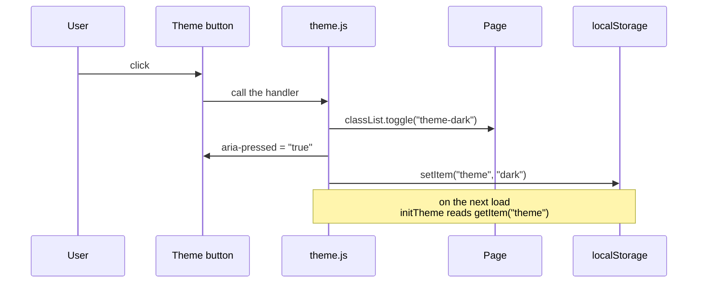
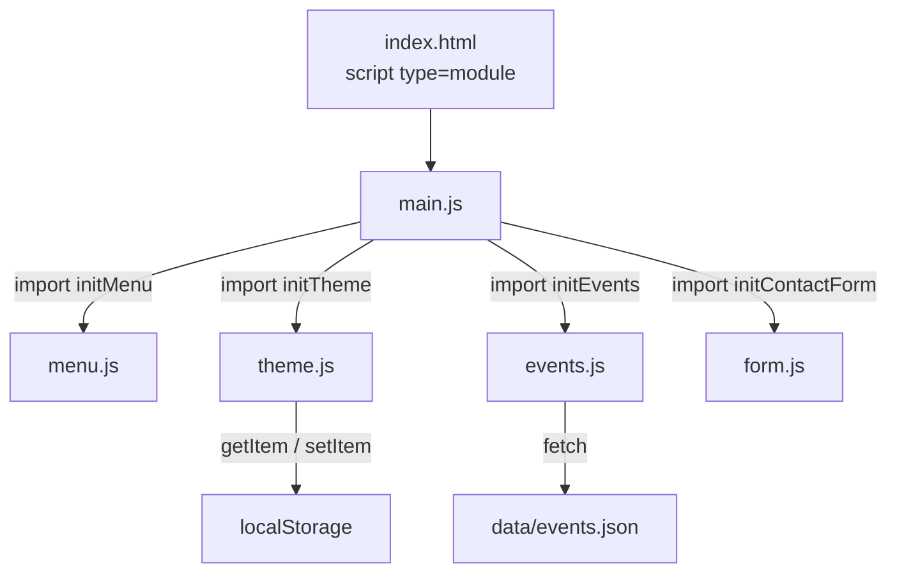
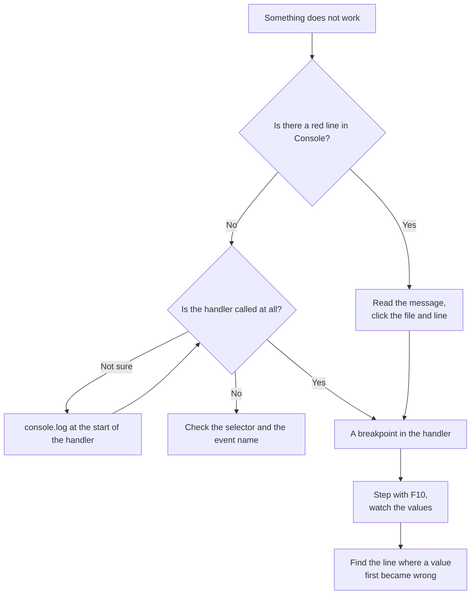

# Final project - an interactive website

[Contents](../../README.md) · [← Back](../../Lesson-9/en/Forms,%20storage%20and%20requests.md) · [Next course: jQuery →](https://github.com/JLearn-space/JLearn-docs/tree/main/jQuery) · [RU](../ru/%D0%98%D1%82%D0%BE%D0%B3%D0%BE%D0%B2%D1%8B%D0%B9%20%D0%BF%D1%80%D0%BE%D0%B5%D0%BA%D1%82%20-%20%D0%B8%D0%BD%D1%82%D0%B5%D1%80%D0%B0%D0%BA%D1%82%D0%B8%D0%B2%D0%BD%D1%8B%D0%B9%20%D1%81%D0%B0%D0%B9%D1%82.md) · [EN](Final%20project%20-%20an%20interactive%20website.md) · [UZ](../uz/Yakuniy%20loyiha%20-%20interaktiv%20sayt.md)

> **Link to all the courses:** in the HTML course you built a four-page website, in the CSS course you styled it. Now the website comes to life: a menu on phones, a dark theme that is remembered, a list of events from a data file with a filter, and a form with checks. At the end you will publish the update on GitHub Pages.

---

## Why you need this

You already know the individual techniques. A real project differs in that everything works **together**: dozens of handlers on several pages, shared data, bugs that only show up on a phone. Today we will learn to organise code so that it is easy to understand a month later, and to test the website the way a user will.

The result of the lesson is a portfolio website you are not ashamed to show.

---

## What you will learn

- Plan interactivity: what happens, when and with what state.
- Split code into modules: `type="module"`, `export`, `import`.
- Build the project: menu, theme, data with a filter, form.
- Make a website that works without JavaScript too.
- Debug code in DevTools: console, breakpoints, `debugger`.
- Read error messages in the console and understand where to look for the cause.

- Check the website before publishing and update GitHub Pages.

---

## Review: 3 questions from lessons 7–9

1. Why does a `render` function clear the container?
2. How do you make a handler work for elements created later?
3. Why is reading from `localStorage` wrapped in `try` / `catch`?

Answers are at the end of the lesson.

---

## Lesson plan

| Section | What we do |
| --- | --- |
| Project requirements | What must work |
| Interaction map | A plan before code |
| Modules | One file - one job |
| Building step by step | Menu, theme, data and filter, form |
| Works without JavaScript | Progressive enhancement |
| Debugging | Console, breakpoints |
| Acceptance | A checklist before publishing |
| Publishing | Updating GitHub Pages |
| Independent work | IDE task and your own website |

---

## Project requirements

The website from the HTML and CSS final project (a club, a library, a study group - your topic) gets four required features:

| # | Feature | Where | What it uses |
| --- | --- | --- | --- |
| 1 | **Mobile menu**: a button opens and closes the navigation, Escape closes it | All pages | Events, `classList`, `aria-expanded` (lessons 7–8) |
| 2 | **Theme**: a switch, and the choice is remembered | All pages | `localStorage`, CSS classes (lessons 8–9) |
| 3 | **Data with a filter**: a list of events or classes loads from `data/*.json`, buttons filter by category | The home page or a schedule page | `fetch`, arrays, `render`, delegation (lessons 6–9) |
| 4 | **Form with checks**: messages at the fields, a thank-you note without reloading | The contact page | `submit`, checks, accessible errors (lesson 9) |

Optional extras: an accordion with questions, a "Back to top" button, a character counter in the message, a form draft in `localStorage`.

---

## Interaction map

Before writing code, describe every interaction in a table. It is the same planning as the page map in the HTML course, only for behaviour:

| Element | Event | What changes | State for screen readers | Saved? |
| --- | --- | --- | --- | --- |
| `.menu-toggle` | `click` | `#site-nav` gets `is-open` | `aria-expanded` | No |
| `document` | `keydown` Escape | The menu closes, focus goes to the button | `aria-expanded="false"` | No |
| `.theme-toggle` | `click` | `body.theme-dark` | `aria-pressed` | Yes: `theme` |
| `.filters` | `click` on `[data-filter]` | The event list is re-rendered | `aria-pressed` on the buttons | No |
| `#contact-form` | `submit` | Errors at the fields or a thank-you note | `aria-invalid`, `role="status"` | No |

If you cannot fill in a row, the behaviour has not been thought through yet. The "State for screen readers" column reminds you about accessibility before writing code, not after.

### One interaction from start to finish

Every row of the table is the same chain from Lessons 7–9: **event → change the state → update the page → (save)**. Here is the theme row:



**How to read the diagram.** Time goes from top to bottom, the arrows show who passes what to whom. The handler changes the look **and** the attribute for screen readers **and** the storage. Forget one of the steps and you get a theme that is not remembered, or a button whose state a screen reader does not know.

---

## Modules

All code in one `main.js` quickly turns into a 500-line dump. **Modules** let you spread code over files: each file is responsible for one feature of the website.

```text
my-site/
├── index.html
├── about.html
├── schedule.html
├── contact.html
├── css/
│   └── style.css
├── data/
│   └── events.json
└── js/
    ├── main.js        ← entry point: connects the other modules
    ├── menu.js
    ├── theme.js
    ├── events.js
    └── form.js
```

### `export` and `import`

A module **exports** what other files need:

```js
// js/theme.js
const STORAGE_KEY = "theme";

export function initTheme() {
    const button = document.querySelector(".theme-toggle");
    if (!button) {
        return;
    }
    // ... code from lesson 9
}
```

The entry point **imports** and runs:

```js
// js/main.js
import { initMenu } from "./menu.js";
import { initTheme } from "./theme.js";
import { initEvents } from "./events.js";
import { initContactForm } from "./form.js";

initMenu();
initTheme();
initEvents();
initContactForm();
```

Connecting it in HTML - only `main.js`, with the attribute `type="module"`:

```html
<script type="module" src="js/main.js"></script>
```

| Module feature | What it means |
| --- | --- |
| Runs after the HTML is parsed | `defer` is not needed - it is already built in |
| Each file has its own variables | `STORAGE_KEY` from `theme.js` does not clash with one of the same name in another file |
| The `import` path has `./` and `.js` | `"./menu.js"`, not `"menu"` |
| Needs a server | Like `fetch`, modules do not work with `file://`: Live Server |

### `init...` functions and presence checks

One `main.js` is connected to **all** pages, but the form exists only on the contact page. So every `init...` function first looks for its elements and quietly leaves if they are not there:

```js
export function initContactForm() {
    const form = document.querySelector("#contact-form");
    if (!form) {
        return; // this page has no form
    }
    // ...
}
```

That way the console shows no `null` errors on the other pages.

### How the modules are connected



**How to read the diagram.** The HTML knows only about `main.js`. The browser loads the other files itself by following `import`. The arrows go one way: `menu.js` knows nothing about `theme.js`, so an error in one module is easy to find without touching the others.

| Module mistake | Message in Console | How to fix |
| --- | --- | --- |
| No `type="module"` | `Cannot use import statement outside a module` | `<script type="module" src="js/main.js">` |
| A path without `./` or without `.js` | `Failed to resolve module specifier` | `import { initMenu } from "./menu.js"` |
| Forgot `export` before the function | `does not provide an export named` | `export function initMenu() {...}` |
| A typo in the file name | `404` in the Network tab | Compare the file name and the path |
| The page is opened as `file://` | A CORS error | Live Server |

---

## Building step by step

Build one feature at a time and test each before moving on. A finished example of the whole project is in the [final-project](../../final-project/README.md) folder.

### Step 1. Mobile menu

```html
<header class="site-header">
    <a class="logo" href="index.html">Club</a>
    <button type="button" class="menu-toggle" aria-expanded="false" aria-controls="site-nav">Menu</button>
    <nav id="site-nav" class="site-nav" aria-label="Main navigation">
        <ul>...</ul>
    </nav>
</header>
```

```js
// js/menu.js
export function initMenu() {
    const toggle = document.querySelector(".menu-toggle");
    const nav = document.querySelector("#site-nav");
    if (!toggle || !nav) {
        return;
    }

    function setOpen(isOpen) {
        nav.classList.toggle("is-open", isOpen);
        toggle.setAttribute("aria-expanded", String(isOpen));
    }

    toggle.addEventListener("click", () => {
        setOpen(!nav.classList.contains("is-open"));
    });

    document.addEventListener("keydown", (event) => {
        if (event.key === "Escape" && nav.classList.contains("is-open")) {
            setOpen(false);
            toggle.focus(); // return focus to where the user opened the menu
        }
    });
}
```

```css
/* Mobile version: the menu is hidden until it has the is-open class.
   The rule only applies when JS works - see "Works without JavaScript". */
.js .site-nav {
    display: none;
}

.js .site-nav.is-open {
    display: block;
}

@media (min-width: 768px) {
    .menu-toggle {
        display: none;
    }

    .js .site-nav {
        display: block;
    }
}
```

`aria-controls` links the button to the menu, and returning focus after Escape keeps a keyboard user from "getting lost" on the page.

### Step 2. Theme

The code is from mini-task 2 of lesson 9, moved into `theme.js` with `export function initTheme()`. The colour variables for `.theme-dark` come from the CSS course.

### Step 3. Data and filter

```html
<div class="filters" role="group" aria-label="Filter by category">
    <button type="button" data-filter="all" aria-pressed="true">All</button>
    <button type="button" data-filter="html" aria-pressed="false">HTML</button>
    <button type="button" data-filter="css" aria-pressed="false">CSS</button>
    <button type="button" data-filter="js" aria-pressed="false">JavaScript</button>
</div>
<p id="events-status" role="status"></p>
<div id="events" class="events"></div>
```

```js
// js/events.js
let allEvents = [];

function renderEvents(list) {
    const container = document.querySelector("#events");
    const status = document.querySelector("#events-status");
    container.textContent = "";

    for (const item of list) {
        const card = document.createElement("article");
        card.classList.add("event");
        card.dataset.category = item.category;

        const title = document.createElement("h3");
        title.textContent = item.title;

        const date = document.createElement("p");
        date.classList.add("event__date");
        date.textContent = item.date;

        card.append(title, date);
        container.append(card);
    }

    status.textContent = list.length === 0 ? "No events in this category yet" : `Shown: ${list.length}`;
}

function applyFilter(category) {
    const list = category === "all"
        ? allEvents
        : allEvents.filter((item) => item.category === category);
    renderEvents(list);
}

export async function initEvents() {
    const container = document.querySelector("#events");
    const filters = document.querySelector(".filters");
    const status = document.querySelector("#events-status");
    if (!container || !filters) {
        return;
    }

    filters.addEventListener("click", (event) => {
        const button = event.target.closest("[data-filter]");
        if (!button) {
            return;
        }
        for (const other of filters.querySelectorAll("[data-filter]")) {
            other.setAttribute("aria-pressed", String(other === button));
        }
        applyFilter(button.dataset.filter);
    });

    status.textContent = "Loading...";
    try {
        const response = await fetch("data/events.json");
        if (!response.ok) {
            throw new Error(`Error ${response.status}`);
        }
        allEvents = await response.json();
        applyFilter("all");
    } catch (error) {
        status.textContent = "Could not load the events. Try refreshing the page.";
        console.error(error);
    }
}
```

Note the separation: the **data** (`allEvents`) is stored separately, the **filter** picks part of the data, and **render** only draws what it is given. The filter does not hide cards on the page - it re-renders the list, so the counter and the empty state are always correct.

### Step 4. Form

The check code from lesson 9 moves into `form.js`. After a successful submit, show a thank-you note in an element with `role="status"` instead of the form: `Thank you, Anna! We will reply to anna@example.com.` Remember: the form is a learning one and the message goes nowhere - say so next to the form.

---

## Works without JavaScript

JavaScript may fail to load: a slow network, a bug in the code, a blocker. The website must not "break" completely. The principle of **progressive enhancement**: the basic content is available without the script, and JavaScript makes it more convenient.

The technique: the script puts the class `js` on `<html>`, and rules that hide content only apply with that class.

```js
// the first line of js/main.js
document.documentElement.classList.add("js");
```

Without JavaScript `<html>` has no `js` class - the menu is simply open, all answers are visible, links work. Check it: DevTools → **Ctrl+Shift+P** → "Disable JavaScript" → reload the page.

---

## Debugging

| Tool | How to use it |
| --- | --- |
| **Console** | The first place for any problem: a red line points to the file and line |
| `console.log(value)` | See a value at the right moment; remove it after debugging |
| **Sources** → click a line number | A **breakpoint**: execution stops on this line, you can see the values of all variables and step through (F10) |
| `debugger;` in code | The same breakpoint, set from code (works when DevTools is open) |
| **Network** | Did `main.js`, the modules and `data/events.json` load, are there any 404s |
| **Application** → Local Storage | What is saved; you can delete it by hand |
| **Elements** | Do classes and `aria-*` change on clicks |

How to hunt a bug: read the message in Console → go to the line → set a breakpoint a little above → look at the variable values → find where a value first became different from what you expected.

### The order of looking for an error: a diagram



### How to read error messages

| Message | What it means in simple words | Where to look |
| --- | --- | --- |
| `Cannot read properties of null (reading 'addEventListener')` | `querySelector` found nothing | The selector and whether the element is on this page |
| `X is not defined` | The variable is not declared or has a typo | The variable name, `import` |
| `X is not a function` | You call something that is not a function | Brackets, the method name, `export` |
| `Assignment to constant variable` | You change a `const` | You need `let` - or a new variable |
| `Unexpected token` | Syntax: a bracket, a comma, a quote | The line in the message and the line above |
| `Failed to fetch` | The request did not get through | `file://`, the address, the network |
| `Unexpected token '<' ... is not valid JSON` | An HTML page came instead of JSON (often 404) | The path to `.json` in the Network tab |

---

## Acceptance

Check the website **on every page** and record the results in a test log (as in the HTML course):

- [ ] Console: not a single error on any page.
- [ ] Network: no 404s for `.js` and `.json`.
- [ ] Menu: opens and closes with the button, closes with Escape, focus returns to the button; on a wide screen there is no button and the menu is visible.
- [ ] Theme: toggles, is kept after a reload and when moving to another page.
- [ ] Filter: every button shows the right cards, the counter matches, an empty category shows a message.
- [ ] Load error: with a broken path to the JSON the user sees a clear text.
- [ ] Form: empty and invalid fields give messages at the fields, valid ones - a thank-you note without reloading.
- [ ] Keyboard: all actions are available with Tab, Enter, Space, Escape; focus is always visible.
- [ ] Without JavaScript: content and navigation are available.
- [ ] Width 375 px and 1440 px: everything works in DevTools device mode too.
- [ ] Code: no `var`, `==`, `innerHTML` with data, `onclick`, `element.style`.
- [ ] Lighthouse: no errors in the Accessibility and Best Practices sections.

---

## Publishing

The website is already published on GitHub Pages in the HTML course. To update it:

**Through the web interface:** in the repository → **Add file** → **Upload files** → drag the updated files and the `js/`, `data/` folders → **Commit changes**.

**With Git:**

```bash
git add .
```

```bash
git commit -m "Interactivity: menu, theme, events with a filter, form checks"
```

```bash
git push
```

After 1–2 minutes open the published website and go through the acceptance checklist **again** - this time on the published version. Common problems after publishing:

| Problem | Cause |
| --- | --- |
| 404 on `js/Menu.js` | GitHub Pages is case-sensitive: `Menu.js` and `menu.js` are different files |
| `fetch` cannot find the data | The path starts with `/`: on Pages the website lives in a repository subfolder. Use relative paths: `data/events.json` |
| An old version of the script | The browser cache: reload with **Ctrl+Shift+R** |

### Try to break it (before handing in)

A good project survives surprises. Check your site one step at a time:

1. Turn off JavaScript (DevTools → **Ctrl+Shift+P** → "Disable JavaScript"). Are the menu, text and links available?
2. Rename `data/events.json`. Does the page show a clear error message instead of emptiness?
3. Clear Local Storage and reload the page. Was the default theme applied without errors?
4. Send an empty form, then a form with spaces instead of a name. Are messages shown next to the fields?
5. Go through the site using only the keyboard: Tab, Enter, Escape. Can you open and close the menu and switch a filter?
6. Open the "About" page, which has no form and no event list. Is the Console clean?

### Typical beginner mistakes

| Mistake | What happens | How to fix |
| --- | --- | --- |
| An `init...` function does not check that the element exists | On pages without a form the Console shows `Cannot read properties of null (reading 'addEventListener')` | `if (!form) { return; }` at the start of the function |
| `.site-nav` is hidden in CSS without the `js` class | Without JavaScript the navigation cannot be opened | Hide it only under `.js .site-nav` |
| The `is-open` class changes, but `aria-expanded` does not | The screen reader always says the menu is collapsed | Change both in one `setOpen` function |
| Focus does not come back after Escape | A keyboard user gets "lost" on the page | `toggle.focus()` after closing the menu |
| `getItem("theme") === true` | After a reload the theme is always light | `localStorage` stores strings: `=== "dark"` |
| No `container.textContent = ""` in `renderEvents` | Each click on a filter adds cards to the old ones | Clear the container before rendering |
| `fetch` without `try / catch` | The Console shows `Uncaught (in promise) TypeError: Failed to fetch`, and the status says "Loading..." forever | `try / catch` and a clear message in `#events-status` |
| Leftover `console.log` and `debugger;` | The Console is cluttered, and with DevTools open the code stops | Remove them before handing in |

---

## Course summary: cheat sheet

| Topic | The main thing |
| --- | --- |
| Variables | `const` by default, `let` if it changes |
| Comparison | Only `===`, `!==` |
| Functions | Pure calculators with `return`; verb names |
| Data | Arrays of objects; `map`, `filter`, `find`, `reduce` |
| DOM | `querySelector`, `textContent`, `classList`, `createElement` + `append` |
| Events | `addEventListener`, delegation with `closest` |
| Forms | `submit` + `preventDefault`, errors at the fields, `aria-invalid` |
| Storage | `localStorage` + JSON in `try` / `catch` |
| Server | `async` / `await fetch`, `response.ok`, three states |
| Project | `init...` modules, progressive enhancement, acceptance by checklist |

---

## Independent work

### Part 1. IDE task (graded by the platform)

The club's event page is already laid out, and the platform sets an array `events` - objects `{ title, category, date }`. Build in one file:

1. **Menu.** A click on `.menu-toggle` toggles the class `is-open` on `#site-nav` and the button's `aria-expanded`. Escape closes the open menu and returns focus to the button.
2. **Theme.** On load the theme is taken from `localStorage` under the key `"theme"`: `"dark"` gives `body` the class `theme-dark` and `.theme-toggle` `aria-pressed="true"`. A click toggles the theme and saves `"dark"` or `"light"`.
3. **Events.** A function `renderEvents(list)` clears `#events` and creates for every event an `article.event` with `data-category`, an `h3` heading and a `p.event__date`. `#events-status` shows `Shown: N` or, if the list is empty, `No events in this category yet`. On load all events are shown.
4. **Filter.** One handler on `.filters`: a click on a button with `data-filter` shows the events of that category (`all` - all of them) and sets `aria-pressed="true"` only on the pressed button.

Handlers with `addEventListener`; do not use `innerHTML`, `onclick` or `element.style`.

What the platform checks: the menu, Escape and returning focus; the default theme, restoring from `localStorage` and saving; rendering the events and the counter; every filter button, `aria-pressed` and an empty category; working on a different data set.

### Part 2. Project on your computer

1. Fill in the interaction map for your website.
2. Split the code into modules as in the "Modules" section and connect `main.js` with `type="module"` to all pages.
3. Implement the four required features, testing each one separately.
4. Go through the acceptance checklist locally (with Live Server), fix what you find and record it in the log.
5. Publish the update on GitHub Pages and repeat the acceptance on the published version.
6. Add an "Interactivity" section to the repository's `README.md`: what the website can do and which technologies are used.

### Acceptance criteria

- [ ] The IDE task is accepted.
- [ ] All four required features work on the published website.
- [ ] The code is split into modules, each module has one job.
- [ ] The acceptance checklist is done on the local and the published versions, and the log is filled in.
- [ ] The website works from the keyboard and stays accessible without JavaScript.
- [ ] You can explain any line of your code.

---

## Self-check questions

1. Why make an interaction map before writing code?
2. How does a module differ from a regular script? Name three differences.
3. How do you export a function from `menu.js` and import it into `main.js`?
4. Why does every `init...` function first check that its elements exist?
5. Why return focus to the button after closing the menu with Escape?
6. Why does the filter re-render the list instead of hiding cards?
7. What is progressive enhancement, and how does the `js` class on `<html>` help?
8. How do you set a breakpoint, and what does it give you?
9. Why might the path `/data/events.json` not work on GitHub Pages?
10. What should you check on the published website even if everything worked locally?

After the questions, take the **lesson test** on the platform: 12 questions, pass mark 70%.

---

## What's next

Congratulations: you have finished the course! You have a published website that you built, styled and brought to life yourself. You can go further in several directions:

- **Deeper into JavaScript:** classes, npm modules, testing, TypeScript.
- **Frameworks:** React or Vue - the same data, `render` and events, just more convenient for large interfaces.
- **The server:** Node.js - JavaScript on the server, your own API for `fetch`.

Follow new courses at [jlearn.space](https://jlearn.space).

---

## Answers

**Review**

1. So that rendering again with new data does not double the elements.
2. Delegation: one handler on a common parent and `event.target.closest(...)`.
3. The data may be broken, and `JSON.parse` would throw an error that stops the script.

**Self-check questions**

1. To think through the events, the changes, the state for screen readers and saving before the code - and not forget accessibility.
2. It runs after the HTML is parsed, has its own variable scope, supports `import` / `export`; it needs a server.
3. `export function initMenu() { ... }` and `import { initMenu } from "./menu.js";`.
4. One `main.js` is connected to all pages, but the elements are not everywhere - without a check there will be `null` errors.
5. A keyboard user continues from where they were; otherwise focus "gets lost".
6. The data, the counter and the empty state always match what is visible.
7. The basic content is available without JS and the script improves it; rules that hide content apply only with the `js` class that the script adds.
8. Sources → click a line number, or `debugger;` in code. Execution stops, the variable values are visible, and you can step through.
9. On Pages the website lives in the subfolder `/repository-name/`, and a path from `/` leads to the domain root. A relative path is needed.
10. The whole checklist: file name case, `fetch` and module paths, the cache, how it works on a phone.

---

[Contents](../../README.md) · [← Back](../../Lesson-9/en/Forms,%20storage%20and%20requests.md) · [Next course: jQuery →](https://github.com/JLearn-space/JLearn-docs/tree/main/jQuery) · [RU](../ru/%D0%98%D1%82%D0%BE%D0%B3%D0%BE%D0%B2%D1%8B%D0%B9%20%D0%BF%D1%80%D0%BE%D0%B5%D0%BA%D1%82%20-%20%D0%B8%D0%BD%D1%82%D0%B5%D1%80%D0%B0%D0%BA%D1%82%D0%B8%D0%B2%D0%BD%D1%8B%D0%B9%20%D1%81%D0%B0%D0%B9%D1%82.md) · [EN](Final%20project%20-%20an%20interactive%20website.md) · [UZ](../uz/Yakuniy%20loyiha%20-%20interaktiv%20sayt.md)
