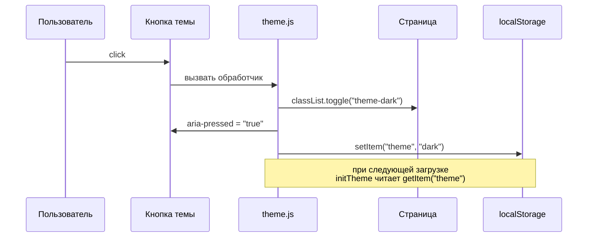
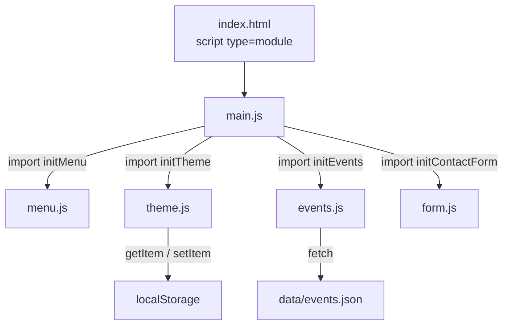
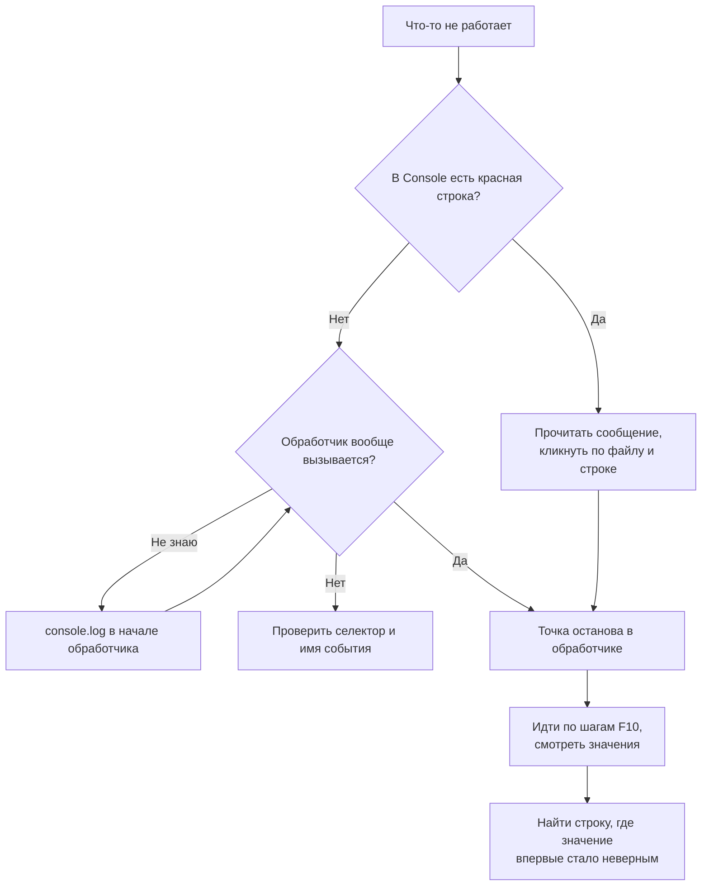

# Итоговый проект - интерактивный сайт

[Содержание](../../README.md) · [← Назад](../../Lesson-9/ru/Формы,%20хранение%20данных%20и%20запросы.md) · [Следующий курс: jQuery →](https://github.com/JLearn-space/JLearn-docs/tree/main/jQuery) · [RU](%D0%98%D1%82%D0%BE%D0%B3%D0%BE%D0%B2%D1%8B%D0%B9%20%D0%BF%D1%80%D0%BE%D0%B5%D0%BA%D1%82%20-%20%D0%B8%D0%BD%D1%82%D0%B5%D1%80%D0%B0%D0%BA%D1%82%D0%B8%D0%B2%D0%BD%D1%8B%D0%B9%20%D1%81%D0%B0%D0%B9%D1%82.md) · [EN](../en/Final%20project%20-%20an%20interactive%20website.md) · [UZ](../uz/Yakuniy%20loyiha%20-%20interaktiv%20sayt.md)

> **Связь со всеми курсами:** в курсе HTML вы построили сайт из четырёх страниц, в курсе CSS - оформили его. Теперь сайт оживёт: меню на телефоне, тёмная тема, которая запоминается, список событий из файла данных с фильтром и форма с проверкой. В конце вы опубликуете обновление на GitHub Pages.

---

## Зачем это вам

Отдельные приёмы вы уже знаете. Настоящий проект отличается тем, что всё работает **вместе**: десятки обработчиков на нескольких страницах, общие данные, ошибки, которые проявляются только на телефоне. Сегодня научимся организовывать код так, чтобы в нём было легко разобраться через месяц, и проверять сайт так, как его проверит пользователь.

Результат урока - сайт в портфолио, который не стыдно показать.

---

## Чему вы научитесь

- Планировать интерактивность: что происходит, когда и с каким состоянием.
- Делить код на модули: `type="module"`, `export`, `import`.
- Собирать проект: меню, тема, данные с фильтром, форма.
- Делать сайт, который работает и без JavaScript.
- Отлаживать код в DevTools: консоль, точки останова, `debugger`.
- Читать сообщения об ошибках в консоли и понимать, где искать причину.

- Проверять сайт перед публикацией и обновлять GitHub Pages.

---

## Повторение: 3 вопроса из уроков 7–9

1. Почему функция `render` очищает контейнер?
2. Как сделать, чтобы обработчик работал и для элементов, созданных позже?
3. Почему чтение из `localStorage` оборачивают в `try` / `catch`?

Ответы - в конце урока.

---

## План урока

| Раздел | Что делаем |
| --- | --- |
| Требования к проекту | Что должно работать |
| Карта взаимодействий | План до кода |
| Модули | Один файл - одна задача |
| Сборка по шагам | Меню, тема, данные и фильтр, форма |
| Работает без JavaScript | Прогрессивное улучшение |
| Отладка | Консоль, точки останова |
| Приёмка | Чек-лист перед публикацией |
| Публикация | Обновление GitHub Pages |
| Самостоятельная работа | Задание в IDE и свой сайт |

---

## Требования к проекту

Сайт из итогового проекта HTML и CSS (клуб, библиотека, кружок - ваша тема) получает четыре обязательные функции:

| # | Функция | Где | Что использует |
| --- | --- | --- | --- |
| 1 | **Мобильное меню**: кнопка открывает и закрывает навигацию, Escape закрывает | Все страницы | События, `classList`, `aria-expanded` (уроки 7–8) |
| 2 | **Тема оформления**: переключатель, выбор запоминается | Все страницы | `localStorage`, классы CSS (уроки 8–9) |
| 3 | **Данные с фильтром**: список событий или занятий загружается из `data/*.json`, кнопки фильтруют по категории | Главная или страница расписания | `fetch`, массивы, `render`, делегирование (уроки 6–9) |
| 4 | **Форма с проверкой**: сообщения у полей, благодарность без перезагрузки | Страница контактов | `submit`, проверка, доступность ошибок (урок 9) |

Дополнительно (по желанию): аккордеон с вопросами, кнопка «Наверх», счётчик символов в сообщении, черновик формы в `localStorage`.

---

## Карта взаимодействий

Прежде чем писать код, опишите каждое взаимодействие в таблице. Это то же планирование, что карта страниц в курсе HTML, только для поведения:

| Элемент | Событие | Что меняется | Состояние для читалки | Сохраняется? |
| --- | --- | --- | --- | --- |
| `.menu-toggle` | `click` | `#site-nav` получает `is-open` | `aria-expanded` | Нет |
| `document` | `keydown` Escape | Меню закрывается, фокус на кнопку | `aria-expanded="false"` | Нет |
| `.theme-toggle` | `click` | `body.theme-dark` | `aria-pressed` | Да: `theme` |
| `.filters` | `click` по `[data-filter]` | Список событий перерисован | `aria-pressed` у кнопок | Нет |
| `#contact-form` | `submit` | Ошибки у полей или благодарность | `aria-invalid`, `role="status"` | Нет |

Если строку таблицы не получается заполнить - значит, поведение ещё не продумано. Колонка «Состояние для читалки» напоминает о доступности до написания кода, а не после.

### Одно взаимодействие от начала до конца

Каждая строка таблицы - это одна и та же цепочка из уроков 7–9: **событие → изменить состояние → обновить страницу → (сохранить)**. Вот строка про тему:



**Как читать схему.** Время идёт сверху вниз, стрелки - кто кому что передаёт. Обработчик меняет **и** внешний вид, **и** атрибут для читалки, **и** хранилище. Если забыть один из шагов, получится тема, которая не запоминается, или кнопка, о состоянии которой не знает экранный диктор.

---

## Модули

Весь код в одном `main.js` быстро превращается в свалку на 500 строк. **Модули** позволяют разложить код по файлам: каждый файл отвечает за одну функцию сайта.

```text
my-site/
├── index.html
├── about.html
├── schedule.html
├── contact.html
├── css/
│   └── style.css
├── data/
│   └── events.json
└── js/
    ├── main.js        ← точка входа: подключает остальные модули
    ├── menu.js
    ├── theme.js
    ├── events.js
    └── form.js
```

### `export` и `import`

Модуль **экспортирует** то, что нужно другим файлам:

```js
// js/theme.js
const STORAGE_KEY = "theme";

export function initTheme() {
    const button = document.querySelector(".theme-toggle");
    if (!button) {
        return;
    }
    // ... код из урока 9
}
```

Точка входа **импортирует** и запускает:

```js
// js/main.js
import { initMenu } from "./menu.js";
import { initTheme } from "./theme.js";
import { initEvents } from "./events.js";
import { initContactForm } from "./form.js";

initMenu();
initTheme();
initEvents();
initContactForm();
```

Подключение в HTML - только `main.js`, с атрибутом `type="module"`:

```html
<script type="module" src="js/main.js"></script>
```

| Особенность модулей | Что это значит |
| --- | --- |
| Выполняются после разбора HTML | `defer` не нужен - он уже включён |
| Свои переменные у каждого файла | `STORAGE_KEY` из `theme.js` не конфликтует с одноимённой в другом файле |
| Путь в `import` - с `./` и `.js` | `"./menu.js"`, а не `"menu"` |
| Нужен сервер | Как и `fetch`, модули не работают с `file://`: Live Server |

### Функции `init...` и проверка наличия

Один `main.js` подключён ко **всем** страницам, но форма есть только на странице контактов. Поэтому каждая функция `init...` сначала ищет свои элементы и тихо выходит, если их нет:

```js
export function initContactForm() {
    const form = document.querySelector("#contact-form");
    if (!form) {
        return; // на этой странице формы нет
    }
    // ...
}
```

Так в консоли не будет ошибок `null` на остальных страницах.

### Как модули связаны между собой



**Как читать схему.** HTML знает только про `main.js`. Остальные файлы браузер загружает сам, следуя за `import`. Стрелки идут в одну сторону: `menu.js` ничего не знает про `theme.js`, поэтому ошибку в одном модуле легко найти, не трогая другие.

| Ошибка с модулями | Сообщение в Console | Как исправить |
| --- | --- | --- |
| Нет `type="module"` | `Cannot use import statement outside a module` | `<script type="module" src="js/main.js">` |
| Путь без `./` или без `.js` | `Failed to resolve module specifier` | `import { initMenu } from "./menu.js"` |
| Забыли `export` перед функцией | `does not provide an export named` | `export function initMenu() {...}` |
| Опечатка в имени файла | `404` во вкладке Network | Сверить имя файла и путь |
| Страница открыта как `file://` | Ошибка CORS | Live Server |

---

## Сборка по шагам

Собирайте по одной функции и проверяйте каждую, прежде чем переходить к следующей. Готовый пример всего проекта - в папке [final-project](../../final-project/README.md).

### Шаг 1. Мобильное меню

```html
<header class="site-header">
    <a class="logo" href="index.html">Кружок</a>
    <button type="button" class="menu-toggle" aria-expanded="false" aria-controls="site-nav">Меню</button>
    <nav id="site-nav" class="site-nav" aria-label="Основная навигация">
        <ul>...</ul>
    </nav>
</header>
```

```js
// js/menu.js
export function initMenu() {
    const toggle = document.querySelector(".menu-toggle");
    const nav = document.querySelector("#site-nav");
    if (!toggle || !nav) {
        return;
    }

    function setOpen(isOpen) {
        nav.classList.toggle("is-open", isOpen);
        toggle.setAttribute("aria-expanded", String(isOpen));
    }

    toggle.addEventListener("click", () => {
        setOpen(!nav.classList.contains("is-open"));
    });

    document.addEventListener("keydown", (event) => {
        if (event.key === "Escape" && nav.classList.contains("is-open")) {
            setOpen(false);
            toggle.focus(); // вернуть фокус туда, откуда пользователь открыл меню
        }
    });
}
```

```css
/* Мобильная версия: меню скрыто, пока нет класса is-open.
   Правило действует только при работающем JS - см. «Работает без JavaScript». */
.js .site-nav {
    display: none;
}

.js .site-nav.is-open {
    display: block;
}

@media (min-width: 768px) {
    .menu-toggle {
        display: none;
    }

    .js .site-nav {
        display: block;
    }
}
```

`aria-controls` связывает кнопку с меню, а возврат фокуса после Escape не даёт пользователю клавиатуры «потеряться» на странице.

### Шаг 2. Тема

Код - из мини-задания 2 урока 9, перенесённый в `theme.js` с `export function initTheme()`. Переменные цвета для `.theme-dark` - из курса CSS.

### Шаг 3. Данные и фильтр

```html
<div class="filters" role="group" aria-label="Фильтр по категории">
    <button type="button" data-filter="all" aria-pressed="true">Все</button>
    <button type="button" data-filter="html" aria-pressed="false">HTML</button>
    <button type="button" data-filter="css" aria-pressed="false">CSS</button>
    <button type="button" data-filter="js" aria-pressed="false">JavaScript</button>
</div>
<p id="events-status" role="status"></p>
<div id="events" class="events"></div>
```

```js
// js/events.js
let allEvents = [];

function renderEvents(list) {
    const container = document.querySelector("#events");
    const status = document.querySelector("#events-status");
    container.textContent = "";

    for (const item of list) {
        const card = document.createElement("article");
        card.classList.add("event");
        card.dataset.category = item.category;

        const title = document.createElement("h3");
        title.textContent = item.title;

        const date = document.createElement("p");
        date.classList.add("event__date");
        date.textContent = item.date;

        card.append(title, date);
        container.append(card);
    }

    status.textContent = list.length === 0 ? "В этой категории пока нет событий" : `Показано: ${list.length}`;
}

function applyFilter(category) {
    const list = category === "all"
        ? allEvents
        : allEvents.filter((item) => item.category === category);
    renderEvents(list);
}

export async function initEvents() {
    const container = document.querySelector("#events");
    const filters = document.querySelector(".filters");
    const status = document.querySelector("#events-status");
    if (!container || !filters) {
        return;
    }

    filters.addEventListener("click", (event) => {
        const button = event.target.closest("[data-filter]");
        if (!button) {
            return;
        }
        for (const other of filters.querySelectorAll("[data-filter]")) {
            other.setAttribute("aria-pressed", String(other === button));
        }
        applyFilter(button.dataset.filter);
    });

    status.textContent = "Загрузка...";
    try {
        const response = await fetch("data/events.json");
        if (!response.ok) {
            throw new Error(`Ошибка ${response.status}`);
        }
        allEvents = await response.json();
        applyFilter("all");
    } catch (error) {
        status.textContent = "Не удалось загрузить события. Попробуйте обновить страницу.";
        console.error(error);
    }
}
```

Обратите внимание на разделение: **данные** (`allEvents`) хранятся отдельно, **фильтр** выбирает часть данных, **render** только рисует то, что ему передали. Фильтр не прячет карточки на странице, а перерисовывает список - так счётчик и пустое состояние всегда верны.

### Шаг 4. Форма

Код проверки из урока 9 переносится в `form.js`. После успешной отправки вместо формы покажите благодарность в элементе с `role="status"`: `Спасибо, Анна! Мы ответим на anna@example.com.` Помните: форма учебная, сообщение никуда не отправляется - напишите это рядом с формой.

---

## Работает без JavaScript

JavaScript может не загрузиться: медленная сеть, ошибка в коде, блокировщик. Сайт не должен «ломаться» полностью. Принцип **прогрессивного улучшения**: базовое содержимое доступно и без скрипта, а JavaScript делает его удобнее.

Приём: скрипт ставит на `<html>` класс `js`, и правила, которые прячут содержимое, действуют только при этом классе.

```js
// первая строка js/main.js
document.documentElement.classList.add("js");
```

Без JavaScript у `<html>` нет класса `js` - меню просто открыто, все ответы видны, ссылки работают. Проверьте: DevTools → **Ctrl+Shift+P** → «Disable JavaScript» → обновите страницу.

---

## Отладка

| Инструмент | Как использовать |
| --- | --- |
| **Console** | Первое место при любой проблеме: красная строка указывает файл и строку |
| `console.log(значение)` | Посмотреть значение в нужный момент; удалите после отладки |
| **Sources** → клик по номеру строки | **Точка останова**: выполнение остановится на этой строке, можно посмотреть значения всех переменных и идти по шагам (F10) |
| `debugger;` в коде | Та же точка останова, поставленная из кода (срабатывает при открытых DevTools) |
| **Network** | Загрузился ли `main.js`, модули и `data/events.json`, нет ли 404 |
| **Application** → Local Storage | Что сохранено, можно удалить вручную |
| **Elements** | Меняются ли классы и `aria-*` при кликах |

Порядок поиска ошибки: прочитать сообщение в Console → перейти к строке → поставить точку останова чуть выше → посмотреть значения переменных → найти, где значение впервые стало не тем, что ожидалось.

### Порядок поиска ошибки: схема



### Как читать сообщения об ошибках

| Сообщение | Что значит простыми словами | Где искать |
| --- | --- | --- |
| `Cannot read properties of null (reading 'addEventListener')` | `querySelector` ничего не нашёл | Селектор и наличие элемента на этой странице |
| `X is not defined` | Переменная не объявлена или опечатка | Имя переменной, `import` |
| `X is not a function` | Вызываете то, что не функция | Скобки, имя метода, `export` |
| `Assignment to constant variable` | Меняете `const` | Нужен `let` - или новая переменная |
| `Unexpected token` | Синтаксис: скобка, запятая, кавычка | Строка из сообщения и строка выше |
| `Failed to fetch` | Запрос не дошёл | `file://`, адрес, сеть |
| `Unexpected token '<' ... is not valid JSON` | Вместо JSON пришла HTML-страница (часто 404) | Путь к `.json` во вкладке Network |

---

## Приёмка

Проверьте сайт **на каждой странице** и запишите результаты в журнал проверок (как в курсе HTML):

- [ ] Console: ни одной ошибки на всех страницах.
- [ ] Network: нет 404 для `.js` и `.json`.
- [ ] Меню: открывается и закрывается кнопкой, закрывается Escape, фокус возвращается на кнопку; на широком экране кнопки нет, меню видно.
- [ ] Тема: переключается, сохраняется после перезагрузки и перехода на другую страницу.
- [ ] Фильтр: каждая кнопка показывает верные карточки, счётчик совпадает, пустая категория показывает сообщение.
- [ ] Ошибка загрузки: при испорченном пути к JSON пользователь видит понятный текст.
- [ ] Форма: пустые и неверные поля дают сообщения у полей, верные - благодарность без перезагрузки.
- [ ] Клавиатура: все действия доступны по Tab, Enter, пробелу, Escape; фокус всегда виден.
- [ ] Без JavaScript: содержимое и навигация доступны.
- [ ] Ширина 375 px и 1440 px: всё работает и в режиме устройства DevTools.
- [ ] Код: нет `var`, `==`, `innerHTML` с данными, `onclick`, `element.style`.
- [ ] Lighthouse: нет ошибок в разделах Accessibility и Best Practices.

---

## Публикация

Сайт уже опубликован на GitHub Pages в курсе HTML. Обновление:

**Через веб-интерфейс:** в репозитории → **Add file** → **Upload files** → перетащите обновлённые файлы и папки `js/`, `data/` → **Commit changes**.

**Через Git:**

```bash
git add .
```

```bash
git commit -m "Интерактивность: меню, тема, события с фильтром, проверка формы"
```

```bash
git push
```

Через 1–2 минуты откройте опубликованный сайт и пройдите чек-лист приёмки **ещё раз** - уже на опубликованной версии. Частые проблемы после публикации:

| Проблема | Причина |
| --- | --- |
| 404 на `js/Menu.js` | GitHub Pages различает регистр: `Menu.js` и `menu.js` - разные файлы |
| `fetch` не находит данные | Путь начинается с `/`: на Pages сайт лежит в подпапке репозитория. Используйте относительные пути: `data/events.json` |
| Старая версия скрипта | Кэш браузера: обновите с **Ctrl+Shift+R** |

### Попробуйте сломать (перед сдачей)

Хороший проект переживает неожиданности. Проверьте свой сайт по очереди:

1. Отключите JavaScript (DevTools → **Ctrl+Shift+P** → «Disable JavaScript»). Доступны ли меню, текст и ссылки?
2. Переименуйте `data/events.json`. Показывает ли страница понятное сообщение об ошибке вместо пустоты?
3. Очистите Local Storage и обновите страницу. Применилась ли тема по умолчанию без ошибок?
4. Отправьте пустую форму, затем форму с пробелами вместо имени. Видны ли сообщения у полей?
5. Пройдите сайт только клавиатурой: Tab, Enter, Escape. Можно ли открыть и закрыть меню, переключить фильтр?
6. Откройте страницу «О нас», где нет формы и списка событий. Чиста ли Console?

### Частые ошибки новичков

| Ошибка | Что получится | Как исправить |
| --- | --- | --- |
| Функция `init...` без проверки, есть ли элемент | На страницах без формы в Console: `Cannot read properties of null (reading 'addEventListener')` | `if (!form) { return; }` в начале функции |
| `.site-nav` спрятано в CSS без класса `js` | Без JavaScript навигацию не открыть | Прятать только под `.js .site-nav` |
| Класс `is-open` меняется, а `aria-expanded` нет | Читалка всегда сообщает, что меню свёрнуто | Менять оба в одной функции `setOpen` |
| После Escape фокус не возвращается | Пользователь клавиатуры «теряется» на странице | `toggle.focus()` после закрытия меню |
| `getItem("theme") === true` | После перезагрузки тема всегда светлая | `localStorage` хранит строки: `=== "dark"` |
| Нет `container.textContent = ""` в `renderEvents` | При каждом клике по фильтру карточки добавляются к старым | Очищать контейнер перед отрисовкой |
| `fetch` без `try / catch` | В Console `Uncaught (in promise) TypeError: Failed to fetch`, статус навсегда «Загрузка...» | `try / catch` и понятный текст в `#events-status` |
| Забытые `console.log` и `debugger;` | Console засорена, при открытых DevTools код останавливается | Удалите перед сдачей |

---

## Итоги курса: шпаргалка

| Тема | Главное |
| --- | --- |
| Переменные | `const` по умолчанию, `let` - если меняется |
| Сравнение | Только `===`, `!==` |
| Функции | Чистые вычислители с `return`; имена-глаголы |
| Данные | Массивы объектов; `map`, `filter`, `find`, `reduce` |
| DOM | `querySelector`, `textContent`, `classList`, `createElement` + `append` |
| События | `addEventListener`, делегирование через `closest` |
| Формы | `submit` + `preventDefault`, ошибки у полей, `aria-invalid` |
| Хранение | `localStorage` + JSON в `try` / `catch` |
| Сервер | `async` / `await fetch`, `response.ok`, три состояния |
| Проект | Модули `init...`, прогрессивное улучшение, приёмка по чек-листу |

---

## Самостоятельная работа

### Часть 1. Задание в IDE (засчитывается платформой)

Страница афиши кружка уже свёрстана, платформа задаёт массив `events` - объекты `{ title, category, date }`. Соберите в одном файле:

1. **Меню.** Клик по `.menu-toggle` переключает у `#site-nav` класс `is-open` и `aria-expanded` кнопки. Escape закрывает открытое меню и возвращает фокус на кнопку.
2. **Тема.** При загрузке тема берётся из `localStorage` по ключу `"theme"`: `"dark"` - у `body` класс `theme-dark` и `aria-pressed="true"` у `.theme-toggle`. Клик переключает тему и сохраняет `"dark"` или `"light"`.
3. **События.** Функция `renderEvents(list)` очищает `#events` и для каждого события создаёт `article.event` с `data-category`, заголовком `h3` и `p.event__date`. В `#events-status` - `Показано: N` или, если список пуст, `В этой категории пока нет событий`. При загрузке показаны все события.
4. **Фильтр.** Один обработчик на `.filters`: клик по кнопке с `data-filter` показывает события этой категории (`all` - все) и ставит `aria-pressed="true"` только нажатой кнопке.

Обработчики - через `addEventListener`; `innerHTML`, `onclick` и `element.style` не используйте.

Что проверяет платформа: меню, Escape и возврат фокуса; тему по умолчанию, восстановление из `localStorage` и сохранение; отрисовку событий и счётчик; каждую кнопку фильтра, `aria-pressed` и пустую категорию; работу на другом наборе данных.

### Часть 2. Проект на компьютере

1. Заполните карту взаимодействий для своего сайта.
2. Разложите код по модулям, как в разделе «Модули», и подключите `main.js` с `type="module"` ко всем страницам.
3. Реализуйте четыре обязательные функции, проверяя каждую по отдельности.
4. Пройдите чек-лист приёмки локально (через Live Server), исправьте найденное и запишите в журнал.
5. Опубликуйте обновление на GitHub Pages и повторите приёмку на опубликованной версии.
6. Добавьте в `README.md` репозитория раздел «Интерактивность»: что умеет сайт и какие технологии использованы.

### Критерии готовности

- [ ] Задание в IDE засчитано.
- [ ] Все четыре обязательные функции работают на опубликованном сайте.
- [ ] Код разложен по модулям, у каждого модуля одна задача.
- [ ] Чек-лист приёмки пройден на локальной и опубликованной версиях, журнал заполнен.
- [ ] Сайт работает с клавиатуры и без JavaScript остаётся доступным.
- [ ] Вы можете объяснить любую строку своего кода.

---

## Вопросы для самопроверки

1. Зачем составлять карту взаимодействий до написания кода?
2. Чем модуль отличается от обычного скрипта? Назовите три отличия.
3. Как экспортировать функцию из `menu.js` и импортировать её в `main.js`?
4. Почему каждая функция `init...` сначала проверяет наличие своих элементов?
5. Зачем возвращать фокус на кнопку после закрытия меню по Escape?
6. Почему фильтр перерисовывает список, а не прячет карточки?
7. Что такое прогрессивное улучшение и как помогает класс `js` на `<html>`?
8. Как поставить точку останова и что она даёт?
9. Почему путь `/data/events.json` может не работать на GitHub Pages?
10. Что проверить на опубликованном сайте, даже если локально всё работало?

После вопросов пройдите **тест урока** на платформе: 12 вопросов, порог 70%.

---

## Что дальше

Поздравляем: курс пройден! У вас опубликованный сайт, который вы построили, оформили и оживили сами. Дальше можно идти в нескольких направлениях:

- **Глубже в JavaScript:** классы, модули npm, тестирование, TypeScript.
- **Фреймворки:** React или Vue - те же данные, `render` и события, только удобнее для больших интерфейсов.
- **Сервер:** Node.js - JavaScript на сервере, свой API для `fetch`.

Следите за новыми курсами на [jlearn.space](https://jlearn.space).

---

## Ответы

**Повторение**

1. Чтобы при повторной отрисовке с новыми данными элементы не задваивались.
2. Делегирование: один обработчик на общем родителе и `event.target.closest(...)`.
3. Данные могут быть испорчены, и `JSON.parse` выбросит ошибку, которая остановит скрипт.

**Вопросы для самопроверки**

1. Чтобы продумать события, изменения, состояние для читалок и хранение до кода - и не забыть доступность.
2. Выполняется после разбора HTML, имеет свою область переменных, поддерживает `import` / `export`; требует сервер.
3. `export function initMenu() { ... }` и `import { initMenu } from "./menu.js";`.
4. Один `main.js` подключён ко всем страницам, а элементы есть не везде - без проверки будут ошибки `null`.
5. Пользователь клавиатуры продолжает с того места, где был; иначе фокус «теряется».
6. Данные, счётчик и пустое состояние всегда соответствуют тому, что видно.
7. Базовое содержимое доступно без JS, а скрипт улучшает его; правила, скрывающие содержимое, действуют только при классе `js`, который ставит скрипт.
8. Sources → клик по номеру строки или `debugger;` в коде. Выполнение останавливается, видны значения переменных, можно идти по шагам.
9. На Pages сайт лежит в подпапке `/имя-репозитория/`, а путь от `/` ведёт в корень домена. Нужен относительный путь.
10. Весь чек-лист: регистр имён файлов, пути `fetch` и модулей, кэш, работу на телефоне.

---

[Содержание](../../README.md) · [← Назад](../../Lesson-9/ru/Формы,%20хранение%20данных%20и%20запросы.md) · [Следующий курс: jQuery →](https://github.com/JLearn-space/JLearn-docs/tree/main/jQuery) · [RU](%D0%98%D1%82%D0%BE%D0%B3%D0%BE%D0%B2%D1%8B%D0%B9%20%D0%BF%D1%80%D0%BE%D0%B5%D0%BA%D1%82%20-%20%D0%B8%D0%BD%D1%82%D0%B5%D1%80%D0%B0%D0%BA%D1%82%D0%B8%D0%B2%D0%BD%D1%8B%D0%B9%20%D1%81%D0%B0%D0%B9%D1%82.md) · [EN](../en/Final%20project%20-%20an%20interactive%20website.md) · [UZ](../uz/Yakuniy%20loyiha%20-%20interaktiv%20sayt.md)
