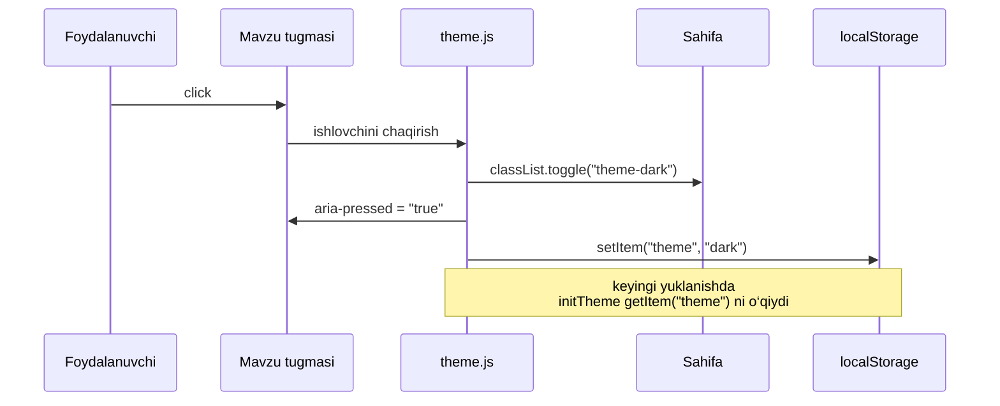
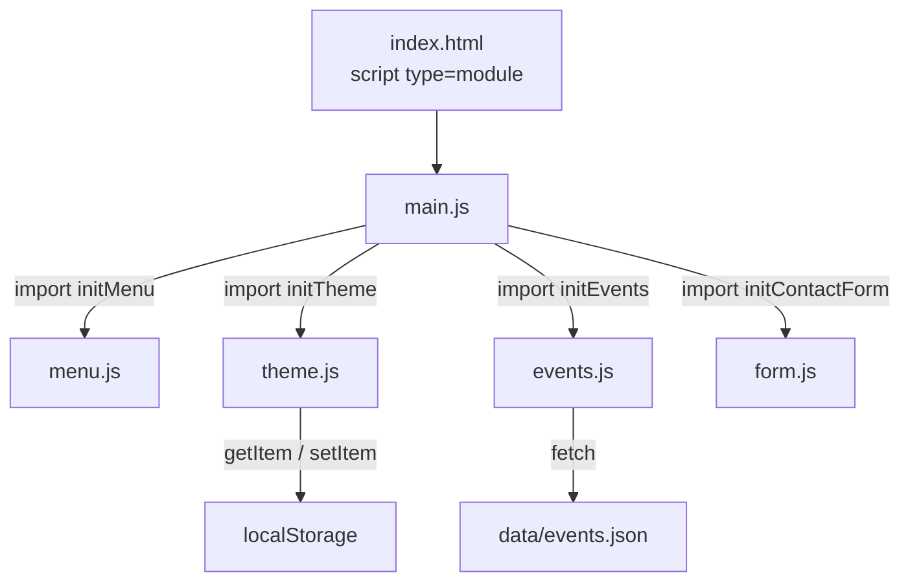
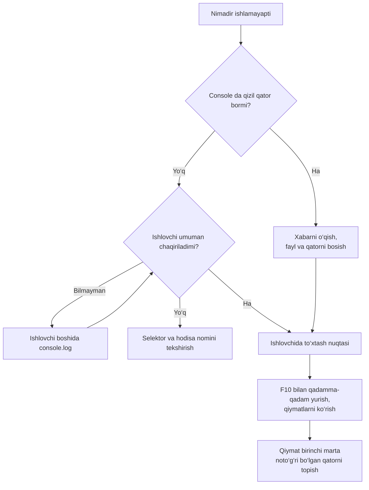

# Yakuniy loyiha - interaktiv sayt

[Mundarija](../../README.md) · [← Orqaga](../../Lesson-9/uz/Formalar,%20ma'lumotlarni%20saqlash%20va%20so'rovlar.md) · [Keyingi kurs: jQuery →](https://github.com/JLearn-space/JLearn-docs/tree/main/jQuery) · [RU](../ru/%D0%98%D1%82%D0%BE%D0%B3%D0%BE%D0%B2%D1%8B%D0%B9%20%D0%BF%D1%80%D0%BE%D0%B5%D0%BA%D1%82%20-%20%D0%B8%D0%BD%D1%82%D0%B5%D1%80%D0%B0%D0%BA%D1%82%D0%B8%D0%B2%D0%BD%D1%8B%D0%B9%20%D1%81%D0%B0%D0%B9%D1%82.md) · [EN](../en/Final%20project%20-%20an%20interactive%20website.md) · [UZ](Yakuniy%20loyiha%20-%20interaktiv%20sayt.md)

> **Barcha kurslar bilan bog‘liqlik:** HTML kursida to‘rt sahifali sayt qurdingiz, CSS kursida uni bezadingiz. Endi sayt jonlanadi: telefondagi menyu, eslab qolinadigan qorong‘i mavzu, ma’lumotlar faylidan filtr bilan yuklanadigan tadbirlar ro‘yxati va tekshiruvli forma. Oxirida yangilanishni GitHub Pages’da e’lon qilasiz.

---

## Bu sizga nima uchun kerak

Alohida usullarni allaqachon bilasiz. Haqiqiy loyiha shunisi bilan farq qiladiki, hammasi **birga** ishlaydi: bir nechta sahifadagi o‘nlab ishlov beruvchilar, umumiy ma’lumotlar, faqat telefonda ko‘rinadigan xatolar. Bugun kodni bir oydan keyin ham oson tushunadigan qilib tashkil etishni va saytni foydalanuvchi tekshiradigandek tekshirishni o‘rganamiz.

Dars natijasi - ko‘rsatishdan uyalmaydigan portfolio sayti.

---

## Nimani o‘rganasiz

- Interaktivlikni rejalashtirish: nima, qachon va qanday holat bilan sodir bo‘ladi.
- Kodni modullarga bo‘lish: `type="module"`, `export`, `import`.
- Loyihani yig‘ish: menyu, mavzu, filtrli ma’lumotlar, forma.
- JavaScript’siz ham ishlaydigan sayt yaratish.
- DevTools’da kodni tuzatish: konsol, to‘xtash nuqtalari, `debugger`.
- Konsoldagi xato xabarlarini o‘qish va sababni qayerdan qidirishni tushunish.

- E’lon qilishdan oldin saytni tekshirish va GitHub Pages’ni yangilash.

---

## Takrorlash: 7–9-darslardan 3 savol

1. Nima uchun `render` funksiyasi konteynerni tozalaydi?
2. Keyin yaratilgan elementlar uchun ham ishlov beruvchi ishlashi uchun nima qilish kerak?
3. Nima uchun `localStorage` dan o‘qish `try` / `catch` ga o‘raladi?

Javoblar - dars oxirida.

---

## Reja

| Bo‘lim | Nima qilamiz |
| --- | --- |
| Loyiha talablari | Nima ishlashi kerak |
| O‘zaro ta’sirlar xaritasi | Koddan oldin reja |
| Modullar | Bitta fayl - bitta vazifa |
| Bosqichma-bosqich yig‘ish | Menyu, mavzu, ma’lumot va filtr, forma |
| JavaScript’siz ishlaydi | Progressiv yaxshilash |
| Nosozliklarni tuzatish | Konsol, to‘xtash nuqtalari |
| Qabul qilish | E’lon qilishdan oldingi chek-list |
| E’lon qilish | GitHub Pages’ni yangilash |
| Mustaqil ish | IDE topshirig‘i va o‘z saytingiz |

---

## Loyiha talablari

HTML va CSS yakuniy loyihasidagi sayt (to‘garak, kutubxona, klub - mavzu sizniki) to‘rtta majburiy funksiya oladi:

| # | Funksiya | Qayerda | Nimadan foydalanadi |
| --- | --- | --- | --- |
| 1 | **Mobil menyu**: tugma navigatsiyani ochadi va yopadi, Escape yopadi | Barcha sahifalar | Hodisalar, `classList`, `aria-expanded` (7–8-darslar) |
| 2 | **Mavzu**: almashtirgich, tanlov eslab qolinadi | Barcha sahifalar | `localStorage`, CSS klasslari (8–9-darslar) |
| 3 | **Filtrli ma’lumotlar**: tadbirlar yoki mashg‘ulotlar ro‘yxati `data/*.json` dan yuklanadi, tugmalar toifa bo‘yicha saralaydi | Bosh sahifa yoki jadval sahifasi | `fetch`, massivlar, `render`, delegatsiya (6–9-darslar) |
| 4 | **Tekshiruvli forma**: maydonlar yonidagi xabarlar, qayta yuklashsiz minnatdorchilik | Aloqa sahifasi | `submit`, tekshiruv, qulay xatolar (9-dars) |

Qo‘shimcha (xohishga ko‘ra): savollar akkordeoni, «Yuqoriga» tugmasi, xabardagi belgilar hisoblagichi, `localStorage` dagi forma qoralamasi.

---

## O‘zaro ta’sirlar xaritasi

Kod yozishdan oldin har bir o‘zaro ta’sirni jadvalda tasvirlang. Bu HTML kursidagi sahifalar xaritasi kabi rejalashtirish, faqat xatti-harakat uchun:

| Element | Hodisa | Nima o‘zgaradi | O‘qish dasturi uchun holat | Saqlanadimi? |
| --- | --- | --- | --- | --- |
| `.menu-toggle` | `click` | `#site-nav` `is-open` oladi | `aria-expanded` | Yo‘q |
| `document` | `keydown` Escape | Menyu yopiladi, fokus tugmaga | `aria-expanded="false"` | Yo‘q |
| `.theme-toggle` | `click` | `body.theme-dark` | `aria-pressed` | Ha: `theme` |
| `.filters` | `[data-filter]` ga `click` | Tadbirlar ro‘yxati qayta chiziladi | Tugmalarda `aria-pressed` | Yo‘q |
| `#contact-form` | `submit` | Maydonlardagi xatolar yoki minnatdorchilik | `aria-invalid`, `role="status"` | Yo‘q |

Jadval qatorini to‘ldirib bo‘lmasa - demak, xatti-harakat hali o‘ylab chiqilmagan. «O‘qish dasturi uchun holat» ustuni qulaylikni koddan keyin emas, oldin eslatadi.

### Bitta o‘zaro ta’sir boshidan oxirigacha

Jadvalning har bir qatori - 7–9-darslardagi o‘sha zanjir: **hodisa → holatni o‘zgartirish → sahifani yangilash → (saqlash)**. Mana mavzu haqidagi qator:



**Sxemani qanday o‘qish kerak.** Vaqt yuqoridan pastga boradi, strelkalar - kim kimga nima uzatadi. Ishlovchi tashqi ko‘rinishni **ham**, ekran o‘qiydigan dastur uchun atributni **ham**, xotirani **ham** o‘zgartiradi. Qadamlardan birini unutsangiz, eslab qolinmaydigan mavzu yoki holatini ekran o‘qiydigan dastur bilmaydigan tugma hosil bo‘ladi.

---

## Modullar

Bitta `main.js` dagi barcha kod tezda 500 qatorlik chiqindixonaga aylanadi. **Modullar** kodni fayllarga taqsimlash imkonini beradi: har bir fayl saytning bitta funksiyasi uchun javob beradi.

```text
my-site/
├── index.html
├── about.html
├── schedule.html
├── contact.html
├── css/
│   └── style.css
├── data/
│   └── events.json
└── js/
    ├── main.js        ← kirish nuqtasi: qolgan modullarni ulaydi
    ├── menu.js
    ├── theme.js
    ├── events.js
    └── form.js
```

### `export` va `import`

Modul boshqa fayllarga kerak bo‘lgan narsani **eksport qiladi**:

```js
// js/theme.js
const STORAGE_KEY = "theme";

export function initTheme() {
    const button = document.querySelector(".theme-toggle");
    if (!button) {
        return;
    }
    // ... 9-darsdagi kod
}
```

Kirish nuqtasi **import qiladi** va ishga tushiradi:

```js
// js/main.js
import { initMenu } from "./menu.js";
import { initTheme } from "./theme.js";
import { initEvents } from "./events.js";
import { initContactForm } from "./form.js";

initMenu();
initTheme();
initEvents();
initContactForm();
```

HTML da ulash - faqat `main.js`, `type="module"` atributi bilan:

```html
<script type="module" src="js/main.js"></script>
```

| Modullar xususiyati | Bu nimani anglatadi |
| --- | --- |
| HTML tahlil qilingach bajariladi | `defer` kerak emas - u allaqachon yoqilgan |
| Har bir faylning o‘z o‘zgaruvchilari | `theme.js` dagi `STORAGE_KEY` boshqa fayldagi shu nomli o‘zgaruvchi bilan to‘qnashmaydi |
| `import` dagi yo‘l - `./` va `.js` bilan | `"menu"` emas, `"./menu.js"` |
| Server kerak | `fetch` kabi, modullar `file://` bilan ishlamaydi: Live Server |

### `init...` funksiyalari va mavjudlikni tekshirish

Bitta `main.js` **barcha** sahifalarga ulangan, forma esa faqat aloqa sahifasida. Shuning uchun har bir `init...` funksiyasi avval o‘z elementlarini qidiradi va ular bo‘lmasa jimgina chiqadi:

```js
export function initContactForm() {
    const form = document.querySelector("#contact-form");
    if (!form) {
        return; // bu sahifada forma yo‘q
    }
    // ...
}
```

Shunda qolgan sahifalarda konsolda `null` xatolari bo‘lmaydi.

### Modullar o‘zaro qanday bog‘langan



**Sxemani qanday o‘qish kerak.** HTML faqat `main.js` haqida biladi. Qolgan fayllarni brauzer `import` ga ergashib o‘zi yuklaydi. Strelkalar bir tomonga boradi: `menu.js` `theme.js` haqida hech narsa bilmaydi, shuning uchun bitta moduldagi xatoni boshqalariga tegmasdan oson topish mumkin.

| Modullar bilan xato | Console dagi xabar | Qanday tuzatish |
| --- | --- | --- |
| `type="module"` yo‘q | `Cannot use import statement outside a module` | `<script type="module" src="js/main.js">` |
| Yo‘l `./` siz yoki `.js` siz | `Failed to resolve module specifier` | `import { initMenu } from "./menu.js"` |
| Funksiya oldida `export` unutilgan | `does not provide an export named` | `export function initMenu() {...}` |
| Fayl nomida xato | Network yorlig‘ida `404` | Fayl nomi va yo‘lni solishtirish |
| Sahifa `file://` sifatida ochilgan | CORS xatosi | Live Server |

---

## Bosqichma-bosqich yig‘ish

Bitta funksiyani yig‘ib, keyingisiga o‘tishdan oldin uni tekshiring. Butun loyihaning tayyor namunasi - [final-project](../../final-project/README.md) papkasida.

### 1-qadam. Mobil menyu

```html
<header class="site-header">
    <a class="logo" href="index.html">To‘garak</a>
    <button type="button" class="menu-toggle" aria-expanded="false" aria-controls="site-nav">Menyu</button>
    <nav id="site-nav" class="site-nav" aria-label="Asosiy navigatsiya">
        <ul>...</ul>
    </nav>
</header>
```

```js
// js/menu.js
export function initMenu() {
    const toggle = document.querySelector(".menu-toggle");
    const nav = document.querySelector("#site-nav");
    if (!toggle || !nav) {
        return;
    }

    function setOpen(isOpen) {
        nav.classList.toggle("is-open", isOpen);
        toggle.setAttribute("aria-expanded", String(isOpen));
    }

    toggle.addEventListener("click", () => {
        setOpen(!nav.classList.contains("is-open"));
    });

    document.addEventListener("keydown", (event) => {
        if (event.key === "Escape" && nav.classList.contains("is-open")) {
            setOpen(false);
            toggle.focus(); // fokusni foydalanuvchi menyuni ochgan joyga qaytarish
        }
    });
}
```

```css
/* Mobil versiya: is-open klassi bo‘lmaguncha menyu yashirin.
   Qoida faqat JS ishlaganda amal qiladi - «JavaScript’siz ishlaydi» ga qarang. */
.js .site-nav {
    display: none;
}

.js .site-nav.is-open {
    display: block;
}

@media (min-width: 768px) {
    .menu-toggle {
        display: none;
    }

    .js .site-nav {
        display: block;
    }
}
```

`aria-controls` tugmani menyu bilan bog‘laydi, Escape dan keyin fokusni qaytarish esa klaviatura foydalanuvchisiga sahifada «adashib qolmaslikka» yordam beradi.

### 2-qadam. Mavzu

Kod - 9-darsning 2-mini-topshirig‘idan, `export function initTheme()` bilan `theme.js` ga ko‘chirilgan. `.theme-dark` uchun rang o‘zgaruvchilari - CSS kursidan.

### 3-qadam. Ma’lumotlar va filtr

```html
<div class="filters" role="group" aria-label="Toifa bo‘yicha filtr">
    <button type="button" data-filter="all" aria-pressed="true">Hammasi</button>
    <button type="button" data-filter="html" aria-pressed="false">HTML</button>
    <button type="button" data-filter="css" aria-pressed="false">CSS</button>
    <button type="button" data-filter="js" aria-pressed="false">JavaScript</button>
</div>
<p id="events-status" role="status"></p>
<div id="events" class="events"></div>
```

```js
// js/events.js
let allEvents = [];

function renderEvents(list) {
    const container = document.querySelector("#events");
    const status = document.querySelector("#events-status");
    container.textContent = "";

    for (const item of list) {
        const card = document.createElement("article");
        card.classList.add("event");
        card.dataset.category = item.category;

        const title = document.createElement("h3");
        title.textContent = item.title;

        const date = document.createElement("p");
        date.classList.add("event__date");
        date.textContent = item.date;

        card.append(title, date);
        container.append(card);
    }

    status.textContent = list.length === 0 ? "Bu toifada hozircha tadbirlar yo‘q" : `Ko‘rsatilgan: ${list.length}`;
}

function applyFilter(category) {
    const list = category === "all"
        ? allEvents
        : allEvents.filter((item) => item.category === category);
    renderEvents(list);
}

export async function initEvents() {
    const container = document.querySelector("#events");
    const filters = document.querySelector(".filters");
    const status = document.querySelector("#events-status");
    if (!container || !filters) {
        return;
    }

    filters.addEventListener("click", (event) => {
        const button = event.target.closest("[data-filter]");
        if (!button) {
            return;
        }
        for (const other of filters.querySelectorAll("[data-filter]")) {
            other.setAttribute("aria-pressed", String(other === button));
        }
        applyFilter(button.dataset.filter);
    });

    status.textContent = "Yuklanmoqda...";
    try {
        const response = await fetch("data/events.json");
        if (!response.ok) {
            throw new Error(`Xato ${response.status}`);
        }
        allEvents = await response.json();
        applyFilter("all");
    } catch (error) {
        status.textContent = "Tadbirlarni yuklab bo‘lmadi. Sahifani yangilab ko‘ring.";
        console.error(error);
    }
}
```

Ajratishga e’tibor bering: **ma’lumotlar** (`allEvents`) alohida saqlanadi, **filtr** ma’lumotlarning bir qismini tanlaydi, **render** esa faqat unga berilganini chizadi. Filtr sahifadagi kartochkalarni yashirmaydi, ro‘yxatni qayta chizadi - shunda hisoblagich va bo‘sh holat doim to‘g‘ri bo‘ladi.

### 4-qadam. Forma

9-darsdagi tekshiruv kodi `form.js` ga ko‘chiriladi. Muvaffaqiyatli yuborilgandan keyin forma o‘rniga `role="status"` li elementda minnatdorchilik ko‘rsating: `Rahmat, Anna! anna@example.com ga javob beramiz.` Esda tuting: forma o‘quv formasi, xabar hech qayerga yuborilmaydi - buni forma yonida yozing.

---

## JavaScript’siz ishlaydi

JavaScript yuklanmasligi mumkin: sekin tarmoq, koddagi xato, bloklovchi. Sayt butunlay «buzilmasligi» kerak. **Progressiv yaxshilash** tamoyili: asosiy tarkib skriptsiz ham mavjud, JavaScript esa uni qulayroq qiladi.

Usul: skript `<html>` ga `js` klassini qo‘yadi, tarkibni yashiradigan qoidalar esa faqat shu klass bilan amal qiladi.

```js
// js/main.js ning birinchi qatori
document.documentElement.classList.add("js");
```

JavaScript’siz `<html>` da `js` klassi yo‘q - menyu shunchaki ochiq, barcha javoblar ko‘rinadi, havolalar ishlaydi. Tekshiring: DevTools → **Ctrl+Shift+P** → «Disable JavaScript» → sahifani yangilang.

---

## Nosozliklarni tuzatish

| Vosita | Qanday foydalaniladi |
| --- | --- |
| **Console** | Har qanday muammoda birinchi joy: qizil qator fayl va qatorni ko‘rsatadi |
| `console.log(qiymat)` | Kerakli paytda qiymatni ko‘rish; tuzatgandan keyin o‘chiring |
| **Sources** → qator raqamiga bosish | **To‘xtash nuqtasi**: bajarilish shu qatorda to‘xtaydi, barcha o‘zgaruvchilar qiymatini ko‘rish va qadamma-qadam yurish mumkin (F10) |
| Koddagi `debugger;` | Xuddi shu to‘xtash nuqtasi, koddan qo‘yilgan (DevTools ochiq bo‘lganda ishlaydi) |
| **Network** | `main.js`, modullar va `data/events.json` yuklandimi, 404 yo‘qmi |
| **Application** → Local Storage | Nima saqlangan, qo‘lda o‘chirish mumkin |
| **Elements** | Bosishlarda klasslar va `aria-*` o‘zgaradimi |

Xatoni qidirish tartibi: Console dagi xabarni o‘qish → qatorga o‘tish → biroz yuqoriroqqa to‘xtash nuqtasi qo‘yish → o‘zgaruvchilar qiymatini ko‘rish → qiymat birinchi marta kutilgandan boshqacha bo‘lgan joyni topish.

### Xatoni qidirish tartibi: sxema



### Xato xabarlarini qanday o‘qish kerak

| Xabar | Oddiy so‘z bilan ma’nosi | Qayerdan qidirish |
| --- | --- | --- |
| `Cannot read properties of null (reading 'addEventListener')` | `querySelector` hech narsa topmadi | Selektor va element shu sahifada borligi |
| `X is not defined` | O‘zgaruvchi e’lon qilinmagan yoki xato yozilgan | O‘zgaruvchi nomi, `import` |
| `X is not a function` | Funksiya bo‘lmagan narsani chaqiryapsiz | Qavslar, metod nomi, `export` |
| `Assignment to constant variable` | `const` ni o‘zgartiryapsiz | `let` kerak - yoki yangi o‘zgaruvchi |
| `Unexpected token` | Sintaksis: qavs, vergul, qo‘shtirnoq | Xabardagi qator va undan yuqoridagi qator |
| `Failed to fetch` | So‘rov yetib bormadi | `file://`, manzil, tarmoq |
| `Unexpected token '<' ... is not valid JSON` | JSON o‘rniga HTML sahifa keldi (ko‘pincha 404) | Network yorlig‘ida `.json` ga yo‘l |

---

## Qabul qilish

Saytni **har bir sahifada** tekshiring va natijalarni tekshiruvlar jurnaliga yozing (HTML kursidagi kabi):

- [ ] Console: barcha sahifalarda bitta ham xato yo‘q.
- [ ] Network: `.js` va `.json` uchun 404 yo‘q.
- [ ] Menyu: tugma bilan ochiladi va yopiladi, Escape bilan yopiladi, fokus tugmaga qaytadi; keng ekranda tugma yo‘q, menyu ko‘rinadi.
- [ ] Mavzu: almashadi, qayta yuklagandan va boshqa sahifaga o‘tgandan keyin saqlanadi.
- [ ] Filtr: har bir tugma to‘g‘ri kartochkalarni ko‘rsatadi, hisoblagich mos keladi, bo‘sh toifa xabar ko‘rsatadi.
- [ ] Yuklash xatosi: JSON yo‘li buzilganda foydalanuvchi tushunarli matnni ko‘radi.
- [ ] Forma: bo‘sh va noto‘g‘ri maydonlar maydonlar yonida xabar beradi, to‘g‘rilari - qayta yuklashsiz minnatdorchilik.
- [ ] Klaviatura: barcha amallar Tab, Enter, bo‘sh joy, Escape orqali mavjud; fokus doim ko‘rinadi.
- [ ] JavaScript’siz: tarkib va navigatsiya mavjud.
- [ ] 375 px va 1440 px kenglik: DevTools qurilma rejimida ham hammasi ishlaydi.
- [ ] Kod: `var`, `==`, ma’lumotli `innerHTML`, `onclick`, `element.style` yo‘q.
- [ ] Lighthouse: Accessibility va Best Practices bo‘limlarida xatolar yo‘q.

---

## E’lon qilish

Sayt HTML kursida GitHub Pages’da allaqachon e’lon qilingan. Yangilash:

**Veb-interfeys orqali:** repozitoriyda → **Add file** → **Upload files** → yangilangan fayllar va `js/`, `data/` papkalarini sudrab tashlang → **Commit changes**.

**Git orqali:**

```bash
git add .
```

```bash
git commit -m "Interaktivlik: menyu, mavzu, filtrli tadbirlar, forma tekshiruvi"
```

```bash
git push
```

1–2 daqiqadan keyin e’lon qilingan saytni oching va qabul chek-listidan **yana bir bor** o‘ting - endi e’lon qilingan versiyada. E’lon qilingandan keyingi tipik muammolar:

| Muammo | Sababi |
| --- | --- |
| `js/Menu.js` da 404 | GitHub Pages registrni farqlaydi: `Menu.js` va `menu.js` - turli fayllar |
| `fetch` ma’lumotlarni topmaydi | Yo‘l `/` bilan boshlanadi: Pages’da sayt repozitoriyning ichki papkasida turadi. Nisbiy yo‘llardan foydalaning: `data/events.json` |
| Skriptning eski versiyasi | Brauzer keshi: **Ctrl+Shift+R** bilan yangilang |

### Buzib ko‘ring (topshirishdan oldin)

Yaxshi loyiha kutilmagan holatlarga bardosh beradi. Saytingizni navbat bilan tekshiring:

1. JavaScript ni o‘chiring (DevTools → **Ctrl+Shift+P** → «Disable JavaScript»). Menyu, matn va havolalar mavjudmi?
2. `data/events.json` nomini o‘zgartiring. Sahifa bo‘shliq o‘rniga tushunarli xato xabarini ko‘rsatadimi?
3. Local Storage ni tozalang va sahifani yangilang. Standart mavzu xatolarsiz qo‘llandimi?
4. Bo‘sh formani, keyin ism o‘rniga bo‘shliqli formani yuboring. Maydonlar yonida xabarlar ko‘rinadimi?
5. Saytni faqat klaviatura bilan aylanib chiqing: Tab, Enter, Escape. Menyuni ochib-yopish, filtrni almashtirish mumkinmi?
6. Forma va tadbirlar ro‘yxati bo‘lmagan «Biz haqimizda» sahifasini oching. Console tozami?

### Yangi o‘rganuvchilarning tipik xatolari

| Xato | Nima bo‘ladi | Qanday tuzatish |
| --- | --- | --- |
| `init...` funksiyasi element bor-yo‘qligini tekshirmaydi | Formasiz sahifalarda Console da: `Cannot read properties of null (reading 'addEventListener')` | Funksiya boshida `if (!form) { return; }` |
| `.site-nav` CSS da `js` klassisiz yashirilgan | JavaScript’siz navigatsiyani ochib bo‘lmaydi | Faqat `.js .site-nav` ostida yashiring |
| `is-open` klassi o‘zgaradi, `aria-expanded` esa yo‘q | O‘qish dasturi doim menyu yopiq deb aytadi | Ikkalasini bitta `setOpen` funksiyasida o‘zgartiring |
| Escape dan keyin fokus qaytmaydi | Klaviatura foydalanuvchisi sahifada «adashib qoladi» | Menyu yopilgandan keyin `toggle.focus()` |
| `getItem("theme") === true` | Qayta yuklangandan keyin mavzu doim och rangda | `localStorage` satrlarni saqlaydi: `=== "dark"` |
| `renderEvents` da `container.textContent = ""` yo‘q | Filtrning har bir bosilishida kartochkalar eskilariga qo‘shiladi | Chizishdan oldin konteynerni tozalang |
| `try / catch` siz `fetch` | Console da `Uncaught (in promise) TypeError: Failed to fetch`, holat abadiy «Yuklanmoqda...» | `try / catch` va `#events-status` da tushunarli matn |
| Unutilgan `console.log` va `debugger;` | Console axlatga to‘ladi, DevTools ochiq bo‘lsa kod to‘xtaydi | Topshirishdan oldin o‘chiring |

---

## Kurs yakuni: shpargalka

| Mavzu | Asosiysi |
| --- | --- |
| O‘zgaruvchilar | Odatda `const`, o‘zgarsa - `let` |
| Solishtirish | Faqat `===`, `!==` |
| Funksiyalar | `return` li sof hisoblovchilar; fe’l-nomlar |
| Ma’lumotlar | Obyektlar massivlari; `map`, `filter`, `find`, `reduce` |
| DOM | `querySelector`, `textContent`, `classList`, `createElement` + `append` |
| Hodisalar | `addEventListener`, `closest` orqali delegatsiya |
| Formalar | `submit` + `preventDefault`, maydonlar yonidagi xatolar, `aria-invalid` |
| Saqlash | `localStorage` + `try` / `catch` ichida JSON |
| Server | `async` / `await fetch`, `response.ok`, uch holat |
| Loyiha | `init...` modullari, progressiv yaxshilash, chek-list bo‘yicha qabul |

---

## Mustaqil ish

### 1-qism. IDE topshirig‘i (platforma hisoblaydi)

To‘garak afishasi sahifasi allaqachon belgilangan, platforma `events` massivini beradi - `{ title, category, date }` obyektlari. Bitta faylda yig‘ing:

1. **Menyu.** `.menu-toggle` ga bosish `#site-nav` dagi `is-open` klassini va tugmaning `aria-expanded` ini almashtiradi. Escape ochiq menyuni yopadi va fokusni tugmaga qaytaradi.
2. **Mavzu.** Yuklanganda mavzu `localStorage` dan `"theme"` kaliti bo‘yicha olinadi: `"dark"` - `body` ga `theme-dark` klassi va `.theme-toggle` ga `aria-pressed="true"`. Bosish mavzuni almashtiradi va `"dark"` yoki `"light"` ni saqlaydi.
3. **Tadbirlar.** `renderEvents(list)` funksiyasi `#events` ni tozalaydi va har bir tadbir uchun `data-category` li, `h3` sarlavhali va `p.event__date` li `article.event` yaratadi. `#events-status` da - `Ko‘rsatilgan: N` yoki ro‘yxat bo‘sh bo‘lsa, `Bu toifada hozircha tadbirlar yo‘q`. Yuklanganda barcha tadbirlar ko‘rsatiladi.
4. **Filtr.** `.filters` ga bitta ishlov beruvchi: `data-filter` li tugmaga bosish shu toifadagi tadbirlarni ko‘rsatadi (`all` - hammasini) va faqat bosilgan tugmaga `aria-pressed="true"` qo‘yadi.

Ishlov beruvchilar - `addEventListener` orqali; `innerHTML`, `onclick` va `element.style` ishlatmang.

Platforma nimani tekshiradi: menyu, Escape va fokusni qaytarish; standart mavzu, `localStorage` dan tiklash va saqlash; tadbirlarni chizish va hisoblagich; filtrning har bir tugmasi, `aria-pressed` va bo‘sh toifa; boshqa ma’lumotlar to‘plamida ishlash.

### 2-qism. Kompyuterdagi loyiha

1. Saytingiz uchun o‘zaro ta’sirlar xaritasini to‘ldiring.
2. Kodni «Modullar» bo‘limidagidek modullarga ajrating va `main.js` ni `type="module"` bilan barcha sahifalarga ulang.
3. To‘rtta majburiy funksiyani amalga oshiring, har birini alohida tekshiring.
4. Qabul chek-listidan mahalliy ravishda (Live Server orqali) o‘ting, topilganlarni tuzating va jurnalga yozing.
5. Yangilanishni GitHub Pages’da e’lon qiling va qabulni e’lon qilingan versiyada takrorlang.
6. Repozitoriyning `README.md` fayliga «Interaktivlik» bo‘limini qo‘shing: sayt nima qila oladi va qaysi texnologiyalar ishlatilgan.

### Tayyorlik mezonlari

- [ ] IDE topshirig‘i qabul qilindi.
- [ ] To‘rtala majburiy funksiya e’lon qilingan saytda ishlaydi.
- [ ] Kod modullarga ajratilgan, har bir modulning bitta vazifasi bor.
- [ ] Qabul chek-listi mahalliy va e’lon qilingan versiyalarda o‘tilgan, jurnal to‘ldirilgan.
- [ ] Sayt klaviaturadan ishlaydi va JavaScript’siz ham qulay qoladi.
- [ ] Kodingizning istalgan qatorini tushuntira olasiz.

---

## O‘zini tekshirish uchun savollar

1. Nima uchun kod yozishdan oldin o‘zaro ta’sirlar xaritasini tuzish kerak?
2. Modul oddiy skriptdan nimasi bilan farq qiladi? Uchta farqni ayting.
3. `menu.js` dan funksiyani qanday eksport qilib, `main.js` ga import qilish mumkin?
4. Nima uchun har bir `init...` funksiyasi avval o‘z elementlari borligini tekshiradi?
5. Nima uchun menyu Escape bilan yopilgandan keyin fokusni tugmaga qaytarish kerak?
6. Nima uchun filtr kartochkalarni yashirmaydi, ro‘yxatni qayta chizadi?
7. Progressiv yaxshilash nima va `<html>` dagi `js` klassi qanday yordam beradi?
8. To‘xtash nuqtasi qanday qo‘yiladi va u nima beradi?
9. Nima uchun `/data/events.json` yo‘li GitHub Pages’da ishlamasligi mumkin?
10. Mahalliy ravishda hammasi ishlagan bo‘lsa ham, e’lon qilingan saytda nimani tekshirish kerak?

Savollardan keyin platformada **dars testini** topshiring: 12 ta savol, o‘tish chegarasi 70%.

---

## Keyin nima

Tabriklaymiz: kurs tugadi! Sizda o‘zingiz qurgan, bezagan va jonlantirgan e’lon qilingan sayt bor. Bundan keyin bir nechta yo‘nalishda borish mumkin:

- **JavaScript’ga chuqurroq:** klasslar, npm modullari, testlash, TypeScript.
- **Freymvorklar:** React yoki Vue - xuddi o‘sha ma’lumotlar, `render` va hodisalar, faqat katta interfeyslar uchun qulayroq.
- **Server:** Node.js - serverdagi JavaScript, `fetch` uchun o‘z API ingiz.

Yangi kurslarni [jlearn.space](https://jlearn.space) da kuzatib boring.

---

## Javoblar

**Takrorlash**

1. Yangi ma’lumotlar bilan qayta chizilganda elementlar ikkilanmasligi uchun.
2. Delegatsiya: umumiy ota-onada bitta ishlov beruvchi va `event.target.closest(...)`.
3. Ma’lumotlar buzilgan bo‘lishi mumkin va `JSON.parse` skriptni to‘xtatadigan xato chiqaradi.

**O‘zini tekshirish uchun savollar**

1. Hodisalar, o‘zgarishlar, o‘qish dasturi uchun holat va saqlashni koddan oldin o‘ylab chiqish - va qulaylikni unutmaslik uchun.
2. HTML tahlil qilingach bajariladi, o‘z o‘zgaruvchilar sohasiga ega, `import` / `export` ni qo‘llab-quvvatlaydi; server talab qiladi.
3. `export function initMenu() { ... }` va `import { initMenu } from "./menu.js";`.
4. Bitta `main.js` barcha sahifalarga ulangan, elementlar esa hamma joyda emas - tekshiruvsiz `null` xatolari bo‘ladi.
5. Klaviatura foydalanuvchisi qayerda bo‘lsa, o‘sha yerdan davom etadi; aks holda fokus «yo‘qoladi».
6. Ma’lumotlar, hisoblagich va bo‘sh holat doim ko‘rinib turgan narsaga mos keladi.
7. Asosiy tarkib JS siz mavjud, skript esa uni yaxshilaydi; tarkibni yashiradigan qoidalar faqat skript qo‘yadigan `js` klassi bilan amal qiladi.
8. Sources → qator raqamiga bosish yoki koddagi `debugger;`. Bajarilish to‘xtaydi, o‘zgaruvchilar qiymati ko‘rinadi, qadamma-qadam yurish mumkin.
9. Pages’da sayt `/repozitoriy-nomi/` ichki papkasida turadi, `/` dan boshlangan yo‘l esa domen ildiziga olib boradi. Nisbiy yo‘l kerak.
10. Butun chek-list: fayl nomlari registri, `fetch` va modullar yo‘llari, kesh, telefonda ishlash.

---

[Mundarija](../../README.md) · [← Orqaga](../../Lesson-9/uz/Formalar,%20ma'lumotlarni%20saqlash%20va%20so'rovlar.md) · [Keyingi kurs: jQuery →](https://github.com/JLearn-space/JLearn-docs/tree/main/jQuery) · [RU](../ru/%D0%98%D1%82%D0%BE%D0%B3%D0%BE%D0%B2%D1%8B%D0%B9%20%D0%BF%D1%80%D0%BE%D0%B5%D0%BA%D1%82%20-%20%D0%B8%D0%BD%D1%82%D0%B5%D1%80%D0%B0%D0%BA%D1%82%D0%B8%D0%B2%D0%BD%D1%8B%D0%B9%20%D1%81%D0%B0%D0%B9%D1%82.md) · [EN](../en/Final%20project%20-%20an%20interactive%20website.md) · [UZ](Yakuniy%20loyiha%20-%20interaktiv%20sayt.md)
