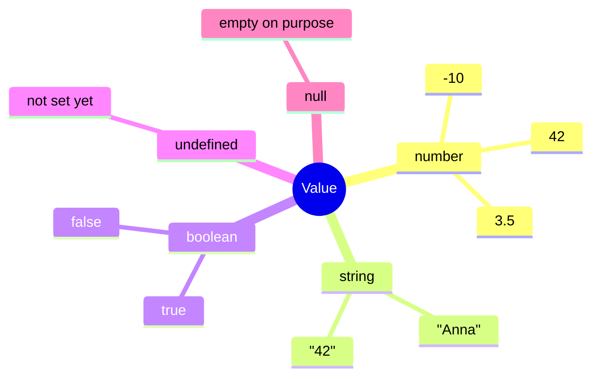

# Data types and operators

[Contents](../../README.md) · [← Back](../../Lesson-1/en/Introduction%20to%20JavaScript.%20First%20program.md) · [Next →](../../Lesson-3/en/Conditions.md) · [RU](../ru/%D0%A2%D0%B8%D0%BF%D1%8B%20%D0%B4%D0%B0%D0%BD%D0%BD%D1%8B%D1%85%20%D0%B8%20%D0%BE%D0%BF%D0%B5%D1%80%D0%B0%D1%82%D0%BE%D1%80%D1%8B.md) · [EN](Data%20types%20and%20operators.md) · [UZ](../uz/Ma%27lumot%20turlari%20va%20operatorlar.md)

> **Link to lesson 1:** you learned to put values into variables. Today we will see *what kinds* of values exist, how to calculate with them and why `"5" + 3` is not `8`.

---

## Why you need this

An online shop cart adds up prices, calculates a discount and writes "Total: 121500 UZS". A sign-up form checks that the age is a number, not a word. All of this is work with **data types** and **operators**.

If you mix up a type, the program does not crash - it quietly calculates the wrong thing: a price `"45000"` from a form field plus delivery `5000` turns into `"450005000"`. Today we will learn to notice and fix such mistakes.

---

## What you will learn

- Tell apart five basic types: `number`, `string`, `boolean`, `null`, `undefined`.
- Find out the type of a value with `typeof`.
- Calculate with the operators `+ - * / % **` and the short forms `+=`, `++`.
- Build text with template strings `` `Total: ${total}` ``.
- Use the `length` property and the string methods `toUpperCase`, `toLowerCase`, `trim`, `includes`.
- Convert a string to a number with `Number()` and understand what `NaN` is.
- Compare values strictly: `===`, `!==`, `<`, `>`.
- Round and get random numbers with `Math`, cut and replace text with `slice`, `split`, `replace`.


---

## Review: 3 questions from lesson 1

1. How does `const` differ from `let`?
2. What does `let a = 2; a = a + 3; console.log(a);` print?
3. What does a `ReferenceError` mean?

Answers are at the end of the lesson.

---

## Lesson plan

| Section | What we do |
| --- | --- |
| Data types | What is inside the box |
| Numbers and arithmetic | A calculator in code |
| Strings | Joining text and templates |
| Mini-task 1 | A greeting from a template |
| Type conversion | Why `"5" + 3 = "53"` |
| Boolean type and comparison | Yes or no |
| Mini-task 2 | Checking an order total |
| Independent work | A shopping receipt |

---

## Data types

Every value has a **type** - the kind of data that determines what you can do with it.

| Type | What it holds | Example |
| --- | --- | --- |
| `number` | Any number: whole, fractional, negative | `42`, `3.5`, `-10` |
| `string` | Text - a string in quotes | `"Anna"`, `"42"` |
| `boolean` | A logical value: yes or no | `true`, `false` |
| `undefined` | "No value has been set yet" | `let x;` - `x` holds `undefined` |
| `null` | "There is deliberately no value" | `let winner = null;` |

> **Important:** `42` and `"42"` are different values. The first is a number you can calculate with. The second is text of two characters.

**In simple terms:** a variable is a box, and the type is the label on the box saying "what is inside". A number can be multiplied, text can be joined, a "yes/no" can be checked. Mix up the label - and the program does the wrong action.



**How to read the diagram.** Any value in a program belongs to one of five types. Note: `"42"` is in the `string` branch, even though it looks like a number.

### How to tell `undefined` from `null`

| | `undefined` | `null` |
| --- | --- | --- |
| Who sets it | JavaScript itself | The programmer, by hand |
| Meaning | "Nothing has been put in yet" | "Empty on purpose" |
| Example | `let city;` | `let winner = null;` - no winner yet |
| `typeof` | `"undefined"` | `"object"` (a historical bug) |

### The `typeof` operator

`typeof` returns the type name as a string:

```js
console.log(typeof 42);        // "number"
console.log(typeof "42");      // "string"
console.log(typeof true);      // "boolean"
console.log(typeof undefined); // "undefined"

let city;
console.log(typeof city);      // "undefined"
```

> **A known oddity:** `typeof null` returns `"object"`. It is a bug from the first version of the language that cannot be fixed without breaking old websites. Just remember it.

---

## Numbers and arithmetic

| Operator | Operation | Example | Result |
| --- | --- | --- | --- |
| `+` | Addition | `7 + 2` | `9` |
| `-` | Subtraction | `7 - 2` | `5` |
| `*` | Multiplication | `7 * 2` | `14` |
| `/` | Division | `7 / 2` | `3.5` |
| `%` | Remainder | `7 % 2` | `1` |
| `**` | Exponent | `2 ** 3` | `8` |

The order of operations is as in maths: first `**`, then `*` `/` `%`, then `+` `-`. Parentheses change the order:

```js
console.log(2 + 3 * 4);   // 14
console.log((2 + 3) * 4); // 20
```

### The remainder `%`

It is useful more often than it seems:

```js
console.log(10 % 2); // 0 - the number is even
console.log(7 % 2);  // 1 - odd
console.log(125 % 60); // 5 - 125 minutes = 2 hours and 5 minutes
```

### Short operators

```js
let score = 10;
score += 5;   // same as score = score + 5;  → 15
score -= 3;   // score = score - 3;          → 12
score *= 2;   // score = score * 2;          → 24
score++;      // score = score + 1;          → 25
score--;      // score = score - 1;          → 24
```

Short forms only work with `let`: a `const` cannot be changed.

### Fractions and rounding

```js
console.log(0.1 + 0.2);          // 0.30000000000000004
console.log(Math.round(4.6));    // 5
console.log(Math.round(0.1 * 3 * 100) / 100); // 0.3
```

A computer stores fractions in binary, so `0.1 + 0.2` is slightly more than `0.3`. For money it is convenient to count in whole units (so'm, cents) and round with `Math.round()`.

### Useful `Math` functions

`Math` is a built-in set of math functions:

| Notation | Result | What it does |
| --- | --- | --- |
| `Math.round(4.5)` | `5` | Rounds to the nearest integer |
| `Math.floor(4.9)` | `4` | Rounds down |
| `Math.ceil(4.1)` | `5` | Rounds up |
| `Math.max(3, 9, 5)` | `9` | The largest of the numbers |
| `Math.min(3, 9, 5)` | `3` | The smallest of the numbers |
| `Math.random()` | e.g. `0.7312` | A random number from 0 (inclusive) to 1 (exclusive) |

A random integer from 1 to 6 - rolling a die:

```js
const dice = Math.floor(Math.random() * 6) + 1;
console.log(dice); // new every time: 1, 2, 3, 4, 5 or 6
```

How it works step by step:

| Step | Expression | Range of values |
| --- | --- | --- |
| 1 | `Math.random()` | from 0 to 0.999... |
| 2 | `* 6` | from 0 to 5.999... |
| 3 | `Math.floor(...)` | integers 0, 1, 2, 3, 4, 5 |
| 4 | `+ 1` | integers 1, 2, 3, 4, 5, 6 |

To show a price with two decimal places there is the `toFixed` method: `(12.5).toFixed(2)` gives the string `"12.50"`. Note - a **string**, not a number.

---

## Strings

A string is text in quotes. The course uses double quotes: `"Hello"`. Single quotes `'Hello'` work the same way.

### Joining with `+`

```js
const firstName = "Anna";
const greeting = "Hello, " + firstName + "!";
console.log(greeting); // Hello, Anna!
```

You must add spaces inside the quotes yourself: `"Hello," + firstName` gives `Hello,Anna`.

### Template strings

A handier way is a **template string** in backticks `` ` `` (the key left of 1). Values are inserted with `${...}`:

```js
const firstName = "Anna";
const lessons = 2;
console.log(`Hello, ${firstName}! Lessons done: ${lessons}.`);
// Hello, Anna! Lessons done: 2.

console.log(`In a year you will finish ${lessons * 5}`); // you can calculate inside ${}
```

Template strings read more easily than joining, so in this course text with variables is built this way.

### Length and string methods

```js
const word = "  JavaScript  ";

console.log(word.length);          // 14 - spaces are characters too
console.log(word.trim());          // "JavaScript" - no spaces at the edges
console.log(word.toUpperCase());   // "  JAVASCRIPT  "
console.log(word.toLowerCase());   // "  javascript  "
console.log(word.includes("Script")); // true
console.log(word.trim()[0]);       // "J" - the first character, counting from 0
```

`length` is a **property** (no parentheses), `trim()` is a **method** (with parentheses): an action the string can perform. Methods do not change the original string - they return a new one:

```js
let name = "  anna ";
name.trim();          // the result is not saved anywhere
console.log(name);    // "  anna "
name = name.trim();   // saved
console.log(name);    // "anna"
```

### Three more methods: `slice`, `split`, `replace`

```js
const email = "anna@example.com";

console.log(email.slice(0, 4));         // "anna" - characters 0 to 3
console.log(email.slice(-3));           // "com" - the last three
console.log(email.split("@"));          // ["anna", "example.com"]
console.log(email.replace("anna", "timur")); // "timur@example.com"
```

| Method | What it does | Example |
| --- | --- | --- |
| `slice(start, end)` | Cuts out a piece from `start` to `end` (`end` not included) | `"Hello".slice(0, 3)` → `"Hel"` |
| `split(separator)` | Cuts the string into parts and returns an **array** | `"a,b,c".split(",")` → `["a", "b", "c"]` |
| `replace(old, new)` | Replaces the **first** occurrence | `"2-2".replace("-", "+")` → `"2+2"` |
| `replaceAll(old, new)` | Replaces all occurrences | `"2-2-2".replaceAll("-", "+")` → `"2+2+2"` |

How character numbers work:

| Character | `J` | `a` | `v` | `a` |
| --- | --- | --- | --- | --- |
| Index | 0 | 1 | 2 | 3 |
| From the end | -4 | -3 | -2 | -1 |

We cover arrays in detail in Lesson 6. For now it is enough to know: `split` turns one string into a list of pieces.

### Try to break it

1. Write `console.log(word.length())` with parentheses. What error does the console show? `length` is a property, not a method.
2. Replace the backticks of a template string with ordinary quotes: `"Total: ${total}"`. What is printed?
3. Call `"JS".toUppercase()` with a lowercase `c`. JavaScript is case-sensitive: there is no method with that name.

---

## Mini-task 1

Declare `const userName = "  timur  ";`. Print `Welcome, TIMUR! Your name has 5 letters.` - the name without spaces and in capitals; count the letters with `length`, not by hand. Use a template string. The solution is in the "Answers" section.

---

## Type conversion

### The `+` trap

With a string, the `+` operator **joins** instead of adding:

```js
console.log(5 + 3);     // 8
console.log("5" + 3);   // "53"
console.log("5" - 3);   // 2  - minus only works with numbers, so the string became a number
console.log("5" * "2"); // 10
```

Data from form fields and `prompt` always comes as **strings**. If you do not convert it to numbers straight away, adding will join.

### `Number()` and `String()`

```js
const quantityText = "3";
const quantity = Number(quantityText);
console.log(quantity + 2);        // 5
console.log(typeof quantity);     // "number"

console.log(String(42) + "!");    // "42!"
```

### `NaN` - "not a number"

```js
console.log(Number("three"));     // NaN
console.log(Number("12px"));      // NaN
console.log(Number(""));          // 0  - an empty string becomes zero!
console.log(typeof NaN);          // "number"
```

`NaN` (Not a Number) is the result of a failed conversion to a number. It "infects" the whole calculation: `NaN + 5` is also `NaN`. If a receipt shows `NaN` instead of a total, look for a string that did not become a number.

---

## Boolean type and comparison

A comparison returns `true` or `false`:

| Operator | Meaning | Example | Result |
| --- | --- | --- | --- |
| `===` | Strictly equal (value and type) | `5 === 5` | `true` |
| `!==` | Strictly not equal | `5 !== "5"` | `true` |
| `>` / `<` | Greater / less | `7 > 3` | `true` |
| `>=` / `<=` | Greater or equal / less or equal | `3 >= 3` | `true` |

```js
const age = 16;
const isAdult = age >= 18;
console.log(isAdult);           // false
console.log(typeof isAdult);    // "boolean"
```

Names of boolean variables usually start with `is`, `has`, `can`: `isAdult`, `hasDiscount`, `canEnter`.

### Why not `==`

JavaScript also has loose comparison `==`. Before comparing it converts types, and the results can be surprising:

```js
console.log(5 == "5");   // true
console.log(0 == "");    // true
console.log(5 === "5");  // false - different types
```

Course rule: **only `===` and `!==`**. If the types may differ, convert the value explicitly with `Number()` first.

### Typical beginner mistakes

| Mistake | What you get | How to fix |
| --- | --- | --- |
| `"45000" + 5000` | `"450005000"` - joined | `Number("45000") + 5000` |
| `Number("12px")` | `NaN` | Remove the units or use `parseInt("12px")` → `12` |
| `name.trim();` without assigning | The string did not change | `name = name.trim();` |
| `0.1 + 0.2 === 0.3` | `false` | Round, or count in whole units |
| `if (age = 18)` instead of a comparison | An assignment, not a check | `age === 18` |
| `5 == "5"` | `true`, although the types differ | `5 === Number("5")` |
| `const count = 0; count++;` | `TypeError` - a constant cannot change | `let count = 0;` |

### How to check yourself in the console

Not sure which type you got? Print the value and the type at once:

```js
const value = "5" * 2;
console.log(value, typeof value); // 10 "number"
```

This way you catch joining or `NaN` in a second, before the error travels further through the program.

---

## Mini-task 2

An item price `"25000"` came from a form as a string, the quantity is the number `4`. Calculate the cost, declare `const hasFreeDelivery` that is `true` if the cost is at least `100000`, and print both variables. The solution is in the "Answers" section.

---

## Lesson summary: cheat sheet

| Task | Code |
| --- | --- |
| Find out the type | `typeof value` |
| Remainder | `a % b` |
| Increase by 1 / by 5 | `count++` / `count += 5` |
| Insert a value into text | `` `Total: ${total}` `` |
| String length | `text.length` |
| No spaces / upper case / lower case | `text.trim()` / `toUpperCase()` / `toLowerCase()` |
| Does it contain a substring | `text.includes("abc")` |
| String to number | `Number("42")` |
| Round | `Math.round(x)` |
| Compare | `===`, `!==`, `>`, `<`, `>=`, `<=` |

---

## Independent work

### Part 1. IDE task (graded by the platform)

Calculate a shopping receipt. The starter code already has the data: the price `price`, the quantity `quantityText` - a **string**, as from a form - and the discount `discountPercent`.

1. `quantity` - the quantity converted to a number with `Number()`.
2. `subtotal` - the price multiplied by the quantity.
3. `discount` - the discount in so'm: `discountPercent` per cent of `subtotal`.
4. `total` - the amount to pay.
5. `isExpensive` - a boolean: `total` is greater than `100000`.
6. `receipt` - the string `Total: <total> UZS`, built with a template string. Print it to the console.

Calculate all results with expressions, not ready-made numbers. Do not use `var`.

What the platform checks: the values and types of all six variables; `quantity` is obtained with `Number(quantityText)`; `receipt` is built with a template string containing `${total}`; no ready answers are written into the code; the receipt line is printed to the console.

### Part 2. Project on your computer

1. In your website's `main.js` describe one product or service: a name, a price, a quantity.
2. Calculate the cost with a discount and print a receipt line with a template string.
3. Add a price string to a number on purpose and look at the joined result; fix it with `Number()`.
4. Print `typeof` of every variable and check that the types are what you expected.

### Acceptance criteria

- [ ] The IDE task is accepted.
- [ ] The console shows no `NaN` and no joined numbers.
- [ ] Text with variables is built with template strings.
- [ ] Only `===` and `!==` are used.
- [ ] Boolean variables are named with `is`, `has` or `can`.

---

## Self-check questions

1. Name the five basic types and an example value of each.
2. How does `42` differ from `"42"`?
3. What does `typeof "true"` return?
4. What is `17 % 5`, and where is the remainder useful?
5. What does `"10" + 5` print, and what about `"10" - 5`? Why?
6. How do you correctly add a number from a form field to another number?
7. What is `NaN` and when does it appear?
8. Why is a template string handier than joining with `+`?
9. Why does `name.trim();` without assignment not change `name`?
10. Why does the course use `===` and not `==`?

After the questions, take the **lesson test** on the platform: 12 questions, pass mark 70%.

---

## What's next

The program can now calculate and compare. But it still always does the same thing. In lesson 3 we will teach it to **make decisions**: "if the order is over 100000 - free delivery, otherwise - 15000".

---

## Answers

**Review**

1. A `const` value cannot be reassigned, a `let` value can.
2. `5`.
3. A reference to a name that was not declared: a typo, or the variable does not exist.

**Mini-task 1**

```js
const userName = "  timur  ";
const cleanName = userName.trim().toUpperCase();
console.log(`Welcome, ${cleanName}! Your name has ${cleanName.length} letters.`);
```

**Mini-task 2**

```js
const priceText = "25000";
const quantity = 4;
const cost = Number(priceText) * quantity;
const hasFreeDelivery = cost >= 100000;
console.log(cost, hasFreeDelivery); // 100000 true
```

**Self-check questions**

1. `number` - `42`, `string` - `"Anna"`, `boolean` - `true`, `undefined` - the value of a variable declared without assignment, `null` - `null`.
2. `42` is a number to calculate with; `"42"` is a string of two characters.
3. `"string"`: the value is in quotes.
4. `2`. Even/odd checks (`n % 2`), minutes and hours, every N-th item.
5. `"105"` - joining, `5` - subtraction: minus only works with numbers and converts the string to a number.
6. Convert the string with `Number()`, then add.
7. "Not a number" - the result of a failed conversion, for example `Number("three")`.
8. You do not have to watch the spaces and `+`, you can calculate inside `${}`, and the text reads as a whole.
9. String methods return a new string and do not change the original. Save the result: `name = name.trim();`.
10. `==` converts types and gives unexpected `true`, `===` compares both value and type.

---

[Contents](../../README.md) · [← Back](../../Lesson-1/en/Introduction%20to%20JavaScript.%20First%20program.md) · [Next →](../../Lesson-3/en/Conditions.md) · [RU](../ru/%D0%A2%D0%B8%D0%BF%D1%8B%20%D0%B4%D0%B0%D0%BD%D0%BD%D1%8B%D1%85%20%D0%B8%20%D0%BE%D0%BF%D0%B5%D1%80%D0%B0%D1%82%D0%BE%D1%80%D1%8B.md) · [EN](Data%20types%20and%20operators.md) · [UZ](../uz/Ma%27lumot%20turlari%20va%20operatorlar.md)
