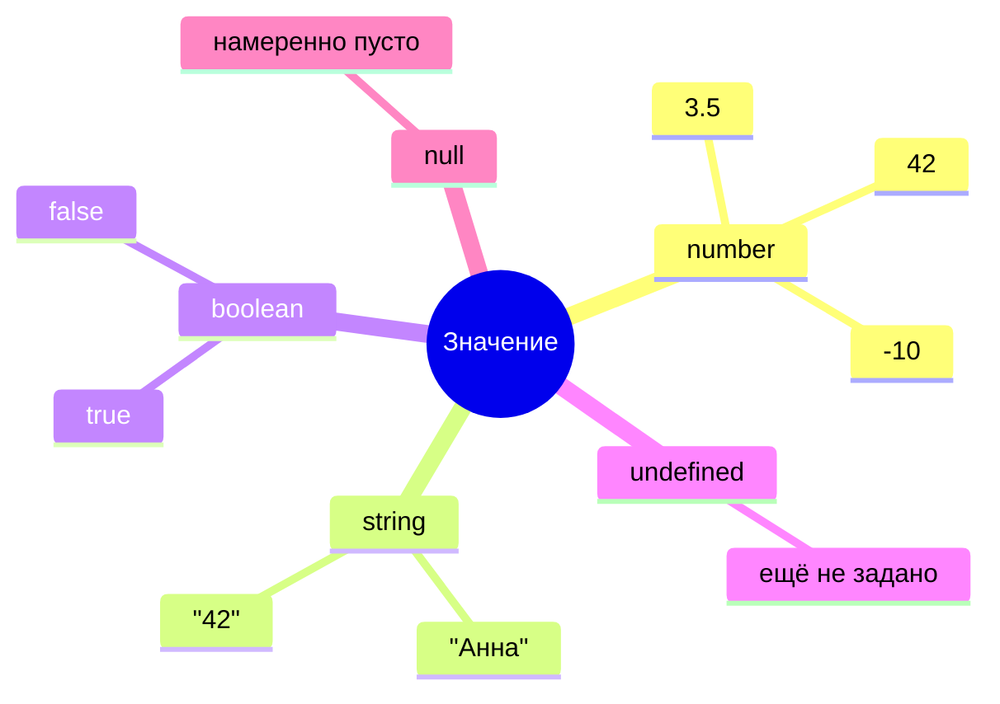

# Типы данных и операторы

[Содержание](../../README.md) · [← Назад](../../Lesson-1/ru/Введение%20в%20JavaScript.%20Первая%20программа.md) · [Вперёд →](../../Lesson-3/ru/Условия.md) · [RU](%D0%A2%D0%B8%D0%BF%D1%8B%20%D0%B4%D0%B0%D0%BD%D0%BD%D1%8B%D1%85%20%D0%B8%20%D0%BE%D0%BF%D0%B5%D1%80%D0%B0%D1%82%D0%BE%D1%80%D1%8B.md) · [EN](../en/Data%20types%20and%20operators.md) · [UZ](../uz/Ma%27lumot%20turlari%20va%20operatorlar.md)

> **Связь с уроком 1:** вы научились класть значения в переменные. Сегодня разберёмся, *какие* бывают значения, как с ними считать и почему `"5" + 3` даёт не `8`.

---

## Зачем это вам

Корзина интернет-магазина складывает цены, считает скидку и пишет «Итого: 121 500 сум». Форма регистрации проверяет, что возраст - число, а не слово. Всё это - работа с **типами данных** и **операторами**.

Если перепутать тип, программа не упадёт, а тихо посчитает неправильно: цена `"45000"` из поля формы плюс доставка `5000` превратится в `"450005000"`. Сегодня научимся замечать и исправлять такие ошибки.

---

## Чему вы научитесь

- Различать пять базовых типов: `number`, `string`, `boolean`, `null`, `undefined`.
- Узнавать тип значения через `typeof`.
- Считать с операторами `+ - * / % **` и сокращёнными `+=`, `++`.
- Собирать текст шаблонными строками `` `Итого: ${total}` ``.
- Пользоваться свойством `length` и методами строк `toUpperCase`, `toLowerCase`, `trim`, `includes`.
- Превращать строку в число через `Number()` и понимать, что такое `NaN`.
- Сравнивать значения строго: `===`, `!==`, `<`, `>`.
- Округлять и получать случайные числа через `Math`, резать и заменять текст методами `slice`, `split`, `replace`.


---

## Повторение: 3 вопроса из урока 1

1. Чем `const` отличается от `let`?
2. Что выведет `let a = 2; a = a + 3; console.log(a);`?
3. Что означает ошибка `ReferenceError`?

Ответы - в конце урока.

---

## План урока

| Раздел | Что делаем |
| --- | --- |
| Типы данных | Что лежит в коробке |
| Числа и арифметика | Калькулятор в коде |
| Строки | Склеиваем текст и шаблоны |
| Мини-задание 1 | Приветствие по шаблону |
| Преобразование типов | Почему `"5" + 3 = "53"` |
| Логический тип и сравнение | Да или нет |
| Мини-задание 2 | Проверка стоимости заказа |
| Самостоятельная работа | Чек покупки |

---

## Типы данных

У каждого значения есть **тип** - вид данных, который определяет, что с ним можно делать.

| Тип | Что хранит | Пример |
| --- | --- | --- |
| `number` | Любое число: целое, дробное, отрицательное | `42`, `3.5`, `-10` |
| `string` | Текст - строка в кавычках | `"Анна"`, `"42"` |
| `boolean` | Логическое значение: да или нет | `true`, `false` |
| `undefined` | «Значение ещё не задано» | `let x;` - в `x` лежит `undefined` |
| `null` | «Значения намеренно нет» | `let winner = null;` |

> **Важно:** `42` и `"42"` - разные значения. Первое - число, с ним можно считать. Второе - текст из двух символов.

**Простыми словами:** переменная - коробка, тип - наклейка на коробке «что внутри». Число можно умножить, текст - склеить, «да/нет» - проверить. Перепутали наклейку - и программа сделает не то действие.



**Как читать схему.** Любое значение в программе относится к одному из пяти типов. Обратите внимание: `"42"` - в ветке `string`, хотя похоже на число.

### Как различить `undefined` и `null`

| | `undefined` | `null` |
| --- | --- | --- |
| Кто ставит | JavaScript сам | Программист вручную |
| Смысл | «Ещё ничего не положили» | «Специально пусто» |
| Пример | `let city;` | `let winner = null;` - победителя пока нет |
| `typeof` | `"undefined"` | `"object"` (историческая ошибка) |

### Оператор `typeof`

`typeof` возвращает название типа строкой:

```js
console.log(typeof 42);        // "number"
console.log(typeof "42");      // "string"
console.log(typeof true);      // "boolean"
console.log(typeof undefined); // "undefined"

let city;
console.log(typeof city);      // "undefined"
```

> **Известная странность:** `typeof null` возвращает `"object"`. Это ошибка первой версии языка, которую нельзя исправить, не сломав старые сайты. Просто запомните.

---

## Числа и арифметика

| Оператор | Действие | Пример | Результат |
| --- | --- | --- | --- |
| `+` | Сложение | `7 + 2` | `9` |
| `-` | Вычитание | `7 - 2` | `5` |
| `*` | Умножение | `7 * 2` | `14` |
| `/` | Деление | `7 / 2` | `3.5` |
| `%` | Остаток от деления | `7 % 2` | `1` |
| `**` | Возведение в степень | `2 ** 3` | `8` |

Порядок действий - как в математике: сначала `**`, потом `*` `/` `%`, потом `+` `-`. Скобки меняют порядок:

```js
console.log(2 + 3 * 4);   // 14
console.log((2 + 3) * 4); // 20
```

### Остаток от деления `%`

Пригодится чаще, чем кажется:

```js
console.log(10 % 2); // 0 - число чётное
console.log(7 % 2);  // 1 - нечётное
console.log(125 % 60); // 5 - 125 минут = 2 часа и 5 минут
```

### Сокращённые операторы

```js
let score = 10;
score += 5;   // то же, что score = score + 5;  → 15
score -= 3;   // score = score - 3;             → 12
score *= 2;   // score = score * 2;             → 24
score++;      // score = score + 1;             → 25
score--;      // score = score - 1;             → 24
```

Сокращения работают только с `let`: `const` изменить нельзя.

### Дробные числа и округление

```js
console.log(0.1 + 0.2);          // 0.30000000000000004
console.log(Math.round(4.6));    // 5
console.log(Math.round(0.1 * 3 * 100) / 100); // 0.3
```

Компьютер хранит дроби в двоичном виде, поэтому `0.1 + 0.2` чуть больше `0.3`. Для денег удобно считать в целых единицах (сумах, центах) и округлять через `Math.round()`.

### Полезные функции `Math`

`Math` - встроенный набор математических функций:

| Запись | Результат | Что делает |
| --- | --- | --- |
| `Math.round(4.5)` | `5` | Округляет до ближайшего целого |
| `Math.floor(4.9)` | `4` | Округляет вниз |
| `Math.ceil(4.1)` | `5` | Округляет вверх |
| `Math.max(3, 9, 5)` | `9` | Наибольшее из чисел |
| `Math.min(3, 9, 5)` | `3` | Наименьшее из чисел |
| `Math.random()` | например `0.7312` | Случайное число от 0 (включительно) до 1 (не включительно) |

Случайное целое от 1 до 6 - бросок кубика:

```js
const dice = Math.floor(Math.random() * 6) + 1;
console.log(dice); // каждый раз новое: 1, 2, 3, 4, 5 или 6
```

Как это работает по шагам:

| Шаг | Выражение | Диапазон значений |
| --- | --- | --- |
| 1 | `Math.random()` | от 0 до 0.999... |
| 2 | `* 6` | от 0 до 5.999... |
| 3 | `Math.floor(...)` | целые 0, 1, 2, 3, 4, 5 |
| 4 | `+ 1` | целые 1, 2, 3, 4, 5, 6 |

Для вывода цены с двумя знаками после запятой есть метод `toFixed`: `(12.5).toFixed(2)` даёт строку `"12.50"`. Обратите внимание - **строку**, а не число.

---

## Строки

Строка - текст в кавычках. В курсе используем двойные: `"Привет"`. Одинарные `'Привет'` работают так же.

### Склейка через `+`

```js
const firstName = "Анна";
const greeting = "Привет, " + firstName + "!";
console.log(greeting); // Привет, Анна!
```

Пробелы внутри кавычек нужно ставить самим: `"Привет," + firstName` даст `Привет,Анна`.

### Шаблонные строки

Удобнее - **шаблонная строка** в обратных кавычках `` ` `` (клавиша Ё в английской раскладке). Значения вставляются через `${...}`:

```js
const firstName = "Анна";
const lessons = 2;
console.log(`Привет, ${firstName}! Пройдено уроков: ${lessons}.`);
// Привет, Анна! Пройдено уроков: 2.

console.log(`Через год пройдёте ${lessons * 5}`); // внутри ${} можно считать
```

Шаблонные строки читаются легче склейки, поэтому в курсе текст с переменными собираем именно так.

### Длина и методы строк

```js
const word = "  JavaScript  ";

console.log(word.length);          // 14 - пробелы тоже символы
console.log(word.trim());          // "JavaScript" - без пробелов по краям
console.log(word.toUpperCase());   // "  JAVASCRIPT  "
console.log(word.toLowerCase());   // "  javascript  "
console.log(word.includes("Script")); // true
console.log(word.trim()[0]);       // "J" - первый символ, счёт с 0
```

`length` - **свойство** (без скобок), `trim()` - **метод** (со скобками): действие, которое строка умеет выполнять. Методы не меняют исходную строку, а возвращают новую:

```js
let name = "  анна ";
name.trim();          // результат никуда не сохранён
console.log(name);    // "  анна "
name = name.trim();   // сохранили
console.log(name);    // "анна"
```

### Ещё три метода: `slice`, `split`, `replace`

```js
const email = "anna@example.com";

console.log(email.slice(0, 4));         // "anna" - символы с 0 по 3
console.log(email.slice(-3));           // "com" - три последних
console.log(email.split("@"));          // ["anna", "example.com"]
console.log(email.replace("anna", "timur")); // "timur@example.com"
```

| Метод | Что делает | Пример |
| --- | --- | --- |
| `slice(start, end)` | Вырезает кусок от `start` до `end` (не включая `end`) | `"Привет".slice(0, 3)` → `"При"` |
| `split(separator)` | Режет строку на части и возвращает **массив** | `"a,b,c".split(",")` → `["a", "b", "c"]` |
| `replace(old, new)` | Заменяет **первое** вхождение | `"2-2".replace("-", "+")` → `"2+2"` |
| `replaceAll(old, new)` | Заменяет все вхождения | `"2-2-2".replaceAll("-", "+")` → `"2+2+2"` |

Как устроены номера символов:

| Символ | `J` | `a` | `v` | `a` |
| --- | --- | --- | --- | --- |
| Индекс | 0 | 1 | 2 | 3 |
| С конца | -4 | -3 | -2 | -1 |

Массивы подробно разберём в уроке 6. Пока достаточно знать: `split` превращает одну строку в список кусочков.

### Попробуйте сломать

1. Напишите `console.log(word.length())` со скобками. Какую ошибку покажет консоль? `length` - свойство, а не метод.
2. Уберите обратные кавычки у шаблонной строки и поставьте обычные: `"Итого: ${total}"`. Что выведется?
3. Вызовите `"JS".toUppercase()` с маленькой `c`. JavaScript различает регистр: метода с таким именем нет.

---

## Мини-задание 1

Объявите `const userName = "  тимур  ";`. Выведите в консоль `Добро пожаловать, ТИМУР! В имени 5 букв.` - имя без пробелов и заглавными буквами, число букв посчитайте через `length`, а не вручную. Используйте шаблонную строку. Решение - в разделе «Ответы».

---

## Преобразование типов

### Ловушка `+`

Оператор `+` со строкой **склеивает**, а не складывает:

```js
console.log(5 + 3);     // 8
console.log("5" + 3);   // "53"
console.log("5" - 3);   // 2  - минус работает только с числами, строка превратилась в число
console.log("5" * "2"); // 10
```

Данные из полей формы и `prompt` всегда приходят **строками**. Если сразу их не превратить в числа, сложение даст склейку.

### `Number()` и `String()`

```js
const quantityText = "3";
const quantity = Number(quantityText);
console.log(quantity + 2);        // 5
console.log(typeof quantity);     // "number"

console.log(String(42) + "!");    // "42!"
```

### `NaN` - «не число»

```js
console.log(Number("три"));       // NaN
console.log(Number("12px"));      // NaN
console.log(Number(""));          // 0  - пустая строка становится нулём!
console.log(typeof NaN);          // "number"
```

`NaN` (Not a Number) - результат неудачного превращения в число. Он «заражает» всё вычисление: `NaN + 5` тоже `NaN`. Если в чеке вместо суммы появился `NaN`, ищите строку, которая не превратилась в число.

---

## Логический тип и сравнение

Сравнение возвращает `true` или `false`:

| Оператор | Смысл | Пример | Результат |
| --- | --- | --- | --- |
| `===` | Строго равно (значение и тип) | `5 === 5` | `true` |
| `!==` | Строго не равно | `5 !== "5"` | `true` |
| `>` / `<` | Больше / меньше | `7 > 3` | `true` |
| `>=` / `<=` | Больше или равно / меньше или равно | `3 >= 3` | `true` |

```js
const age = 16;
const isAdult = age >= 18;
console.log(isAdult);           // false
console.log(typeof isAdult);    // "boolean"
```

Имена логических переменных обычно начинаются с `is`, `has`, `can`: `isAdult`, `hasDiscount`, `canEnter`.

### Почему не `==`

В JavaScript есть и нестрогое сравнение `==`. Перед сравнением оно приводит типы, и результаты бывают неожиданными:

```js
console.log(5 == "5");   // true
console.log(0 == "");    // true
console.log(5 === "5");  // false - разные типы
```

Правило курса: **только `===` и `!==`**. Если типы могут различаться, сначала явно превратите значение через `Number()`.

### Частые ошибки новичков

| Ошибка | Что получится | Как исправить |
| --- | --- | --- |
| `"45000" + 5000` | `"450005000"` - склейка | `Number("45000") + 5000` |
| `Number("12px")` | `NaN` | Уберите единицы или используйте `parseInt("12px")` → `12` |
| `name.trim();` без присваивания | Строка не изменилась | `name = name.trim();` |
| `0.1 + 0.2 === 0.3` | `false` | Округляйте или считайте в целых единицах |
| `if (age = 18)` вместо сравнения | Присваивание, а не проверка | `age === 18` |
| `5 == "5"` | `true`, хотя типы разные | `5 === Number("5")` |
| `const count = 0; count++;` | `TypeError` - константу нельзя изменить | `let count = 0;` |

### Как проверить себя в консоли

Не уверены, какой тип получился? Выведите и значение, и тип сразу:

```js
const value = "5" * 2;
console.log(value, typeof value); // 10 "number"
```

Так вы за секунду поймаете склейку или `NaN`, пока ошибка не ушла дальше по программе.

---

## Мини-задание 2

Цена товара `"25000"` пришла из формы строкой, количество - число `4`. Посчитайте стоимость, объявите `const hasFreeDelivery`, которая равна `true`, если стоимость не меньше `100000`, и выведите обе переменные. Решение - в разделе «Ответы».

---

## Итоги урока: шпаргалка

| Задача | Запись |
| --- | --- |
| Узнать тип | `typeof value` |
| Остаток от деления | `a % b` |
| Увеличить на 1 / на 5 | `count++` / `count += 5` |
| Вставить значение в текст | `` `Итого: ${total}` `` |
| Длина строки | `text.length` |
| Без пробелов / заглавные / строчные | `text.trim()` / `toUpperCase()` / `toLowerCase()` |
| Есть ли подстрока | `text.includes("abc")` |
| Строку в число | `Number("42")` |
| Округлить | `Math.round(x)` |
| Сравнить | `===`, `!==`, `>`, `<`, `>=`, `<=` |

---

## Самостоятельная работа

### Часть 1. Задание в IDE (засчитывается платформой)

Посчитайте чек покупки. В стартовом коде уже есть данные: цена `price`, количество `quantityText` - **строка**, как из формы, и скидка `discountPercent`.

1. `quantity` - количество, превращённое в число через `Number()`.
2. `subtotal` - цена, умноженная на количество.
3. `discount` - скидка в сумах: `discountPercent` процентов от `subtotal`.
4. `total` - сумма к оплате.
5. `isExpensive` - логическое значение: `total` больше `100000`.
6. `receipt` - строка `Итого: <total> сум`, собранная шаблонной строкой. Выведите её в консоль.

Все результаты считайте выражениями, а не готовыми числами. `var` не используйте.

Что проверяет платформа: значения и типы всех шести переменных; `quantity` получена через `Number(quantityText)`; `receipt` собрана шаблонной строкой с `${total}`; готовые ответы не вписаны в код; строка чека выведена в консоль.

### Часть 2. Проект на компьютере

1. В `main.js` своего сайта опишите один товар или услугу: название, цену, количество.
2. Посчитайте стоимость со скидкой и выведите в консоль строку чека шаблонной строкой.
3. Специально сложите цену-строку с числом и посмотрите на склейку; исправьте через `Number()`.
4. Выведите `typeof` каждой переменной и проверьте, что типы такие, как вы ожидали.

### Критерии готовности

- [ ] Задание в IDE засчитано.
- [ ] В консоли нет `NaN` и склеенных чисел.
- [ ] Текст с переменными собран шаблонными строками.
- [ ] Используются только `===` и `!==`.
- [ ] Логические переменные названы с `is`, `has` или `can`.

---

## Вопросы для самопроверки

1. Назовите пять базовых типов и пример значения каждого.
2. Чем `42` отличается от `"42"`?
3. Что вернёт `typeof "true"`?
4. Чему равно `17 % 5` и где пригодится остаток?
5. Что выведет `"10" + 5`, а что `"10" - 5`? Почему?
6. Как правильно сложить число из поля формы с другим числом?
7. Что такое `NaN` и когда он появляется?
8. Чем шаблонная строка удобнее склейки через `+`?
9. Почему `name.trim();` без присваивания не меняет `name`?
10. Почему в курсе используется `===`, а не `==`?

После вопросов пройдите **тест урока** на платформе: 12 вопросов, порог 70%.

---

## Что дальше

Теперь программа умеет считать и сравнивать. Но пока она всегда делает одно и то же. В уроке 3 научим её **принимать решения**: «если сумма больше 100 000 - доставка бесплатная, иначе - 15 000».

---

## Ответы

**Повторение**

1. Значение `const` нельзя переназначить, `let` - можно.
2. `5`.
3. Обращение к имени, которое не объявлено: опечатка или переменной нет.

**Мини-задание 1**

```js
const userName = "  тимур  ";
const cleanName = userName.trim().toUpperCase();
console.log(`Добро пожаловать, ${cleanName}! В имени ${cleanName.length} букв.`);
```

**Мини-задание 2**

```js
const priceText = "25000";
const quantity = 4;
const cost = Number(priceText) * quantity;
const hasFreeDelivery = cost >= 100000;
console.log(cost, hasFreeDelivery); // 100000 true
```

**Вопросы для самопроверки**

1. `number` - `42`, `string` - `"Анна"`, `boolean` - `true`, `undefined` - значение объявленной без присваивания переменной, `null` - `null`.
2. `42` - число, с ним считают; `"42"` - строка из двух символов.
3. `"string"`: значение в кавычках.
4. `2`. Чётность (`n % 2`), минуты и часы, каждый N-й элемент.
5. `"105"` - склейка, `5` - вычитание: минус работает только с числами и превращает строку в число.
6. Превратить строку через `Number()`, затем складывать.
7. «Не число» - результат неудачного превращения, например `Number("три")`.
8. Не нужно следить за пробелами и `+`, внутри `${}` можно считать, текст читается целиком.
9. Методы строк возвращают новую строку, а исходную не меняют. Результат нужно сохранить: `name = name.trim();`.
10. `==` приводит типы и даёт неожиданные `true`, `===` сравнивает и значение, и тип.

---

[Содержание](../../README.md) · [← Назад](../../Lesson-1/ru/Введение%20в%20JavaScript.%20Первая%20программа.md) · [Вперёд →](../../Lesson-3/ru/Условия.md) · [RU](%D0%A2%D0%B8%D0%BF%D1%8B%20%D0%B4%D0%B0%D0%BD%D0%BD%D1%8B%D1%85%20%D0%B8%20%D0%BE%D0%BF%D0%B5%D1%80%D0%B0%D1%82%D0%BE%D1%80%D1%8B.md) · [EN](../en/Data%20types%20and%20operators.md) · [UZ](../uz/Ma%27lumot%20turlari%20va%20operatorlar.md)
