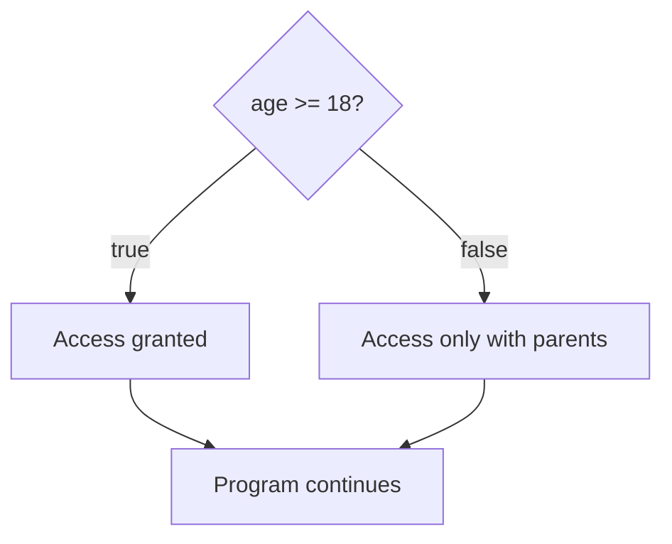
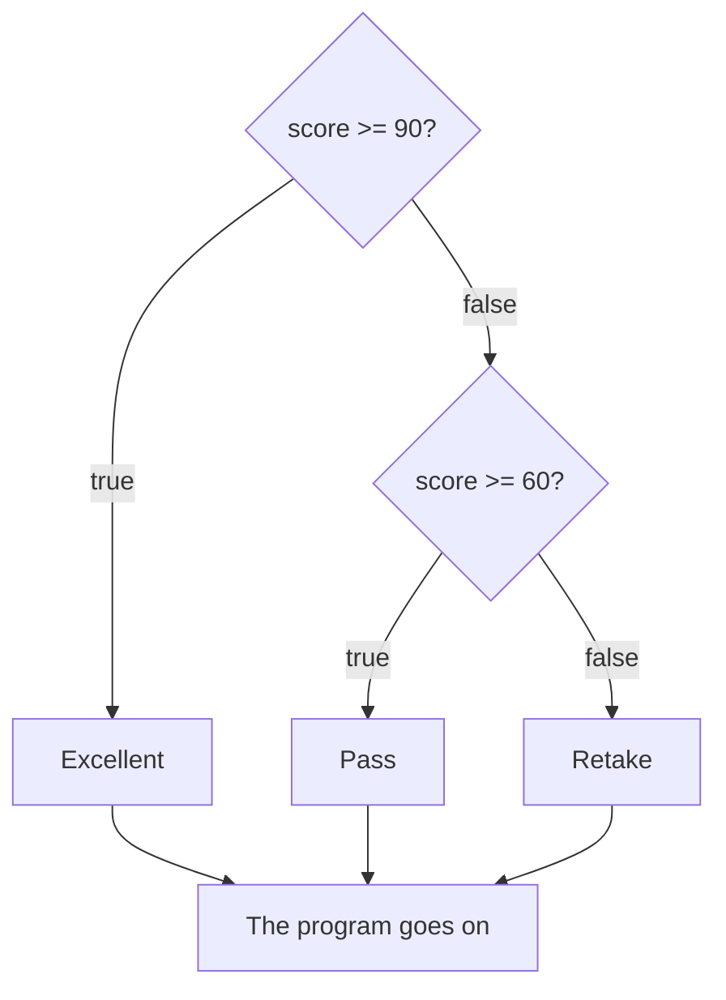

# Conditions

[Contents](../../README.md) · [← Back](../../Lesson-2/en/Data%20types%20and%20operators.md) · [Next →](../../Lesson-4/en/Loops.md) · [RU](../ru/%D0%A3%D1%81%D0%BB%D0%BE%D0%B2%D0%B8%D1%8F.md) · [EN](Conditions.md) · [UZ](../uz/Shartlar.md)

> **Link to lesson 2:** you learned to compare values and get `true` or `false`. Today the program will start **making decisions** based on those answers.

---

## Why you need this

"If the password is shorter than 8 characters - show an error." "If the order is over 100000 - free delivery, otherwise - 15000." "If the user chose the dark theme - turn it on." Without conditions a program always does the same thing. With conditions it reacts to data.

---

## What you will learn

- Run code only when a condition holds: `if`.
- Choose between two or more options: `else`, `else if`.
- Combine conditions: `&&` (and), `||` (or), `!` (not).
- Understand which values JavaScript treats as "false".
- Write a short choice with the ternary operator `? :`.
- Choose from a list of exact values with `switch`.

---

## Review: 3 questions from lesson 2

1. What does `7 >= 7` return?
2. How does `===` differ from `==`?
3. What is the type of the result of `age > 18`?

Answers are at the end of the lesson.

---

## Lesson plan

| Section | What we do |
| --- | --- |
| `if` and `else` | A fork in the road |
| `else if` | Several roads |
| Mini-task 1 | Time of day |
| Logical operators | And, or, not |
| Truthy and falsy | What JavaScript considers "false" |
| Ternary operator | A choice in one line |
| `switch` | Choosing by an exact value |
| Mini-task 2 | Delivery cost |
| Independent work | A grade and admission to an olympiad |

---

## `if` and `else`

**In simple words:** a condition is a fork in the road. A sign that says "if it is raining - take an umbrella".

```js
const temperature = 28;

if (temperature > 25) {
    console.log("It's hot, take some water");
}
```

| Part | What it is |
| --- | --- |
| `if` | "If" |
| `( temperature > 25 )` | The condition in parentheses - any expression that gives `true` or `false` |
| `{ ... }` | A block: statements that run only if the condition is true |

The code inside the block is indented by 4 spaces - this shows it is "inside" the condition. No semicolon is written after `}`.

### `else` - "otherwise"

```js
const age = 16;

if (age >= 18) {
    console.log("Access granted");
} else {
    console.log("Access only with parents");
}
```

**Exactly one** branch runs: either the first or the second.



### A common mistake: `=` instead of `===`

```js
let role = "guest";

if (role = "admin") {        // mistake: this is assignment, not comparison!
    console.log("Admin panel");
}
console.log(role);           // "admin" - the value is spoiled
```

`=` puts a value into a variable. Comparison is only `===`.

---

## `else if` - several options

```js
const hour = 14;

if (hour < 12) {
    console.log("Good morning");
} else if (hour < 18) {
    console.log("Good afternoon");
} else {
    console.log("Good evening");
}
```

Conditions are checked **from top to bottom**; the first matching branch runs and the rest are skipped. That is why order matters:

```js
const score = 95;

// Wrong: 95 >= 60 is true, the check for 90 is never reached
if (score >= 60) {
    console.log("Pass");
} else if (score >= 90) {
    console.log("Excellent");
}

// Right: from the strictest condition to the softest
if (score >= 90) {
    console.log("Excellent");
} else if (score >= 60) {
    console.log("Pass");
} else {
    console.log("Retake");
}
```

### Saving the result in a variable

Often branches do not print text but compute a value. The variable is declared with `let` **before** the condition, and the branches assign to it:

```js
const hour = 20;
let greeting;

if (hour < 12) {
    greeting = "Good morning";
} else if (hour < 18) {
    greeting = "Good afternoon";
} else {
    greeting = "Good evening";
}

console.log(greeting); // Good evening
```

If you declare `let greeting` inside a `{ }` block, the variable is not available after the block: it lives only inside its curly braces.

### How branches are checked: step by step

Take the correct chain above and `score = 75`. The browser goes from top to bottom and stops at the first `true`:

| Step | Check | Result | What happens |
| --- | --- | --- | --- |
| 1 | `75 >= 90` | `false` | The branch is skipped, we go on |
| 2 | `75 >= 60` | `true` | `Pass` is printed, the other branches are **not checked** |
| 3 | `else` | - | Not run: a branch has already been found |



**How to read the diagram.** Each diamond is a question. The answer `false` leads to the next question, the answer `true` leads to an action and straight to the exit. That is why the order of conditions matters: the strictest one goes first.

---

## Mini-task 1

Declare `const hour = 7;`. Print `Night` for 0–5, `Morning` for 6–11, `Afternoon` for 12–17 and `Evening` for 18–23. Test the program with 0, 5, 6, 12, 18, 23. The solution is in the "Answers" section.

---

## Logical operators

| Operator | Reads as | Result is `true` when |
| --- | --- | --- |
| `&&` | AND | Both conditions are true |
| `\|\|` | OR | At least one is true |
| `!` | NOT | It flips: `!true` → `false` |

```js
const age = 15;
const hasTicket = true;

if (age >= 12 && hasTicket) {
    console.log("Come in");
}

const day = "sat";
if (day === "sat" || day === "sun") {
    console.log("Day off");
}

const isLoggedIn = false;
if (!isLoggedIn) {
    console.log("Please sign in");
}
```

### A range

"A number from 6 to 11 inclusive" is written with two comparisons:

```js
if (hour >= 6 && hour <= 11) { ... }
```

The maths notation `6 <= hour <= 11` **does not work** in JavaScript the way it looks: first `6 <= hour` gives `true`, then `true <= 11` gives `true` for any `hour`.

### Truth table

All four combinations for two conditions - worth writing out once:

| `a` | `b` | `a && b` | `a \|\| b` |
| --- | --- | --- | --- |
| `true` | `true` | `true` | `true` |
| `true` | `false` | `false` | `true` |
| `false` | `true` | `false` | `true` |
| `false` | `false` | `false` | `false` |

Easy to remember: `&&` is strict - **everything** must hold; `||` is kind - **one** is enough.

A real-life example: "entry to the cinema hall if you have a ticket **and** are 16" is `&&`. "A discount if you are a student **or** a pensioner" is `||`.

---

## Truthy and falsy

You can put any value into a condition, not only `true` or `false`. JavaScript converts it to a boolean. There are only six values considered **false** (falsy):

| Falsy value | Type |
| --- | --- |
| `false` | boolean |
| `0` | number |
| `""` (empty string) | string |
| `null` | null |
| `undefined` | undefined |
| `NaN` | number |

Everything else is **truthy**, including `"0"`, `" "` and `"false"`.

```js
const userName = "";

if (userName) {
    console.log(`Hello, ${userName}`);
} else {
    console.log("Enter your name");   // runs: an empty string is falsy
}
```

> **Careful with zero:** `if (count)` cannot tell "0 items" from "no value set". If zero is a valid value, compare explicitly: `if (count === 0)`.

---

## Ternary operator

When you need to choose one of two values, `if/else` can be written in one line:

```js
const age = 20;
const access = age >= 18 ? "Adult ticket" : "Child ticket";
console.log(access); // Adult ticket
```

Pattern: `condition ? value_if_true : value_if_false`.

The ternary operator is handy when the result is a **value** stored in a variable or inserted into a template string:

```js
const items = 1;
console.log(`The cart has ${items} ${items === 1 ? "item" : "items"}`);
```

If the branches contain several actions or there are more than two options, use `if/else`. Nested ternaries are hard to read.

---

## `switch`

`switch` compares one value with a list of exact options using `===`:

```js
const day = "wed";
let lesson;

switch (day) {
    case "mon":
    case "wed":
        lesson = "JavaScript";
        break;
    case "tue":
        lesson = "CSS";
        break;
    default:
        lesson = "Free day";
}

console.log(lesson); // JavaScript
```

| Part | What it does |
| --- | --- |
| `case "mon":` | An option for the value |
| `break;` | Exit from `switch`. Without it execution "falls through" into the next `case` |
| `default:` | If no `case` matched - like `else` |

Two `case` lines in a row with no code mean "the same for mon and wed". `switch` suits exact values; ranges (`score >= 90`) need `if/else if`.

### What to choose: `if`, the ternary operator or `switch`

| Situation | Tool | Example |
| --- | --- | --- |
| Ranges and complex conditions | `if / else if / else` | A grade from points |
| Choosing one of two values | Ternary operator | `"item"` or `"items"` |
| One value and many exact options | `switch` | Day of the week, user role |

### Try to break it

1. Remove the `break` after `lesson = "JavaScript";` and run it for `"wed"`. What value ends up in `lesson`? Execution "fell through" into the next `case`.
2. Swap the two checks in the grade chain: first `>= 60`, then `>= 90`. What is the result for `95`?
3. Write `if (6 <= hour <= 11)` for `hour = 20`. Why did the condition turn out `true`?

### Typical beginner mistakes

| Mistake | What you get | How to fix |
| --- | --- | --- |
| `if (x = 5)` | An assignment, the condition is always true | `if (x === 5)` |
| `6 <= hour <= 11` | Always `true` | `hour >= 6 && hour <= 11` |
| A soft condition before a strict one | The strict branch never runs | From strict to soft |
| `let result` declared inside `{ }` | After the block - `ReferenceError` | Declare `let result;` before the `if` |
| No `break` in `switch` | The next `case` runs too | `break;` at the end of each option |
| `if (count)` with `count = 0` | The branch does not run although the value is set | `if (count !== undefined)` or `count >= 0` |

---

## Mini-task 2

Declare `const orderTotal = 85000;` and `const city = "Tashkent";`. Delivery is free if the total is at least 100000, **or** if the city is Tashkent and the total is at least 50000. Otherwise delivery costs 15000. Store the delivery cost in `const deliveryCost` with a ternary operator and print `Delivery: 0 UZS` or `Delivery: 15000 UZS`. The solution is in the "Answers" section.

---

## Lesson summary: cheat sheet

| Task | Code |
| --- | --- |
| Run on a condition | `if (condition) { ... }` |
| Otherwise | `} else { ... }` |
| Another option | `} else if (condition) { ... }` |
| AND / OR / NOT | `&&` / `\|\|` / `!` |
| Range | `x >= 6 && x <= 11` |
| Choose a value | `const v = condition ? a : b;` |
| Exact options | `switch (x) { case "a": ...; break; default: ... }` |
| Falsy | `false`, `0`, `""`, `null`, `undefined`, `NaN` |

---

## Independent work

### Part 1. IDE task (graded by the platform)

The platform sets the student's score `score` (0–100) and age `age`. Write:

1. `let grade;` and an `if / else if / else` chain: 90 and above → `5`, from 75 → `4`, from 60 → `3`, below → `2`. The grade is a number.
2. `const canEnter` - admission to an olympiad: age **from 14** and score **from 60**.
3. `const status` with a ternary operator: `"Admitted"` or `"Not admitted"`.
4. Print the line `Grade: 4. Admitted` (with your values) using a template string.

Compare only with `===`, `!==`, `<`, `>`, `<=`, `>=`.

What the platform checks: the grade for 95, 90, 87, 75, 74, 60, 59; admission at the age and score boundaries; the use of `else if` and the ternary operator; no `==`; the line in the console.

### Part 2. Project on your computer

1. In your website's `main.js` declare `const hour = new Date().getHours();` - the current hour (this takes the time from the computer; we will cover it in detail later).
2. Print a greeting for the time of day.
3. Declare `const isWeekend` and print different messages for weekdays and weekends with a ternary operator. Day of the week: `new Date().getDay()` - `0` is Sunday, `6` is Saturday.
4. Test every branch: temporarily replace `hour` with specific numbers.

### Acceptance criteria

- [ ] The IDE task is accepted.
- [ ] Every branch is tested with at least one value, boundaries included.
- [ ] Conditions in `else if` go from strict to soft.
- [ ] Only strict comparisons are used.
- [ ] The ternary operator is only used to choose a value.

---

## Self-check questions

1. How many branches run in an `if / else if / else` chain?
2. Why does the order of conditions in `else if` matter? Give an example.
3. How does `if (x = 5)` differ from `if (x === 5)`?
4. How do you write "a number from 1 to 10 inclusive"?
5. How does `&&` differ from `||`?
6. List the falsy values.
7. Will the block `if ("0") { ... }` run? Why?
8. When is the ternary operator handy, and when is `if/else` better?
9. What happens in `switch` if you forget `break`?
10. Why is `let grade;` declared before `if` and not inside the branches?

After the questions, take the **lesson test** on the platform: 12 questions, pass mark 70%.

---

## What's next

A condition runs code once or not at all. But what if an action must be repeated 10 or 1000 times - print a multiplication table, add up a sum, check every letter of a word? Lesson 4 is about **loops**.

---

## Answers

**Review**

1. `true`.
2. `===` compares value and type, `==` converts types.
3. `boolean`.

**Mini-task 1**

```js
const hour = 7;
let partOfDay;

if (hour <= 5) {
    partOfDay = "Night";
} else if (hour <= 11) {
    partOfDay = "Morning";
} else if (hour <= 17) {
    partOfDay = "Afternoon";
} else {
    partOfDay = "Evening";
}

console.log(partOfDay); // Morning
```

**Mini-task 2**

```js
const orderTotal = 85000;
const city = "Tashkent";

const isFree = orderTotal >= 100000 || (city === "Tashkent" && orderTotal >= 50000);
const deliveryCost = isFree ? 0 : 15000;

console.log(`Delivery: ${deliveryCost} UZS`); // Delivery: 0 UZS
```

The parentheses around `&&` are not required here (`&&` runs before `||`), but they make the meaning obvious.

**Self-check questions**

1. Exactly one - the first matching one, or `else`.
2. The first matching branch runs. If `score >= 60` comes before `score >= 90`, a score of 95 gets "Pass".
3. `=` assigns and spoils the value, `===` compares.
4. `x >= 1 && x <= 10`.
5. `&&` - both conditions are true, `||` - at least one.
6. `false`, `0`, `""`, `null`, `undefined`, `NaN`.
7. Yes: `"0"` is a non-empty string, so it is truthy.
8. The ternary - for choosing one of two values; `if/else` - for several actions or options.
9. Execution "falls through" into the next `case` and runs its code.
10. A variable declared inside `{ }` is not available after the block.

---

[Contents](../../README.md) · [← Back](../../Lesson-2/en/Data%20types%20and%20operators.md) · [Next →](../../Lesson-4/en/Loops.md) · [RU](../ru/%D0%A3%D1%81%D0%BB%D0%BE%D0%B2%D0%B8%D1%8F.md) · [EN](Conditions.md) · [UZ](../uz/Shartlar.md)
