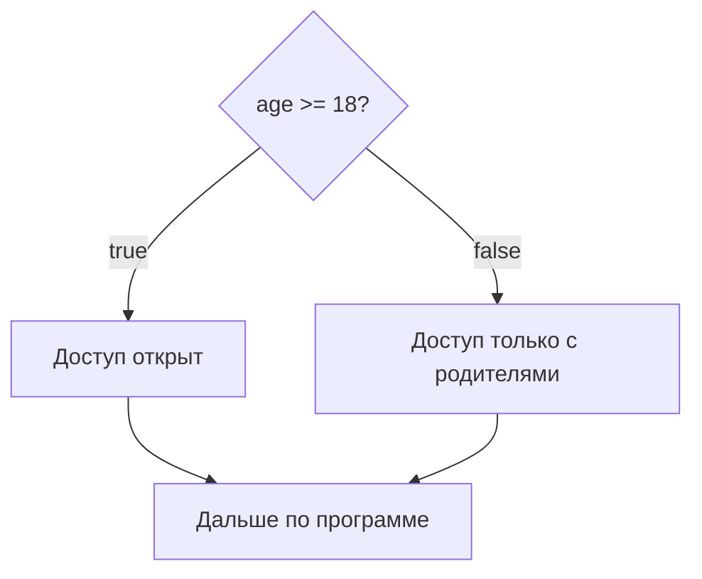
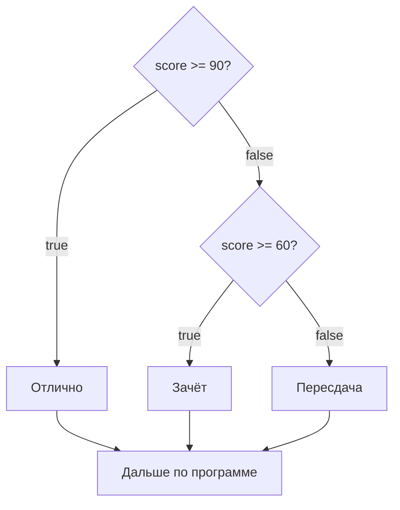

# Условия

[Содержание](../../README.md) · [← Назад](../../Lesson-2/ru/Типы%20данных%20и%20операторы.md) · [Вперёд →](../../Lesson-4/ru/Циклы.md) · [RU](%D0%A3%D1%81%D0%BB%D0%BE%D0%B2%D0%B8%D1%8F.md) · [EN](../en/Conditions.md) · [UZ](../uz/Shartlar.md)

> **Связь с уроком 2:** вы научились сравнивать значения и получать `true` или `false`. Сегодня программа начнёт по этим ответам **принимать решения**.

---

## Зачем это вам

«Если пароль короче 8 символов - показать ошибку». «Если сумма заказа больше 100 000 - доставка бесплатная, иначе - 15 000». «Если пользователь выбрал тёмную тему - включить её». Без условий программа всегда делает одно и то же. С условиями - реагирует на данные.

---

## Чему вы научитесь

- Выполнять код только при условии: `if`.
- Выбирать из двух и более вариантов: `else`, `else if`.
- Объединять условия: `&&` (и), `||` (или), `!` (не).
- Понимать, какие значения JavaScript считает «ложными».
- Записывать короткий выбор тернарным оператором `? :`.
- Выбирать из списка точных значений через `switch`.

---

## Повторение: 3 вопроса из урока 2

1. Что вернёт `7 >= 7`?
2. Чем `===` отличается от `==`?
3. Какого типа результат сравнения `age > 18`?

Ответы - в конце урока.

---

## План урока

| Раздел | Что делаем |
| --- | --- |
| `if` и `else` | Развилка на дороге |
| `else if` | Несколько дорог |
| Мини-задание 1 | Время суток |
| Логические операторы | И, или, не |
| Truthy и falsy | Что JavaScript считает «ложью» |
| Тернарный оператор | Выбор в одну строку |
| `switch` | Выбор по точному значению |
| Мини-задание 2 | Стоимость доставки |
| Самостоятельная работа | Оценка и допуск к олимпиаде |

---

## `if` и `else`

**Простыми словами:** условие - развилка на дороге. Табличка «если идёт дождь - возьми зонт».

```js
const temperature = 28;

if (temperature > 25) {
    console.log("Жарко, возьмите воду");
}
```

| Часть | Что это |
| --- | --- |
| `if` | «Если» |
| `( temperature > 25 )` | Условие в круглых скобках - любое выражение, которое даёт `true` или `false` |
| `{ ... }` | Блок: инструкции, которые выполнятся, только если условие истинно |

Код внутри блока сдвигается на 4 пробела - так видно, что он «внутри» условия. Точка с запятой после `}` не ставится.

### `else` - «иначе»

```js
const age = 16;

if (age >= 18) {
    console.log("Доступ открыт");
} else {
    console.log("Доступ только с родителями");
}
```

Выполнится **ровно одна** ветка: либо первая, либо вторая.



### Частая ошибка: `=` вместо `===`

```js
let role = "guest";

if (role = "admin") {        // ошибка: это присваивание, а не сравнение!
    console.log("Панель администратора");
}
console.log(role);           // "admin" - значение испорчено
```

`=` кладёт значение в переменную. Сравнение - только `===`.

---

## `else if` - несколько вариантов

```js
const hour = 14;

if (hour < 12) {
    console.log("Доброе утро");
} else if (hour < 18) {
    console.log("Добрый день");
} else {
    console.log("Добрый вечер");
}
```

Условия проверяются **сверху вниз**, выполняется первая подходящая ветка, остальные пропускаются. Поэтому порядок важен:

```js
const score = 95;

// Неправильно: 95 >= 60 - true, до проверки на 90 очередь не дойдёт
if (score >= 60) {
    console.log("Зачёт");
} else if (score >= 90) {
    console.log("Отлично");
}

// Правильно: от самого строгого условия к самому мягкому
if (score >= 90) {
    console.log("Отлично");
} else if (score >= 60) {
    console.log("Зачёт");
} else {
    console.log("Пересдача");
}
```

### Сохранить результат в переменную

Часто ветки не выводят текст, а вычисляют значение. Переменную объявляют через `let` **до** условия, а в ветках присваивают:

```js
const hour = 20;
let greeting;

if (hour < 12) {
    greeting = "Доброе утро";
} else if (hour < 18) {
    greeting = "Добрый день";
} else {
    greeting = "Добрый вечер";
}

console.log(greeting); // Добрый вечер
```

Если объявить `let greeting` внутри блока `{ }`, после блока переменная будет недоступна: она живёт только внутри своих фигурных скобок.

### Как проверяются ветки: пошагово

Возьмём правильную цепочку выше и `score = 75`. Браузер идёт сверху вниз и останавливается на первом `true`:

| Шаг | Проверка | Результат | Что происходит |
| --- | --- | --- | --- |
| 1 | `75 >= 90` | `false` | Ветка пропущена, идём дальше |
| 2 | `75 >= 60` | `true` | Выводится `Зачёт`, остальные ветки **не проверяются** |
| 3 | `else` | - | Не выполняется: ветка уже найдена |



**Как читать схему.** Каждый ромб - вопрос. Ответ `false` ведёт к следующему вопросу, ответ `true` - к действию и сразу на выход. Поэтому порядок условий важен: самое строгое ставят первым.

---

## Мини-задание 1

Объявите `const hour = 7;`. Выведите `Ночь` для 0–5, `Утро` для 6–11, `День` для 12–17 и `Вечер` для 18–23. Проверьте программу на значениях 0, 5, 6, 12, 18, 23. Решение - в разделе «Ответы».

---

## Логические операторы

| Оператор | Читается | Результат `true`, когда |
| --- | --- | --- |
| `&&` | И | Оба условия истинны |
| `\|\|` | ИЛИ | Хотя бы одно истинно |
| `!` | НЕ | Переворачивает: `!true` → `false` |

```js
const age = 15;
const hasTicket = true;

if (age >= 12 && hasTicket) {
    console.log("Проходите");
}

const day = "сб";
if (day === "сб" || day === "вс") {
    console.log("Выходной");
}

const isLoggedIn = false;
if (!isLoggedIn) {
    console.log("Войдите в аккаунт");
}
```

### Диапазон

Проверка «число от 6 до 11 включительно» записывается двумя сравнениями:

```js
if (hour >= 6 && hour <= 11) { ... }
```

Математическая запись `6 <= hour <= 11` в JavaScript **не работает** так, как кажется: сначала вычисляется `6 <= hour` → `true`, затем `true <= 11` → `true` при любом `hour`.

### Таблица истинности

Все четыре сочетания для двух условий - их полезно один раз выписать:

| `a` | `b` | `a && b` | `a \|\| b` |
| --- | --- | --- | --- |
| `true` | `true` | `true` | `true` |
| `true` | `false` | `false` | `true` |
| `false` | `true` | `false` | `true` |
| `false` | `false` | `false` | `false` |

Запомнить просто: `&&` строгий - нужно, чтобы выполнилось **всё**; `||` добрый - хватает **одного**.

Пример из жизни: «вход в кинозал, если есть билет **и** исполнилось 16» - это `&&`. «Скидка, если вы студент **или** пенсионер» - это `||`.

---

## Truthy и falsy

В условие можно поставить не только `true` или `false`, но и любое значение. JavaScript превратит его в логическое. Значений, которые считаются **ложными** (falsy), всего шесть:

| Falsy-значение | Тип |
| --- | --- |
| `false` | boolean |
| `0` | number |
| `""` (пустая строка) | string |
| `null` | null |
| `undefined` | undefined |
| `NaN` | number |

Всё остальное - **truthy** (истинное), включая `"0"`, `" "` и `"false"`.

```js
const userName = "";

if (userName) {
    console.log(`Привет, ${userName}`);
} else {
    console.log("Введите имя");   // выполнится: пустая строка - falsy
}
```

> **Осторожно с нулём:** `if (count)` не отличит «0 товаров» от «значение не задано». Если ноль - допустимое значение, сравнивайте явно: `if (count === 0)`.

---

## Тернарный оператор

Когда нужно выбрать одно из двух значений, `if/else` можно записать в одну строку:

```js
const age = 20;
const access = age >= 18 ? "Взрослый билет" : "Детский билет";
console.log(access); // Взрослый билет
```

Схема: `условие ? значение_если_true : значение_если_false`.

Тернарный оператор удобен, когда результат - **значение**, которое кладут в переменную или вставляют в шаблонную строку:

```js
const items = 1;
console.log(`В корзине ${items} ${items === 1 ? "товар" : "товара"}`);
```

Если в ветках несколько действий или вариантов больше двух - используйте `if/else`. Вложенные тернарные операторы читать тяжело.

---

## `switch`

`switch` сравнивает одно значение со списком точных вариантов через `===`:

```js
const day = "ср";
let lesson;

switch (day) {
    case "пн":
    case "ср":
        lesson = "JavaScript";
        break;
    case "вт":
        lesson = "CSS";
        break;
    default:
        lesson = "Свободный день";
}

console.log(lesson); // JavaScript
```

| Часть | Что делает |
| --- | --- |
| `case "пн":` | Вариант значения |
| `break;` | Выход из `switch`. Без него выполнение «проваливается» в следующий `case` |
| `default:` | Если ни один `case` не подошёл - как `else` |

Два `case` подряд без кода - способ сказать «для пн и ср одно и то же». `switch` подходит для точных значений, а для диапазонов (`score >= 90`) нужен `if/else if`.

### Что выбрать: `if`, тернарный оператор или `switch`

| Ситуация | Инструмент | Пример |
| --- | --- | --- |
| Диапазоны и сложные условия | `if / else if / else` | Оценка по баллам |
| Выбор одного из двух значений | Тернарный оператор | `"товар"` или `"товара"` |
| Одно значение и много точных вариантов | `switch` | День недели, роль пользователя |

### Попробуйте сломать

1. Уберите `break` после `lesson = "JavaScript";` и запустите для `"ср"`. Какое значение окажется в `lesson`? Выполнение «провалилось» в следующий `case`.
2. Поменяйте местами две проверки в цепочке оценок: сначала `>= 60`, потом `>= 90`. Какой результат будет для `95`?
3. Напишите `if (6 <= hour <= 11)` для `hour = 20`. Почему условие оказалось `true`?

### Частые ошибки новичков

| Ошибка | Что получится | Как исправить |
| --- | --- | --- |
| `if (x = 5)` | Присваивание, условие всегда истинно | `if (x === 5)` |
| `6 <= hour <= 11` | Всегда `true` | `hour >= 6 && hour <= 11` |
| Мягкое условие стоит раньше строгого | Строгая ветка никогда не выполняется | От строгого к мягкому |
| `let result` объявлена внутри `{ }` | После блока - `ReferenceError` | Объявите `let result;` до `if` |
| Нет `break` в `switch` | Выполняется и следующий `case` | `break;` в конце каждого варианта |
| `if (count)` при `count = 0` | Ветка не выполняется, хотя значение задано | `if (count !== undefined)` или `count >= 0` |

---

## Мини-задание 2

Объявите `const orderTotal = 85000;` и `const city = "Ташкент";`. Доставка бесплатная, если сумма от 100 000, **или** если город - Ташкент и сумма от 50 000. Иначе доставка стоит 15 000. Сохраните стоимость доставки в `const deliveryCost` тернарным оператором и выведите `Доставка: 0 сум` или `Доставка: 15000 сум`. Решение - в разделе «Ответы».

---

## Итоги урока: шпаргалка

| Задача | Запись |
| --- | --- |
| Выполнить при условии | `if (условие) { ... }` |
| Иначе | `} else { ... }` |
| Ещё вариант | `} else if (условие) { ... }` |
| И / ИЛИ / НЕ | `&&` / `\|\|` / `!` |
| Диапазон | `x >= 6 && x <= 11` |
| Выбор значения | `const v = условие ? a : b;` |
| Точные варианты | `switch (x) { case "a": ...; break; default: ... }` |
| Falsy | `false`, `0`, `""`, `null`, `undefined`, `NaN` |

---

## Самостоятельная работа

### Часть 1. Задание в IDE (засчитывается платформой)

Платформа задаёт балл ученика `score` (0–100) и возраст `age`. Напишите:

1. `let grade;` и цепочку `if / else if / else`: 90 и выше → `5`, от 75 → `4`, от 60 → `3`, ниже → `2`. Оценка - число.
2. `const canEnter` - допуск к олимпиаде: возраст **от 14** и балл **от 60**.
3. `const status` тернарным оператором: `"Допущен"` или `"Не допущен"`.
4. Выведите в консоль строку `Оценка: 4. Допущен` (со своими значениями) шаблонной строкой.

Сравнивайте только через `===`, `!==`, `<`, `>`, `<=`, `>=`.

Что проверяет платформа: оценку на значениях 95, 90, 87, 75, 74, 60, 59; допуск на границах возраста и балла; использование `else if` и тернарного оператора; отсутствие `==`; строку в консоли.

### Часть 2. Проект на компьютере

1. В `main.js` своего сайта объявите `const hour = new Date().getHours();` - текущий час (эта запись берёт время с компьютера, подробно разберём позже).
2. Выведите в консоль приветствие по времени суток.
3. Объявите `const isWeekend` и выведите разное сообщение для будней и выходных через тернарный оператор. День недели: `new Date().getDay()` - `0` воскресенье, `6` суббота.
4. Проверьте все ветки: временно заменяйте `hour` на конкретные числа.

### Критерии готовности

- [ ] Задание в IDE засчитано.
- [ ] Каждая ветка условия проверена хотя бы одним значением, включая границы.
- [ ] Условия в `else if` идут от строгого к мягкому.
- [ ] Используются только строгие сравнения.
- [ ] Тернарный оператор применён только для выбора значения.

---

## Вопросы для самопроверки

1. Сколько веток выполнится в цепочке `if / else if / else`?
2. Почему порядок условий в `else if` важен? Приведите пример.
3. Чем `if (x = 5)` отличается от `if (x === 5)`?
4. Как записать «число от 1 до 10 включительно»?
5. Чем `&&` отличается от `||`?
6. Перечислите falsy-значения.
7. Выполнится ли блок `if ("0") { ... }`? Почему?
8. Когда удобен тернарный оператор, а когда лучше `if/else`?
9. Что будет в `switch`, если забыть `break`?
10. Почему `let grade;` объявляют до `if`, а не внутри веток?

После вопросов пройдите **тест урока** на платформе: 12 вопросов, порог 70%.

---

## Что дальше

Условие выполняет код один раз или не выполняет вовсе. А если действие нужно повторить 10 или 1000 раз - вывести таблицу умножения, посчитать сумму, проверить каждую букву слова? В уроке 4 - **циклы**.

---

## Ответы

**Повторение**

1. `true`.
2. `===` сравнивает значение и тип, `==` приводит типы.
3. `boolean`.

**Мини-задание 1**

```js
const hour = 7;
let partOfDay;

if (hour <= 5) {
    partOfDay = "Ночь";
} else if (hour <= 11) {
    partOfDay = "Утро";
} else if (hour <= 17) {
    partOfDay = "День";
} else {
    partOfDay = "Вечер";
}

console.log(partOfDay); // Утро
```

**Мини-задание 2**

```js
const orderTotal = 85000;
const city = "Ташкент";

const isFree = orderTotal >= 100000 || (city === "Ташкент" && orderTotal >= 50000);
const deliveryCost = isFree ? 0 : 15000;

console.log(`Доставка: ${deliveryCost} сум`); // Доставка: 0 сум
```

Скобки вокруг `&&` здесь не обязательны (`&&` выполняется раньше `||`), но делают смысл очевидным.

**Вопросы для самопроверки**

1. Ровно одна - первая подходящая, или `else`.
2. Выполняется первая подходящая ветка. Если `score >= 60` стоит раньше `score >= 90`, балл 95 получит «Зачёт».
3. `=` присваивает и портит значение, `===` сравнивает.
4. `x >= 1 && x <= 10`.
5. `&&` - истинны оба условия, `||` - хотя бы одно.
6. `false`, `0`, `""`, `null`, `undefined`, `NaN`.
7. Да: `"0"` - непустая строка, а значит truthy.
8. Тернарный - для выбора одного из двух значений; `if/else` - для нескольких действий или вариантов.
9. Выполнение «провалится» в следующий `case` и выполнит его код.
10. Переменная, объявленная внутри `{ }`, недоступна после блока.

---

[Содержание](../../README.md) · [← Назад](../../Lesson-2/ru/Типы%20данных%20и%20операторы.md) · [Вперёд →](../../Lesson-4/ru/Циклы.md) · [RU](%D0%A3%D1%81%D0%BB%D0%BE%D0%B2%D0%B8%D1%8F.md) · [EN](../en/Conditions.md) · [UZ](../uz/Shartlar.md)
