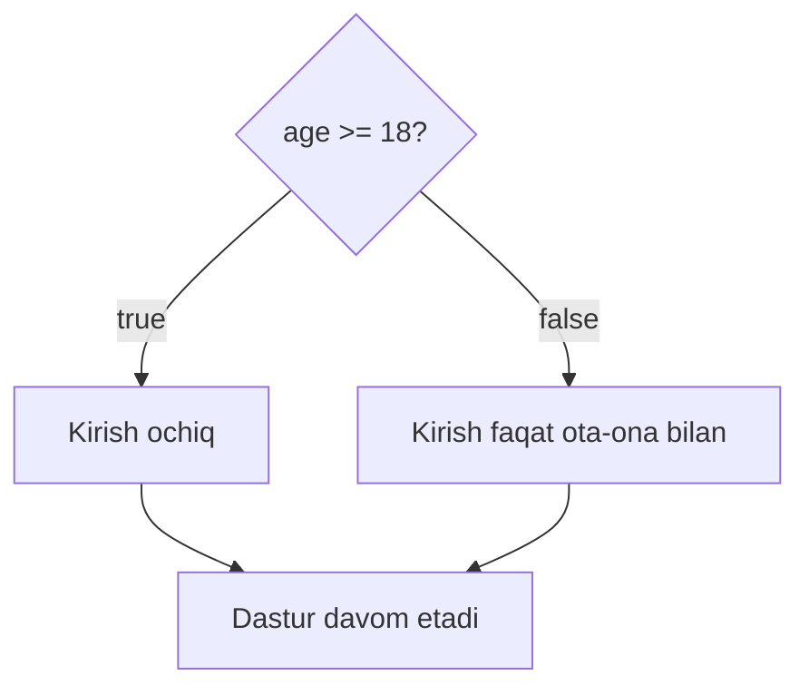
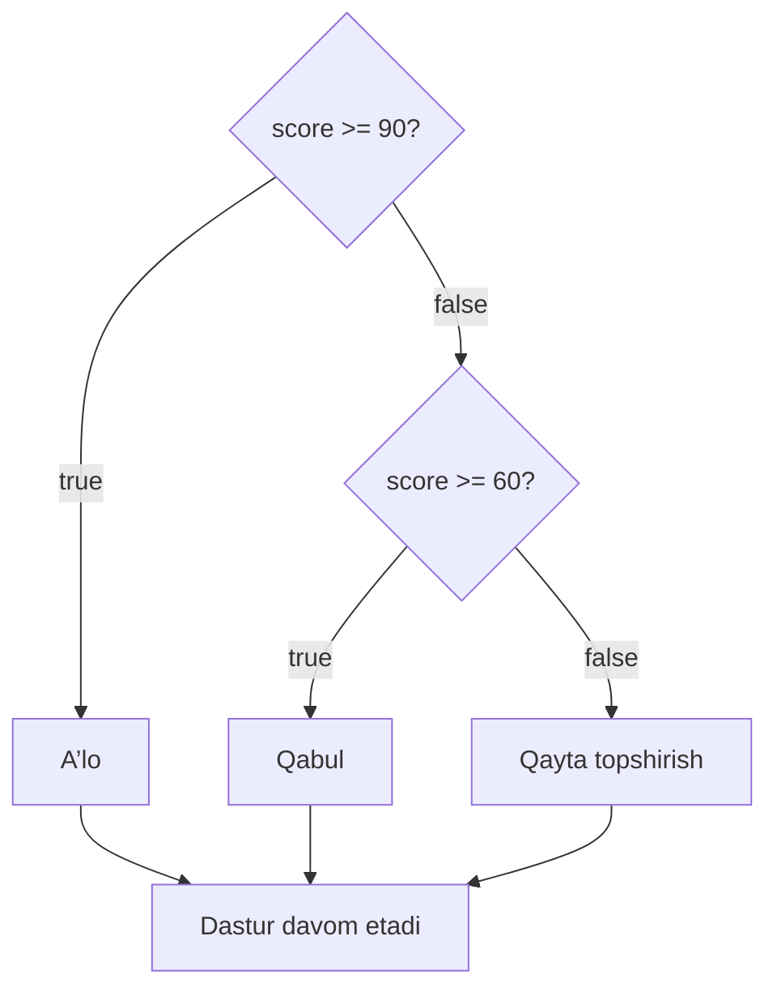

# Shartlar

[Mundarija](../../README.md) · [← Orqaga](../../Lesson-2/uz/Ma'lumot%20turlari%20va%20operatorlar.md) · [Keyingi →](../../Lesson-4/uz/Sikllar.md) · [RU](../ru/%D0%A3%D1%81%D0%BB%D0%BE%D0%B2%D0%B8%D1%8F.md) · [EN](../en/Conditions.md) · [UZ](Shartlar.md)

> **2-dars bilan bog‘liqlik:** siz qiymatlarni solishtirib, `true` yoki `false` olishni o‘rgandingiz. Bugun dastur shu javoblarga qarab **qaror qabul qila** boshlaydi.

---

## Bu sizga nima uchun kerak

«Agar parol 8 belgidan qisqa bo‘lsa - xato ko‘rsatilsin». «Agar buyurtma summasi 100000 dan katta bo‘lsa - yetkazib berish bepul, aks holda - 15000». «Agar foydalanuvchi qorong‘i mavzuni tanlagan bo‘lsa - uni yoqish». Shartlarsiz dastur doim bir xil ishni qiladi. Shartlar bilan esa ma’lumotlarga javob beradi.

---

## Nimani o‘rganasiz

- Kodni faqat shart bajarilganda ishga tushirish: `if`.
- Ikki va undan ortiq variantdan tanlash: `else`, `else if`.
- Shartlarni birlashtirish: `&&` (va), `||` (yoki), `!` (emas).
- JavaScript qaysi qiymatlarni «yolg‘on» deb hisoblashini tushunish.
- Qisqa tanlovni `? :` ternar operatori bilan yozish.
- Aniq qiymatlar ro‘yxatidan `switch` orqali tanlash.

---

## Takrorlash: 2-darsdan 3 savol

1. `7 >= 7` nimani qaytaradi?
2. `===` `==` dan nimasi bilan farq qiladi?
3. `age > 18` solishtirish natijasining turi qanday?

Javoblar - dars oxirida.

---

## Reja

| Bo‘lim | Nima qilamiz |
| --- | --- |
| `if` va `else` | Yo‘ldagi ayrilish |
| `else if` | Bir nechta yo‘l |
| Mini-topshiriq 1 | Kun vaqti |
| Mantiqiy operatorlar | Va, yoki, emas |
| Truthy va falsy | JavaScript nimani «yolg‘on» deb biladi |
| Ternar operator | Bir qatorda tanlov |
| `switch` | Aniq qiymat bo‘yicha tanlov |
| Mini-topshiriq 2 | Yetkazib berish narxi |
| Mustaqil ish | Baho va olimpiadaga ruxsat |

---

## `if` va `else`

**Oddiy so‘z bilan:** shart - yo‘ldagi ayrilish. «Yomg‘ir yog‘sa - soyabon ol» degan yozuv.

```js
const temperature = 28;

if (temperature > 25) {
    console.log("Issiq, suv oling");
}
```

| Qism | Bu nima |
| --- | --- |
| `if` | «Agar» |
| `( temperature > 25 )` | Qavs ichidagi shart - `true` yoki `false` beradigan istalgan ifoda |
| `{ ... }` | Blok: faqat shart rost bo‘lganda bajariladigan ko‘rsatmalar |

Blok ichidagi kod 4 ta bo‘sh joyga suriladi - shunda u shart «ichida» ekani ko‘rinadi. `}` dan keyin nuqtali vergul qo‘yilmaydi.

### `else` - «aks holda»

```js
const age = 16;

if (age >= 18) {
    console.log("Kirish ochiq");
} else {
    console.log("Kirish faqat ota-ona bilan");
}
```

**Faqat bitta** tarmoq bajariladi: yo birinchisi, yo ikkinchisi.



### Tipik xato: `===` o‘rniga `=`

```js
let role = "guest";

if (role = "admin") {        // xato: bu solishtirish emas, qiymat berish!
    console.log("Administrator paneli");
}
console.log(role);           // "admin" - qiymat buzildi
```

`=` o‘zgaruvchiga qiymat soladi. Solishtirish - faqat `===`.

---

## `else if` - bir nechta variant

```js
const hour = 14;

if (hour < 12) {
    console.log("Xayrli tong");
} else if (hour < 18) {
    console.log("Xayrli kun");
} else {
    console.log("Xayrli kech");
}
```

Shartlar **yuqoridan pastga** tekshiriladi, birinchi mos tarmoq bajariladi, qolganlari o‘tkazib yuboriladi. Shuning uchun tartib muhim:

```js
const score = 95;

// Noto‘g‘ri: 95 >= 60 - true, 90 ni tekshirishgacha navbat yetmaydi
if (score >= 60) {
    console.log("Qabul");
} else if (score >= 90) {
    console.log("A’lo");
}

// To‘g‘ri: eng qat’iy shartdan eng yumshog‘iga
if (score >= 90) {
    console.log("A’lo");
} else if (score >= 60) {
    console.log("Qabul");
} else {
    console.log("Qayta topshirish");
}
```

### Natijani o‘zgaruvchida saqlash

Ko‘pincha tarmoqlar matn chiqarmaydi, qiymat hisoblaydi. O‘zgaruvchi shartdan **oldin** `let` bilan e’lon qilinadi, tarmoqlarda esa qiymat beriladi:

```js
const hour = 20;
let greeting;

if (hour < 12) {
    greeting = "Xayrli tong";
} else if (hour < 18) {
    greeting = "Xayrli kun";
} else {
    greeting = "Xayrli kech";
}

console.log(greeting); // Xayrli kech
```

Agar `let greeting` ni `{ }` blok ichida e’lon qilsangiz, blokdan keyin o‘zgaruvchi mavjud bo‘lmaydi: u faqat o‘z jingalak qavslari ichida yashaydi.

### Tarmoqlar qanday tekshiriladi: qadamma-qadam

Yuqoridagi to‘g‘ri zanjirni va `score = 75` ni olamiz. Brauzer yuqoridan pastga boradi va birinchi `true` da to‘xtaydi:

| Qadam | Tekshiruv | Natija | Nima bo‘ladi |
| --- | --- | --- | --- |
| 1 | `75 >= 90` | `false` | Tarmoq o‘tkazib yuboriladi, davom etamiz |
| 2 | `75 >= 60` | `true` | `Qabul` chiqariladi, qolgan tarmoqlar **tekshirilmaydi** |
| 3 | `else` | - | Bajarilmaydi: tarmoq allaqachon topilgan |



**Sxemani qanday o‘qish kerak.** Har bir romb - savol. `false` javobi keyingi savolga, `true` javobi - amalga va darhol chiqishga olib boradi. Shuning uchun shartlar tartibi muhim: eng qat’iysi birinchi qo‘yiladi.

---

## Mini-topshiriq 1

`const hour = 7;` e’lon qiling. 0–5 uchun `Tun`, 6–11 uchun `Tong`, 12–17 uchun `Kun` va 18–23 uchun `Kech` chiqaring. Dasturni 0, 5, 6, 12, 18, 23 qiymatlarida tekshiring. Yechim - «Javoblar» bo‘limida.

---

## Mantiqiy operatorlar

| Operator | O‘qilishi | `true` natija, qachonki |
| --- | --- | --- |
| `&&` | VA | Ikkala shart ham rost |
| `\|\|` | YOKI | Kamida bittasi rost |
| `!` | EMAS | Teskari qiladi: `!true` → `false` |

```js
const age = 15;
const hasTicket = true;

if (age >= 12 && hasTicket) {
    console.log("Marhamat");
}

const day = "shan";
if (day === "shan" || day === "yak") {
    console.log("Dam olish kuni");
}

const isLoggedIn = false;
if (!isLoggedIn) {
    console.log("Akkauntga kiring");
}
```

### Oraliq

«6 dan 11 gacha (ular ham kiradi) son» tekshiruvi ikkita solishtirish bilan yoziladi:

```js
if (hour >= 6 && hour <= 11) { ... }
```

Matematik `6 <= hour <= 11` yozuvi JavaScript’da ko‘ringanidek **ishlamaydi**: avval `6 <= hour` → `true`, keyin `true <= 11` → istalgan `hour` da `true`.

### Haqiqiylik jadvali

Ikki shart uchun barcha to‘rtta birikma - ularni bir marta yozib chiqish foydali:

| `a` | `b` | `a && b` | `a \|\| b` |
| --- | --- | --- | --- |
| `true` | `true` | `true` | `true` |
| `true` | `false` | `false` | `true` |
| `false` | `true` | `false` | `true` |
| `false` | `false` | `false` | `false` |

Eslab qolish oson: `&&` qat’iy - **hammasi** bajarilishi kerak; `||` mehribon - **bittasi** yetarli.

Hayotiy misol: «chipta bor **va** 16 yoshga to‘lgan bo‘lsa, kinozalga kirish» - bu `&&`. «Talaba **yoki** nafaqaxo‘r bo‘lsangiz, chegirma» - bu `||`.

---

## Truthy va falsy

Shartga faqat `true` yoki `false` emas, istalgan qiymatni qo‘yish mumkin. JavaScript uni mantiqiy qiymatga aylantiradi. **Yolg‘on** (falsy) hisoblanadigan qiymatlar atigi oltita:

| Falsy qiymat | Tur |
| --- | --- |
| `false` | boolean |
| `0` | number |
| `""` (bo‘sh satr) | string |
| `null` | null |
| `undefined` | undefined |
| `NaN` | number |

Qolgan hammasi - **truthy** (rost), jumladan `"0"`, `" "` va `"false"`.

```js
const userName = "";

if (userName) {
    console.log(`Salom, ${userName}`);
} else {
    console.log("Ismingizni kiriting");   // bajariladi: bo‘sh satr - falsy
}
```

> **Nol bilan ehtiyot bo‘ling:** `if (count)` «0 ta mahsulot» ni «qiymat berilmagan» dan ajrata olmaydi. Agar nol to‘g‘ri qiymat bo‘lsa, aniq solishtiring: `if (count === 0)`.

---

## Ternar operator

Ikki qiymatdan birini tanlash kerak bo‘lsa, `if/else` ni bir qatorda yozish mumkin:

```js
const age = 20;
const access = age >= 18 ? "Kattalar chiptasi" : "Bolalar chiptasi";
console.log(access); // Kattalar chiptasi
```

Sxema: `shart ? true_bo‘lsa_qiymat : false_bo‘lsa_qiymat`.

Ternar operator natija **qiymat** bo‘lib, uni o‘zgaruvchiga solish yoki shablon satrga qo‘yish kerak bo‘lganda qulay:

```js
const items = 1;
console.log(`Savatda ${items} ta ${items === 1 ? "mahsulot" : "mahsulotlar"}`);
```

Tarmoqlarda bir nechta amal bo‘lsa yoki variantlar ikkitadan ko‘p bo‘lsa - `if/else` ishlating. Ichma-ich ternar operatorlarni o‘qish qiyin.

---

## `switch`

`switch` bitta qiymatni aniq variantlar ro‘yxati bilan `===` orqali solishtiradi:

```js
const day = "chor";
let lesson;

switch (day) {
    case "dush":
    case "chor":
        lesson = "JavaScript";
        break;
    case "sesh":
        lesson = "CSS";
        break;
    default:
        lesson = "Bo‘sh kun";
}

console.log(lesson); // JavaScript
```

| Qism | Nima qiladi |
| --- | --- |
| `case "dush":` | Qiymat varianti |
| `break;` | `switch` dan chiqish. Usiz bajarilish keyingi `case` ga «tushib ketadi» |
| `default:` | Hech bir `case` mos kelmasa - `else` kabi |

Kodsiz ketma-ket ikkita `case` - «dush va chor uchun bir xil» deyish usuli. `switch` aniq qiymatlar uchun mos, oraliqlar (`score >= 90`) uchun esa `if/else if` kerak.

### Nimani tanlash: `if`, ternar operator yoki `switch`

| Vaziyat | Vosita | Misol |
| --- | --- | --- |
| Oraliqlar va murakkab shartlar | `if / else if / else` | Ball bo‘yicha baho |
| Ikki qiymatdan birini tanlash | Ternar operator | `"ta mahsulot"` yoki `"mahsulot"` |
| Bitta qiymat va ko‘p aniq variantlar | `switch` | Hafta kuni, foydalanuvchi roli |

### Buzib ko‘ring

1. `lesson = "JavaScript";` dan keyingi `break` ni olib tashlang va `"chor"` uchun ishga tushiring. `lesson` da qanday qiymat bo‘ladi? Bajarilish keyingi `case` ga «tushib ketdi».
2. Baholar zanjiridagi ikki tekshiruv o‘rnini almashtiring: avval `>= 60`, keyin `>= 90`. `95` uchun natija qanday bo‘ladi?
3. `hour = 20` uchun `if (6 <= hour <= 11)` deb yozing. Nega shart `true` bo‘lib chiqdi?

### Yangi o‘rganuvchilarning tipik xatolari

| Xato | Nima bo‘ladi | Qanday tuzatish |
| --- | --- | --- |
| `if (x = 5)` | O‘zlashtirish, shart doim rost | `if (x === 5)` |
| `6 <= hour <= 11` | Doim `true` | `hour >= 6 && hour <= 11` |
| Yumshoq shart qat’iysidan oldin turibdi | Qat’iy tarmoq hech qachon bajarilmaydi | Qat’iydan yumshoqqa |
| `let result` `{ }` ichida e’lon qilingan | Blokdan keyin - `ReferenceError` | `let result;` ni `if` dan oldin e’lon qiling |
| `switch` da `break` yo‘q | Keyingi `case` ham bajariladi | Har bir variant oxirida `break;` |
| `count = 0` da `if (count)` | Qiymat berilgan bo‘lsa ham tarmoq bajarilmaydi | `if (count !== undefined)` yoki `count >= 0` |

---

## Mini-topshiriq 2

`const orderTotal = 85000;` va `const city = "Toshkent";` e’lon qiling. Summa 100000 dan kam bo‘lmasa, **yoki** shahar Toshkent va summa 50000 dan kam bo‘lmasa, yetkazib berish bepul. Aks holda yetkazib berish 15000 turadi. Yetkazib berish narxini ternar operator bilan `const deliveryCost` ga saqlang va `Yetkazib berish: 0 so‘m` yoki `Yetkazib berish: 15000 so‘m` chiqaring. Yechim - «Javoblar» bo‘limida.

---

## Dars yakuni: shpargalka

| Vazifa | Yozuv |
| --- | --- |
| Shart bo‘yicha bajarish | `if (shart) { ... }` |
| Aks holda | `} else { ... }` |
| Yana variant | `} else if (shart) { ... }` |
| VA / YOKI / EMAS | `&&` / `\|\|` / `!` |
| Oraliq | `x >= 6 && x <= 11` |
| Qiymat tanlash | `const v = shart ? a : b;` |
| Aniq variantlar | `switch (x) { case "a": ...; break; default: ... }` |
| Falsy | `false`, `0`, `""`, `null`, `undefined`, `NaN` |

---

## Mustaqil ish

### 1-qism. IDE topshirig‘i (platforma hisoblaydi)

Platforma o‘quvchi bali `score` (0–100) va yoshi `age` ni beradi. Yozing:

1. `let grade;` va `if / else if / else` zanjiri: 90 va undan yuqori → `5`, 75 dan → `4`, 60 dan → `3`, pastroq → `2`. Baho - son.
2. `const canEnter` - olimpiadaga ruxsat: yosh **14 dan** va ball **60 dan**.
3. Ternar operator bilan `const status`: `"Ruxsat berildi"` yoki `"Ruxsat berilmadi"`.
4. Konsolga shablon satr bilan `Baho: 4. Ruxsat berildi` qatorini (o‘z qiymatlaringiz bilan) chiqaring.

Faqat `===`, `!==`, `<`, `>`, `<=`, `>=` bilan solishtiring.

Platforma nimani tekshiradi: 95, 90, 87, 75, 74, 60, 59 qiymatlaridagi baho; yosh va ball chegaralarida ruxsat; `else if` va ternar operator ishlatilgani; `==` yo‘qligi; konsoldagi qator.

### 2-qism. Kompyuterdagi loyiha

1. Saytingizning `main.js` faylida `const hour = new Date().getHours();` - joriy soatni e’lon qiling (bu yozuv vaqtni kompyuterdan oladi, keyinroq batafsil ko‘ramiz).
2. Konsolga kun vaqtiga qarab salomlashuv chiqaring.
3. `const isWeekend` e’lon qiling va ish kunlari hamda dam olish kunlari uchun turli xabarni ternar operator bilan chiqaring. Hafta kuni: `new Date().getDay()` - `0` yakshanba, `6` shanba.
4. Barcha tarmoqlarni tekshiring: `hour` ni vaqtincha aniq sonlarga almashtiring.

### Tayyorlik mezonlari

- [ ] IDE topshirig‘i qabul qilindi.
- [ ] Shartning har bir tarmog‘i kamida bitta qiymat bilan, chegaralar bilan birga tekshirilgan.
- [ ] `else if` dagi shartlar qat’iydan yumshoqqa qarab boradi.
- [ ] Faqat qat’iy solishtirishlar ishlatilgan.
- [ ] Ternar operator faqat qiymat tanlash uchun qo‘llangan.

---

## O‘zini tekshirish uchun savollar

1. `if / else if / else` zanjirida nechta tarmoq bajariladi?
2. Nima uchun `else if` dagi shartlar tartibi muhim? Misol keltiring.
3. `if (x = 5)` `if (x === 5)` dan nimasi bilan farq qiladi?
4. «1 dan 10 gacha (ular ham kiradi) son» qanday yoziladi?
5. `&&` `||` dan nimasi bilan farq qiladi?
6. Falsy qiymatlarni sanab bering.
7. `if ("0") { ... }` bloki bajariladimi? Nima uchun?
8. Ternar operator qachon qulay, `if/else` qachon yaxshiroq?
9. `switch` da `break` unutilsa nima bo‘ladi?
10. Nima uchun `let grade;` tarmoqlar ichida emas, `if` dan oldin e’lon qilinadi?

Savollardan keyin platformada **dars testini** topshiring: 12 ta savol, o‘tish chegarasi 70%.

---

## Keyin nima

Shart kodni bir marta bajaradi yoki umuman bajarmaydi. Agar amalni 10 yoki 1000 marta takrorlash kerak bo‘lsa-chi - ko‘paytirish jadvalini chiqarish, yig‘indini hisoblash, so‘zning har bir harfini tekshirish? 4-darsda - **sikllar**.

---

## Javoblar

**Takrorlash**

1. `true`.
2. `===` qiymat va turni solishtiradi, `==` turlarni o‘zgartiradi.
3. `boolean`.

**Mini-topshiriq 1**

```js
const hour = 7;
let partOfDay;

if (hour <= 5) {
    partOfDay = "Tun";
} else if (hour <= 11) {
    partOfDay = "Tong";
} else if (hour <= 17) {
    partOfDay = "Kun";
} else {
    partOfDay = "Kech";
}

console.log(partOfDay); // Tong
```

**Mini-topshiriq 2**

```js
const orderTotal = 85000;
const city = "Toshkent";

const isFree = orderTotal >= 100000 || (city === "Toshkent" && orderTotal >= 50000);
const deliveryCost = isFree ? 0 : 15000;

console.log(`Yetkazib berish: ${deliveryCost} so‘m`); // Yetkazib berish: 0 so‘m
```

Bu yerda `&&` atrofidagi qavslar shart emas (`&&` `||` dan oldin bajariladi), lekin ma’noni aniq qiladi.

**O‘zini tekshirish uchun savollar**

1. Faqat bittasi - birinchi mos keladigani yoki `else`.
2. Birinchi mos tarmoq bajariladi. Agar `score >= 60` `score >= 90` dan oldin tursa, 95 ball «Qabul» oladi.
3. `=` qiymat beradi va uni buzadi, `===` solishtiradi.
4. `x >= 1 && x <= 10`.
5. `&&` - ikkala shart rost, `||` - kamida bittasi.
6. `false`, `0`, `""`, `null`, `undefined`, `NaN`.
7. Ha: `"0"` - bo‘sh bo‘lmagan satr, demak truthy.
8. Ternar - ikki qiymatdan birini tanlash uchun; `if/else` - bir nechta amal yoki variant uchun.
9. Bajarilish keyingi `case` ga «tushib ketadi» va uning kodini bajaradi.
10. `{ }` ichida e’lon qilingan o‘zgaruvchi blokdan keyin mavjud emas.

---

[Mundarija](../../README.md) · [← Orqaga](../../Lesson-2/uz/Ma'lumot%20turlari%20va%20operatorlar.md) · [Keyingi →](../../Lesson-4/uz/Sikllar.md) · [RU](../ru/%D0%A3%D1%81%D0%BB%D0%BE%D0%B2%D0%B8%D1%8F.md) · [EN](../en/Conditions.md) · [UZ](Shartlar.md)
