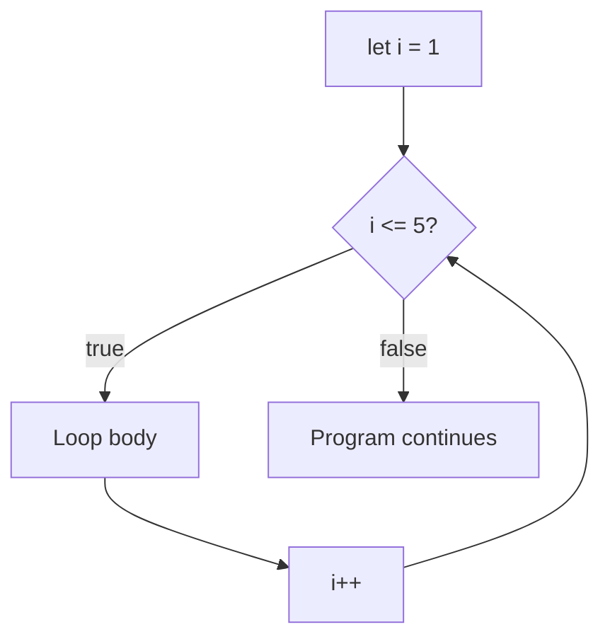

# Loops

[Contents](../../README.md) · [← Back](../../Lesson-3/en/Conditions.md) · [Next →](../../Lesson-5/en/Functions.md) · [RU](../ru/%D0%A6%D0%B8%D0%BA%D0%BB%D1%8B.md) · [EN](Loops.md) · [UZ](../uz/Sikllar.md)

> **Link to lesson 3:** a condition decides whether to run code once. A loop runs code **many times** while a condition is true.

---

## Why you need this

Print a multiplication table, add up all purchases, check every letter of a password, show 20 product cards - nobody will copy one line 20 times. A loop does it in three lines, no matter how many repetitions: 10 or 10000.

---

## What you will learn

- Repeat code a fixed number of times: `for`.
- Repeat while a condition is true: `while`.
- Leave a loop early (`break`) and skip a step (`continue`).
- Count a sum and a quantity: an accumulator and a counter.
- Go through the characters of a string: `for...of`.
- Find and stop an infinite loop.
- Trace a loop step by step in a table and write nested loops.


---

## Review: 3 questions from lesson 3

1. What does `count++` do?
2. How do you check that a number is even?
3. How do you write "`x` from 1 to 10 inclusive"?

Answers are at the end of the lesson.

---

## Lesson plan

| Section | What we do |
| --- | --- |
| The `for` loop | Repeat N times |
| Counter and accumulator | Count a sum and a quantity |
| Mini-task 1 | A countdown |
| `break` and `continue` | Stop and skip |
| The `while` loop | While the condition is true |
| An infinite loop | How not to freeze the tab |
| `for...of` over a string | Every letter |
| Mini-task 2 | How many spaces are in a text |
| Independent work | Multiplication table, sum of evens, vowels |

---

## The `for` loop

**In simple words:** a loop is an exercise like "10 squats". You know where to start, where to stop counting and how to move to the next one.

```js
for (let i = 1; i <= 5; i++) {
    console.log(`Squat ${i}`);
}
```

The console shows five lines: from `Squat 1` to `Squat 5`.

| Part | When it runs | What it does |
| --- | --- | --- |
| `let i = 1` | Once, at the start | Creates the counter |
| `i <= 5` | Before every step | If `false` - the loop ends |
| `i++` | After every step | Increases the counter |
| `{ ... }` | On every step | The **loop body** |



One pass of the body is called an **iteration**. The counter is traditionally called `i` (from *index*). The step can be anything:

```js
for (let i = 10; i >= 0; i -= 2) {
    console.log(i); // 10, 8, 6, 4, 2, 0
}
```

### Any code inside the loop

```js
for (let i = 1; i <= 10; i++) {
    if (i % 2 === 0) {
        console.log(`${i} is even`);
    }
}
```

---

## Counter and accumulator

These are the two main loop techniques. The variable is declared with `let` **before** the loop, changed inside it and used after it.

An **accumulator** collects a sum:

```js
let sum = 0;

for (let i = 1; i <= 100; i++) {
    sum += i;
}

console.log(sum); // 5050
```

A **counter** counts how many times a condition held:

```js
let count = 0;

for (let i = 1; i <= 100; i++) {
    if (i % 7 === 0) {
        count++;
    }
}

console.log(count); // 14 numbers from 1 to 100 are divisible by 7
```

### How an accumulator works: an execution table

Let us shrink the example to `i <= 5` and go through it by hand. Each row of the table is one iteration:

| Iteration | `i` | Condition `i <= 5` | `sum` before | `sum += i` | `sum` after |
| --- | --- | --- | --- | --- | --- |
| 1 | 1 | `true` | 0 | 0 + 1 | 1 |
| 2 | 2 | `true` | 1 | 1 + 2 | 3 |
| 3 | 3 | `true` | 3 | 3 + 3 | 6 |
| 4 | 4 | `true` | 6 | 6 + 4 | 10 |
| 5 | 5 | `true` | 10 | 10 + 5 | 15 |
| - | 6 | `false` | 15 | loop finished | 15 |

Note the last row: the counter manages to become `6`, the condition gives `false`, and the body does **not run**. Such a table is the main tool for understanding any loop. If a result surprises you - draw it on paper.

You can see the same in the console if you print the intermediate values:

```js
let sum = 0;

for (let i = 1; i <= 5; i++) {
    sum += i;
    console.log(`i = ${i}, sum = ${sum}`);
}
```

> **A common mistake:** declaring `let sum = 0;` **inside** the loop. Then the sum resets on every iteration, and after the loop the variable is not available.

You can accumulate strings too:

```js
let stars = "";

for (let i = 1; i <= 5; i++) {
    stars += "*";
}

console.log(stars); // *****
```

### Nested loops

A loop inside a loop: for **each** iteration of the outer one, the inner one runs **completely**. This is how tables and grids are built:

```js
for (let row = 1; row <= 3; row++) {
    let line = "";
    for (let col = 1; col <= 3; col++) {
        line += `${row * col} `;
    }
    console.log(line);
}
// 1 2 3
// 2 4 6
// 3 6 9
```

| `row` | Inner loop `col` | `line` after the inner loop |
| --- | --- | --- |
| 1 | 1, 2, 3 | `"1 2 3 "` |
| 2 | 1, 2, 3 | `"2 4 6 "` |
| 3 | 1, 2, 3 | `"3 6 9 "` |

The body of the inner loop ran 3 × 3 = 9 times. For two loops of 1000 steps that is already a million steps - use nesting deliberately.

---

## Mini-task 1

Print a countdown from 10 to 1, and after the loop - `Go!`. Then calculate the sum of the numbers from 1 to 50 that are divisible by 5. You should get `275`. The solution is in the "Answers" section.

---

## `break` and `continue`

| Command | What it does |
| --- | --- |
| `break` | Ends the whole loop immediately |
| `continue` | Skips the rest of the current iteration and moves to the next one |

```js
// The first number greater than 1 divisible by both 3 and 7
for (let i = 2; i <= 100; i++) {
    if (i % 3 === 0 && i % 7 === 0) {
        console.log(`Found: ${i}`); // Found: 21
        break;
    }
}

// All numbers from 1 to 10 except multiples of 3
for (let i = 1; i <= 10; i++) {
    if (i % 3 === 0) {
        continue;
    }
    console.log(i); // 1 2 4 5 7 8 10
}
```

`break` saves work: there is no point in searching further once the answer is found.

---

## The `while` loop

`while` repeats the body **while** the condition is true. It is used when you do not know in advance how many steps there will be.

```js
let balance = 100000;
let months = 0;

while (balance < 200000) {
    balance = balance * 1.1;   // +10% a month
    months++;
}

console.log(`The amount doubles in ${months} months`); // 8 months
```

The same `for` can be rewritten with `while`:

```js
let i = 1;
while (i <= 5) {
    console.log(i);
    i++;
}
```

| When | Loop |
| --- | --- |
| The number of repetitions is known | `for` |
| Repeat until something happens | `while` |
| Go through every character of a string (and later - every array item) | `for...of` |

### `do...while` - at least once

An ordinary `while` checks the condition **before** the first step and may not run even once. `do...while` runs the body first and checks **after**:

```js
let attempt = 0;

do {
    attempt++;
    console.log(`Attempt ${attempt}`);
} while (attempt < 3);
```

| Loop | When the condition is checked | Minimum runs |
| --- | --- | --- |
| `while` | Before each step | 0 |
| `do...while` | After each step | 1 |

`do...while` is rare in this course: `for` and `while` are almost always enough.

---

## An infinite loop

If the condition never becomes `false`, the loop never ends:

```js
let i = 1;
while (i <= 5) {
    console.log(i);
    // forgot i++ - i is always 1
}
```

The browser tab "freezes": it stops responding and the fan gets loud. What to do:

1. Close the tab or press "Stop" in the browser's "Page unresponsive" window.
2. In DevTools: the **Sources** tab → the pause button.
3. Find the variable that should have changed and check the condition.

> **On the platform** the run time is limited: an infinite loop is stopped after a couple of seconds with the message `Script execution timed out`. It means the loop condition never becomes false.

---

## `for...of` over a string

A string is a sequence of characters. `for...of` goes through them one by one, without a counter:

```js
const word = "Hello";

for (const letter of word) {
    console.log(letter); // H, e, l, l, o - each letter on its own line
}
```

On every iteration `letter` gets the next character. We declare it with `const`: it does not change within one iteration and is created anew on the next one.

To count certain characters - a counter plus `for...of`:

```js
const text = "banana";
let countA = 0;

for (const char of text) {
    if (char === "a") {
        countA++;
    }
}

console.log(countA); // 3
```

To check whether a character belongs to a set, `includes` from lesson 2 is handy:

```js
const vowels = "aeiou";
console.log(vowels.includes("o")); // true
console.log(vowels.includes("m")); // false
```

### Try to break it

1. Replace `i <= 5` with `i < 5` in the squats loop. How many lines are printed? This is an "off by one" error - the most common one in loops.
2. Move `let sum = 0;` inside the loop and print `sum` after the loop. Why did you get an error or a wrong number?
3. In the `while` loop that doubles the sum, change `<` to `>`. Does the body run even once?

### Typical beginner mistakes

| Mistake | What you get | How to fix |
| --- | --- | --- |
| `i < 5` instead of `i <= 5` | One step is lost | Check the first and last value of the counter |
| The accumulator declared inside the loop | The sum resets on every step | `let sum = 0;` **before** the loop |
| Forgot `i++` in `while` | An infinite loop | Change the condition variable in the body |
| `for (let i = 1; i <= 5; i--)` | The counter decreases, the condition is always `true` | The step must lead toward the end |
| `;` after `for (...)` | The body runs once after the loop | No `;` before `{` |
| `const i` in an ordinary `for` | `TypeError` on `i++` | In `for` the counter is `let`; in `for...of` - `const` |

---

## Mini-task 2

Declare `const sentence = "We learn JavaScript every day";`. Count the spaces with `for...of` and print `Words: 5` - there is one more word than spaces. The solution is in the "Answers" section.

---

## Lesson summary: cheat sheet

| Task | Code |
| --- | --- |
| Repeat N times | `for (let i = 1; i <= n; i++) { ... }` |
| While the condition is true | `while (condition) { ... }` |
| Every character of a string | `for (const char of text) { ... }` |
| Leave the loop | `break;` |
| Skip a step | `continue;` |
| Sum | `let sum = 0;` before the loop, `sum += x;` inside |
| Quantity | `let count = 0;` before the loop, `count++;` inside |
| Infinite loop | Check that the condition becomes `false` at some point |

---

## Independent work

### Part 1. IDE task (graded by the platform)

The platform sets a number `n` and a word `word`.

1. **Multiplication table.** With a `for` loop print 10 lines like `5 x 1 = 5` … `5 x 10 = 50` for the number `n`. Build the lines with a template string.
2. **Sum of evens.** In `let evenSum` calculate the sum of all even numbers from 1 to `n` inclusive.
3. **Vowels.** In `let vowelCount` count the Latin vowels (`a`, `e`, `i`, `o`, `u`) in `word` with a `for...of` loop. Case does not matter: `A` is a vowel too.

What the platform checks: 10 table lines with the right products; `evenSum` for different `n`, including `1`; `vowelCount` for words with capitals and without vowels; the use of `for` and `for...of`; the program finishes without hanging.

### Part 2. Project on your computer

1. In your website's `main.js` declare `const pageTitle` - the website's name.
2. With `for...of` count its letters and spaces and print the statistics to the console.
3. Print a "frame" of `=` characters as long as the name - with a string accumulator.
4. Write an infinite `while` on purpose, see the tab freeze, stop it and fix it.

### Acceptance criteria

- [ ] The IDE task is accepted.
- [ ] Accumulators and counters are declared before the loop.
- [ ] A known number of repetitions uses `for`, going through characters uses `for...of`.
- [ ] Every `while` is guaranteed to end.
- [ ] You can explain when you need `break` and when `continue`.

---

## Self-check questions

1. What three parts make up the `for` header, and when does each run?
2. How many times does the body of `for (let i = 0; i < 5; i++)` run?
3. How does an accumulator differ from a counter?
4. Why can't `let sum = 0;` be declared inside the loop?
5. How does `break` differ from `continue`?
6. When do you choose `while`, and when `for`?
7. Why does an infinite loop happen, and how do you stop it in the browser?
8. What goes into the variable `char` in `for (const char of text)`?
9. How do you make a character check case-insensitive?
10. What does the loop `for (let i = 10; i > 0; i -= 3)` print?

After the questions, take the **lesson test** on the platform: 12 questions, pass mark 70%.

---

## What's next

You will want to use the multiplication table code for different numbers without copying it. In lesson 5 we will learn to pack code into **functions** - named actions you can call again and again with different data.

---

## Answers

**Review**

1. Increases `count` by 1.
2. `n % 2 === 0`.
3. `x >= 1 && x <= 10`.

**Mini-task 1**

```js
for (let i = 10; i >= 1; i--) {
    console.log(i);
}
console.log("Go!");

let sum = 0;
for (let i = 1; i <= 50; i++) {
    if (i % 5 === 0) {
        sum += i;
    }
}
console.log(sum); // 275
```

**Mini-task 2**

```js
const sentence = "We learn JavaScript every day";
let spaces = 0;

for (const char of sentence) {
    if (char === " ") {
        spaces++;
    }
}

console.log(`Words: ${spaces + 1}`); // Words: 5
```

**Self-check questions**

1. The start (`let i = 1`) - once; the condition - before every iteration; the step (`i++`) - after every iteration.
2. 5 times: `i` from 0 to 4.
3. An accumulator collects a value (a sum, a string), a counter counts the matching cases.
4. It would reset on every iteration and be unavailable after the loop.
5. `break` ends the whole loop, `continue` - only the current iteration.
6. `for` - the number of repetitions is known, `while` - repeat until an event happens.
7. The condition never becomes `false` (the variable is not changed). Close the tab or pause in DevTools → Sources.
8. The next character of the string.
9. Bring the character to one case: `char.toLowerCase()`.
10. `10`, `7`, `4`, `1`.

---

[Contents](../../README.md) · [← Back](../../Lesson-3/en/Conditions.md) · [Next →](../../Lesson-5/en/Functions.md) · [RU](../ru/%D0%A6%D0%B8%D0%BA%D0%BB%D1%8B.md) · [EN](Loops.md) · [UZ](../uz/Sikllar.md)
