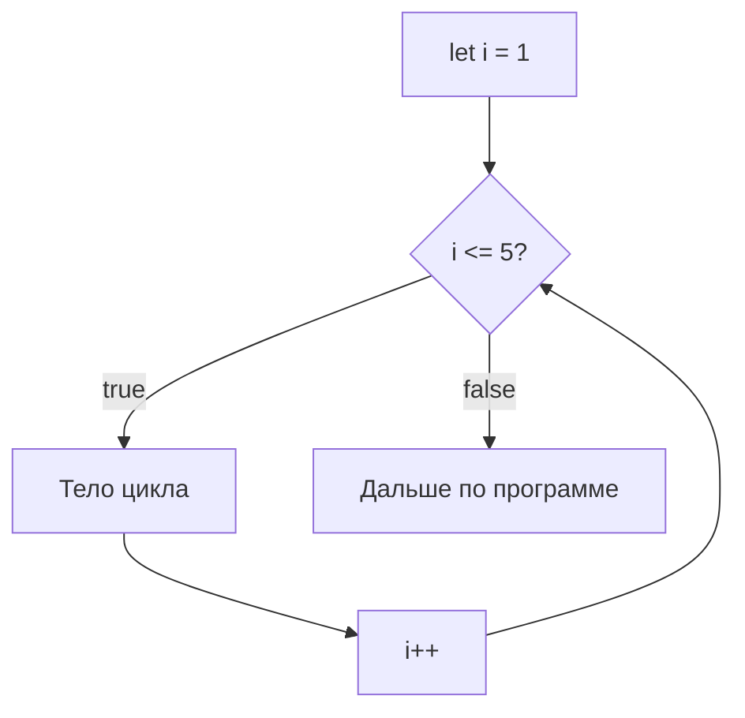

# Циклы

[Содержание](../../README.md) · [← Назад](../../Lesson-3/ru/Условия.md) · [Вперёд →](../../Lesson-5/ru/Функции.md) · [RU](%D0%A6%D0%B8%D0%BA%D0%BB%D1%8B.md) · [EN](../en/Loops.md) · [UZ](../uz/Sikllar.md)

> **Связь с уроком 3:** условие решает, выполнить ли код один раз. Цикл выполняет код **много раз**, пока условие истинно.

---

## Зачем это вам

Вывести таблицу умножения, посчитать сумму всех покупок, проверить каждую букву пароля, показать 20 карточек товаров - копировать одну строку 20 раз никто не будет. Цикл делает это за три строки, и неважно, сколько повторений: 10 или 10 000.

---

## Чему вы научитесь

- Повторять код фиксированное число раз: `for`.
- Повторять, пока условие истинно: `while`.
- Досрочно выходить из цикла (`break`) и пропускать шаг (`continue`).
- Считать сумму и количество: накопитель и счётчик.
- Перебирать символы строки: `for...of`.
- Находить и останавливать бесконечный цикл.
- Проследить выполнение цикла по шагам в таблице и писать вложенные циклы.


---

## Повторение: 3 вопроса из урока 3

1. Что делает `count++`?
2. Как проверить, что число чётное?
3. Как записать «`x` от 1 до 10 включительно»?

Ответы - в конце урока.

---

## План урока

| Раздел | Что делаем |
| --- | --- |
| Цикл `for` | Повтори N раз |
| Счётчик и накопитель | Считаем сумму и количество |
| Мини-задание 1 | Обратный отсчёт |
| `break` и `continue` | Стоп и пропуск |
| Цикл `while` | Пока условие истинно |
| Бесконечный цикл | Как не повесить вкладку |
| `for...of` по строке | Каждая буква |
| Мини-задание 2 | Сколько пробелов в тексте |
| Самостоятельная работа | Таблица умножения, сумма чётных, гласные |

---

## Цикл `for`

**Простыми словами:** цикл - упражнение «10 приседаний». Вы знаете, с какого числа начать, до какого считать и как переходить к следующему.

```js
for (let i = 1; i <= 5; i++) {
    console.log(`Приседание ${i}`);
}
```

В консоли - пять строк: от `Приседание 1` до `Приседание 5`.

| Часть | Когда выполняется | Что делает |
| --- | --- | --- |
| `let i = 1` | Один раз, в начале | Создаёт счётчик |
| `i <= 5` | Перед каждым шагом | Если `false` - цикл заканчивается |
| `i++` | После каждого шага | Увеличивает счётчик |
| `{ ... }` | На каждом шаге | **Тело цикла** |



Один проход тела называют **итерацией**. Счётчик традиционно называют `i` (от *index*). Шаг может быть любым:

```js
for (let i = 10; i >= 0; i -= 2) {
    console.log(i); // 10, 8, 6, 4, 2, 0
}
```

### Внутри цикла - любой код

```js
for (let i = 1; i <= 10; i++) {
    if (i % 2 === 0) {
        console.log(`${i} - чётное`);
    }
}
```

---

## Счётчик и накопитель

Два главных приёма работы с циклами. Переменную объявляют через `let` **до** цикла, внутри - изменяют, после - используют.

**Накопитель** - собирает сумму:

```js
let sum = 0;

for (let i = 1; i <= 100; i++) {
    sum += i;
}

console.log(sum); // 5050
```

**Счётчик** - считает, сколько раз выполнилось условие:

```js
let count = 0;

for (let i = 1; i <= 100; i++) {
    if (i % 7 === 0) {
        count++;
    }
}

console.log(count); // 14 чисел от 1 до 100 делятся на 7
```

### Как работает накопитель: таблица выполнения

Уменьшим пример до `i <= 5` и пройдём его вручную. В каждой строке таблицы - одна итерация:

| Итерация | `i` | Условие `i <= 5` | `sum` до | `sum += i` | `sum` после |
| --- | --- | --- | --- | --- | --- |
| 1 | 1 | `true` | 0 | 0 + 1 | 1 |
| 2 | 2 | `true` | 1 | 1 + 2 | 3 |
| 3 | 3 | `true` | 3 | 3 + 3 | 6 |
| 4 | 4 | `true` | 6 | 6 + 4 | 10 |
| 5 | 5 | `true` | 10 | 10 + 5 | 15 |
| - | 6 | `false` | 15 | цикл закончен | 15 |

Обратите внимание на последнюю строку: счётчик успевает стать `6`, условие даёт `false`, и тело **не выполняется**. Такая таблица - главный инструмент, чтобы понять любой цикл. Если результат удивил - нарисуйте её на бумаге.

То же самое можно увидеть в консоли, если вывести промежуточные значения:

```js
let sum = 0;

for (let i = 1; i <= 5; i++) {
    sum += i;
    console.log(`i = ${i}, sum = ${sum}`);
}
```

> **Частая ошибка:** объявить `let sum = 0;` **внутри** цикла. Тогда на каждой итерации сумма обнуляется, а после цикла переменная недоступна.

Накапливать можно и строки:

```js
let stars = "";

for (let i = 1; i <= 5; i++) {
    stars += "*";
}

console.log(stars); // *****
```

### Вложенные циклы

Цикл внутри цикла: на **каждую** итерацию внешнего внутренний проходит **целиком**. Так строят таблицы и сетки:

```js
for (let row = 1; row <= 3; row++) {
    let line = "";
    for (let col = 1; col <= 3; col++) {
        line += `${row * col} `;
    }
    console.log(line);
}
// 1 2 3
// 2 4 6
// 3 6 9
```

| `row` | Внутренний цикл `col` | `line` после внутреннего цикла |
| --- | --- | --- |
| 1 | 1, 2, 3 | `"1 2 3 "` |
| 2 | 1, 2, 3 | `"2 4 6 "` |
| 3 | 1, 2, 3 | `"3 6 9 "` |

Тело внутреннего цикла выполнилось 3 × 3 = 9 раз. Для двух циклов по 1000 шагов это уже миллион шагов - вложенность стоит использовать осознанно.

---

## Мини-задание 1

Выведите обратный отсчёт от 10 до 1, а после цикла - `Старт!`. Затем посчитайте сумму чисел от 1 до 50, которые делятся на 5. Должно получиться `275`. Решение - в разделе «Ответы».

---

## `break` и `continue`

| Команда | Что делает |
| --- | --- |
| `break` | Немедленно завершает весь цикл |
| `continue` | Пропускает остаток текущей итерации и переходит к следующей |

```js
// Первое число больше 1, которое делится и на 3, и на 7
for (let i = 2; i <= 100; i++) {
    if (i % 3 === 0 && i % 7 === 0) {
        console.log(`Найдено: ${i}`); // Найдено: 21
        break;
    }
}

// Все числа от 1 до 10, кроме кратных 3
for (let i = 1; i <= 10; i++) {
    if (i % 3 === 0) {
        continue;
    }
    console.log(i); // 1 2 4 5 7 8 10
}
```

`break` экономит работу: искать дальше, когда ответ найден, незачем.

---

## Цикл `while`

`while` повторяет тело, **пока** условие истинно. Его используют, когда заранее неизвестно, сколько будет шагов.

```js
let balance = 100000;
let months = 0;

while (balance < 200000) {
    balance = balance * 1.1;   // +10% в месяц
    months++;
}

console.log(`Сумма удвоится через ${months} мес.`); // 8 мес.
```

Тот же `for` можно переписать через `while`:

```js
let i = 1;
while (i <= 5) {
    console.log(i);
    i++;
}
```

| Когда | Цикл |
| --- | --- |
| Известно число повторений | `for` |
| Повторять, пока что-то не случится | `while` |
| Перебрать каждый символ строки (и позже - элемент массива) | `for...of` |

### `do...while` - хотя бы один раз

Обычный `while` проверяет условие **до** первого шага и может не выполниться ни разу. `do...while` сначала выполняет тело, а проверяет **после**:

```js
let attempt = 0;

do {
    attempt++;
    console.log(`Попытка ${attempt}`);
} while (attempt < 3);
```

| Цикл | Когда проверяется условие | Минимум выполнений |
| --- | --- | --- |
| `while` | Перед каждым шагом | 0 |
| `do...while` | После каждого шага | 1 |

В курсе `do...while` встречается редко: почти всегда хватает `for` и `while`.

---

## Бесконечный цикл

Если условие никогда не станет `false`, цикл не закончится:

```js
let i = 1;
while (i <= 5) {
    console.log(i);
    // забыли i++ - i всегда 1
}
```

Вкладка браузера «зависнет»: перестанет реагировать, вентилятор зашумит. Что делать:

1. Закройте вкладку или нажмите «Остановить» в окне браузера «Страница не отвечает».
2. В DevTools: вкладка **Sources** → кнопка паузы.
3. Найдите переменную, которая должна была меняться, и проверьте условие.

> **На платформе** время выполнения ограничено: бесконечный цикл прервётся через пару секунд с сообщением `Script execution timed out`. Значит, условие цикла никогда не становится ложным.

---

## `for...of` по строке

Строка - последовательность символов. `for...of` перебирает их по одному, без счётчика:

```js
const word = "Привет";

for (const letter of word) {
    console.log(letter); // П, р, и, в, е, т - каждая буква отдельной строкой
}
```

На каждой итерации в `letter` попадает очередной символ. Объявляем её через `const`: внутри одной итерации она не меняется, а на следующей создаётся заново.

Посчитать определённые символы - счётчик плюс `for...of`:

```js
const text = "мама мыла раму";
let countA = 0;

for (const char of text) {
    if (char === "а") {
        countA++;
    }
}

console.log(countA); // 4
```

Проверить, входит ли символ в набор, удобно через `includes` из урока 2:

```js
const vowels = "аеёиоуыэюя";
console.log(vowels.includes("о")); // true
console.log(vowels.includes("м")); // false
```

### Попробуйте сломать

1. Замените `i <= 5` на `i < 5` в цикле с приседаниями. Сколько строк выведется? Это ошибка «на единицу» - самая частая в циклах.
2. Перенесите `let sum = 0;` внутрь цикла и выведите `sum` после цикла. Почему получилась ошибка или неверное число?
3. В цикле `while` с удвоением суммы поменяйте `<` на `>`. Выполнится ли тело хотя бы раз?

### Частые ошибки новичков

| Ошибка | Что получится | Как исправить |
| --- | --- | --- |
| `i < 5` вместо `i <= 5` | Один шаг потерян | Проверьте первое и последнее значение счётчика |
| Накопитель объявлен внутри цикла | Сумма обнуляется на каждом шаге | `let sum = 0;` **до** цикла |
| Забыли `i++` в `while` | Бесконечный цикл | Меняйте переменную условия в теле |
| `for (let i = 1; i <= 5; i--)` | Счётчик уменьшается, условие всегда `true` | Направление шага должно вести к концу |
| `;` после `for (...)` | Тело выполняется один раз после цикла | Без `;` перед `{` |
| `const i` в обычном `for` | `TypeError` на `i++` | В `for` счётчик - `let`; в `for...of` - `const` |

---

## Мини-задание 2

Объявите `const sentence = "Учим JavaScript каждый день";`. Посчитайте пробелы с помощью `for...of` и выведите `Слов: 4` - слов на одно больше, чем пробелов. Решение - в разделе «Ответы».

---

## Итоги урока: шпаргалка

| Задача | Запись |
| --- | --- |
| Повторить N раз | `for (let i = 1; i <= n; i++) { ... }` |
| Пока условие истинно | `while (условие) { ... }` |
| Каждый символ строки | `for (const char of text) { ... }` |
| Выйти из цикла | `break;` |
| Пропустить шаг | `continue;` |
| Сумма | `let sum = 0;` до цикла, `sum += x;` внутри |
| Количество | `let count = 0;` до цикла, `count++;` внутри |
| Бесконечный цикл | Проверьте, что условие когда-нибудь станет `false` |

---

## Самостоятельная работа

### Часть 1. Задание в IDE (засчитывается платформой)

Платформа задаёт число `n` и слово `word`.

1. **Таблица умножения.** Циклом `for` выведите в консоль 10 строк вида `5 x 1 = 5` … `5 x 10 = 50` для числа `n`. Строки собирайте шаблонной строкой.
2. **Сумма чётных.** В `let evenSum` посчитайте сумму всех чётных чисел от 1 до `n` включительно.
3. **Гласные.** В `let vowelCount` посчитайте гласные латинские буквы (`a`, `e`, `i`, `o`, `u`) в `word` циклом `for...of`. Регистр не важен: `A` - тоже гласная.

Что проверяет платформа: 10 строк таблицы с правильными произведениями; `evenSum` на разных `n`, включая `1`; `vowelCount` на словах с заглавными буквами и без гласных; использование `for` и `for...of`; программа завершается без зависания.

### Часть 2. Проект на компьютере

1. В `main.js` своего сайта объявите `const pageTitle` - название сайта.
2. Циклом `for...of` посчитайте в нём буквы, пробелы и выведите статистику в консоль.
3. Выведите в консоль «рамку» из символов `=` той же длины, что название, - накопителем строк.
4. Намеренно напишите бесконечный `while`, увидьте зависание вкладки, остановите его и исправьте.

### Критерии готовности

- [ ] Задание в IDE засчитано.
- [ ] Накопители и счётчики объявлены до цикла.
- [ ] Для известного числа повторений - `for`, для перебора символов - `for...of`.
- [ ] Каждый `while` гарантированно заканчивается.
- [ ] Вы можете объяснить, когда нужен `break`, а когда `continue`.

---

## Вопросы для самопроверки

1. Из каких трёх частей состоит заголовок `for` и когда выполняется каждая?
2. Сколько раз выполнится тело `for (let i = 0; i < 5; i++)`?
3. Чем накопитель отличается от счётчика?
4. Почему `let sum = 0;` нельзя объявлять внутри цикла?
5. Чем `break` отличается от `continue`?
6. Когда выбирают `while`, а когда - `for`?
7. Почему возникает бесконечный цикл и как его остановить в браузере?
8. Что попадает в переменную `char` в `for (const char of text)`?
9. Как сделать проверку символа нечувствительной к регистру?
10. Что выведет цикл `for (let i = 10; i > 0; i -= 3)`?

После вопросов пройдите **тест урока** на платформе: 12 вопросов, порог 70%.

---

## Что дальше

Код таблицы умножения хочется использовать для разных чисел, не копируя его. В уроке 5 научимся упаковывать код в **функции** - именованные действия, которые можно вызывать снова и снова с разными данными.

---

## Ответы

**Повторение**

1. Увеличивает `count` на 1.
2. `n % 2 === 0`.
3. `x >= 1 && x <= 10`.

**Мини-задание 1**

```js
for (let i = 10; i >= 1; i--) {
    console.log(i);
}
console.log("Старт!");

let sum = 0;
for (let i = 1; i <= 50; i++) {
    if (i % 5 === 0) {
        sum += i;
    }
}
console.log(sum); // 275
```

**Мини-задание 2**

```js
const sentence = "Учим JavaScript каждый день";
let spaces = 0;

for (const char of sentence) {
    if (char === " ") {
        spaces++;
    }
}

console.log(`Слов: ${spaces + 1}`); // Слов: 4
```

**Вопросы для самопроверки**

1. Начало (`let i = 1`) - один раз; условие - перед каждой итерацией; шаг (`i++`) - после каждой.
2. 5 раз: `i` от 0 до 4.
3. Накопитель собирает значение (сумму, строку), счётчик считает количество подходящих случаев.
4. Он обнулится на каждой итерации и будет недоступен после цикла.
5. `break` завершает весь цикл, `continue` - только текущую итерацию.
6. `for` - число повторений известно, `while` - повторяем до наступления события.
7. Условие никогда не становится `false` (забыли изменить переменную). Закрыть вкладку или поставить паузу в DevTools → Sources.
8. Очередной символ строки.
9. Привести символ к одному регистру: `char.toLowerCase()`.
10. `10`, `7`, `4`, `1`.

---

[Содержание](../../README.md) · [← Назад](../../Lesson-3/ru/Условия.md) · [Вперёд →](../../Lesson-5/ru/Функции.md) · [RU](%D0%A6%D0%B8%D0%BA%D0%BB%D1%8B.md) · [EN](../en/Loops.md) · [UZ](../uz/Sikllar.md)
