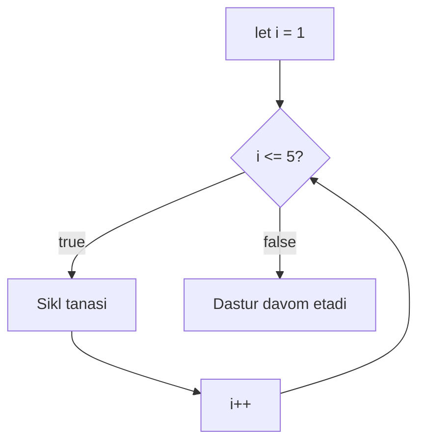

# Sikllar

[Mundarija](../../README.md) · [← Orqaga](../../Lesson-3/uz/Shartlar.md) · [Keyingi →](../../Lesson-5/uz/Funksiyalar.md) · [RU](../ru/%D0%A6%D0%B8%D0%BA%D0%BB%D1%8B.md) · [EN](../en/Loops.md) · [UZ](Sikllar.md)

> **3-dars bilan bog‘liqlik:** shart kodni bir marta bajarish-bajarmaslikni hal qiladi. Sikl esa kodni shart rost bo‘lguncha **ko‘p marta** bajaradi.

---

## Bu sizga nima uchun kerak

Ko‘paytirish jadvalini chiqarish, barcha xaridlar yig‘indisini hisoblash, parolning har bir harfini tekshirish, 20 ta mahsulot kartochkasini ko‘rsatish - bitta qatorni 20 marta hech kim nusxalamaydi. Sikl buni uch qatorda qiladi, takrorlar soni 10 yoki 10000 bo‘lishidan qat’i nazar.

---

## Nimani o‘rganasiz

- Kodni belgilangan marta takrorlash: `for`.
- Shart rost bo‘lguncha takrorlash: `while`.
- Sikldan oldinroq chiqish (`break`) va qadamni o‘tkazib yuborish (`continue`).
- Yig‘indi va sonni hisoblash: to‘plovchi va hisoblagich.
- Satr belgilarini aylanib chiqish: `for...of`.
- Cheksiz siklni topish va to‘xtatish.

---

## Takrorlash: 3-darsdan 3 savol

1. `count++` nima qiladi?
2. Son juft ekanini qanday tekshirish mumkin?
3. «`x` 1 dan 10 gacha (ular ham kiradi)» qanday yoziladi?

Javoblar - dars oxirida.

---

## Reja

| Bo‘lim | Nima qilamiz |
| --- | --- |
| `for` sikli | N marta takrorla |
| Hisoblagich va to‘plovchi | Yig‘indi va sonni hisoblaymiz |
| Mini-topshiriq 1 | Teskari sanoq |
| `break` va `continue` | To‘xta va o‘tkazib yubor |
| `while` sikli | Shart rost ekan |
| Cheksiz sikl | Vkladkani qotirmaslik |
| Satr bo‘yicha `for...of` | Har bir harf |
| Mini-topshiriq 2 | Matnda nechta bo‘sh joy |
| Mustaqil ish | Ko‘paytirish jadvali, juftlar yig‘indisi, unlilar |

---

## `for` sikli

**Oddiy so‘z bilan:** sikl - «10 marta o‘tirib-turish» mashqi. Qaysi sondan boshlash, qaysigacha sanash va keyingisiga qanday o‘tishni bilasiz.

```js
for (let i = 1; i <= 5; i++) {
    console.log(`O‘tirib-turish ${i}`);
}
```

Konsolda beshta qator: `O‘tirib-turish 1` dan `O‘tirib-turish 5` gacha.

| Qism | Qachon bajariladi | Nima qiladi |
| --- | --- | --- |
| `let i = 1` | Bir marta, boshida | Hisoblagich yaratadi |
| `i <= 5` | Har qadamdan oldin | `false` bo‘lsa - sikl tugaydi |
| `i++` | Har qadamdan keyin | Hisoblagichni oshiradi |
| `{ ... }` | Har qadamda | **Sikl tanasi** |



Tananing bir marta o‘tilishi **iteratsiya** deyiladi. Hisoblagich an’anaviy ravishda `i` (*index* dan) deb ataladi. Qadam istalgancha bo‘lishi mumkin:

```js
for (let i = 10; i >= 0; i -= 2) {
    console.log(i); // 10, 8, 6, 4, 2, 0
}
```

### Sikl ichida - istalgan kod

```js
for (let i = 1; i <= 10; i++) {
    if (i % 2 === 0) {
        console.log(`${i} - juft`);
    }
}
```

---

## Hisoblagich va to‘plovchi

Sikllar bilan ishlashning ikki asosiy usuli. O‘zgaruvchi sikldan **oldin** `let` bilan e’lon qilinadi, ichida - o‘zgartiriladi, keyin - ishlatiladi.

**To‘plovchi** - yig‘indini yig‘adi:

```js
let sum = 0;

for (let i = 1; i <= 100; i++) {
    sum += i;
}

console.log(sum); // 5050
```

**Hisoblagich** - shart necha marta bajarilganini sanaydi:

```js
let count = 0;

for (let i = 1; i <= 100; i++) {
    if (i % 7 === 0) {
        count++;
    }
}

console.log(count); // 1 dan 100 gacha 14 ta son 7 ga bo‘linadi
```

> **Tipik xato:** `let sum = 0;` ni sikl **ichida** e’lon qilish. Shunda yig‘indi har iteratsiyada nolga tushadi, sikldan keyin esa o‘zgaruvchi mavjud bo‘lmaydi.

Satrlarni ham to‘plash mumkin:

```js
let stars = "";

for (let i = 1; i <= 5; i++) {
    stars += "*";
}

console.log(stars); // *****
```

---

## Mini-topshiriq 1

10 dan 1 gacha teskari sanoqni, sikldan keyin esa `Start!` ni chiqaring. Keyin 1 dan 50 gacha 5 ga bo‘linadigan sonlar yig‘indisini hisoblang. `275` chiqishi kerak. Yechim - «Javoblar» bo‘limida.

---

## `break` va `continue`

| Buyruq | Nima qiladi |
| --- | --- |
| `break` | Butun siklni darhol tugatadi |
| `continue` | Joriy iteratsiya qoldig‘ini o‘tkazib, keyingisiga o‘tadi |

```js
// 1 dan katta, 3 ga ham, 7 ga ham bo‘linadigan birinchi son
for (let i = 2; i <= 100; i++) {
    if (i % 3 === 0 && i % 7 === 0) {
        console.log(`Topildi: ${i}`); // Topildi: 21
        break;
    }
}

// 1 dan 10 gacha 3 ga karrali bo‘lmagan barcha sonlar
for (let i = 1; i <= 10; i++) {
    if (i % 3 === 0) {
        continue;
    }
    console.log(i); // 1 2 4 5 7 8 10
}
```

`break` ishni tejaydi: javob topilgach, qidirishni davom ettirish shart emas.

---

## `while` sikli

`while` shart rost **ekan**, tanani takrorlaydi. Qadamlar soni oldindan noma’lum bo‘lganda ishlatiladi.

```js
let balance = 100000;
let months = 0;

while (balance < 200000) {
    balance = balance * 1.1;   // oyiga +10%
    months++;
}

console.log(`Summa ${months} oyda ikki baravar oshadi`); // 8 oy
```

Xuddi shu `for` ni `while` bilan qayta yozish mumkin:

```js
let i = 1;
while (i <= 5) {
    console.log(i);
    i++;
}
```

| Qachon | Sikl |
| --- | --- |
| Takrorlar soni ma’lum | `for` |
| Biror narsa sodir bo‘lguncha takrorlash | `while` |
| Satrning har bir belgisini (keyinroq - massiv elementini) aylanib chiqish | `for...of` |

---

## Cheksiz sikl

Agar shart hech qachon `false` bo‘lmasa, sikl tugamaydi:

```js
let i = 1;
while (i <= 5) {
    console.log(i);
    // i++ unutilgan - i doim 1
}
```

Brauzer vkladkasi «qotib qoladi»: javob bermay qo‘yadi, ventilyator shovqin qiladi. Nima qilish kerak:

1. Vkladkani yoping yoki brauzerning «Sahifa javob bermayapti» oynasida «To‘xtatish» ni bosing.
2. DevTools’da: **Sources** bo‘limi → pauza tugmasi.
3. O‘zgarishi kerak bo‘lgan o‘zgaruvchini toping va shartni tekshiring.

> **Platformada** bajarilish vaqti cheklangan: cheksiz sikl bir-ikki soniyadan keyin `Script execution timed out` xabari bilan to‘xtatiladi. Bu sikl sharti hech qachon yolg‘on bo‘lmasligini bildiradi.

---

## Satr bo‘yicha `for...of`

Satr - belgilar ketma-ketligi. `for...of` ularni hisoblagichsiz birma-bir aylanib chiqadi:

```js
const word = "Salom";

for (const letter of word) {
    console.log(letter); // S, a, l, o, m - har bir harf alohida qatorda
}
```

Har iteratsiyada `letter` ga navbatdagi belgi tushadi. Uni `const` orqali e’lon qilamiz: bitta iteratsiya ichida u o‘zgarmaydi, keyingisida esa qayta yaratiladi.

Ma’lum belgilarni sanash - hisoblagich va `for...of`:

```js
const text = "qalam va daftar";
let countA = 0;

for (const char of text) {
    if (char === "a") {
        countA++;
    }
}

console.log(countA); // 5
```

Belgi to‘plamga kirishini 2-darsdagi `includes` bilan tekshirish qulay:

```js
const vowels = "aeiou";
console.log(vowels.includes("o")); // true
console.log(vowels.includes("m")); // false
```

---

## Mini-topshiriq 2

`const sentence = "Har kuni JavaScript o‘rganamiz";` e’lon qiling. `for...of` yordamida bo‘sh joylarni sanang va `So‘zlar: 4` ni chiqaring - so‘zlar bo‘sh joylardan bittaga ko‘p. Yechim - «Javoblar» bo‘limida.

---

## Dars yakuni: shpargalka

| Vazifa | Yozuv |
| --- | --- |
| N marta takrorlash | `for (let i = 1; i <= n; i++) { ... }` |
| Shart rost ekan | `while (shart) { ... }` |
| Satrning har bir belgisi | `for (const char of text) { ... }` |
| Sikldan chiqish | `break;` |
| Qadamni o‘tkazish | `continue;` |
| Yig‘indi | Sikldan oldin `let sum = 0;`, ichida `sum += x;` |
| Son | Sikldan oldin `let count = 0;`, ichida `count++;` |
| Cheksiz sikl | Shart qachondir `false` bo‘lishini tekshiring |

---

## Mustaqil ish

### 1-qism. IDE topshirig‘i (platforma hisoblaydi)

Platforma `n` sonini va `word` so‘zini beradi.

1. **Ko‘paytirish jadvali.** `for` sikli bilan `n` soni uchun `5 x 1 = 5` … `5 x 10 = 50` ko‘rinishidagi 10 ta qatorni konsolga chiqaring. Qatorlarni shablon satr bilan yig‘ing.
2. **Juftlar yig‘indisi.** `let evenSum` da 1 dan `n` gacha (u ham kiradi) barcha juft sonlar yig‘indisini hisoblang.
3. **Unlilar.** `let vowelCount` da `word` dagi lotin unli harflarini (`a`, `e`, `i`, `o`, `u`) `for...of` sikli bilan sanang. Registr muhim emas: `A` ham unli.

Platforma nimani tekshiradi: to‘g‘ri ko‘paytmali 10 ta jadval qatori; turli `n` lardagi `evenSum`, jumladan `1`; katta harfli va unlisiz so‘zlardagi `vowelCount`; `for` va `for...of` ishlatilgani; dastur qotmasdan tugaydi.

### 2-qism. Kompyuterdagi loyiha

1. Saytingizning `main.js` faylida `const pageTitle` - sayt nomini e’lon qiling.
2. `for...of` sikli bilan undagi harflar va bo‘sh joylarni sanang va statistikani konsolga chiqaring.
3. Konsolga nom uzunligidagi `=` belgilaridan «ramka» chiqaring - satr to‘plovchisi bilan.
4. Ataylab cheksiz `while` yozing, vkladka qotishini ko‘ring, uni to‘xtating va tuzating.

### Tayyorlik mezonlari

- [ ] IDE topshirig‘i qabul qilindi.
- [ ] To‘plovchi va hisoblagichlar sikldan oldin e’lon qilingan.
- [ ] Ma’lum takrorlar soni uchun - `for`, belgilarni aylanib chiqish uchun - `for...of`.
- [ ] Har bir `while` albatta tugaydi.
- [ ] `break` qachon, `continue` qachon kerakligini tushuntira olasiz.

---

## O‘zini tekshirish uchun savollar

1. `for` sarlavhasi qaysi uch qismdan iborat va har biri qachon bajariladi?
2. `for (let i = 0; i < 5; i++)` tanasi necha marta bajariladi?
3. To‘plovchi hisoblagichdan nimasi bilan farq qiladi?
4. Nima uchun `let sum = 0;` ni sikl ichida e’lon qilib bo‘lmaydi?
5. `break` `continue` dan nimasi bilan farq qiladi?
6. Qachon `while`, qachon `for` tanlanadi?
7. Cheksiz sikl nima uchun paydo bo‘ladi va uni brauzerda qanday to‘xtatish mumkin?
8. `for (const char of text)` dagi `char` o‘zgaruvchisiga nima tushadi?
9. Belgini tekshirishni registrga bog‘liq bo‘lmaydigan qanday qilish mumkin?
10. `for (let i = 10; i > 0; i -= 3)` sikli nimani chiqaradi?

Savollardan keyin platformada **dars testini** topshiring: 12 ta savol, o‘tish chegarasi 70%.

---

## Keyin nima

Ko‘paytirish jadvali kodini nusxalamasdan turli sonlar uchun ishlatgingiz keladi. 5-darsda kodni **funksiyalarga** joylashni o‘rganamiz - turli ma’lumotlar bilan qayta-qayta chaqirish mumkin bo‘lgan nomli amallar.

---

## Javoblar

**Takrorlash**

1. `count` ni 1 ga oshiradi.
2. `n % 2 === 0`.
3. `x >= 1 && x <= 10`.

**Mini-topshiriq 1**

```js
for (let i = 10; i >= 1; i--) {
    console.log(i);
}
console.log("Start!");

let sum = 0;
for (let i = 1; i <= 50; i++) {
    if (i % 5 === 0) {
        sum += i;
    }
}
console.log(sum); // 275
```

**Mini-topshiriq 2**

```js
const sentence = "Har kuni JavaScript o‘rganamiz";
let spaces = 0;

for (const char of sentence) {
    if (char === " ") {
        spaces++;
    }
}

console.log(`So‘zlar: ${spaces + 1}`); // So‘zlar: 4
```

**O‘zini tekshirish uchun savollar**

1. Boshlanish (`let i = 1`) - bir marta; shart - har iteratsiyadan oldin; qadam (`i++`) - har iteratsiyadan keyin.
2. 5 marta: `i` 0 dan 4 gacha.
3. To‘plovchi qiymat (yig‘indi, satr) yig‘adi, hisoblagich mos holatlar sonini sanaydi.
4. U har iteratsiyada nolga tushadi va sikldan keyin mavjud bo‘lmaydi.
5. `break` butun siklni, `continue` - faqat joriy iteratsiyani tugatadi.
6. `for` - takrorlar soni ma’lum, `while` - hodisa sodir bo‘lguncha takrorlaymiz.
7. Shart hech qachon `false` bo‘lmaydi (o‘zgaruvchi o‘zgartirilmagan). Vkladkani yopish yoki DevTools → Sources da pauza qilish.
8. Satrning navbatdagi belgisi.
9. Belgini bitta registrga keltirish: `char.toLowerCase()`.
10. `10`, `7`, `4`, `1`.

---

[Mundarija](../../README.md) · [← Orqaga](../../Lesson-3/uz/Shartlar.md) · [Keyingi →](../../Lesson-5/uz/Funksiyalar.md) · [RU](../ru/%D0%A6%D0%B8%D0%BA%D0%BB%D1%8B.md) · [EN](../en/Loops.md) · [UZ](Sikllar.md)
