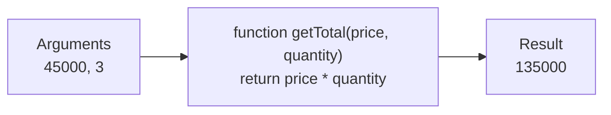
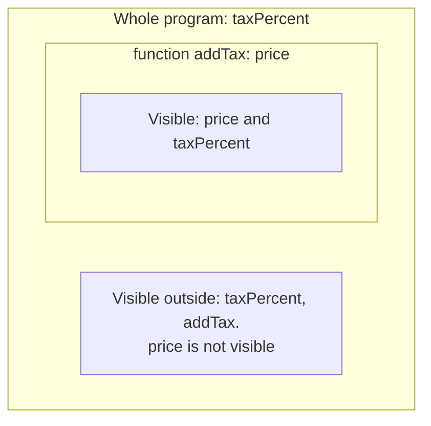

# Functions

[Contents](../../README.md) · [← Back](../../Lesson-4/en/Loops.md) · [Next →](../../Lesson-6/en/Arrays%20and%20objects.md) · [RU](../ru/%D0%A4%D1%83%D0%BD%D0%BA%D1%86%D0%B8%D0%B8.md) · [EN](Functions.md) · [UZ](../uz/Funksiyalar.md)

> **Link to lessons 3–4:** you wrote conditions and loops, and to test them on another value you changed the variable by hand. Today we will pack code into **functions**: write once - call as many times as you like with different data.

---

## Why you need this

An online shop's "Add to cart" button is the same for a hundred products. The code that calculates a discounted price is needed in the cart, in the product card and in the order email. Copying it into three places means fixing a bug three times. A function solves this: the code lives in one place and is called from wherever it is needed.

`console.log` is a function too. Browser developers wrote it, and you just call it by name. Today you will write your own.

---

## What you will learn

- Declare a function and call it.
- Pass data in through parameters and get a result through `return`.
- Tell `return` apart from `console.log`.
- Set default parameter values.
- Write short functions with the arrow `=>`.
- Understand scope: where variables "live".
- Write pure functions and give them clear names.

---

## Review: 3 questions from lesson 4

1. How does an accumulator differ from a counter?
2. What does `break` do?
3. How do you go through every character of the string `word`?

Answers are at the end of the lesson.

---

## Lesson plan

| Section | What we do |
| --- | --- |
| Declaration and call | A recipe and cooking |
| Parameters and arguments | Ingredients |
| `return` | The finished dish |
| Mini-task 1 | The area of a rectangle |
| Default values | If an ingredient was not passed |
| Arrow functions | A short form |
| Scope | What is visible inside and outside |
| Pure functions | A predictable result |
| Mini-task 2 | A function with a loop |
| Independent work | A set of functions for grades and prices |

---

## Declaration and call

**In simple words:** a function is a recipe. Writing down a recipe (declaring) and cooking a dish (calling) are different actions. You write the recipe once and cook from it as often as you like.

```js
// Declaration: we wrote down the recipe
function sayHello() {
    console.log("Hello!");
}

// Call: we cooked
sayHello();
sayHello();
```

The console shows `Hello!` twice.

| Part | What it is |
| --- | --- |
| `function` | Keyword "I declare a function" |
| `sayHello` | Function name |
| `()` | Parameter list - empty for now |
| `{ ... }` | Function body - the code that runs when called |
| `sayHello();` | Call: the name and parentheses |

> **Without parentheses the function is not called.** `sayHello;` just mentions the name; the code does not run. A call is always `sayHello()`.

---

## Parameters and arguments

For a function to work with different data, values are passed to it:

```js
function greet(name) {
    console.log(`Hello, ${name}!`);
}

greet("Anna");   // Hello, Anna!
greet("Timur");  // Hello, Timur!
```

- A **parameter** is a name in the declaration: `name`. It is a variable that exists only inside the function.
- An **argument** is a value in the call: `"Anna"`. It is put into the parameter.

There can be several parameters, separated by commas. Arguments are passed **in the same order**:

```js
function introduce(name, city) {
    console.log(`${name} from ${city}`);
}

introduce("Anna", "Tashkent"); // Anna from Tashkent
introduce("Tashkent", "Anna"); // Tashkent from Anna - order matters!
```

If an argument is not passed, the parameter is `undefined`:

```js
greet(); // Hello, undefined!
```

### What happens on a call: step by step

Let us take `introduce("Anna", "Tashkent");` the way the browser runs it:

| Step | What the browser does | Values |
| --- | --- | --- |
| 1 | Finds the function `introduce` | - |
| 2 | Creates the parameters and puts the arguments into them in order | `name = "Anna"`, `city = "Tashkent"` |
| 3 | Runs the function body | Prints `Anna from Tashkent` |
| 4 | Removes the parameters: the function has ended | `name` and `city` no longer exist |
| 5 | Returns to the line after the call | The program goes on |

On the next call everything starts again with new values. Parameters do not remember the previous call.

---

## `return` - giving back a result

The `greet` function only prints. But more often you need a **result** from a function to use further: add it, compare it, insert it into text. That is what `return` is for:

```js
function getTotal(price, quantity) {
    return price * quantity;
}

const total = getTotal(45000, 3);
console.log(total);                       // 135000
console.log(getTotal(1000, 2) + 500);     // 2500
console.log(`To pay: ${getTotal(20, 5)}`); // To pay: 100
```

The call `getTotal(45000, 3)` "turns into" the value `135000` - as if the number were written instead of the call.



### `return` and `console.log` are not the same

```js
function doubleLog(x) {
    console.log(x * 2);   // only shows
}

function doubleReturn(x) {
    return x * 2;         // gives back the value
}

const a = doubleLog(5);     // the console shows 10, but...
console.log(a);             // undefined - the function returned nothing

const b = doubleReturn(5);  // the console is empty
console.log(b);             // 10
console.log(b + 1);         // 11 - you can work with the result
```

| | `console.log` | `return` |
| --- | --- | --- |
| For whom | For the person looking at the console | For the program |
| What the call gets | `undefined` | The value |
| When to use | Debugging, printing a final result | Almost always in calculating functions |

### `return` ends the function

After `return` the function ends immediately; the following lines do not run. This is handy for an **early exit**:

```js
function getDeliveryCost(total) {
    if (total >= 100000) {
        return 0;
    }
    return 15000;
}

console.log(getDeliveryCost(150000)); // 0
console.log(getDeliveryCost(50000));  // 15000
```

No `else` is needed here: if the first condition fired, execution never reaches the second `return`.

### A function calls a function

A big task is built from small functions, like a dish from prepared ingredients:

```js
function getSubtotal(price, quantity) {
    return price * quantity;
}

function getDeliveryCost(total) {
    if (total >= 100000) {
        return 0;
    }
    return 15000;
}

function getOrderTotal(price, quantity) {
    const subtotal = getSubtotal(price, quantity);
    return subtotal + getDeliveryCost(subtotal);
}

console.log(getOrderTotal(30000, 2)); // 75000
```

| Step | Call | Result |
| --- | --- | --- |
| 1 | `getOrderTotal(30000, 2)` starts | - |
| 2 | `getSubtotal(30000, 2)` | `60000` |
| 3 | `getDeliveryCost(60000)` | `15000` - the sum is below 100000 |
| 4 | `60000 + 15000` | `getOrderTotal` returns `75000` |

Each function does **one** job and is named after that job. If the delivery rule changes, only `getDeliveryCost` changes.

---

## Mini-task 1

Write a function `getArea(width, height)` that **returns** the area of a rectangle. Print `getArea(3, 4)` and the sum of the areas of two rectangles: `3 × 4` and `5 × 2`. You should get `12` and `22`. The solution is in the "Answers" section.

---

## Default values

A parameter can have a value that is used if the argument was not passed:

```js
function formatPrice(amount, currency = "UZS") {
    return `${amount} ${currency}`;
}

console.log(formatPrice(45000));      // 45000 UZS
console.log(formatPrice(20, "$"));    // 20 $
```

Parameters with defaults go at the end of the list: then you can simply leave them out.

---

## Arrow functions

A function can be stored in a constant. The short modern form is an **arrow function**:

```js
// Regular declaration
function square(x) {
    return x * x;
}

// The same with an arrow
const squareArrow = (x) => x * x;

console.log(square(4));      // 16
console.log(squareArrow(4)); // 16
```

| Form | When |
| --- | --- |
| `const f = (x) => x * x;` | The body is one expression: `return` is implied |
| `const f = (a, b) => { ... return ...; };` | Several lines: curly braces and an explicit `return` |
| `const f = () => "Hello";` | No parameters - empty parentheses |

```js
const getDiscount = (total, percent) => {
    const discount = total * percent / 100;
    return Math.round(discount);
};
```

> **Note:** with curly braces `return` is required. `const f = (x) => { x * 2 };` returns `undefined`.

The course uses both forms: `function` for the main named functions and arrows for short calculations. Arrow functions will be especially useful in lessons 6–8: they are passed into other functions.

### A function is a value too

A function can be put into a variable - you already did that with an arrow. That means it can be **passed to another function** as an argument. Such a passed function is called a **callback**: "here is an instruction, call it when the time comes".

```js
function repeat(times, action) {
    for (let i = 1; i <= times; i++) {
        action(i);
    }
}

repeat(3, (n) => console.log(`Step ${n}`));
// Step 1
// Step 2
// Step 3
```

Here `action` is a parameter that holds a function. `action(i)` calls it.

A built-in example is `setTimeout`: "run the function after N milliseconds":

```js
console.log("Order accepted");

setTimeout(() => {
    console.log("Order ready");
}, 2000);

console.log("Waiting...");
// Order accepted
// Waiting...
// Order ready  ← after 2 seconds
```

Note the order: `setTimeout` does **not stop** the program. It remembers the function and goes on, and calls the function later. This idea will be needed three times: array methods in Lesson 6, events in Lesson 8 and server requests in Lesson 9.

| Notation | What we pass |
| --- | --- |
| `setTimeout(showMessage, 1000)` | The function itself - correct |
| `setTimeout(showMessage(), 1000)` | The result of a call: the function runs **immediately** - a mistake |

---

## Scope

A variable declared inside a function is visible only inside it:

```js
function calculate() {
    const result = 42;
    console.log(result); // 42
}

calculate();
console.log(result); // ReferenceError: result is not defined
```

Variables outside the function are visible inside:

```js
const taxPercent = 12;

function addTax(price) {
    return price + price * taxPercent / 100;
}

console.log(addTax(1000)); // 1120
```



The rule is the same as for `{ }` blocks in `if` and loops: a variable lives inside its curly braces and in all nested ones.

---

## Pure functions

A **pure function** is a function that:

1. Always returns the same result for the same arguments.
2. Changes nothing outside: does not touch outer variables and does not print to the console.

```js
// Pure: the result depends only on the arguments
function getTotal(price, quantity) {
    return price * quantity;
}

// Not pure: changes an outer variable
let cartTotal = 0;
function addToCart(price) {
    cartTotal += price;
}
```

Pure functions are easy to check: call with arguments - compare the result. That is exactly how the platform tests work. Try to keep calculating functions pure and do the output (`console.log`) outside.

### Function names

A function is an action, so its name starts with a **verb**: `getTotal`, `formatPrice`, `calculateDiscount`, `showMessage`. Functions that answer "yes or no" start with `is`, `has`, `can`: `isEven`, `hasDiscount`, `canEnter`.

### Try to break it

1. Remove `return` from `getTotal` and print `getTotal(45000, 3)`. What did the function return?
2. Call `introduce("Anna")` with one argument. What ends up in `city`?
3. Pass `showMessage()` with parentheses to `setTimeout`. Why did the message appear at once?

### Typical beginner mistakes

| Mistake | What you get | How to fix |
| --- | --- | --- |
| A call without parentheses: `sayHello;` | Nothing happens | `sayHello();` |
| No `return` in a calculating function | The call gives `undefined` | `return result;` |
| `console.log` instead of `return` | The value is visible in the console but does not reach the program | Return the value, print it outside |
| Code after `return` | It never runs | Put `return` last |
| Arguments in the wrong order | The values are mixed up | Argument order = parameter order |
| An arrow with `{ }` and no `return` | `undefined` | `(x) => x * 2` or `(x) => { return x * 2; }` |
| A variable from a function used outside | `ReferenceError` | Return it with `return` |

---

## Mini-task 2

Write a function `countChar(text, char)` that uses a `for...of` loop to count how many times `char` occurs in `text` and **returns** the number. `countChar("banana", "a")` should return `3`. The solution is in the "Answers" section.

---

## Lesson summary: cheat sheet

| Task | Code |
| --- | --- |
| Declare a function | `function getTotal(price, qty) { ... }` |
| Call | `getTotal(45000, 3)` |
| Return a result | `return price * qty;` |
| Default value | `function f(amount, currency = "UZS")` |
| Arrow, one expression | `const square = (x) => x * x;` |
| Arrow, several lines | `const f = (a) => { ...; return ...; };` |
| Early exit | `if (...) { return 0; }` |
| Name | A verb: `getTotal`, a question: `isEven` |

---

## Independent work

### Part 1. IDE task (graded by the platform)

Write a set of functions. Each **returns** its result and prints nothing to the console.

1. `isEven(number)` - with a `function` declaration: `true` if the number is even, otherwise `false`.
2. `getGrade(score)` - a numeric grade from a score, as in lesson 3: 90 and above → `5`, from 75 → `4`, from 60 → `3`, below → `2`.
3. `formatPrice(amount, currency)` - the string `"45000 UZS"`; if no currency is passed, `"UZS"` is used.
4. `square` - an arrow function in a constant: returns the square of a number.
5. `countVowels(word)` - the number of vowels `a, e, i, o, u` in a word, ignoring case, as in lesson 4.

After the functions you may print a few calls to check them - that is allowed.

What the platform checks: the results of each function for different arguments, including `0`, negative numbers and grade boundaries; `isEven` is declared with `function`; `square` is an arrow function; `currency` has the default value `"UZS"`; the functions print nothing when called.

### Part 2. Project on your computer

1. Move the time-of-day greeting from lesson 3 into a function `getGreeting(hour)` in your website's `main.js` that returns a string.
2. Write a `formatPrice` function and print the prices of several products or services with it.
3. Call every function with several arguments and compare the result with the expected one: `console.log(getGreeting(9) === "Good morning");`.

### Acceptance criteria

- [ ] The IDE task is accepted.
- [ ] Calculating functions return a value with `return` and do not print.
- [ ] Function names start with a verb or with `is` / `has` / `can`.
- [ ] Every function is tested with several calls, boundary values included.
- [ ] Functions do not change outer variables without a need.

---

## Self-check questions

1. How does a function declaration differ from a call?
2. How does a parameter differ from an argument?
3. What does `const x = f();` get if `f` has no `return`?
4. Why does a calculating function need `return` but not `console.log`?
5. What happens to the code after `return`?
6. How do you give a parameter a default value?
7. Rewrite `function triple(n) { return n * 3; }` as an arrow.
8. Why does `const f = (x) => { x * 2 };` return `undefined`?
9. Is a variable declared inside a function visible outside?
10. What is a pure function and why is it easy to check?

After the questions, take the **lesson test** on the platform: 12 questions, pass mark 70%.

---

## What's next

So far functions work with single values: one number, one string. But a shop has hundreds of products, a course has dozens of students. Lesson 6 is about **arrays and objects**: how to store a lot of data at once and process it with functions.

---

## Answers

**Review**

1. An accumulator collects a value (a sum, a string), a counter counts the quantity.
2. Ends the loop immediately.
3. `for (const char of word) { ... }`.

**Mini-task 1**

```js
function getArea(width, height) {
    return width * height;
}

console.log(getArea(3, 4));                  // 12
console.log(getArea(3, 4) + getArea(5, 2));  // 22
```

**Mini-task 2**

```js
function countChar(text, char) {
    let count = 0;
    for (const c of text) {
        if (c === char) {
            count++;
        }
    }
    return count;
}

console.log(countChar("banana", "a")); // 3
```

**Self-check questions**

1. A declaration writes down the function's code, a call `f()` runs it.
2. A parameter is a name in the declaration, an argument is a value in the call.
3. `undefined`.
4. `return` gives the value to the program so you can keep working with it; `console.log` only shows it to a person.
5. It does not run: `return` ends the function.
6. `function f(currency = "UZS")`.
7. `const triple = (n) => n * 3;`.
8. With curly braces `return` is not implied; it must be written explicitly.
9. No - it lives inside the function.
10. Its result depends only on the arguments and nothing outside changes. Call it - compare with the expected value.

---

[Contents](../../README.md) · [← Back](../../Lesson-4/en/Loops.md) · [Next →](../../Lesson-6/en/Arrays%20and%20objects.md) · [RU](../ru/%D0%A4%D1%83%D0%BD%D0%BA%D1%86%D0%B8%D0%B8.md) · [EN](Functions.md) · [UZ](../uz/Funksiyalar.md)
