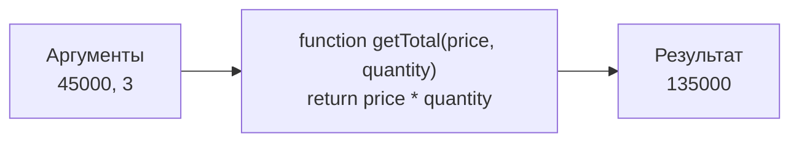
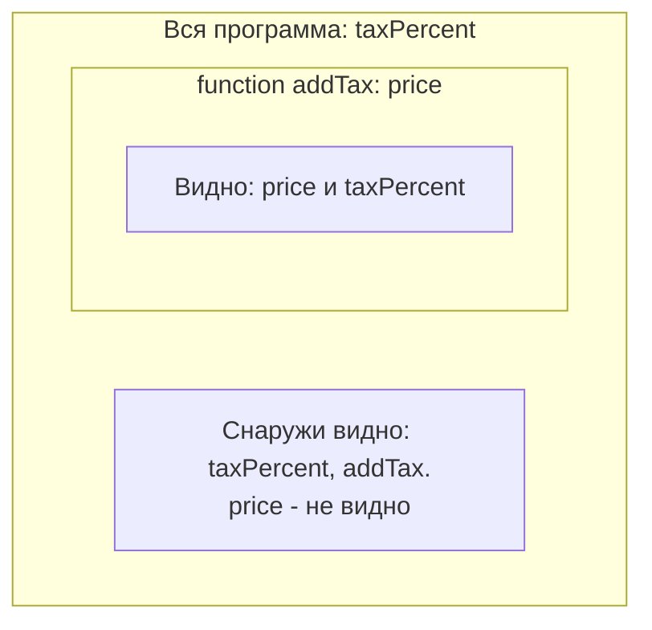

# Функции

[Содержание](../../README.md) · [← Назад](../../Lesson-4/ru/Циклы.md) · [Вперёд →](../../Lesson-6/ru/Массивы%20и%20объекты.md) · [RU](%D0%A4%D1%83%D0%BD%D0%BA%D1%86%D0%B8%D0%B8.md) · [EN](../en/Functions.md) · [UZ](../uz/Funksiyalar.md)

> **Связь с уроками 3–4:** вы писали условия и циклы, а чтобы проверить их на другом значении, меняли переменную вручную. Сегодня упакуем код в **функции**: один раз написали - вызываем сколько угодно раз с разными данными.

---

## Зачем это вам

Кнопка «Добавить в корзину» на сайте магазина одна и та же у сотни товаров. Код, который считает цену со скидкой, нужен и в корзине, и в карточке товара, и в письме с заказом. Копировать его в три места - значит трижды исправлять ошибку. Функция решает это: код живёт в одном месте, а вызывается откуда нужно.

`console.log` - тоже функция. Её написали разработчики браузера, а вы просто вызываете её по имени. Сегодня напишете свои.

---

## Чему вы научитесь

- Объявлять функцию и вызывать её.
- Передавать данные через параметры и получать результат через `return`.
- Отличать `return` от `console.log`.
- Задавать значения параметров по умолчанию.
- Записывать короткие функции стрелкой `=>`.
- Понимать область видимости: где «живут» переменные.
- Писать чистые функции и давать им понятные имена.

---

## Повторение: 3 вопроса из урока 4

1. Чем накопитель отличается от счётчика?
2. Что делает `break`?
3. Как перебрать каждый символ строки `word`?

Ответы - в конце урока.

---

## План урока

| Раздел | Что делаем |
| --- | --- |
| Объявление и вызов | Рецепт и приготовление |
| Параметры и аргументы | Ингредиенты |
| `return` | Готовое блюдо |
| Мини-задание 1 | Площадь прямоугольника |
| Значения по умолчанию | Если ингредиент не передали |
| Стрелочные функции | Короткая запись |
| Область видимости | Что видно внутри и снаружи |
| Чистые функции | Предсказуемый результат |
| Мини-задание 2 | Функция с циклом |
| Самостоятельная работа | Набор функций для оценок и цен |

---

## Объявление и вызов

**Простыми словами:** функция - рецепт. Записать рецепт (объявить) и приготовить блюдо (вызвать) - разные действия. Рецепт пишут один раз, готовят по нему сколько угодно.

```js
// Объявление: записали рецепт
function sayHello() {
    console.log("Привет!");
}

// Вызов: приготовили
sayHello();
sayHello();
```

В консоли дважды `Привет!`.

| Часть | Что это |
| --- | --- |
| `function` | Ключевое слово «объявляю функцию» |
| `sayHello` | Имя функции |
| `()` | Список параметров - пока пустой |
| `{ ... }` | Тело функции - код, который выполнится при вызове |
| `sayHello();` | Вызов: имя и скобки |

> **Без скобок функция не вызывается.** `sayHello;` - это просто упоминание имени, код не выполнится. Вызов - всегда `sayHello()`.

---

## Параметры и аргументы

Чтобы функция работала с разными данными, ей передают значения:

```js
function greet(name) {
    console.log(`Привет, ${name}!`);
}

greet("Анна");   // Привет, Анна!
greet("Тимур");  // Привет, Тимур!
```

- **Параметр** - имя в объявлении: `name`. Это переменная, которая существует только внутри функции.
- **Аргумент** - значение при вызове: `"Анна"`. Оно кладётся в параметр.

Параметров может быть несколько, через запятую. Аргументы передаются **в том же порядке**:

```js
function introduce(name, city) {
    console.log(`${name} из города ${city}`);
}

introduce("Анна", "Ташкент"); // Анна из города Ташкент
introduce("Ташкент", "Анна"); // Ташкент из города Анна - порядок важен!
```

Если аргумент не передать, параметр будет `undefined`:

```js
greet(); // Привет, undefined!
```

### Что происходит при вызове: пошагово

Разберём `introduce("Анна", "Ташкент");` так, как его выполняет браузер:

| Шаг | Что делает браузер | Значения |
| --- | --- | --- |
| 1 | Находит функцию `introduce` | - |
| 2 | Создаёт параметры и кладёт в них аргументы по порядку | `name = "Анна"`, `city = "Ташкент"` |
| 3 | Выполняет тело функции | Выводит `Анна из города Ташкент` |
| 4 | Удаляет параметры: функция закончилась | `name` и `city` больше не существуют |
| 5 | Возвращается к строке после вызова | Программа идёт дальше |

При следующем вызове всё начинается заново, с новыми значениями. Параметры не помнят прошлый вызов.

---

## `return` - вернуть результат

Функция `greet` только печатает. Но чаще от функции нужен **результат**, чтобы использовать его дальше: сложить, сравнить, вставить в текст. Для этого есть `return`:

```js
function getTotal(price, quantity) {
    return price * quantity;
}

const total = getTotal(45000, 3);
console.log(total);                       // 135000
console.log(getTotal(1000, 2) + 500);     // 2500
console.log(`К оплате: ${getTotal(20, 5)}`); // К оплате: 100
```

Вызов `getTotal(45000, 3)` «превращается» в значение `135000` - как будто вместо вызова написано число.



### `return` и `console.log` - не одно и то же

```js
function doubleLog(x) {
    console.log(x * 2);   // только показывает
}

function doubleReturn(x) {
    return x * 2;         // отдаёт значение
}

const a = doubleLog(5);     // в консоли 10, но...
console.log(a);             // undefined - функция ничего не вернула

const b = doubleReturn(5);  // в консоли пусто
console.log(b);             // 10
console.log(b + 1);         // 11 - с результатом можно работать
```

| | `console.log` | `return` |
| --- | --- | --- |
| Для кого | Для человека, который смотрит в консоль | Для программы |
| Что получает вызов | `undefined` | Значение |
| Когда использовать | Отладка, вывод итога | Почти всегда в функциях-вычислителях |

### `return` завершает функцию

После `return` функция сразу заканчивается, следующие строки не выполняются. Это удобно для **раннего выхода**:

```js
function getDeliveryCost(total) {
    if (total >= 100000) {
        return 0;
    }
    return 15000;
}

console.log(getDeliveryCost(150000)); // 0
console.log(getDeliveryCost(50000));  // 15000
```

`else` здесь не нужен: если первое условие сработало, до второго `return` выполнение не дойдёт.

### Функция вызывает функцию

Большую задачу собирают из маленьких функций, как блюдо из заготовок:

```js
function getSubtotal(price, quantity) {
    return price * quantity;
}

function getDeliveryCost(total) {
    if (total >= 100000) {
        return 0;
    }
    return 15000;
}

function getOrderTotal(price, quantity) {
    const subtotal = getSubtotal(price, quantity);
    return subtotal + getDeliveryCost(subtotal);
}

console.log(getOrderTotal(30000, 2)); // 75000
```

| Шаг | Вызов | Результат |
| --- | --- | --- |
| 1 | `getOrderTotal(30000, 2)` начинает работу | - |
| 2 | `getSubtotal(30000, 2)` | `60000` |
| 3 | `getDeliveryCost(60000)` | `15000` - сумма меньше 100000 |
| 4 | `60000 + 15000` | `getOrderTotal` возвращает `75000` |

Каждая функция делает **одно** дело и называется по этому делу. Если нужно поменять правило доставки, меняется только `getDeliveryCost`.

---

## Мини-задание 1

Напишите функцию `getArea(width, height)`, которая **возвращает** площадь прямоугольника. Выведите в консоль `getArea(3, 4)` и сумму площадей двух прямоугольников: `3 × 4` и `5 × 2`. Должно получиться `12` и `22`. Решение - в разделе «Ответы».

---

## Значения по умолчанию

Параметру можно задать значение, которое используется, если аргумент не передали:

```js
function formatPrice(amount, currency = "сум") {
    return `${amount} ${currency}`;
}

console.log(formatPrice(45000));      // 45000 сум
console.log(formatPrice(20, "$"));    // 20 $
```

Параметры по умолчанию ставят в конец списка: так их можно просто не передавать.

---

## Стрелочные функции

Функцию можно сохранить в константу. Короткая современная запись - **стрелочная функция**:

```js
// Обычное объявление
function square(x) {
    return x * x;
}

// То же самое стрелкой
const squareArrow = (x) => x * x;

console.log(square(4));      // 16
console.log(squareArrow(4)); // 16
```

| Запись | Когда |
| --- | --- |
| `const f = (x) => x * x;` | Тело - одно выражение: `return` подразумевается |
| `const f = (a, b) => { ... return ...; };` | Несколько строк: фигурные скобки и явный `return` |
| `const f = () => "Привет";` | Без параметров - пустые скобки |

```js
const getDiscount = (total, percent) => {
    const discount = total * percent / 100;
    return Math.round(discount);
};
```

> **Внимание:** с фигурными скобками `return` обязателен. `const f = (x) => { x * 2 };` вернёт `undefined`.

В курсе используем обе записи: `function` - для основных именованных функций, стрелки - для коротких вычислений. Стрелочные функции особенно понадобятся в уроках 6–8: их передают в другие функции.

### Функция - тоже значение

Функцию можно положить в переменную - это вы уже сделали со стрелкой. А значит, её можно **передать другой функции** как аргумент. Такую переданную функцию называют **колбэком** (callback - «перезвоните»): «вот тебе инструкция, вызови её, когда придёт время».

```js
function repeat(times, action) {
    for (let i = 1; i <= times; i++) {
        action(i);
    }
}

repeat(3, (n) => console.log(`Шаг ${n}`));
// Шаг 1
// Шаг 2
// Шаг 3
```

Здесь `action` - параметр, в котором лежит функция. `action(i)` вызывает её.

Встроенный пример - `setTimeout`: «выполни функцию через N миллисекунд»:

```js
console.log("Заказ принят");

setTimeout(() => {
    console.log("Заказ готов");
}, 2000);

console.log("Ждём...");
// Заказ принят
// Ждём...
// Заказ готов  ← через 2 секунды
```

Обратите внимание на порядок: `setTimeout` **не останавливает** программу. Он запоминает функцию и идёт дальше, а функцию вызовет потом. Эта идея пригодится трижды: методы массивов в уроке 6, события в уроке 8 и запросы к серверу в уроке 9.

| Запись | Что передаём |
| --- | --- |
| `setTimeout(showMessage, 1000)` | Саму функцию - правильно |
| `setTimeout(showMessage(), 1000)` | Результат вызова: функция выполнится **сразу** - ошибка |

---

## Область видимости

Переменная, объявленная внутри функции, видна только внутри неё:

```js
function calculate() {
    const result = 42;
    console.log(result); // 42
}

calculate();
console.log(result); // ReferenceError: result is not defined
```

А переменные снаружи функции видны внутри:

```js
const taxPercent = 12;

function addTax(price) {
    return price + price * taxPercent / 100;
}

console.log(addTax(1000)); // 1120
```



Правило то же, что у блоков `{ }` в `if` и циклах: переменная живёт внутри своих фигурных скобок и во всех вложенных.

---

## Чистые функции

**Чистая функция** - функция, которая:

1. При одинаковых аргументах всегда возвращает одинаковый результат.
2. Ничего не меняет снаружи: не трогает внешние переменные, не печатает в консоль.

```js
// Чистая: результат зависит только от аргументов
function getTotal(price, quantity) {
    return price * quantity;
}

// Не чистая: меняет внешнюю переменную
let cartTotal = 0;
function addToCart(price) {
    cartTotal += price;
}
```

Чистые функции легко проверять: вызвал с аргументами - сравнил результат. Именно так работают тесты на платформе. Старайтесь, чтобы функции-вычислители были чистыми, а вывод (`console.log`) делался снаружи.

### Имена функций

Функция - действие, поэтому имя начинается с **глагола**: `getTotal`, `formatPrice`, `calculateDiscount`, `showMessage`. Функции, которые отвечают «да или нет», начинаются с `is`, `has`, `can`: `isEven`, `hasDiscount`, `canEnter`.

### Попробуйте сломать

1. Уберите `return` из `getTotal` и выведите `getTotal(45000, 3)`. Что вернула функция?
2. Вызовите `introduce("Анна")` с одним аргументом. Что окажется в `city`?
3. В `setTimeout` передайте `showMessage()` со скобками. Почему сообщение появилось сразу?

### Частые ошибки новичков

| Ошибка | Что получится | Как исправить |
| --- | --- | --- |
| Вызов без скобок: `sayHello;` | Ничего не происходит | `sayHello();` |
| Нет `return` в функции-вычислителе | Вызов даёт `undefined` | `return результат;` |
| `console.log` вместо `return` | Значение видно в консоли, но в программу не попадает | Возвращайте значение, печатайте снаружи |
| Код после `return` | Он никогда не выполнится | Ставьте `return` последним |
| Аргументы не в том порядке | Значения перепутаны | Порядок аргументов = порядок параметров |
| Стрелка с `{ }` без `return` | `undefined` | `(x) => x * 2` или `(x) => { return x * 2; }` |
| Переменная из функции используется снаружи | `ReferenceError` | Верните её через `return` |

---

## Мини-задание 2

Напишите функцию `countChar(text, char)`, которая циклом `for...of` считает, сколько раз символ `char` встречается в `text`, и **возвращает** число. `countChar("мама мыла раму", "м")` должна вернуть `4`. Решение - в разделе «Ответы».

---

## Итоги урока: шпаргалка

| Задача | Запись |
| --- | --- |
| Объявить функцию | `function getTotal(price, qty) { ... }` |
| Вызвать | `getTotal(45000, 3)` |
| Вернуть результат | `return price * qty;` |
| Значение по умолчанию | `function f(amount, currency = "сум")` |
| Стрелочная, одно выражение | `const square = (x) => x * x;` |
| Стрелочная, несколько строк | `const f = (a) => { ...; return ...; };` |
| Ранний выход | `if (...) { return 0; }` |
| Имя | Глагол: `getTotal`, вопрос: `isEven` |

---

## Самостоятельная работа

### Часть 1. Задание в IDE (засчитывается платформой)

Напишите набор функций. Каждая **возвращает** результат и ничего не выводит в консоль.

1. `isEven(number)` - объявлением `function`: `true`, если число чётное, иначе `false`.
2. `getGrade(score)` - оценка числом по баллу, как в уроке 3: 90 и выше → `5`, от 75 → `4`, от 60 → `3`, ниже → `2`.
3. `formatPrice(amount, currency)` - строка `"45000 сум"`; если валюту не передали, используется `"сум"`.
4. `square` - стрелочная функция в константе: возвращает квадрат числа.
5. `countVowels(word)` - число гласных `a, e, i, o, u` в слове без учёта регистра, как в уроке 4.

После функций выведите в консоль несколько вызовов, чтобы проверить их, - это разрешено.

Что проверяет платформа: результаты каждой функции на разных аргументах, включая `0`, отрицательные числа и границы оценок; `isEven` объявлена через `function`; `square` - стрелочная функция; у `currency` значение по умолчанию `"сум"`; функции ничего не печатают при вызове.

### Часть 2. Проект на компьютере

1. Перенесите в `main.js` своего сайта приветствие по времени суток из урока 3 в функцию `getGreeting(hour)`, которая возвращает строку.
2. Напишите функцию `formatPrice` и выведите ею цены нескольких товаров или услуг.
3. Вызовите каждую функцию с несколькими аргументами и сравните результат с ожидаемым: `console.log(getGreeting(9) === "Доброе утро");`.

### Критерии готовности

- [ ] Задание в IDE засчитано.
- [ ] Функции-вычислители возвращают значение через `return` и не печатают.
- [ ] Имена функций начинаются с глагола или с `is` / `has` / `can`.
- [ ] Каждая функция проверена несколькими вызовами, включая граничные значения.
- [ ] Внутри функций нет изменения внешних переменных без необходимости.

---

## Вопросы для самопроверки

1. Чем объявление функции отличается от вызова?
2. Чем параметр отличается от аргумента?
3. Что получит переменная `const x = f();`, если в `f` нет `return`?
4. Почему `return` нужен функции-вычислителю, а `console.log` - нет?
5. Что происходит с кодом после `return`?
6. Как задать параметру значение по умолчанию?
7. Перепишите `function triple(n) { return n * 3; }` стрелкой.
8. Почему `const f = (x) => { x * 2 };` возвращает `undefined`?
9. Видна ли переменная, объявленная внутри функции, снаружи?
10. Что такое чистая функция и почему её легко проверять?

После вопросов пройдите **тест урока** на платформе: 12 вопросов, порог 70%.

---

## Что дальше

Пока функции работают с отдельными значениями: одно число, одна строка. Но у магазина сотни товаров, у курса - десятки учеников. В уроке 6 - **массивы и объекты**: как хранить много данных сразу и обрабатывать их функциями.

---

## Ответы

**Повторение**

1. Накопитель собирает значение (сумму, строку), счётчик считает количество.
2. Немедленно завершает цикл.
3. `for (const char of word) { ... }`.

**Мини-задание 1**

```js
function getArea(width, height) {
    return width * height;
}

console.log(getArea(3, 4));                  // 12
console.log(getArea(3, 4) + getArea(5, 2));  // 22
```

**Мини-задание 2**

```js
function countChar(text, char) {
    let count = 0;
    for (const c of text) {
        if (c === char) {
            count++;
        }
    }
    return count;
}

console.log(countChar("мама мыла раму", "м")); // 4
```

**Вопросы для самопроверки**

1. Объявление записывает код функции, вызов `f()` выполняет его.
2. Параметр - имя в объявлении, аргумент - значение при вызове.
3. `undefined`.
4. `return` отдаёт значение программе, с ним можно дальше работать; `console.log` только показывает его человеку.
5. Не выполняется: `return` завершает функцию.
6. `function f(currency = "сум")`.
7. `const triple = (n) => n * 3;`.
8. С фигурными скобками `return` не подразумевается, его нужно написать явно.
9. Нет - она живёт внутри функции.
10. Результат зависит только от аргументов, снаружи ничего не меняется. Вызвал - сравнил с ожидаемым.

---

[Содержание](../../README.md) · [← Назад](../../Lesson-4/ru/Циклы.md) · [Вперёд →](../../Lesson-6/ru/Массивы%20и%20объекты.md) · [RU](%D0%A4%D1%83%D0%BD%D0%BA%D1%86%D0%B8%D0%B8.md) · [EN](../en/Functions.md) · [UZ](../uz/Funksiyalar.md)
