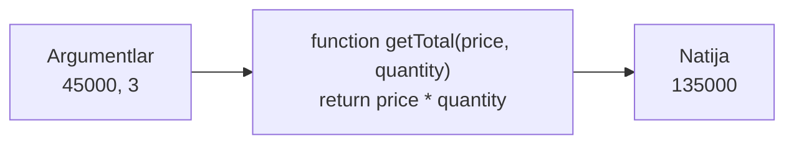
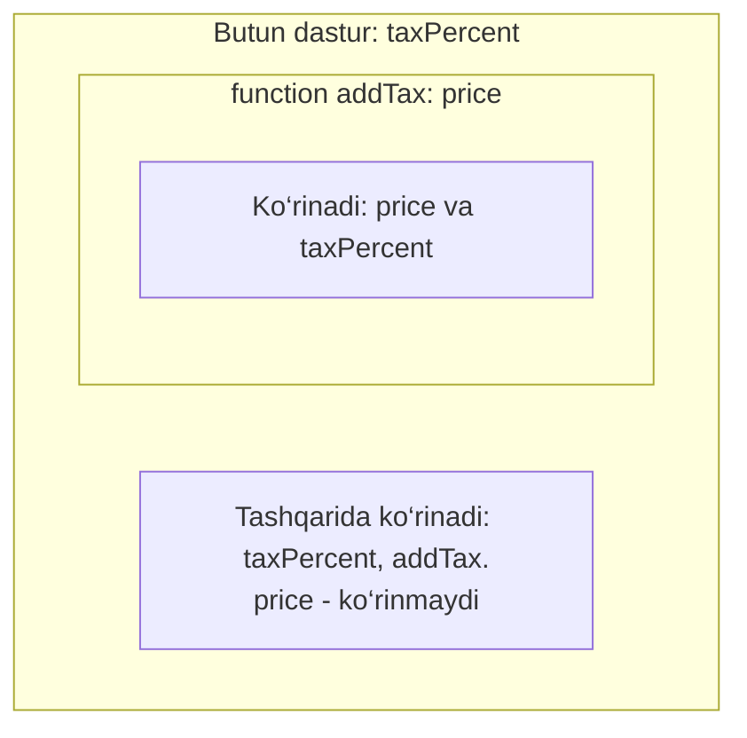

# Funksiyalar

[Mundarija](../../README.md) · [← Orqaga](../../Lesson-4/uz/Sikllar.md) · [Keyingi →](../../Lesson-6/uz/Massivlar%20va%20obyektlar.md) · [RU](../ru/%D0%A4%D1%83%D0%BD%D0%BA%D1%86%D0%B8%D0%B8.md) · [EN](../en/Functions.md) · [UZ](Funksiyalar.md)

> **3–4-darslar bilan bog‘liqlik:** siz shartlar va sikllar yozdingiz, ularni boshqa qiymatda tekshirish uchun esa o‘zgaruvchini qo‘lda o‘zgartirdingiz. Bugun kodni **funksiyalarga** joylaymiz: bir marta yozdik - turli ma’lumotlar bilan istagancha chaqiramiz.

---

## Bu sizga nima uchun kerak

Internet-do‘kondagi «Savatga qo‘shish» tugmasi yuzta mahsulotda bir xil. Chegirmali narxni hisoblaydigan kod savatda ham, mahsulot kartochkasida ham, buyurtma xatida ham kerak. Uni uch joyga nusxalash - xatoni uch marta tuzatish demak. Funksiya buni hal qiladi: kod bitta joyda yashaydi, kerakli joydan chaqiriladi.

`console.log` ham funksiya. Uni brauzer dasturchilari yozgan, siz esa shunchaki nomi bilan chaqirasiz. Bugun o‘zingiznikini yozasiz.

---

## Nimani o‘rganasiz

- Funksiya e’lon qilish va uni chaqirish.
- Ma’lumotni parametrlar orqali berish va natijani `return` orqali olish.
- `return` ni `console.log` dan farqlash.
- Parametrlarga standart qiymat berish.
- Qisqa funksiyalarni `=>` strelka bilan yozish.
- Ko‘rinish sohasini tushunish: o‘zgaruvchilar qayerda «yashaydi».
- Sof funksiyalar yozish va ularga tushunarli nom berish.

---

## Takrorlash: 4-darsdan 3 savol

1. To‘plovchi hisoblagichdan nimasi bilan farq qiladi?
2. `break` nima qiladi?
3. `word` satrining har bir belgisini qanday aylanib chiqish mumkin?

Javoblar - dars oxirida.

---

## Reja

| Bo‘lim | Nima qilamiz |
| --- | --- |
| E’lon va chaqiruv | Retsept va pishirish |
| Parametrlar va argumentlar | Masalliqlar |
| `return` | Tayyor taom |
| Mini-topshiriq 1 | To‘rtburchak yuzi |
| Standart qiymatlar | Masalliq berilmasa |
| Strelkali funksiyalar | Qisqa yozuv |
| Ko‘rinish sohasi | Ichkarida va tashqarida nima ko‘rinadi |
| Sof funksiyalar | Oldindan ma’lum natija |
| Mini-topshiriq 2 | Siklli funksiya |
| Mustaqil ish | Baho va narxlar uchun funksiyalar to‘plami |

---

## E’lon va chaqiruv

**Oddiy so‘z bilan:** funksiya - retsept. Retseptni yozib qo‘yish (e’lon qilish) va taomni pishirish (chaqirish) - turli amallar. Retsept bir marta yoziladi, unga ko‘ra istagancha pishiriladi.

```js
// E’lon: retseptni yozdik
function sayHello() {
    console.log("Salom!");
}

// Chaqiruv: pishirdik
sayHello();
sayHello();
```

Konsolda ikki marta `Salom!`.

| Qism | Bu nima |
| --- | --- |
| `function` | «Funksiya e’lon qilaman» kalit so‘zi |
| `sayHello` | Funksiya nomi |
| `()` | Parametrlar ro‘yxati - hozircha bo‘sh |
| `{ ... }` | Funksiya tanasi - chaqirilganda bajariladigan kod |
| `sayHello();` | Chaqiruv: nom va qavslar |

> **Qavssiz funksiya chaqirilmaydi.** `sayHello;` - shunchaki nomni tilga olish, kod bajarilmaydi. Chaqiruv - doim `sayHello()`.

---

## Parametrlar va argumentlar

Funksiya turli ma’lumotlar bilan ishlashi uchun unga qiymatlar beriladi:

```js
function greet(name) {
    console.log(`Salom, ${name}!`);
}

greet("Anna");   // Salom, Anna!
greet("Timur");  // Salom, Timur!
```

- **Parametr** - e’londagi nom: `name`. Bu faqat funksiya ichida mavjud o‘zgaruvchi.
- **Argument** - chaqiruvdagi qiymat: `"Anna"`. U parametrga solinadi.

Parametrlar vergul bilan bir nechta bo‘lishi mumkin. Argumentlar **xuddi shu tartibda** beriladi:

```js
function introduce(name, city) {
    console.log(`${name} ${city} shahridan`);
}

introduce("Anna", "Toshkent"); // Anna Toshkent shahridan
introduce("Toshkent", "Anna"); // Toshkent Anna shahridan - tartib muhim!
```

Agar argument berilmasa, parametr `undefined` bo‘ladi:

```js
greet(); // Salom, undefined!
```

---

## `return` - natijani qaytarish

`greet` funksiyasi faqat chiqaradi. Lekin ko‘pincha funksiyadan keyin ishlatish uchun **natija** kerak: qo‘shish, solishtirish, matnga qo‘yish. Buning uchun `return` bor:

```js
function getTotal(price, quantity) {
    return price * quantity;
}

const total = getTotal(45000, 3);
console.log(total);                       // 135000
console.log(getTotal(1000, 2) + 500);     // 2500
console.log(`To‘lov: ${getTotal(20, 5)}`); // To‘lov: 100
```

`getTotal(45000, 3)` chaqiruvi `135000` qiymatiga «aylanadi» - go‘yo chaqiruv o‘rnida son yozilgandek.



### `return` va `console.log` - bir xil narsa emas

```js
function doubleLog(x) {
    console.log(x * 2);   // faqat ko‘rsatadi
}

function doubleReturn(x) {
    return x * 2;         // qiymatni qaytaradi
}

const a = doubleLog(5);     // konsolda 10, lekin...
console.log(a);             // undefined - funksiya hech narsa qaytarmadi

const b = doubleReturn(5);  // konsolda bo‘sh
console.log(b);             // 10
console.log(b + 1);         // 11 - natija bilan ishlash mumkin
```

| | `console.log` | `return` |
| --- | --- | --- |
| Kim uchun | Konsolga qarayotgan odam uchun | Dastur uchun |
| Chaqiruv nima oladi | `undefined` | Qiymat |
| Qachon ishlatiladi | Nosozliklarni tuzatish, yakunni chiqarish | Hisoblovchi funksiyalarda deyarli doim |

### `return` funksiyani tugatadi

`return` dan keyin funksiya darhol tugaydi, keyingi qatorlar bajarilmaydi. Bu **erta chiqish** uchun qulay:

```js
function getDeliveryCost(total) {
    if (total >= 100000) {
        return 0;
    }
    return 15000;
}

console.log(getDeliveryCost(150000)); // 0
console.log(getDeliveryCost(50000));  // 15000
```

Bu yerda `else` kerak emas: birinchi shart ishlasa, bajarilish ikkinchi `return` ga yetib bormaydi.

---

## Mini-topshiriq 1

To‘rtburchak yuzini **qaytaradigan** `getArea(width, height)` funksiyasini yozing. Konsolga `getArea(3, 4)` ni va ikki to‘rtburchak yuzlari yig‘indisini chiqaring: `3 × 4` va `5 × 2`. `12` va `22` chiqishi kerak. Yechim - «Javoblar» bo‘limida.

---

## Standart qiymatlar

Parametrga argument berilmaganda ishlatiladigan qiymat berish mumkin:

```js
function formatPrice(amount, currency = "so‘m") {
    return `${amount} ${currency}`;
}

console.log(formatPrice(45000));      // 45000 so‘m
console.log(formatPrice(20, "$"));    // 20 $
```

Standart qiymatli parametrlar ro‘yxat oxiriga qo‘yiladi: shunda ularni shunchaki bermaslik mumkin.

---

## Strelkali funksiyalar

Funksiyani konstantaga saqlash mumkin. Qisqa zamonaviy yozuv - **strelkali funksiya**:

```js
// Oddiy e’lon
function square(x) {
    return x * x;
}

// Xuddi shu strelka bilan
const squareArrow = (x) => x * x;

console.log(square(4));      // 16
console.log(squareArrow(4)); // 16
```

| Yozuv | Qachon |
| --- | --- |
| `const f = (x) => x * x;` | Tana - bitta ifoda: `return` nazarda tutiladi |
| `const f = (a, b) => { ... return ...; };` | Bir necha qator: jingalak qavslar va aniq `return` |
| `const f = () => "Salom";` | Parametrsiz - bo‘sh qavslar |

```js
const getDiscount = (total, percent) => {
    const discount = total * percent / 100;
    return Math.round(discount);
};
```

> **Diqqat:** jingalak qavslar bilan `return` majburiy. `const f = (x) => { x * 2 };` `undefined` qaytaradi.

Kursda ikkala yozuvdan foydalanamiz: `function` - asosiy nomli funksiyalar uchun, strelkalar - qisqa hisoblar uchun. Strelkali funksiyalar ayniqsa 6–8-darslarda kerak bo‘ladi: ular boshqa funksiyalarga beriladi.

---

## Ko‘rinish sohasi

Funksiya ichida e’lon qilingan o‘zgaruvchi faqat uning ichida ko‘rinadi:

```js
function calculate() {
    const result = 42;
    console.log(result); // 42
}

calculate();
console.log(result); // ReferenceError: result is not defined
```

Funksiyadan tashqaridagi o‘zgaruvchilar esa ichkarida ko‘rinadi:

```js
const taxPercent = 12;

function addTax(price) {
    return price + price * taxPercent / 100;
}

console.log(addTax(1000)); // 1120
```



Qoida `if` va sikllardagi `{ }` bloklari bilan bir xil: o‘zgaruvchi o‘z jingalak qavslari va barcha ichki qavslar ichida yashaydi.

---

## Sof funksiyalar

**Sof funksiya** - bu shunday funksiya:

1. Bir xil argumentlarda doim bir xil natija qaytaradi.
2. Tashqarida hech narsani o‘zgartirmaydi: tashqi o‘zgaruvchilarga tegmaydi, konsolga chiqarmaydi.

```js
// Sof: natija faqat argumentlarga bog‘liq
function getTotal(price, quantity) {
    return price * quantity;
}

// Sof emas: tashqi o‘zgaruvchini o‘zgartiradi
let cartTotal = 0;
function addToCart(price) {
    cartTotal += price;
}
```

Sof funksiyalarni tekshirish oson: argumentlar bilan chaqirdik - natijani solishtirdik. Platformadagi testlar aynan shunday ishlaydi. Hisoblovchi funksiyalar sof bo‘lishiga harakat qiling, chiqarishni (`console.log`) esa tashqarida bajaring.

### Funksiya nomlari

Funksiya - amal, shuning uchun nomi **fe’l** bilan boshlanadi: `getTotal`, `formatPrice`, `calculateDiscount`, `showMessage`. «Ha yoki yo‘q» ga javob beradigan funksiyalar `is`, `has`, `can` bilan boshlanadi: `isEven`, `hasDiscount`, `canEnter`.

---

## Mini-topshiriq 2

`char` belgisi `text` da necha marta uchrashini `for...of` sikli bilan sanaydigan va sonni **qaytaradigan** `countChar(text, char)` funksiyasini yozing. `countChar("qalam va daftar", "a")` `5` qaytarishi kerak. Yechim - «Javoblar» bo‘limida.

---

## Dars yakuni: shpargalka

| Vazifa | Yozuv |
| --- | --- |
| Funksiya e’lon qilish | `function getTotal(price, qty) { ... }` |
| Chaqirish | `getTotal(45000, 3)` |
| Natija qaytarish | `return price * qty;` |
| Standart qiymat | `function f(amount, currency = "so‘m")` |
| Strelka, bitta ifoda | `const square = (x) => x * x;` |
| Strelka, bir necha qator | `const f = (a) => { ...; return ...; };` |
| Erta chiqish | `if (...) { return 0; }` |
| Nom | Fe’l: `getTotal`, savol: `isEven` |

---

## Mustaqil ish

### 1-qism. IDE topshirig‘i (platforma hisoblaydi)

Funksiyalar to‘plamini yozing. Har biri natijani **qaytaradi** va konsolga hech narsa chiqarmaydi.

1. `isEven(number)` - `function` e’loni bilan: son juft bo‘lsa `true`, aks holda `false`.
2. `getGrade(score)` - 3-darsdagi kabi balldan son ko‘rinishidagi baho: 90 va yuqori → `5`, 75 dan → `4`, 60 dan → `3`, pastroq → `2`.
3. `formatPrice(amount, currency)` - `"45000 so‘m"` satri; valyuta berilmasa, `"so‘m"` ishlatiladi.
4. `square` - konstantadagi strelkali funksiya: sonning kvadratini qaytaradi.
5. `countVowels(word)` - 4-darsdagi kabi so‘zdagi `a, e, i, o, u` unlilari soni, registrni hisobga olmay.

Funksiyalardan keyin ularni tekshirish uchun bir nechta chaqiruvni konsolga chiqarishingiz mumkin - bunga ruxsat.

Platforma nimani tekshiradi: har bir funksiyaning turli argumentlardagi natijasi, jumladan `0`, manfiy sonlar va baho chegaralari; `isEven` `function` orqali e’lon qilingan; `square` - strelkali funksiya; `currency` ning standart qiymati `"so‘m"`; funksiyalar chaqirilganda hech narsa chiqarmaydi.

### 2-qism. Kompyuterdagi loyiha

1. Saytingizning `main.js` faylidagi 3-darsdagi kun vaqtiga qarab salomlashuvni satr qaytaradigan `getGreeting(hour)` funksiyasiga ko‘chiring.
2. `formatPrice` funksiyasini yozing va u bilan bir nechta mahsulot yoki xizmat narxini chiqaring.
3. Har bir funksiyani bir nechta argument bilan chaqiring va natijani kutilgani bilan solishtiring: `console.log(getGreeting(9) === "Xayrli tong");`.

### Tayyorlik mezonlari

- [ ] IDE topshirig‘i qabul qilindi.
- [ ] Hisoblovchi funksiyalar qiymatni `return` orqali qaytaradi va chiqarmaydi.
- [ ] Funksiya nomlari fe’l yoki `is` / `has` / `can` bilan boshlanadi.
- [ ] Har bir funksiya bir nechta chaqiruv bilan, chegaraviy qiymatlar bilan birga tekshirilgan.
- [ ] Funksiyalar ichida keraksiz tashqi o‘zgaruvchilarni o‘zgartirish yo‘q.

---

## O‘zini tekshirish uchun savollar

1. Funksiya e’loni chaqiruvdan nimasi bilan farq qiladi?
2. Parametr argumentdan nimasi bilan farq qiladi?
3. `f` da `return` bo‘lmasa, `const x = f();` nima oladi?
4. Nima uchun hisoblovchi funksiyaga `return` kerak, `console.log` esa yo‘q?
5. `return` dan keyingi kod bilan nima bo‘ladi?
6. Parametrga standart qiymat qanday beriladi?
7. `function triple(n) { return n * 3; }` ni strelka bilan qayta yozing.
8. Nima uchun `const f = (x) => { x * 2 };` `undefined` qaytaradi?
9. Funksiya ichida e’lon qilingan o‘zgaruvchi tashqarida ko‘rinadimi?
10. Sof funksiya nima va uni nima uchun tekshirish oson?

Savollardan keyin platformada **dars testini** topshiring: 12 ta savol, o‘tish chegarasi 70%.

---

## Keyin nima

Hozircha funksiyalar alohida qiymatlar bilan ishlaydi: bitta son, bitta satr. Lekin do‘konda yuzlab mahsulot, kursda o‘nlab o‘quvchi bor. 6-darsda - **massivlar va obyektlar**: ko‘p ma’lumotni birdaniga qanday saqlash va funksiyalar bilan qayta ishlash.

---

## Javoblar

**Takrorlash**

1. To‘plovchi qiymat (yig‘indi, satr) yig‘adi, hisoblagich sonni sanaydi.
2. Siklni darhol tugatadi.
3. `for (const char of word) { ... }`.

**Mini-topshiriq 1**

```js
function getArea(width, height) {
    return width * height;
}

console.log(getArea(3, 4));                  // 12
console.log(getArea(3, 4) + getArea(5, 2));  // 22
```

**Mini-topshiriq 2**

```js
function countChar(text, char) {
    let count = 0;
    for (const c of text) {
        if (c === char) {
            count++;
        }
    }
    return count;
}

console.log(countChar("qalam va daftar", "a")); // 5
```

**O‘zini tekshirish uchun savollar**

1. E’lon funksiya kodini yozib qo‘yadi, `f()` chaqiruvi uni bajaradi.
2. Parametr - e’londagi nom, argument - chaqiruvdagi qiymat.
3. `undefined`.
4. `return` qiymatni dasturga beradi, u bilan keyin ishlash mumkin; `console.log` uni faqat odamga ko‘rsatadi.
5. Bajarilmaydi: `return` funksiyani tugatadi.
6. `function f(currency = "so‘m")`.
7. `const triple = (n) => n * 3;`.
8. Jingalak qavslar bilan `return` nazarda tutilmaydi, uni aniq yozish kerak.
9. Yo‘q - u funksiya ichida yashaydi.
10. Natija faqat argumentlarga bog‘liq, tashqarida hech narsa o‘zgarmaydi. Chaqirdik - kutilgani bilan solishtirdik.

---

[Mundarija](../../README.md) · [← Orqaga](../../Lesson-4/uz/Sikllar.md) · [Keyingi →](../../Lesson-6/uz/Massivlar%20va%20obyektlar.md) · [RU](../ru/%D0%A4%D1%83%D0%BD%D0%BA%D1%86%D0%B8%D0%B8.md) · [EN](../en/Functions.md) · [UZ](Funksiyalar.md)
