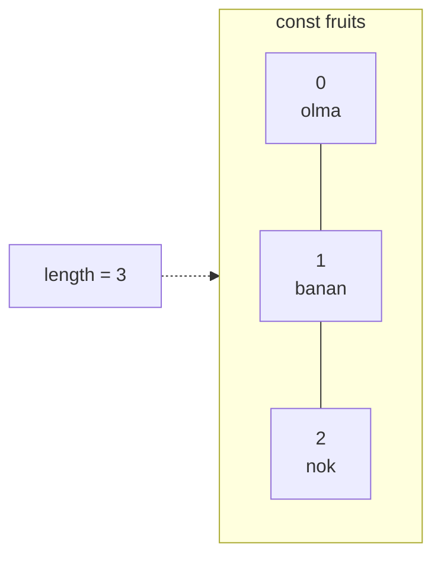
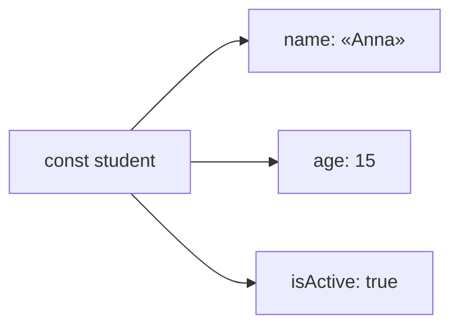
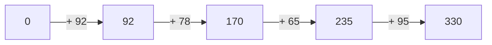
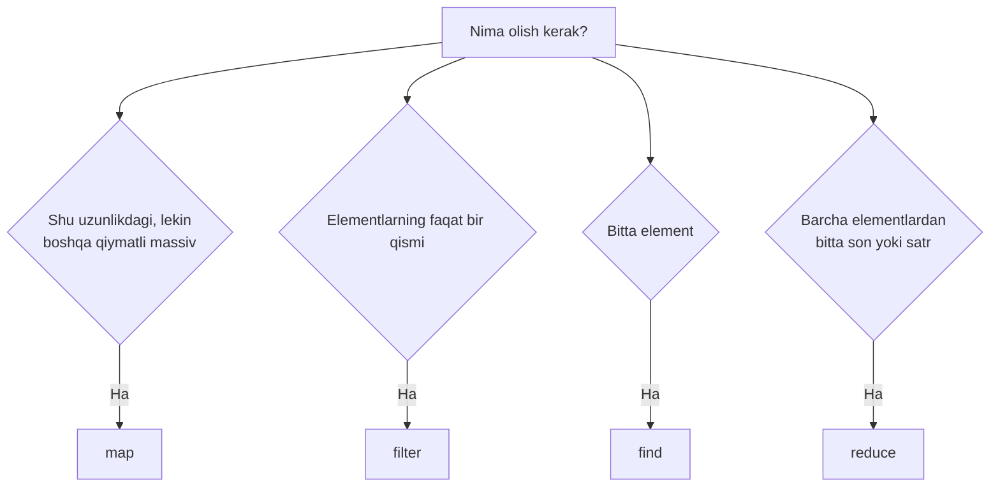

# Massivlar va obyektlar

[Mundarija](../../README.md) · [← Orqaga](../../Lesson-5/uz/Funksiyalar.md) · [Keyingi →](../../Lesson-7/uz/DOM%20elementlarni%20topish%20va%20o'zgartirish.md) · [RU](../ru/%D0%9C%D0%B0%D1%81%D1%81%D0%B8%D0%B2%D1%8B%20%D0%B8%20%D0%BE%D0%B1%D1%8A%D0%B5%D0%BA%D1%82%D1%8B.md) · [EN](../en/Arrays%20and%20objects.md) · [UZ](Massivlar%20va%20obyektlar.md)

> **4–5-darslar bilan bog‘liqlik:** siz satrni sikl bilan aylanib chiqdingiz va funksiyalar yozdingiz. Bugun **ko‘p ma’lumotni birdaniga** saqlashni - o‘quvchilar ro‘yxati, mahsulotlar katalogi - va ularni bir qatorda funksiyalar bilan qayta ishlashni o‘rganamiz.

---

## Bu sizga nima uchun kerak

Internet-do‘konda yuzlab mahsulot bor, har birining nomi, narxi, toifasi va mavjudligi bor. `product1Name`, `product1Price`, `product2Name`... o‘zgaruvchilarini yaratib bo‘lmaydi. Ma’lumotlar **massivlarda** (ro‘yxatlar) va **obyektlarda** (xususiyatli kartochkalar) saqlanadi. Sayt serverdan oladigan deyarli hamma narsa - obyektlar massivi.

Bu darsdan keyin sinfning o‘rtacha balini hisoblash, mahsulotni nomi bo‘yicha topish, barcha a’lochilarni ajratib olish - har bir amalni bir-ikki qatorda bajara olasiz.

---

## Nimani o‘rganasiz

- Massiv yaratish, elementlarni indeks bo‘yicha o‘qish, uzunligini bilish.
- Elementlarni qo‘shish va olib tashlash: `push`, `pop`; qidirish: `includes`, `indexOf`.
- Massivni `for...of` sikli bilan aylanib chiqish.
- Mohiyatni obyekt bilan tasvirlash: xususiyatlar, nuqta va kvadrat qavslar.
- Obyektlar massivi bilan ishlash.
- Ma’lumotlarni `map`, `filter`, `find`, `reduce` metodlari bilan o‘zgartirish.
- Qiymatlarni destrukturizatsiya bilan ochish va `...` orqali nusxalash.
- Massivni saralash va qismlarini kesib olish, obyekt xususiyatlarini aylanib chiqish; `map`, `filter` va `reduce` ishini qadamma-qadam kuzatish.


---

## Takrorlash: 5-darsdan 3 savol

1. `return` `console.log` dan nimasi bilan farq qiladi?
2. `function half(n) { return n / 2; }` ni strelka bilan qayta yozing.
3. Sof funksiya nima?

Javoblar - dars oxirida.

---

## Reja

| Bo‘lim | Nima qilamiz |
| --- | --- |
| Massivlar | Raqamli ro‘yxat |
| O‘zgartirish va qidirish | Qo‘shish, olib tashlash, topish |
| Obyektlar | Xususiyatli kartochka |
| Mini-topshiriq 1 | Mahsulot kartochkasi |
| Obyektlar massivi | Katalog |
| `map`, `filter`, `find`, `reduce` | Bir qatorda qayta ishlash |
| Destrukturizatsiya va `...` | Ochish va nusxalash |
| Mini-topshiriq 2 | Mavjud mahsulotlar |
| Mustaqil ish | Baholar jurnali |

---

## Massivlar

**Oddiy so‘z bilan:** massiv - xaridlar ro‘yxati. Bandlar tartib bilan keladi, har birining raqami bor.

```js
const fruits = ["olma", "banan", "nok"];

console.log(fruits[0]);       // "olma"
console.log(fruits[2]);       // "nok"
console.log(fruits.length);   // 3
console.log(fruits[fruits.length - 1]); // "nok" - oxirgi element
console.log(fruits[5]);       // undefined - bunday element yo‘q
```

| Tushuncha | Bu nima |
| --- | --- |
| `[ ... ]` | Massiv: vergul bilan ajratilgan qiymatlar |
| Element | Massivdagi bitta qiymat |
| Indeks | Element raqami. **Sanash noldan**: birinchisi - `0`, oxirgisi - `length - 1` |
| `length` | Elementlar soni |

Massivda istalgan turdagi qiymatlar bo‘lishi mumkin, lekin odatda bitta turdagi: faqat sonlar, faqat satrlar, faqat obyektlar.

```js
const scores = [92, 78, 65, 88];
const empty = [];
```

Massiv «ichidan» qanday ko‘rinadi - raqamlangan kataklar qatori:



**Sxemani qanday o‘qish kerak.** Katakdagi raqam - indeks, uning ostida - qiymat. Indekslar doim noldan ketma-ket boradi, shuning uchun oxirgi indeks uzunlikdan bittaga kam: `3 - 1 = 2`.

### Massivni aylanib chiqish

4-darsdagi `for...of` massivlar bilan ham ishlaydi:

```js
const scores = [92, 78, 65, 88];
let sum = 0;

for (const score of scores) {
    sum += score;
}

console.log(sum / scores.length); // 80.75
```

---

## O‘zgartirish va qidirish

```js
const cart = ["non", "sut"];

cart.push("pishloq");  // oxiriga qo‘shish → ["non", "sut", "pishloq"]
cart.pop();            // oxirgisini olib tashlash → ["non", "sut"]
cart[0] = "baton";     // indeks bo‘yicha almashtirish → ["baton", "sut"]

console.log(cart.includes("sut"));   // true
console.log(cart.indexOf("sut"));    // 1
console.log(cart.indexOf("kefir"));  // -1 - topilmadi
```

> **`const` va massiv:** `const cart = [...]` `cart` ga **boshqa** massiv solishni taqiqlaydi (`cart = []` - xato). Lekin o‘sha massiv ichini o‘zgartirish - `push`, `pop`, `cart[0] = ...` - mumkin. Konstanta - bitta qutiga abadiy yopishtirilgan yorliq, qutini ochishga taqiq emas.

### Yana to‘rtta metod: `slice`, `join`, `sort`, `forEach`

```js
const days = ["du", "se", "chor", "pay", "ju"];

console.log(days.slice(1, 3));   // ["se", "chor"] - bo‘lak nusxasi, days o‘zgarmaydi
console.log(days.join(", "));    // "du, se, chor, pay, ju" - massivdan satr

const names = ["Timur", "Anna", "Lola"];
names.sort();
console.log(names);              // ["Anna", "Lola", "Timur"] - alifbo bo‘yicha

days.forEach((day, index) => {
    console.log(`${index + 1}. ${day}`);
});
```

| Metod | Nima qiladi | Massivni o‘zgartiradimi? |
| --- | --- | --- |
| `slice(start, end)` | Bo‘lakni nusxalaydi, satrlardagidek | Yo‘q |
| `join(separator)` | Elementlarni satrga ulaydi - `split` ning teskarisi | Yo‘q |
| `sort()` | Elementlarni saralaydi | **Ha** |
| `forEach(fn)` | Har bir element uchun funksiyani chaqiradi, hech narsa qaytarmaydi | Yo‘q |

> **Sonlar bilan `sort` tuzog‘i.** Argumentsiz `sort` elementlarni **satr** sifatida solishtiradi: `[10, 9, 100].sort()` `[10, 100, 9]` beradi. Sonlar uchun solishtirish funksiyasini bering: `numbers.sort((a, b) => a - b)` - o‘sish bo‘yicha, `(a, b) => b - a` - kamayish bo‘yicha.

`forEach` va `for...of` bir xil ishni qiladi. Kursda ko‘proq `for...of` ishlatamiz: unda `break` va `continue` ishlaydi.

---

## Obyektlar

**Oddiy so‘z bilan:** obyekt - kartotekadagi kartochka. Kartochkaning har bir qatorida nom va qiymat bor.

```js
const student = {
    name: "Anna",
    age: 15,
    isActive: true,
};

console.log(student.name);    // "Anna"
console.log(student["age"]);  // 15
```

| Tushuncha | Bu nima |
| --- | --- |
| `{ ... }` | Obyekt |
| Xususiyat | `kalit: qiymat` juftligi |
| Kalit | Xususiyat nomi: `name`, `age` |
| `student.name` | Nuqta orqali o‘qish - asosiy usul |
| `student["name"]` | Qavslar orqali - xususiyat nomi o‘zgaruvchida bo‘lganda |

Oxirgi xususiyatdan keyingi vergul ruxsat etilgan va qulay: yangi qator qo‘shganda vergulni unutmaysiz.

### Obyektni o‘zgartirish

```js
const student = { name: "Anna", age: 15 };

student.age = 16;            // o‘zgartirish
student.city = "Toshkent";   // yangi xususiyat qo‘shish
console.log(student);        // { name: "Anna", age: 16, city: "Toshkent" }
console.log(student.phone);  // undefined - bunday xususiyat yo‘q

const key = "name";
console.log(student[key]);   // "Anna" - xususiyat nomi o‘zgaruvchidan
```

### Ichma-ichlik

Xususiyat qiymati massiv yoki boshqa obyekt bo‘lishi mumkin:

```js
const course = {
    title: "JavaScript",
    lessons: 10,
    author: { name: "Javlonbek", city: "Toshkent" },
    tags: ["til", "DOM", "hodisalar"],
};

console.log(course.author.city);  // "Toshkent"
console.log(course.tags[1]);      // "DOM"
console.log(course.tags.length);  // 3
```

### Obyekt qanday tuzilgan



**Sxemani qanday o‘qish kerak.** Massivda kataklar **raqamlar** bilan, obyektda - **nomlar** bilan belgilangan. Bir turdagi qiymatlar tartibi muhim bo‘lsa massiv, bitta narsaning ko‘p turli xususiyati bo‘lsa obyekt tanlanadi.

| | Massiv | Obyekt |
| --- | --- | --- |
| Qavslar | `[ ]` | `{ }` |
| Murojaat | Raqam bo‘yicha: `arr[0]` | Nom bo‘yicha: `obj.name` |
| Tartib | Muhim | Muhim emas |
| Misol | Baholar ro‘yxati | O‘quvchi kartochkasi |

### Xususiyatlarni aylanib chiqish: `Object.keys` va `Object.entries`

```js
const prices = { tea: 5000, coffee: 12000, juice: 9000 };

console.log(Object.keys(prices));    // ["tea", "coffee", "juice"]
console.log(Object.values(prices));  // [5000, 12000, 9000]

for (const [drink, price] of Object.entries(prices)) {
    console.log(`${drink}: ${price} so‘m`);
}
```

`Object.entries` obyektni `[kalit, qiymat]` juftlari massiviga aylantiradi, kvadrat qavsli `for...of` esa har bir juftni darhol ikki o‘zgaruvchiga ajratadi. Bunday ochish haqida batafsil - «Destrukturizatsiya» bo‘limida.

---

## Mini-topshiriq 1

`title`, `price`, `inStock` (mantiqiy) xususiyatli `product` obyektini yarating. Narxni 10% ga oshiring, `category` xususiyatini qo‘shing va shablon satr bilan `Noutbuk: 5500000 so‘m, mavjud: true` qatorini chiqaring. Yechim - «Javoblar» bo‘limida.

---

## Obyektlar massivi

Ma’lumotlarning eng ko‘p uchraydigan shakli - har bir elementi bir xil xususiyatlar to‘plamiga ega obyekt bo‘lgan massiv:

```js
const students = [
    { name: "Anna", score: 92 },
    { name: "Timur", score: 78 },
    { name: "Lola", score: 65 },
    { name: "Sardor", score: 95 },
];

console.log(students[1].name);   // "Timur"

for (const student of students) {
    console.log(`${student.name}: ${student.score}`);
}
```

Xuddi shu tuzilmani serverdan keladigan ma’lumotlarda (9-dars) ko‘rasiz va sahifaga chiqarasiz (7-dars).

---

## `map`, `filter`, `find`, `reduce`

Massiv metodlari **funksiya** qabul qiladi va elementlarni o‘zi aylanib chiqadi. 5-darsdagi strelkali funksiyani berish eng qulay.

### `map` - har bir elementni o‘zgartirish

Xuddi shu uzunlikdagi **yangi** massiv qaytaradi:

```js
const names = students.map((student) => student.name);
console.log(names); // ["Anna", "Timur", "Lola", "Sardor"]

const prices = [1000, 2500, 400];
const withTax = prices.map((price) => price * 1.12);
```

`map` `students` massivi bo‘ylab qanday o‘tadi - qadamma-qadam:

| Qadam | `student` | Funksiya qaytardi | Qadamdan keyin yangi massiv |
| --- | --- | --- | --- |
| 1 | `{ name: "Anna", score: 92 }` | `"Anna"` | `["Anna"]` |
| 2 | `{ name: "Timur", score: 78 }` | `"Timur"` | `["Anna", "Timur"]` |
| 3 | `{ name: "Lola", score: 65 }` | `"Lola"` | `["Anna", "Timur", "Lola"]` |
| 4 | `{ name: "Sardor", score: 95 }` | `"Sardor"` | `["Anna", "Timur", "Lola", "Sardor"]` |

`map` - 4-darsdagi yig‘uvchili o‘sha sikl, faqat bitta qatorda yozilgan. U «kapot ostida» mana nima qiladi:

```js
const names = [];
for (const student of students) {
    names.push(student.name);
}
```

### `filter` - moslarini ajratib olish

Funksiya `true` qaytargan elementlardangina iborat yangi massiv qaytaradi:

```js
const excellent = students.filter((student) => student.score >= 90);
console.log(excellent.length); // 2
```

| Qadam | `student.score` | `score >= 90` | Natijaga tushadimi? |
| --- | --- | --- | --- |
| 1 | 92 | `true` | Ha - Anna |
| 2 | 78 | `false` | Yo‘q |
| 3 | 65 | `false` | Yo‘q |
| 4 | 95 | `true` | Ha - Sardor |

`filter` ichidagi funksiya `true` yoki `false` qaytarishi kerak - bu «shu elementni qoldiraymi?» degan savol. Natijaga faqat ballar emas, **butun obyektlar** tushadi.

### `find` - birinchi mosini topish

**Bitta element** qaytaradi yoki hech narsa topilmasa `undefined`:

```js
const timur = students.find((student) => student.name === "Timur");
console.log(timur.score); // 78

const nobody = students.find((student) => student.name === "Ira");
console.log(nobody);      // undefined
```

### `reduce` - bitta qiymatga keltirish

Massivni aylanib chiqadi va natijani to‘playdi - 4-darsdagi to‘plovchi kabi:

```js
const total = students.reduce((sum, student) => sum + student.score, 0);
console.log(total); // 330
```

| Qism | Bu nima |
| --- | --- |
| `sum` | To‘plovchi: oldingi qadam natijasi |
| `student` | Joriy element |
| `sum + student.score` | To‘plovchining yangi qiymati |
| `0` | To‘plovchining boshlang‘ich qiymati - **doim ko‘rsating** |

`sum` yig‘uvchisi qanday o‘zgaradi:

| Qadam | `sum` (kirishda) | `student.score` | `sum + student.score` |
| --- | --- | --- | --- |
| 1 | 0 - boshlang‘ich qiymat | 92 | 92 |
| 2 | 92 | 78 | 170 |
| 3 | 170 | 65 | 235 |
| 4 | 235 | 95 | **330** - natija aynan shu |



**Sxemani qanday o‘qish kerak.** Yig‘uvchi massiv bo‘ylab qor uyumidek dumalaydi: har qadamda unga navbatdagi element qo‘shiladi. Funksiya qadamda qaytargan narsa keyingi qadamda `sum` bo‘ladi.

O‘rtacha ball - summa, miqdorga bo‘lingan:

```js
const average = total / students.length; // 330 / 4 = 82.5
```

> **Boshlang‘ich qiymatsiz** `reduce` birinchi yig‘uvchi sifatida birinchi elementning o‘zini - `{ name: "Anna", score: 92 }` obyektini oladi va qo‘shish `"[object Object]78..."` satrini beradi. Bo‘sh massivda esa - `TypeError` xatosini. Shuning uchun oxiridagi `0` majburiy.

### Zanjirlar

Massiv qaytaradigan metodlarni ulash mumkin:

```js
const topNames = students
    .filter((student) => student.score >= 90)
    .map((student) => student.name);

console.log(topNames); // ["Anna", "Sardor"]
```

| Metod | Qaytaradi | Asl massiv |
| --- | --- | --- |
| `map` | Xuddi shu uzunlikdagi yangi massiv | O‘zgarmaydi |
| `filter` | Yangi massiv, ehtimol qisqaroq | O‘zgarmaydi |
| `find` | Bitta element yoki `undefined` | O‘zgarmaydi |
| `reduce` | Bitta qiymat | O‘zgarmaydi |
| `push` / `pop` | Uzunlik / olib tashlangan element | **O‘zgaradi** |

### Qaysi metodni tanlash



**Sxemani qanday o‘qish kerak.** «Nima chiqishi kerak» savolidan boshlang - javob metodni ko‘rsatadi. Javoblar bir nechta bo‘lsa (masalan, «a’lochilar ismlari»), metodlarni zanjir bilan ulang: avval `filter`, keyin `map`.

---

## Destrukturizatsiya va `...`

### Destrukturizatsiya - ochish

```js
const student = { name: "Anna", score: 92 };
const { name, score } = student;
console.log(name, score); // Anna 92

const colors = ["red", "green", "blue"];
const [first, second] = colors;
console.log(first);       // "red"
```

Funksiya parametrlarida qulay:

```js
const getLabel = ({ name, score }) => `${name} - ${score}`;
console.log(getLabel(student)); // Anna - 92
```

### Spread `...` - yoyish

```js
const a = [1, 2];
const b = [...a, 3];              // [1, 2, 3] - yangi massiv, a o‘zgarmadi

const base = { name: "Anna", score: 92 };
const updated = { ...base, score: 95 };   // yangi score bilan nusxa
console.log(base.score, updated.score);   // 92 95
```

**Nima uchun nusxalash kerak?** Sof funksiya kiruvchi ma’lumotlarni o‘zgartirmaydi. Agar funksiya «o‘quvchi qo‘shishi» kerak bo‘lsa, u yangi `[...students, newStudent]` massivini qaytaradi, asl massiv esa o‘zgarishsiz qoladi. Shunda xatolarni topish osonroq: ma’lumotlar «orqangizdan» o‘zgarmaydi.

### Buzib ko‘ring

1. Uch elementli massiv uchun `fruits[3]` ni chiqaring. Nega xato emas, `undefined`?
2. `reduce` oxiridagi `0` ni olib tashlang va uni bo‘sh `[]` massivda chaqiring. Xatoni o‘qing.
3. `[10, 9, 100]` ni argumentsiz `sort()` metodi bilan saralang. Nega tartib «noto‘g‘ri»?
4. `map` da figurali qavsli va `return` siz strelka yozing: `students.map((s) => { s.name; })`. Massivda nima bo‘ladi?

### Yangi o‘rganuvchilarning tipik xatolari

| Xato | Nima bo‘ladi | Qanday tuzatish |
| --- | --- | --- |
| `arr[arr.length]` | `undefined` - bunday indeks yo‘q | Oxirgi element: `arr[arr.length - 1]` |
| Boshlang‘ich qiymatsiz `reduce` | Bo‘sh massivda xato, obyektlarda g‘alati natija | Doim `reduce(fn, 0)` |
| `find` dan massiv kutishadi | `find` bitta obyekt yoki `undefined` qaytardi | Bir nechtasi kerak bo‘lsa - `filter` |
| `map` da `return` siz `{ }` li strelka | `undefined` lardan iborat massiv | `(s) => s.name` |
| Sonlar uchun `sort()` | Satrlardek saralanadi | `sort((a, b) => a - b)` |
| Nom `key` o‘zgaruvchisida bo‘lganda `obj.key` | `"key"` nomli xususiyat qidiriladi | `obj[key]` |
| Massiv funksiya ichida o‘zgartirildi | Ma’lumotlar «orqadan» o‘zgardi | Nusxa qaytaring: `[...arr, x]` |

---

## Mini-topshiriq 2

`{ title, price, inStock }` ko‘rinishidagi uchta obyektdan iborat `products` massivi berilgan. Mavjud mahsulotlar nomlari massivini va shu mahsulotlarning umumiy narxini oling. `filter`, `map` va `reduce` dan foydalaning. Yechim - «Javoblar» bo‘limida.

---

## Dars yakuni: shpargalka

| Vazifa | Yozuv |
| --- | --- |
| Massiv / element / uzunlik | `[1, 2]` / `arr[0]` / `arr.length` |
| Oxirgi element | `arr[arr.length - 1]` |
| Oxiriga qo‘shish / olib tashlash | `arr.push(x)` / `arr.pop()` |
| Qiymat bormi / indeks | `arr.includes(x)` / `arr.indexOf(x)` |
| Obyekt / xususiyat | `{ name: "Anna" }` / `obj.name`, `obj[key]` |
| Har birini o‘zgartirish | `arr.map((x) => ...)` |
| Ajratib olish | `arr.filter((x) => shart)` |
| Bittasini topish | `arr.find((x) => shart)` |
| Bittaga keltirish | `arr.reduce((acc, x) => ..., 0)` |
| Ochish | `const { name } = obj;` |
| Qo‘shilgan nusxa | `[...arr, x]`, `{ ...obj, key: value }` |

---

## Mustaqil ish

### 1-qism. IDE topshirig‘i (platforma hisoblaydi)

Platforma `students` massivini beradi - `{ name, score }` obyektlari. Kiruvchi ma’lumotlarda hech narsani o‘zgartirmaydigan **sof** funksiyalar yozing:

1. `getAverage(list)` - `Math.round` bilan yaxlitlangan o‘rtacha ball. Bo‘sh massiv uchun - `0`.
2. `getExcellentNames(list)` - 90 va undan yuqori ball olgan o‘quvchilar **ismlari** massivi.
3. `findStudent(list, name)` - shu ismli o‘quvchi obyekti yoki `undefined`.
4. `addStudent(list, name, score)` - `{ name, score }` o‘quvchisi qo‘shilgan **yangi** massiv; asl massiv o‘zgarmaydi.

Massiv metodlaridan foydalaning: `reduce`, `filter`, `map`, `find` va spread `...`.

Platforma nimani tekshiradi: berilgan va boshqa massivlarda, jumladan bo‘sh massivda funksiyalar natijasi; `getExcellentNames` obyektlarni emas, satrlarni qaytaradi; `addStudent` asl massivni o‘zgartirmaydi; `reduce`, `filter`, `map`, `find` va `...` ishlatilgan.

### 2-qism. Kompyuterdagi loyiha

1. Saytingizning `main.js` faylida sayt ma’lumotlarini obyektlar massivi bilan tasvirlang: mashg‘ulotlar, mahsulotlar, ishtirokchilar - sahifalaringizda nima bo‘lsa.
2. Konsolga chiqaring: elementlar soni, nomlar ro‘yxati (`map`), biror belgi bo‘yicha saralangan ro‘yxat (`filter`), sonli xususiyat yig‘indisi yoki o‘rtachasi (`reduce`).
3. Elementni nomi bo‘yicha `find` orqali topadigan funksiya yozing va uni mavjud hamda mavjud bo‘lmagan nom bilan tekshiring.

Bu massiv 7-darsda kerak bo‘ladi: uni sahifaga chiqaramiz.

### Tayyorlik mezonlari

- [ ] IDE topshirig‘i qabul qilindi.
- [ ] Sayt ma’lumotlari bir xil xususiyatli obyektlar massivi bilan tasvirlangan.
- [ ] O‘zgartirish va ajratib olish uchun qo‘lda yozilgan sikllar emas, `map` va `filter` ishlatilgan.
- [ ] `reduce` da doim boshlang‘ich qiymat ko‘rsatilgan.
- [ ] Funksiyalar kiruvchi massivni o‘zgartirmaydi.

---

## O‘zini tekshirish uchun savollar

1. 5 elementli massivning birinchi va oxirgi elementi indeksi qanday?
2. Massivda 3 ta element bo‘lsa, `arr[10]` nimani qaytaradi?
3. Nima uchun `const arr = []` bilan `arr.push(1)` ishlaydi, `arr = [1]` esa yo‘q?
4. Qachon `obj.key`, qachon `obj[key]` ishlatiladi?
5. `map` `filter` dan nimasi bilan farq qiladi?
6. Hech narsa topilmasa, `find` nimani qaytaradi?
7. `reduce` ga ikkinchi argument - boshlang‘ich qiymat nima uchun kerak?
8. `map` va `filter` asl massivni o‘zgartiradimi? `push` chi?
9. `const { name } = student;` nima qiladi?
10. Asl massivni o‘zgartirmasdan element qo‘shilgan yangi massivni qanday olish mumkin?

Savollardan keyin platformada **dars testini** topshiring: 12 ta savol, o‘tish chegarasi 70%.

---

## Keyin nima

Hozircha natijalar faqat konsolda ko‘rinadi. Foydalanuvchi esa konsolni ochmaydi. 7-darsda JavaScript **sahifaning o‘zini o‘zgartira** boshlaydi: elementlarni topish, matn va klasslarni o‘zgartirish, ma’lumotlar massividan yangi kartochkalar yaratish.

---

## Javoblar

**Takrorlash**

1. `return` qiymatni dasturga beradi, `console.log` uni faqat ko‘rsatadi.
2. `const half = (n) => n / 2;`.
3. Natijasi faqat argumentlarga bog‘liq va tashqarida hech narsani o‘zgartirmaydigan funksiya.

**Mini-topshiriq 1**

```js
const product = {
    title: "Noutbuk",
    price: 5000000,
    inStock: true,
};

product.price = product.price * 1.1;
product.category = "Texnika";

console.log(`${product.title}: ${Math.round(product.price)} so‘m, mavjud: ${product.inStock}`);
// Noutbuk: 5500000 so‘m, mavjud: true
```

Bu yerda `Math.round` - ehtiyot uchun: kasrga ko‘paytirganda natija 2-darsdagi `0.1 + 0.2` kabi «dum» bilan chiqishi mumkin (masalan, `1000 * 1.15` `1150` beradi, `7 * 1.1` esa `7.700000000000001`).

**Mini-topshiriq 2**

```js
const products = [
    { title: "Ruchka", price: 3000, inStock: true },
    { title: "Daftar", price: 8000, inStock: false },
    { title: "Chizg‘ich", price: 5000, inStock: true },
];

const available = products.filter((product) => product.inStock);
const titles = available.map((product) => product.title);
const total = available.reduce((sum, product) => sum + product.price, 0);

console.log(titles, total); // ["Ruchka", "Chizg‘ich"] 8000
```

**O‘zini tekshirish uchun savollar**

1. `0` va `4`.
2. `undefined`.
3. `const` o‘zgaruvchini qayta tayinlashni taqiqlaydi, massiv ichini o‘zgartirishni emas.
4. Nuqta orqali - xususiyat nomi oldindan ma’lum bo‘lsa; qavslar orqali - u o‘zgaruvchida bo‘lsa.
5. `map` har bir elementni o‘zgartiradi (uzunlik bir xil), `filter` faqat moslarini qoldiradi.
6. `undefined`.
7. Bu to‘plovchining boshlang‘ich qiymati; usiz bo‘sh massiv xato beradi va natija kutilmagan bo‘lishi mumkin.
8. `map` va `filter` - yo‘q, ular yangi massiv qaytaradi. `push` - ha.
9. `student.name` qiymatli `name` konstantasini yaratadi.
10. `const next = [...arr, item];`.

---

[Mundarija](../../README.md) · [← Orqaga](../../Lesson-5/uz/Funksiyalar.md) · [Keyingi →](../../Lesson-7/uz/DOM%20elementlarni%20topish%20va%20o'zgartirish.md) · [RU](../ru/%D0%9C%D0%B0%D1%81%D1%81%D0%B8%D0%B2%D1%8B%20%D0%B8%20%D0%BE%D0%B1%D1%8A%D0%B5%D0%BA%D1%82%D1%8B.md) · [EN](../en/Arrays%20and%20objects.md) · [UZ](Massivlar%20va%20obyektlar.md)
