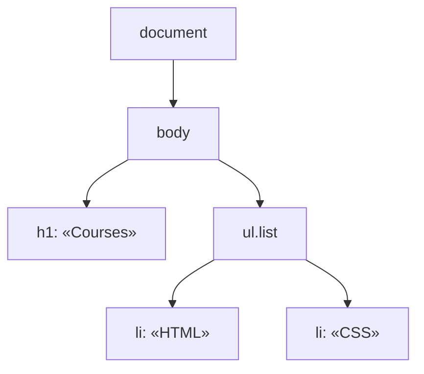
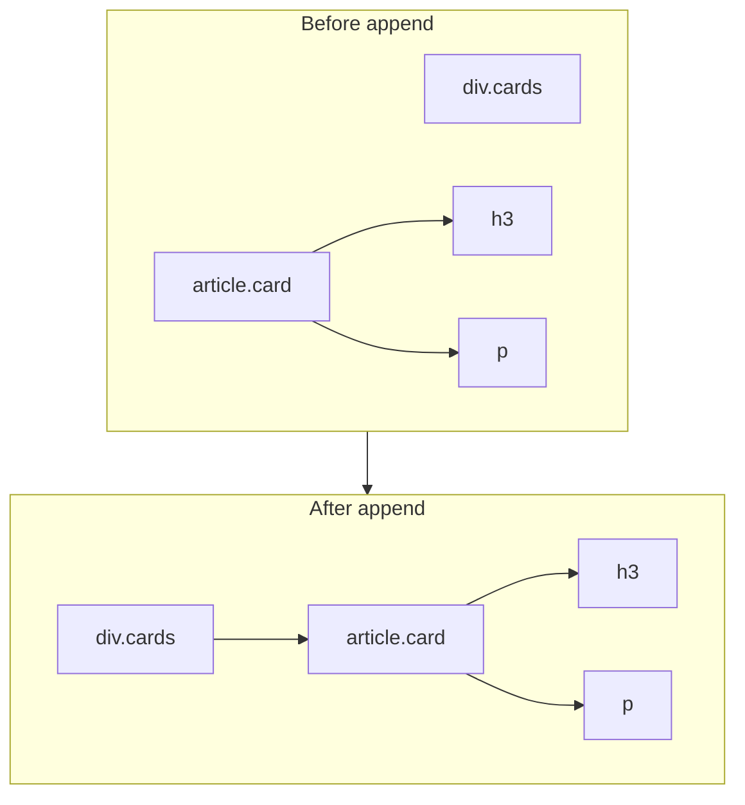
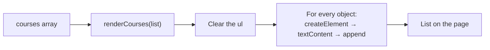

# DOM: finding and changing elements

[Contents](../../README.md) · [← Back](../../Lesson-6/en/Arrays%20and%20objects.md) · [Next →](../../Lesson-8/en/Events.md) · [RU](../ru/DOM%20%D0%BF%D0%BE%D0%B8%D1%81%D0%BA%20%D0%B8%20%D0%B8%D0%B7%D0%BC%D0%B5%D0%BD%D0%B5%D0%BD%D0%B8%D0%B5%20%D1%8D%D0%BB%D0%B5%D0%BC%D0%B5%D0%BD%D1%82%D0%BE%D0%B2.md) · [EN](DOM%20finding%20and%20changing%20elements.md) · [UZ](../uz/DOM%20elementlarni%20topish%20va%20o%27zgartirish.md)

> **Link to lesson 6 and the HTML and CSS courses:** you have data in an array of objects, and the page has HTML markup and CSS classes. Today we will connect them: JavaScript will find elements on the page, change text and classes and create new cards from an array.

---

## Why you need this

A cart shows "Items: 3", a feed loads new posts, a product card gets a "New" badge. All of this is JavaScript changing the HTML page after it has loaded. For this the browser provides the **DOM** - access to every page element from code.

From this lesson on, the result of your code is visible not only in the console but on the page itself.

---

## What you will learn

- Explain what the DOM is and how HTML turns into a tree.
- Find elements: `querySelector`, `querySelectorAll`.
- Change text with `textContent` and understand why not `innerHTML`.
- Manage CSS classes: `classList.add`, `remove`, `toggle`, `contains`.
- Read and change attributes, `hidden` and `data-*`.
- Create elements: `createElement`, `append`, `remove`.
- Put an array of objects on the page with a `render` function.

---

## Review: 3 questions from lesson 6 and the HTML and CSS courses

1. Which CSS selector picks the element with `id="menu"`? And all elements with the class `card`?
2. What does `find` return if nothing was found?
3. How do you go through every item of the `courses` array?

Answers are at the end of the lesson.

---

## Lesson plan

| Section | What we do |
| --- | --- |
| What the DOM is | HTML as a family tree |
| Finding elements | CSS selectors in JavaScript |
| Text | `textContent` |
| Classes | Appearance through CSS |
| Mini-task 1 | Mark the active menu item |
| Attributes, `hidden`, `data-*` | Element properties |
| Creating and removing | New elements from code |
| Rendering an array | Data → cards |
| Mini-task 2 | A to-do list on the page |
| Independent work | A course catalogue |

---

## What the DOM is

The browser reads HTML and builds a **tree of objects** from it - the DOM (Document Object Model). Every tag becomes a **node** of the tree, and you can work with it from JavaScript like with an object from lesson 6.

```html
<body>
    <h1>Courses</h1>
    <ul class="list">
        <li>HTML</li>
        <li>CSS</li>
    </ul>
</body>
```



The relationships are like in a family: `ul` is the **parent** of `li`, the `li` elements are the **children** of `ul`, and the two `li` are **siblings**. The entry point to the tree is the global `document` object.

> **The DOM is not the HTML file.** When JavaScript changes the DOM, the page on screen updates, but the `index.html` file stays the same. After a reload the script runs again and makes the changes again.

You can see the live DOM in DevTools on the **Elements** tab: changes made by JavaScript flash there for a moment.

---

## Finding elements

Searching uses the same **selectors** as CSS:

```js
const title = document.querySelector("h1");            // the first h1
const menu = document.querySelector("#menu");          // by id
const firstCard = document.querySelector(".card");     // the first with the class card
const links = document.querySelectorAll("nav a");      // all links in nav
```

| Method | Returns | If nothing is found |
| --- | --- | --- |
| `querySelector(selector)` | The first matching element | `null` |
| `querySelectorAll(selector)` | A collection of all matches (`NodeList`) | An empty collection |

A collection is gone through with `for...of`, like an array:

```js
const cards = document.querySelectorAll(".card");
console.log(cards.length);

for (const card of cards) {
    console.log(card.textContent);
}
```

You can also search inside a found element - not in the whole document:

```js
const nav = document.querySelector("nav");
const navLinks = nav.querySelectorAll("a");
```

### `null` and `defer`

```js
const button = document.querySelector(".buy-button");
button.textContent = "Buy"; // TypeError: Cannot set properties of null
```

This error means the element was not found. Causes:

1. A typo in the selector: `.buy-btn` instead of `.buy-button`, a missing `.` or `#`.
2. The script ran before the browser parsed the HTML. Check that `<script>` has `defer` (lesson 1).
3. The element does not exist on this page - for example, the script is shared by all pages.

If an element may be missing from the page, check the result before using it:

```js
const banner = document.querySelector(".banner");
if (banner) {
    banner.textContent = "10% off";
}
```

### How to find the right selector

The most reliable way is not to guess but to check in the console:

1. Open the page and DevTools → **Console**.
2. Type `document.querySelector(".card")` and press Enter.
3. If an element comes back, hover over it - the browser highlights it on the page. If `null` comes back - the selector is wrong.

| What we look for | Selector | Example |
| --- | --- | --- |
| By tag | `tag` | `"h1"` |
| By class | `.class` | `".card"` |
| By id | `#id` | `"#menu"` |
| Inside another | `parent descendant` | `"nav a"` |
| By attribute | `[attribute="value"]` | `'[data-id="js"]'` |

These are the same selectors as in Lesson 2 of the CSS course. The shorter and clearer the selector, the less often it breaks when the markup changes. That is why it is handy to add separate classes or `data-*` attributes for scripts.

---

## Text: `textContent`

```js
const counter = document.querySelector("#cart-count");

console.log(counter.textContent);   // read the text
counter.textContent = "Items: 3";   // replace the text
```

`textContent` always works with **text**: if you put `<b>` into it, the page shows the literal characters `<b>`, not bold text.

### Why not `innerHTML`

Elements also have an `innerHTML` property that parses a string as HTML. The danger is in user data:

```js
const userName = '';

title.innerHTML = `Hello, ${userName}`;   // the browser runs someone else's code
title.textContent = `Hello, ${userName}`; // safe: shows the text as it is
```

This is the **XSS** vulnerability (cross-site scripting): an attacker types code into a form field, and the website runs it for other visitors. Course rule: output text with `textContent`, create markup with `createElement` (below).

---

## Classes: appearance through CSS

JavaScript **does not paint** elements directly. It adds and removes classes, and CSS decides what a class looks like. This keeps styles in the CSS file and code in the JS file.

```css
/* style.css */
.card--active {
    border-color: #4338ca;
}
```

```js
const card = document.querySelector(".card");

card.classList.add("card--active");      // add
card.classList.remove("card--active");   // remove
card.classList.toggle("card--active");   // if present - remove, if not - add
console.log(card.classList.contains("card--active")); // true or false
```

| Method | Action |
| --- | --- |
| `add("a")` | Add a class |
| `remove("a")` | Remove a class |
| `toggle("a")` | Toggle |
| `toggle("a", condition)` | Add if the condition is `true`, otherwise remove |
| `contains("a")` | Check whether it is present |

> **Why not `element.style.color = "red"`?** That puts the style into a `style=""` attribute - exactly what we gave up in the CSS course: classes cannot override it, it is not visible in the CSS file, and the dark theme ignores it. Use classes.

---

## Mini-task 1

On a page with a menu (`nav a`) find the link whose `href` matches the current page and add the class `is-active` to it. Hint: the current file path is `location.pathname`, and the link's attribute is `link.getAttribute("href")`. For simplicity check whether the path ends with `href`: `location.pathname.endsWith(href)`. The solution is in the "Answers" section.

---

## Attributes, `hidden` and `data-*`

### Attributes

```js
const link = document.querySelector(".docs-link");

console.log(link.getAttribute("href"));            // read
link.setAttribute("href", "https://jlearn.space"); // change
link.setAttribute("target", "_blank");
link.removeAttribute("target");                    // remove
```

Common attributes are also available as properties: `img.src`, `img.alt`, `input.value`, `link.href`.

### `hidden` - hiding an element

```js
const message = document.querySelector(".message");
message.hidden = true;   // hidden: the hidden attribute from the HTML course
message.hidden = false;  // visible again
```

`hidden` hides the element for screen readers too - this is the right way, unlike transparency.

### `data-*` - your own data in markup

`data-` attributes store service data that the script needs:

```html
<li class="course" data-id="js" data-lessons="10">JavaScript</li>
```

```js
const course = document.querySelector(".course");
console.log(course.dataset.id);       // "js"
console.log(course.dataset.lessons);  // "10" - always a string
course.dataset.status = "new";        // data-status="new" appears
```

Hyphens turn into camelCase: `data-course-id` → `dataset.courseId`.

---

## Creating and removing elements

```js
const list = document.querySelector(".list");

const item = document.createElement("li");   // 1. create
item.textContent = "JavaScript";             // 2. fill
item.classList.add("list__item");            //    style
list.append(item);                           // 3. insert at the end of list
```

Until the element is inserted with `append`, it exists only in memory and is not visible on the page.

| Method | Action |
| --- | --- |
| `document.createElement("li")` | Create an element |
| `parent.append(child)` | Insert at the end of `parent` |
| `parent.prepend(child)` | Insert at the beginning |
| `element.remove()` | Remove the element from the page |
| `parent.textContent = ""` | Clear all content |

A nested card is built in parts:

```js
const card = document.createElement("article");
card.classList.add("card");

const heading = document.createElement("h3");
heading.textContent = "JavaScript";

const info = document.createElement("p");
info.textContent = "10 lessons";

card.append(heading, info);  // append accepts several elements
document.querySelector(".cards").append(card);
```

### What happens to the tree

Before `append` the card lives on its own, after it - it becomes part of the DOM:



**How to read the diagram.** On the left the card is built in memory but not attached to the page - it is not on screen. On the right it has become a child of `div.cards`, and the browser has drawn it at once.

---

## Rendering an array

The main technique of the lesson: **data → a `render` function → the page**. The function clears the container and builds the elements anew from the array:

```js
const courses = [
    { title: "HTML", lessons: 10 },
    { title: "CSS", lessons: 10 },
    { title: "JavaScript", lessons: 10 },
];

function renderCourses(list) {
    const container = document.querySelector(".course-list");
    container.textContent = "";              // 1. clear

    for (const course of list) {             // 2. for every object
        const item = document.createElement("li");
        item.textContent = `${course.title} - ${course.lessons} lessons`;
        container.append(item);              // 3. create and insert
    }
}

renderCourses(courses);
```



Why clear? When the data changes (lesson 8: filtering, adding), we simply call `renderCourses` again with a new array. Without clearing, the old elements would stay and the list would double.

### What `renderCourses` does: step by step

| Step | `course` | What was created | What is in the list on the page |
| --- | --- | --- | --- |
| 0 | - | The list was cleared | empty |
| 1 | `{ title: "HTML", lessons: 10 }` | `<li>HTML - 10 lessons</li>` | 1 item |
| 2 | `{ title: "CSS", lessons: 10 }` | `<li>CSS - 10 lessons</li>` | 2 items |
| 3 | `{ title: "JavaScript", lessons: 10 }` | `<li>JavaScript - 10 lessons</li>` | 3 items |

Add a fourth course to the array and call `renderCourses(courses)` again - the page will show exactly four items, without duplicates. That is the point of clearing at step 0.

### What you will see in DevTools

Open the **Elements** tab and expand `ul.course-list`: inside there are three `li` that are not in the HTML file. Open the **page source** (Ctrl+U) - the list is empty there. The DOM is live, the file is not.

### Try to break it

1. Remove the line `container.textContent = "";` and call `renderCourses(courses)` twice. How many items are there now?
2. Write `.course-lis` in the selector, without the last letter. Which error does the console show, and on which line?
3. Remove `defer` from the `<script>` in `<head>`. Why did `querySelector` return `null`?

### Typical beginner mistakes

| Mistake | What you get | How to fix |
| --- | --- | --- |
| A selector without `.` or `#` | `null` and a `TypeError` later | `".card"`, `"#menu"` |
| A script in `<head>` without `defer` | The elements do not exist yet - `null` | `<script src="..." defer>` |
| `querySelector` where all elements are needed | Only the first one changes | `querySelectorAll` + `for...of` |
| `innerHTML` with user data | An XSS hole | `textContent` and `createElement` |
| `element.style.color = ...` | The style is in an attribute, CSS is hard to maintain | `classList.add("...")` |
| Forgot `append` | The element is created but not visible | `parent.append(element)` |
| No clearing in `render` | The list duplicates | `container.textContent = "";` at the start |
| `dataset.lessons + 1` | `"101"` - strings joined | `Number(dataset.lessons) + 1` |

---

## Mini-task 2

The HTML has an empty `<ul class="todo-list"></ul>`. Declare a `todos` array of three strings and a function `renderTodos(list)` that outputs each string as a separate `li` and adds the class `todo--last` to the last item. The solution is in the "Answers" section.

---

## Lesson summary: cheat sheet

| Task | Code |
| --- | --- |
| Find one / all | `document.querySelector(".a")` / `querySelectorAll(".a")` |
| Text | `el.textContent = "..."` |
| Class | `el.classList.add / remove / toggle / contains` |
| Attribute | `el.getAttribute("href")` / `setAttribute(...)` |
| Hide | `el.hidden = true` |
| Data | `el.dataset.id` ↔ `data-id` |
| Create and insert | `const li = document.createElement("li"); list.append(li);` |
| Remove / clear | `el.remove()` / `el.textContent = ""` |
| Render an array | `render(list)`: clear → `for...of` → create → `append` |

---

## Independent work

### Part 1. IDE task (graded by the platform)

The page has an empty list `<ul id="course-list">` and a paragraph `<p id="course-count">`. The platform sets an array `courses` - objects `{ id, title, lessons, isNew }`.

Write a function `renderCourses(list)` that:

1. Clears `#course-list`.
2. For every course creates an `li` with the class `course`, the text `HTML - 10 lessons` and a `data-id` attribute from `id`.
3. Adds the class `course--new` to courses with `isNew: true`.
4. Writes the text `Courses: 3` into `#course-count` - from the length of the array passed in.

At the end call `renderCourses(courses)`. Do not use `innerHTML` or `element.style`.

What the platform checks: the number and text of the elements, `data-id`, the class `course--new` only on new courses, the counter text; calling it again with a different and with an empty array does not double the list; text with `<` and `>` characters is output as text.

### Part 2. Project on your computer

1. Take the array of objects you described in lesson 6.
2. Add an empty container to a page of your website and output cards into it with a `render...` function: a heading, a description, a badge.
3. Style the cards with classes in your `style.css` and add a special class for items with a standout feature (new, discount, "today").
4. Open DevTools → Elements and check that the card markup is semantic: headings, lists, paragraphs.

### Acceptance criteria

- [ ] The IDE task is accepted.
- [ ] The cards are created from an array, not written into the HTML by hand.
- [ ] Text is output with `textContent`; `innerHTML` is not used.
- [ ] Appearance is changed with classes; `element.style` is not used.
- [ ] The script is connected with `defer`, and the console has no `null` errors.

---

## Self-check questions

1. What is the DOM and how does it differ from the HTML file?
2. How does `querySelector` differ from `querySelectorAll`?
3. What does `querySelector` return if the element is not found, and what error does that lead to?
4. Why is text output with `textContent` and not `innerHTML`?
5. Why is appearance changed with classes and not with `element.style`?
6. What does `classList.toggle` do?
7. How do you read the `data-course-id` attribute from JavaScript?
8. What three steps make a new element appear on the page?
9. Why does the `render` function clear the container before rendering?
10. How do you hide an element so that screen readers do not see it either?

After the questions, take the **lesson test** on the platform: 12 questions, pass mark 70%.

---

## What's next

The page changes, but only once - when it loads. In lesson 8 JavaScript will start **reacting to the user**: clicks, typing, key presses. A counter, a theme switch, expanding sections.

---

## Answers

**Review**

1. `#menu` and `.card`.
2. `undefined`.
3. `for (const course of courses) { ... }`.

**Mini-task 1**

```js
const links = document.querySelectorAll("nav a");

for (const link of links) {
    const href = link.getAttribute("href");
    if (location.pathname.endsWith(href)) {
        link.classList.add("is-active");
    }
}
```

On the home page the path may end with `/` rather than `index.html` - mark that link separately.

**Mini-task 2**

```js
const todos = ["Read the lesson", "Do the task", "Take the test"];

function renderTodos(list) {
    const container = document.querySelector(".todo-list");
    container.textContent = "";

    for (const todo of list) {
        const item = document.createElement("li");
        item.textContent = todo;
        container.append(item);
    }

    const last = container.querySelector("li:last-child");
    if (last) {
        last.classList.add("todo--last");
    }
}

renderTodos(todos);
```

**Self-check questions**

1. A tree of objects the browser builds from HTML. JavaScript changes the DOM, and the file stays the same.
2. The first matching element versus a collection of all matches.
3. `null`; accessing its properties gives `TypeError: Cannot ... of null`.
4. `innerHTML` runs markup from a string - someone else's code from user data (XSS). `textContent` shows the text as it is.
5. Styles stay in CSS where they can be overridden and adapted; `style=""` mixes styling with code.
6. Removes the class if it is present and adds it if not.
7. `element.dataset.courseId`.
8. `createElement`, fill it (`textContent`, classes), `append` it to a parent.
9. So that calling it again with new data does not double the list.
10. `element.hidden = true`.

---

[Contents](../../README.md) · [← Back](../../Lesson-6/en/Arrays%20and%20objects.md) · [Next →](../../Lesson-8/en/Events.md) · [RU](../ru/DOM%20%D0%BF%D0%BE%D0%B8%D1%81%D0%BA%20%D0%B8%20%D0%B8%D0%B7%D0%BC%D0%B5%D0%BD%D0%B5%D0%BD%D0%B8%D0%B5%20%D1%8D%D0%BB%D0%B5%D0%BC%D0%B5%D0%BD%D1%82%D0%BE%D0%B2.md) · [EN](DOM%20finding%20and%20changing%20elements.md) · [UZ](../uz/DOM%20elementlarni%20topish%20va%20o%27zgartirish.md)
