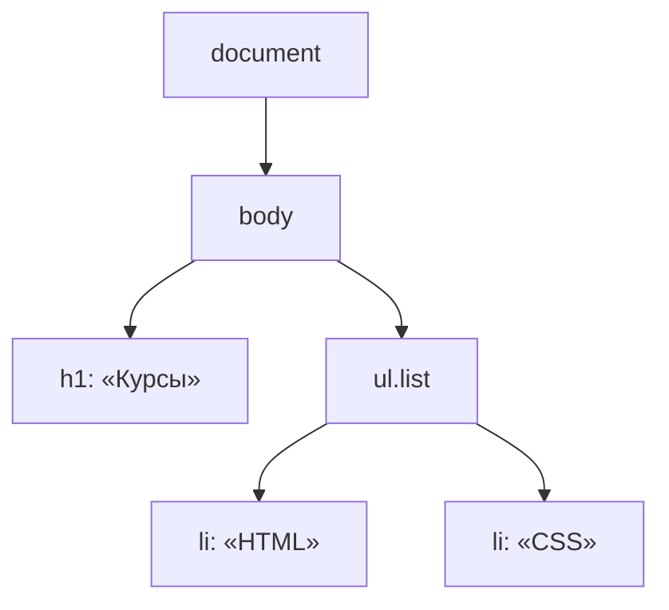
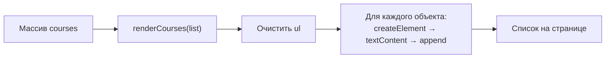

# DOM: поиск и изменение элементов

[Содержание](../../README.md) · [← Назад](../../Lesson-6/ru/Массивы%20и%20объекты.md) · [Вперёд →](../../Lesson-8/ru/События.md) · [RU](DOM%20%D0%BF%D0%BE%D0%B8%D1%81%D0%BA%20%D0%B8%20%D0%B8%D0%B7%D0%BC%D0%B5%D0%BD%D0%B5%D0%BD%D0%B8%D0%B5%20%D1%8D%D0%BB%D0%B5%D0%BC%D0%B5%D0%BD%D1%82%D0%BE%D0%B2.md) · [EN](../en/DOM%20finding%20and%20changing%20elements.md) · [UZ](../uz/DOM%20elementlarni%20topish%20va%20o%27zgartirish.md)

> **Связь с уроком 6 и курсами HTML и CSS:** у вас есть данные в массиве объектов, а у страницы - HTML-разметка и классы CSS. Сегодня соединим их: JavaScript найдёт элементы на странице, поменяет текст и классы и создаст новые карточки из массива.

---

## Зачем это вам

Корзина показывает «Товаров: 3», лента подгружает новые посты, карточка товара получает метку «Новинка». Всё это - JavaScript, который меняет HTML-страницу уже после загрузки. Для этого браузер даёт **DOM** - доступ к каждому элементу страницы из кода.

С этого урока результат вашего кода видят не только в консоли, но и на самой странице.

---

## Чему вы научитесь

- Объяснять, что такое DOM и как HTML превращается в дерево.
- Находить элементы: `querySelector`, `querySelectorAll`.
- Менять текст через `textContent` и понимать, почему не `innerHTML`.
- Управлять классами CSS: `classList.add`, `remove`, `toggle`, `contains`.
- Читать и менять атрибуты, `hidden` и `data-*`.
- Создавать элементы: `createElement`, `append`, `remove`.
- Выводить массив объектов на страницу функцией `render`.

---

## Повторение: 3 вопроса из урока 6 и курсов HTML и CSS

1. Какой CSS-селектор выберет элемент с `id="menu"`? А все элементы с классом `card`?
2. Что вернёт `find`, если ничего не нашлось?
3. Как пройти по каждому элементу массива `courses`?

Ответы - в конце урока.

---

## План урока

| Раздел | Что делаем |
| --- | --- |
| Что такое DOM | HTML как генеалогическое дерево |
| Поиск элементов | Селекторы из CSS в JavaScript |
| Текст | `textContent` |
| Классы | Внешний вид через CSS |
| Мини-задание 1 | Отметить активный пункт меню |
| Атрибуты, `hidden`, `data-*` | Свойства элементов |
| Создание и удаление | Новые элементы из кода |
| Отрисовка массива | Данные → карточки |
| Мини-задание 2 | Список дел на странице |
| Самостоятельная работа | Каталог курсов |

---

## Что такое DOM

Браузер читает HTML и строит из него **дерево объектов** - DOM (Document Object Model, «объектная модель документа»). Каждый тег становится **узлом** дерева, и с ним можно работать из JavaScript, как с объектом из урока 6.

```html
<body>
    <h1>Курсы</h1>
    <ul class="list">
        <li>HTML</li>
        <li>CSS</li>
    </ul>
</body>
```



Отношения как в семье: `ul` - **родитель** для `li`, `li` - **дети** `ul`, два `li` - **соседи**. Вход в дерево - глобальный объект `document`.

> **DOM - не HTML-файл.** Когда JavaScript меняет DOM, страница на экране обновляется, но файл `index.html` остаётся прежним. После перезагрузки скрипт снова выполнится и снова внесёт изменения.

Посмотреть живой DOM можно в DevTools на вкладке **Elements**: изменения от JavaScript подсвечиваются там на мгновение.

---

## Поиск элементов

Для поиска используются те же **селекторы**, что в CSS:

```js
const title = document.querySelector("h1");            // первый h1
const menu = document.querySelector("#menu");          // по id
const firstCard = document.querySelector(".card");     // первый с классом card
const links = document.querySelectorAll("nav a");      // все ссылки в nav
```

| Метод | Возвращает | Если не найдено |
| --- | --- | --- |
| `querySelector(селектор)` | Первый подходящий элемент | `null` |
| `querySelectorAll(селектор)` | Коллекцию всех подходящих (`NodeList`) | Пустую коллекцию |

Коллекцию перебирают `for...of`, как массив:

```js
const cards = document.querySelectorAll(".card");
console.log(cards.length);

for (const card of cards) {
    console.log(card.textContent);
}
```

Искать можно и внутри найденного элемента - не во всём документе:

```js
const nav = document.querySelector("nav");
const navLinks = nav.querySelectorAll("a");
```

### `null` и `defer`

```js
const button = document.querySelector(".buy-button");
button.textContent = "Купить"; // TypeError: Cannot set properties of null
```

Такая ошибка значит, что элемент не найден. Причины:

1. Опечатка в селекторе: `.buy-btn` вместо `.buy-button`, забыли `.` или `#`.
2. Скрипт выполнился раньше, чем браузер разобрал HTML. Проверьте, что у `<script>` есть `defer` (урок 1).
3. Элемента нет на этой странице - например, скрипт общий для всех страниц.

Если элемента на странице может не быть, проверьте результат перед использованием:

```js
const banner = document.querySelector(".banner");
if (banner) {
    banner.textContent = "Скидка 10%";
}
```

---

## Текст: `textContent`

```js
const counter = document.querySelector("#cart-count");

console.log(counter.textContent);   // прочитать текст
counter.textContent = "Товаров: 3"; // заменить текст
```

`textContent` всегда работает с **текстом**: если положить в него `<b>`, на странице появятся буквально символы `<b>`, а не жирный шрифт.

### Почему не `innerHTML`

У элементов есть свойство `innerHTML`, которое разбирает строку как HTML. Опасность - в данных от пользователя:

```js
const userName = '';

title.innerHTML = `Привет, ${userName}`;   // браузер выполнит чужой код
title.textContent = `Привет, ${userName}`; // безопасно: покажет текст как есть
```

Это уязвимость **XSS** (межсайтовый скриптинг): злоумышленник вводит код в поле формы, а сайт выполняет его у других посетителей. Правило курса: текст выводим через `textContent`, разметку создаём через `createElement` (ниже).

---

## Классы: внешний вид через CSS

JavaScript **не красит** элементы напрямую. Он добавляет и убирает классы, а как выглядит класс - решает CSS. Так стили остаются в CSS-файле, а код - в JS.

```css
/* style.css */
.card--active {
    border-color: #4338ca;
}
```

```js
const card = document.querySelector(".card");

card.classList.add("card--active");      // добавить
card.classList.remove("card--active");   // убрать
card.classList.toggle("card--active");   // есть - убрать, нет - добавить
console.log(card.classList.contains("card--active")); // true или false
```

| Метод | Действие |
| --- | --- |
| `add("a")` | Добавить класс |
| `remove("a")` | Убрать класс |
| `toggle("a")` | Переключить |
| `toggle("a", условие)` | Добавить, если условие `true`, иначе убрать |
| `contains("a")` | Проверить наличие |

> **Почему не `element.style.color = "red"`?** Так стиль попадает в атрибут `style=""` - то, от чего мы отказались в курсе CSS: его не переопределить классами, его не видно в CSS-файле, тёмная тема его не учтёт. Используйте классы.

---

## Мини-задание 1

На странице с меню (`nav a`) найдите ссылку, у которой `href` совпадает с текущей страницей, и добавьте ей класс `is-active`. Подсказка: имя текущего файла - `location.pathname`, а атрибут ссылки - `link.getAttribute("href")`. Для простоты сравнивайте, заканчивается ли путь на `href`: `location.pathname.endsWith(href)`. Решение - в разделе «Ответы».

---

## Атрибуты, `hidden` и `data-*`

### Атрибуты

```js
const link = document.querySelector(".docs-link");

console.log(link.getAttribute("href"));          // прочитать
link.setAttribute("href", "https://jlearn.space"); // изменить
link.setAttribute("target", "_blank");
link.removeAttribute("target");                    // удалить
```

Частые атрибуты доступны и как свойства: `img.src`, `img.alt`, `input.value`, `link.href`.

### `hidden` - скрыть элемент

```js
const message = document.querySelector(".message");
message.hidden = true;   // скрыт: атрибут hidden из курса HTML
message.hidden = false;  // снова виден
```

`hidden` скрывает элемент и для экранных читалок - это правильный способ, в отличие от прозрачности.

### `data-*` - свои данные в разметке

Атрибуты `data-` хранят служебные данные, которые нужны скрипту:

```html
<li class="course" data-id="js" data-lessons="10">JavaScript</li>
```

```js
const course = document.querySelector(".course");
console.log(course.dataset.id);       // "js"
console.log(course.dataset.lessons);  // "10" - всегда строка
course.dataset.status = "new";        // появится data-status="new"
```

Дефисы превращаются в camelCase: `data-course-id` → `dataset.courseId`.

---

## Создание и удаление элементов

```js
const list = document.querySelector(".list");

const item = document.createElement("li");   // 1. создать
item.textContent = "JavaScript";             // 2. наполнить
item.classList.add("list__item");            //    оформить
list.append(item);                           // 3. вставить в конец list
```

Пока элемент не вставлен через `append`, он существует только в памяти и на странице не виден.

| Метод | Действие |
| --- | --- |
| `document.createElement("li")` | Создать элемент |
| `parent.append(child)` | Вставить в конец `parent` |
| `parent.prepend(child)` | Вставить в начало |
| `element.remove()` | Удалить элемент со страницы |
| `parent.textContent = ""` | Очистить всё содержимое |

Вложенную карточку собирают по частям:

```js
const card = document.createElement("article");
card.classList.add("card");

const heading = document.createElement("h3");
heading.textContent = "JavaScript";

const info = document.createElement("p");
info.textContent = "10 уроков";

card.append(heading, info);  // append принимает несколько элементов
document.querySelector(".cards").append(card);
```

---

## Отрисовка массива

Главный приём урока: **данные → функция `render` → страница**. Функция очищает контейнер и строит элементы заново из массива:

```js
const courses = [
    { title: "HTML", lessons: 10 },
    { title: "CSS", lessons: 10 },
    { title: "JavaScript", lessons: 10 },
];

function renderCourses(list) {
    const container = document.querySelector(".course-list");
    container.textContent = "";              // 1. очистить

    for (const course of list) {             // 2. для каждого объекта
        const item = document.createElement("li");
        item.textContent = `${course.title} - ${course.lessons} уроков`;
        container.append(item);              // 3. создать и вставить
    }
}

renderCourses(courses);
```



Зачем очищать? Когда данные изменятся (урок 8: фильтр, добавление), мы просто вызовем `renderCourses` снова с новым массивом. Без очистки старые элементы остались бы, и список задвоился бы.

---

## Мини-задание 2

В HTML есть пустой `<ul class="todo-list"></ul>`. Объявите массив `todos` из трёх строк и функцию `renderTodos(list)`, которая выводит каждую строку отдельным `li`, а последнему элементу добавляет класс `todo--last`. Решение - в разделе «Ответы».

---

## Итоги урока: шпаргалка

| Задача | Запись |
| --- | --- |
| Найти один / все | `document.querySelector(".a")` / `querySelectorAll(".a")` |
| Текст | `el.textContent = "..."` |
| Класс | `el.classList.add / remove / toggle / contains` |
| Атрибут | `el.getAttribute("href")` / `setAttribute(...)` |
| Скрыть | `el.hidden = true` |
| Данные | `el.dataset.id` ↔ `data-id` |
| Создать и вставить | `const li = document.createElement("li"); list.append(li);` |
| Удалить / очистить | `el.remove()` / `el.textContent = ""` |
| Отрисовать массив | `render(list)`: очистить → `for...of` → создать → `append` |

---

## Самостоятельная работа

### Часть 1. Задание в IDE (засчитывается платформой)

На странице есть пустой список `<ul id="course-list">` и абзац `<p id="course-count">`. Платформа задаёт массив `courses` - объекты `{ id, title, lessons, isNew }`.

Напишите функцию `renderCourses(list)`, которая:

1. Очищает `#course-list`.
2. Для каждого курса создаёт `li` с классом `course`, текстом `HTML - 10 уроков` и атрибутом `data-id` из `id`.
3. Курсам с `isNew: true` добавляет класс `course--new`.
4. Записывает в `#course-count` текст `Курсов: 3` - по длине переданного массива.

В конце вызовите `renderCourses(courses)`. `innerHTML` и `element.style` не используйте.

Что проверяет платформа: число и текст элементов, `data-id`, класс `course--new` только у новых курсов, текст счётчика; повторный вызов с другим и с пустым массивом не задваивает список; текст с символами `<` и `>` выводится как текст.

### Часть 2. Проект на компьютере

1. Возьмите массив объектов, который вы описали в уроке 6.
2. Добавьте на страницу сайта пустой контейнер и выведите в него карточки функцией `render...`: заголовок, описание, метка.
3. Оформите карточки классами в своём `style.css` и добавьте особый класс для элементов с выделяющим признаком (новинка, скидка, «сегодня»).
4. Откройте DevTools → Elements и убедитесь, что разметка карточек семантическая: заголовки, списки, абзацы.

### Критерии готовности

- [ ] Задание в IDE засчитано.
- [ ] Карточки создаются из массива, а не вписаны в HTML вручную.
- [ ] Текст выводится через `textContent`, `innerHTML` не используется.
- [ ] Внешний вид меняется классами, `element.style` не используется.
- [ ] Скрипт подключён с `defer`, в консоли нет `null`-ошибок.

---

## Вопросы для самопроверки

1. Что такое DOM и чем он отличается от HTML-файла?
2. Чем `querySelector` отличается от `querySelectorAll`?
3. Что вернёт `querySelector`, если элемент не найден, и к какой ошибке это приведёт?
4. Почему для вывода текста используют `textContent`, а не `innerHTML`?
5. Почему внешний вид меняют классами, а не через `element.style`?
6. Что делает `classList.toggle`?
7. Как прочитать атрибут `data-course-id` из JavaScript?
8. Какие три шага нужны, чтобы новый элемент появился на странице?
9. Зачем функция `render` очищает контейнер перед отрисовкой?
10. Как скрыть элемент так, чтобы его не видели и экранные читалки?

После вопросов пройдите **тест урока** на платформе: 12 вопросов, порог 70%.

---

## Что дальше

Страница меняется, но только один раз - при загрузке. В уроке 8 JavaScript начнёт **реагировать на пользователя**: клики, ввод текста, нажатия клавиш. Счётчик, переключатель темы, раскрывающиеся блоки.

---

## Ответы

**Повторение**

1. `#menu` и `.card`.
2. `undefined`.
3. `for (const course of courses) { ... }`.

**Мини-задание 1**

```js
const links = document.querySelectorAll("nav a");

for (const link of links) {
    const href = link.getAttribute("href");
    if (location.pathname.endsWith(href)) {
        link.classList.add("is-active");
    }
}
```

На главной странице путь может заканчиваться на `/`, а не на `index.html`, - такую ссылку отметьте отдельно.

**Мини-задание 2**

```js
const todos = ["Прочитать урок", "Сделать задание", "Пройти тест"];

function renderTodos(list) {
    const container = document.querySelector(".todo-list");
    container.textContent = "";

    for (const todo of list) {
        const item = document.createElement("li");
        item.textContent = todo;
        container.append(item);
    }

    const last = container.querySelector("li:last-child");
    if (last) {
        last.classList.add("todo--last");
    }
}

renderTodos(todos);
```

**Вопросы для самопроверки**

1. Дерево объектов, которое браузер строит из HTML. JavaScript меняет DOM, а файл остаётся прежним.
2. Первый подходящий элемент против коллекции всех подходящих.
3. `null`; при обращении к его свойствам - `TypeError: Cannot ... of null`.
4. `innerHTML` выполняет разметку из строки - чужой код из данных пользователя (XSS). `textContent` показывает текст как есть.
5. Стили остаются в CSS, их можно переопределить и адаптировать; `style=""` смешивает оформление с кодом.
6. Убирает класс, если он есть, и добавляет, если нет.
7. `element.dataset.courseId`.
8. `createElement`, наполнить (`textContent`, классы), `append` в родителя.
9. Чтобы при повторном вызове с новыми данными список не задваивался.
10. `element.hidden = true`.

---

[Содержание](../../README.md) · [← Назад](../../Lesson-6/ru/Массивы%20и%20объекты.md) · [Вперёд →](../../Lesson-8/ru/События.md) · [RU](DOM%20%D0%BF%D0%BE%D0%B8%D1%81%D0%BA%20%D0%B8%20%D0%B8%D0%B7%D0%BC%D0%B5%D0%BD%D0%B5%D0%BD%D0%B8%D0%B5%20%D1%8D%D0%BB%D0%B5%D0%BC%D0%B5%D0%BD%D1%82%D0%BE%D0%B2.md) · [EN](../en/DOM%20finding%20and%20changing%20elements.md) · [UZ](../uz/DOM%20elementlarni%20topish%20va%20o%27zgartirish.md)
