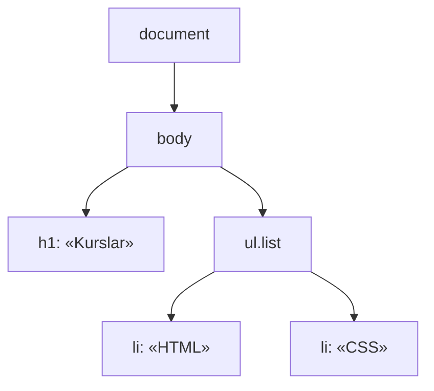
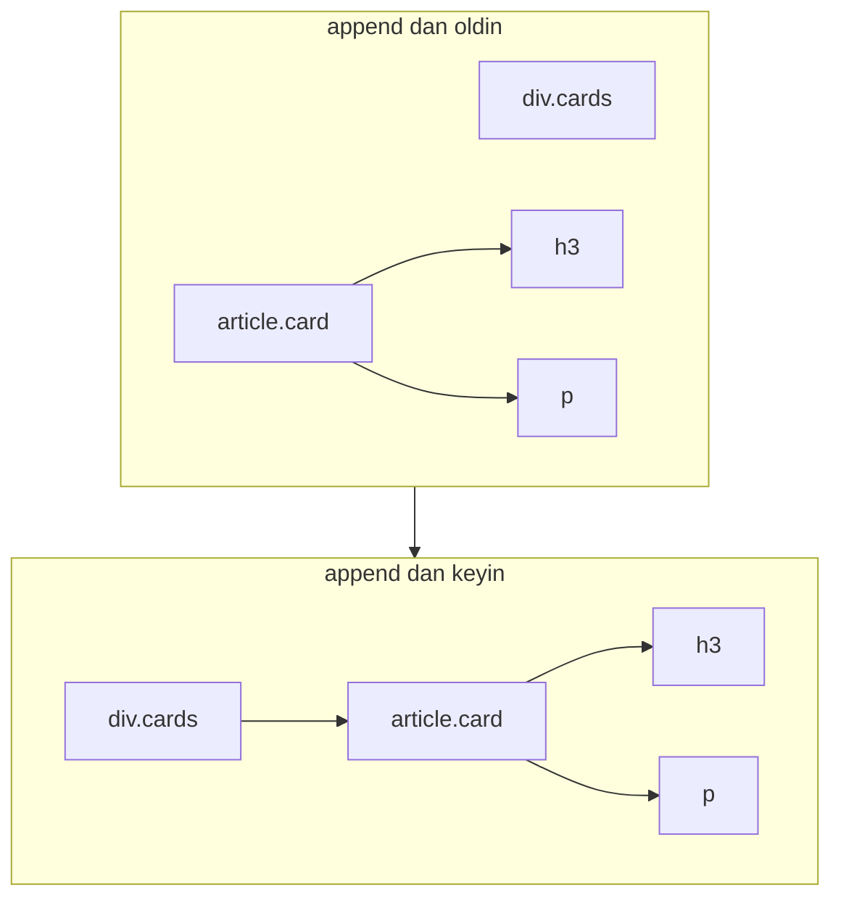
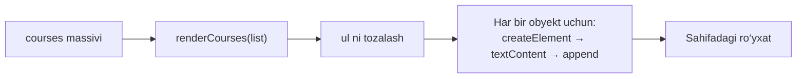

# DOM: elementlarni topish va o‘zgartirish

[Mundarija](../../README.md) · [← Orqaga](../../Lesson-6/uz/Massivlar%20va%20obyektlar.md) · [Keyingi →](../../Lesson-8/uz/Hodisalar.md) · [RU](../ru/DOM%20%D0%BF%D0%BE%D0%B8%D1%81%D0%BA%20%D0%B8%20%D0%B8%D0%B7%D0%BC%D0%B5%D0%BD%D0%B5%D0%BD%D0%B8%D0%B5%20%D1%8D%D0%BB%D0%B5%D0%BC%D0%B5%D0%BD%D1%82%D0%BE%D0%B2.md) · [EN](../en/DOM%20finding%20and%20changing%20elements.md) · [UZ](DOM%20elementlarni%20topish%20va%20o%27zgartirish.md)

> **6-dars va HTML hamda CSS kurslari bilan bog‘liqlik:** sizda obyektlar massividagi ma’lumotlar bor, sahifada esa HTML-belgilash va CSS klasslari. Bugun ularni bog‘laymiz: JavaScript sahifadagi elementlarni topadi, matn va klasslarni o‘zgartiradi va massivdan yangi kartochkalar yaratadi.

---

## Bu sizga nima uchun kerak

Savat «Mahsulotlar: 3» ni ko‘rsatadi, lenta yangi postlarni yuklaydi, mahsulot kartochkasi «Yangilik» belgisini oladi. Bularning barchasi - yuklangandan keyin HTML sahifani o‘zgartiradigan JavaScript. Buning uchun brauzer **DOM** ni beradi - koddan sahifaning har bir elementiga kirish imkoni.

Shu darsdan boshlab kodingiz natijasi faqat konsolda emas, sahifaning o‘zida ko‘rinadi.

---

## Nimani o‘rganasiz

- DOM nima ekanini va HTML qanday daraxtga aylanishini tushuntirish.
- Elementlarni topish: `querySelector`, `querySelectorAll`.
- Matnni `textContent` orqali o‘zgartirish va nima uchun `innerHTML` emasligini tushunish.
- CSS klasslarini boshqarish: `classList.add`, `remove`, `toggle`, `contains`.
- Atributlar, `hidden` va `data-*` ni o‘qish va o‘zgartirish.
- Elementlar yaratish: `createElement`, `append`, `remove`.
- Obyektlar massivini `render` funksiyasi bilan sahifaga chiqarish.

---

## Takrorlash: 6-dars va HTML hamda CSS kurslaridan 3 savol

1. `id="menu"` li elementni qaysi CSS selektor tanlaydi? `card` klassli barcha elementlarni-chi?
2. Hech narsa topilmasa, `find` nimani qaytaradi?
3. `courses` massivining har bir elementini qanday aylanib chiqish mumkin?

Javoblar - dars oxirida.

---

## Reja

| Bo‘lim | Nima qilamiz |
| --- | --- |
| DOM nima | HTML - shajara daraxti sifatida |
| Elementlarni topish | JavaScript’da CSS selektorlari |
| Matn | `textContent` |
| Klasslar | Ko‘rinish CSS orqali |
| Mini-topshiriq 1 | Menyuning faol bandini belgilash |
| Atributlar, `hidden`, `data-*` | Element xususiyatlari |
| Yaratish va o‘chirish | Koddan yangi elementlar |
| Massivni chizish | Ma’lumot → kartochkalar |
| Mini-topshiriq 2 | Sahifadagi vazifalar ro‘yxati |
| Mustaqil ish | Kurslar katalogi |

---

## DOM nima

Brauzer HTML ni o‘qiydi va undan **obyektlar daraxtini** quradi - DOM (Document Object Model, «hujjatning obyekt modeli»). Har bir teg daraxtning **tuguniga** aylanadi va u bilan JavaScript’dan 6-darsdagi obyekt kabi ishlash mumkin.

```html
<body>
    <h1>Kurslar</h1>
    <ul class="list">
        <li>HTML</li>
        <li>CSS</li>
    </ul>
</body>
```



Munosabatlar oiladagi kabi: `ul` - `li` lar uchun **ota-ona**, `li` lar - `ul` ning **bolalari**, ikkita `li` - **qo‘shnilar**. Daraxtga kirish nuqtasi - global `document` obyekti.

> **DOM - HTML fayl emas.** JavaScript DOM ni o‘zgartirsa, ekrandagi sahifa yangilanadi, lekin `index.html` fayli avvalgidek qoladi. Qayta yuklangandan keyin skript yana bajariladi va o‘zgarishlarni qayta kiritadi.

Jonli DOM ni DevTools’ning **Elements** bo‘limida ko‘rish mumkin: JavaScript qilgan o‘zgarishlar u yerda bir lahza yonib ko‘rinadi.

---

## Elementlarni topish

Qidirish uchun CSS dagi xuddi o‘sha **selektorlar** ishlatiladi:

```js
const title = document.querySelector("h1");            // birinchi h1
const menu = document.querySelector("#menu");          // id bo‘yicha
const firstCard = document.querySelector(".card");     // card klassli birinchisi
const links = document.querySelectorAll("nav a");      // nav dagi barcha havolalar
```

| Metod | Qaytaradi | Topilmasa |
| --- | --- | --- |
| `querySelector(selektor)` | Birinchi mos element | `null` |
| `querySelectorAll(selektor)` | Barcha moslar to‘plami (`NodeList`) | Bo‘sh to‘plam |

To‘plam massiv kabi `for...of` bilan aylanib chiqiladi:

```js
const cards = document.querySelectorAll(".card");
console.log(cards.length);

for (const card of cards) {
    console.log(card.textContent);
}
```

Butun hujjatda emas, topilgan element ichida ham qidirish mumkin:

```js
const nav = document.querySelector("nav");
const navLinks = nav.querySelectorAll("a");
```

### `null` va `defer`

```js
const button = document.querySelector(".buy-button");
button.textContent = "Sotib olish"; // TypeError: Cannot set properties of null
```

Bu xato element topilmaganini bildiradi. Sabablari:

1. Selektorda xato: `.buy-button` o‘rniga `.buy-btn`, `.` yoki `#` unutilgan.
2. Skript brauzer HTML ni tahlil qilishidan oldin bajarilgan. `<script>` da `defer` borligini tekshiring (1-dars).
3. Bu sahifada element yo‘q - masalan, skript barcha sahifalar uchun umumiy.

Agar sahifada element bo‘lmasligi mumkin bo‘lsa, natijani ishlatishdan oldin tekshiring:

```js
const banner = document.querySelector(".banner");
if (banner) {
    banner.textContent = "10% chegirma";
}
```

### To‘g‘ri selektorni qanday topish

Eng ishonchli yo‘l - taxmin qilmasdan, konsolda tekshirish:

1. Sahifani va DevTools → **Console** ni oching.
2. `document.querySelector(".card")` ni yozing va Enter ni bosing.
3. Javobda element kelsa, kursorni unga olib boring - brauzer uni sahifada yoritadi. `null` kelsa - selektor noto‘g‘ri.

| Nimani qidiramiz | Selektor | Misol |
| --- | --- | --- |
| Teg bo‘yicha | `teg` | `"h1"` |
| Sinf bo‘yicha | `.sinf` | `".card"` |
| id bo‘yicha | `#id` | `"#menu"` |
| Boshqasining ichida | `ota avlod` | `"nav a"` |
| Atribut bo‘yicha | `[atribut="qiymat"]` | `'[data-id="js"]'` |

Bular CSS kursining 2-darsidagi o‘sha selektorlar. Selektor qancha qisqa va tushunarli bo‘lsa, belgilash o‘zgarganda shuncha kam buziladi. Shuning uchun skriptlar uchun alohida sinflar yoki `data-*` atributlari ochish qulay.

---

## Matn: `textContent`

```js
const counter = document.querySelector("#cart-count");

console.log(counter.textContent);        // matnni o‘qish
counter.textContent = "Mahsulotlar: 3";  // matnni almashtirish
```

`textContent` doim **matn** bilan ishlaydi: unga `<b>` solsangiz, sahifada qalin shrift emas, aynan `<b>` belgilari paydo bo‘ladi.

### Nima uchun `innerHTML` emas

Elementlarda satrni HTML sifatida tahlil qiladigan `innerHTML` xususiyati ham bor. Xavf - foydalanuvchi ma’lumotlarida:

```js
const userName = '';

title.innerHTML = `Salom, ${userName}`;   // brauzer begona kodni bajaradi
title.textContent = `Salom, ${userName}`; // xavfsiz: matnni o‘zicha ko‘rsatadi
```

Bu **XSS** (saytlararo skripting) zaifligi: buzg‘unchi forma maydoniga kod kiritadi, sayt esa uni boshqa tashrifchilarda bajaradi. Kurs qoidasi: matnni `textContent` orqali chiqaramiz, belgilashni `createElement` orqali yaratamiz (pastda).

---

## Klasslar: ko‘rinish CSS orqali

JavaScript elementlarni to‘g‘ridan-to‘g‘ri **bo‘yamaydi**. U klasslarni qo‘shadi va olib tashlaydi, klass qanday ko‘rinishini esa CSS hal qiladi. Shunda stillar CSS faylda, kod esa JS da qoladi.

```css
/* style.css */
.card--active {
    border-color: #4338ca;
}
```

```js
const card = document.querySelector(".card");

card.classList.add("card--active");      // qo‘shish
card.classList.remove("card--active");   // olib tashlash
card.classList.toggle("card--active");   // bo‘lsa - olib tashlash, bo‘lmasa - qo‘shish
console.log(card.classList.contains("card--active")); // true yoki false
```

| Metod | Amal |
| --- | --- |
| `add("a")` | Klass qo‘shish |
| `remove("a")` | Klassni olib tashlash |
| `toggle("a")` | Almashtirish |
| `toggle("a", shart)` | Shart `true` bo‘lsa qo‘shish, aks holda olib tashlash |
| `contains("a")` | Bor-yo‘qligini tekshirish |

> **Nima uchun `element.style.color = "red"` emas?** Bunda stil `style=""` atributiga tushadi - CSS kursida biz voz kechgan narsa: uni klasslar bilan bekor qilib bo‘lmaydi, u CSS faylda ko‘rinmaydi, qorong‘i mavzu uni hisobga olmaydi. Klasslardan foydalaning.

---

## Mini-topshiriq 1

Menyuli sahifada (`nav a`) `href` i joriy sahifaga mos keladigan havolani toping va unga `is-active` klassini qo‘shing. Maslahat: joriy fayl yo‘li - `location.pathname`, havola atributi esa - `link.getAttribute("href")`. Soddalik uchun yo‘l `href` bilan tugashini tekshiring: `location.pathname.endsWith(href)`. Yechim - «Javoblar» bo‘limida.

---

## Atributlar, `hidden` va `data-*`

### Atributlar

```js
const link = document.querySelector(".docs-link");

console.log(link.getAttribute("href"));            // o‘qish
link.setAttribute("href", "https://jlearn.space"); // o‘zgartirish
link.setAttribute("target", "_blank");
link.removeAttribute("target");                    // o‘chirish
```

Ko‘p uchraydigan atributlar xususiyat sifatida ham mavjud: `img.src`, `img.alt`, `input.value`, `link.href`.

### `hidden` - elementni yashirish

```js
const message = document.querySelector(".message");
message.hidden = true;   // yashirildi: HTML kursidagi hidden atributi
message.hidden = false;  // yana ko‘rinadi
```

`hidden` elementni ekran o‘qish dasturlaridan ham yashiradi - shaffoflikdan farqli o‘laroq, bu to‘g‘ri usul.

### `data-*` - belgilashdagi o‘z ma’lumotlaringiz

`data-` atributlari skriptga kerak bo‘lgan xizmat ma’lumotlarini saqlaydi:

```html
<li class="course" data-id="js" data-lessons="10">JavaScript</li>
```

```js
const course = document.querySelector(".course");
console.log(course.dataset.id);       // "js"
console.log(course.dataset.lessons);  // "10" - doim satr
course.dataset.status = "new";        // data-status="new" paydo bo‘ladi
```

Chiziqchalar camelCase ga aylanadi: `data-course-id` → `dataset.courseId`.

---

## Elementlarni yaratish va o‘chirish

```js
const list = document.querySelector(".list");

const item = document.createElement("li");   // 1. yaratish
item.textContent = "JavaScript";             // 2. to‘ldirish
item.classList.add("list__item");            //    bezash
list.append(item);                           // 3. list oxiriga qo‘yish
```

Element `append` orqali qo‘yilmaguncha, u faqat xotirada mavjud va sahifada ko‘rinmaydi.

| Metod | Amal |
| --- | --- |
| `document.createElement("li")` | Element yaratish |
| `parent.append(child)` | `parent` oxiriga qo‘yish |
| `parent.prepend(child)` | Boshiga qo‘yish |
| `element.remove()` | Elementni sahifadan o‘chirish |
| `parent.textContent = ""` | Butun tarkibni tozalash |

Ichma-ich kartochka qismlarga bo‘lib yig‘iladi:

```js
const card = document.createElement("article");
card.classList.add("card");

const heading = document.createElement("h3");
heading.textContent = "JavaScript";

const info = document.createElement("p");
info.textContent = "10 ta dars";

card.append(heading, info);  // append bir nechta element qabul qiladi
document.querySelector(".cards").append(card);
```

### Daraxt bilan nima bo‘ladi

`append` dan oldin kartochka alohida yashaydi, keyin esa - DOM ning bir qismiga aylanadi:



**Sxemani qanday o‘qish kerak.** Chapda kartochka xotirada yig‘ilgan, lekin sahifaga bog‘lanmagan - ekranda u yo‘q. O‘ngda u `div.cards` ning bolasiga aylandi va brauzer uni darhol chizdi.

---

## Massivni chizish

Darsning asosiy usuli: **ma’lumot → `render` funksiyasi → sahifa**. Funksiya konteynerni tozalaydi va elementlarni massivdan qaytadan quradi:

```js
const courses = [
    { title: "HTML", lessons: 10 },
    { title: "CSS", lessons: 10 },
    { title: "JavaScript", lessons: 10 },
];

function renderCourses(list) {
    const container = document.querySelector(".course-list");
    container.textContent = "";              // 1. tozalash

    for (const course of list) {             // 2. har bir obyekt uchun
        const item = document.createElement("li");
        item.textContent = `${course.title} - ${course.lessons} ta dars`;
        container.append(item);              // 3. yaratish va qo‘yish
    }
}

renderCourses(courses);
```



Nima uchun tozalash kerak? Ma’lumotlar o‘zgarganda (8-dars: filtr, qo‘shish) biz shunchaki `renderCourses` ni yangi massiv bilan yana chaqiramiz. Tozalashsiz eski elementlar qolib, ro‘yxat ikkilanib ketardi.

### `renderCourses` nima qiladi: qadamma-qadam

| Qadam | `course` | Nima yaratildi | Sahifadagi ro‘yxatda nima bor |
| --- | --- | --- | --- |
| 0 | - | Ro‘yxat tozalandi | bo‘sh |
| 1 | `{ title: "HTML", lessons: 10 }` | `<li>HTML - 10 ta dars</li>` | 1 band |
| 2 | `{ title: "CSS", lessons: 10 }` | `<li>CSS - 10 ta dars</li>` | 2 band |
| 3 | `{ title: "JavaScript", lessons: 10 }` | `<li>JavaScript - 10 ta dars</li>` | 3 band |

Massivga to‘rtinchi kursni qo‘shing va `renderCourses(courses)` ni yana chaqiring - sahifada takrorlarsiz roppa-rosa to‘rtta band bo‘ladi. 0-qadamdagi tozalashning ma’nosi aynan shu.

### DevTools da nimani ko‘rasiz

**Elements** yorlig‘ini oching va `ul.course-list` ni oching: ichida HTML faylda yo‘q uchta `li` bor. **Sahifaning manba kodini** oching (Ctrl+U) - u yerda ro‘yxat bo‘sh. DOM jonli, fayl esa yo‘q.

### Buzib ko‘ring

1. `container.textContent = "";` qatorini olib tashlang va `renderCourses(courses)` ni ikki marta chaqiring. Nechta band bo‘ldi?
2. Selektorda oxirgi harfsiz `.course-lis` deb yozing. Konsol qanday xato va qaysi qatorda ko‘rsatadi?
3. `<head>` dagi `<script>` dan `defer` ni olib tashlang. Nega `querySelector` `null` qaytardi?

### Yangi o‘rganuvchilarning tipik xatolari

| Xato | Nima bo‘ladi | Qanday tuzatish |
| --- | --- | --- |
| `.` yoki `#` siz selektor | `null` va keyin `TypeError` | `".card"`, `"#menu"` |
| `<head>` da `defer` siz skript | Elementlar hali yaratilmagan - `null` | `<script src="..." defer>` |
| Barcha elementlar kerak joyda `querySelector` | Faqat birinchisi o‘zgaradi | `querySelectorAll` + `for...of` |
| Foydalanuvchi ma’lumotlari bilan `innerHTML` | XSS teshigi | `textContent` va `createElement` |
| `element.style.color = ...` | Uslub atributda, CSS ni qo‘llab-quvvatlash qiyin | `classList.add("...")` |
| `append` unutilgan | Element yaratilgan, lekin ko‘rinmaydi | `parent.append(element)` |
| `render` da tozalash yo‘q | Ro‘yxat takrorlanadi | Boshida `container.textContent = "";` |
| `dataset.lessons + 1` | `"101"` - satrlar ulanishi | `Number(dataset.lessons) + 1` |

---

## Mini-topshiriq 2

HTML da bo‘sh `<ul class="todo-list"></ul>` bor. Uchta satrdan iborat `todos` massivini va har bir satrni alohida `li` sifatida chiqaradigan, oxirgi elementga esa `todo--last` klassini qo‘shadigan `renderTodos(list)` funksiyasini e’lon qiling. Yechim - «Javoblar» bo‘limida.

---

## Dars yakuni: shpargalka

| Vazifa | Yozuv |
| --- | --- |
| Bittasini / hammasini topish | `document.querySelector(".a")` / `querySelectorAll(".a")` |
| Matn | `el.textContent = "..."` |
| Klass | `el.classList.add / remove / toggle / contains` |
| Atribut | `el.getAttribute("href")` / `setAttribute(...)` |
| Yashirish | `el.hidden = true` |
| Ma’lumot | `el.dataset.id` ↔ `data-id` |
| Yaratish va qo‘yish | `const li = document.createElement("li"); list.append(li);` |
| O‘chirish / tozalash | `el.remove()` / `el.textContent = ""` |
| Massivni chizish | `render(list)`: tozalash → `for...of` → yaratish → `append` |

---

## Mustaqil ish

### 1-qism. IDE topshirig‘i (platforma hisoblaydi)

Sahifada bo‘sh `<ul id="course-list">` ro‘yxati va `<p id="course-count">` abzatsi bor. Platforma `courses` massivini beradi - `{ id, title, lessons, isNew }` obyektlari.

Quyidagilarni bajaradigan `renderCourses(list)` funksiyasini yozing:

1. `#course-list` ni tozalaydi.
2. Har bir kurs uchun `course` klassli, `HTML - 10 ta dars` matnli va `id` dan olingan `data-id` atributli `li` yaratadi.
3. `isNew: true` bo‘lgan kurslarga `course--new` klassini qo‘shadi.
4. `#course-count` ga berilgan massiv uzunligi bo‘yicha `Kurslar: 3` matnini yozadi.

Oxirida `renderCourses(courses)` ni chaqiring. `innerHTML` va `element.style` ishlatmang.

Platforma nimani tekshiradi: elementlar soni va matni, `data-id`, `course--new` klassi faqat yangi kurslarda, hisoblagich matni; boshqa va bo‘sh massiv bilan qayta chaqirish ro‘yxatni ikkilantirmaydi; `<` va `>` belgili matn matn sifatida chiqadi.

### 2-qism. Kompyuterdagi loyiha

1. 6-darsda tasvirlagan obyektlar massivingizni oling.
2. Sayt sahifasiga bo‘sh konteyner qo‘shing va unga `render...` funksiyasi bilan kartochkalar chiqaring: sarlavha, tavsif, belgi.
3. Kartochkalarni `style.css` dagi klasslar bilan bezang va ajralib turadigan elementlar (yangilik, chegirma, «bugun») uchun alohida klass qo‘shing.
4. DevTools → Elements ni oching va kartochkalar belgilashi semantik ekaniga ishonch hosil qiling: sarlavhalar, ro‘yxatlar, abzatslar.

### Tayyorlik mezonlari

- [ ] IDE topshirig‘i qabul qilindi.
- [ ] Kartochkalar HTML ga qo‘lda yozilmagan, massivdan yaratiladi.
- [ ] Matn `textContent` orqali chiqariladi, `innerHTML` ishlatilmaydi.
- [ ] Ko‘rinish klasslar bilan o‘zgartiriladi, `element.style` ishlatilmaydi.
- [ ] Skript `defer` bilan ulangan, konsolda `null` xatolari yo‘q.

---

## O‘zini tekshirish uchun savollar

1. DOM nima va u HTML fayldan nimasi bilan farq qiladi?
2. `querySelector` `querySelectorAll` dan nimasi bilan farq qiladi?
3. Element topilmasa, `querySelector` nimani qaytaradi va bu qanday xatoga olib keladi?
4. Nima uchun matn `innerHTML` orqali emas, `textContent` orqali chiqariladi?
5. Nima uchun ko‘rinish `element.style` bilan emas, klasslar bilan o‘zgartiriladi?
6. `classList.toggle` nima qiladi?
7. `data-course-id` atributini JavaScript’dan qanday o‘qish mumkin?
8. Yangi element sahifada paydo bo‘lishi uchun qaysi uchta qadam kerak?
9. Nima uchun `render` funksiyasi chizishdan oldin konteynerni tozalaydi?
10. Elementni ekran o‘qish dasturlari ham ko‘rmaydigan qilib qanday yashirish mumkin?

Savollardan keyin platformada **dars testini** topshiring: 12 ta savol, o‘tish chegarasi 70%.

---

## Keyin nima

Sahifa o‘zgaradi, lekin faqat bir marta - yuklanganda. 8-darsda JavaScript **foydalanuvchiga javob bera** boshlaydi: bosishlar, matn kiritish, tugmalarni bosish. Hisoblagich, mavzu almashtirgichi, ochiladigan bloklar.

---

## Javoblar

**Takrorlash**

1. `#menu` va `.card`.
2. `undefined`.
3. `for (const course of courses) { ... }`.

**Mini-topshiriq 1**

```js
const links = document.querySelectorAll("nav a");

for (const link of links) {
    const href = link.getAttribute("href");
    if (location.pathname.endsWith(href)) {
        link.classList.add("is-active");
    }
}
```

Bosh sahifada yo‘l `index.html` bilan emas, `/` bilan tugashi mumkin - bunday havolani alohida belgilang.

**Mini-topshiriq 2**

```js
const todos = ["Darsni o‘qish", "Topshiriqni bajarish", "Testdan o‘tish"];

function renderTodos(list) {
    const container = document.querySelector(".todo-list");
    container.textContent = "";

    for (const todo of list) {
        const item = document.createElement("li");
        item.textContent = todo;
        container.append(item);
    }

    const last = container.querySelector("li:last-child");
    if (last) {
        last.classList.add("todo--last");
    }
}

renderTodos(todos);
```

**O‘zini tekshirish uchun savollar**

1. Brauzer HTML dan quradigan obyektlar daraxti. JavaScript DOM ni o‘zgartiradi, fayl esa avvalgidek qoladi.
2. Birinchi mos element va barcha moslar to‘plami.
3. `null`; uning xususiyatlariga murojaat `TypeError: Cannot ... of null` beradi.
4. `innerHTML` satrdagi belgilashni bajaradi - foydalanuvchi ma’lumotidagi begona kodni (XSS). `textContent` matnni o‘zicha ko‘rsatadi.
5. Stillar CSS da qoladi, ularni bekor qilish va moslashtirish mumkin; `style=""` bezakni kod bilan aralashtiradi.
6. Klass bo‘lsa olib tashlaydi, bo‘lmasa qo‘shadi.
7. `element.dataset.courseId`.
8. `createElement`, to‘ldirish (`textContent`, klasslar), ota-onaga `append`.
9. Yangi ma’lumotlar bilan qayta chaqirilganda ro‘yxat ikkilanmasligi uchun.
10. `element.hidden = true`.

---

[Mundarija](../../README.md) · [← Orqaga](../../Lesson-6/uz/Massivlar%20va%20obyektlar.md) · [Keyingi →](../../Lesson-8/uz/Hodisalar.md) · [RU](../ru/DOM%20%D0%BF%D0%BE%D0%B8%D1%81%D0%BA%20%D0%B8%20%D0%B8%D0%B7%D0%BC%D0%B5%D0%BD%D0%B5%D0%BD%D0%B8%D0%B5%20%D1%8D%D0%BB%D0%B5%D0%BC%D0%B5%D0%BD%D1%82%D0%BE%D0%B2.md) · [EN](../en/DOM%20finding%20and%20changing%20elements.md) · [UZ](DOM%20elementlarni%20topish%20va%20o%27zgartirish.md)
