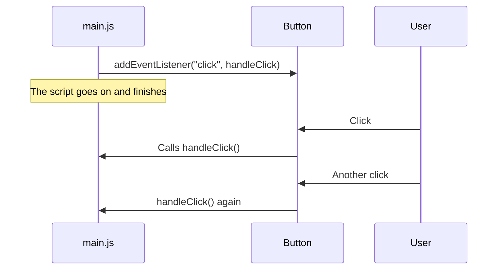
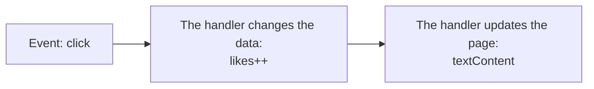
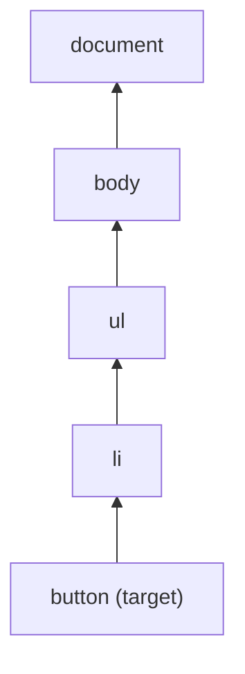

# Events

[Contents](../../README.md) · [← Back](../../Lesson-7/en/DOM%20finding%20and%20changing%20elements.md) · [Next →](../../Lesson-9/en/Forms,%20storage%20and%20requests.md) · [RU](../ru/%D0%A1%D0%BE%D0%B1%D1%8B%D1%82%D0%B8%D1%8F.md) · [EN](Events.md) · [UZ](../uz/Hodisalar.md)

> **Link to lesson 7:** you learned to change the page from code. But the code ran only once, when the page loaded. Today it will start **waiting for user actions** and responding to them.

---

## Why you need this

You press "Like" - the counter goes up. You type text - "57 / 100" updates under the field. You press Escape - the window closes. The browser turns every user action into an **event**, and your code can subscribe to it. This is the heart of every interactive website.

---

## What you will learn

- Subscribe to events with `addEventListener`.
- Handle clicks, typing and key presses.
- Use the event object: `event.target`, `event.key`.
- Cancel the browser's default action: `preventDefault`.
- Understand bubbling and use event delegation.
- Make interactive elements accessible: `<button>`, `aria-expanded`, `aria-pressed`.

---

## Review: 3 questions from lesson 7

1. How do you toggle the class `is-open` on the `menu` element?
2. How do you hide an element?
3. What does `querySelector` return if the element is not found?

Answers are at the end of the lesson.

---

## Lesson plan

| Section | What we do |
| --- | --- |
| `addEventListener` | Subscribing to an event |
| A click and state | A like counter |
| The event object | Who, where, which key |
| Mini-task 1 | A theme switch |
| Typing | A character counter |
| The keyboard | Escape closes |
| `preventDefault` | Cancel the browser's action |
| Bubbling and delegation | One handler for the whole list |
| Accessibility | A button, not a `div` |
| Mini-task 2 | An accordion |
| Independent work | An interactive page |

---

## `addEventListener`

**In simple words:** a notification subscription. You tell a button: "When someone presses you - call me". Until someone presses it, the code just waits.

```js
const button = document.querySelector("#hello-btn");

button.addEventListener("click", () => {
    console.log("The button was pressed!");
});
```

| Part | What it is |
| --- | --- |
| `button` | The element we wait for the event on |
| `"click"` | The event type |
| `() => { ... }` | The **handler** - the function the browser calls on the event |

A handler is an ordinary function; it can be declared separately and passed by name. **Without parentheses**: we pass the function, we do not call it.

```js
function handleClick() {
    console.log("The button was pressed!");
}

button.addEventListener("click", handleClick);   // correct
button.addEventListener("click", handleClick()); // mistake: the function is called right away
```

### Why not `onclick=""`

In HTML you can write `<button onclick="...">`. That mixes code with markup - like styles in a `style=""` attribute. Course rule: HTML stays in HTML, handlers go in the JS file with `addEventListener`.

### When the handler runs

It is important to understand the order: `addEventListener` does **not run** the function. It only writes it into a "subscription log". The function itself runs later - every time the user presses the button.



**How to read the diagram.** First the script "subscribes" and finishes its work. Then the page waits. Each click is a new call of the handler. It is the same callback idea as `setTimeout` in Lesson 5: the function is passed now and called later.

### The most needed events

| Event | When it happens | Where it is used |
| --- | --- | --- |
| `click` | A press with a mouse, a finger, Enter or Space on a button | Buttons, menus, cards |
| `input` | Every change of the text in a field | Live search, a character counter |
| `change` | A field's value is changed and confirmed | `select`, `checkbox`, `radio` |
| `submit` | A form is sent | Forms - Lesson 9 |
| `keydown` | A key is pressed | Escape, shortcuts |
| `focus` / `blur` | A field gets / loses focus | Hints for fields |

---

## A click and state

For the counter to "remember" the number of clicks, the value is stored in a variable **outside** the handler:

```js
const likeButton = document.querySelector("#like-btn");
const likeCount = document.querySelector("#like-count");
let likes = 0;

likeButton.addEventListener("click", () => {
    likes++;
    likeCount.textContent = String(likes);
});
```

The pattern of any interactivity is the same:



> **A common mistake:** declaring `let likes = 0;` inside the handler. Then every click starts counting from zero, and the page always shows `1`.

### What happens on three clicks

| Event | `likes` before | Action | `likes` after | On the page |
| --- | --- | --- | --- | --- |
| Page load | - | `let likes = 0;` | 0 | `0` |
| Click 1 | 0 | `likes++` | 1 | `1` |
| Click 2 | 1 | `likes++` | 2 | `2` |
| Click 3 | 2 | `likes++` | 3 | `3` |

The variable `likes` is created **once** on load, and the handler takes its current value on every click. This is called **state**: data that lives between events.

---

## The event object

The browser passes an **event object** with details into the handler. It is usually called `event`:

```js
button.addEventListener("click", (event) => {
    console.log(event.type);    // "click"
    console.log(event.target);  // the element that was clicked
});
```

| Property | What it holds |
| --- | --- |
| `event.type` | The type: `"click"`, `"input"`, `"keydown"` |
| `event.target` | The element the event happened on |
| `event.key` | For the keyboard: `"Enter"`, `"Escape"`, `"a"` |

---

## Mini-task 1

Make a theme switch: clicking `<button id="theme-toggle">` toggles the class `theme-dark` on `body`. The button text changes: `Dark theme` ↔ `Light theme`. Hint: `classList.toggle` returns `true` if the class was added. The solution is in the "Answers" section.

---

## Typing

The `input` event happens on **every** change of a field: a letter typed, deleted, pasted.

```js
const comment = document.querySelector("#comment");
const counter = document.querySelector("#comment-counter");

comment.addEventListener("input", () => {
    counter.textContent = `${comment.value.length} / 100`;
});
```

The field's value is the `value` property, always a string.

| Event | When it happens |
| --- | --- |
| `input` | Every change of the value |
| `change` | The value changed and the field lost focus (for `select`, `checkbox` - immediately) |
| `focus` / `blur` | The field got / lost focus |

---

## The keyboard

```js
document.addEventListener("keydown", (event) => {
    if (event.key === "Escape") {
        console.log("Closing the window");
    }
});
```

Subscribing on `document` catches key presses on the whole page. Common `event.key` values: `"Enter"`, `"Escape"`, `"ArrowUp"`, `"ArrowDown"`, `" "` (space), letters.

> **Escape closes** - a user habit. Every menu, window or expanded section should close on Escape.

---

## `preventDefault`

Some elements have a **default action**: a link opens an address, a form is submitted and reloads the page. `event.preventDefault()` cancels it:

```js
const link = document.querySelector(".demo-link");

link.addEventListener("click", (event) => {
    event.preventDefault();
    console.log("Navigation cancelled");
});
```

Its main use is forms in lesson 9: we will check the fields ourselves and not let the page reload.

---

## Bubbling and delegation

### Bubbling

An event happens on an element and then **bubbles up** to its parents - like an air bubble in water: `button` → `li` → `ul` → `body` → `document`. That is why a click on a button inside a list can be caught on the list itself.



### Delegation

Instead of a handler on every button - **one** on the common parent. Inside it, `event.target.closest(...)` finds which button was clicked:

```js
const list = document.querySelector(".todo-list");

list.addEventListener("click", (event) => {
    const button = event.target.closest(".todo__delete");
    if (!button) {
        return; // the click was not on a delete button - do nothing
    }
    button.closest(".todo").remove();
});
```

| Method | What it does |
| --- | --- |
| `el.closest(".a")` | Finds the nearest element matching `.a`, starting with `el` itself and going up through its parents. If none - `null` |

Why delegation is better:

1. One handler instead of a hundred - simpler code.
2. **It works for new elements.** Cards that `render` creates later (lesson 7) are clickable straight away: the handler sits on the container, not on them.

`closest` is needed because `event.target` is the deepest element: if a button contains a `<span>` or an icon, that is what gets clicked.

### Delegation step by step

Say the delete button contains an icon: `<button class="todo__delete"><span>✕</span></button>`. The user hit exactly the `✕`:

| Step | What happens | Value |
| --- | --- | --- |
| 1 | A click on the `span` | `event.target` is the `span`, not the button |
| 2 | The event bubbles up to `ul.todo-list` | Our single handler fires |
| 3 | `event.target.closest(".todo__delete")` | The search goes up from the `span` and finds the button |
| 4 | `button.closest(".todo")` | Up from the button - we find the whole `li.todo` item |
| 5 | `.remove()` | The item disappears from the page |

If the task text had been clicked, at step 3 `closest` would return `null`, and `return` would stop the handler. That is why the `if (!button)` check is required.

---

## Accessibility

An interactive element must work **from the keyboard** and be understandable to a screen reader.

| Rule | Why |
| --- | --- |
| Use `<button type="button">` for actions, not `<div>` | A button gets focus with Tab and is pressed with Enter and Space with no extra code |
| Use `<a href>` for navigation | A link is navigation, a button is an action |
| Expanding section: `aria-expanded="true/false"` on the button | The screen reader says "expanded" / "collapsed" |
| Toggle: `aria-pressed="true/false"` | The screen reader says "pressed" / "not pressed" |
| Hidden content - `hidden` | Hidden for screen readers too |

`aria-*` attributes are strings, so values are written with `setAttribute` and `String`:

```js
const isOpen = answer.hidden;            // was hidden → we open it now
answer.hidden = !isOpen;
button.setAttribute("aria-expanded", String(isOpen));
```

Test every interactive part with the keyboard: Tab - reach it, Enter or Space - press it, Escape - close it.

### Try to break it

1. Pass the handler with parentheses: `button.addEventListener("click", handleClick());`. When did the message appear in the console - on load or on click?
2. Move `let likes = 0;` inside the handler. What does the counter show after five clicks?
3. Remove `event.preventDefault()` from the link handler. What does the browser do?
4. Make a button from a `<div>` and try to press it with the keyboard: Tab, then Enter.

### Typical beginner mistakes

| Mistake | What you get | How to fix |
| --- | --- | --- |
| `handleClick()` in `addEventListener` | The function ran once on load | Pass the name without parentheses |
| State inside the handler | The count starts over on every event | `let` outside the handler |
| `"onclick"` instead of `"click"` | The handler never fires | The event type has no `on` |
| `event.target` instead of `closest` | You hit the icon inside the button | `event.target.closest(".btn")` |
| A handler on every new element | New cards after `render` do not react | Delegation on the container |
| A `<div>` as a button | Does not work from the keyboard or for screen readers | `<button type="button">` |
| No `aria-expanded` on an expanding button | The screen reader does not know the state | `setAttribute("aria-expanded", String(isOpen))` |

---

## Mini-task 2

An accordion: inside `<div class="faq">` there are several `.faq__item` blocks, each with a `.faq__question` button with `aria-expanded="false"` and an answer `.faq__answer` with `hidden`. Attach **one** handler to `.faq`: clicking a question shows or hides its answer and updates `aria-expanded`. The solution is in the "Answers" section.

---

## Lesson summary: cheat sheet

| Task | Code |
| --- | --- |
| Subscribe | `el.addEventListener("click", handler)` |
| A handler with the event | `(event) => { ... }` |
| Who triggered it | `event.target` |
| Which key | `event.key === "Escape"` |
| Typing in a field | `"input"` and `field.value` |
| Cancel the browser's action | `event.preventDefault()` |
| Delegation | Handler on the parent + `event.target.closest(".item")` |
| State | `let` outside the handler |
| Accessibility | `<button type="button">`, `aria-expanded`, `aria-pressed`, `hidden` |

---

## Independent work

### Part 1. IDE task (graded by the platform)

The page is already laid out. Bring it to life:

1. **Likes.** A click on `#like-btn` increases the number in `#like-count` by 1.
2. **Theme.** A click on `#theme-toggle` toggles the class `theme-dark` on `body` and sets the button's `aria-pressed` to `"true"` or `"false"`.
3. **Questions.** **One** handler on `#faq` (delegation): a click on `.faq__question` shows or hides the `.faq__answer` of its own `.faq__item` block and updates `aria-expanded`.
4. **Escape.** Pressing Escape anywhere on the page closes all answers and sets `aria-expanded="false"` on all questions.
5. **Character counter.** Typing in `#comment` writes `12 / 100` - the current text length - into `#comment-counter`.

Handlers only with `addEventListener`. Do not use `onclick`, `innerHTML` or `element.style`.

What the platform checks: the values after one and several clicks; the class and `aria-pressed` after two clicks; opening and closing answers; a question added to the page **after** loading works (without delegation it will not); Escape; the character counter while typing.

### Part 2. Project on your computer

1. Add a theme switch to your website: a button and the class `theme-dark` with the CSS variables from the CSS course.
2. If your website has a questions or descriptions section, turn it into an accordion with delegation.
3. Add an action button (for example, "Add to favourites") to the cards from lesson 7, handled by one handler on the container.
4. Go through all interactive elements with the keyboard only: Tab, Enter, Space, Escape.

### Acceptance criteria

- [ ] The IDE task is accepted.
- [ ] All handlers are attached with `addEventListener`.
- [ ] Lists and cards use delegation.
- [ ] Every action is performed by a `<button type="button">` and works from the keyboard.
- [ ] The expanded and toggled state is reflected in `aria-expanded` / `aria-pressed`.

---

## Self-check questions

1. What is an event handler?
2. Why is `addEventListener("click", handle())` a mistake?
3. Where do you declare a counter variable: inside the handler or outside? Why?
4. What does `event.target` hold?
5. How does the `input` event differ from `change`?
6. How do you detect an Escape press?
7. What does `preventDefault` do, and where will you need it?
8. What is event bubbling?
9. What two advantages does delegation give?
10. Why does an action need a `<button>` and not a `<div>`?

After the questions, take the **lesson test** on the platform: 12 questions, pass mark 70%.

---

## What's next

The page responds to the user but forgets everything after a reload. In lesson 9 we will learn to **validate forms**, **save data** in the browser and **load data from a server**.

---

## Answers

**Review**

1. `menu.classList.toggle("is-open");`.
2. `element.hidden = true;`.
3. `null`.

**Mini-task 1**

```js
const themeButton = document.querySelector("#theme-toggle");

themeButton.addEventListener("click", () => {
    const isDark = document.body.classList.toggle("theme-dark");
    themeButton.textContent = isDark ? "Light theme" : "Dark theme";
});
```

**Mini-task 2**

```js
const faq = document.querySelector(".faq");

faq.addEventListener("click", (event) => {
    const question = event.target.closest(".faq__question");
    if (!question) {
        return;
    }

    const answer = question.closest(".faq__item").querySelector(".faq__answer");
    const willOpen = answer.hidden;

    answer.hidden = !willOpen;
    question.setAttribute("aria-expanded", String(willOpen));
});
```

**Self-check questions**

1. A function the browser calls when an event happens.
2. The function is called immediately when subscribing, and `addEventListener` gets its result (`undefined`).
3. Outside: inside, it would be created anew with zero on every event.
4. The element the event happened on - the deepest one that was clicked.
5. `input` - on every change, `change` - after the change is finished (focus is lost).
6. `document.addEventListener("keydown", (event) => { if (event.key === "Escape") { ... } });`.
7. Cancels the browser's default action; you will need it to submit a form without reloading.
8. After the target element, the event rises through all its parents up to `document`.
9. One handler instead of many, and it works with elements added later.
10. A button gets focus and is pressed from the keyboard, and the screen reader announces it as a button.

---

[Contents](../../README.md) · [← Back](../../Lesson-7/en/DOM%20finding%20and%20changing%20elements.md) · [Next →](../../Lesson-9/en/Forms,%20storage%20and%20requests.md) · [RU](../ru/%D0%A1%D0%BE%D0%B1%D1%8B%D1%82%D0%B8%D1%8F.md) · [EN](Events.md) · [UZ](../uz/Hodisalar.md)
