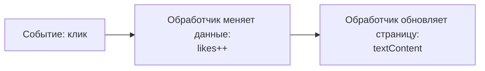
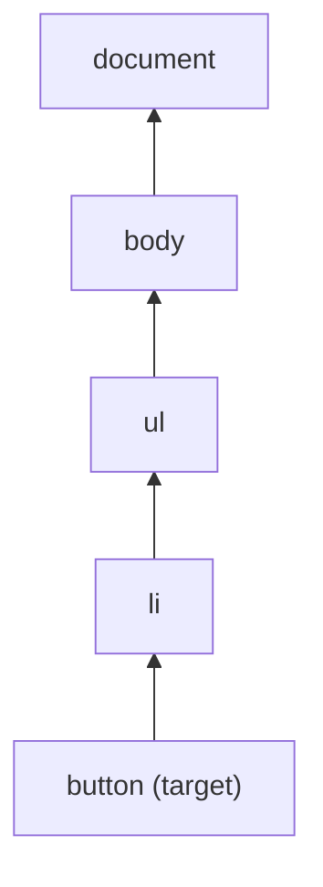

# События

[Содержание](../../README.md) · [← Назад](../../Lesson-7/ru/DOM%20поиск%20и%20изменение%20элементов.md) · [Вперёд →](../../Lesson-9/ru/Формы,%20хранение%20данных%20и%20запросы.md) · [RU](%D0%A1%D0%BE%D0%B1%D1%8B%D1%82%D0%B8%D1%8F.md) · [EN](../en/Events.md) · [UZ](../uz/Hodisalar.md)

> **Связь с уроком 7:** вы научились менять страницу из кода. Но код выполнялся один раз при загрузке. Сегодня он начнёт **ждать действий пользователя** и отвечать на них.

---

## Зачем это вам

Нажал «Нравится» - счётчик вырос. Ввёл текст - под полем обновилось «57 / 100». Нажал Escape - окно закрылось. Каждое действие пользователя браузер превращает в **событие**, а ваш код может на него подписаться. Это сердце любого интерактивного сайта.

---

## Чему вы научитесь

- Подписываться на события через `addEventListener`.
- Обрабатывать клики, ввод текста и нажатия клавиш.
- Пользоваться объектом события: `event.target`, `event.key`.
- Отменять действие браузера по умолчанию: `preventDefault`.
- Понимать всплытие и применять делегирование событий.
- Делать интерактивные элементы доступными: `<button>`, `aria-expanded`, `aria-pressed`.

---

## Повторение: 3 вопроса из урока 7

1. Как переключить класс `is-open` у элемента `menu`?
2. Как скрыть элемент?
3. Что вернёт `querySelector`, если элемент не найден?

Ответы - в конце урока.

---

## План урока

| Раздел | Что делаем |
| --- | --- |
| `addEventListener` | Подписка на событие |
| Клик и состояние | Счётчик лайков |
| Объект события | Кто, где, какая клавиша |
| Мини-задание 1 | Переключатель темы |
| Ввод текста | Счётчик символов |
| Клавиатура | Escape закрывает |
| `preventDefault` | Отменить действие браузера |
| Всплытие и делегирование | Один обработчик на весь список |
| Доступность | Кнопка, а не `div` |
| Мини-задание 2 | Аккордеон |
| Самостоятельная работа | Интерактивная страница |

---

## `addEventListener`

**Простыми словами:** подписка на уведомления. Вы говорите кнопке: «Когда тебя нажмут - позвони мне». Пока никто не нажал, код просто ждёт.

```js
const button = document.querySelector("#hello-btn");

button.addEventListener("click", () => {
    console.log("Кнопку нажали!");
});
```

| Часть | Что это |
| --- | --- |
| `button` | Элемент, на котором ждём событие |
| `"click"` | Тип события |
| `() => { ... }` | **Обработчик** - функция, которую браузер вызовет при событии |

Обработчик - обычная функция, её можно объявить отдельно и передать по имени. **Без скобок**: мы передаём функцию, а не вызываем её.

```js
function handleClick() {
    console.log("Кнопку нажали!");
}

button.addEventListener("click", handleClick);   // правильно
button.addEventListener("click", handleClick()); // ошибка: функция вызовется сразу
```

### Почему не `onclick=""`

В HTML можно написать `<button onclick="...">`. Так код смешивается с разметкой - как стили в атрибуте `style=""`. Правило курса: HTML - в HTML, обработчики - в JS-файле через `addEventListener`.

---

## Клик и состояние

Чтобы счётчик «помнил» число нажатий, значение хранят в переменной **снаружи** обработчика:

```js
const likeButton = document.querySelector("#like-btn");
const likeCount = document.querySelector("#like-count");
let likes = 0;

likeButton.addEventListener("click", () => {
    likes++;
    likeCount.textContent = String(likes);
});
```

Схема любой интерактивности одна и та же:



> **Частая ошибка:** объявить `let likes = 0;` внутри обработчика. Тогда при каждом клике счёт начнётся с нуля, и на странице всегда будет `1`.

---

## Объект события

Браузер передаёт в обработчик **объект события** с подробностями. Его принято называть `event`:

```js
button.addEventListener("click", (event) => {
    console.log(event.type);    // "click"
    console.log(event.target);  // элемент, по которому кликнули
});
```

| Свойство | Что содержит |
| --- | --- |
| `event.type` | Тип: `"click"`, `"input"`, `"keydown"` |
| `event.target` | Элемент, на котором событие произошло |
| `event.key` | Для клавиатуры: `"Enter"`, `"Escape"`, `"a"` |

---

## Мини-задание 1

Сделайте переключатель темы: по клику на `<button id="theme-toggle">` у `body` переключается класс `theme-dark`. Текст кнопки меняется: `Тёмная тема` ↔ `Светлая тема`. Подсказка: `classList.toggle` возвращает `true`, если класс добавлен. Решение - в разделе «Ответы».

---

## Ввод текста

Событие `input` происходит при **каждом** изменении поля: напечатали букву, удалили, вставили.

```js
const comment = document.querySelector("#comment");
const counter = document.querySelector("#comment-counter");

comment.addEventListener("input", () => {
    counter.textContent = `${comment.value.length} / 100`;
});
```

Значение поля - свойство `value`, всегда строка.

| Событие | Когда происходит |
| --- | --- |
| `input` | Каждое изменение значения |
| `change` | Значение изменено и поле потеряло фокус (для `select`, `checkbox` - сразу) |
| `focus` / `blur` | Поле получило / потеряло фокус |

---

## Клавиатура

```js
document.addEventListener("keydown", (event) => {
    if (event.key === "Escape") {
        console.log("Закрываем окно");
    }
});
```

Подписка на `document` ловит нажатия на всей странице. Частые значения `event.key`: `"Enter"`, `"Escape"`, `"ArrowUp"`, `"ArrowDown"`, `" "` (пробел), буквы.

> **Escape закрывает** - привычка пользователей. Каждое меню, окно или раскрытый блок должен закрываться по Escape.

---

## `preventDefault`

У некоторых элементов есть **действие по умолчанию**: ссылка открывает адрес, форма отправляется и перезагружает страницу. `event.preventDefault()` отменяет его:

```js
const link = document.querySelector(".demo-link");

link.addEventListener("click", (event) => {
    event.preventDefault();
    console.log("Переход отменён");
});
```

Главное применение - формы в уроке 9: мы проверим поля сами и не дадим странице перезагрузиться.

---

## Всплытие и делегирование

### Всплытие

Событие происходит на элементе, а затем **всплывает** к родителям - как пузырёк воды: `button` → `li` → `ul` → `body` → `document`. Поэтому клик по кнопке внутри списка можно поймать на самом списке.



### Делегирование

Вместо обработчика на каждой кнопке - **один** на общем родителе. В нём через `event.target.closest(...)` находим, по какой кнопке кликнули:

```js
const list = document.querySelector(".todo-list");

list.addEventListener("click", (event) => {
    const button = event.target.closest(".todo__delete");
    if (!button) {
        return; // клик не по кнопке удаления - ничего не делаем
    }
    button.closest(".todo").remove();
});
```

| Метод | Что делает |
| --- | --- |
| `el.closest(".a")` | Ищет ближайший элемент с селектором `.a`, начиная с самого `el` и вверх по родителям. Если нет - `null` |

Почему делегирование лучше:

1. Один обработчик вместо ста - проще код.
2. **Работает для новых элементов.** Карточки, которые `render` создаст позже (урок 7), сразу кликабельны: обработчик висит на контейнере, а не на них.

`closest` нужен, потому что `event.target` - самый глубокий элемент: если внутри кнопки есть `<span>` или иконка, кликнут именно по ним.

---

## Доступность

Интерактивный элемент должен работать **с клавиатуры** и быть понятен экранной читалке.

| Правило | Почему |
| --- | --- |
| Для действий - `<button type="button">`, не `<div>` | Кнопка получает фокус по Tab и нажимается Enter и пробелом без дополнительного кода |
| Для перехода - `<a href>` | Ссылка - это навигация, кнопка - действие |
| Раскрывающийся блок: `aria-expanded="true/false"` на кнопке | Читалка скажет «развёрнуто» / «свёрнуто» |
| Переключатель: `aria-pressed="true/false"` | Читалка скажет «нажата» / «не нажата» |
| Скрытое содержимое - `hidden` | Скрыто и для читалок |

Атрибуты `aria-*` - строки, поэтому значения записываются через `setAttribute` и `String`:

```js
const isOpen = answer.hidden;            // было скрыто → сейчас откроем
answer.hidden = !isOpen;
button.setAttribute("aria-expanded", String(isOpen));
```

Проверяйте каждую интерактивную часть клавиатурой: Tab - дойти, Enter или пробел - нажать, Escape - закрыть.

---

## Мини-задание 2

Аккордеон: внутри `<div class="faq">` несколько блоков `.faq__item`, в каждом кнопка `.faq__question` с `aria-expanded="false"` и ответ `.faq__answer` с `hidden`. Повесьте **один** обработчик на `.faq`: клик по вопросу показывает или скрывает его ответ и обновляет `aria-expanded`. Решение - в разделе «Ответы».

---

## Итоги урока: шпаргалка

| Задача | Запись |
| --- | --- |
| Подписаться | `el.addEventListener("click", handler)` |
| Обработчик с событием | `(event) => { ... }` |
| Кто вызвал | `event.target` |
| Какая клавиша | `event.key === "Escape"` |
| Ввод в поле | `"input"` и `field.value` |
| Отменить действие браузера | `event.preventDefault()` |
| Делегирование | Обработчик на родителе + `event.target.closest(".item")` |
| Состояние | `let` снаружи обработчика |
| Доступность | `<button type="button">`, `aria-expanded`, `aria-pressed`, `hidden` |

---

## Самостоятельная работа

### Часть 1. Задание в IDE (засчитывается платформой)

Страница уже свёрстана. Оживите её:

1. **Лайки.** Клик по `#like-btn` увеличивает число в `#like-count` на 1.
2. **Тема.** Клик по `#theme-toggle` переключает у `body` класс `theme-dark` и ставит кнопке `aria-pressed` в `"true"` или `"false"`.
3. **Вопросы.** **Один** обработчик на `#faq` (делегирование): клик по `.faq__question` показывает или скрывает `.faq__answer` своего блока `.faq__item` и обновляет `aria-expanded`.
4. **Escape.** Нажатие Escape в любом месте страницы закрывает все ответы и ставит всем вопросам `aria-expanded="false"`.
5. **Счётчик символов.** При вводе в `#comment` в `#comment-counter` пишется `12 / 100` - текущая длина текста.

Обработчики - только через `addEventListener`. `onclick`, `innerHTML` и `element.style` не используйте.

Что проверяет платформа: значения после одного и нескольких кликов; класс и `aria-pressed` после двух кликов; раскрытие и закрытие ответов; работу вопроса, добавленного на страницу **после** загрузки (без делегирования он не сработает); Escape; счётчик символов при вводе.

### Часть 2. Проект на компьютере

1. Добавьте на свой сайт переключатель темы: кнопку и класс `theme-dark` с переменными CSS из курса CSS.
2. Если на сайте есть раздел вопросов или описаний - сделайте из него аккордеон с делегированием.
3. Карточкам из урока 7 добавьте кнопку-действие (например, «В избранное»), обработанную одним обработчиком на контейнере.
4. Пройдите все интерактивные элементы только клавиатурой: Tab, Enter, пробел, Escape.

### Критерии готовности

- [ ] Задание в IDE засчитано.
- [ ] Все обработчики подключены через `addEventListener`.
- [ ] Для списков и карточек используется делегирование.
- [ ] Каждое действие выполняется кнопкой `<button type="button">` и работает с клавиатуры.
- [ ] Состояние раскрытия и переключения отражено в `aria-expanded` / `aria-pressed`.

---

## Вопросы для самопроверки

1. Что такое обработчик события?
2. Почему `addEventListener("click", handle())` - ошибка?
3. Где объявлять переменную-счётчик: внутри обработчика или снаружи? Почему?
4. Что содержит `event.target`?
5. Чем событие `input` отличается от `change`?
6. Как отследить нажатие Escape?
7. Что делает `preventDefault` и где он понадобится?
8. Что такое всплытие событий?
9. Какие два преимущества даёт делегирование?
10. Почему для действия нужна `<button>`, а не `<div>`?

После вопросов пройдите **тест урока** на платформе: 12 вопросов, порог 70%.

---

## Что дальше

Страница отвечает пользователю, но всё забывает после перезагрузки. В уроке 9 научимся **проверять формы**, **сохранять данные** в браузере и **загружать данные с сервера**.

---

## Ответы

**Повторение**

1. `menu.classList.toggle("is-open");`.
2. `element.hidden = true;`.
3. `null`.

**Мини-задание 1**

```js
const themeButton = document.querySelector("#theme-toggle");

themeButton.addEventListener("click", () => {
    const isDark = document.body.classList.toggle("theme-dark");
    themeButton.textContent = isDark ? "Светлая тема" : "Тёмная тема";
});
```

**Мини-задание 2**

```js
const faq = document.querySelector(".faq");

faq.addEventListener("click", (event) => {
    const question = event.target.closest(".faq__question");
    if (!question) {
        return;
    }

    const answer = question.closest(".faq__item").querySelector(".faq__answer");
    const willOpen = answer.hidden;

    answer.hidden = !willOpen;
    question.setAttribute("aria-expanded", String(willOpen));
});
```

**Вопросы для самопроверки**

1. Функция, которую браузер вызывает, когда происходит событие.
2. Функция вызовется сразу при подписке, а в `addEventListener` попадёт её результат (`undefined`).
3. Снаружи: внутри она создавалась бы заново с нулём при каждом событии.
4. Элемент, на котором произошло событие, - самый глубокий, по которому кликнули.
5. `input` - при каждом изменении, `change` - после завершения изменения (потеря фокуса).
6. `document.addEventListener("keydown", (event) => { if (event.key === "Escape") { ... } });`.
7. Отменяет действие браузера по умолчанию; понадобится для отправки формы без перезагрузки.
8. Событие после целевого элемента поднимается по всем его родителям до `document`.
9. Один обработчик вместо многих и работа с элементами, добавленными позже.
10. Кнопка получает фокус и нажимается с клавиатуры, читалка объявляет её как кнопку.

---

[Содержание](../../README.md) · [← Назад](../../Lesson-7/ru/DOM%20поиск%20и%20изменение%20элементов.md) · [Вперёд →](../../Lesson-9/ru/Формы,%20хранение%20данных%20и%20запросы.md) · [RU](%D0%A1%D0%BE%D0%B1%D1%8B%D1%82%D0%B8%D1%8F.md) · [EN](../en/Events.md) · [UZ](../uz/Hodisalar.md)
