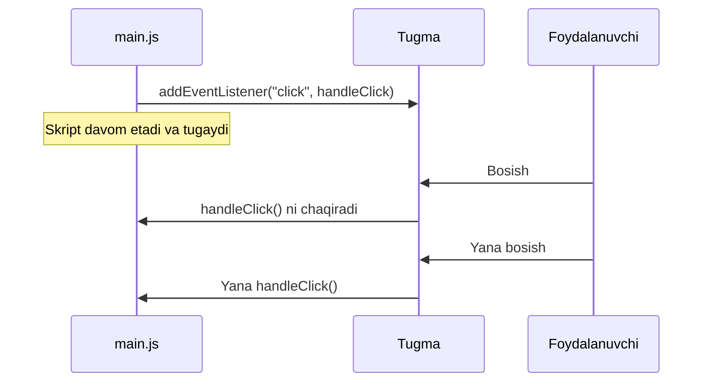
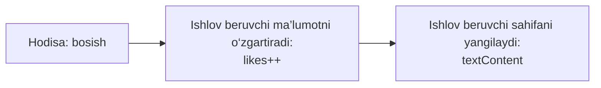
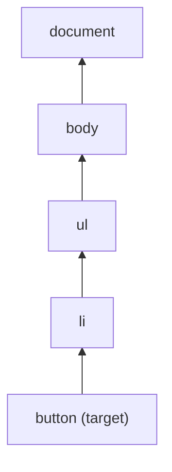

# Hodisalar

[Mundarija](../../README.md) · [← Orqaga](../../Lesson-7/uz/DOM%20elementlarni%20topish%20va%20o'zgartirish.md) · [Keyingi →](../../Lesson-9/uz/Formalar,%20ma'lumotlarni%20saqlash%20va%20so'rovlar.md) · [RU](../ru/%D0%A1%D0%BE%D0%B1%D1%8B%D1%82%D0%B8%D1%8F.md) · [EN](../en/Events.md) · [UZ](Hodisalar.md)

> **7-dars bilan bog‘liqlik:** siz sahifani koddan o‘zgartirishni o‘rgandingiz. Lekin kod faqat bir marta - yuklanganda bajarildi. Bugun u **foydalanuvchi harakatlarini kuta** va ularga javob bera boshlaydi.

---

## Bu sizga nima uchun kerak

«Yoqdi» ni bosdingiz - hisoblagich oshdi. Matn kiritdingiz - maydon ostida «57 / 100» yangilandi. Escape ni bosdingiz - oyna yopildi. Brauzer foydalanuvchining har bir harakatini **hodisaga** aylantiradi, kodingiz esa unga obuna bo‘lishi mumkin. Bu har qanday interaktiv saytning yuragi.

---

## Nimani o‘rganasiz

- `addEventListener` orqali hodisalarga obuna bo‘lish.
- Bosishlar, matn kiritish va tugmalar bosilishini qayta ishlash.
- Hodisa obyektidan foydalanish: `event.target`, `event.key`.
- Brauzerning standart amalini bekor qilish: `preventDefault`.
- Ko‘tarilishni tushunish va hodisalarni delegatsiya qilishni qo‘llash.
- Interaktiv elementlarni qulay qilish: `<button>`, `aria-expanded`, `aria-pressed`.

---

## Takrorlash: 7-darsdan 3 savol

1. `menu` elementidagi `is-open` klassini qanday almashtirish mumkin?
2. Elementni qanday yashirish mumkin?
3. Element topilmasa, `querySelector` nimani qaytaradi?

Javoblar - dars oxirida.

---

## Reja

| Bo‘lim | Nima qilamiz |
| --- | --- |
| `addEventListener` | Hodisaga obuna |
| Bosish va holat | Layklar hisoblagichi |
| Hodisa obyekti | Kim, qayerda, qaysi tugma |
| Mini-topshiriq 1 | Mavzu almashtirgichi |
| Matn kiritish | Belgilar hisoblagichi |
| Klaviatura | Escape yopadi |
| `preventDefault` | Brauzer amalini bekor qilish |
| Ko‘tarilish va delegatsiya | Butun ro‘yxatga bitta ishlov beruvchi |
| Qulaylik | `div` emas, tugma |
| Mini-topshiriq 2 | Akkordeon |
| Mustaqil ish | Interaktiv sahifa |

---

## `addEventListener`

**Oddiy so‘z bilan:** bildirishnomalarga obuna. Tugmaga aytasiz: «Seni bosishsa - menga qo‘ng‘iroq qil». Hech kim bosmaguncha kod shunchaki kutadi.

```js
const button = document.querySelector("#hello-btn");

button.addEventListener("click", () => {
    console.log("Tugma bosildi!");
});
```

| Qism | Bu nima |
| --- | --- |
| `button` | Hodisani kutayotgan element |
| `"click"` | Hodisa turi |
| `() => { ... }` | **Ishlov beruvchi** - hodisa sodir bo‘lganda brauzer chaqiradigan funksiya |

Ishlov beruvchi - oddiy funksiya, uni alohida e’lon qilib, nomi bilan berish mumkin. **Qavssiz**: biz funksiyani beramiz, uni chaqirmaymiz.

```js
function handleClick() {
    console.log("Tugma bosildi!");
}

button.addEventListener("click", handleClick);   // to‘g‘ri
button.addEventListener("click", handleClick()); // xato: funksiya darhol chaqiriladi
```

### Nima uchun `onclick=""` emas

HTML da `<button onclick="...">` deb yozish mumkin. Bunda kod belgilash bilan aralashadi - `style=""` atributidagi stillar kabi. Kurs qoidasi: HTML - HTML da, ishlov beruvchilar - JS faylda `addEventListener` orqali.

### Ishlovchi qachon bajariladi

Tartibni tushunish muhim: `addEventListener` funksiyani **ishga tushirmaydi**. U faqat uni «obunalar jurnaliga» yozib qo‘yadi. Funksiyaning o‘zi keyinroq bajariladi - foydalanuvchi tugmani har bosganida.



**Sxemani qanday o‘qish kerak.** Avval skript «obuna bo‘ladi» va ishini tugatadi. Keyin sahifa kutadi. Har bir bosish - ishlovchining yangi chaqiruvi. Bu 5-darsdagi `setTimeout` dagi kolbekning o‘sha g‘oyasi: funksiya hozir beriladi, keyin chaqiriladi.

### Eng kerakli hodisalar

| Hodisa | Qachon sodir bo‘ladi | Qayerda ishlatiladi |
| --- | --- | --- |
| `click` | Sichqoncha, barmoq bilan bosish, tugmada Enter yoki probel | Tugmalar, menyu, kartochkalar |
| `input` | Maydondagi matnning har bir o‘zgarishi | «Darhol» qidiruv, belgilar hisoblagichi |
| `change` | Maydon qiymati o‘zgartirildi va tasdiqlandi | `select`, `checkbox`, `radio` |
| `submit` | Formani yuborish | Formalar - 9-dars |
| `keydown` | Tugmachani bosish | Escape, tezkor tugmalar |
| `focus` / `blur` | Maydon fokusni oldi / yo‘qotdi | Maydonlarga maslahatlar |

---

## Bosish va holat

Hisoblagich bosishlar sonini «eslab qolishi» uchun qiymat ishlov beruvchidan **tashqaridagi** o‘zgaruvchida saqlanadi:

```js
const likeButton = document.querySelector("#like-btn");
const likeCount = document.querySelector("#like-count");
let likes = 0;

likeButton.addEventListener("click", () => {
    likes++;
    likeCount.textContent = String(likes);
});
```

Har qanday interaktivlik sxemasi bir xil:



> **Tipik xato:** `let likes = 0;` ni ishlov beruvchi ichida e’lon qilish. Shunda har bosishda hisob noldan boshlanadi va sahifada doim `1` turadi.

### Uch marta bosilganda nima bo‘ladi

| Hodisa | oldin `likes` | Amal | keyin `likes` | Sahifada |
| --- | --- | --- | --- | --- |
| Sahifa yuklanishi | - | `let likes = 0;` | 0 | `0` |
| 1-bosish | 0 | `likes++` | 1 | `1` |
| 2-bosish | 1 | `likes++` | 2 | `2` |
| 3-bosish | 2 | `likes++` | 3 | `3` |

`likes` o‘zgaruvchisi yuklanishda **bir marta** yaratilgan, ishlovchi esa har bosishda uning joriy qiymatini oladi. Buni **holat** deyishadi: hodisalar orasida yashaydigan ma’lumotlar.

---

## Hodisa obyekti

Brauzer ishlov beruvchiga tafsilotlari bor **hodisa obyektini** beradi. Uni odatda `event` deb atashadi:

```js
button.addEventListener("click", (event) => {
    console.log(event.type);    // "click"
    console.log(event.target);  // bosilgan element
});
```

| Xususiyat | Nimani saqlaydi |
| --- | --- |
| `event.type` | Turi: `"click"`, `"input"`, `"keydown"` |
| `event.target` | Hodisa sodir bo‘lgan element |
| `event.key` | Klaviatura uchun: `"Enter"`, `"Escape"`, `"a"` |

---

## Mini-topshiriq 1

Mavzu almashtirgichini yarating: `<button id="theme-toggle">` bosilganda `body` dagi `theme-dark` klassi almashadi. Tugma matni o‘zgaradi: `Qorong‘i mavzu` ↔ `Yorug‘ mavzu`. Maslahat: klass qo‘shilgan bo‘lsa, `classList.toggle` `true` qaytaradi. Yechim - «Javoblar» bo‘limida.

---

## Matn kiritish

`input` hodisasi maydonning **har bir** o‘zgarishida sodir bo‘ladi: harf yozildi, o‘chirildi, qo‘yildi.

```js
const comment = document.querySelector("#comment");
const counter = document.querySelector("#comment-counter");

comment.addEventListener("input", () => {
    counter.textContent = `${comment.value.length} / 100`;
});
```

Maydon qiymati - `value` xususiyati, doim satr.

| Hodisa | Qachon sodir bo‘ladi |
| --- | --- |
| `input` | Qiymatning har bir o‘zgarishida |
| `change` | Qiymat o‘zgardi va maydon fokusni yo‘qotdi (`select`, `checkbox` uchun - darhol) |
| `focus` / `blur` | Maydon fokusni oldi / yo‘qotdi |

---

## Klaviatura

```js
document.addEventListener("keydown", (event) => {
    if (event.key === "Escape") {
        console.log("Oynani yopamiz");
    }
});
```

`document` ga obuna butun sahifadagi bosishlarni ushlaydi. `event.key` ning ko‘p uchraydigan qiymatlari: `"Enter"`, `"Escape"`, `"ArrowUp"`, `"ArrowDown"`, `" "` (bo‘sh joy), harflar.

> **Escape yopadi** - foydalanuvchilar odati. Har bir menyu, oyna yoki ochilgan blok Escape bilan yopilishi kerak.

---

## `preventDefault`

Ba’zi elementlarda **standart amal** bor: havola manzilni ochadi, forma yuboriladi va sahifani qayta yuklaydi. `event.preventDefault()` uni bekor qiladi:

```js
const link = document.querySelector(".demo-link");

link.addEventListener("click", (event) => {
    event.preventDefault();
    console.log("O‘tish bekor qilindi");
});
```

Asosiy qo‘llanishi - 9-darsdagi formalar: maydonlarni o‘zimiz tekshiramiz va sahifa qayta yuklanishiga yo‘l qo‘ymaymiz.

---

## Ko‘tarilish va delegatsiya

### Ko‘tarilish

Hodisa elementda sodir bo‘ladi, keyin esa ota-onalariga **ko‘tariladi** - suvdagi pufakcha kabi: `button` → `li` → `ul` → `body` → `document`. Shuning uchun ro‘yxat ichidagi tugmaga bosishni ro‘yxatning o‘zida ushlash mumkin.



### Delegatsiya

Har bir tugmaga ishlov beruvchi o‘rniga - umumiy ota-onaga **bitta**. Uning ichida `event.target.closest(...)` orqali qaysi tugma bosilganini topamiz:

```js
const list = document.querySelector(".todo-list");

list.addEventListener("click", (event) => {
    const button = event.target.closest(".todo__delete");
    if (!button) {
        return; // o‘chirish tugmasiga bosilmagan - hech narsa qilmaymiz
    }
    button.closest(".todo").remove();
});
```

| Metod | Nima qiladi |
| --- | --- |
| `el.closest(".a")` | `el` ning o‘zidan boshlab ota-onalar bo‘ylab yuqoriga `.a` selektorli eng yaqin elementni qidiradi. Bo‘lmasa - `null` |

Delegatsiya nima uchun yaxshiroq:

1. Yuzta o‘rniga bitta ishlov beruvchi - kod soddaroq.
2. **Yangi elementlar uchun ishlaydi.** `render` keyinroq yaratadigan kartochkalar (7-dars) darhol bosiladigan bo‘ladi: ishlov beruvchi ularda emas, konteynerda turibdi.

`closest` kerak, chunki `event.target` - eng chuqur element: agar tugma ichida `<span>` yoki belgi bo‘lsa, aynan ular bosiladi.

### Delegatsiya qadamma-qadam

O‘chirish tugmasi ichida belgi bor deylik: `<button class="todo__delete"><span>✕</span></button>`. Foydalanuvchi aynan `✕` ga bosdi:

| Qadam | Nima bo‘ladi | Qiymat |
| --- | --- | --- |
| 1 | `span` ga bosish | `event.target` - tugma emas, `span` |
| 2 | Hodisa `ul.todo-list` gacha suzib chiqadi | Yagona ishlovchimiz ishlaydi |
| 3 | `event.target.closest(".todo__delete")` | Qidiruv `span` dan yuqoriga boradi va tugmani topadi |
| 4 | `button.closest(".todo")` | Tugmadan yuqoriga - butun `li.todo` bandini topamiz |
| 5 | `.remove()` | Band sahifadan yo‘qoladi |

Agar vazifa matniga bosilganda edi, 3-qadamda `closest` `null` qaytarardi va `return` ishlovchini to‘xtatardi. Shuning uchun `if (!button)` tekshiruvi majburiy.

---

## Qulaylik

Interaktiv element **klaviaturadan** ishlashi va ekran o‘qish dasturiga tushunarli bo‘lishi kerak.

| Qoida | Nima uchun |
| --- | --- |
| Amallar uchun - `<div>` emas, `<button type="button">` | Tugma Tab bilan fokus oladi va qo‘shimcha kodsiz Enter va bo‘sh joy bilan bosiladi |
| O‘tish uchun - `<a href>` | Havola - navigatsiya, tugma - amal |
| Ochiladigan blok: tugmada `aria-expanded="true/false"` | O‘qish dasturi «ochilgan» / «yig‘ilgan» deydi |
| Almashtirgich: `aria-pressed="true/false"` | O‘qish dasturi «bosilgan» / «bosilmagan» deydi |
| Yashirin tarkib - `hidden` | O‘qish dasturlaridan ham yashirin |

`aria-*` atributlari - satrlar, shuning uchun qiymatlar `setAttribute` va `String` orqali yoziladi:

```js
const isOpen = answer.hidden;            // yashirin edi → hozir ochamiz
answer.hidden = !isOpen;
button.setAttribute("aria-expanded", String(isOpen));
```

Har bir interaktiv qismni klaviatura bilan tekshiring: Tab - yetib borish, Enter yoki bo‘sh joy - bosish, Escape - yopish.

### Buzib ko‘ring

1. Ishlovchini qavslar bilan bering: `button.addEventListener("click", handleClick());`. Konsolda xabar qachon paydo bo‘ldi - yuklanishdami yoki bosishdami?
2. `let likes = 0;` ni ishlovchi ichiga ko‘chiring. Besh marta bosishdan keyin hisoblagich nimani ko‘rsatadi?
3. Havola ishlovchisidan `event.preventDefault()` ni olib tashlang. Brauzer nima qiladi?
4. Tugmani `<div>` dan yasang va uni klaviatura bilan bosishga urinib ko‘ring: Tab, keyin Enter.

### Yangi o‘rganuvchilarning tipik xatolari

| Xato | Nima bo‘ladi | Qanday tuzatish |
| --- | --- | --- |
| `addEventListener` da `handleClick()` | Funksiya yuklanishda bir marta bajarildi | Nomni qavssiz bering |
| Holat ishlovchi ichida | Hisob har hodisada qaytadan boshlanadi | `let` ishlovchidan tashqarida |
| `"click"` o‘rniga `"onclick"` | Ishlovchi hech qachon ishlamaydi | Hodisa turi `on` siz |
| `closest` o‘rniga `event.target` | Tugma ichidagi belgiga tushishadi | `event.target.closest(".btn")` |
| Har bir yangi elementda ishlovchi | `render` dan keyingi yangi kartochkalar javob bermaydi | Konteynerda delegatsiya |
| Tugma sifatida `<div>` | Klaviaturadan va ekran o‘quvchilar uchun ishlamaydi | `<button type="button">` |
| Ochiladigan tugmada `aria-expanded` yo‘q | Ekran o‘quvchi holatni bilmaydi | `setAttribute("aria-expanded", String(isOpen))` |

---

## Mini-topshiriq 2

Akkordeon: `<div class="faq">` ichida bir nechta `.faq__item` bloki, har birida `aria-expanded="false"` li `.faq__question` tugmasi va `hidden` li `.faq__answer` javobi bor. `.faq` ga **bitta** ishlov beruvchi qo‘ying: savolga bosish uning javobini ko‘rsatadi yoki yashiradi va `aria-expanded` ni yangilaydi. Yechim - «Javoblar» bo‘limida.

---

## Dars yakuni: shpargalka

| Vazifa | Yozuv |
| --- | --- |
| Obuna bo‘lish | `el.addEventListener("click", handler)` |
| Hodisali ishlov beruvchi | `(event) => { ... }` |
| Kim chaqirdi | `event.target` |
| Qaysi tugma | `event.key === "Escape"` |
| Maydonga kiritish | `"input"` va `field.value` |
| Brauzer amalini bekor qilish | `event.preventDefault()` |
| Delegatsiya | Ota-onada ishlov beruvchi + `event.target.closest(".item")` |
| Holat | Ishlov beruvchidan tashqarida `let` |
| Qulaylik | `<button type="button">`, `aria-expanded`, `aria-pressed`, `hidden` |

---

## Mustaqil ish

### 1-qism. IDE topshirig‘i (platforma hisoblaydi)

Sahifa allaqachon belgilangan. Uni jonlantiring:

1. **Layklar.** `#like-btn` ga bosish `#like-count` dagi sonni 1 ga oshiradi.
2. **Mavzu.** `#theme-toggle` ga bosish `body` dagi `theme-dark` klassini almashtiradi va tugmaga `aria-pressed` ni `"true"` yoki `"false"` qilib qo‘yadi.
3. **Savollar.** `#faq` ga **bitta** ishlov beruvchi (delegatsiya): `.faq__question` ga bosish o‘z `.faq__item` blokidagi `.faq__answer` ni ko‘rsatadi yoki yashiradi va `aria-expanded` ni yangilaydi.
4. **Escape.** Sahifaning istalgan joyida Escape bosish barcha javoblarni yopadi va barcha savollarga `aria-expanded="false"` qo‘yadi.
5. **Belgilar hisoblagichi.** `#comment` ga kiritishda `#comment-counter` ga `12 / 100` - matnning joriy uzunligi yoziladi.

Ishlov beruvchilar - faqat `addEventListener` orqali. `onclick`, `innerHTML` va `element.style` ishlatmang.

Platforma nimani tekshiradi: bir va bir necha bosishdan keyingi qiymatlar; ikki bosishdan keyingi klass va `aria-pressed`; javoblarning ochilishi va yopilishi; yuklangandan **keyin** sahifaga qo‘shilgan savolning ishlashi (delegatsiyasiz u ishlamaydi); Escape; kiritishdagi belgilar hisoblagichi.

### 2-qism. Kompyuterdagi loyiha

1. Saytingizga mavzu almashtirgichini qo‘shing: tugma va CSS kursidagi o‘zgaruvchilar bilan `theme-dark` klassi.
2. Saytda savollar yoki tavsiflar bo‘limi bo‘lsa - undan delegatsiyali akkordeon yasang.
3. 7-darsdagi kartochkalarga konteynerdagi bitta ishlov beruvchi bilan qayta ishlanadigan amal tugmasini qo‘shing (masalan, «Sevimlilarga»).
4. Barcha interaktiv elementlardan faqat klaviatura bilan o‘ting: Tab, Enter, bo‘sh joy, Escape.

### Tayyorlik mezonlari

- [ ] IDE topshirig‘i qabul qilindi.
- [ ] Barcha ishlov beruvchilar `addEventListener` orqali ulangan.
- [ ] Ro‘yxatlar va kartochkalar uchun delegatsiya ishlatilgan.
- [ ] Har bir amal `<button type="button">` bilan bajariladi va klaviaturadan ishlaydi.
- [ ] Ochilish va almashtirish holati `aria-expanded` / `aria-pressed` da aks etgan.

---

## O‘zini tekshirish uchun savollar

1. Hodisaga ishlov beruvchi nima?
2. Nima uchun `addEventListener("click", handle())` - xato?
3. Hisoblagich o‘zgaruvchisini qayerda e’lon qilish kerak: ishlov beruvchi ichidami yoki tashqaridami? Nima uchun?
4. `event.target` nimani saqlaydi?
5. `input` hodisasi `change` dan nimasi bilan farq qiladi?
6. Escape bosilishini qanday kuzatish mumkin?
7. `preventDefault` nima qiladi va qayerda kerak bo‘ladi?
8. Hodisalar ko‘tarilishi nima?
9. Delegatsiya qanday ikkita afzallik beradi?
10. Nima uchun amal uchun `<div>` emas, `<button>` kerak?

Savollardan keyin platformada **dars testini** topshiring: 12 ta savol, o‘tish chegarasi 70%.

---

## Keyin nima

Sahifa foydalanuvchiga javob beradi, lekin qayta yuklangach hammasini unutadi. 9-darsda **formalarni tekshirish**, brauzerda **ma’lumotlarni saqlash** va **serverdan ma’lumot yuklashni** o‘rganamiz.

---

## Javoblar

**Takrorlash**

1. `menu.classList.toggle("is-open");`.
2. `element.hidden = true;`.
3. `null`.

**Mini-topshiriq 1**

```js
const themeButton = document.querySelector("#theme-toggle");

themeButton.addEventListener("click", () => {
    const isDark = document.body.classList.toggle("theme-dark");
    themeButton.textContent = isDark ? "Yorug‘ mavzu" : "Qorong‘i mavzu";
});
```

**Mini-topshiriq 2**

```js
const faq = document.querySelector(".faq");

faq.addEventListener("click", (event) => {
    const question = event.target.closest(".faq__question");
    if (!question) {
        return;
    }

    const answer = question.closest(".faq__item").querySelector(".faq__answer");
    const willOpen = answer.hidden;

    answer.hidden = !willOpen;
    question.setAttribute("aria-expanded", String(willOpen));
});
```

**O‘zini tekshirish uchun savollar**

1. Hodisa sodir bo‘lganda brauzer chaqiradigan funksiya.
2. Funksiya obuna paytida darhol chaqiriladi, `addEventListener` ga esa uning natijasi (`undefined`) tushadi.
3. Tashqarida: ichkarida u har hodisada nol bilan qaytadan yaratilardi.
4. Hodisa sodir bo‘lgan element - bosilgan eng chuqur element.
5. `input` - har o‘zgarishda, `change` - o‘zgarish tugagach (fokus yo‘qolganda).
6. `document.addEventListener("keydown", (event) => { if (event.key === "Escape") { ... } });`.
7. Brauzerning standart amalini bekor qiladi; formani qayta yuklamasdan yuborish uchun kerak bo‘ladi.
8. Hodisa maqsadli elementdan keyin uning barcha ota-onalari bo‘ylab `document` gacha ko‘tariladi.
9. Ko‘p o‘rniga bitta ishlov beruvchi va keyin qo‘shilgan elementlar bilan ishlash.
10. Tugma fokus oladi va klaviaturadan bosiladi, o‘qish dasturi uni tugma deb e’lon qiladi.

---

[Mundarija](../../README.md) · [← Orqaga](../../Lesson-7/uz/DOM%20elementlarni%20topish%20va%20o'zgartirish.md) · [Keyingi →](../../Lesson-9/uz/Formalar,%20ma'lumotlarni%20saqlash%20va%20so'rovlar.md) · [RU](../ru/%D0%A1%D0%BE%D0%B1%D1%8B%D1%82%D0%B8%D1%8F.md) · [EN](../en/Events.md) · [UZ](Hodisalar.md)
