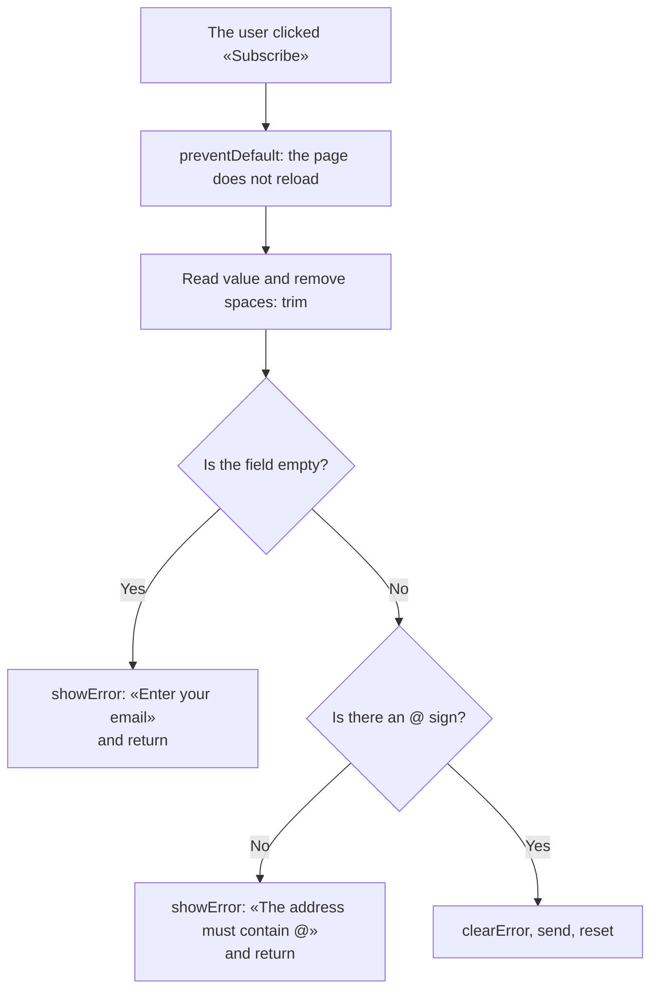
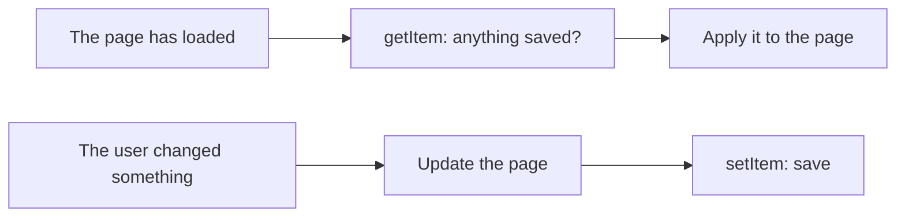
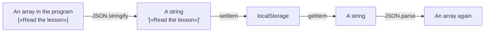
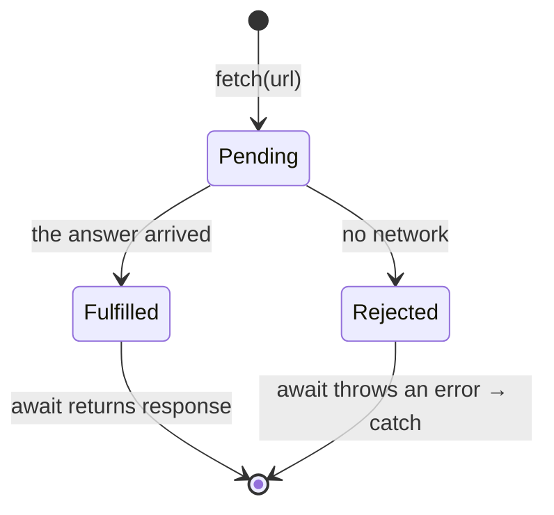
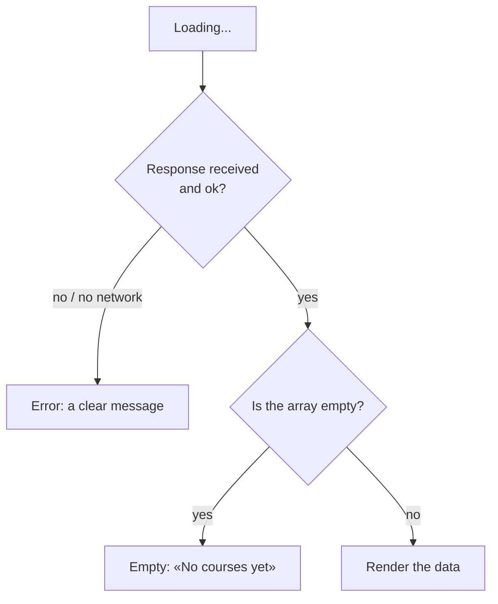

# Forms, storage and requests

[Contents](../../README.md) · [← Back](../../Lesson-8/en/Events.md) · [Next →](../../Lesson-10/en/Final%20project%20-%20an%20interactive%20website.md) · [RU](../ru/%D0%A4%D0%BE%D1%80%D0%BC%D1%8B%2C%20%D1%85%D1%80%D0%B0%D0%BD%D0%B5%D0%BD%D0%B8%D0%B5%20%D0%B4%D0%B0%D0%BD%D0%BD%D1%8B%D1%85%20%D0%B8%20%D0%B7%D0%B0%D0%BF%D1%80%D0%BE%D1%81%D1%8B.md) · [EN](Forms%2C%20storage%20and%20requests.md) · [UZ](../uz/Formalar%2C%20ma%27lumotlarni%20saqlash%20va%20so%27rovlar.md)

> **Link to lesson 8 and the HTML course:** in the HTML course forms sent data with a GET request and reloaded the page. In lesson 8 you learned to cancel the browser's action. Today the form will be checked and handled by JavaScript without reloading, data will be kept between visits, and a list will be loaded from a data file.

---

## Why you need this

You filled in half an order, accidentally refreshed the page - and everything was gone. Annoying. A good website:

- immediately and clearly points out what is wrong in a form, next to the right field;
- remembers your settings and drafts after a reload;
- loads data from a server and honestly shows "Loading..." and "Could not load".

These are the three topics of the lesson: **forms**, **`localStorage`** and **`fetch`**.

---

## What you will learn

- Handle form submission with the `submit` event without reloading the page.
- Check fields and show an accessible error message.
- Save data in the browser with `localStorage`.
- Turn arrays and objects into a string and back: `JSON.stringify`, `JSON.parse`.
- Catch errors: `try` / `catch`.
- Load data with `fetch` using `async` / `await`.
- Show the states "loading", "error", "empty".

---

## Review: 3 questions from lesson 8

1. What does `event.preventDefault()` do?
2. What does `input.value` hold?
3. How do you catch clicks on buttons added later with a single handler?

Answers are at the end of the lesson.

---

## Lesson plan

| Section | What we do |
| --- | --- |
| The `submit` event | A form without reloading |
| Checking fields | An error next to the field |
| Mini-task 1 | A subscription form |
| `localStorage` | The browser's memory |
| JSON | An array to a string and back |
| `try` / `catch` | An error does not break the page |
| Asynchrony | Why the program waits for an answer |

| `fetch` and `async` / `await` | Data from a file or a server |
| Three states | Loading, error, empty |
| Mini-task 2 | Remember the theme |
| Independent work | A to-do list that is saved |

---

## The `submit` event

The handler is attached **to the form**, not to the button: a form is submitted both by clicking the button and by pressing Enter in a field.

```html
<form id="subscribe-form" novalidate>
    <label for="email">Email</label>
    <input id="email" name="email" type="email" aria-describedby="email-error">
    <p id="email-error" class="error" hidden></p>
    <button type="submit">Subscribe</button>
</form>
```

```js
const form = document.querySelector("#subscribe-form");
const emailInput = document.querySelector("#email");

form.addEventListener("submit", (event) => {
    event.preventDefault();               // do not reload the page
    const email = emailInput.value.trim();
    console.log(`Subscription: ${email}`);
    form.reset();                         // clear all form fields
});
```

> **`novalidate`** turns off the browser's built-in hints so that the checks and error texts are yours - the same in every browser and in the website's language. Keep the `required` and `type="email"` attributes from the HTML course: they describe the meaning of the field.

---

## Checking fields

A good error message:

1. Stands **next to the field** and says what to fix: "Enter your email", not "Error".
2. Is **linked to the field** with `aria-describedby` - the screen reader reads it together with the label.
3. Marks the field with `aria-invalid="true"`, and focus moves into it.
4. Disappears once the error is fixed.

```js
const emailError = document.querySelector("#email-error");

function showError(input, errorElement, message) {
    errorElement.textContent = message;
    errorElement.hidden = false;
    input.setAttribute("aria-invalid", "true");
    input.focus();
}

function clearError(input, errorElement) {
    errorElement.textContent = "";
    errorElement.hidden = true;
    input.removeAttribute("aria-invalid");
}

form.addEventListener("submit", (event) => {
    event.preventDefault();
    const email = emailInput.value.trim();

    if (email === "") {
        showError(emailInput, emailError, "Enter your email");
        return;
    }
    if (!email.includes("@")) {
        showError(emailInput, emailError, "The address must contain @");
        return;
    }

    clearError(emailInput, emailError);
    console.log(`Subscribed: ${email}`);
    form.reset();
});
```

The early `return` from lesson 5 is very handy here: found an error - showed it and left.

```css
/* style.css */
.error {
    color: #b91c1c;
}

input[aria-invalid="true"] {
    border-color: #b91c1c;
}
```

> **Checking in the browser is for convenience, not protection.** Anyone can turn off JavaScript or send a request bypassing the form. Real data validation is always repeated on the server.

### How the check works: a diagram



**How to read the diagram.** The checks go one after another, like the `if` chain from Lesson 3. The first error found is shown, and the handler leaves at once with `return`. Only a form without errors reaches sending.

### Common checks

| What we check | Condition | Message |
| --- | --- | --- |
| The field is filled in | `value.trim() === ""` | "Enter your name" |
| Minimum length | `value.trim().length < 2` | "The name must be at least 2 letters" |
| A number in a range | `age < 7 \|\| age > 99`, where `age = Number(input.value)` | "Age - from 7 to 99" |
| It is a number at all | `Number.isNaN(age)` | "Enter your age in digits" |
| A checkbox is ticked | `!checkbox.checked` | "Please confirm your consent" |

A field's value is **always a string**, even for `<input type="number">`. Before comparing it with a number, convert it with `Number()` - Lesson 2.

---

## Mini-task 1

Add a "Name" field to the subscription form (`#name`, the error in `#name-error`). The name is required and must be at least 2 characters after `trim()`. Check the name first, then the email: focus should go to the first field with an error. The solution is in the "Answers" section.

---

## `localStorage`

`localStorage` is a small storage in the browser: "key - value" pairs that **survive a reload and closing the tab**. The data is visible only to this website in this browser.

```js
localStorage.setItem("theme", "dark");          // save
console.log(localStorage.getItem("theme"));     // "dark"
console.log(localStorage.getItem("nothing"));   // null - no such key
localStorage.removeItem("theme");               // remove
```

To look at the storage: DevTools → **Application** → **Local Storage**.

| Important | Why |
| --- | --- |
| It stores only **strings** | The number `5` is saved as `"5"` |
| About 5 MB per website | Not for images or large data |
| Visible to any script on the page | **Never** store passwords, tokens, card data |
| Tied to the browser | The data is not there on another device |

### A typical scenario: remember a setting

`localStorage` is almost always used in one pattern - **read on load, write on change**:



An example with a visit counter. Remember: storage gives back a string or `null`.

```js
const saved = localStorage.getItem("visits");     // "3" or null
const visits = saved === null ? 1 : Number(saved) + 1;
localStorage.setItem("visits", String(visits));
console.log(`You are here for time number ${visits}`);
```

| Page opening | `saved` | `visits` | What is written |
| --- | --- | --- | --- |
| First | `null` | 1 | `"1"` |
| Second | `"1"` | 2 | `"2"` |
| Third | `"2"` | 3 | `"3"` |

---

## JSON

You cannot put an array or an object into `localStorage` directly - only a string. They are converted with **JSON** - a text data format that looks like JavaScript objects:

```js
const todos = ["Read the lesson", "Do the task"];

const text = JSON.stringify(todos);
console.log(text);                    // '["Read the lesson","Do the task"]'
localStorage.setItem("todos", text);

const saved = JSON.parse(localStorage.getItem("todos"));
console.log(saved[0]);                // "Read the lesson"
```

| Method | Converts |
| --- | --- |
| `JSON.stringify(value)` | An array / object → a string |
| `JSON.parse(text)` | A string → an array / object |

The JSON format is stricter than JavaScript: keys and strings use only double quotes, no trailing comma, no comments. Data from servers comes in JSON too.

### The data's path there and back



**How to read the diagram.** In storage data lies only as a string. So before writing, the array is "packed" into a string, and after reading it is "unpacked" back.

| JavaScript object | JSON |
| --- | --- |
| `{ name: "Anna" }` - a key without quotes is fine | `{ "name": "Anna" }` - the key **only** in double quotes |
| `'text'` - single quotes are fine | Only `"text"` |
| A comma after the last element is fine | Not allowed |
| Functions and `undefined` can be stored | Not allowed: they disappear |

A common mistake is to forget `JSON.parse` and treat the string as an array: `saved[0]` gives the first **character** `"["`, not the first task.

---

## `try` / `catch`

What if `localStorage` holds a broken string - for example, it was edited by hand? `JSON.parse("{oops")` throws a `SyntaxError`, and the whole script stops. Dangerous code is wrapped in `try` / `catch`:

```js
function loadTodos() {
    try {
        const saved = JSON.parse(localStorage.getItem("todos"));
        return Array.isArray(saved) ? saved : [];
    } catch (error) {
        console.error("Could not read the tasks:", error);
        return [];
    }
}
```

| Part | What it does |
| --- | --- |
| `try { ... }` | Code that may throw an error |
| `catch (error) { ... }` | Runs only if an error happened; `error` holds its description |

After `catch` the program keeps working. `Array.isArray` checks that an array was actually read: `JSON.parse(null)` returns `null`, not an error.

You can "throw" your own error with `throw` - it will be useful below:

```js
throw new Error("The server responded with an error");
```

---

## Asynchrony: why the program waits

Until now every line ran instantly. A request to a server is different: the answer may come in 50 milliseconds, in 5 seconds or not at all. If the browser stood and waited, the page would "freeze": buttons would not press, scrolling would not work.

**In simple terms:** a promise is a pager in a café. You place an order, they give you a pager and **do not keep you at the counter**: you can sit down, talk, look at your phone. When the order is ready, the pager vibrates - and you pick up your food. If the dish has run out, the pager tells you that too.

| In the café | In JavaScript |
| --- | --- |
| Place an order | Call `fetch(url)` |
| Get a pager | Get a **promise** |
| Do your own things | The browser runs the rest of the code and reacts to clicks |
| The pager buzzes: the order is ready | The promise is **fulfilled** - the answer has arrived |
| The pager buzzes: no dish | The promise is **rejected** - a network error |
| Go and pick it up | `await` - get the result |

A promise has three states:



**How to read the diagram.** Right after `fetch` is called the promise is "pending". Then it moves into one of two final states and never changes again. `await` waits exactly for this move.

### The order of execution

The same effect as `setTimeout` in Lesson 5 - the code does **not stop** at the request:

```js
console.log("1. Starting the download");

fetch("data/courses.json").then(() => {
    console.log("3. The answer arrived");
});

console.log("2. The code goes on");
```

The console shows `1`, `2`, `3` - not in the order of the lines. The notation `.then(...)` is the older way to say "when the promise is fulfilled, call the function". In this course we use the clearer `await`: it lets you write asynchronous code from top to bottom, like ordinary code.

---

## `fetch` and `async` / `await`

`fetch` loads data from an address - from a server or from a file next to the page. Loading takes time, so `fetch` returns a **promise** - a promise of a result in the future. `await` inside a function declared with `async` helps wait for the result:

```js
async function loadCourses() {
    const response = await fetch("data/courses.json");
    const courses = await response.json();
    console.log(courses);
}

loadCourses();
```

| Part | What it does |
| --- | --- |
| `async function` | A function inside which you can wait |
| `await fetch(url)` | Wait for the server's response - the `response` object |
| `response.ok` | `true` if the status is 200–299 |
| `response.status` | The response code: `200`, `404`, `500` |
| `await response.json()` | Wait for the response body and parse it as JSON |

The `data/courses.json` file:

```json
[
    { "id": "html", "title": "HTML", "lessons": 10 },
    { "id": "css", "title": "CSS", "lessons": 10 },
    { "id": "js", "title": "JavaScript", "lessons": 10 }
]
```

> **`fetch` does not work with `file://`.** If you open the page by double-clicking it, the browser blocks the request. Run a local server: in VS Code - the **Live Server** extension (the "Go Live" button). On GitHub Pages everything just works.

### What happens inside `loadCourses`: step by step

| Step | Line | What happens | What the rest of the page does |
| --- | --- | --- | --- |
| 1 | `loadCourses();` | The function starts | - |
| 2 | `await fetch(...)` | The request is sent, the function is **paused** | Works: clicks, scrolling, other code |
| 3 | The answer arrives | The function continues, `response` holds the answer object | - |
| 4 | `await response.json()` | The body is read and turned into an array | Works again |
| 5 | `console.log(courses)` | The array is ready | - |

The pause applies **only** to this function. That is why `await` is allowed only inside a function marked `async`: the browser must know which function may be paused.

### What is in `response`

| Property or method | Example value | Why |
| --- | --- | --- |
| `response.ok` | `true` | A quick check: all is well |
| `response.status` | `200`, `404`, `500` | The exact response code |
| `await response.json()` | An array or an object | The data from JSON |
| `await response.text()` | A string | If plain text arrived |

| Code | Meaning | What to tell the user |
| --- | --- | --- |
| `200` | All is fine | Show the data |
| `404` | Address not found | "Data not found" |
| `500` | An error on the server | "The service is temporarily unavailable" |

---

## Three states

While data is loading, and the network can be slow or unavailable, the user must understand what is happening:

```js
async function loadCourses() {
    const status = document.querySelector("#courses-status");
    status.textContent = "Loading...";

    try {
        const response = await fetch("data/courses.json");
        if (!response.ok) {
            throw new Error(`Error ${response.status}`);
        }
        const courses = await response.json();

        if (courses.length === 0) {
            status.textContent = "No courses yet";
            return;
        }

        status.textContent = "";
        renderCourses(courses);          // the function from lesson 7
    } catch (error) {
        status.textContent = "Could not load the courses. Try refreshing the page.";
        console.error(error);
    }
}

loadCourses();
```



`fetch` itself only throws an error on a network problem. A `404` response is "a response with an error successfully received", so we check `response.ok` by hand and throw an error with `throw` to get into `catch`.

Give the status element `role="status"` - the screen reader will announce "Loading..." and the error message.

### Try to break it

1. Remove `event.preventDefault()` from the `submit` handler. What happens to the page and to the console output?
2. Save the array without `JSON.stringify`: `localStorage.setItem("todos", todos)`. Look in Application at what was written.
3. Remove `await` before `fetch` and print `response`. What did you see instead of the answer?
4. Change the address to `data/coursess.json`. Which of the three states did the page show, and what is the response `status`?
5. In DevTools → **Network** choose **Offline** and reload the page. Did `catch` fire?

### Typical beginner mistakes

| Mistake | What you get | How to fix |
| --- | --- | --- |
| The handler is on the button, not the form | Enter in a field does not send the form | `form.addEventListener("submit", ...)` |
| No `preventDefault()` | The page reloads, the data is lost | The first line of the handler |
| `input.value` without `trim()` | Spaces pass the emptiness check | `input.value.trim()` |
| A number from a field without `Number()` | Comparison and addition work as with strings | `Number(input.value)` |
| `setItem("todos", todos)` with an array | The string `"a,b"` was written, the structure is lost | `JSON.stringify(todos)` |
| `getItem` without `JSON.parse` | We treat a string as an array | `JSON.parse(...)` inside `try / catch` |
| No `response.ok` check | A `404` answer counts as success | `if (!response.ok) throw new Error(...)` |
| `await` in an ordinary function | `SyntaxError` | `async function ...` |
| The page is opened as `file://` | `fetch` is blocked | Live Server or GitHub Pages |
| A password or token in `localStorage` | Any script on the page can read it | Do not keep secrets in the browser |

---

## Mini-task 2

Improve the theme switch from lesson 8: on click save the chosen theme in `localStorage` under the key `theme` (`"dark"` or `"light"`), and restore it when the page loads. The solution is in the "Answers" section.

---

## Lesson summary: cheat sheet

| Task | Code |
| --- | --- |
| Handle submission | `form.addEventListener("submit", (event) => { event.preventDefault(); ... })` |
| A value without spaces | `input.value.trim()` |
| An error at a field | Text into the error element, `hidden = false`, `aria-invalid="true"`, `focus()` |
| Clear the form | `form.reset()` |
| Save / read | `localStorage.setItem(k, v)` / `getItem(k)` |
| Array ↔ string | `JSON.stringify(arr)` / `JSON.parse(text)` |
| Catch an error | `try { ... } catch (error) { ... }` |
| Load data | `const response = await fetch(url); const data = await response.json();` |
| Check the response | `if (!response.ok) { throw new Error(...); }` |

---

## Independent work

### Part 1. IDE task (graded by the platform)

The page: a form `#todo-form` with a field `#todo-input` and an error element `#todo-error`, a message `#todo-empty` and an empty list `#todo-list`. Make a to-do list:

1. **Loading.** A function `loadTodos()` reads an array of strings from `localStorage` under the key `"todos"`. If there is no key or the data is broken - an empty array. Use `try` / `catch`.
2. **Rendering.** `renderTodos()` outputs each task as `li.todo` containing a `span.todo__title` with the text and a `button.todo__delete` with the text `Delete`. `#todo-empty` is visible only when there are no tasks.
3. **Adding.** On form submission: no reload; the value after `trim()`; if it is empty - the text `Enter a task` in `#todo-error`, the error is visible, the field has `aria-invalid="true"`. Otherwise the task is added and saved, the field is cleared, the error is hidden and `aria-invalid` is removed.
4. **Deleting.** One handler on `#todo-list`: the delete button removes its task from the list and from `localStorage`.

What the platform checks: the empty initial state; adding with spaces trimmed; that the reload is cancelled; writing to `localStorage`; the error on empty input and its disappearance; loading saved tasks; resilience to broken data; deleting the first and the last task.

### Part 2. Project on your computer

1. Handle your website's form from the HTML course: field checks, messages at the fields, a thank-you note after submission instead of a reload.
2. Save the chosen theme or a draft of the form's message in `localStorage`.
3. Move the data array from lesson 6 into a `data/*.json` file and load it with `fetch` and the three states.
4. Test the error: temporarily break the file name in `fetch` and check that the user sees a clear message.

### Acceptance criteria

- [ ] The IDE task is accepted.
- [ ] The form does not reload the page; errors stand at the fields and are linked to them with `aria-describedby`.
- [ ] Data in `localStorage` is saved with `JSON.stringify` and read inside `try` / `catch`.
- [ ] `localStorage` holds no passwords or personal data.
- [ ] Loading with `fetch` shows the "loading", "error", "empty" states.
- [ ] The page with `fetch` is run through a local server.

---

## Self-check questions

1. Why is the `submit` handler attached to the form and not to the button?
2. Why does the submission handler need `event.preventDefault()`?
3. What are the four features of an accessible error message?
4. Why are browser checks not enough to protect data?
5. What happens to data in `localStorage` after a reload?
6. Why is an array converted with `JSON.stringify` before saving?
7. What does `catch` run, and what happens to the program after it?
8. What are `async` and `await` for?
9. Why does `fetch` not throw an error on a 404 response, and how do you handle it?
10. Why does `fetch` not work when the page is opened by double-clicking?

After the questions, take the **lesson test** on the platform: 12 questions, pass mark 70%.

---

## What's next

You now know everything to make a website interactive. In lesson 10 we will bring the knowledge together in the **final project**: split the code into modules, bring the website from the HTML and CSS courses to life and publish the update.

---

## Answers

**Review**

1. Cancels the browser's default action.
2. The field's current value - a string.
3. Delegation: a handler on the parent and `event.target.closest(...)`.

**Mini-task 1**

```js
const nameInput = document.querySelector("#name");
const nameError = document.querySelector("#name-error");

form.addEventListener("submit", (event) => {
    event.preventDefault();
    const name = nameInput.value.trim();
    const email = emailInput.value.trim();

    clearError(nameInput, nameError);
    clearError(emailInput, emailError);

    if (name.length < 2) {
        showError(nameInput, nameError, "The name must be at least 2 characters");
        return;
    }
    if (!email.includes("@")) {
        showError(emailInput, emailError, "Enter an email with @");
        return;
    }

    console.log(`Subscription: ${name}, ${email}`);
    form.reset();
});
```

**Mini-task 2**

```js
const themeButton = document.querySelector("#theme-toggle");

function applyTheme(theme) {
    const isDark = theme === "dark";
    document.body.classList.toggle("theme-dark", isDark);
    themeButton.setAttribute("aria-pressed", String(isDark));
}

applyTheme(localStorage.getItem("theme") ?? "light");

themeButton.addEventListener("click", () => {
    const next = document.body.classList.contains("theme-dark") ? "light" : "dark";
    localStorage.setItem("theme", next);
    applyTheme(next);
});
```

The `??` operator substitutes the value on the right if the left side is `null` or `undefined` - here, if no theme has been saved yet.

**Self-check questions**

1. A form is submitted both with the button and with Enter in a field - the `submit` event catches both.
2. So that the page does not reload and we handle the data ourselves.
3. Next to the field and clear, linked with `aria-describedby`, the field has `aria-invalid="true"` and focus, and it disappears after the fix.
4. Browser checks can be bypassed; the server must check the data itself.
5. It stays - until code or the user deletes it.
6. `localStorage` stores only strings.
7. The `catch` code runs if `try` throws an error; the program then continues.
8. `fetch` does not return the result immediately; `await` waits for it, and `await` can only be used inside an `async` function.
9. A 404 is a received response, not a network failure. You need to check `response.ok` and throw an error with `throw`.
10. The browser blocks requests from `file://` pages; a local server is needed.

---

[Contents](../../README.md) · [← Back](../../Lesson-8/en/Events.md) · [Next →](../../Lesson-10/en/Final%20project%20-%20an%20interactive%20website.md) · [RU](../ru/%D0%A4%D0%BE%D1%80%D0%BC%D1%8B%2C%20%D1%85%D1%80%D0%B0%D0%BD%D0%B5%D0%BD%D0%B8%D0%B5%20%D0%B4%D0%B0%D0%BD%D0%BD%D1%8B%D1%85%20%D0%B8%20%D0%B7%D0%B0%D0%BF%D1%80%D0%BE%D1%81%D1%8B.md) · [EN](Forms%2C%20storage%20and%20requests.md) · [UZ](../uz/Formalar%2C%20ma%27lumotlarni%20saqlash%20va%20so%27rovlar.md)
