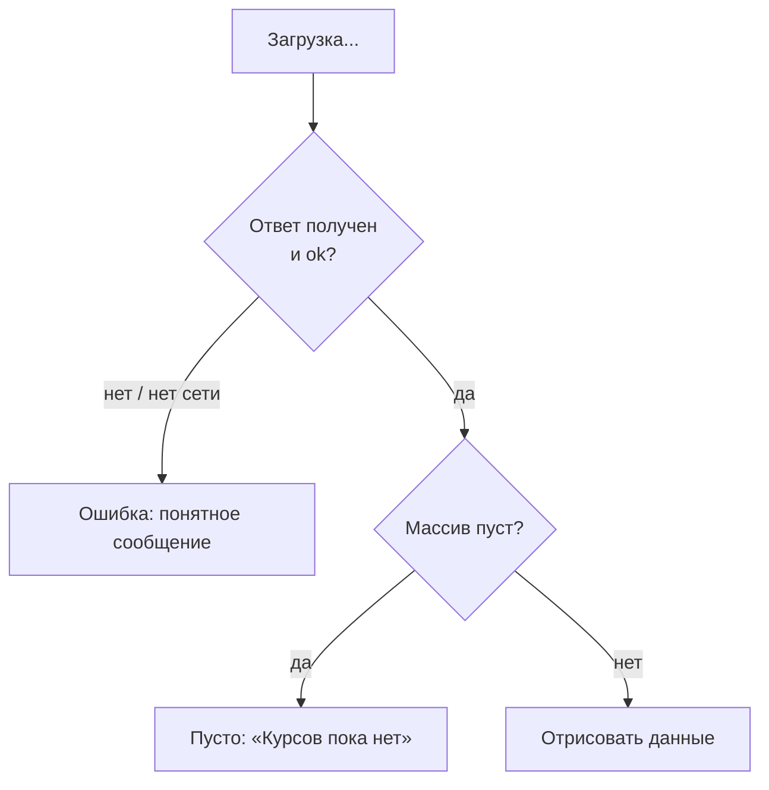

# Формы, хранение данных и запросы

[Содержание](../../README.md) · [← Назад](../../Lesson-8/ru/События.md) · [Вперёд →](../../Lesson-10/ru/Итоговый%20проект%20-%20интерактивный%20сайт.md) · [RU](%D0%A4%D0%BE%D1%80%D0%BC%D1%8B%2C%20%D1%85%D1%80%D0%B0%D0%BD%D0%B5%D0%BD%D0%B8%D0%B5%20%D0%B4%D0%B0%D0%BD%D0%BD%D1%8B%D1%85%20%D0%B8%20%D0%B7%D0%B0%D0%BF%D1%80%D0%BE%D1%81%D1%8B.md) · [EN](../en/Forms%2C%20storage%20and%20requests.md) · [UZ](../uz/Formalar%2C%20ma%27lumotlarni%20saqlash%20va%20so%27rovlar.md)

> **Связь с уроком 8 и курсом HTML:** в курсе HTML формы отправляли данные GET-запросом и перезагружали страницу. В уроке 8 вы научились отменять действие браузера. Сегодня форма будет проверяться и обрабатываться JavaScript без перезагрузки, данные - сохраняться между визитами, а список - загружаться из файла с данными.

---

## Зачем это вам

Вы ввели половину заказа, случайно обновили страницу - и всё пропало. Обидно. Хороший сайт:

- сразу и понятно подсказывает, что не так в форме, рядом с нужным полем;
- помнит ваши настройки и черновики после перезагрузки;
- загружает данные с сервера и честно показывает «Загрузка...» и «Не удалось загрузить».

Это три темы урока: **формы**, **`localStorage`** и **`fetch`**.

---

## Чему вы научитесь

- Обрабатывать отправку формы событием `submit` без перезагрузки страницы.
- Проверять поля и показывать доступное сообщение об ошибке.
- Сохранять данные в браузере через `localStorage`.
- Превращать массивы и объекты в строку и обратно: `JSON.stringify`, `JSON.parse`.
- Перехватывать ошибки: `try` / `catch`.
- Загружать данные через `fetch` с `async` / `await`.
- Показывать состояния «загрузка», «ошибка», «пусто».

---

## Повторение: 3 вопроса из урока 8

1. Что делает `event.preventDefault()`?
2. Что содержит `input.value`?
3. Как с помощью одного обработчика ловить клики по кнопкам, добавленным позже?

Ответы - в конце урока.

---

## План урока

| Раздел | Что делаем |
| --- | --- |
| Событие `submit` | Форма без перезагрузки |
| Проверка полей | Ошибка рядом с полем |
| Мини-задание 1 | Форма подписки |
| `localStorage` | Память браузера |
| JSON | Массив в строку и обратно |
| `try` / `catch` | Ошибка не ломает страницу |
| `fetch` и `async` / `await` | Данные из файла или с сервера |
| Три состояния | Загрузка, ошибка, пусто |
| Мини-задание 2 | Запомнить тему |
| Самостоятельная работа | Список дел с сохранением |

---

## Событие `submit`

Обработчик вешают **на форму**, а не на кнопку: форма отправляется и кликом по кнопке, и клавишей Enter в поле.

```html
<form id="subscribe-form" novalidate>
    <label for="email">Email</label>
    <input id="email" name="email" type="email" aria-describedby="email-error">
    <p id="email-error" class="error" hidden></p>
    <button type="submit">Подписаться</button>
</form>
```

```js
const form = document.querySelector("#subscribe-form");
const emailInput = document.querySelector("#email");

form.addEventListener("submit", (event) => {
    event.preventDefault();               // не перезагружать страницу
    const email = emailInput.value.trim();
    console.log(`Подписка: ${email}`);
    form.reset();                         // очистить все поля формы
});
```

> **`novalidate`** отключает встроенные подсказки браузера, чтобы проверка и текст ошибок были вашими - одинаковыми во всех браузерах и на языке сайта. Атрибуты `required`, `type="email"` из курса HTML оставьте: они описывают смысл поля.

---

## Проверка полей

Хорошее сообщение об ошибке:

1. Стоит **рядом с полем** и говорит, что исправить: «Введите email», а не «Ошибка».
2. **Связано с полем** через `aria-describedby` - читалка прочитает его вместе с подписью.
3. Поле помечено `aria-invalid="true"`, а фокус переходит в него.
4. Исчезает, когда ошибка исправлена.

```js
const emailError = document.querySelector("#email-error");

function showError(input, errorElement, message) {
    errorElement.textContent = message;
    errorElement.hidden = false;
    input.setAttribute("aria-invalid", "true");
    input.focus();
}

function clearError(input, errorElement) {
    errorElement.textContent = "";
    errorElement.hidden = true;
    input.removeAttribute("aria-invalid");
}

form.addEventListener("submit", (event) => {
    event.preventDefault();
    const email = emailInput.value.trim();

    if (email === "") {
        showError(emailInput, emailError, "Введите email");
        return;
    }
    if (!email.includes("@")) {
        showError(emailInput, emailError, "В адресе должен быть символ @");
        return;
    }

    clearError(emailInput, emailError);
    console.log(`Подписка оформлена: ${email}`);
    form.reset();
});
```

Ранний `return` из урока 5 здесь очень удобен: нашли ошибку - показали и вышли.

```css
/* style.css */
.error {
    color: #b91c1c;
}

input[aria-invalid="true"] {
    border-color: #b91c1c;
}
```

> **Проверка в браузере - для удобства, не для защиты.** Любой может отключить JavaScript или отправить запрос в обход формы. Настоящая проверка данных всегда повторяется на сервере.

---

## Мини-задание 1

Добавьте в форму подписки поле «Имя» (`#name`, ошибка в `#name-error`). Имя обязательно и должно быть не короче 2 символов после `trim()`. Проверьте сначала имя, потом email: фокус должен попасть в первое поле с ошибкой. Решение - в разделе «Ответы».

---

## `localStorage`

`localStorage` - небольшое хранилище в браузере: пары «ключ - значение», которые **сохраняются после перезагрузки и закрытия вкладки**. Данные видны только этому сайту в этом браузере.

```js
localStorage.setItem("theme", "dark");          // сохранить
console.log(localStorage.getItem("theme"));     // "dark"
console.log(localStorage.getItem("nothing"));   // null - ключа нет
localStorage.removeItem("theme");               // удалить
```

Посмотреть хранилище: DevTools → **Application** → **Local Storage**.

| Важно | Почему |
| --- | --- |
| Хранит только **строки** | Число `5` сохранится как `"5"` |
| Около 5 МБ на сайт | Не для картинок и больших данных |
| Видно любому скрипту на странице | **Никогда** не храните пароли, токены, данные карт |
| Привязано к браузеру | На другом устройстве данных нет |

---

## JSON

Массив или объект нельзя положить в `localStorage` напрямую - только строку. Превращают через **JSON** - текстовый формат данных, который выглядит как объекты JavaScript:

```js
const todos = ["Прочитать урок", "Сделать задание"];

const text = JSON.stringify(todos);
console.log(text);                    // '["Прочитать урок","Сделать задание"]'
localStorage.setItem("todos", text);

const saved = JSON.parse(localStorage.getItem("todos"));
console.log(saved[0]);                // "Прочитать урок"
```

| Метод | Превращает |
| --- | --- |
| `JSON.stringify(value)` | Массив / объект → строку |
| `JSON.parse(text)` | Строку → массив / объект |

Формат JSON строже JavaScript: ключи и строки - только в двойных кавычках, без запятой в конце, без комментариев. В JSON же приходят данные с серверов.

---

## `try` / `catch`

Что если в `localStorage` лежит испорченная строка - например, её отредактировали вручную? `JSON.parse("{oops")` выбросит `SyntaxError`, и весь скрипт остановится. Опасный код оборачивают в `try` / `catch`:

```js
function loadTodos() {
    try {
        const saved = JSON.parse(localStorage.getItem("todos"));
        return Array.isArray(saved) ? saved : [];
    } catch (error) {
        console.error("Не удалось прочитать задачи:", error);
        return [];
    }
}
```

| Часть | Что делает |
| --- | --- |
| `try { ... }` | Код, который может выбросить ошибку |
| `catch (error) { ... }` | Выполняется, только если ошибка случилась; в `error` - её описание |

После `catch` программа продолжает работать. `Array.isArray` проверяет, что прочитан именно массив: `JSON.parse(null)` вернёт `null`, а не ошибку.

Свою ошибку можно «выбросить» командой `throw` - пригодится ниже:

```js
throw new Error("Сервер ответил ошибкой");
```

---

## `fetch` и `async` / `await`

`fetch` загружает данные по адресу - с сервера или из файла рядом со страницей. Загрузка занимает время, поэтому `fetch` возвращает **промис** - обещание результата в будущем. Дождаться результата помогает `await` внутри функции, объявленной с `async`:

```js
async function loadCourses() {
    const response = await fetch("data/courses.json");
    const courses = await response.json();
    console.log(courses);
}

loadCourses();
```

| Часть | Что делает |
| --- | --- |
| `async function` | Функция, внутри которой можно ждать |
| `await fetch(url)` | Ждём ответ сервера - объект `response` |
| `response.ok` | `true`, если статус 200–299 |
| `response.status` | Код ответа: `200`, `404`, `500` |
| `await response.json()` | Ждём и разбираем тело ответа как JSON |

Файл `data/courses.json`:

```json
[
    { "id": "html", "title": "HTML", "lessons": 10 },
    { "id": "css", "title": "CSS", "lessons": 10 },
    { "id": "js", "title": "JavaScript", "lessons": 10 }
]
```

> **`fetch` не работает с `file://`.** Если открыть страницу двойным кликом, браузер заблокирует запрос. Запустите локальный сервер: в VS Code - расширение **Live Server** (кнопка «Go Live»). На GitHub Pages всё работает само.

---

## Три состояния

Пока данные грузятся, а сеть бывает медленной или недоступной, пользователь должен понимать, что происходит:

```js
async function loadCourses() {
    const status = document.querySelector("#courses-status");
    status.textContent = "Загрузка...";

    try {
        const response = await fetch("data/courses.json");
        if (!response.ok) {
            throw new Error(`Ошибка ${response.status}`);
        }
        const courses = await response.json();

        if (courses.length === 0) {
            status.textContent = "Курсов пока нет";
            return;
        }

        status.textContent = "";
        renderCourses(courses);          // функция из урока 7
    } catch (error) {
        status.textContent = "Не удалось загрузить курсы. Попробуйте обновить страницу.";
        console.error(error);
    }
}

loadCourses();
```



`fetch` сам выбрасывает ошибку только при проблеме сети. Ответ `404` - это «успешно получен ответ с ошибкой», поэтому `response.ok` проверяем вручную и выбрасываем ошибку через `throw`, чтобы попасть в `catch`.

Добавьте элементу статуса атрибут `role="status"` - экранная читалка объявит «Загрузка...» и сообщение об ошибке.

---

## Мини-задание 2

Доработайте переключатель темы из урока 8: при клике сохраняйте выбранную тему в `localStorage` под ключом `theme` (`"dark"` или `"light"`), а при загрузке страницы восстанавливайте её. Решение - в разделе «Ответы».

---

## Итоги урока: шпаргалка

| Задача | Запись |
| --- | --- |
| Обработать отправку | `form.addEventListener("submit", (event) => { event.preventDefault(); ... })` |
| Значение без пробелов | `input.value.trim()` |
| Ошибка у поля | Текст в элемент ошибки, `hidden = false`, `aria-invalid="true"`, `focus()` |
| Очистить форму | `form.reset()` |
| Сохранить / прочитать | `localStorage.setItem(k, v)` / `getItem(k)` |
| Массив ↔ строка | `JSON.stringify(arr)` / `JSON.parse(text)` |
| Перехватить ошибку | `try { ... } catch (error) { ... }` |
| Загрузить данные | `const response = await fetch(url); const data = await response.json();` |
| Проверить ответ | `if (!response.ok) { throw new Error(...); }` |

---

## Самостоятельная работа

### Часть 1. Задание в IDE (засчитывается платформой)

Страница: форма `#todo-form` с полем `#todo-input` и элементом ошибки `#todo-error`, сообщение `#todo-empty` и пустой список `#todo-list`. Сделайте список дел:

1. **Загрузка.** Функция `loadTodos()` читает массив строк из `localStorage` по ключу `"todos"`. Если ключа нет или данные испорчены - пустой массив. Используйте `try` / `catch`.
2. **Отрисовка.** `renderTodos()` выводит каждую задачу как `li.todo`, внутри - `span.todo__title` с текстом и кнопка `button.todo__delete` с текстом `Удалить`. `#todo-empty` виден, только когда задач нет.
3. **Добавление.** При отправке формы: без перезагрузки; значение после `trim()`; если пусто - в `#todo-error` текст `Введите задачу`, ошибка видна, у поля `aria-invalid="true"`. Иначе задача добавляется, сохраняется, поле очищается, ошибка скрывается, `aria-invalid` убирается.
4. **Удаление.** Один обработчик на `#todo-list`: кнопка удаления убирает свою задачу из списка и из `localStorage`.

Что проверяет платформа: пустое начальное состояние; добавление с обрезкой пробелов; отмену перезагрузки; запись в `localStorage`; ошибку при пустом вводе и её исчезновение; загрузку сохранённых задач; устойчивость к испорченным данным; удаление первой и последней задачи.

### Часть 2. Проект на компьютере

1. Обработайте форму своего сайта из курса HTML: проверка полей, сообщения у полей, благодарность после отправки вместо перезагрузки.
2. Сохраните в `localStorage` выбранную тему или черновик сообщения формы.
3. Перенесите массив данных из урока 6 в файл `data/*.json` и загрузите его через `fetch` с тремя состояниями.
4. Проверьте ошибку: временно испортите имя файла в `fetch` и убедитесь, что пользователь видит понятное сообщение.

### Критерии готовности

- [ ] Задание в IDE засчитано.
- [ ] Форма не перезагружает страницу, ошибки стоят у полей и связаны с ними через `aria-describedby`.
- [ ] Данные в `localStorage` сохраняются через `JSON.stringify` и читаются в `try` / `catch`.
- [ ] В `localStorage` нет паролей и личных данных.
- [ ] Загрузка через `fetch` показывает состояния «загрузка», «ошибка», «пусто».
- [ ] Страница с `fetch` запускается через локальный сервер.

---

## Вопросы для самопроверки

1. Почему обработчик `submit` вешают на форму, а не на кнопку?
2. Зачем в обработчике отправки `event.preventDefault()`?
3. Какие четыре признака у доступного сообщения об ошибке?
4. Почему проверки в браузере недостаточно для защиты данных?
5. Что произойдёт после перезагрузки с данными в `localStorage`?
6. Почему массив перед сохранением превращают через `JSON.stringify`?
7. Что выполнит `catch` и что будет с программой после него?
8. Зачем нужны `async` и `await`?
9. Почему `fetch` не выбросит ошибку при ответе 404 и как это обработать?
10. Почему `fetch` не работает при открытии страницы двойным кликом?

После вопросов пройдите **тест урока** на платформе: 12 вопросов, порог 70%.

---

## Что дальше

Вы знаете всё, чтобы сделать сайт интерактивным. В уроке 10 соберём знания в **итоговый проект**: разложим код по модулям, оживим сайт из курсов HTML и CSS и опубликуем обновление.

---

## Ответы

**Повторение**

1. Отменяет действие браузера по умолчанию.
2. Текущее значение поля - строку.
3. Делегирование: обработчик на родителе и `event.target.closest(...)`.

**Мини-задание 1**

```js
const nameInput = document.querySelector("#name");
const nameError = document.querySelector("#name-error");

form.addEventListener("submit", (event) => {
    event.preventDefault();
    const name = nameInput.value.trim();
    const email = emailInput.value.trim();

    clearError(nameInput, nameError);
    clearError(emailInput, emailError);

    if (name.length < 2) {
        showError(nameInput, nameError, "Имя - не короче 2 символов");
        return;
    }
    if (!email.includes("@")) {
        showError(emailInput, emailError, "Введите email с символом @");
        return;
    }

    console.log(`Подписка: ${name}, ${email}`);
    form.reset();
});
```

**Мини-задание 2**

```js
const themeButton = document.querySelector("#theme-toggle");

function applyTheme(theme) {
    const isDark = theme === "dark";
    document.body.classList.toggle("theme-dark", isDark);
    themeButton.setAttribute("aria-pressed", String(isDark));
}

applyTheme(localStorage.getItem("theme") ?? "light");

themeButton.addEventListener("click", () => {
    const next = document.body.classList.contains("theme-dark") ? "light" : "dark";
    localStorage.setItem("theme", next);
    applyTheme(next);
});
```

Оператор `??` подставляет значение справа, если слева `null` или `undefined`, - здесь, если тема ещё не сохранена.

**Вопросы для самопроверки**

1. Форма отправляется и кнопкой, и клавишей Enter в поле - событие `submit` ловит оба случая.
2. Чтобы страница не перезагрузилась и мы обработали данные сами.
3. Рядом с полем и понятно, связано через `aria-describedby`, поле с `aria-invalid="true"` и в фокусе, исчезает после исправления.
4. Проверку в браузере можно обойти; сервер должен проверять данные сам.
5. Они сохранятся - до удаления кодом или пользователем.
6. `localStorage` хранит только строки.
7. Код из `catch` выполнится при ошибке в `try`; программа продолжит работу дальше.
8. `fetch` возвращает результат не сразу; `await` ждёт его, а использовать `await` можно только в `async`-функции.
9. 404 - это полученный ответ, а не сбой сети. Нужно проверить `response.ok` и выбросить ошибку через `throw`.
10. Браузер блокирует запросы со страниц `file://`; нужен локальный сервер.

---

[Содержание](../../README.md) · [← Назад](../../Lesson-8/ru/События.md) · [Вперёд →](../../Lesson-10/ru/Итоговый%20проект%20-%20интерактивный%20сайт.md) · [RU](%D0%A4%D0%BE%D1%80%D0%BC%D1%8B%2C%20%D1%85%D1%80%D0%B0%D0%BD%D0%B5%D0%BD%D0%B8%D0%B5%20%D0%B4%D0%B0%D0%BD%D0%BD%D1%8B%D1%85%20%D0%B8%20%D0%B7%D0%B0%D0%BF%D1%80%D0%BE%D1%81%D1%8B.md) · [EN](../en/Forms%2C%20storage%20and%20requests.md) · [UZ](../uz/Formalar%2C%20ma%27lumotlarni%20saqlash%20va%20so%27rovlar.md)
