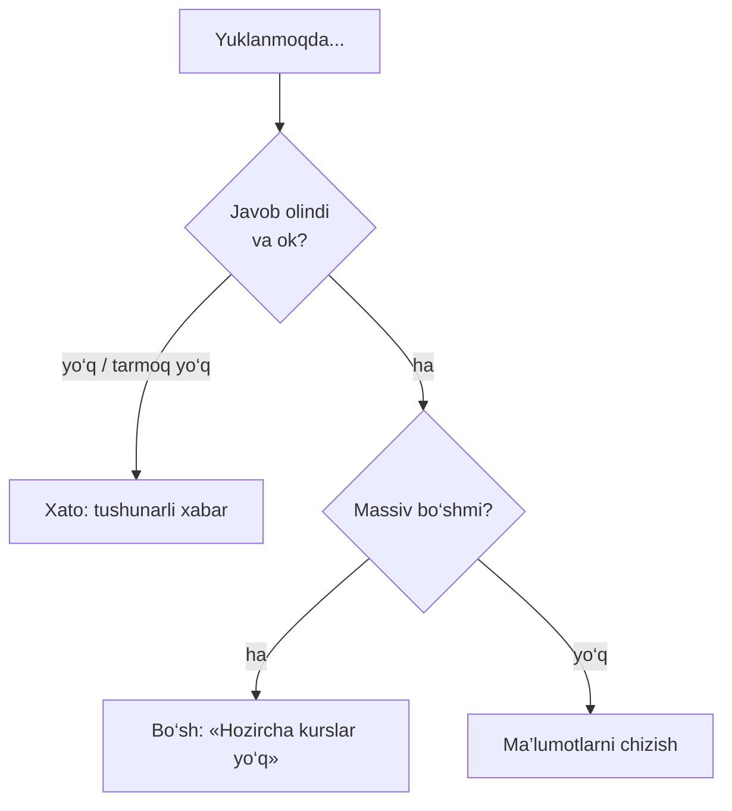

# Formalar, ma’lumotlarni saqlash va so‘rovlar

[Mundarija](../../README.md) · [← Orqaga](../../Lesson-8/uz/Hodisalar.md) · [Keyingi →](../../Lesson-10/uz/Yakuniy%20loyiha%20-%20interaktiv%20sayt.md) · [RU](../ru/%D0%A4%D0%BE%D1%80%D0%BC%D1%8B%2C%20%D1%85%D1%80%D0%B0%D0%BD%D0%B5%D0%BD%D0%B8%D0%B5%20%D0%B4%D0%B0%D0%BD%D0%BD%D1%8B%D1%85%20%D0%B8%20%D0%B7%D0%B0%D0%BF%D1%80%D0%BE%D1%81%D1%8B.md) · [EN](../en/Forms%2C%20storage%20and%20requests.md) · [UZ](Formalar%2C%20ma%27lumotlarni%20saqlash%20va%20so%27rovlar.md)

> **8-dars va HTML kursi bilan bog‘liqlik:** HTML kursida formalar ma’lumotni GET-so‘rov bilan yuborib, sahifani qayta yuklardi. 8-darsda brauzer amalini bekor qilishni o‘rgandingiz. Bugun forma JavaScript tomonidan qayta yuklanmasdan tekshiriladi va qayta ishlanadi, ma’lumotlar tashriflar orasida saqlanadi, ro‘yxat esa ma’lumotlar faylidan yuklanadi.

---

## Bu sizga nima uchun kerak

Buyurtmaning yarmini to‘ldirdingiz, tasodifan sahifani yangiladingiz - va hammasi yo‘qoldi. Achinarli. Yaxshi sayt:

- formada nima noto‘g‘ri ekanini darhol va tushunarli qilib, kerakli maydon yonida aytadi;
- qayta yuklangandan keyin sozlamalar va qoralamalaringizni eslab qoladi;
- serverdan ma’lumot yuklaydi va «Yuklanmoqda...» hamda «Yuklab bo‘lmadi» ni halol ko‘rsatadi.

Bu darsning uch mavzusi: **formalar**, **`localStorage`** va **`fetch`**.

---

## Nimani o‘rganasiz

- Forma yuborilishini `submit` hodisasi bilan sahifani qayta yuklamasdan qayta ishlash.
- Maydonlarni tekshirish va qulay xato xabarini ko‘rsatish.
- Ma’lumotlarni brauzerda `localStorage` orqali saqlash.
- Massiv va obyektlarni satrga va orqaga aylantirish: `JSON.stringify`, `JSON.parse`.
- Xatolarni ushlash: `try` / `catch`.
- Ma’lumotlarni `fetch` orqali `async` / `await` bilan yuklash.
- «Yuklanmoqda», «xato», «bo‘sh» holatlarini ko‘rsatish.

---

## Takrorlash: 8-darsdan 3 savol

1. `event.preventDefault()` nima qiladi?
2. `input.value` nimani saqlaydi?
3. Keyin qo‘shilgan tugmalarga bosishni bitta ishlov beruvchi bilan qanday ushlash mumkin?

Javoblar - dars oxirida.

---

## Reja

| Bo‘lim | Nima qilamiz |
| --- | --- |
| `submit` hodisasi | Qayta yuklanmaydigan forma |
| Maydonlarni tekshirish | Maydon yonidagi xato |
| Mini-topshiriq 1 | Obuna formasi |
| `localStorage` | Brauzer xotirasi |
| JSON | Massivni satrga va orqaga |
| `try` / `catch` | Xato sahifani buzmaydi |
| `fetch` va `async` / `await` | Fayl yoki serverdan ma’lumot |
| Uch holat | Yuklanmoqda, xato, bo‘sh |
| Mini-topshiriq 2 | Mavzuni eslab qolish |
| Mustaqil ish | Saqlanadigan vazifalar ro‘yxati |

---

## `submit` hodisasi

Ishlov beruvchi tugmaga emas, **formaga** qo‘yiladi: forma tugmani bosish bilan ham, maydonda Enter bosish bilan ham yuboriladi.

```html
<form id="subscribe-form" novalidate>
    <label for="email">Email</label>
    <input id="email" name="email" type="email" aria-describedby="email-error">
    <p id="email-error" class="error" hidden></p>
    <button type="submit">Obuna bo‘lish</button>
</form>
```

```js
const form = document.querySelector("#subscribe-form");
const emailInput = document.querySelector("#email");

form.addEventListener("submit", (event) => {
    event.preventDefault();               // sahifani qayta yuklamaslik
    const email = emailInput.value.trim();
    console.log(`Obuna: ${email}`);
    form.reset();                         // formaning barcha maydonlarini tozalash
});
```

> **`novalidate`** brauzerning o‘rnatilgan maslahatlarini o‘chiradi - shunda tekshiruv va xato matnlari sizniki bo‘ladi: barcha brauzerlarda bir xil va sayt tilida. HTML kursidagi `required`, `type="email"` atributlarini qoldiring: ular maydon ma’nosini tasvirlaydi.

---

## Maydonlarni tekshirish

Yaxshi xato xabari:

1. **Maydon yonida** turadi va nimani tuzatish kerakligini aytadi: «Xato» emas, «Email kiriting».
2. **Maydon bilan bog‘langan** `aria-describedby` orqali - o‘qish dasturi uni yorliq bilan birga o‘qiydi.
3. Maydon `aria-invalid="true"` bilan belgilanadi, fokus esa unga o‘tadi.
4. Xato tuzatilgach yo‘qoladi.

```js
const emailError = document.querySelector("#email-error");

function showError(input, errorElement, message) {
    errorElement.textContent = message;
    errorElement.hidden = false;
    input.setAttribute("aria-invalid", "true");
    input.focus();
}

function clearError(input, errorElement) {
    errorElement.textContent = "";
    errorElement.hidden = true;
    input.removeAttribute("aria-invalid");
}

form.addEventListener("submit", (event) => {
    event.preventDefault();
    const email = emailInput.value.trim();

    if (email === "") {
        showError(emailInput, emailError, "Email kiriting");
        return;
    }
    if (!email.includes("@")) {
        showError(emailInput, emailError, "Manzilda @ belgisi bo‘lishi kerak");
        return;
    }

    clearError(emailInput, emailError);
    console.log(`Obuna rasmiylashtirildi: ${email}`);
    form.reset();
});
```

5-darsdagi erta `return` bu yerda juda qulay: xatoni topdik - ko‘rsatdik va chiqdik.

```css
/* style.css */
.error {
    color: #b91c1c;
}

input[aria-invalid="true"] {
    border-color: #b91c1c;
}
```

> **Brauzerdagi tekshiruv - qulaylik uchun, himoya uchun emas.** Istalgan odam JavaScript’ni o‘chirishi yoki formani chetlab so‘rov yuborishi mumkin. Ma’lumotlarni haqiqiy tekshirish doim serverda takrorlanadi.

---

## Mini-topshiriq 1

Obuna formasiga «Ism» maydonini qo‘shing (`#name`, xato `#name-error` da). Ism majburiy va `trim()` dan keyin kamida 2 belgidan iborat bo‘lishi kerak. Avval ismni, keyin email’ni tekshiring: fokus xatoli birinchi maydonga tushishi kerak. Yechim - «Javoblar» bo‘limida.

---

## `localStorage`

`localStorage` - brauzerdagi kichik ombor: **qayta yuklash va vkladkani yopishdan keyin ham saqlanadigan** «kalit - qiymat» juftliklari. Ma’lumotlar faqat shu brauzerdagi shu saytga ko‘rinadi.

```js
localStorage.setItem("theme", "dark");          // saqlash
console.log(localStorage.getItem("theme"));     // "dark"
console.log(localStorage.getItem("nothing"));   // null - bunday kalit yo‘q
localStorage.removeItem("theme");               // o‘chirish
```

Omborni ko‘rish: DevTools → **Application** → **Local Storage**.

| Muhim | Nima uchun |
| --- | --- |
| Faqat **satrlarni** saqlaydi | `5` soni `"5"` bo‘lib saqlanadi |
| Bir saytga taxminan 5 MB | Rasmlar va katta ma’lumotlar uchun emas |
| Sahifadagi istalgan skriptga ko‘rinadi | Parollar, tokenlar, karta ma’lumotlarini **hech qachon** saqlamang |
| Brauzerga bog‘langan | Boshqa qurilmada ma’lumotlar yo‘q |

---

## JSON

Massiv yoki obyektni `localStorage` ga to‘g‘ridan-to‘g‘ri solib bo‘lmaydi - faqat satr. Ular **JSON** orqali aylantiriladi - JavaScript obyektlariga o‘xshash matnli ma’lumot formati:

```js
const todos = ["Darsni o‘qish", "Topshiriqni bajarish"];

const text = JSON.stringify(todos);
console.log(text);                    // '["Darsni o‘qish","Topshiriqni bajarish"]'
localStorage.setItem("todos", text);

const saved = JSON.parse(localStorage.getItem("todos"));
console.log(saved[0]);                // "Darsni o‘qish"
```

| Metod | Nimani nimaga aylantiradi |
| --- | --- |
| `JSON.stringify(value)` | Massiv / obyekt → satr |
| `JSON.parse(text)` | Satr → massiv / obyekt |

JSON formati JavaScript’dan qat’iyroq: kalitlar va satrlar faqat qo‘sh qo‘shtirnoqda, oxirida vergul yo‘q, izohlar yo‘q. Serverlardan ma’lumotlar ham JSON da keladi.

---

## `try` / `catch`

Agar `localStorage` da buzilgan satr bo‘lsa-chi - masalan, uni qo‘lda tahrirlashgan bo‘lsa? `JSON.parse("{oops")` `SyntaxError` chiqaradi va butun skript to‘xtaydi. Xavfli kod `try` / `catch` ga o‘raladi:

```js
function loadTodos() {
    try {
        const saved = JSON.parse(localStorage.getItem("todos"));
        return Array.isArray(saved) ? saved : [];
    } catch (error) {
        console.error("Vazifalarni o‘qib bo‘lmadi:", error);
        return [];
    }
}
```

| Qism | Nima qiladi |
| --- | --- |
| `try { ... }` | Xato chiqarishi mumkin bo‘lgan kod |
| `catch (error) { ... }` | Faqat xato bo‘lganda bajariladi; `error` da uning tavsifi |

`catch` dan keyin dastur ishlashda davom etadi. `Array.isArray` aynan massiv o‘qilganini tekshiradi: `JSON.parse(null)` xato emas, `null` qaytaradi.

O‘z xatongizni `throw` buyrug‘i bilan «otish» mumkin - quyida kerak bo‘ladi:

```js
throw new Error("Server xato bilan javob berdi");
```

---

## `fetch` va `async` / `await`

`fetch` ma’lumotni manzil bo‘yicha yuklaydi - serverdan yoki sahifa yonidagi fayldan. Yuklash vaqt oladi, shuning uchun `fetch` **promis** qaytaradi - kelajakdagi natija va’dasi. `async` bilan e’lon qilingan funksiya ichidagi `await` natijani kutishga yordam beradi:

```js
async function loadCourses() {
    const response = await fetch("data/courses.json");
    const courses = await response.json();
    console.log(courses);
}

loadCourses();
```

| Qism | Nima qiladi |
| --- | --- |
| `async function` | Ichida kutish mumkin bo‘lgan funksiya |
| `await fetch(url)` | Server javobini kutamiz - `response` obyekti |
| `response.ok` | Status 200–299 bo‘lsa `true` |
| `response.status` | Javob kodi: `200`, `404`, `500` |
| `await response.json()` | Javob tanasini kutamiz va JSON sifatida tahlil qilamiz |

`data/courses.json` fayli:

```json
[
    { "id": "html", "title": "HTML", "lessons": 10 },
    { "id": "css", "title": "CSS", "lessons": 10 },
    { "id": "js", "title": "JavaScript", "lessons": 10 }
]
```

> **`fetch` `file://` bilan ishlamaydi.** Sahifani ikki marta bosib ochsangiz, brauzer so‘rovni bloklaydi. Mahalliy server ishga tushiring: VS Code’da - **Live Server** kengaytmasi («Go Live» tugmasi). GitHub Pages’da hammasi o‘zi ishlaydi.

---

## Uch holat

Ma’lumot yuklanayotganda, tarmoq esa sekin yoki ishlamay qolishi mumkin bo‘lganda, foydalanuvchi nima bo‘layotganini tushunishi kerak:

```js
async function loadCourses() {
    const status = document.querySelector("#courses-status");
    status.textContent = "Yuklanmoqda...";

    try {
        const response = await fetch("data/courses.json");
        if (!response.ok) {
            throw new Error(`Xato ${response.status}`);
        }
        const courses = await response.json();

        if (courses.length === 0) {
            status.textContent = "Hozircha kurslar yo‘q";
            return;
        }

        status.textContent = "";
        renderCourses(courses);          // 7-darsdagi funksiya
    } catch (error) {
        status.textContent = "Kurslarni yuklab bo‘lmadi. Sahifani yangilab ko‘ring.";
        console.error(error);
    }
}

loadCourses();
```



`fetch` o‘zi faqat tarmoq muammosida xato chiqaradi. `404` javobi - bu «xatoli javob muvaffaqiyatli olindi», shuning uchun `response.ok` ni qo‘lda tekshiramiz va `catch` ga tushish uchun `throw` bilan xato chiqaramiz.

Holat elementiga `role="status"` atributini qo‘shing - ekran o‘qish dasturi «Yuklanmoqda...» va xato xabarini e’lon qiladi.

---

## Mini-topshiriq 2

8-darsdagi mavzu almashtirgichini takomillashtiring: bosilganda tanlangan mavzuni `localStorage` ga `theme` kaliti bilan saqlang (`"dark"` yoki `"light"`), sahifa yuklanganda esa uni tiklang. Yechim - «Javoblar» bo‘limida.

---

## Dars yakuni: shpargalka

| Vazifa | Yozuv |
| --- | --- |
| Yuborishni qayta ishlash | `form.addEventListener("submit", (event) => { event.preventDefault(); ... })` |
| Bo‘sh joysiz qiymat | `input.value.trim()` |
| Maydondagi xato | Xato elementiga matn, `hidden = false`, `aria-invalid="true"`, `focus()` |
| Formani tozalash | `form.reset()` |
| Saqlash / o‘qish | `localStorage.setItem(k, v)` / `getItem(k)` |
| Massiv ↔ satr | `JSON.stringify(arr)` / `JSON.parse(text)` |
| Xatoni ushlash | `try { ... } catch (error) { ... }` |
| Ma’lumot yuklash | `const response = await fetch(url); const data = await response.json();` |
| Javobni tekshirish | `if (!response.ok) { throw new Error(...); }` |

---

## Mustaqil ish

### 1-qism. IDE topshirig‘i (platforma hisoblaydi)

Sahifa: `#todo-input` maydoni va `#todo-error` xato elementi bor `#todo-form` formasi, `#todo-empty` xabari va bo‘sh `#todo-list` ro‘yxati. Vazifalar ro‘yxatini yarating:

1. **Yuklash.** `loadTodos()` funksiyasi `localStorage` dan `"todos"` kaliti bo‘yicha satrlar massivini o‘qiydi. Kalit bo‘lmasa yoki ma’lumotlar buzilgan bo‘lsa - bo‘sh massiv. `try` / `catch` dan foydalaning.
2. **Chizish.** `renderTodos()` har bir vazifani `li.todo` sifatida chiqaradi, ichida - matnli `span.todo__title` va `O‘chirish` matnli `button.todo__delete` tugmasi. `#todo-empty` faqat vazifalar bo‘lmaganda ko‘rinadi.
3. **Qo‘shish.** Forma yuborilganda: qayta yuklashsiz; `trim()` dan keyingi qiymat; bo‘sh bo‘lsa - `#todo-error` da `Vazifani kiriting` matni, xato ko‘rinadi, maydonda `aria-invalid="true"`. Aks holda vazifa qo‘shiladi, saqlanadi, maydon tozalanadi, xato yashiriladi, `aria-invalid` olib tashlanadi.
4. **O‘chirish.** `#todo-list` ga bitta ishlov beruvchi: o‘chirish tugmasi o‘z vazifasini ro‘yxatdan va `localStorage` dan olib tashlaydi.

Platforma nimani tekshiradi: bo‘sh boshlang‘ich holat; bo‘sh joylarni kesib qo‘shish; qayta yuklashning bekor qilinishi; `localStorage` ga yozish; bo‘sh kiritishdagi xato va uning yo‘qolishi; saqlangan vazifalarni yuklash; buzilgan ma’lumotlarga chidamlilik; birinchi va oxirgi vazifani o‘chirish.

### 2-qism. Kompyuterdagi loyiha

1. HTML kursidagi saytingiz formasini qayta ishlang: maydonlarni tekshirish, maydonlar yonidagi xabarlar, qayta yuklash o‘rniga yuborilgandan keyin minnatdorchilik.
2. Tanlangan mavzuni yoki forma xabarining qoralamasini `localStorage` da saqlang.
3. 6-darsdagi ma’lumotlar massivini `data/*.json` fayliga ko‘chiring va uni `fetch` orqali uch holat bilan yuklang.
4. Xatoni tekshiring: `fetch` dagi fayl nomini vaqtincha buzing va foydalanuvchi tushunarli xabarni ko‘rishiga ishonch hosil qiling.

### Tayyorlik mezonlari

- [ ] IDE topshirig‘i qabul qilindi.
- [ ] Forma sahifani qayta yuklamaydi, xatolar maydonlar yonida va ular bilan `aria-describedby` orqali bog‘langan.
- [ ] `localStorage` dagi ma’lumotlar `JSON.stringify` bilan saqlanadi va `try` / `catch` ichida o‘qiladi.
- [ ] `localStorage` da parollar va shaxsiy ma’lumotlar yo‘q.
- [ ] `fetch` orqali yuklash «yuklanmoqda», «xato», «bo‘sh» holatlarini ko‘rsatadi.
- [ ] `fetch` li sahifa mahalliy server orqali ishga tushiriladi.

---

## O‘zini tekshirish uchun savollar

1. Nima uchun `submit` ishlov beruvchisi tugmaga emas, formaga qo‘yiladi?
2. Yuborish ishlov beruvchisida `event.preventDefault()` nima uchun kerak?
3. Qulay xato xabarining to‘rtta belgisi qaysilar?
4. Nima uchun brauzerdagi tekshiruv ma’lumotlarni himoya qilish uchun yetarli emas?
5. Qayta yuklangandan keyin `localStorage` dagi ma’lumotlar bilan nima bo‘ladi?
6. Nima uchun massiv saqlashdan oldin `JSON.stringify` orqali aylantiriladi?
7. `catch` nimani bajaradi va undan keyin dastur bilan nima bo‘ladi?
8. `async` va `await` nima uchun kerak?
9. Nima uchun `fetch` 404 javobida xato chiqarmaydi va buni qanday qayta ishlash kerak?
10. Nima uchun sahifa ikki marta bosib ochilganda `fetch` ishlamaydi?

Savollardan keyin platformada **dars testini** topshiring: 12 ta savol, o‘tish chegarasi 70%.

---

## Keyin nima

Saytni interaktiv qilish uchun hamma narsani bilasiz. 10-darsda bilimlarni **yakuniy loyihaga** jamlaymiz: kodni modullarga ajratamiz, HTML va CSS kurslaridagi saytni jonlantiramiz va yangilanishni e’lon qilamiz.

---

## Javoblar

**Takrorlash**

1. Brauzerning standart amalini bekor qiladi.
2. Maydonning joriy qiymatini - satrni.
3. Delegatsiya: ota-onada ishlov beruvchi va `event.target.closest(...)`.

**Mini-topshiriq 1**

```js
const nameInput = document.querySelector("#name");
const nameError = document.querySelector("#name-error");

form.addEventListener("submit", (event) => {
    event.preventDefault();
    const name = nameInput.value.trim();
    const email = emailInput.value.trim();

    clearError(nameInput, nameError);
    clearError(emailInput, emailError);

    if (name.length < 2) {
        showError(nameInput, nameError, "Ism kamida 2 belgidan iborat bo‘lsin");
        return;
    }
    if (!email.includes("@")) {
        showError(emailInput, emailError, "@ belgili email kiriting");
        return;
    }

    console.log(`Obuna: ${name}, ${email}`);
    form.reset();
});
```

**Mini-topshiriq 2**

```js
const themeButton = document.querySelector("#theme-toggle");

function applyTheme(theme) {
    const isDark = theme === "dark";
    document.body.classList.toggle("theme-dark", isDark);
    themeButton.setAttribute("aria-pressed", String(isDark));
}

applyTheme(localStorage.getItem("theme") ?? "light");

themeButton.addEventListener("click", () => {
    const next = document.body.classList.contains("theme-dark") ? "light" : "dark";
    localStorage.setItem("theme", next);
    applyTheme(next);
});
```

`??` operatori chap tomon `null` yoki `undefined` bo‘lsa, o‘ngdagi qiymatni qo‘yadi - bu yerda mavzu hali saqlanmagan bo‘lsa.

**O‘zini tekshirish uchun savollar**

1. Forma tugma bilan ham, maydondagi Enter bilan ham yuboriladi - `submit` hodisasi ikkalasini ham ushlaydi.
2. Sahifa qayta yuklanmasligi va ma’lumotlarni o‘zimiz qayta ishlashimiz uchun.
3. Maydon yonida va tushunarli, `aria-describedby` orqali bog‘langan, maydonda `aria-invalid="true"` va fokus, tuzatilgach yo‘qoladi.
4. Brauzerdagi tekshiruvni chetlab o‘tish mumkin; server ma’lumotlarni o‘zi tekshirishi kerak.
5. Ular saqlanib qoladi - kod yoki foydalanuvchi o‘chirmaguncha.
6. `localStorage` faqat satrlarni saqlaydi.
7. `try` da xato bo‘lsa, `catch` kodi bajariladi; dastur undan keyin davom etadi.
8. `fetch` natijani darhol qaytarmaydi; `await` uni kutadi, `await` ni esa faqat `async` funksiyada ishlatish mumkin.
9. 404 - tarmoq nosozligi emas, olingan javob. `response.ok` ni tekshirish va `throw` bilan xato chiqarish kerak.
10. Brauzer `file://` sahifalaridan so‘rovlarni bloklaydi; mahalliy server kerak.

---

[Mundarija](../../README.md) · [← Orqaga](../../Lesson-8/uz/Hodisalar.md) · [Keyingi →](../../Lesson-10/uz/Yakuniy%20loyiha%20-%20interaktiv%20sayt.md) · [RU](../ru/%D0%A4%D0%BE%D1%80%D0%BC%D1%8B%2C%20%D1%85%D1%80%D0%B0%D0%BD%D0%B5%D0%BD%D0%B8%D0%B5%20%D0%B4%D0%B0%D0%BD%D0%BD%D1%8B%D1%85%20%D0%B8%20%D0%B7%D0%B0%D0%BF%D1%80%D0%BE%D1%81%D1%8B.md) · [EN](../en/Forms%2C%20storage%20and%20requests.md) · [UZ](Formalar%2C%20ma%27lumotlarni%20saqlash%20va%20so%27rovlar.md)
