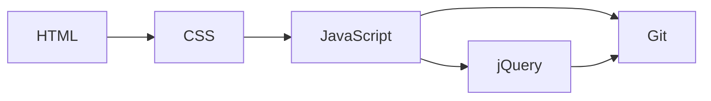

# JLearn - курсы / Courses / Kurslar

> Открытые учебные курсы платформы [JLearn.space](https://jlearn.space) для тех, кто начинает программировать с нуля. Каждый курс - 10 уроков на русском, узбекском и английском. Урок заканчивается заданием во встроенной IDE с автоматической проверкой и тестом из 12 вопросов.
>
> Open courses of the [JLearn.space](https://jlearn.space) platform for complete beginners. Each course has 10 lessons in Russian, Uzbek and English; every lesson ends with an auto-checked IDE task and a 12-question test.
>
> [JLearn.space](https://jlearn.space) platformasining dasturlashni noldan boshlovchilar uchun ochiq kurslari. Har bir kurs - rus, o‘zbek va ingliz tillarida 10 ta dars; har bir dars avtomatik tekshiriladigan IDE topshirig‘i va 12 savollik test bilan yakunlanadi.

---

## Курсы / Courses / Kurslar

| # | Курс / Course / Kurs | Чему научитесь | Нужно знать |
| :---: | --- | --- | --- |
| 1 | [**HTML: за 10 уроков**](HTML/README.md) | Структура страницы, текст, ссылки, изображения, таблицы, формы, доступность, публикация сайта | Ничего |
| 2 | [**CSS: за 10 уроков**](CSS/README.md) | Селекторы, блочная модель, Flexbox, Grid, адаптивность, анимации | HTML |
| 3 | [**JavaScript: за 10 уроков**](JavaScript/README.md) | Переменные, условия, циклы, функции, массивы и объекты, DOM, события, формы, `fetch` | HTML, CSS |
| 4 | [**jQuery: за 10 уроков**](jQuery/README.md) | jQuery 4.1: выбор элементов, классы, события, эффекты, формы, AJAX, свой плагин | HTML, CSS, JavaScript |
| 5 | [**Git: за 10 уроков**](Git/README.md) | Терминал, коммиты, история, отмена, ветки, конфликты, GitHub, командная работа, релизы | HTML; лучше - все курсы выше |

Курсы идут по порядку: в каждом следующем продолжается работа над **своим сайтом** из курса HTML. Курс Git можно начать сразу после JavaScript.

## Как устроен урок / How a lesson works / Dars qanday tuzilgan

1. Объяснение с примерами, схемами и аналогиями.
2. Мини-задания по ходу урока.
3. **Задание в IDE** на платформе - проверяется автоматически.
4. Часть 2 - проект на своём компьютере.
5. **Тест урока** - 12 вопросов, порог 70%.

Урок засчитывается, когда задание в IDE прошло все проверки, а тест сдан от 70%.

## Языки / Languages / Tillar

В каждом курсе папки `Lesson-N/ru`, `Lesson-N/uz`, `Lesson-N/en` - одна и та же программа на трёх языках, строка в строку. Задания и тесты для платформы - в папке `platform/` каждого курса.

---

| | |
| --- | --- |
| **Автор / Author** | Javlonbek Saydullaev - [github.com/Saydullayev017](https://github.com/Saydullayev017) |
| **Платформа / Platform** | [jlearn.space](https://jlearn.space) |
| **YouTube** | [@JLearnProgramming](https://www.youtube.com/@JLearnProgramming) |

Материалы распространяются под лицензией **CC BY-NC-SA 4.0** (файл `LICENSE` в папке каждого курса).

© 2026 Javlonbek Saydullaev.
