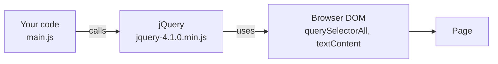
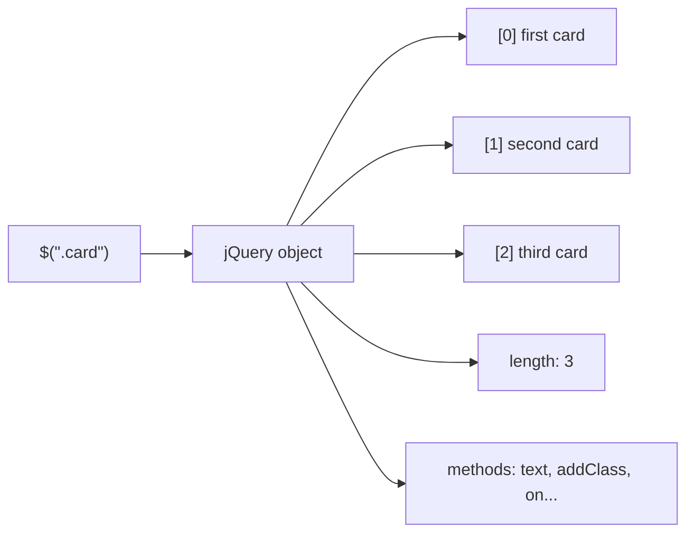
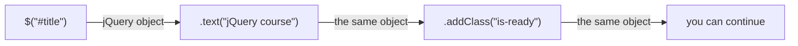
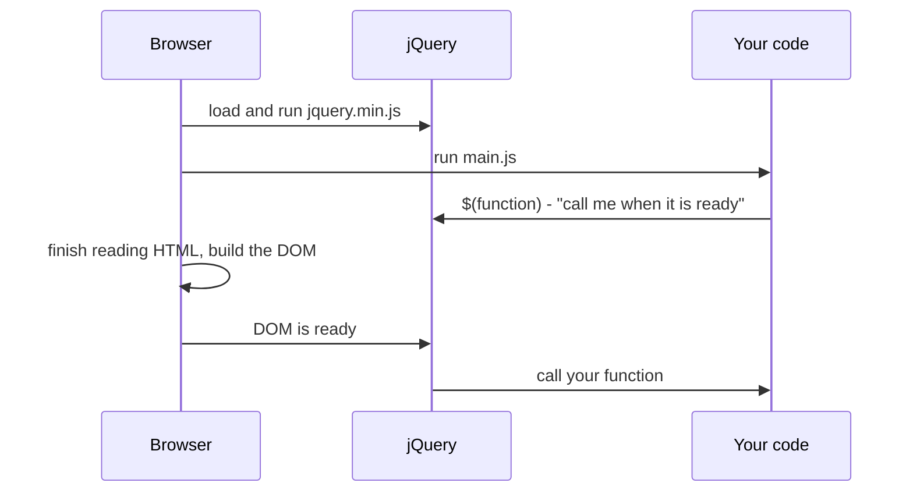

# Getting to know jQuery

[Contents](../../README.md) · [← JavaScript course](https://github.com/JLearn-space/JLearn-docs/tree/main/JavaScript) · [Next →](../../Lesson-2/en/Selectors%20and%20DOM%20traversal.md) · [RU](../ru/%D0%97%D0%BD%D0%B0%D0%BA%D0%BE%D0%BC%D1%81%D1%82%D0%B2%D0%BE%20%D1%81%20jQuery.md) · [EN](Getting%20to%20know%20jQuery.md) · [UZ](../uz/jQuery%20bilan%20tanishuv.md)

> **Link to the JavaScript course:** you already know how to find elements with `querySelector`, change text with `textContent` and subscribe to events. jQuery does the same things, but in less code. Today you will load the library and rewrite familiar code so that it becomes several times shorter.

---

## Why you need this

Open the source code of a random shop, bank or university website, and there is a good chance you will find a `jquery.min.js` file there. jQuery runs on a huge number of websites, and WordPress, Bootstrap 4 and thousands of ready-made plugins are built on it: sliders, galleries, input masks. To fix and improve such websites, you need to be able to read and write jQuery.

The second reason is speed. The task "find all cards and change their text" takes a loop of several lines in plain JavaScript, and one line in jQuery.

---

## What you will learn

- Explain what a library is and how jQuery differs from plain JavaScript.
- Load jQuery 4.1 from a CDN and from a local file.
- Select elements with the `$()` function and check whether anything was found: `.length`.
- Read and change text: `.text()`.
- Understand implicit iteration: one call changes all the elements that were found.
- Write call chains: `$("h1").text("...").addClass("...")`.
- Run code after the page has loaded: `defer` and `$(function () { ... })`.
- Go from a DOM element to a jQuery object and back.

---

## Review: 3 questions from the JavaScript course

1. What does `document.querySelector(".card")` return if the page has three cards? And if it has none?
2. Why is `textContent` safer than `innerHTML`?
3. What is the `defer` attribute on `<script>` for?

Answers are at the end of the lesson.

---

## Lesson plan

| Section | What we do |
| --- | --- |
| What a library is | A set of ready-made functions |
| jQuery in 2026 | Where it is needed and where it is not |
| Loading jQuery | CDN, local file, version 4.1 |
| The `$` function | Find elements with one call |
| The jQuery object | What `$()` returned and how to check the result |
| `.text()` | Read and change text |
| Mini-task 1 | Rewrite code from JavaScript to jQuery |
| Implicit iteration | One call - all elements |
| Chains | Several actions in a row |
| When to run code | `defer` and `$(function)` |
| DOM element and jQuery object | Converting back and forth |
| Mini-task 2 | A profile page |
| Independent work | Your first page with jQuery |

---

## What a library is

**In simple words:** a library is a set of tools that someone else has already made for you. You can hammer nails with a stone, or you can take a hammer. A hammer cannot do anything a stone cannot, but working with it is faster and easier.

jQuery is a library written in JavaScript. It is an ordinary `.js` file containing thousands of lines of code. Once this file is loaded, the page gets a `$` function with handy methods for working with the page.



**How to read the diagram.** jQuery does not replace JavaScript and does not bypass the browser. Inside, it calls the same `querySelectorAll`, `textContent` and `addEventListener` that you learned in the JavaScript course. It simply hides repetitive code behind short commands.

| Task | Plain JavaScript | jQuery |
| --- | --- | --- |
| Find all cards | `document.querySelectorAll(".card")` | `$(".card")` |
| Change the text of all of them | `for...of` loop + `textContent` | `$(".card").text("New")` |
| Add a class to all of them | Loop + `classList.add` | `$(".card").addClass("is-new")` |
| Listen for clicks on all of them | Loop + `addEventListener` | `$(".card").on("click", ...)` |

> **Important:** jQuery is JavaScript. Variables, conditions, loops, functions, arrays and objects stay the same. Only the way you work with the page changes.

---

## jQuery in 2026

jQuery appeared in 2006, when browsers handled pages differently and the same command needed different code in Internet Explorer and Firefox. jQuery hid these differences. Today browsers have agreed with each other, and many tasks are easy to solve in plain JavaScript.

Even so, the library keeps developing. In January 2026, jQuery 4.0 was released - the first major version in almost 10 years: outdated functions and support for old browsers were removed from it. In November 2026, jQuery 4.1.0 was released. The whole course is written for **jQuery 4.1**.

| When jQuery is a good choice | When plain JavaScript or a framework is better |
| --- | --- |
| The website already uses jQuery (WordPress, older projects) | A new large application - React, Vue and similar tools are used there |
| You need a ready-made plugin: a slider, a phone mask, a gallery | A small script for one button - the library weighs more than the code itself |
| Quickly "bring to life" a page that is already laid out | Every kilobyte of download matters |

**In simple words:** jQuery is neither outdated junk nor a magic wand. It is a widespread tool that you need to know to work with real websites.

---

## Loading jQuery

### From a CDN

A **CDN** (Content Delivery Network) is a network of servers that delivers files quickly all over the world. The official jQuery address is `code.jquery.com`.

```html
<!DOCTYPE html>
<html lang="en">
<head>
    <meta charset="UTF-8">
    <title>My first jQuery</title>
    <script src="https://code.jquery.com/jquery-4.1.0.min.js"></script>
    <script src="js/main.js" defer></script>
</head>
<body>
    <h1 id="title">Hello!</h1>
</body>
</html>
```

| Line | What it does |
| --- | --- |
| `jquery-4.1.0.min.js` | Version 4.1.0, `.min` means a compressed file without spaces and comments (about 79 KB instead of 259 KB) |
| The first `<script>` | Loads jQuery: after it, the page has the `$` function |
| The second `<script ... defer>` | Your code. It runs after the HTML has been parsed, when jQuery is already loaded |

> **Important:** jQuery is loaded **before** your code. The browser runs scripts in order: if `main.js` comes first, it will not have the `$` function.

On the [code.jquery.com](https://code.jquery.com/) page you can copy a ready-made tag: it also has the `integrity` and `crossorigin` attributes. This is an authenticity check: the browser compares the downloaded file with a "fingerprint" and refuses to run a file that has been tampered with. For learning projects you can do without them.

### Local file

Download `jquery-4.1.0.min.js` from [jquery.com/download](https://jquery.com/download/) and put it in the `js/` folder:

```text
my-site/
├── index.html
└── js/
    ├── jquery-4.1.0.min.js
    └── main.js
```

```html
<script src="js/jquery-4.1.0.min.js"></script>
<script src="js/main.js" defer></script>
```

| Method | Pros | Cons |
| --- | --- | --- |
| CDN | No need to store the file, loads quickly | Does not work without the internet |
| Local file | Works without the internet | You have to update the file manually |

### Full and slim builds

jQuery has two builds: the full `jquery-4.1.0.min.js` and the lighter `jquery-4.1.0.slim.min.js`. The slim build **has no animation effects and no AJAX** - the topics of lessons 7 and 9. The course uses the **full** build.

### Checking that it is loaded

Open the page, then the DevTools console (F12), and type:

```js
jQuery.fn.jquery
```

You should see `"4.1.0"`. If you see `ReferenceError: jQuery is not defined`, the file did not load: check the address and the **Network** tab.

---

## The `$` function

Once jQuery is loaded, the page gets two identical functions: `jQuery` and its short name `$`. The dollar sign is an ordinary character that is allowed in JavaScript names, just like a letter.

```js
console.log($ === jQuery); // true
```

The main technique: pass a **CSS selector** to `$()` - the same one you wrote in CSS and in `querySelectorAll`.

```js
$("#title");          // the element with id="title"
$(".card");           // all elements with the class card
$("nav a");           // all links inside nav
$("li:first-child");  // the first li in each list
```

| Plain JavaScript | jQuery |
| --- | --- |
| `document.querySelector("#title")` | `$("#title")` |
| `document.querySelectorAll(".card")` | `$(".card")` |

jQuery has no separate functions for "one" and "all" elements. `$()` always finds **all** matching elements.

---

## The jQuery object

`$()` returns neither an element nor `null`, but a **jQuery object** - a "box" that holds the elements that were found.

**In simple words:** a jQuery object is like a shopping basket. You say: "Put all the red apples in the basket." The basket may end up with 5 apples, one or none - but you **always** have the basket in your hands. And you can do something with the basket for everything inside it at once.



**How to read the diagram.** Inside the object, the elements are numbered from zero, like in an array, and the `length` property stores how many there are. Besides the elements, the object has jQuery methods.

### `.length` - was anything found

```html
<ul>
    <li class="item">Tea</li>
    <li class="item">Coffee</li>
    <li class="item">Juice</li>
</ul>
```

```js
const $items = $(".item");
console.log($items.length); // 3

const $missing = $(".nothing");
console.log($missing.length); // 0 - not null!
```

| Situation | Plain JavaScript | jQuery |
| --- | --- | --- |
| The element is found | The element | A jQuery object, `length >= 1` |
| Nothing is found | `null` | A jQuery object, `length === 0` |
| Calling a method on "nothing" | Error `Cannot read properties of null` | No error, simply nothing happens |

The last row of the table is both a benefit and a trap. There is no error, but there is no result either: a typo in a selector is easy to miss. So when debugging, check `.length` first:

```js
if ($("#menu").length === 0) {
    console.log("Menu not found - check the selector");
}
```

### The `$` sign in a variable name

In this course, a variable that holds a jQuery object starts with `$`:

```js
const $title = $("#title");   // jQuery object
const titleText = $title.text(); // ordinary string
```

This is not a language rule but a convention. It helps you see at a glance where there is a jQuery object with methods and where there is an ordinary value.

---

## `.text()` - read and change text

The `.text()` method works in two modes - this is a common jQuery technique:

| Call | Mode | What it does |
| --- | --- | --- |
| `$title.text()` | **Getter** (from get) | Returns the text |
| `$title.text("New")` | **Setter** (from set) | Writes the text |

```html
<h1 id="title">Hello!</h1>
```

```js
const $title = $("#title");

console.log($title.text()); // "Hello!"
$title.text("Welcome to jQuery");
console.log($title.text()); // "Welcome to jQuery"
```

Like `textContent`, the `.text()` method inserts a string **as text**, not as markup:

```js
$title.text("<b>bold</b>");
// the page literally shows: <b>bold</b>
```

This protects against inserting someone else's code if the text came from a user. We will cover the `.html()` method, which inserts markup, in lesson 3.

### Comparison with the JavaScript course

```js
// Plain JavaScript
const title = document.querySelector("#title");
title.textContent = "Welcome";

// jQuery
$("#title").text("Welcome");
```

---

## Mini-task 1

The page has `<p id="greeting">` and `<span id="year">`. Using jQuery, write the text `Hello, Anna!` into `#greeting`, where the name is taken from the variable `const userName = "Anna";`, and write the current year (`new Date().getFullYear()`) into `#year`. Then read the text of `#greeting` and print it to the console.

---

## Implicit iteration

**In simple words:** a teacher tells the class "Everyone, stand up!" - and everyone stands up, even though the teacher did not call each student by name. jQuery works the same way: a method called on a jQuery object is applied to **each** element inside it.

```html
<ul>
    <li class="status">?</li>
    <li class="status">?</li>
    <li class="status">?</li>
</ul>
```

```js
$(".status").text("Done");
```

All three items get the text `Done`. In plain JavaScript you would need a loop:

```js
for (const item of document.querySelectorAll(".status")) {
    item.textContent = "Done";
}
```

| Step inside jQuery | What happens |
| --- | --- |
| 1 | `$(".status")` finds 3 elements and puts them into a jQuery object |
| 2 | `.text("Done")` goes through the elements `[0]`, `[1]`, `[2]` |
| 3 | Each one gets `textContent = "Done"` |
| 4 | The method returns the same jQuery object |

### What text the getter returns

Setters act on all elements. Getters, however, behave differently:

```js
$(".status").text(); // "DoneDoneDone" - the text of all elements, joined together
```

`.text()` is an exception: it joins the text of all elements. Most other getters (for example, `.attr()` and `.val()` from lesson 3) return the value of **only the first** element. If you need the text of one element, select exactly that element - we will see how to do this in lesson 2.

---

## Call chains

A setter returns the same jQuery object it was called on. This means you can call the next method on the result right away:

```js
$("#title")
    .text("jQuery course")
    .addClass("is-ready");
```

The `.addClass()` method adds a CSS class, like `classList.add`. We will cover classes in detail in lesson 4; here it is needed as the second link in the chain.



**How to read the diagram.** Each link receives the object from the previous one and passes it on. The element is searched for on the page **only once**, at the start of the chain.

| Code | Does the chain continue? | Why |
| --- | --- | --- |
| `.text("Course").addClass("x")` | Yes | The setter returned a jQuery object |
| `.text().addClass("x")` | No, an error | The getter returned a **string**, and a string has no `addClass` |
| `.length.text("x")` | No, an error | `length` is a number |

A long chain is written in a column: each method on its own line with indentation. This makes it easier to read and comment.

---

## When to run code

A script can look for elements only **after** the browser has created them. In the JavaScript course you solved this with the `defer` attribute. With jQuery there are two ways.

### Way 1: `defer` (the main one in this course)

```html
<script src="https://code.jquery.com/jquery-4.1.0.min.js"></script>
<script src="js/main.js" defer></script>
```

A script with `defer` runs after all the HTML has been parsed. You do not need to write anything extra.

### Way 2: `$(function () { ... })`

If you pass a **function** to `$()` instead of a string, jQuery will call it when the page is ready:

```js
$(function () {
    $("#title").text("The page is ready");
});
```

You need this when a script is loaded without `defer` - for example, in the `<head>` of someone else's website or in an old project.

| Code | Status in jQuery 4 |
| --- | --- |
| `$(function () { ... })` | Recommended |
| `$(() => { ... })` | The same thing, with an arrow function |
| `$(document).ready(function () { ... })` | Deprecated: it works, but it is not used in new code |



**How to read the diagram.** The function from `$(function)` does not run immediately: jQuery remembers it and calls it only after the browser has built the whole page.

---

## DOM element and jQuery object

Sometimes you need a "real" element - for example, for a property that jQuery does not have. And the other way round: an element from plain JavaScript needs to be turned into a jQuery object.

```js
const $title = $("#title");

// jQuery object → DOM element
const titleElement = $title[0];      // or $title.get(0)
console.log(titleElement.textContent);

// DOM element → jQuery object
const heading = document.querySelector("h1");
const $heading = $(heading);
$heading.text("jQuery again");
```

| What you have | How to get the other one | Example |
| --- | --- | --- |
| A jQuery object | `[0]` or `.get(0)` | `$title[0].textContent` |
| A DOM element | `$(element)` | `$(heading).text("...")` |

| Mistake | What you get |
| --- | --- |
| `$title.textContent` | `undefined`: a jQuery object has no DOM properties |
| `heading.text("...")` | `TypeError: heading.text is not a function`: a DOM element has no jQuery methods |

---

### Try to break it

1. Swap the two `<script>` tags so that `main.js` is loaded before jQuery. What error does the console show?
2. Load `jquery-4.1.0.slim.min.js` and call `$("#title").fadeOut()`. What does the console say?
3. Make a typo in the selector: `$("#titel").text("Hello")`. Is there an error in the console? What does `$("#titel").length` show?
4. Add a chain to the getter: `$("#title").text().addClass("x")`. Read the error message.
5. Print `$("#title")` and `$("#title")[0]` to the console. How is what you see different?

### Typical beginner mistakes

| Mistake | What you get | How to fix |
| --- | --- | --- |
| jQuery is loaded after your own script | `$ is not defined` | The jQuery tag goes first |
| The slim build is loaded | `fadeOut is not a function`, `$.ajax is not a function` | The full build `jquery-4.1.0.min.js` |
| A typo in the selector | No error, but nothing changes | Check `.length` |
| A script in `<head>` without `defer` | Nothing changes: the elements do not exist yet | `defer` or `$(function () { ... })` |
| The check `if ($(".x"))` | The condition is always true: the object always exists | `if ($(".x").length > 0)` |
| A DOM property on a jQuery object: `$title.textContent` | `undefined` | `$title.text()` or `$title[0].textContent` |
| A chain after a getter | `TypeError: ... is not a function` | Put the getter at the end of the chain or on a separate line |

---

## Mini-task 2

A profile page:

```html
<h1 id="name">Name</h1>
<p id="city">City</p>
<ul>
    <li class="skill">?</li>
    <li class="skill">?</li>
    <li class="skill">?</li>
</ul>
<p id="skill-count"></p>
```

1. Write your name into `#name` and add the class `is-filled` in the same chain.
2. Write your city into `#city`.
3. With one call, write the text `HTML, CSS, JavaScript` into all `.skill` elements.
4. Show `Skills: 3` in `#skill-count`, where the number is taken from `.length`.

---

## Lesson summary: cheat sheet

| Task | Code |
| --- | --- |
| Load jQuery | `<script src="https://code.jquery.com/jquery-4.1.0.min.js"></script>` before your own script |
| Check the version | `jQuery.fn.jquery` in the console |
| Find elements | `$("css-selector")` |
| How many were found | `$(".card").length` |
| Read text | `$el.text()` |
| Write text | `$el.text("New")` - for all found elements |
| Chain | `$el.text("...").addClass("...")` |
| Code after loading | `defer` or `$(function () { ... })` |
| jQuery → DOM | `$el[0]` |
| DOM → jQuery | `$(element)` |

---

## Independent work

### Part 1. IDE task (graded by the platform)

The page has a heading `#course-title`, a paragraph `#lesson-count` and a list of lessons: each lesson is an `li.lesson` with `.lesson__name` and `.lesson__status` inside. jQuery is already loaded on the page. Using only jQuery:

1. Write the text `jQuery in 10 lessons` into `#course-title` and, in **the same chain**, add the class `is-ready` to it.
2. Count the lessons on the page and save the number in the constant `lessonCount`.
3. Write the text `Lessons on the page: 4` into `#lesson-count`, where the number is the value of `lessonCount`.
4. With one call, write the text `not started` into all `.lesson__status` elements.
5. Read the heading text into the constant `titleText` and print it to the console.

Do not use `document.querySelector`, `innerHTML` or `.html()`.

What the platform checks: the heading text and class; that `lessonCount` is calculated and not written by hand (a page with five lessons gives `5`); the counter text; the status of each lesson; the value of `titleText` and that it is printed to the console; that the code is written with jQuery.

### Part 2. Project on your computer

1. Load jQuery 4.1.0 on your website from the HTML and CSS courses: the CDN tag goes before your own script.
2. Check the version in the console: `jQuery.fn.jquery`.
3. Rewrite in jQuery any three lines from your `main.js` from the JavaScript course that change text.
4. Print to the console how many links, images and `h2` headings the home page has - using `.length`.

### Acceptance criteria

- [ ] The IDE task is accepted.
- [ ] jQuery 4.1.0 is loaded before your own script, and there are no errors in the console.
- [ ] Variables holding jQuery objects start with `$`.
- [ ] Text is set with `.text()`, not `.html()`.
- [ ] You can explain why `$(".x")` never returns `null`.

---

## Self-check questions

1. What is a library, and how does jQuery differ from plain JavaScript?
2. Why must the jQuery tag come before your script?
3. How does the full build differ from the slim one?
4. What does `$(".card")` return if there are no cards? How can you check this?
5. What are a getter and a setter? Give an example with `.text()`.
6. What is implicit iteration?
7. Why can you continue a chain after `.text("...")` but not after `.text()`?
8. Why do you need `$(function () { ... })` if there is `defer`?
9. How do you get a DOM element from a jQuery object, and the other way round?
10. When is jQuery a good choice, and when is it not?

After the questions, take the **lesson test** on the platform: 12 questions, pass mark 70%.

---

## What's next

So far we have selected elements only by selector. In lesson 2 we will learn to **move through the page tree**: from an element to its parent, children and siblings, select the first, last or Nth element, and loop over the results with `.each()`.

---

## Answers

**Review**

1. The first of the three cards; if there are no cards, `null`.
2. `textContent` inserts a string as text, so the browser will not run someone else's code or markup.
3. The script loads in parallel and runs after all the HTML has been parsed, so the elements already exist.

**Mini-task 1**

```js
const userName = "Anna";

$("#greeting").text(`Hello, ${userName}!`);
$("#year").text(new Date().getFullYear());

const greetingText = $("#greeting").text();
console.log(greetingText);
```

**Mini-task 2**

```js
$("#name")
    .text("Anna")
    .addClass("is-filled");

$("#city").text("Tashkent");

const $skills = $(".skill");
$skills.text("HTML, CSS, JavaScript");

$("#skill-count").text(`Skills: ${$skills.length}`);
```

**Self-check questions**

1. A set of ready-made functions written by other people. jQuery is a JavaScript library: inside, it uses the same browser DOM functions, but they are shorter to write.
2. Scripts run in order: until jQuery is loaded, the `$` function does not exist.
3. Slim has no animation effects and no AJAX; the full build contains everything.
4. An empty jQuery object with `length === 0`. Check: `$(".card").length === 0`.
5. A getter reads a value (`$el.text()`), a setter writes it (`$el.text("New")`).
6. A method called on a jQuery object is applied to each element that was found, without a loop.
7. A setter returns a jQuery object, while a getter returns a string, which has no jQuery methods.
8. If the script is loaded without `defer`, for example in `<head>`, the function will run only after the DOM has been built.
9. `$el[0]` or `$el.get(0)` gives a DOM element; `$(element)` gives a jQuery object.
10. A good choice: the website already uses jQuery, you need a ready-made plugin, or you need to bring a page to life quickly. Not needed: for large applications built with frameworks, and for one small function where page weight matters.

---

[Contents](../../README.md) · [← JavaScript course](https://github.com/JLearn-space/JLearn-docs/tree/main/JavaScript) · [Next →](../../Lesson-2/en/Selectors%20and%20DOM%20traversal.md) · [RU](../ru/%D0%97%D0%BD%D0%B0%D0%BA%D0%BE%D0%BC%D1%81%D1%82%D0%B2%D0%BE%20%D1%81%20jQuery.md) · [EN](Getting%20to%20know%20jQuery.md) · [UZ](../uz/jQuery%20bilan%20tanishuv.md)
