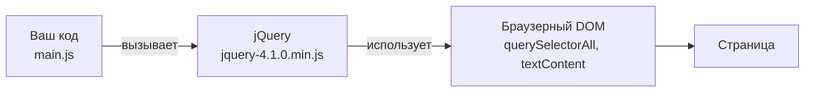
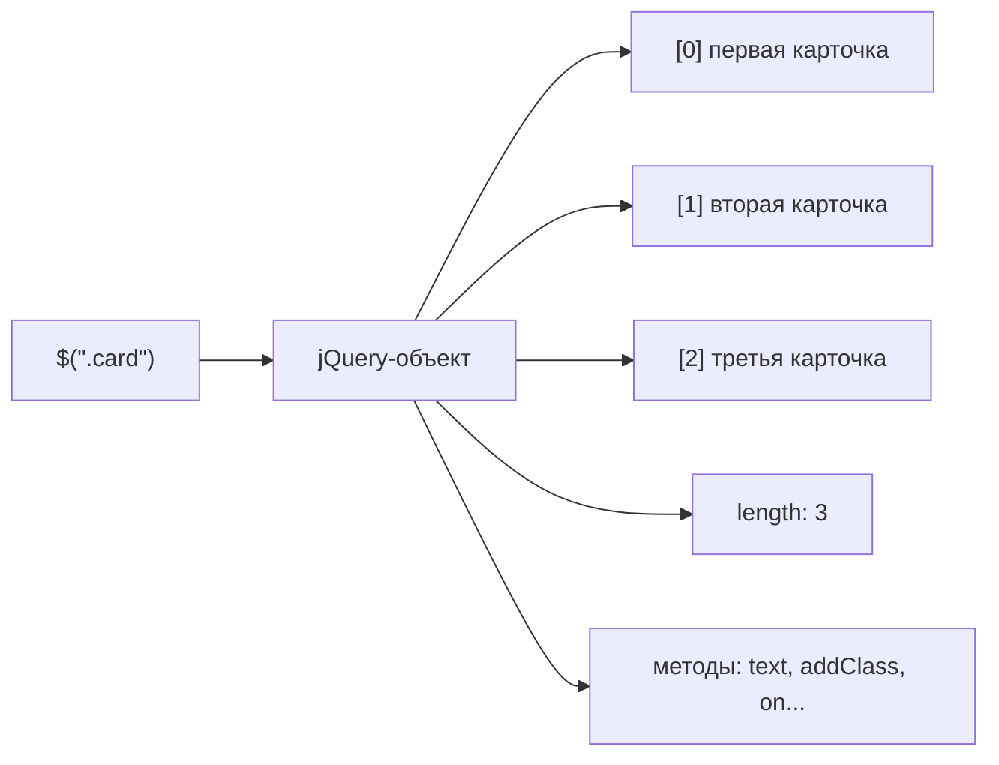
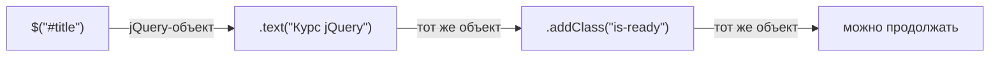
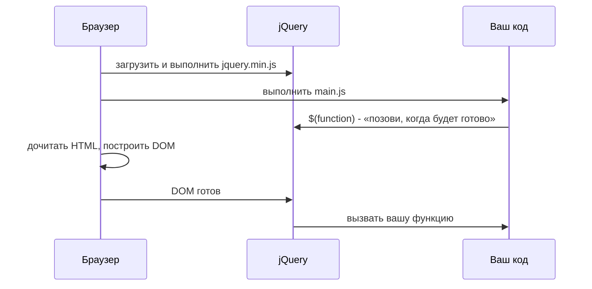

# Знакомство с jQuery

[Содержание](../../README.md) · [← Курс JavaScript](https://github.com/JLearn-space/JLearn-docs/tree/main/JavaScript) · [Вперёд →](../../Lesson-2/ru/%D0%A1%D0%B5%D0%BB%D0%B5%D0%BA%D1%82%D0%BE%D1%80%D1%8B%20%D0%B8%20%D0%BE%D0%B1%D1%85%D0%BE%D0%B4%20DOM.md) · [RU](%D0%97%D0%BD%D0%B0%D0%BA%D0%BE%D0%BC%D1%81%D1%82%D0%B2%D0%BE%20%D1%81%20jQuery.md) · [EN](../en/Getting%20to%20know%20jQuery.md) · [UZ](../uz/jQuery%20bilan%20tanishuv.md)

> **Связь с курсом JavaScript:** вы уже умеете находить элементы через `querySelector`, менять текст через `textContent` и подписываться на события. jQuery делает то же самое, но короче. Сегодня вы подключите библиотеку и перепишете знакомый код в несколько раз короче.

---

## Зачем это вам

Откройте исходный код случайного сайта магазина, банка или университета - с большой вероятностью вы найдёте там файл `jquery.min.js`. jQuery работает на огромном числе сайтов, на нём построены WordPress, Bootstrap 4 и тысячи готовых плагинов: слайдеры, галереи, маски ввода. Чтобы чинить и дорабатывать такие сайты, jQuery нужно читать и писать.

Вторая причина - скорость. Задача «найти все карточки и поменять им текст» на чистом JavaScript занимает цикл из нескольких строк, а на jQuery - одну строку.

---

## Чему вы научитесь

- Объяснять, что такое библиотека и чем jQuery отличается от чистого JavaScript.
- Подключать jQuery 4.1 с CDN и из локального файла.
- Выбирать элементы функцией `$()` и проверять, нашлось ли что-то: `.length`.
- Читать и менять текст: `.text()`.
- Понимать неявный перебор: один вызов меняет все найденные элементы.
- Писать цепочки вызовов: `$("h1").text("...").addClass("...")`.
- Запускать код после загрузки страницы: `defer` и `$(function () { ... })`.
- Переходить от DOM-элемента к jQuery-объекту и обратно.

---

## Повторение: 3 вопроса из курса JavaScript

1. Что вернёт `document.querySelector(".card")`, если на странице три карточки? А если ни одной?
2. Чем `textContent` безопаснее `innerHTML`?
3. Зачем атрибут `defer` у `<script>`?

Ответы - в конце урока.

---

## План урока

| Раздел | Что делаем |
| --- | --- |
| Что такое библиотека | Набор готовых функций |
| jQuery в 2026 году | Где он нужен, а где нет |
| Подключение | CDN, локальный файл, версия 4.1 |
| Функция `$` | Найти элементы одним вызовом |
| jQuery-объект | Что вернула `$()` и как проверить результат |
| `.text()` | Прочитать и изменить текст |
| Мини-задание 1 | Переписать код с JavaScript на jQuery |
| Неявный перебор | Один вызов - все элементы |
| Цепочки | Несколько действий подряд |
| Когда запускать код | `defer` и `$(function)` |
| DOM-элемент и jQuery-объект | Переход туда и обратно |
| Мини-задание 2 | Страница-анкета |
| Самостоятельная работа | Первая страница на jQuery |

---

## Что такое библиотека

**Простыми словами:** библиотека - это набор инструментов, которые за вас уже сделал кто-то другой. Можно забивать гвозди камнем, а можно взять молоток. Молоток не умеет ничего, чего не может камень, но работать им быстрее и удобнее.

jQuery - библиотека на JavaScript. Это обычный файл `.js`, в котором записаны тысячи строк кода. После подключения этого файла на странице появляется функция `$` с удобными методами для работы со страницей.



**Как читать схему.** jQuery не заменяет JavaScript и не обходит браузер. Внутри он вызывает те же `querySelectorAll`, `textContent` и `addEventListener`, что вы изучили в курсе JavaScript. Он просто прячет повторяющийся код за короткими командами.

| Задача | Чистый JavaScript | jQuery |
| --- | --- | --- |
| Найти все карточки | `document.querySelectorAll(".card")` | `$(".card")` |
| Поменять текст у всех | Цикл `for...of` + `textContent` | `$(".card").text("Новое")` |
| Добавить класс всем | Цикл + `classList.add` | `$(".card").addClass("is-new")` |
| Подписаться на клик всех | Цикл + `addEventListener` | `$(".card").on("click", ...)` |

> **Важно:** jQuery - это JavaScript. Переменные, условия, циклы, функции, массивы и объекты остаются теми же. Меняется только способ работы со страницей.

---

## jQuery в 2026 году

jQuery появился в 2006 году, когда браузеры работали со страницей по-разному и одна и та же команда в Internet Explorer и Firefox требовала разного кода. jQuery скрыл эти различия. Сегодня браузеры договорились между собой, и многие задачи легко решаются чистым JavaScript.

Тем не менее библиотека развивается. В январе 2026 года вышел jQuery 4.0 - первая крупная версия почти за 10 лет: из неё убрали устаревшие функции и поддержку старых браузеров. В ноябре 2026 вышел jQuery 4.1.0. Весь курс написан для **jQuery 4.1**.

| Когда jQuery - хороший выбор | Когда лучше чистый JavaScript или фреймворк |
| --- | --- |
| Сайт уже использует jQuery (WordPress, старые проекты) | Новое большое приложение - там используют React, Vue и подобные |
| Нужен готовый плагин: слайдер, маска телефона, галерея | Маленький скрипт на одну кнопку - библиотека весит больше самого кода |
| Быстро «оживить» сверстанную страницу | Важен каждый килобайт загрузки |

**Простыми словами:** jQuery - не устаревший мусор и не волшебная палочка. Это распространённый инструмент, который нужно знать, чтобы работать с реальными сайтами.

---

## Подключение jQuery

### С CDN

**CDN** (Content Delivery Network) - сеть серверов, которая быстро отдаёт файлы по всему миру. Официальный адрес jQuery - `code.jquery.com`.

```html
<!DOCTYPE html>
<html lang="ru">
<head>
    <meta charset="UTF-8">
    <title>Мой первый jQuery</title>
    <script src="https://code.jquery.com/jquery-4.1.0.min.js"></script>
    <script src="js/main.js" defer></script>
</head>
<body>
    <h1 id="title">Привет!</h1>
</body>
</html>
```

| Строка | Что делает |
| --- | --- |
| `jquery-4.1.0.min.js` | Версия 4.1.0, `.min` - сжатый файл без пробелов и комментариев (около 79 КБ вместо 259 КБ) |
| Первый `<script>` | Загружает jQuery: после него на странице есть функция `$` |
| Второй `<script ... defer>` | Ваш код. Выполнится после разбора HTML, когда jQuery уже загружен |

> **Важно:** jQuery подключается **раньше** вашего кода. Браузер выполняет скрипты по порядку: если `main.js` окажется первым, в нём не будет функции `$`.

На странице [code.jquery.com](https://code.jquery.com/) можно скопировать готовый тег: в нём есть ещё атрибуты `integrity` и `crossorigin`. Это проверка подлинности: браузер сравнит загруженный файл с «отпечатком» и откажется выполнять подменённый файл. Для учебных проектов можно обойтись без них.

### Локальный файл

Скачайте `jquery-4.1.0.min.js` с сайта [jquery.com/download](https://jquery.com/download/) и положите в папку `js/`:

```text
my-site/
├── index.html
└── js/
    ├── jquery-4.1.0.min.js
    └── main.js
```

```html
<script src="js/jquery-4.1.0.min.js"></script>
<script src="js/main.js" defer></script>
```

| Способ | Плюсы | Минусы |
| --- | --- | --- |
| CDN | Не нужно хранить файл, быстро грузится | Без интернета не работает |
| Локальный файл | Работает без интернета | Обновлять файл нужно вручную |

### Полная и slim-сборка

У jQuery две сборки: полная `jquery-4.1.0.min.js` и облегчённая `jquery-4.1.0.slim.min.js`. В slim-сборке **нет эффектов анимации и AJAX** - уроков 7 и 9. В курсе используется **полная** сборка.

### Проверка подключения

Откройте страницу, затем консоль DevTools (F12) и введите:

```js
jQuery.fn.jquery
```

Должно появиться `"4.1.0"`. Если видите `ReferenceError: jQuery is not defined` - файл не загрузился: проверьте адрес и вкладку **Network**.

---

## Функция `$`

После подключения на странице появляются две одинаковые функции: `jQuery` и её короткое имя `$`. Знак доллара - обычный символ, разрешённый в именах JavaScript, как буква.

```js
console.log($ === jQuery); // true
```

Главный приём: передать в `$()` **CSS-селектор** - тот же, что вы писали в CSS и в `querySelectorAll`.

```js
$("#title");          // элемент с id="title"
$(".card");           // все элементы с классом card
$("nav a");           // все ссылки внутри nav
$("li:first-child");  // первые li в каждом списке
```

| Чистый JavaScript | jQuery |
| --- | --- |
| `document.querySelector("#title")` | `$("#title")` |
| `document.querySelectorAll(".card")` | `$(".card")` |

У jQuery нет отдельных функций для «одного» и «всех» элементов. `$()` всегда находит **все** подходящие элементы.

---

## jQuery-объект

`$()` возвращает не элемент и не `null`, а **jQuery-объект** - «коробку», в которой лежат найденные элементы.

**Простыми словами:** jQuery-объект похож на корзину в магазине. Вы говорите: «Положи в корзину все красные яблоки». В корзине может оказаться 5 яблок, одно или ни одного - но корзина у вас в руках **всегда**. И с корзиной можно сделать действие сразу для всего содержимого.



**Как читать схему.** Внутри объекта элементы пронумерованы с нуля, как в массиве, а свойство `length` хранит их количество. Кроме элементов, у объекта есть методы jQuery.

### `.length` - нашлось ли что-то

```html
<ul>
    <li class="item">Чай</li>
    <li class="item">Кофе</li>
    <li class="item">Сок</li>
</ul>
```

```js
const $items = $(".item");
console.log($items.length); // 3

const $missing = $(".nothing");
console.log($missing.length); // 0 - не null!
```

| Ситуация | Чистый JavaScript | jQuery |
| --- | --- | --- |
| Элемент найден | Элемент | jQuery-объект, `length >= 1` |
| Ничего не найдено | `null` | jQuery-объект, `length === 0` |
| Вызвать метод у «ничего» | Ошибка `Cannot read properties of null` | Ошибки нет, просто ничего не произойдёт |

Последняя строка таблицы - и плюс, и ловушка. Ошибки нет, но и результата нет: опечатку в селекторе легко не заметить. Поэтому при отладке первым делом проверяйте `.length`:

```js
if ($("#menu").length === 0) {
    console.log("Меню не найдено - проверьте селектор");
}
```

### Знак `$` в имени переменной

В курсе переменная, в которой лежит jQuery-объект, начинается с `$`:

```js
const $title = $("#title");   // jQuery-объект
const titleText = $title.text(); // обычная строка
```

Это не правило языка, а договорённость. Она помогает с первого взгляда понять, где jQuery-объект с методами, а где обычное значение.

---

## `.text()` - прочитать и изменить текст

Метод `.text()` работает в двух режимах - это общий приём jQuery:

| Вызов | Режим | Что делает |
| --- | --- | --- |
| `$title.text()` | **Геттер** (от get - получить) | Возвращает текст |
| `$title.text("Новый")` | **Сеттер** (от set - установить) | Записывает текст |

```html
<h1 id="title">Привет!</h1>
```

```js
const $title = $("#title");

console.log($title.text()); // "Привет!"
$title.text("Добро пожаловать в jQuery");
console.log($title.text()); // "Добро пожаловать в jQuery"
```

Как и `textContent`, метод `.text()` вставляет строку **как текст**, а не как разметку:

```js
$title.text("<b>жирный</b>");
// на странице видно буквально: <b>жирный</b>
```

Это защищает от вставки чужого кода, если текст пришёл от пользователя. Метод `.html()`, который вставляет разметку, разберём в уроке 3.

### Сравнение с курсом JavaScript

```js
// Чистый JavaScript
const title = document.querySelector("#title");
title.textContent = "Добро пожаловать";

// jQuery
$("#title").text("Добро пожаловать");
```

---

## Мини-задание 1

На странице есть `<p id="greeting">` и `<span id="year">`. С помощью jQuery запишите в `#greeting` текст `Здравствуйте, Анна!`, где имя берётся из переменной `const userName = "Анна";`, а в `#year` - текущий год (`new Date().getFullYear()`). Затем прочитайте текст `#greeting` и выведите его в консоль.

---

## Неявный перебор

**Простыми словами:** учитель говорит классу «Все встаньте!» - и встают все, хотя он не обращался к каждому по имени. jQuery работает так же: метод, вызванный у jQuery-объекта, применяется **к каждому** элементу внутри.

```html
<ul>
    <li class="status">?</li>
    <li class="status">?</li>
    <li class="status">?</li>
</ul>
```

```js
$(".status").text("Готово");
```

Все три пункта получат текст `Готово`. На чистом JavaScript понадобился бы цикл:

```js
for (const item of document.querySelectorAll(".status")) {
    item.textContent = "Готово";
}
```

| Шаг внутри jQuery | Что происходит |
| --- | --- |
| 1 | `$(".status")` находит 3 элемента и кладёт их в jQuery-объект |
| 2 | `.text("Готово")` перебирает элементы `[0]`, `[1]`, `[2]` |
| 3 | Каждому записывается `textContent = "Готово"` |
| 4 | Метод возвращает тот же jQuery-объект |

### Какой текст вернёт геттер

Сеттеры действуют на все элементы. А геттеры ведут себя по-разному:

```js
$(".status").text(); // "ГотовоГотовоГотово" - текст всех элементов, склеенный
```

`.text()` - исключение: он склеивает текст всех элементов. Большинство других геттеров (например, `.attr()` и `.val()` из урока 3) возвращают значение **только первого** элемента. Если нужен текст одного элемента, выбирайте именно его - как это делать, разберём в уроке 2.

---

## Цепочки вызовов

Сеттер возвращает тот же jQuery-объект, у которого его вызвали. Значит, у результата можно сразу вызвать следующий метод:

```js
$("#title")
    .text("Курс jQuery")
    .addClass("is-ready");
```

Метод `.addClass()` добавляет класс CSS, как `classList.add`. Подробно классы разберём в уроке 4, а здесь он нужен как второе звено цепочки.



**Как читать схему.** Каждое звено получает объект от предыдущего и передаёт его дальше. Элемент ищется на странице **один раз**, в начале цепочки.

| Запись | Цепочка продолжается? | Почему |
| --- | --- | --- |
| `.text("Курс").addClass("x")` | Да | Сеттер вернул jQuery-объект |
| `.text().addClass("x")` | Нет, ошибка | Геттер вернул **строку**, у строки нет `addClass` |
| `.length.text("x")` | Нет, ошибка | `length` - число |

Длинную цепочку записывают в столбик: каждый метод на своей строке с отступом. Так её легче читать и комментировать.

---

## Когда запускать код

Скрипт может искать элементы только **после того**, как браузер их создал. В курсе JavaScript вы решали это атрибутом `defer`. С jQuery есть два способа.

### Способ 1: `defer` (основной в курсе)

```html
<script src="https://code.jquery.com/jquery-4.1.0.min.js"></script>
<script src="js/main.js" defer></script>
```

Скрипт с `defer` выполняется после разбора всего HTML. Ничего дополнительно писать не нужно.

### Способ 2: `$(function () { ... })`

Если передать в `$()` не строку, а **функцию**, jQuery вызовет её, когда страница будет готова:

```js
$(function () {
    $("#title").text("Страница готова");
});
```

Это нужно, когда скрипт подключён без `defer` - например, в `<head>` чужого сайта или в старом проекте.

| Запись | Статус в jQuery 4 |
| --- | --- |
| `$(function () { ... })` | Рекомендуется |
| `$(() => { ... })` | То же самое, стрелочная функция |
| `$(document).ready(function () { ... })` | Устарела: работает, но в новом коде не пишут |



**Как читать схему.** Функция из `$(function)` не выполняется сразу: jQuery запоминает её и вызывает только после того, как браузер построил всю страницу.

---

## DOM-элемент и jQuery-объект

Иногда нужен «настоящий» элемент - например, для свойства, которого нет в jQuery. И наоборот: элемент из чистого JavaScript нужно превратить в jQuery-объект.

```js
const $title = $("#title");

// jQuery-объект → DOM-элемент
const titleElement = $title[0];      // или $title.get(0)
console.log(titleElement.textContent);

// DOM-элемент → jQuery-объект
const heading = document.querySelector("h1");
const $heading = $(heading);
$heading.text("Снова jQuery");
```

| Что у вас | Как получить другое | Пример |
| --- | --- | --- |
| jQuery-объект | `[0]` или `.get(0)` | `$title[0].textContent` |
| DOM-элемент | `$(элемент)` | `$(heading).text("...")` |

| Ошибка | Что получится |
| --- | --- |
| `$title.textContent` | `undefined`: у jQuery-объекта нет свойства DOM |
| `heading.text("...")` | `TypeError: heading.text is not a function`: у DOM-элемента нет методов jQuery |

---

### Попробуйте сломать

1. Поменяйте местами два тега `<script>`, чтобы `main.js` подключался раньше jQuery. Какую ошибку покажет консоль?
2. Подключите `jquery-4.1.0.slim.min.js` и вызовите `$("#title").fadeOut()`. Что напишет консоль?
3. Сделайте опечатку в селекторе: `$("#titel").text("Привет")`. Есть ли ошибка в консоли? Что покажет `$("#titel").length`?
4. Допишите к геттеру цепочку: `$("#title").text().addClass("x")`. Прочитайте сообщение об ошибке.
5. Выведите в консоль `$("#title")` и `$("#title")[0]`. Чем отличается то, что вы видите?

### Частые ошибки новичков

| Ошибка | Что получится | Как исправить |
| --- | --- | --- |
| jQuery подключён после своего скрипта | `$ is not defined` | Тег jQuery - первым |
| Подключена slim-сборка | `fadeOut is not a function`, `$.ajax is not a function` | Полная сборка `jquery-4.1.0.min.js` |
| Опечатка в селекторе | Ошибки нет, но ничего не меняется | Проверить `.length` |
| Скрипт в `<head>` без `defer` | Ничего не меняется: элементов ещё нет | `defer` или `$(function () { ... })` |
| Проверка `if ($(".x"))` | Условие всегда истинно: объект существует всегда | `if ($(".x").length > 0)` |
| Метод DOM у jQuery-объекта: `$title.textContent` | `undefined` | `$title.text()` или `$title[0].textContent` |
| Цепочка после геттера | `TypeError: ... is not a function` | Геттер - в конце цепочки или отдельной строкой |

---

## Мини-задание 2

Страница-анкета:

```html
<h1 id="name">Имя</h1>
<p id="city">Город</p>
<ul>
    <li class="skill">?</li>
    <li class="skill">?</li>
    <li class="skill">?</li>
</ul>
<p id="skill-count"></p>
```

1. Запишите в `#name` своё имя и в той же цепочке добавьте класс `is-filled`.
2. Запишите город в `#city`.
3. Одним вызовом запишите во все `.skill` текст `HTML, CSS, JavaScript`.
4. В `#skill-count` выведите `Навыков: 3`, где число взято из `.length`.

---

## Итоги урока: шпаргалка

| Задача | Запись |
| --- | --- |
| Подключить jQuery | `<script src="https://code.jquery.com/jquery-4.1.0.min.js"></script>` перед своим скриптом |
| Проверить версию | `jQuery.fn.jquery` в консоли |
| Найти элементы | `$("css-селектор")` |
| Сколько нашлось | `$(".card").length` |
| Прочитать текст | `$el.text()` |
| Записать текст | `$el.text("Новый")` - у всех найденных |
| Цепочка | `$el.text("...").addClass("...")` |
| Код после загрузки | `defer` или `$(function () { ... })` |
| jQuery → DOM | `$el[0]` |
| DOM → jQuery | `$(element)` |

---

## Самостоятельная работа

### Часть 1. Задание в IDE (засчитывается платформой)

На странице есть заголовок `#course-title`, абзац `#lesson-count` и список уроков: каждый урок - `li.lesson` со вложенными `.lesson__name` и `.lesson__status`. jQuery на странице уже подключён. Используя только jQuery:

1. Запишите в `#course-title` текст `jQuery за 10 уроков` и в **той же цепочке** добавьте ему класс `is-ready`.
2. Посчитайте уроки на странице и сохраните число в константу `lessonCount`.
3. Запишите в `#lesson-count` текст `Уроков на странице: 4`, где число - значение `lessonCount`.
4. Одним вызовом запишите во все `.lesson__status` текст `не начат`.
5. Прочитайте текст заголовка в константу `titleText` и выведите её в консоль.

`document.querySelector`, `innerHTML` и `.html()` не используйте.

Что проверяет платформа: текст и класс заголовка; что `lessonCount` вычислен, а не записан вручную (страница с пятью уроками даёт `5`); текст счётчика; статус каждого урока; значение `titleText` и вывод в консоль; что код написан на jQuery.

### Часть 2. Проект на компьютере

1. Подключите jQuery 4.1.0 к своему сайту из курсов HTML и CSS: тег CDN перед своим скриптом.
2. Проверьте версию в консоли: `jQuery.fn.jquery`.
3. Перепишите на jQuery три любые строки из своего `main.js` курса JavaScript, где менялся текст.
4. Выведите в консоль, сколько на главной странице ссылок, изображений и заголовков `h2` - через `.length`.

### Критерии готовности

- [ ] Задание в IDE засчитано.
- [ ] jQuery 4.1.0 подключён раньше своего скрипта, в консоли нет ошибок.
- [ ] Переменные с jQuery-объектами начинаются с `$`.
- [ ] Для текста используется `.text()`, а не `.html()`.
- [ ] Вы можете объяснить, почему `$(".x")` никогда не возвращает `null`.

---

## Вопросы для самопроверки

1. Что такое библиотека и чем jQuery отличается от чистого JavaScript?
2. Почему тег jQuery должен стоять раньше вашего скрипта?
3. Чем полная сборка отличается от slim?
4. Что возвращает `$(".card")`, если карточек нет? Как это проверить?
5. Что такое геттер и сеттер? Приведите пример с `.text()`.
6. Что такое неявный перебор?
7. Почему после `.text("...")` можно продолжить цепочку, а после `.text()` - нет?
8. Зачем нужна запись `$(function () { ... })`, если есть `defer`?
9. Как получить DOM-элемент из jQuery-объекта и наоборот?
10. Когда jQuery - хороший выбор, а когда нет?

После вопросов пройдите **тест урока** на платформе: 12 вопросов, порог 70%.

---

## Что дальше

Пока мы выбирали элементы только по селектору. В уроке 2 научимся **двигаться по дереву** страницы: от элемента к родителю, детям и соседям, выбирать первый, последний или N-й элемент и перебирать найденное через `.each()`.

---

## Ответы

**Повторение**

1. Первую из трёх карточек; если карточек нет - `null`.
2. `textContent` вставляет строку как текст, и браузер не выполнит чужой код или разметку.
3. Скрипт загружается параллельно и выполняется после разбора всего HTML, поэтому элементы уже существуют.

**Мини-задание 1**

```js
const userName = "Анна";

$("#greeting").text(`Здравствуйте, ${userName}!`);
$("#year").text(new Date().getFullYear());

const greetingText = $("#greeting").text();
console.log(greetingText);
```

**Мини-задание 2**

```js
$("#name")
    .text("Анна")
    .addClass("is-filled");

$("#city").text("Ташкент");

const $skills = $(".skill");
$skills.text("HTML, CSS, JavaScript");

$("#skill-count").text(`Навыков: ${$skills.length}`);
```

**Вопросы для самопроверки**

1. Набор готовых функций, написанных другими. jQuery - библиотека на JavaScript: внутри те же DOM-функции браузера, но короче записываются.
2. Скрипты выполняются по порядку: пока jQuery не загружен, функции `$` не существует.
3. В slim нет эффектов анимации и AJAX; полная сборка содержит всё.
4. Пустой jQuery-объект с `length === 0`. Проверка: `$(".card").length === 0`.
5. Геттер читает значение (`$el.text()`), сеттер записывает (`$el.text("Новый")`).
6. Метод, вызванный у jQuery-объекта, применяется к каждому найденному элементу без цикла.
7. Сеттер возвращает jQuery-объект, а геттер - строку, у которой нет методов jQuery.
8. Если скрипт подключён без `defer`, например в `<head>`, функция выполнится только после построения DOM.
9. `$el[0]` или `$el.get(0)` - DOM-элемент; `$(element)` - jQuery-объект.
10. Хороший выбор - сайт уже на jQuery, нужен готовый плагин, нужно быстро оживить страницу. Не нужен - для крупных приложений на фреймворках и для одной маленькой функции, где важен вес страницы.

---

[Содержание](../../README.md) · [← Курс JavaScript](https://github.com/JLearn-space/JLearn-docs/tree/main/JavaScript) · [Вперёд →](../../Lesson-2/ru/%D0%A1%D0%B5%D0%BB%D0%B5%D0%BA%D1%82%D0%BE%D1%80%D1%8B%20%D0%B8%20%D0%BE%D0%B1%D1%85%D0%BE%D0%B4%20DOM.md) · [RU](%D0%97%D0%BD%D0%B0%D0%BA%D0%BE%D0%BC%D1%81%D1%82%D0%B2%D0%BE%20%D1%81%20jQuery.md) · [EN](../en/Getting%20to%20know%20jQuery.md) · [UZ](../uz/jQuery%20bilan%20tanishuv.md)
