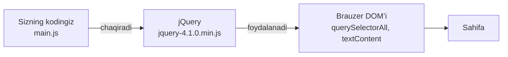
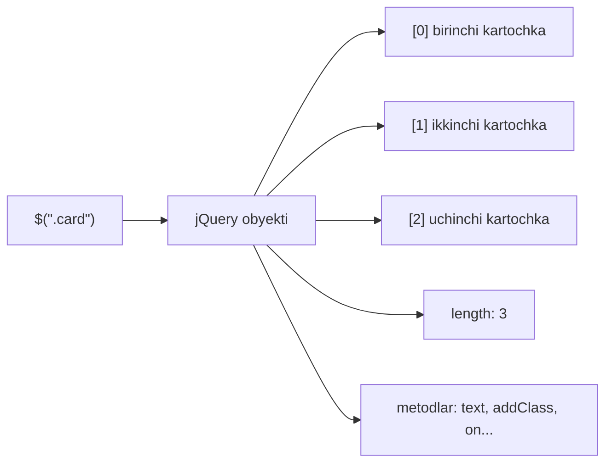
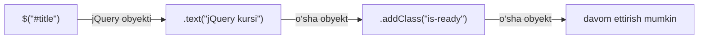
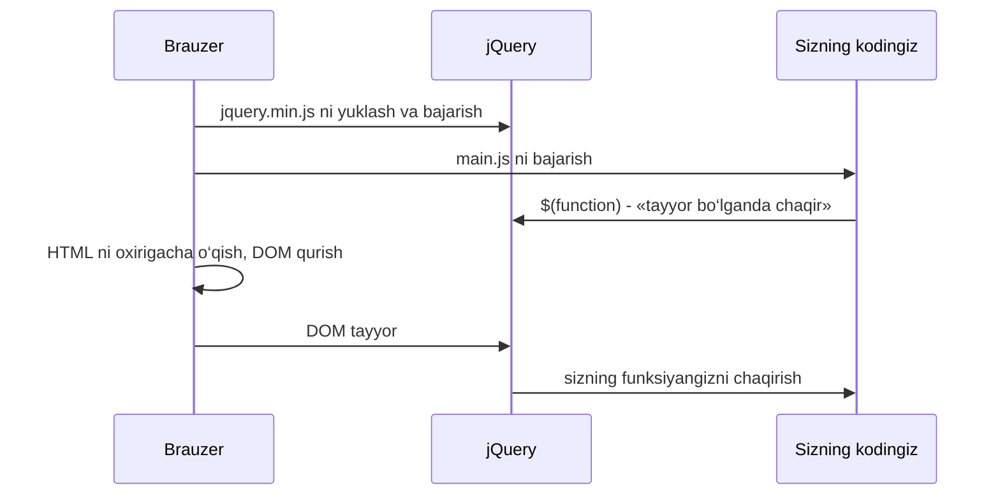

# jQuery bilan tanishuv

[Mundarija](../../README.md) · [← JavaScript kursi](https://github.com/JLearn-space/JLearn-docs/tree/main/JavaScript) · [Keyingi →](../../Lesson-2/uz/Selektorlar%20va%20DOM%20bo'ylab%20harakat.md) · [RU](../ru/%D0%97%D0%BD%D0%B0%D0%BA%D0%BE%D0%BC%D1%81%D1%82%D0%B2%D0%BE%20%D1%81%20jQuery.md) · [EN](../en/Getting%20to%20know%20jQuery.md) · [UZ](jQuery%20bilan%20tanishuv.md)

> **JavaScript kursi bilan bog‘liqlik:** siz elementlarni `querySelector` orqali topishni, matnni `textContent` orqali o‘zgartirishni va hodisalarga obuna bo‘lishni allaqachon bilasiz. jQuery xuddi shu ishlarni qisqaroq qiladi. Bugun kutubxonani ulaysiz va tanish kodni bir necha baravar qisqaroq qilib qayta yozasiz.

---

## Bu sizga nima uchun kerak

Istalgan do‘kon, bank yoki universitet saytining manba kodini oching - katta ehtimol bilan u yerda `jquery.min.js` faylini topasiz. jQuery juda ko‘p saytlarda ishlaydi, unga WordPress, Bootstrap 4 va minglab tayyor plaginlar qurilgan: slayderlar, galereyalar, kiritish maskalari. Bunday saytlarni tuzatish va rivojlantirish uchun jQuery kodini o‘qiy va yoza olish kerak.

Ikkinchi sabab - tezlik. «Barcha kartochkalarni topib, matnini almashtirish» vazifasi sof JavaScript’da bir necha qatorli sikl talab qiladi, jQuery’da esa - bitta qator.

---

## Nimani o‘rganasiz

- Kutubxona nima ekanini va jQuery sof JavaScript’dan nimasi bilan farq qilishini tushuntirish.
- jQuery 4.1 ni CDN’dan va lokal fayldan ulash.
- Elementlarni `$()` funksiyasi bilan tanlash va biror narsa topilganini tekshirish: `.length`.
- Matnni o‘qish va o‘zgartirish: `.text()`.
- Yashirin aylanib chiqishni tushunish: bitta chaqiruv topilgan barcha elementlarni o‘zgartiradi.
- Chaqiruvlar zanjirini yozish: `$("h1").text("...").addClass("...")`.
- Kodni sahifa yuklangandan keyin ishga tushirish: `defer` va `$(function () { ... })`.
- DOM elementidan jQuery obyektiga va aksincha o‘tish.

---

## Takrorlash: JavaScript kursidan 3 savol

1. Sahifada uchta kartochka bo‘lsa, `document.querySelector(".card")` nimani qaytaradi? Birorta ham bo‘lmasa-chi?
2. `textContent` nima uchun `innerHTML` dan xavfsizroq?
3. `<script>` dagi `defer` atributi nima uchun kerak?

Javoblar - dars oxirida.

---

## Reja

| Bo‘lim | Nima qilamiz |
| --- | --- |
| Kutubxona nima | Tayyor funksiyalar to‘plami |
| 2026-yilda jQuery | Qayerda kerak, qayerda kerak emas |
| Ulash | CDN, lokal fayl, 4.1 versiya |
| `$` funksiyasi | Elementlarni bitta chaqiruv bilan topish |
| jQuery obyekti | `$()` nima qaytardi va natijani qanday tekshirish |
| `.text()` | Matnni o‘qish va o‘zgartirish |
| Mini-topshiriq 1 | Kodni JavaScript’dan jQuery’ga qayta yozish |
| Yashirin aylanib chiqish | Bitta chaqiruv - barcha elementlar |
| Zanjirlar | Ketma-ket bir nechta amal |
| Kodni qachon ishga tushirish | `defer` va `$(function)` |
| DOM elementi va jQuery obyekti | U yoqqa va bu yoqqa o‘tish |
| Mini-topshiriq 2 | Anketa sahifasi |
| Mustaqil ish | jQuery’dagi birinchi sahifa |

---

## Kutubxona nima

**Oddiy so‘z bilan:** kutubxona - siz uchun boshqa birov allaqachon yasab qo‘ygan asboblar to‘plami. Mixni tosh bilan qoqish mumkin, bolg‘a olish ham mumkin. Bolg‘a toshning qo‘lidan kelmaydigan biror ishni qilmaydi, lekin u bilan ishlash tezroq va qulayroq.

jQuery - JavaScript’da yozilgan kutubxona. Bu minglab qator kod yozilgan oddiy `.js` fayl. Shu fayl ulangach, sahifada sahifa bilan ishlash uchun qulay metodlarga ega `$` funksiyasi paydo bo‘ladi.



**Sxemani qanday o‘qish kerak.** jQuery JavaScript’ni almashtirmaydi va brauzerni chetlab o‘tmaydi. Ichida u siz JavaScript kursida o‘rgangan o‘sha `querySelectorAll`, `textContent` va `addEventListener` ni chaqiradi. U shunchaki takrorlanadigan kodni qisqa buyruqlar ortiga yashiradi.

| Vazifa | Sof JavaScript | jQuery |
| --- | --- | --- |
| Barcha kartochkalarni topish | `document.querySelectorAll(".card")` | `$(".card")` |
| Hammasining matnini almashtirish | `for...of` sikli + `textContent` | `$(".card").text("Yangi")` |
| Hammasiga klass qo‘shish | Sikl + `classList.add` | `$(".card").addClass("is-new")` |
| Hammasining bosilishiga obuna bo‘lish | Sikl + `addEventListener` | `$(".card").on("click", ...)` |

> **Muhim:** jQuery - bu JavaScript. O‘zgaruvchilar, shartlar, sikllar, funksiyalar, massivlar va obyektlar o‘sha-o‘sha qoladi. Faqat sahifa bilan ishlash usuli o‘zgaradi.

---

## 2026-yilda jQuery

jQuery 2006-yilda paydo bo‘lgan. O‘shanda brauzerlar sahifa bilan turlicha ishlardi va bitta buyruq Internet Explorer va Firefox’da turli kod talab qilardi. jQuery bu farqlarni yashirdi. Bugun brauzerlar o‘zaro kelishib olgan va ko‘p vazifalar sof JavaScript’da oson hal qilinadi.

Shunga qaramay kutubxona rivojlanmoqda. 2026-yil yanvarida jQuery 4.0 chiqdi - deyarli 10 yil ichidagi birinchi yirik versiya: undan eskirgan funksiyalar va eski brauzerlarni qo‘llab-quvvatlash olib tashlandi. 2026-yil noyabrida jQuery 4.1.0 chiqdi. Butun kurs **jQuery 4.1** uchun yozilgan.

| jQuery qachon yaxshi tanlov | Qachon sof JavaScript yoki freymvork yaxshiroq |
| --- | --- |
| Sayt allaqachon jQuery’dan foydalanadi (WordPress, eski loyihalar) | Yangi katta ilova - u yerda React, Vue va shunga o‘xshashlar ishlatiladi |
| Tayyor plagin kerak: slayder, telefon maskasi, galereya | Bitta tugma uchun kichik skript - kutubxona kodning o‘zidan og‘irroq |
| Maketlangan sahifani tezda «jonlantirish» | Yuklanishning har bir kilobayti muhim |

**Oddiy so‘z bilan:** jQuery - eskirgan axlat ham emas, sehrli tayoqcha ham emas. Bu haqiqiy saytlar bilan ishlash uchun bilish kerak bo‘lgan keng tarqalgan vosita.

---

## jQuery’ni ulash

### CDN’dan

**CDN** (Content Delivery Network) - fayllarni butun dunyo bo‘ylab tez yetkazib beradigan serverlar tarmog‘i. jQuery’ning rasmiy manzili - `code.jquery.com`.

```html
<!DOCTYPE html>
<html lang="uz">
<head>
    <meta charset="UTF-8">
    <title>Mening birinchi jQuery’im</title>
    <script src="https://code.jquery.com/jquery-4.1.0.min.js"></script>
    <script src="js/main.js" defer></script>
</head>
<body>
    <h1 id="title">Salom!</h1>
</body>
</html>
```

| Qator | Nima qiladi |
| --- | --- |
| `jquery-4.1.0.min.js` | 4.1.0 versiya, `.min` - bo‘shliqlar va izohlarsiz siqilgan fayl (259 KB o‘rniga taxminan 79 KB) |
| Birinchi `<script>` | jQuery’ni yuklaydi: undan keyin sahifada `$` funksiyasi bor |
| Ikkinchi `<script ... defer>` | Sizning kodingiz. HTML tahlil qilingach, jQuery allaqachon yuklanganda bajariladi |

> **Muhim:** jQuery sizning kodingizdan **oldin** ulanadi. Brauzer skriptlarni tartib bilan bajaradi: agar `main.js` birinchi bo‘lib qolsa, unda `$` funksiyasi bo‘lmaydi.

[code.jquery.com](https://code.jquery.com/) sahifasidan tayyor tegni nusxalash mumkin: unda yana `integrity` va `crossorigin` atributlari bor. Bu haqiqiylikni tekshirish: brauzer yuklangan faylni «barmoq izi» bilan solishtiradi va almashtirilgan faylni bajarishdan bosh tortadi. O‘quv loyihalarida ularsiz ham bo‘ladi.

### Lokal fayl

`jquery-4.1.0.min.js` ni [jquery.com/download](https://jquery.com/download/) saytidan yuklab oling va `js/` papkasiga joylang:

```text
my-site/
├── index.html
└── js/
    ├── jquery-4.1.0.min.js
    └── main.js
```

```html
<script src="js/jquery-4.1.0.min.js"></script>
<script src="js/main.js" defer></script>
```

| Usul | Afzalliklari | Kamchiliklari |
| --- | --- | --- |
| CDN | Faylni saqlash shart emas, tez yuklanadi | Internetsiz ishlamaydi |
| Lokal fayl | Internetsiz ishlaydi | Faylni qo‘lda yangilash kerak |

### To‘liq va slim yig‘ma

jQuery’ning ikki yig‘masi bor: to‘liq `jquery-4.1.0.min.js` va yengillashtirilgan `jquery-4.1.0.slim.min.js`. Slim yig‘mada **animatsiya effektlari va AJAX yo‘q** - 7- va 9-darslar mavzulari. Kursda **to‘liq** yig‘ma ishlatiladi.

### Ulanganini tekshirish

Sahifani, keyin DevTools konsolini (F12) oching va kiriting:

```js
jQuery.fn.jquery
```

`"4.1.0"` paydo bo‘lishi kerak. Agar `ReferenceError: jQuery is not defined` ni ko‘rsangiz - fayl yuklanmagan: manzilni va **Network** bo‘limini tekshiring.

---

## `$` funksiyasi

Ulangandan keyin sahifada ikkita bir xil funksiya paydo bo‘ladi: `jQuery` va uning qisqa nomi `$`. Dollar belgisi - JavaScript nomlarida harf kabi ruxsat etilgan oddiy belgi.

```js
console.log($ === jQuery); // true
```

Asosiy usul: `$()` ga **CSS selektor** berish - CSS’da va `querySelectorAll` da yozgan o‘sha selektor.

```js
$("#title");          // id="title" li element
$(".card");           // card klassli barcha elementlar
$("nav a");           // nav ichidagi barcha havolalar
$("li:first-child");  // har bir ro‘yxatdagi birinchi li
```

| Sof JavaScript | jQuery |
| --- | --- |
| `document.querySelector("#title")` | `$("#title")` |
| `document.querySelectorAll(".card")` | `$(".card")` |

jQuery’da «bitta» va «hamma» element uchun alohida funksiyalar yo‘q. `$()` doim mos keladigan **barcha** elementlarni topadi.

---

## jQuery obyekti

`$()` element ham, `null` ham emas, balki **jQuery obyekti**ni qaytaradi - ichida topilgan elementlar yotgan «quti».

**Oddiy so‘z bilan:** jQuery obyekti do‘kondagi savatga o‘xshaydi. Siz aytasiz: «Savatga barcha qizil olmalarni sol». Savatda 5 ta olma, bitta yoki birorta ham bo‘lmasligi mumkin - lekin savat **doim** qo‘lingizda. Va savat bilan uning butun ichidagisi uchun birdaniga amal bajarish mumkin.



**Sxemani qanday o‘qish kerak.** Obyekt ichida elementlar massivdagi kabi noldan raqamlangan, `length` xususiyati esa ularning sonini saqlaydi. Elementlardan tashqari obyektda jQuery metodlari bor.

### `.length` - biror narsa topildimi

```html
<ul>
    <li class="item">Choy</li>
    <li class="item">Qahva</li>
    <li class="item">Sharbat</li>
</ul>
```

```js
const $items = $(".item");
console.log($items.length); // 3

const $missing = $(".nothing");
console.log($missing.length); // 0 - null emas!
```

| Vaziyat | Sof JavaScript | jQuery |
| --- | --- | --- |
| Element topildi | Element | jQuery obyekti, `length >= 1` |
| Hech narsa topilmadi | `null` | jQuery obyekti, `length === 0` |
| «Hech narsa» ning metodini chaqirish | `Cannot read properties of null` xatosi | Xato yo‘q, shunchaki hech narsa bo‘lmaydi |

Jadvalning oxirgi qatori - ham afzallik, ham tuzoq. Xato yo‘q, lekin natija ham yo‘q: selektordagi xatoni sezmay qolish oson. Shuning uchun nosozlikni qidirganda birinchi navbatda `.length` ni tekshiring:

```js
if ($("#menu").length === 0) {
    console.log("Menyu topilmadi - selektorni tekshiring");
}
```

### O‘zgaruvchi nomidagi `$` belgisi

Kursda jQuery obyekti saqlanadigan o‘zgaruvchi `$` bilan boshlanadi:

```js
const $title = $("#title");   // jQuery obyekti
const titleText = $title.text(); // oddiy satr
```

Bu til qoidasi emas, kelishuv. U bir qarashda qayerda metodlari bor jQuery obyekti, qayerda oddiy qiymat ekanini tushunishga yordam beradi.

---

## `.text()` - matnni o‘qish va o‘zgartirish

`.text()` metodi ikki rejimda ishlaydi - bu jQuery’ning umumiy usuli:

| Chaqiruv | Rejim | Nima qiladi |
| --- | --- | --- |
| `$title.text()` | **Getter** (get - olish) | Matnni qaytaradi |
| `$title.text("Yangi")` | **Setter** (set - o‘rnatish) | Matnni yozadi |

```html
<h1 id="title">Salom!</h1>
```

```js
const $title = $("#title");

console.log($title.text()); // "Salom!"
$title.text("jQuery’ga xush kelibsiz");
console.log($title.text()); // "jQuery’ga xush kelibsiz"
```

`textContent` kabi `.text()` metodi ham satrni belgilash sifatida emas, **matn sifatida** qo‘yadi:

```js
$title.text("<b>qalin</b>");
// sahifada so‘zma-so‘z ko‘rinadi: <b>qalin</b>
```

Bu matn foydalanuvchidan kelgan bo‘lsa, begona kod qo‘yilishidan himoya qiladi. Belgilashni qo‘yadigan `.html()` metodini 3-darsda ko‘rib chiqamiz.

### JavaScript kursi bilan solishtirish

```js
// Sof JavaScript
const title = document.querySelector("#title");
title.textContent = "Xush kelibsiz";

// jQuery
$("#title").text("Xush kelibsiz");
```

---

## Mini-topshiriq 1

Sahifada `<p id="greeting">` va `<span id="year">` bor. jQuery yordamida `#greeting` ga `Assalomu alaykum, Anna!` matnini yozing, bunda ism `const userName = "Anna";` o‘zgaruvchisidan olinadi, `#year` ga esa - joriy yilni (`new Date().getFullYear()`). Keyin `#greeting` matnini o‘qing va konsolga chiqaring.

---

## Yashirin aylanib chiqish

**Oddiy so‘z bilan:** o‘qituvchi sinfga «Hamma o‘rningizdan turing!» deydi - va hamma turadi, garchi u har biriga ismi bilan murojaat qilmagan bo‘lsa ham. jQuery ham shunday ishlaydi: jQuery obyektida chaqirilgan metod ichidagi **har bir** elementga qo‘llanadi.

```html
<ul>
    <li class="status">?</li>
    <li class="status">?</li>
    <li class="status">?</li>
</ul>
```

```js
$(".status").text("Tayyor");
```

Uchala band ham `Tayyor` matnini oladi. Sof JavaScript’da sikl kerak bo‘lardi:

```js
for (const item of document.querySelectorAll(".status")) {
    item.textContent = "Tayyor";
}
```

| jQuery ichidagi qadam | Nima bo‘ladi |
| --- | --- |
| 1 | `$(".status")` 3 ta elementni topadi va ularni jQuery obyektiga soladi |
| 2 | `.text("Tayyor")` `[0]`, `[1]`, `[2]` elementlarini aylanib chiqadi |
| 3 | Har biriga `textContent = "Tayyor"` yoziladi |
| 4 | Metod o‘sha jQuery obyektini qaytaradi |

### Getter qaysi matnni qaytaradi

Setterlar barcha elementlarga ta’sir qiladi. Getterlar esa turlicha ishlaydi:

```js
$(".status").text(); // "TayyorTayyorTayyor" - barcha elementlar matni, birlashtirilgan
```

`.text()` - istisno: u barcha elementlar matnini birlashtiradi. Boshqa getterlarning aksariyati (masalan, 3-darsdagi `.attr()` va `.val()`) **faqat birinchi** elementning qiymatini qaytaradi. Agar bitta elementning matni kerak bo‘lsa, aynan shu elementni tanlang - buni qanday qilishni 2-darsda ko‘rib chiqamiz.

---

## Chaqiruvlar zanjiri

Setter o‘zi chaqirilgan o‘sha jQuery obyektini qaytaradi. Demak, natijada darhol keyingi metodni chaqirish mumkin:

```js
$("#title")
    .text("jQuery kursi")
    .addClass("is-ready");
```

`.addClass()` metodi `classList.add` kabi CSS klassini qo‘shadi. Klasslarni 4-darsda batafsil ko‘ramiz, bu yerda esa u zanjirning ikkinchi bo‘g‘ini sifatida kerak.



**Sxemani qanday o‘qish kerak.** Har bir bo‘g‘in obyektni oldingisidan oladi va keyingisiga uzatadi. Element sahifadan zanjir boshida **bir marta** qidiriladi.

| Yozuv | Zanjir davom etadimi? | Nima uchun |
| --- | --- | --- |
| `.text("Kurs").addClass("x")` | Ha | Setter jQuery obyektini qaytardi |
| `.text().addClass("x")` | Yo‘q, xato | Getter **satr** qaytardi, satrda `addClass` yo‘q |
| `.length.text("x")` | Yo‘q, xato | `length` - son |

Uzun zanjirni ustun qilib yozishadi: har bir metod o‘z qatorida, chekinish bilan. Shunda uni o‘qish va izohlash osonroq.

---

## Kodni qachon ishga tushirish

Skript elementlarni faqat brauzer ularni yaratgandan **keyin** qidira oladi. JavaScript kursida buni `defer` atributi bilan hal qilgansiz. jQuery bilan ikki usul bor.

### 1-usul: `defer` (kursda asosiy)

```html
<script src="https://code.jquery.com/jquery-4.1.0.min.js"></script>
<script src="js/main.js" defer></script>
```

`defer` li skript butun HTML tahlil qilingach bajariladi. Qo‘shimcha hech narsa yozish shart emas.

### 2-usul: `$(function () { ... })`

Agar `$()` ga satr emas, **funksiya** berilsa, jQuery uni sahifa tayyor bo‘lganda chaqiradi:

```js
$(function () {
    $("#title").text("Sahifa tayyor");
});
```

Bu skript `defer` siz ulanganda kerak - masalan, begona saytning `<head>` qismida yoki eski loyihada.

| Yozuv | jQuery 4 dagi holati |
| --- | --- |
| `$(function () { ... })` | Tavsiya etiladi |
| `$(() => { ... })` | Xuddi shunday, strelkali funksiya |
| `$(document).ready(function () { ... })` | Eskirgan: ishlaydi, lekin yangi kodda yozilmaydi |



**Sxemani qanday o‘qish kerak.** `$(function)` dagi funksiya darhol bajarilmaydi: jQuery uni eslab qoladi va faqat brauzer butun sahifani qurib bo‘lgach chaqiradi.

---

## DOM elementi va jQuery obyekti

Ba’zan «haqiqiy» element kerak bo‘ladi - masalan, jQuery’da yo‘q xususiyat uchun. Va aksincha: sof JavaScript’dagi elementni jQuery obyektiga aylantirish kerak bo‘ladi.

```js
const $title = $("#title");

// jQuery obyekti → DOM elementi
const titleElement = $title[0];      // yoki $title.get(0)
console.log(titleElement.textContent);

// DOM elementi → jQuery obyekti
const heading = document.querySelector("h1");
const $heading = $(heading);
$heading.text("Yana jQuery");
```

| Sizda nima bor | Ikkinchisini qanday olish | Misol |
| --- | --- | --- |
| jQuery obyekti | `[0]` yoki `.get(0)` | `$title[0].textContent` |
| DOM elementi | `$(element)` | `$(heading).text("...")` |

| Xato | Nima bo‘ladi |
| --- | --- |
| `$title.textContent` | `undefined`: jQuery obyektida DOM xususiyati yo‘q |
| `heading.text("...")` | `TypeError: heading.text is not a function`: DOM elementida jQuery metodlari yo‘q |

---

### Buzib ko‘ring

1. `main.js` jQuery’dan oldin ulanishi uchun ikkita `<script>` tegining o‘rnini almashtiring. Konsol qanday xato ko‘rsatadi?
2. `jquery-4.1.0.slim.min.js` ni ulang va `$("#title").fadeOut()` ni chaqiring. Konsol nima yozadi?
3. Selektorda xato qiling: `$("#titel").text("Salom")`. Konsolda xato bormi? `$("#titel").length` nimani ko‘rsatadi?
4. Getterga zanjir qo‘shing: `$("#title").text().addClass("x")`. Xato xabarini o‘qing.
5. Konsolga `$("#title")` va `$("#title")[0]` ni chiqaring. Ko‘rganlaringiz nimasi bilan farq qiladi?

### Yangi o‘rganuvchilarning tipik xatolari

| Xato | Nima bo‘ladi | Qanday tuzatish |
| --- | --- | --- |
| jQuery o‘z skriptingizdan keyin ulangan | `$ is not defined` | jQuery tegi - birinchi |
| Slim yig‘ma ulangan | `fadeOut is not a function`, `$.ajax is not a function` | To‘liq yig‘ma `jquery-4.1.0.min.js` |
| Selektorda xato | Xato yo‘q, lekin hech narsa o‘zgarmaydi | `.length` ni tekshirish |
| Skript `<head>` da `defer` siz | Hech narsa o‘zgarmaydi: elementlar hali yo‘q | `defer` yoki `$(function () { ... })` |
| `if ($(".x"))` tekshiruvi | Shart doim rost: obyekt doim mavjud | `if ($(".x").length > 0)` |
| jQuery obyektida DOM xususiyati: `$title.textContent` | `undefined` | `$title.text()` yoki `$title[0].textContent` |
| Getterdan keyin zanjir | `TypeError: ... is not a function` | Getter - zanjir oxirida yoki alohida qatorda |

---

## Mini-topshiriq 2

Anketa sahifasi:

```html
<h1 id="name">Ism</h1>
<p id="city">Shahar</p>
<ul>
    <li class="skill">?</li>
    <li class="skill">?</li>
    <li class="skill">?</li>
</ul>
<p id="skill-count"></p>
```

1. `#name` ga o‘z ismingizni yozing va o‘sha zanjirda `is-filled` klassini qo‘shing.
2. `#city` ga shaharni yozing.
3. Bitta chaqiruv bilan barcha `.skill` larga `HTML, CSS, JavaScript` matnini yozing.
4. `#skill-count` ga `Ko‘nikmalar: 3` ni chiqaring, bunda son `.length` dan olinadi.

---

## Dars yakuni: shpargalka

| Vazifa | Yozuv |
| --- | --- |
| jQuery’ni ulash | O‘z skriptingizdan oldin `<script src="https://code.jquery.com/jquery-4.1.0.min.js"></script>` |
| Versiyani tekshirish | Konsolda `jQuery.fn.jquery` |
| Elementlarni topish | `$("css-selektor")` |
| Nechta topildi | `$(".card").length` |
| Matnni o‘qish | `$el.text()` |
| Matnni yozish | `$el.text("Yangi")` - topilganlarning hammasida |
| Zanjir | `$el.text("...").addClass("...")` |
| Yuklangandan keyingi kod | `defer` yoki `$(function () { ... })` |
| jQuery → DOM | `$el[0]` |
| DOM → jQuery | `$(element)` |

---

## Mustaqil ish

### 1-qism. IDE topshirig‘i (platforma hisoblaydi)

Sahifada `#course-title` sarlavhasi, `#lesson-count` xatboshisi va darslar ro‘yxati bor: har bir dars - ichida `.lesson__name` va `.lesson__status` bo‘lgan `li.lesson`. Sahifaga jQuery allaqachon ulangan. Faqat jQuery’dan foydalanib:

1. `#course-title` ga `jQuery 10 darsda` matnini yozing va **o‘sha zanjirda** unga `is-ready` klassini qo‘shing.
2. Sahifadagi darslarni sanang va sonni `lessonCount` konstantasiga saqlang.
3. `#lesson-count` ga `Sahifadagi darslar: 4` matnini yozing, bunda son - `lessonCount` qiymati.
4. Bitta chaqiruv bilan barcha `.lesson__status` larga `boshlanmagan` matnini yozing.
5. Sarlavha matnini `titleText` konstantasiga o‘qing va uni konsolga chiqaring.

`document.querySelector`, `innerHTML` va `.html()` dan foydalanmang.

Platforma nimani tekshiradi: sarlavha matni va klassi; `lessonCount` qo‘lda yozilmasdan hisoblangani (beshta darsli sahifa `5` beradi); hisoblagich matni; har bir darsning holati; `titleText` qiymati va konsolga chiqarilgani; kod jQuery’da yozilgani.

### 2-qism. Kompyuterdagi loyiha

1. HTML va CSS kurslaridagi saytingizga jQuery 4.1.0 ni ulang: CDN tegi o‘z skriptingizdan oldin.
2. Konsolda versiyani tekshiring: `jQuery.fn.jquery`.
3. JavaScript kursidagi `main.js` faylingizdan matn o‘zgartirilgan istalgan uchta qatorni jQuery’da qayta yozing.
4. Bosh sahifada nechta havola, rasm va `h2` sarlavhasi borligini `.length` orqali konsolga chiqaring.

### Tayyorlik mezonlari

- [ ] IDE topshirig‘i qabul qilindi.
- [ ] jQuery 4.1.0 o‘z skriptingizdan oldin ulangan, konsolda xatolar yo‘q.
- [ ] jQuery obyektlari saqlanadigan o‘zgaruvchilar `$` bilan boshlanadi.
- [ ] Matn uchun `.html()` emas, `.text()` ishlatiladi.
- [ ] Nima uchun `$(".x")` hech qachon `null` qaytarmasligini tushuntira olasiz.

---

## O‘zini tekshirish uchun savollar

1. Kutubxona nima va jQuery sof JavaScript’dan nimasi bilan farq qiladi?
2. Nima uchun jQuery tegi sizning skriptingizdan oldin turishi kerak?
3. To‘liq yig‘ma slim’dan nimasi bilan farq qiladi?
4. Kartochkalar bo‘lmasa, `$(".card")` nimani qaytaradi? Buni qanday tekshirish mumkin?
5. Getter va setter nima? `.text()` bilan misol keltiring.
6. Yashirin aylanib chiqish nima?
7. Nima uchun `.text("...")` dan keyin zanjirni davom ettirish mumkin, `.text()` dan keyin esa - yo‘q?
8. `defer` bor bo‘lsa, `$(function () { ... })` yozuvi nima uchun kerak?
9. jQuery obyektidan DOM elementini qanday olish mumkin va aksincha?
10. jQuery qachon yaxshi tanlov, qachon esa yo‘q?

Savollardan keyin platformada **dars testini** topshiring: 12 ta savol, o‘tish chegarasi 70%.

---

## Keyin nima

Hozircha elementlarni faqat selektor bo‘yicha tanladik. 2-darsda sahifa **daraxti bo‘ylab harakatlanishni** o‘rganamiz: elementdan ota-elementga, bolalarga va qo‘shnilarga o‘tish, birinchi, oxirgi yoki N-elementni tanlash va topilganlarni `.each()` orqali aylanib chiqish.

---

## Javoblar

**Takrorlash**

1. Uchta kartochkaning birinchisini; kartochkalar bo‘lmasa - `null`.
2. `textContent` satrni matn sifatida qo‘yadi va brauzer begona kod yoki belgilashni bajarmaydi.
3. Skript parallel yuklanadi va butun HTML tahlil qilingach bajariladi, shuning uchun elementlar allaqachon mavjud bo‘ladi.

**Mini-topshiriq 1**

```js
const userName = "Anna";

$("#greeting").text(`Assalomu alaykum, ${userName}!`);
$("#year").text(new Date().getFullYear());

const greetingText = $("#greeting").text();
console.log(greetingText);
```

**Mini-topshiriq 2**

```js
$("#name")
    .text("Anna")
    .addClass("is-filled");

$("#city").text("Toshkent");

const $skills = $(".skill");
$skills.text("HTML, CSS, JavaScript");

$("#skill-count").text(`Ko‘nikmalar: ${$skills.length}`);
```

**O‘zini tekshirish uchun savollar**

1. Boshqalar yozgan tayyor funksiyalar to‘plami. jQuery - JavaScript’dagi kutubxona: ichida brauzerning o‘sha DOM funksiyalari, lekin ular qisqaroq yoziladi.
2. Skriptlar tartib bilan bajariladi: jQuery yuklanmaguncha `$` funksiyasi mavjud emas.
3. Slim’da animatsiya effektlari va AJAX yo‘q; to‘liq yig‘mada hammasi bor.
4. `length === 0` bo‘lgan bo‘sh jQuery obyekti. Tekshiruv: `$(".card").length === 0`.
5. Getter qiymatni o‘qiydi (`$el.text()`), setter yozadi (`$el.text("Yangi")`).
6. jQuery obyektida chaqirilgan metod sikl kerak bo‘lmasdan topilgan har bir elementga qo‘llanadi.
7. Setter jQuery obyektini qaytaradi, getter esa - jQuery metodlari yo‘q satrni.
8. Agar skript `defer` siz ulangan bo‘lsa, masalan `<head>` da, funksiya faqat DOM qurilgandan keyin bajariladi.
9. `$el[0]` yoki `$el.get(0)` - DOM elementi; `$(element)` - jQuery obyekti.
10. Yaxshi tanlov - sayt allaqachon jQuery’da, tayyor plagin kerak, sahifani tezda jonlantirish kerak. Kerak emas - freymvorklardagi yirik ilovalar uchun va sahifa og‘irligi muhim bo‘lgan bitta kichik funksiya uchun.

---

[Mundarija](../../README.md) · [← JavaScript kursi](https://github.com/JLearn-space/JLearn-docs/tree/main/JavaScript) · [Keyingi →](../../Lesson-2/uz/Selektorlar%20va%20DOM%20bo'ylab%20harakat.md) · [RU](../ru/%D0%97%D0%BD%D0%B0%D0%BA%D0%BE%D0%BC%D1%81%D1%82%D0%B2%D0%BE%20%D1%81%20jQuery.md) · [EN](../en/Getting%20to%20know%20jQuery.md) · [UZ](jQuery%20bilan%20tanishuv.md)
