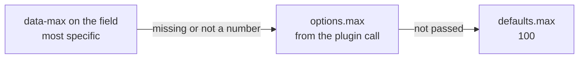
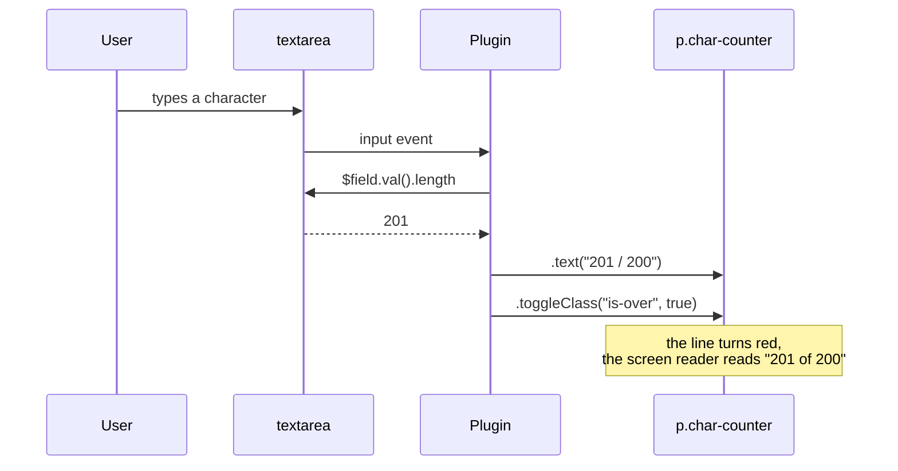
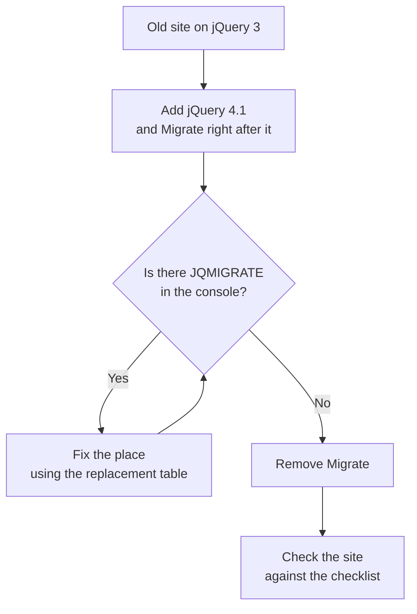

# Plugins and final project

[Contents](../../README.md) · [← Back](../../Lesson-9/en/AJAX%20-%20loading%20data.md) · [Next course: Git →](https://github.com/JLearn-space/JLearn-docs/tree/main/Git) · [RU](../ru/%D0%9F%D0%BB%D0%B0%D0%B3%D0%B8%D0%BD%D1%8B%20%D0%B8%20%D0%B8%D1%82%D0%BE%D0%B3%D0%BE%D0%B2%D1%8B%D0%B9%20%D0%BF%D1%80%D0%BE%D0%B5%D0%BA%D1%82.md) · [EN](Plugins%20and%20final%20project.md) · [UZ](../uz/Plaginlar%20va%20yakuniy%20loyiha.md)

> **Link to lesson 9:** you learned to load data with `$.getJSON`, handle the response in `.done`, `.fail` and `.always`, and show three states of the page. Now you know all the main features of jQuery. Today we will learn to **package our code into plugins**, look at what was removed in jQuery 4, and build the final project - the club website in jQuery.

---

## Why you need this

Imagine the club website has five forms, and each has a field that needs a character counter «37 / 200». You can copy the same code five times - and then fix the same bug five times. Or you can write a **plugin** once and call it with one line: `$("textarea").charCounter({ max: 200 })`.

Thousands of ready-made jQuery solutions work this way: sliders, phone number masks, dropdown lists with search. When you can write your own plugin, you understand how other people's plugins work, and you can add them, configure them and, if needed, fix them.

The second half of the lesson is the final project. You will rewrite the club website you built in the HTML, CSS and JavaScript courses in jQuery, add your own plugin and publish it on GitHub Pages.

---

## What you will learn

- Explain what a jQuery plugin is and what `$.fn` is.
- Write your own plugin: a method in `$.fn`, `return this.each(...)`, `$(this)`.
- Set default settings and merge them with the user's settings using `$.extend({}, defaults, options)`.
- Choose the order of priority: `data-*` on the element → `options` → default values.
- Protect a plugin from being called again on the same element.
- Add a third-party plugin and check that it is compatible with jQuery 4.
- Decide when to write in jQuery and when in plain JavaScript.
- Find functions removed in jQuery 4 in old code with jQuery Migrate.
- Build the final project, check it against a checklist and publish it.

---

## Review: 3 questions from lesson 9

1. What does `$.getJSON("data/events.json")` return right after the call?
2. Why is the button unlocked in `.always` and not in `.done`?
3. Why does the request not work if you open the page by double-clicking the file?

Answers are at the end of the lesson.

---

## Lesson plan

| Section | What we do |
| --- | --- |
| What is a plugin | `$.fn` - the shared set of methods of all jQuery objects |
| Your own plugin step by step | `this`, `return this.each`, `$(this)` |
| Plugin settings | `defaults`, `$.extend`, `data-max`, priorities |
| Mini-task 1 | The `$.fn.highlight` plugin |
| Repeated calls and the wrapper | Protection from duplicates, `(function ($) { ... })(jQuery)` |
| Third-party plugin | Adding, documentation, compatibility |
| jQuery or plain JavaScript | Comparison table and choice |
| jQuery 4 and jQuery Migrate | What was removed and how to find it in old code |
| Final project | Structure, loading order, site features |
| Acceptance and publishing | Checklist and GitHub Pages |
| Mini-task 2 | The `$.fn.togglePassword` plugin |
| Independent work | The `$.fn.charCounter` plugin and your own website |

---

## What is a plugin

**In simple words:** a jQuery object is a toolbox: `.text()`, `.addClass()`, `.on()`. A plugin is **a new tool that you put into this toolbox yourself**. After that it is in every toolbox: in any `$(...)` on the page.

All methods of jQuery objects are stored in one shared object - `$.fn` (read as "dollar-ef-en", from the word function). When you write `$("h1").text()`, jQuery looks for the `text` method in `$.fn`.

```js
console.log(typeof $.fn.text);   // "function" - a built-in method
console.log(typeof $.fn.hello);  // "undefined" - there is no such method yet

$.fn.hello = function () {
    console.log("Hello from the plugin!");
};

$("h1").hello(); // Hello from the plugin!
$("p").hello();  // works on any jQuery object
```

Methods are not copied into every jQuery object: all objects use one shared `$.fn`. That is why it is enough to write a method **once** - and it appears on every `$(...)`.

You can check in the console whether a plugin is loaded: `typeof $.fn.charCounter` returns `"function"` or `"undefined"`.

> **Important:** a plugin name must not match a built-in method. Writing `$.fn.text = ...` breaks `.text()` on the whole page.

---

## Your own plugin step by step

Let's write a character counter called `charCounter`. Under each `textarea` field, a line `0 / 100` appears; it updates as you type and turns red if the text is longer than the limit.

```html
<textarea id="message"></textarea>
<!-- after the plugin is called, this appears here: -->
<p class="char-counter" aria-live="polite">0 / 100</p>
```

### Step 1. What `this` is inside a plugin

Inside a plugin method, `this` is **the jQuery object** the method was called on: for `$("textarea").charCounter()` it is `$("textarea")`, and `this.length` equals the number of fields. Do not confuse this with an event handler from lesson 6: there `this` is a DOM element, and here it is a jQuery object. You do not need to wrap it in `$(this)`.

### Step 2. Iteration: `this.each` and `$(this)`

Each field needs its own counter with its own limit, so we go through the fields with `.each()` from lesson 2. **Inside** `.each`, `this` is different - a single DOM element:

```js
$.fn.charCounter = function () {
    // here this is a jQuery object with all the fields
    return this.each(function () {
        // here this is one field, a DOM element
        const $field = $(this);
        const $counter = $("<p>", { class: "char-counter" });
        $field.after($counter);
        $counter.text(`${$field.val().length} / 100`);
    });
};
```

| Where | What `this` is | What to do with it |
| --- | --- | --- |
| In the plugin body | A jQuery object with all the elements | You can call jQuery methods right away |
| Inside `this.each(function () {...})` | One DOM element | Wrap it: `const $field = $(this);` |

### Step 3. Why `return this.each(...)`

Built-in jQuery setters return the same object - that is why chains work (lesson 1). A good plugin behaves the same way. The `.each()` method returns the object it went through, and `return` passes it out - then `$("textarea").charCounter().addClass("is-ready")` works.

| The plugin ends with | What `$("textarea").charCounter()` returns | Chain |
| --- | --- | --- |
| `return this.each(...)` | The same jQuery object | Works |
| `this.each(...)` without `return` | `undefined` | `TypeError: Cannot read properties of undefined` |

If the plugin does not need separate logic for each element, you can skip `.each`: implicit iteration will do everything, for example `return this.addClass("x");`.

### Trace: a call for two fields

The page has `textarea#about` and `textarea#message`, and the call is `$("textarea").charCounter();`:

| Step | What happens | Value / page state |
| --- | --- | --- |
| 1 | `$("textarea")` finds the fields | jQuery object, `length: 2` |
| 2 | `charCounter` is called, `this` is this object | `this.length === 2` |
| 3 | `.each`: first field, `this` is `#about` | `$field` = `$(#about)` |
| 4 | A `<p>` is created and inserted after `#about` | `0 / 100` under the first field |
| 5 | `.each`: second field, `this` is `#message` | `$field` = `$(#message)` |
| 6 | A `<p>` is created after `#message` | `0 / 100` under the second field |
| 7 | `.each` finished and returned the original object | The plugin returned `$("textarea")` for the chain |

---

## Plugin settings

### Default values and `$.extend`

The user of a plugin should be able to change the limit, but should not have to. For this, the plugin accepts an `options` object and takes the missing values from the **default settings**.

**In simple words:** you order a coffee. The menu says "default: medium, with sugar". You say: "large". The barista takes the standard recipe and changes **only** what you said: large, with sugar.

The function `$.extend(target, source1, source2, ...)` merges objects: it copies the properties of the sources into the target in order, and each next one overwrites the previous one.

```js
const defaults = { max: 100, overClass: "is-over" };
const options = { max: 200 };

const settings = $.extend({}, defaults, options);
console.log(settings); // { max: 200, overClass: "is-over" }
console.log(defaults); // { max: 100, overClass: "is-over" } - not changed
```

| Step | What happens | Value of `settings` |
| --- | --- | --- |
| 1 | The target is a new empty object `{}` | `{}` |
| 2 | The properties of `defaults` are copied | `{ max: 100, overClass: "is-over" }` |
| 3 | The properties of `options` are copied, `max` is overwritten | `{ max: 200, overClass: "is-over" }` |
| 4 | If `options` = `undefined` (the plugin was called without an argument) | The source is skipped: `{ max: 100, overClass: "is-over" }` |

> **Important:** always pass **a new empty object** `{}` as the first argument. Writing `$.extend(defaults, options)` puts `max: 200` straight into `defaults` - and all later plugin calls without settings get 200 instead of 100.

In plain JavaScript, `Object.assign({}, defaults, options)` or `{ ...defaults, ...options }` does the same. There is one difference: `$.extend` skips properties whose value is `undefined`, so `{ max: undefined }` does not erase the default limit.

### Settings from `data-*` on the element

Sometimes it is easier to write the limit right in the HTML, on a specific field: `<textarea data-max="50">`. You already read such attributes with `.data()` in lesson 3: `$field.data("max")` returns the **number** `50`.

Now the limit has three sources. We need to decide which one is more important. The course uses the rule **"the closer to the element, the more important"** - like in CSS, where a style in the `style` attribute is stronger than a rule from a file:



**How to read the diagram.** The plugin first looks at the field's attribute. If there is a number there, it takes it. If not, it looks at the call settings, and if those are empty too - at the default values. This way one call `$("textarea").charCounter({ max: 200 })` can serve all the fields of a form, and a single field with `data-max="50"` gets its own limit.

```js
const max = Number($field.data("max")) || settings.max;
```

| Attribute on the field | `Number($field.data("max"))` | Final `max` when `settings.max = 200` |
| --- | --- | --- |
| `data-max="50"` | `50` | `50` |
| no attribute | `Number(undefined)` → `NaN` | `200` |
| `data-max="abc"` | `NaN` | `200` |
| `data-max=""` | `0` | `200` |

The `||` operator returns the right value if the left one is "falsy": `NaN` and `0` are exactly that. The result is a short way to say "the number from the attribute, and if there is none - from the settings".

---

## Mini-task 1

Write a plugin `$.fn.highlight(options)`. Default settings: `{ className: "is-highlighted" }`. The plugin adds the class `settings.className` to all elements and returns the jQuery object for chaining. Call it for all `.price` elements with the class `is-sale`, and in the same chain give them a `title` attribute with the value `Sale`. You do not need `.each` here - implicit iteration is enough.

```html
<p class="price">1 200 sum</p>
<p class="price">900 sum</p>
```

---

## Repeated calls and the plugin wrapper

### Protection from repeated calls

What happens if you call a plugin twice? For example, one script called `$("textarea").charCounter()`, and another one, later, called it again for all fields. Without protection, each field gets **two** counters and two `input` handlers.

The solution: after creating the counter, put a "mark" on the field with `.data()`, and check it at the start of the loop:

```js
return this.each(function () {
    const $field = $(this);

    if ($field.data("charCounter")) {
        return; // the counter already exists - skip the field
    }

    // ... create the counter ...
    $field.data("charCounter", true);
});
```

`return` inside the `.each` function means "go to the next element". You can stop the loop completely with `return false`, but you do not need that here.

**In simple words:** it is like a "vaccinated" mark in a register. The nurse looks at the register first - and does not give the shot a second time.

### The `(function ($) { ... })(jQuery)` wrapper

Plugins are usually wrapped in a function that is **called right away**:

```js
(function ($) {
    const defaults = { max: 100 };

    $.fn.charCounter = function (options) {
        // ...
    };
})(jQuery);
```

The wrapper gives three things: `defaults` is visible only inside and does not clash with a variable from another file; `$` inside is definitely jQuery, even if another library on the site has taken this name (this happens in WordPress); the file can be copied into any project. This is similar to modules from the JavaScript course, but it works in a regular `<script>`.

### The finished plugin

Put together the skeleton, the settings, the limit from `data-max` and the protection from repeated calls - and you get the file `js/jquery.char-counter.js` from the [final project](../../final-project/README.md). You will write it in full yourself in the IDE task, and you can compare it with the [sample](../../final-project/final/js/jquery.char-counter.js). The finished plugin has a few more details:

| Line | Why |
| --- | --- |
| `counterClass`, `overClass` in `defaults` | Class names can also be changed in the call: `{ overClass: "too-long" }` |
| `"aria-live": "polite"` | A screen reader announces the new number when the user pauses |
| `update()` at the end | If the field already has text (the browser restored it after "Back"), the counter is correct right away |
| `"input.charCounter"` | A namespace from lesson 6: `$field.off(".charCounter")` removes only the plugin's handlers |
| `length > max` | Exactly 200 characters out of 200 is not over the limit yet |



**How to read the diagram.** The plugin does not store the text itself: on each input it reads the length from the field again and redraws the counter. The state lives in the field itself, so the counter cannot "drift apart" from what the user sees.

---

## Adding a third-party plugin

Ready-made plugins are added the same way as yours: as a separate file **after** jQuery and **before** the code that calls them.

```html
<script src="https://code.jquery.com/jquery-4.1.0.min.js"></script>
<script src="js/vendor/select2.min.js" defer></script>
<script src="js/main.js" defer></script>
```

```js
// main.js - a call as described in the plugin documentation
$("#city").select2({ placeholder: "Choose a city" });
```

How to work with a third-party plugin: read the README (how to call it, what settings it has, whether it needs its own CSS) → check the date of the last update and jQuery 4 support → add the file after jQuery → check `typeof $.fn.select2` in the console → call it with minimal settings and add your own.

> **Important:** many old plugins were written for jQuery 1–3 and call functions removed in jQuery 4. If after adding one the console shows `$.isArray is not a function` or a similar error, the plugin has not been updated. A temporary fix is jQuery Migrate (see below); a permanent one is an updated version or a different plugin.

---

## jQuery or plain JavaScript

You know both ways of writing code. This is how they match:

| Task | jQuery | Plain JavaScript |
| --- | --- | --- |
| Find elements | `$(".card")` | `document.querySelectorAll(".card")` |
| Text | `$el.text("Hello")` | `el.textContent = "Hello"` |
| Class by condition | `$el.toggleClass("is-open", isOpen)` | `el.classList.toggle("is-open", isOpen)` |
| Create an element | `$("<li>", { text: name })` | `document.createElement("li")` + `textContent` |
| Event | `$el.on("click", fn)` | `el.addEventListener("click", fn)` |
| Delegation | `$list.on("click", ".item", fn)` | `list.addEventListener("click", ...)` + `event.target.closest(".item")` |
| Smooth hiding | `$el.slideUp(200)` | CSS `transition` + class |
| Load JSON | `$.getJSON(url).done(fn)` | `fetch(url).then((r) => r.json()).then(fn)` |
| Merge settings | `$.extend({}, defaults, options)` | `{ ...defaults, ...options }` |

**How to choose:**

| Choose jQuery if | Choose plain JavaScript if |
| --- | --- |
| The site already uses jQuery: WordPress, Bootstrap 4, an old project | A new project without old code |
| You need a ready-made plugin that has no replacement | The script is small: the library weighs more than the code |
| You need ready-made effects `slideToggle`, `fadeIn` | You are moving to React or Vue - jQuery is not used there |

The main thing is **not to mix them without a reason**. If a file already uses `$`, write in jQuery; if the project has no jQuery, do not add it for one button.

---

## jQuery 4 and jQuery Migrate

### What was removed in jQuery 4

jQuery 4.0 (January 2026) removed functions that JavaScript itself has had for a long time. If you see them in old code, replace them:

| Removed in jQuery 4 | Replacement |
| --- | --- |
| `$.trim(str)` | `str.trim()` |
| `$.isArray(x)` | `Array.isArray(x)` |
| `$.isFunction(x)` | `typeof x === "function"` |
| `$.isNumeric(x)` | `Number.isFinite(Number(x))` |
| `$.parseJSON(str)` | `JSON.parse(str)` |
| `$.now()`, `$.type(x)` | `Date.now()`, `typeof x` |
| `$.unique(arr)` | `$.uniqueSort(arr)` |
| `$el.push()`, `.sort()`, `.splice()` | `$el.get()` gives an array - array methods work with it |
| `.toggleClass(true)` without a class name | `.toggleClass("name", true)` |

Two more changes in behavior:

- `.css("font-size", 20)` - for most properties, a number without units no longer gets `px` added (`px` is added automatically only to sizes and spacing). In the course, always write units: `.css("font-size", "20px")`.
- `$.ajax` no longer turns a JSON request into JSONP on its own.

**Deprecated** forms that still work are not used in new code: `$(document).ready(fn)` (write `defer` or `$(fn)`), the shortcuts `.click(fn)`, `.submit(fn)`, `.hover(...)`, `.bind()`, `.delegate()` (write `.on(...)`), the positional pseudo-classes `:first`, `:eq(2)`, `:even` (write `.first()`, `.eq(2)`, `.filter(...)`).

### jQuery Migrate

**In simple words:** jQuery Migrate is an interpreter for the time of the move. The old code speaks "jQuery 3 language", the interpreter understands it and at the same time writes every outdated word in a notebook. When everything in the notebook is fixed, the interpreter is no longer needed.

Migrate is a separate file from the jQuery team. It is added **right after** jQuery: it brings back many removed functions and prints a warning to the console every time one of them is used.

```html
<script src="https://code.jquery.com/jquery-4.1.0.min.js"></script>
<script src="https://code.jquery.com/jquery-migrate-4.0.2.js"></script>
<script src="js/main.js" defer></script>
```

Lines starting with `JQMIGRATE:` appear in the console, for example a warning about `jQuery.trim`. Each one points to a place that needs to be rewritten. For searching, use the uncompressed version of Migrate (without `.min`): its messages are more detailed.



**How to read the diagram.** Migrate is a temporary support, not a permanent part of the site. The "warning → fix" loop repeats until the console is clean. Only after that is the Migrate file removed and the site checked once more.

---

### Try to break it

1. Remove `return` before `this.each` and call `$("textarea").charCounter().addClass("x")`. What error does the console show?
2. Replace `$.extend({}, defaults, options)` with `$.extend(defaults, options)`. Call the plugin first with `{ max: 10 }` for one field, then without settings for another. What is the limit of the second one?
3. Delete the check `if ($field.data("charCounter"))` and call the plugin twice. How many counters are under the field?
4. Inside `.each`, write `this.val()` instead of `$(this).val()`. What does the console say?
5. Add the plugin file **before** jQuery. What error appears, and in which file?
6. Call `$.trim(" a ")` in the console with jQuery 4.1, and then with Migrate added. How does the result differ?

### Typical beginner mistakes

| Mistake | What you get | How to fix |
| --- | --- | --- |
| No `return` before `this.each` | A chain after the plugin: `Cannot read properties of undefined` | `return this.each(...)` |
| `$.extend(defaults, options)` | The settings of one call "stick" to all the next ones | `$.extend({}, defaults, options)` |
| `this.val()` inside `.each` | `this.val is not a function`: `this` is a DOM element | `const $field = $(this);` |
| No protection from repeated calls | Two counters under one field | The mark `$field.data("charCounter", true)` and a check |
| `update()` only in the `input` handler | The counter is empty until the first input | Call `update()` right after creating the counter |
| `length >= max` | Exactly 200 out of 200 is already "red" | Strictly `length > max` |
| The plugin file is loaded after `main.js` | `$(...).charCounter is not a function` | jQuery → plugin → `main.js` |
| The plugin name matches a built-in one | A jQuery method breaks on the whole page | A unique name: `charCounter`, not `text` |

---

## Final project

The finished sample is in the [final-project](../../final-project/README.md) folder. It is the club website from the JavaScript course, rewritten in jQuery 4.1 - compare your work with it, but build your project on **your own** website from the HTML, CSS and JavaScript courses.

### Interaction map

The project must be able to do six things: the menu, the theme, the event listings from `data/events.json`, the "FAQ" accordion, the form with validation and the character counter on your own plugin. As in the JavaScript course, first the behavior plan, then the code:

| Element | Event | What changes | For screen readers | Lessons |
| --- | --- | --- | --- | --- |
| `.menu-toggle` | `click` | `#site-nav` gets `is-open` | `aria-expanded` | 4, 6 |
| `document` | `keydown` Escape | Menu closed, focus on the button | `aria-expanded="false"` | 6 |
| `.theme-toggle` | `click` | `body.theme-dark` | `aria-pressed`, `localStorage` | 4, 9 |
| `.filters` | `click` on `[data-filter]` | Listings redrawn | `aria-pressed` | 5, 6, 9 |
| `.faq` | `click` on `.faq__question` | One answer open, `prefers-reduced-motion` | `aria-expanded` | 7 |
| `#message` | `input` | Counter, `is-over` | `aria-live="polite"` | 10 |
| `#contact-form` | `submit` | Errors or a thank-you message | `aria-invalid`, `role="status"` | 3, 8 |

### The structure of the `js/` folder and the loading order

```text
my-site/
├── index.html
├── contact.html
├── css/style.css
├── data/
│   └── events.json
└── js/
    ├── jquery.char-counter.js   ← plugin: only $.fn.charCounter
    └── main.js                  ← site code: init... functions
```

```html
<script src="https://code.jquery.com/jquery-4.1.0.min.js"></script>
<script src="js/jquery.char-counter.js" defer></script>
<script src="js/main.js" defer></script>
```

Scripts with `defer` run **in the order of the tags**, after the HTML is parsed. The order matters: the plugin needs `$`, and `main.js` calls the plugin. Swap the last two tags - and `main.js` fails with the error `charCounter is not a function`. By tradition, plugin file names start with `jquery.`: you can see right away that the file needs jQuery.

### `init...` functions and the `.length` check

One `main.js` is loaded on all pages, but the form exists only on the contacts page. So each function first looks for its elements and exits if there are none. In jQuery, "nothing found" is `length === 0`, not `null`:

```js
function initContactForm() {
    const $form = $("#contact-form");
    if ($form.length === 0) {
        return; // there is no form on this page
    }
    $("#message").charCounter({ max: 200 }); // our own plugin
    // ... form validation from lesson 8
}

$("html").addClass("js"); // progressive enhancement
initMenu();
initTheme();
initEvents();
initContactForm();
initFaq();
```

The line `$("html").addClass("js")` is progressive enhancement from the JavaScript course: the CSS rules that hide the menu and the accordion answers are written with the `.js` prefix, so without the script all the content is visible.

---

## Acceptance and publishing

### Acceptance checklist

Check the site **on every page**, locally with Live Server:

- [ ] Console: not a single error and not a single `JQMIGRATE` on all pages.
- [ ] Network: jQuery, the plugin, `main.js` and `data/events.json` load without 404.
- [ ] Menu: opens and closes with the button and Escape, focus returns to the button.
- [ ] Theme: is kept after a reload and after going to another page.
- [ ] Listings: each filter button is correct; there is "Loading...", an empty category and an error with a broken path to the JSON.
- [ ] Accordion: only one answer is open; with `prefers-reduced-motion` - no animation.
- [ ] Form: errors next to the fields, `aria-invalid`, a thank-you message without a reload.
- [ ] Counter: the correct number right away, red when over the limit, `0 / 200` again after the form is reset.
- [ ] Keyboard: everything works with Tab, Enter, Space, Escape.
- [ ] Without JavaScript the content is available; widths 375 px and 1440 px.
- [ ] Code: no `var`, `==`, `.html()` with data, `onclick`, `.click(fn)`, or functions removed in jQuery 4.

### Publishing on GitHub Pages

Upload the update through the web interface (**Add file** → **Upload files** → the files and the `js/`, `data/`, `css/` folders → **Commit changes**), or with Git:

```bash
git add .
git commit -m "Site on jQuery 4.1: menu, theme, listings, accordion, form, charCounter plugin"
git push
```

After 1–2 minutes, go through the checklist **once more** on the published site:

| Problem on Pages | Cause and solution |
| --- | --- |
| 404 for `js/jquery.Char-Counter.js` | Pages is case-sensitive: the name in the tag and the file name must match letter for letter |
| `$.getJSON` does not find the data | A path starting with `/` leads to the root of the domain, but the site is in a subfolder of the repository. Write `data/events.json` |
| You see an old version | Browser cache: **Ctrl+Shift+R** |

---

## Mini-task 2

Write a plugin `$.fn.togglePassword(options)` - a "Show password" button next to the field.

```html
<label for="password">Password</label>
<input type="password" id="password">
```

1. Default settings: `{ showText: "Show", hideText: "Hide" }`, merged with `$.extend`.
2. For each field, create right after it a `<button type="button" class="password-toggle" aria-pressed="false">` with the text `settings.showText`.
3. A click on the button switches the field's `type` between `password` and `text`, the button text between `showText` and `hideText`, and `aria-pressed` between `"false"` and `"true"`.
4. A repeated call does not create a second button; the plugin returns the jQuery object.
5. Call the plugin for all `input[type="password"]` with `{ showText: "Show password" }`.

---

## Lesson summary: cheat sheet

| Task | Code |
| --- | --- |
| Declare a plugin | `$.fn.charCounter = function (options) { ... };` |
| Wrap the plugin file | `(function ($) { ... })(jQuery);` |
| Go through the elements and return the object | `return this.each(function () { ... });` |
| The element inside `.each` | `const $field = $(this);` |
| Merge settings | `const settings = $.extend({}, defaults, options);` |
| Limit from the attribute or the settings | `Number($field.data("max")) \|\| settings.max` |
| Protection from repeated calls | `if ($field.data("charCounter")) { return; }` + `$field.data("charCounter", true)` |
| Find outdated code | jQuery Migrate right after jQuery, `JQMIGRATE` messages |
| Loading order | jQuery → plugins → `main.js` |
| Page function | `if ($el.length === 0) { return; }` at the start of `init...` |

---

## Independent work

### Part 1. IDE task (graded by the platform)

The page has a form `#signup-form` with the fields `textarea#about` (`data-max="50"`) and `textarea#message` (without `data-max`). jQuery is already loaded. Write a plugin `$.fn.charCounter(options)`:

1. Default settings `defaults = { max: 100, counterClass: "char-counter", overClass: "is-over" }`; inside the plugin, merge them with `options` using `$.extend({}, defaults, options)`, without changing `defaults`.
2. Go through the fields with `return this.each(...)` so that the plugin can be continued with a chain.
3. If the field already has a counter (a repeated call), skip the field.
4. The field's limit is the number from `data-max` if there is one, otherwise `settings.max`.
5. Right after the field, create a `<p>` with the class `settings.counterClass` and `aria-live="polite"`.
6. The counter text is `N / limit`, where N is the number of characters; update it right away and on every `input` event; the class `settings.overClass` - only when N is greater than the limit.
7. Call the plugin for all `textarea` elements of the form `#signup-form` with `{ max: 200 }`.

Do not use `document.querySelector`, `innerHTML`, `.html()` or `addEventListener`.

What the platform checks: that the plugin is declared and creates `p.char-counter` with `aria-live` right after each field; that `data-max` has priority over `options` and the default limit is 100; updating on input and counting text that is already there; the boundary "exactly the limit - without `is-over`, more - with `is-over`"; that a repeated call does not create a second counter; that the plugin returns the same object for chaining; that `defaults` does not change after a call with settings; that `counterClass` and `overClass` work; that the code runs without errors.

### Part 2. Project on your computer

1. Fill in the interaction map for your website from the HTML, CSS and JavaScript courses.
2. Rewrite `main.js` from the JavaScript course in jQuery: the menu, the theme, the listings via `$.getJSON`, the form. Replace the `import`/`export` modules with `init...` functions in one file.
3. Add the "FAQ" accordion from lesson 7 and connect your own `charCounter` plugin to the message field in the form.
4. Go through the acceptance checklist locally, then publish the site on GitHub Pages and go through the checklist again.
5. Add a "jQuery" section to the repository's `README.md`: which features use jQuery, what plugin you wrote and how to call it.

### Acceptance criteria

- [ ] The IDE task is accepted.
- [ ] The plugin is in a separate file `js/jquery.char-counter.js` and is loaded between jQuery and `main.js`.
- [ ] All six features of the final project work on the published site.
- [ ] The Console is clean on all pages, and the code has no functions removed in jQuery 4.
- [ ] You can explain the order of setting priorities and why `return this.each(...)` is needed.

---

## Self-check questions

1. What is `$.fn`, and why does a method added to it appear on all jQuery objects?
2. What is `this` in the plugin body, and what is it inside `this.each(function () {...})`?
3. Why does a plugin return `this.each(...)`? What breaks without `return`?
4. What does `$.extend({}, defaults, options)` do? Why is `{}` the first argument?
5. What is the priority order of the limit in `charCounter`, and why this order?
6. How do you protect a plugin from being called again on the same element?
7. Why is a plugin file wrapped in `(function ($) { ... })(jQuery)`?
8. In what order do you load jQuery, the plugin and `main.js`, and why?
9. Name three functions removed in jQuery 4 and their replacements. How do you find them in old code?
10. When is plain JavaScript a better choice for a new task, and when is jQuery?

After the questions, take the **lesson test** on the platform: 12 questions, pass mark 70%.

---

## What's next

Congratulations: you have finished the jQuery course! Now you can read and write code in jQuery 4.1, package it into plugins and move old sites to the new version. You have a published website that has everything: from the menu to loading data and your own plugin. Where to go next:

- **Real jQuery sites:** WordPress themes, Bootstrap 4, admin panels. Try to find jQuery code on a site you know and figure out what it does.
- **Deeper into JavaScript and frameworks:** classes, npm, TypeScript, then React or Vue - the same data, rendering and events for large interfaces.
- **The server:** PHP or Node.js - your own API where your form sends data with `$.post`.

Follow new courses on [jlearn.space](https://jlearn.space).

---

## Answers

**Review**

1. A jqXHR object - the "tracking number" of the request, not the data. The data comes later in `.done`.
2. `.always` runs both on success and on error; if you unlock the button only in `.done`, it stays locked after an error.
3. The browser does not allow loading files from a `file://` address. You need Live Server or a published site.

**Mini-task 1**

```js
(function ($) {
    const defaults = { className: "is-highlighted" };

    $.fn.highlight = function (options) {
        const settings = $.extend({}, defaults, options);
        return this.addClass(settings.className);
    };
})(jQuery);

$(".price")
    .highlight({ className: "is-sale" })
    .attr("title", "Sale");
```

`.addClass` applies itself to all elements and returns the same object, so `.each` is not needed.

**Mini-task 2**

```js
(function ($) {
    const defaults = { showText: "Show", hideText: "Hide" };

    $.fn.togglePassword = function (options) {
        const settings = $.extend({}, defaults, options);

        return this.each(function () {
            const $input = $(this);
            if ($input.data("togglePassword")) {
                return;
            }

            const $button = $("<button>", {
                type: "button",
                class: "password-toggle",
                text: settings.showText,
                "aria-pressed": "false"
            });
            $input.after($button).data("togglePassword", true);

            $button.on("click", function () {
                const isHidden = $input.attr("type") === "password";
                $input.attr("type", isHidden ? "text" : "password");
                $button
                    .text(isHidden ? settings.hideText : settings.showText)
                    .attr("aria-pressed", String(isHidden));
            });
        });
    };
})(jQuery);

$("input[type=password]").togglePassword({ showText: "Show password" });
```

**Self-check questions**

1. A shared object with the methods of all jQuery objects. Objects do not store methods themselves but take them from `$.fn`, so a new method is immediately available on any `$(...)`.
2. In the plugin body - a jQuery object with all the elements found; inside `.each` - one DOM element, which is wrapped in `$(this)`.
3. To process each element and return the same object for chaining. Without `return`, the plugin returns `undefined`, and `.charCounter().addClass(...)` throws an error.
4. It creates a new object: first the properties of `defaults`, then `options` on top. The empty `{}` is needed so that `defaults` itself is not changed.
5. `data-max` on the field → `options.max` → `defaults.max` (100). The closer a setting is to the element, the more specific it is: one call for the whole form, and a separate field gets its own limit in the HTML.
6. Put the mark `$field.data("charCounter", true)` after creating the counter, and at the start of `.each` exit with `return` if the mark is already there.
7. The plugin's variables (for example, `defaults`) do not go into the shared scope and do not clash with other files, and `$` inside is guaranteed to be jQuery.
8. jQuery → plugin → `main.js`. The plugin needs `$`, and `main.js` calls the plugin; scripts with `defer` run in the order of the tags.
9. For example, `$.trim` → `str.trim()`, `$.isArray` → `Array.isArray`, `$.parseJSON` → `JSON.parse`. Add jQuery Migrate after jQuery and read the `JQMIGRATE` warnings in the console.
10. Plain JavaScript - for a new project without jQuery and for small scripts where page weight matters. jQuery - if the site already uses it, if you need a ready-made plugin, or if there are many actions on many elements.

[Contents](../../README.md) · [← Back](../../Lesson-9/en/AJAX%20-%20loading%20data.md) · [Next course: Git →](https://github.com/JLearn-space/JLearn-docs/tree/main/Git) · [RU](../ru/%D0%9F%D0%BB%D0%B0%D0%B3%D0%B8%D0%BD%D1%8B%20%D0%B8%20%D0%B8%D1%82%D0%BE%D0%B3%D0%BE%D0%B2%D1%8B%D0%B9%20%D0%BF%D1%80%D0%BE%D0%B5%D0%BA%D1%82.md) · [EN](Plugins%20and%20final%20project.md) · [UZ](../uz/Plaginlar%20va%20yakuniy%20loyiha.md)
