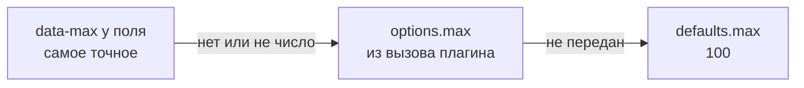
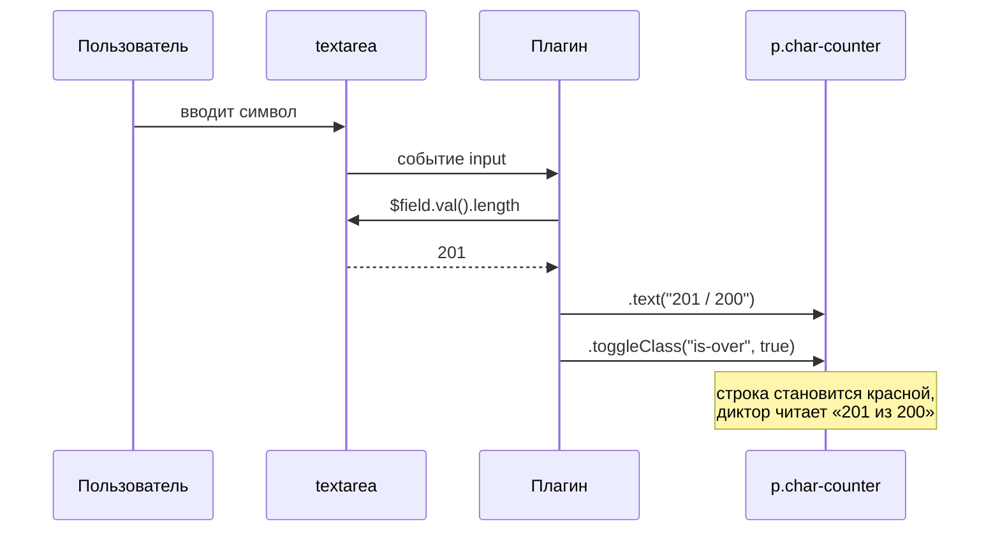
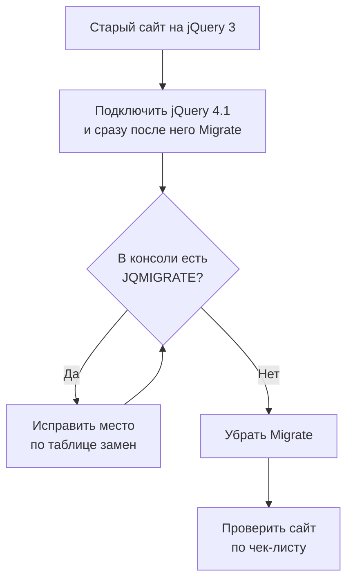

# Плагины и итоговый проект

[Содержание](../../README.md) · [← Назад](../../Lesson-9/ru/AJAX%20-%20%D0%B7%D0%B0%D0%B3%D1%80%D1%83%D0%B7%D0%BA%D0%B0%20%D0%B4%D0%B0%D0%BD%D0%BD%D1%8B%D1%85.md) · [Следующий курс: Git →](https://github.com/JLearn-space/JLearn-docs/tree/main/Git) · [RU](%D0%9F%D0%BB%D0%B0%D0%B3%D0%B8%D0%BD%D1%8B%20%D0%B8%20%D0%B8%D1%82%D0%BE%D0%B3%D0%BE%D0%B2%D1%8B%D0%B9%20%D0%BF%D1%80%D0%BE%D0%B5%D0%BA%D1%82.md) · [EN](../en/Plugins%20and%20final%20project.md) · [UZ](../uz/Plaginlar%20va%20yakuniy%20loyiha.md)

> **Связь с уроком 9:** вы научились загружать данные через `$.getJSON`, обрабатывать ответ в `.done`, `.fail` и `.always` и показывать три состояния страницы. Теперь вы знаете все основные возможности jQuery. Сегодня научимся **упаковывать свой код в плагины**, разберёмся, что убрали в jQuery 4, и соберём итоговый проект - сайт кружка на jQuery.

---

## Зачем это вам

Представьте: на сайте кружка пять форм, и в каждой есть поле, где нужен счётчик символов «37 / 200». Можно пять раз скопировать один и тот же код - и потом пять раз исправлять в нём одну и ту же ошибку. А можно один раз написать **плагин** и вызывать его одной строкой: `$("textarea").charCounter({ max: 200 })`.

Так устроены тысячи готовых решений для jQuery: слайдеры, маски телефона, выпадающие списки с поиском. Умея писать свой плагин, вы понимаете, как работают чужие, и можете подключить их, настроить и, если нужно, починить.

Вторая половина урока - итоговый проект. Сайт кружка, который вы строили в курсах HTML, CSS и JavaScript, вы перепишете на jQuery, добавите свой плагин и опубликуете на GitHub Pages.

---

## Чему вы научитесь

- Объяснять, что такое плагин jQuery и что такое `$.fn`.
- Писать свой плагин: метод в `$.fn`, `return this.each(...)`, `$(this)`.
- Задавать настройки по умолчанию и объединять их с настройками пользователя через `$.extend({}, defaults, options)`.
- Выбирать порядок приоритетов: `data-*` у элемента → `options` → значения по умолчанию.
- Защищать плагин от повторного вызова на том же элементе.
- Подключать чужой плагин и проверять, что он совместим с jQuery 4.
- Решать, когда писать на jQuery, а когда - на чистом JavaScript.
- Находить в старом коде функции, удалённые в jQuery 4, с помощью jQuery Migrate.
- Собирать, проверять по чек-листу и публиковать итоговый проект.

---

## Повторение: 3 вопроса из урока 9

1. Что возвращает `$.getJSON("data/events.json")` сразу после вызова?
2. Почему разблокировку кнопки пишут в `.always`, а не в `.done`?
3. Почему запрос не работает, если открыть страницу двойным кликом по файлу?

Ответы - в конце урока.

---

## План урока

| Раздел | Что делаем |
| --- | --- |
| Что такое плагин | `$.fn` - общий набор методов всех jQuery-объектов |
| Свой плагин по шагам | `this`, `return this.each`, `$(this)` |
| Настройки плагина | `defaults`, `$.extend`, `data-max`, приоритеты |
| Мини-задание 1 | Плагин `$.fn.highlight` |
| Повторный вызов и обёртка | Защита от дублей, `(function ($) { ... })(jQuery)` |
| Чужой плагин | Подключение, документация, совместимость |
| jQuery или чистый JavaScript | Таблица соответствий и выбор |
| jQuery 4 и jQuery Migrate | Что удалено и как найти это в старом коде |
| Итоговый проект | Структура, порядок подключения, функции сайта |
| Приёмка и публикация | Чек-лист и GitHub Pages |
| Мини-задание 2 | Плагин `$.fn.togglePassword` |
| Самостоятельная работа | Плагин `$.fn.charCounter` и свой сайт |

---

## Что такое плагин

**Простыми словами:** jQuery-объект - это ящик с инструментами: `.text()`, `.addClass()`, `.on()`. Плагин - это **новый инструмент, который вы сами кладёте в этот ящик**. После этого он есть в каждом ящике: у любого `$(...)` на странице.

Все методы jQuery-объектов хранятся в одном общем объекте - `$.fn` (читается «доллар-эф-эн», от слова function). Когда вы пишете `$("h1").text()`, jQuery ищет метод `text` именно в `$.fn`.

```js
console.log(typeof $.fn.text);   // "function" - встроенный метод
console.log(typeof $.fn.hello);  // "undefined" - такого метода пока нет

$.fn.hello = function () {
    console.log("Привет от плагина!");
};

$("h1").hello(); // Привет от плагина!
$("p").hello();  // работает у любого jQuery-объекта
```

Методы не копируются в каждый jQuery-объект: все объекты пользуются одним общим `$.fn`. Поэтому достаточно **один раз** записать метод - и он появится у всех `$(...)`.

Проверить, подключён ли плагин, можно в консоли: `typeof $.fn.charCounter` вернёт `"function"` или `"undefined"`.

> **Важно:** имя плагина не должно совпадать со встроенным методом. Запись `$.fn.text = ...` сломает `.text()` на всей странице.

---

## Свой плагин по шагам

Напишем счётчик символов `charCounter`. Под каждым полем `textarea` появится строка `0 / 100`, которая обновляется при вводе и краснеет, если текст длиннее лимита.

```html
<textarea id="message"></textarea>
<!-- после вызова плагина здесь появится: -->
<p class="char-counter" aria-live="polite">0 / 100</p>
```

### Шаг 1. Что такое `this` внутри плагина

Внутри метода плагина `this` - это **тот jQuery-объект**, у которого метод вызвали: при `$("textarea").charCounter()` это `$("textarea")`, и `this.length` равен числу полей. Не путайте с обработчиком события из урока 6: там `this` - DOM-элемент, а здесь - jQuery-объект. Оборачивать его в `$(this)` не нужно.

### Шаг 2. Перебор: `this.each` и `$(this)`

Каждому полю нужен свой счётчик со своим лимитом, поэтому поля перебираются через `.each()` из урока 2. **Внутри** `.each` `this` уже другой - отдельный DOM-элемент:

```js
$.fn.charCounter = function () {
    // здесь this - jQuery-объект со всеми полями
    return this.each(function () {
        // здесь this - одно поле, DOM-элемент
        const $field = $(this);
        const $counter = $("<p>", { class: "char-counter" });
        $field.after($counter);
        $counter.text(`${$field.val().length} / 100`);
    });
};
```

| Где | Чему равен `this` | Что с ним делать |
| --- | --- | --- |
| В теле плагина | jQuery-объект со всеми элементами | Можно сразу вызывать методы jQuery |
| Внутри `this.each(function () {...})` | Один DOM-элемент | Обернуть: `const $field = $(this);` |

### Шаг 3. Зачем `return this.each(...)`

Встроенные сеттеры jQuery возвращают тот же объект - поэтому работают цепочки (урок 1). Хороший плагин ведёт себя так же. Метод `.each()` возвращает объект, который перебирал, и `return` отдаёт его наружу - тогда работает `$("textarea").charCounter().addClass("is-ready")`.

| Плагин заканчивается на | Что вернёт `$("textarea").charCounter()` | Цепочка |
| --- | --- | --- |
| `return this.each(...)` | Тот же jQuery-объект | Работает |
| `this.each(...)` без `return` | `undefined` | `TypeError: Cannot read properties of undefined` |

Если плагину не нужна своя логика для каждого элемента, `.each` можно не писать: неявный перебор сделает всё сам, например `return this.addClass("x");`.

### Трассировка: вызов для двух полей

На странице `textarea#about` и `textarea#message`, вызов `$("textarea").charCounter();`:

| Шаг | Что происходит | Значение / состояние страницы |
| --- | --- | --- |
| 1 | `$("textarea")` находит поля | jQuery-объект, `length: 2` |
| 2 | Вызывается `charCounter`, `this` - этот объект | `this.length === 2` |
| 3 | `.each`: первое поле, `this` - `#about` | `$field` = `$(#about)` |
| 4 | Создаётся `<p>` и вставляется после `#about` | Под первым полем `0 / 100` |
| 5 | `.each`: второе поле, `this` - `#message` | `$field` = `$(#message)` |
| 6 | Создаётся `<p>` после `#message` | Под вторым полем `0 / 100` |
| 7 | `.each` закончился и вернул исходный объект | Плагин вернул `$("textarea")` для цепочки |

---

## Настройки плагина

### Значения по умолчанию и `$.extend`

Пользователь плагина должен иметь возможность поменять лимит, но не обязан это делать. Для этого плагин принимает объект `options`, а недостающие значения берёт из **настроек по умолчанию**.

**Простыми словами:** вы заказываете кофе. В меню написано «по умолчанию: средний, с сахаром». Вы говорите: «большой». Бариста берёт стандартный рецепт и меняет в нём **только** то, что вы сказали: большой, с сахаром.

Склеивает объекты функция `$.extend(цель, источник1, источник2, ...)`: копирует свойства источников в цель по порядку, и каждый следующий перезаписывает предыдущий.

```js
const defaults = { max: 100, overClass: "is-over" };
const options = { max: 200 };

const settings = $.extend({}, defaults, options);
console.log(settings); // { max: 200, overClass: "is-over" }
console.log(defaults); // { max: 100, overClass: "is-over" } - не изменился
```

| Шаг | Что происходит | Значение `settings` |
| --- | --- | --- |
| 1 | Цель - новый пустой объект `{}` | `{}` |
| 2 | Копируются свойства `defaults` | `{ max: 100, overClass: "is-over" }` |
| 3 | Копируются свойства `options`, `max` перезаписан | `{ max: 200, overClass: "is-over" }` |
| 4 | Если `options` = `undefined` (плагин вызван без аргумента) | Источник пропускается: `{ max: 100, overClass: "is-over" }` |

> **Важно:** первым аргументом всегда передавайте **новый пустой объект** `{}`. Запись `$.extend(defaults, options)` запишет `max: 200` прямо в `defaults` - и все следующие вызовы плагина без настроек получат 200 вместо 100.

В чистом JavaScript то же самое делает `Object.assign({}, defaults, options)` или запись `{ ...defaults, ...options }`. Разница одна: `$.extend` пропускает свойства со значением `undefined`, поэтому `{ max: undefined }` не сотрёт лимит по умолчанию.

### Настройка из `data-*` у элемента

Иногда лимит удобнее записать прямо в HTML, у конкретного поля: `<textarea data-max="50">`. Вы уже читали такие атрибуты через `.data()` в уроке 3: `$field.data("max")` вернёт **число** `50`.

Теперь у лимита три источника. Нужно решить, какой важнее. В курсе действует правило **«чем ближе к элементу, тем важнее»** - как в CSS, где стиль в атрибуте `style` сильнее правила из файла:



**Как читать схему.** Плагин сначала смотрит на атрибут поля. Если там число - берёт его. Если нет - смотрит в настройки вызова, а если и там пусто - в значения по умолчанию. Так одним вызовом `$("textarea").charCounter({ max: 200 })` можно обслужить все поля формы, а одному полю с `data-max="50"` дать свой лимит.

```js
const max = Number($field.data("max")) || settings.max;
```

| Атрибут у поля | `Number($field.data("max"))` | Итоговый `max` при `settings.max = 200` |
| --- | --- | --- |
| `data-max="50"` | `50` | `50` |
| нет атрибута | `Number(undefined)` → `NaN` | `200` |
| `data-max="abc"` | `NaN` | `200` |
| `data-max=""` | `0` | `200` |

Оператор `||` возвращает правое значение, если левое «ложное»: `NaN` и `0` как раз такие. Получается короткая запись «число из атрибута, а если его нет - из настроек».

---

## Мини-задание 1

Напишите плагин `$.fn.highlight(options)`. Настройки по умолчанию: `{ className: "is-highlighted" }`. Плагин добавляет всем элементам класс `settings.className` и возвращает jQuery-объект для цепочки. Вызовите его для всех `.price` с классом `is-sale` и в той же цепочке задайте им атрибут `title` со значением `Скидка`. Здесь не нужен `.each` - достаточно неявного перебора.

```html
<p class="price">1 200 сум</p>
<p class="price">900 сум</p>
```

---

## Повторный вызов и обёртка плагина

### Защита от повторного вызова

Что будет, если вызвать плагин дважды? Например, один скрипт вызвал `$("textarea").charCounter()`, а другой, позже, - ещё раз для всех полей. Без защиты под каждым полем окажется **два** счётчика и два обработчика `input`.

Решение: после создания счётчика поставить полю «метку» через `.data()`, а в начале перебора проверять её:

```js
return this.each(function () {
    const $field = $(this);

    if ($field.data("charCounter")) {
        return; // счётчик уже есть - пропускаем поле
    }

    // ... создать счётчик ...
    $field.data("charCounter", true);
});
```

`return` внутри функции `.each` означает «перейти к следующему элементу». Остановить перебор совсем можно через `return false`, но здесь это не нужно.

**Простыми словами:** это как отметка в журнале «прививка сделана». Медсестра сначала смотрит в журнал - и не делает укол второй раз.

### Обёртка `(function ($) { ... })(jQuery)`

Плагины обычно оборачивают в функцию, которая **сразу вызывается**:

```js
(function ($) {
    const defaults = { max: 100 };

    $.fn.charCounter = function (options) {
        // ...
    };
})(jQuery);
```

Обёртка даёт три вещи: `defaults` виден только внутри и не конфликтует с переменной из другого файла; `$` внутри - точно jQuery, даже если на сайте другая библиотека заняла это имя (так бывает в WordPress); файл можно скопировать в любой проект. Это похоже на модули из курса JavaScript, но работает в обычном `<script>`.

### Готовый плагин

Соберите вместе каркас, настройки, лимит из `data-max` и защиту от повтора - получится файл `js/jquery.char-counter.js` из [итогового проекта](../../final-project/README.md). Целиком его вы напишете сами в задании IDE, а сверить можно с [образцом](../../final-project/final/js/jquery.char-counter.js). В готовом плагине есть ещё несколько деталей:

| Строка | Зачем |
| --- | --- |
| `counterClass`, `overClass` в `defaults` | Имена классов тоже можно поменять при вызове: `{ overClass: "too-long" }` |
| `"aria-live": "polite"` | Экранный диктор озвучит новое число, когда пользователь сделает паузу |
| `update()` в конце | Если в поле уже есть текст (браузер восстановил его после «Назад»), счётчик сразу верный |
| `"input.charCounter"` | Пространство имён из урока 6: `$field.off(".charCounter")` снимет только обработчики плагина |
| `length > max` | Ровно 200 символов из 200 - ещё не превышение |



**Как читать схему.** Плагин не хранит текст у себя: при каждом вводе он заново читает длину из поля и перерисовывает счётчик. Состояние живёт в самом поле, поэтому счётчик не может «разойтись» с тем, что видит пользователь.

---

## Подключение чужого плагина

Готовые плагины подключаются так же, как ваш: отдельным файлом **после** jQuery и **до** кода, который их вызывает.

```html
<script src="https://code.jquery.com/jquery-4.1.0.min.js"></script>
<script src="js/vendor/select2.min.js" defer></script>
<script src="js/main.js" defer></script>
```

```js
// main.js - вызов по документации плагина
$("#city").select2({ placeholder: "Выберите город" });
```

Порядок работы с чужим плагином: прочитать README (как вызывать, какие настройки, нужен ли свой CSS) → проверить дату обновления и поддержку jQuery 4 → подключить файл после jQuery → проверить в консоли `typeof $.fn.select2` → вызвать с минимальными настройками и добавлять свои.

> **Важно:** многие старые плагины написаны для jQuery 1–3 и вызывают функции, удалённые в jQuery 4. Если после подключения в консоли `$.isArray is not a function` или похожая ошибка - плагин не обновлён. Временное решение - jQuery Migrate (см. ниже), постоянное - обновлённая версия или другой плагин.

---

## jQuery или чистый JavaScript

Вы знаете обе записи. Вот как они соответствуют друг другу:

| Задача | jQuery | Чистый JavaScript |
| --- | --- | --- |
| Найти элементы | `$(".card")` | `document.querySelectorAll(".card")` |
| Текст | `$el.text("Привет")` | `el.textContent = "Привет"` |
| Класс по условию | `$el.toggleClass("is-open", isOpen)` | `el.classList.toggle("is-open", isOpen)` |
| Создать элемент | `$("<li>", { text: name })` | `document.createElement("li")` + `textContent` |
| Событие | `$el.on("click", fn)` | `el.addEventListener("click", fn)` |
| Делегирование | `$list.on("click", ".item", fn)` | `list.addEventListener("click", ...)` + `event.target.closest(".item")` |
| Плавное скрытие | `$el.slideUp(200)` | CSS `transition` + класс |
| Загрузка JSON | `$.getJSON(url).done(fn)` | `fetch(url).then((r) => r.json()).then(fn)` |
| Объединить настройки | `$.extend({}, defaults, options)` | `{ ...defaults, ...options }` |

**Как выбирать:**

| Выбирайте jQuery, если | Выбирайте чистый JavaScript, если |
| --- | --- |
| Сайт уже на jQuery: WordPress, Bootstrap 4, старый проект | Новый проект без старого кода |
| Нужен готовый плагин, у которого нет замены | Скрипт маленький: библиотека весит больше кода |
| Нужны готовые эффекты `slideToggle`, `fadeIn` | Вы переходите на React или Vue - там jQuery не используют |

Главное - **не смешивать без причины**. Если в файле уже `$`, пишите на jQuery; если в проекте нет jQuery, не подключайте его ради одной кнопки.

---

## jQuery 4 и jQuery Migrate

### Что удалено в jQuery 4

В jQuery 4.0 (январь 2026) убрали функции, которые давно есть в самом JavaScript. Если увидите их в старом коде, замените:

| Удалено в jQuery 4 | Замена |
| --- | --- |
| `$.trim(str)` | `str.trim()` |
| `$.isArray(x)` | `Array.isArray(x)` |
| `$.isFunction(x)` | `typeof x === "function"` |
| `$.isNumeric(x)` | `Number.isFinite(Number(x))` |
| `$.parseJSON(str)` | `JSON.parse(str)` |
| `$.now()`, `$.type(x)` | `Date.now()`, `typeof x` |
| `$.unique(arr)` | `$.uniqueSort(arr)` |
| `$el.push()`, `.sort()`, `.splice()` | `$el.get()` даёт массив - с ним работают методы массивов |
| `.toggleClass(true)` без имени класса | `.toggleClass("имя", true)` |

Ещё два изменения поведения:

- `.css("font-size", 20)` - для большинства свойств число без единиц больше не дополняется `px` (автоматически `px` добавляется только к размерам и отступам). В курсе всегда пишите единицы: `.css("font-size", "20px")`.
- `$.ajax` больше не превращает запрос JSON в JSONP сам по себе.

**Устаревшие**, но пока работающие записи в новом коде не пишут: `$(document).ready(fn)` (пишите `defer` или `$(fn)`), сокращения `.click(fn)`, `.submit(fn)`, `.hover(...)`, `.bind()`, `.delegate()` (пишите `.on(...)`), позиционные псевдоклассы `:first`, `:eq(2)`, `:even` (пишите `.first()`, `.eq(2)`, `.filter(...)`).

### jQuery Migrate

**Простыми словами:** jQuery Migrate - это переводчик на время переезда. Старый код говорит на «языке jQuery 3», переводчик понимает его и при этом записывает в блокнот каждое устаревшее слово. Когда всё в блокноте исправлено, переводчик больше не нужен.

Migrate - отдельный файл от команды jQuery. Он подключается **сразу после** jQuery: возвращает многие удалённые функции и выводит в консоль предупреждение при каждом их использовании.

```html
<script src="https://code.jquery.com/jquery-4.1.0.min.js"></script>
<script src="https://code.jquery.com/jquery-migrate-4.0.2.js"></script>
<script src="js/main.js" defer></script>
```

В консоли появятся строки, начинающиеся с `JQMIGRATE:`, например предупреждение о `jQuery.trim`. Каждая указывает на место, которое нужно переписать. Для поиска используйте несжатую версию Migrate (без `.min`): её сообщения подробнее.



**Как читать схему.** Migrate - временная подпорка, а не постоянная часть сайта. Цикл «предупреждение → исправление» повторяется, пока консоль не станет чистой. Только после этого файл Migrate удаляют и проверяют сайт ещё раз.

---

### Попробуйте сломать

1. Уберите `return` перед `this.each` и вызовите `$("textarea").charCounter().addClass("x")`. Какую ошибку покажет консоль?
2. Замените `$.extend({}, defaults, options)` на `$.extend(defaults, options)`. Вызовите плагин сначала с `{ max: 10 }` для одного поля, потом без настроек для другого. Какой лимит у второго?
3. Удалите проверку `if ($field.data("charCounter"))` и вызовите плагин два раза. Сколько счётчиков под полем?
4. Внутри `.each` напишите `this.val()` вместо `$(this).val()`. Что скажет консоль?
5. Подключите файл плагина **до** jQuery. Какая ошибка и в каком файле?
6. Вызовите в консоли `$.trim(" a ")` с jQuery 4.1, а потом - с подключённым Migrate. Чем отличается результат?

### Частые ошибки новичков

| Ошибка | Что получится | Как исправить |
| --- | --- | --- |
| Нет `return` перед `this.each` | Цепочка после плагина: `Cannot read properties of undefined` | `return this.each(...)` |
| `$.extend(defaults, options)` | Настройки одного вызова «прилипают» ко всем следующим | `$.extend({}, defaults, options)` |
| `this.val()` внутри `.each` | `this.val is not a function`: `this` - DOM-элемент | `const $field = $(this);` |
| Нет защиты от повторного вызова | Два счётчика под одним полем | Метка `$field.data("charCounter", true)` и проверка |
| `update()` только в обработчике `input` | До первого ввода счётчик пустой | Вызвать `update()` сразу после создания |
| `length >= max` | Ровно 200 из 200 уже «красное» | Строго `length > max` |
| Файл плагина подключён после `main.js` | `$(...).charCounter is not a function` | jQuery → плагин → `main.js` |
| Имя плагина совпадает со встроенным | Ломается метод jQuery на всей странице | Уникальное имя: `charCounter`, а не `text` |

---

## Итоговый проект

Готовый образец лежит в папке [final-project](../../final-project/README.md). Это сайт кружка из курса JavaScript, переписанный на jQuery 4.1, - сверяйтесь с ним, а свой проект делайте на **своём** сайте из курсов HTML, CSS и JavaScript.

### Карта взаимодействий

Проект должен уметь шесть вещей: меню, тема, афиша из `data/events.json`, аккордеон «Частые вопросы», форма с проверкой и счётчик символов на своём плагине. Как и в курсе JavaScript, сначала план поведения, потом код:

| Элемент | Событие | Что меняется | Для читалки | Уроки |
| --- | --- | --- | --- | --- |
| `.menu-toggle` | `click` | `#site-nav` получает `is-open` | `aria-expanded` | 4, 6 |
| `document` | `keydown` Escape | Меню закрыто, фокус на кнопке | `aria-expanded="false"` | 6 |
| `.theme-toggle` | `click` | `body.theme-dark` | `aria-pressed`, `localStorage` | 4, 9 |
| `.filters` | `click` по `[data-filter]` | Афиша перерисована | `aria-pressed` | 5, 6, 9 |
| `.faq` | `click` по `.faq__question` | Один ответ раскрыт, `prefers-reduced-motion` | `aria-expanded` | 7 |
| `#message` | `input` | Счётчик, `is-over` | `aria-live="polite"` | 10 |
| `#contact-form` | `submit` | Ошибки или благодарность | `aria-invalid`, `role="status"` | 3, 8 |

### Структура папки `js/` и порядок подключения

```text
my-site/
├── index.html
├── contact.html
├── css/style.css
├── data/
│   └── events.json
└── js/
    ├── jquery.char-counter.js   ← плагин: только $.fn.charCounter
    └── main.js                  ← код сайта: функции init...
```

```html
<script src="https://code.jquery.com/jquery-4.1.0.min.js"></script>
<script src="js/jquery.char-counter.js" defer></script>
<script src="js/main.js" defer></script>
```

Скрипты с `defer` выполняются **в порядке тегов**, после разбора HTML. Порядок важен: плагину нужен `$`, а `main.js` вызывает плагин. Поменяйте два последних тега местами - и `main.js` упадёт с ошибкой `charCounter is not a function`. Имена файлов плагинов по традиции начинаются с `jquery.`: сразу видно, что файлу нужен jQuery.

### Функции `init...` и проверка `.length`

Один `main.js` подключён ко всем страницам, а форма есть только на странице контактов. Поэтому каждая функция сначала ищет свои элементы и выходит, если их нет. В jQuery «ничего не нашлось» - это `length === 0`, а не `null`:

```js
function initContactForm() {
    const $form = $("#contact-form");
    if ($form.length === 0) {
        return; // на этой странице формы нет
    }
    $("#message").charCounter({ max: 200 }); // свой плагин
    // ... проверка формы из урока 8
}

$("html").addClass("js"); // прогрессивное улучшение
initMenu();
initTheme();
initEvents();
initContactForm();
initFaq();
```

Строка `$("html").addClass("js")` - прогрессивное улучшение из курса JavaScript: правила CSS, которые прячут меню и ответы аккордеона, пишутся с префиксом `.js`, поэтому без скрипта всё содержимое видно.

---

## Приёмка и публикация

### Чек-лист приёмки

Проверьте сайт **на каждой странице**, локально через Live Server:

- [ ] Console: ни одной ошибки и ни одного `JQMIGRATE` на всех страницах.
- [ ] Network: jQuery, плагин, `main.js` и `data/events.json` загружаются без 404.
- [ ] Меню: открывается и закрывается кнопкой и Escape, фокус возвращается на кнопку.
- [ ] Тема: сохраняется после перезагрузки и перехода на другую страницу.
- [ ] Афиша: каждая кнопка фильтра верна, есть «Загрузка...», пустая категория и ошибка при испорченном пути к JSON.
- [ ] Аккордеон: открыт только один ответ; с `prefers-reduced-motion` - без анимации.
- [ ] Форма: ошибки у полей, `aria-invalid`, благодарность без перезагрузки.
- [ ] Счётчик: верное число сразу, красный при превышении, после сброса формы снова `0 / 200`.
- [ ] Клавиатура: всё доступно по Tab, Enter, пробелу, Escape.
- [ ] Без JavaScript содержимое доступно; ширина 375 px и 1440 px.
- [ ] Код: нет `var`, `==`, `.html()` с данными, `onclick`, `.click(fn)`, удалённых функций jQuery 4.

### Публикация на GitHub Pages

Загрузите обновление через веб-интерфейс (**Add file** → **Upload files** → файлы и папки `js/`, `data/`, `css/` → **Commit changes**), или через Git:

```bash
git add .
git commit -m "Сайт на jQuery 4.1: меню, тема, афиша, аккордеон, форма, плагин charCounter"
git push
```

Через 1–2 минуты пройдите чек-лист **ещё раз** на опубликованном сайте:

| Проблема на Pages | Причина и решение |
| --- | --- |
| 404 на `js/jquery.Char-Counter.js` | Pages различает регистр: имя в теге и имя файла должны совпадать буква в букву |
| `$.getJSON` не находит данные | Путь с `/` в начале ведёт в корень домена, а сайт лежит в подпапке репозитория. Пишите `data/events.json` |
| Видна старая версия | Кэш браузера: **Ctrl+Shift+R** |

---

## Мини-задание 2

Напишите плагин `$.fn.togglePassword(options)` - кнопку «Показать пароль» рядом с полем.

```html
<label for="password">Пароль</label>
<input type="password" id="password">
```

1. Настройки по умолчанию: `{ showText: "Показать", hideText: "Скрыть" }`, объединение через `$.extend`.
2. Для каждого поля создайте сразу после него `<button type="button" class="password-toggle" aria-pressed="false">` с текстом `settings.showText`.
3. Клик по кнопке переключает у поля `type` между `password` и `text`, текст кнопки - между `showText` и `hideText`, а `aria-pressed` - между `"false"` и `"true"`.
4. Повторный вызов не создаёт вторую кнопку; плагин возвращает jQuery-объект.
5. Вызовите плагин для всех `input[type="password"]` с `{ showText: "Показать пароль" }`.

---

## Итоги урока: шпаргалка

| Задача | Запись |
| --- | --- |
| Объявить плагин | `$.fn.charCounter = function (options) { ... };` |
| Обернуть файл плагина | `(function ($) { ... })(jQuery);` |
| Перебрать элементы и вернуть объект | `return this.each(function () { ... });` |
| Элемент внутри `.each` | `const $field = $(this);` |
| Объединить настройки | `const settings = $.extend({}, defaults, options);` |
| Лимит из атрибута или настроек | `Number($field.data("max")) \|\| settings.max` |
| Защита от повторного вызова | `if ($field.data("charCounter")) { return; }` + `$field.data("charCounter", true)` |
| Найти устаревший код | jQuery Migrate сразу после jQuery, сообщения `JQMIGRATE` |
| Порядок подключения | jQuery → плагины → `main.js` |
| Функция страницы | `if ($el.length === 0) { return; }` в начале `init...` |

---

## Самостоятельная работа

### Часть 1. Задание в IDE (засчитывается платформой)

На странице форма `#signup-form` с полями `textarea#about` (`data-max="50"`) и `textarea#message` (без `data-max`). jQuery уже подключён. Напишите плагин `$.fn.charCounter(options)`:

1. Настройки по умолчанию `defaults = { max: 100, counterClass: "char-counter", overClass: "is-over" }`; внутри плагина объедините их с `options` через `$.extend({}, defaults, options)`, не меняя `defaults`.
2. Перебирайте поля через `return this.each(...)`, чтобы плагин можно было продолжить цепочкой.
3. Если у поля счётчик уже создан (повторный вызов), пропустите поле.
4. Лимит поля - число из `data-max`, если оно есть, иначе `settings.max`.
5. Сразу после поля создайте `<p>` с классом `settings.counterClass` и `aria-live="polite"`.
6. Текст счётчика `N / лимит`, где N - число символов; обновляйте его сразу и при каждом событии `input`; класс `settings.overClass` - только когда N больше лимита.
7. Вызовите плагин для всех `textarea` формы `#signup-form` с `{ max: 200 }`.

`document.querySelector`, `innerHTML`, `.html()` и `addEventListener` не используйте.

Что проверяет платформа: что плагин объявлен и создаёт `p.char-counter` с `aria-live` сразу после каждого поля; приоритет `data-max` над `options` и лимит 100 по умолчанию; обновление при вводе и учёт уже введённого текста; границу «ровно лимит - без `is-over`, больше - с `is-over`»; что повторный вызов не создаёт второй счётчик; что плагин возвращает тот же объект для цепочки; что `defaults` не меняется после вызова с настройками; что работают `counterClass` и `overClass`; что код выполняется без ошибок.

### Часть 2. Проект на компьютере

1. Заполните карту взаимодействий для своего сайта из курсов HTML, CSS и JavaScript.
2. Перепишите `main.js` курса JavaScript на jQuery: меню, тема, афиша через `$.getJSON`, форма. Модули `import`/`export` замените функциями `init...` в одном файле.
3. Добавьте аккордеон «Частые вопросы» из урока 7 и подключите свой плагин `charCounter` к полю сообщения в форме.
4. Пройдите чек-лист приёмки локально, затем опубликуйте сайт на GitHub Pages и пройдите чек-лист ещё раз.
5. Допишите в `README.md` репозитория раздел «jQuery»: какие функции на jQuery, какой плагин написан и как его вызвать.

### Критерии готовности

- [ ] Задание в IDE засчитано.
- [ ] Плагин лежит в отдельном файле `js/jquery.char-counter.js` и подключён между jQuery и `main.js`.
- [ ] Все шесть функций итогового проекта работают на опубликованном сайте.
- [ ] Console чистая на всех страницах, удалённых в jQuery 4 функций в коде нет.
- [ ] Вы можете объяснить порядок приоритетов настроек и зачем `return this.each(...)`.

---

## Вопросы для самопроверки

1. Что такое `$.fn` и почему метод, добавленный в него, появляется у всех jQuery-объектов?
2. Чему равен `this` в теле плагина и чему - внутри `this.each(function () {...})`?
3. Зачем плагин возвращает `this.each(...)`? Что сломается без `return`?
4. Что делает `$.extend({}, defaults, options)`? Почему первым аргументом идёт `{}`?
5. Какой порядок приоритетов лимита у `charCounter` и почему именно такой?
6. Как защитить плагин от повторного вызова на том же элементе?
7. Зачем файл плагина оборачивают в `(function ($) { ... })(jQuery)`?
8. В каком порядке подключать jQuery, плагин и `main.js` и почему?
9. Назовите три функции, удалённые в jQuery 4, и их замены. Как найти их в старом коде?
10. Когда для новой задачи лучше выбрать чистый JavaScript, а когда - jQuery?

После вопросов пройдите **тест урока** на платформе: 12 вопросов, порог 70%.

---

## Что дальше

Поздравляем: курс jQuery пройден! Теперь вы читаете и пишете код на jQuery 4.1, умеете упаковывать его в плагины и переводить старые сайты на новую версию. У вас опубликованный сайт, в котором есть всё: от меню до загрузки данных и своего плагина. Куда двигаться дальше:

- **Реальные сайты на jQuery:** WordPress-темы, Bootstrap 4, админ-панели. Попробуйте найти на знакомом сайте jQuery-код и разобраться, что он делает.
- **Глубже в JavaScript и фреймворки:** классы, npm, TypeScript, затем React или Vue - те же данные, отрисовка и события для больших интерфейсов.
- **Сервер:** PHP или Node.js - свой API, куда ваша форма отправит данные через `$.post`.

Следите за новыми курсами на [jlearn.space](https://jlearn.space).

---

## Ответы

**Повторение**

1. Объект jqXHR - «трек-номер» запроса, а не данные. Данные придут позже в `.done`.
2. `.always` срабатывает и при успехе, и при ошибке; если разблокировать только в `.done`, после ошибки кнопка останется заблокированной.
3. С адреса `file://` браузер запрещает загрузку файлов. Нужен Live Server или опубликованный сайт.

**Мини-задание 1**

```js
(function ($) {
    const defaults = { className: "is-highlighted" };

    $.fn.highlight = function (options) {
        const settings = $.extend({}, defaults, options);
        return this.addClass(settings.className);
    };
})(jQuery);

$(".price")
    .highlight({ className: "is-sale" })
    .attr("title", "Скидка");
```

`.addClass` сам применяется ко всем элементам и возвращает тот же объект, поэтому `.each` не нужен.

**Мини-задание 2**

```js
(function ($) {
    const defaults = { showText: "Показать", hideText: "Скрыть" };

    $.fn.togglePassword = function (options) {
        const settings = $.extend({}, defaults, options);

        return this.each(function () {
            const $input = $(this);
            if ($input.data("togglePassword")) {
                return;
            }

            const $button = $("<button>", {
                type: "button",
                class: "password-toggle",
                text: settings.showText,
                "aria-pressed": "false"
            });
            $input.after($button).data("togglePassword", true);

            $button.on("click", function () {
                const isHidden = $input.attr("type") === "password";
                $input.attr("type", isHidden ? "text" : "password");
                $button
                    .text(isHidden ? settings.hideText : settings.showText)
                    .attr("aria-pressed", String(isHidden));
            });
        });
    };
})(jQuery);

$("input[type=password]").togglePassword({ showText: "Показать пароль" });
```

**Вопросы для самопроверки**

1. Общий объект с методами всех jQuery-объектов. Объекты не хранят методы у себя, а берут их из `$.fn`, поэтому новый метод сразу доступен у любого `$(...)`.
2. В теле плагина - jQuery-объект со всеми найденными элементами; внутри `.each` - один DOM-элемент, его оборачивают в `$(this)`.
3. Чтобы обработать каждый элемент и вернуть тот же объект для цепочки. Без `return` плагин вернёт `undefined`, и `.charCounter().addClass(...)` даст ошибку.
4. Создаёт новый объект: сначала свойства `defaults`, поверх - `options`. Пустой `{}` нужен, чтобы не изменить сам `defaults`.
5. `data-max` у поля → `options.max` → `defaults.max` (100). Чем ближе настройка к элементу, тем она точнее: один вызов для всей формы, а отдельному полю - свой лимит в HTML.
6. Поставить метку `$field.data("charCounter", true)` после создания и в начале `.each` выходить через `return`, если метка уже есть.
7. Переменные плагина (например, `defaults`) не попадают в общую область и не конфликтуют с другими файлами, а `$` внутри гарантированно равен jQuery.
8. jQuery → плагин → `main.js`. Плагину нужен `$`, а `main.js` вызывает плагин; скрипты с `defer` выполняются в порядке тегов.
9. Например, `$.trim` → `str.trim()`, `$.isArray` → `Array.isArray`, `$.parseJSON` → `JSON.parse`. Подключить jQuery Migrate после jQuery и читать предупреждения `JQMIGRATE` в консоли.
10. Чистый JavaScript - для нового проекта без jQuery и маленьких скриптов, где важен вес страницы. jQuery - если сайт уже на нём, нужен готовый плагин или много действий со многими элементами.

[Содержание](../../README.md) · [← Назад](../../Lesson-9/ru/AJAX%20-%20%D0%B7%D0%B0%D0%B3%D1%80%D1%83%D0%B7%D0%BA%D0%B0%20%D0%B4%D0%B0%D0%BD%D0%BD%D1%8B%D1%85.md) · [Следующий курс: Git →](https://github.com/JLearn-space/JLearn-docs/tree/main/Git) · [RU](%D0%9F%D0%BB%D0%B0%D0%B3%D0%B8%D0%BD%D1%8B%20%D0%B8%20%D0%B8%D1%82%D0%BE%D0%B3%D0%BE%D0%B2%D1%8B%D0%B9%20%D0%BF%D1%80%D0%BE%D0%B5%D0%BA%D1%82.md) · [EN](../en/Plugins%20and%20final%20project.md) · [UZ](../uz/Plaginlar%20va%20yakuniy%20loyiha.md)
