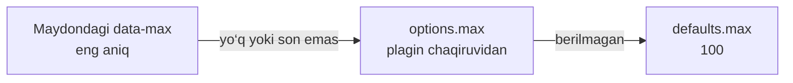
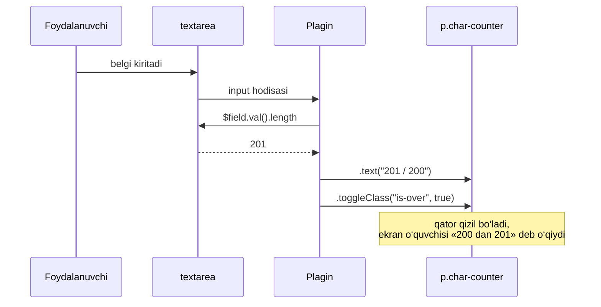
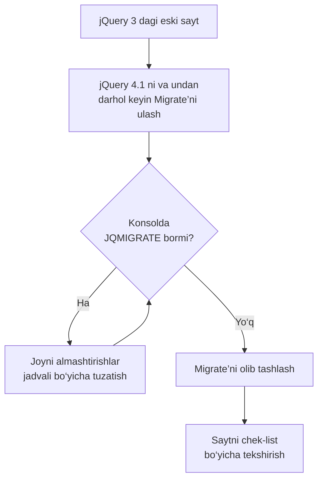

# Plaginlar va yakuniy loyiha

[Mundarija](../../README.md) · [← Orqaga](../../Lesson-9/uz/AJAX%20-%20ma'lumotlarni%20yuklash.md) · [Keyingi kurs: Git →](https://github.com/JLearn-space/JLearn-docs/tree/main/Git) · [RU](../ru/%D0%9F%D0%BB%D0%B0%D0%B3%D0%B8%D0%BD%D1%8B%20%D0%B8%20%D0%B8%D1%82%D0%BE%D0%B3%D0%BE%D0%B2%D1%8B%D0%B9%20%D0%BF%D1%80%D0%BE%D0%B5%D0%BA%D1%82.md) · [EN](../en/Plugins%20and%20final%20project.md) · [UZ](Plaginlar%20va%20yakuniy%20loyiha.md)

> **9-dars bilan bog‘liqlik:** siz `$.getJSON` orqali ma’lumotlarni yuklashni, javobni `.done`, `.fail` va `.always` da qayta ishlashni va sahifaning uchta holatini ko‘rsatishni o‘rgandingiz. Endi siz jQuery’ning barcha asosiy imkoniyatlarini bilasiz. Bugun **o‘z kodingizni plaginlarga joylashni** o‘rganamiz, jQuery 4 da nimalar olib tashlanganini ko‘rib chiqamiz va yakuniy loyihani - jQuery’dagi to‘garak saytini yig‘amiz.

---

## Bu sizga nima uchun kerak

Tasavvur qiling: to‘garak saytida beshta forma bor va har birida «37 / 200» belgilar hisoblagichi kerak bo‘lgan maydon bor. Bitta kodni besh marta nusxalash mumkin - keyin undagi bitta xatoni ham besh marta tuzatishga to‘g‘ri keladi. Yoki bir marta **plagin** yozib, uni bitta qator bilan chaqirish mumkin: `$("textarea").charCounter({ max: 200 })`.

jQuery uchun minglab tayyor yechimlar shunday tuzilgan: slayderlar, telefon raqami niqoblari, qidiruvli ochiladigan ro‘yxatlar. O‘z plaginingizni yoza olsangiz, boshqalarnikilari qanday ishlashini tushunasiz, ularni ulay olasiz, sozlay olasiz va kerak bo‘lsa, tuzata olasiz.

Darsning ikkinchi yarmi - yakuniy loyiha. HTML, CSS va JavaScript kurslarida qurgan to‘garak saytingizni jQuery’da qayta yozasiz, o‘z plaginingizni qo‘shasiz va uni GitHub Pages’da e’lon qilasiz.

---

## Nimani o‘rganasiz

- jQuery plagini nima ekanini va `$.fn` nima ekanini tushuntirish.
- O‘z plaginingizni yozish: `$.fn` dagi metod, `return this.each(...)`, `$(this)`.
- Standart sozlamalarni berish va ularni `$.extend({}, defaults, options)` orqali foydalanuvchi sozlamalari bilan birlashtirish.
- Ustuvorlik tartibini tanlash: elementdagi `data-*` → `options` → standart qiymatlar.
- Plaginni bitta elementda qayta chaqirilishdan himoya qilish.
- Begona plaginni ulash va uning jQuery 4 bilan mosligini tekshirish.
- Qachon jQuery’da, qachon esa sof JavaScript’da yozishni hal qilish.
- Eski kodda jQuery 4 da olib tashlangan funksiyalarni jQuery Migrate yordamida topish.
- Yakuniy loyihani yig‘ish, chek-list bo‘yicha tekshirish va e’lon qilish.

---

## Takrorlash: 9-darsdan 3 savol

1. `$.getJSON("data/events.json")` chaqirilgandan so‘ng darhol nimani qaytaradi?
2. Nega tugmani blokdan chiqarish `.done` da emas, `.always` da yoziladi?
3. Nega sahifani faylni ikki marta bosib ochsangiz, so‘rov ishlamaydi?

Javoblar - dars oxirida.

---

## Reja

| Bo‘lim | Nima qilamiz |
| --- | --- |
| Plagin nima | `$.fn` - barcha jQuery obyektlarining umumiy metodlar to‘plami |
| O‘z plaginimiz qadamma-qadam | `this`, `return this.each`, `$(this)` |
| Plagin sozlamalari | `defaults`, `$.extend`, `data-max`, ustuvorliklar |
| Mini-topshiriq 1 | `$.fn.highlight` plagini |
| Qayta chaqirish va o‘ram | Dublikatlardan himoya, `(function ($) { ... })(jQuery)` |
| Begona plagin | Ulash, hujjatlar, moslik |
| jQuery yoki sof JavaScript | Moslik jadvali va tanlov |
| jQuery 4 va jQuery Migrate | Nimalar olib tashlangan va buni eski kodda qanday topish |
| Yakuniy loyiha | Tuzilma, ulash tartibi, sayt funksiyalari |
| Qabul qilish va e’lon qilish | Chek-list va GitHub Pages |
| Mini-topshiriq 2 | `$.fn.togglePassword` plagini |
| Mustaqil ish | `$.fn.charCounter` plagini va o‘z saytingiz |

---

## Plagin nima

**Oddiy so‘z bilan:** jQuery obyekti - bu asboblar qutisi: `.text()`, `.addClass()`, `.on()`. Plagin - bu **siz o‘zingiz shu qutiga soladigan yangi asbob**. Shundan keyin u har bir qutida bo‘ladi: sahifadagi istalgan `$(...)` da.

jQuery obyektlarining barcha metodlari bitta umumiy obyektda saqlanadi - `$.fn` («dollar-ef-en» deb o‘qiladi, function so‘zidan). Siz `$("h1").text()` deb yozganingizda, jQuery `text` metodini aynan `$.fn` dan qidiradi.

```js
console.log(typeof $.fn.text);   // "function" - o‘rnatilgan metod
console.log(typeof $.fn.hello);  // "undefined" - bunday metod hozircha yo‘q

$.fn.hello = function () {
    console.log("Plagindan salom!");
};

$("h1").hello(); // Plagindan salom!
$("p").hello();  // istalgan jQuery obyektida ishlaydi
```

Metodlar har bir jQuery obyektiga nusxalanmaydi: barcha obyektlar bitta umumiy `$.fn` dan foydalanadi. Shuning uchun metodni **bir marta** yozish yetarli - va u barcha `$(...)` larda paydo bo‘ladi.

Plagin ulanganini konsolda tekshirish mumkin: `typeof $.fn.charCounter` `"function"` yoki `"undefined"` ni qaytaradi.

> **Muhim:** plagin nomi o‘rnatilgan metod nomi bilan bir xil bo‘lmasligi kerak. `$.fn.text = ...` yozuvi butun sahifada `.text()` ni buzadi.

---

## O‘z plaginimiz qadamma-qadam

`charCounter` belgilar hisoblagichini yozamiz. Har bir `textarea` maydoni ostida `0 / 100` qatori paydo bo‘ladi, u kiritishda yangilanadi va matn limitdan uzun bo‘lsa, qizaradi.

```html
<textarea id="message"></textarea>
<!-- plagin chaqirilgandan keyin bu yerda paydo bo‘ladi: -->
<p class="char-counter" aria-live="polite">0 / 100</p>
```

### 1-qadam. Plagin ichida `this` nima

Plagin metodi ichida `this` - metod chaqirilgan **o‘sha jQuery obyekti**: `$("textarea").charCounter()` da bu `$("textarea")`, `this.length` esa maydonlar soniga teng. 6-darsdagi hodisa ishlovchisi bilan adashtirmang: u yerda `this` - DOM elementi, bu yerda esa - jQuery obyekti. Uni `$(this)` ga o‘rash shart emas.

### 2-qadam. Aylanib chiqish: `this.each` va `$(this)`

Har bir maydonga o‘z limiti bilan o‘z hisoblagichi kerak, shuning uchun maydonlar 2-darsdagi `.each()` orqali aylanib chiqiladi. `.each` **ichida** `this` boshqa - alohida DOM elementi:

```js
$.fn.charCounter = function () {
    // bu yerda this - barcha maydonlarga ega jQuery obyekti
    return this.each(function () {
        // bu yerda this - bitta maydon, DOM elementi
        const $field = $(this);
        const $counter = $("<p>", { class: "char-counter" });
        $field.after($counter);
        $counter.text(`${$field.val().length} / 100`);
    });
};
```

| Qayerda | `this` nimaga teng | U bilan nima qilish kerak |
| --- | --- | --- |
| Plagin tanasida | Barcha elementlarga ega jQuery obyekti | jQuery metodlarini darhol chaqirish mumkin |
| `this.each(function () {...})` ichida | Bitta DOM elementi | O‘rash kerak: `const $field = $(this);` |

### 3-qadam. `return this.each(...)` nima uchun kerak

jQuery’ning o‘rnatilgan setterlari o‘sha obyektni qaytaradi - shuning uchun zanjirlar ishlaydi (1-dars). Yaxshi plagin ham o‘zini shunday tutadi. `.each()` metodi o‘zi aylanib chiqqan obyektni qaytaradi, `return` esa uni tashqariga beradi - shunda `$("textarea").charCounter().addClass("is-ready")` ishlaydi.

| Plagin nima bilan tugaydi | `$("textarea").charCounter()` nimani qaytaradi | Zanjir |
| --- | --- | --- |
| `return this.each(...)` | O‘sha jQuery obyekti | Ishlaydi |
| `return` siz `this.each(...)` | `undefined` | `TypeError: Cannot read properties of undefined` |

Agar plaginga har bir element uchun alohida mantiq kerak bo‘lmasa, `.each` ni yozmasa ham bo‘ladi: yashirin aylanib chiqish hammasini o‘zi qiladi, masalan `return this.addClass("x");`.

### Trassirovka: ikki maydon uchun chaqiruv

Sahifada `textarea#about` va `textarea#message`, chaqiruv `$("textarea").charCounter();`:

| Qadam | Nima bo‘ladi | Qiymat / sahifa holati |
| --- | --- | --- |
| 1 | `$("textarea")` maydonlarni topadi | jQuery obyekti, `length: 2` |
| 2 | `charCounter` chaqiriladi, `this` - shu obyekt | `this.length === 2` |
| 3 | `.each`: birinchi maydon, `this` - `#about` | `$field` = `$(#about)` |
| 4 | `<p>` yaratiladi va `#about` dan keyin qo‘yiladi | Birinchi maydon ostida `0 / 100` |
| 5 | `.each`: ikkinchi maydon, `this` - `#message` | `$field` = `$(#message)` |
| 6 | `#message` dan keyin `<p>` yaratiladi | Ikkinchi maydon ostida `0 / 100` |
| 7 | `.each` tugadi va dastlabki obyektni qaytardi | Plagin zanjir uchun `$("textarea")` ni qaytardi |

---

## Plagin sozlamalari

### Standart qiymatlar va `$.extend`

Plagindan foydalanuvchi limitni o‘zgartira olishi kerak, lekin bunga majbur emas. Buning uchun plagin `options` obyektini qabul qiladi, yetishmayotgan qiymatlarni esa **standart sozlamalardan** oladi.

**Oddiy so‘z bilan:** siz kofe buyurtma qilyapsiz. Menyuda «standart: o‘rtacha, shakar bilan» deb yozilgan. Siz: «katta» deysiz. Barista standart retseptni oladi va unda **faqat** siz aytganingizni o‘zgartiradi: katta, shakar bilan.

Obyektlarni `$.extend(maqsad, manba1, manba2, ...)` funksiyasi birlashtiradi: manbalarning xususiyatlarini tartib bilan maqsadga nusxalaydi va har bir keyingisi oldingisini qayta yozadi.

```js
const defaults = { max: 100, overClass: "is-over" };
const options = { max: 200 };

const settings = $.extend({}, defaults, options);
console.log(settings); // { max: 200, overClass: "is-over" }
console.log(defaults); // { max: 100, overClass: "is-over" } - o‘zgarmadi
```

| Qadam | Nima bo‘ladi | `settings` qiymati |
| --- | --- | --- |
| 1 | Maqsad - yangi bo‘sh obyekt `{}` | `{}` |
| 2 | `defaults` xususiyatlari nusxalanadi | `{ max: 100, overClass: "is-over" }` |
| 3 | `options` xususiyatlari nusxalanadi, `max` qayta yozildi | `{ max: 200, overClass: "is-over" }` |
| 4 | Agar `options` = `undefined` bo‘lsa (plagin argumentsiz chaqirilgan) | Manba o‘tkazib yuboriladi: `{ max: 100, overClass: "is-over" }` |

> **Muhim:** birinchi argument sifatida doim **yangi bo‘sh obyekt** `{}` bering. `$.extend(defaults, options)` yozuvi `max: 200` ni to‘g‘ridan-to‘g‘ri `defaults` ga yozadi - va plaginning sozlamasiz keyingi barcha chaqiruvlari 100 o‘rniga 200 oladi.

Sof JavaScript’da xuddi shu ishni `Object.assign({}, defaults, options)` yoki `{ ...defaults, ...options }` yozuvi qiladi. Farq bitta: `$.extend` qiymati `undefined` bo‘lgan xususiyatlarni o‘tkazib yuboradi, shuning uchun `{ max: undefined }` standart limitni o‘chirmaydi.

### Elementdagi `data-*` dan sozlama

Ba’zan limitni to‘g‘ridan-to‘g‘ri HTML’da, aniq bir maydonda yozish qulayroq: `<textarea data-max="50">`. Siz bunday atributlarni 3-darsda `.data()` orqali o‘qigansiz: `$field.data("max")` `50` **sonini** qaytaradi.

Endi limitning uchta manbasi bor. Qaysi biri muhimroq ekanini hal qilish kerak. Kursda **«elementga qanchalik yaqin bo‘lsa, shunchalik muhim»** qoidasi amal qiladi - CSS’dagidek, u yerda `style` atributidagi uslub fayldagi qoidadan kuchliroq:



**Sxemani qanday o‘qish kerak.** Plagin avval maydon atributiga qaraydi. U yerda son bo‘lsa - uni oladi. Bo‘lmasa - chaqiruv sozlamalariga qaraydi, u yerda ham bo‘sh bo‘lsa - standart qiymatlarga. Shunday qilib bitta `$("textarea").charCounter({ max: 200 })` chaqiruvi bilan formaning barcha maydonlariga xizmat ko‘rsatish, `data-max="50"` bo‘lgan bitta maydonga esa o‘z limitini berish mumkin.

```js
const max = Number($field.data("max")) || settings.max;
```

| Maydondagi atribut | `Number($field.data("max"))` | `settings.max = 200` bo‘lganda yakuniy `max` |
| --- | --- | --- |
| `data-max="50"` | `50` | `50` |
| atribut yo‘q | `Number(undefined)` → `NaN` | `200` |
| `data-max="abc"` | `NaN` | `200` |
| `data-max=""` | `0` | `200` |

`||` operatori chap qiymat «yolg‘on» bo‘lsa, o‘ng qiymatni qaytaradi: `NaN` va `0` aynan shunday. Natijada «atributdagi son, u bo‘lmasa - sozlamalardagi» degan qisqa yozuv hosil bo‘ladi.

---

## Mini-topshiriq 1

`$.fn.highlight(options)` plaginini yozing. Standart sozlamalar: `{ className: "is-highlighted" }`. Plagin barcha elementlarga `settings.className` klassini qo‘shadi va zanjir uchun jQuery obyektini qaytaradi. Uni barcha `.price` lar uchun `is-sale` klassi bilan chaqiring va o‘sha zanjirda ularga `Chegirma` qiymatli `title` atributini bering. Bu yerda `.each` kerak emas - yashirin aylanib chiqish yetarli.

```html
<p class="price">1 200 so‘m</p>
<p class="price">900 so‘m</p>
```

---

## Qayta chaqirish va plagin o‘rami

### Qayta chaqirishdan himoya

Plaginni ikki marta chaqirsak nima bo‘ladi? Masalan, bitta skript `$("textarea").charCounter()` ni chaqirdi, boshqasi esa keyinroq - barcha maydonlar uchun yana bir marta. Himoyasiz har bir maydon ostida **ikkita** hisoblagich va ikkita `input` ishlovchisi paydo bo‘ladi.

Yechim: hisoblagich yaratilgandan keyin maydonga `.data()` orqali «belgi» qo‘yish, aylanib chiqish boshida esa uni tekshirish:

```js
return this.each(function () {
    const $field = $(this);

    if ($field.data("charCounter")) {
        return; // hisoblagich allaqachon bor - maydonni o‘tkazib yuboramiz
    }

    // ... hisoblagich yaratish ...
    $field.data("charCounter", true);
});
```

`.each` funksiyasi ichidagi `return` «keyingi elementga o‘tish» degani. Aylanib chiqishni butunlay to‘xtatish uchun `return false` bor, lekin bu yerda u kerak emas.

**Oddiy so‘z bilan:** bu jurnaldagi «emlangan» degan belgiga o‘xshaydi. Hamshira avval jurnalga qaraydi - va ukolni ikkinchi marta qilmaydi.

### `(function ($) { ... })(jQuery)` o‘rami

Plaginlar odatda **darhol chaqiriladigan** funksiyaga o‘raladi:

```js
(function ($) {
    const defaults = { max: 100 };

    $.fn.charCounter = function (options) {
        // ...
    };
})(jQuery);
```

O‘ram uchta narsa beradi: `defaults` faqat ichkarida ko‘rinadi va boshqa fayldagi o‘zgaruvchi bilan to‘qnashmaydi; ichkaridagi `$` - aniq jQuery, hatto saytda boshqa kutubxona bu nomni egallagan bo‘lsa ham (WordPress’da shunday bo‘ladi); faylni istalgan loyihaga nusxalash mumkin. Bu JavaScript kursidagi modullarga o‘xshaydi, lekin oddiy `<script>` da ishlaydi.

### Tayyor plagin

Karkas, sozlamalar, `data-max` dan limit va qayta chaqirishdan himoyani birga yig‘ing - [yakuniy loyiha](../../final-project/README.md)dagi `js/jquery.char-counter.js` fayli hosil bo‘ladi. Uni to‘liq IDE topshirig‘ida o‘zingiz yozasiz, solishtirish uchun esa [namuna](../../final-project/final/js/jquery.char-counter.js) bor. Tayyor plaginda yana bir nechta tafsilot bor:

| Qator | Nima uchun |
| --- | --- |
| `defaults` dagi `counterClass`, `overClass` | Klass nomlarini ham chaqiruvda o‘zgartirish mumkin: `{ overClass: "too-long" }` |
| `"aria-live": "polite"` | Foydalanuvchi to‘xtaganda ekran o‘quvchisi yangi sonni ovoz chiqarib o‘qiydi |
| Oxiridagi `update()` | Maydonda allaqachon matn bo‘lsa (brauzer uni «Orqaga» dan keyin tiklagan), hisoblagich darhol to‘g‘ri |
| `"input.charCounter"` | 6-darsdagi nomlar fazosi: `$field.off(".charCounter")` faqat plagin ishlovchilarini olib tashlaydi |
| `length > max` | 200 dan aynan 200 ta belgi - hali oshib ketish emas |



**Sxemani qanday o‘qish kerak.** Plagin matnni o‘zida saqlamaydi: har bir kiritishda u uzunlikni maydondan qaytadan o‘qiydi va hisoblagichni qayta chizadi. Holat maydonning o‘zida yashaydi, shuning uchun hisoblagich foydalanuvchi ko‘rayotgan narsadan «ajralib qola» olmaydi.

---

## Begona plaginni ulash

Tayyor plaginlar xuddi siznikidek ulanadi: alohida fayl bilan, jQuery’dan **keyin** va ularni chaqiradigan koddan **oldin**.

```html
<script src="https://code.jquery.com/jquery-4.1.0.min.js"></script>
<script src="js/vendor/select2.min.js" defer></script>
<script src="js/main.js" defer></script>
```

```js
// main.js - plagin hujjatlari bo‘yicha chaqiruv
$("#city").select2({ placeholder: "Shaharni tanlang" });
```

Begona plagin bilan ishlash tartibi: README’ni o‘qish (qanday chaqiriladi, qanday sozlamalar bor, o‘z CSS’i kerakmi) → yangilanish sanasini va jQuery 4 qo‘llab-quvvatlanishini tekshirish → faylni jQuery’dan keyin ulash → konsolda `typeof $.fn.select2` ni tekshirish → minimal sozlamalar bilan chaqirib, o‘zingiznikini qo‘shib borish.

> **Muhim:** ko‘plab eski plaginlar jQuery 1–3 uchun yozilgan va jQuery 4 da olib tashlangan funksiyalarni chaqiradi. Agar ulagandan keyin konsolda `$.isArray is not a function` yoki shunga o‘xshash xato chiqsa - plagin yangilanmagan. Vaqtinchalik yechim - jQuery Migrate (quyida qarang), doimiysi - yangilangan versiya yoki boshqa plagin.

---

## jQuery yoki sof JavaScript

Siz ikkala yozuvni ham bilasiz. Ular bir-biriga shunday mos keladi:

| Vazifa | jQuery | Sof JavaScript |
| --- | --- | --- |
| Elementlarni topish | `$(".card")` | `document.querySelectorAll(".card")` |
| Matn | `$el.text("Salom")` | `el.textContent = "Salom"` |
| Shartga ko‘ra klass | `$el.toggleClass("is-open", isOpen)` | `el.classList.toggle("is-open", isOpen)` |
| Element yaratish | `$("<li>", { text: name })` | `document.createElement("li")` + `textContent` |
| Hodisa | `$el.on("click", fn)` | `el.addEventListener("click", fn)` |
| Delegatsiya | `$list.on("click", ".item", fn)` | `list.addEventListener("click", ...)` + `event.target.closest(".item")` |
| Silliq yashirish | `$el.slideUp(200)` | CSS `transition` + klass |
| JSON yuklash | `$.getJSON(url).done(fn)` | `fetch(url).then((r) => r.json()).then(fn)` |
| Sozlamalarni birlashtirish | `$.extend({}, defaults, options)` | `{ ...defaults, ...options }` |

**Qanday tanlash kerak:**

| jQuery’ni tanlang, agar | Sof JavaScript’ni tanlang, agar |
| --- | --- |
| Sayt allaqachon jQuery’da: WordPress, Bootstrap 4, eski loyiha | Eski kodsiz yangi loyiha |
| O‘rnini bosadigani yo‘q tayyor plagin kerak | Skript kichik: kutubxona koddan og‘irroq |
| Tayyor `slideToggle`, `fadeIn` effektlari kerak | Siz React yoki Vue’ga o‘tyapsiz - u yerda jQuery ishlatilmaydi |

Asosiysi - **sababsiz aralashtirmang**. Agar faylda allaqachon `$` bo‘lsa, jQuery’da yozing; agar loyihada jQuery bo‘lmasa, uni bitta tugma uchun ulamang.

---

## jQuery 4 va jQuery Migrate

### jQuery 4 da nimalar olib tashlangan

jQuery 4.0 da (2026-yil yanvar) JavaScript’ning o‘zida anchadan beri bor funksiyalar olib tashlandi. Ularni eski kodda ko‘rsangiz, almashtiring:

| jQuery 4 da olib tashlangan | Almashtirish |
| --- | --- |
| `$.trim(str)` | `str.trim()` |
| `$.isArray(x)` | `Array.isArray(x)` |
| `$.isFunction(x)` | `typeof x === "function"` |
| `$.isNumeric(x)` | `Number.isFinite(Number(x))` |
| `$.parseJSON(str)` | `JSON.parse(str)` |
| `$.now()`, `$.type(x)` | `Date.now()`, `typeof x` |
| `$.unique(arr)` | `$.uniqueSort(arr)` |
| `$el.push()`, `.sort()`, `.splice()` | `$el.get()` massiv beradi - u bilan massiv metodlari ishlaydi |
| Klass nomisiz `.toggleClass(true)` | `.toggleClass("nom", true)` |

Xatti-harakatdagi yana ikki o‘zgarish:

- `.css("font-size", 20)` - ko‘pchilik xususiyatlar uchun birliksiz songa endi `px` qo‘shilmaydi (`px` avtomatik ravishda faqat o‘lchamlar va chekinishlarga qo‘shiladi). Kursda doim birliklarni yozing: `.css("font-size", "20px")`.
- `$.ajax` endi JSON so‘rovini o‘z-o‘zidan JSONP ga aylantirmaydi.

**Eskirgan**, lekin hozircha ishlaydigan yozuvlar yangi kodda yozilmaydi: `$(document).ready(fn)` (`defer` yoki `$(fn)` yozing), `.click(fn)`, `.submit(fn)`, `.hover(...)`, `.bind()`, `.delegate()` qisqartmalari (`.on(...)` yozing), `:first`, `:eq(2)`, `:even` pozitsion psevdoklasslari (`.first()`, `.eq(2)`, `.filter(...)` yozing).

### jQuery Migrate

**Oddiy so‘z bilan:** jQuery Migrate - bu ko‘chish davridagi tarjimon. Eski kod «jQuery 3 tilida» gapiradi, tarjimon uni tushunadi va shu bilan birga har bir eskirgan so‘zni daftarga yozib boradi. Daftardagi hamma narsa tuzatilgach, tarjimon endi kerak emas.

Migrate - jQuery jamoasining alohida fayli. U jQuery’dan **darhol keyin** ulanadi: olib tashlangan ko‘plab funksiyalarni qaytaradi va ularning har bir ishlatilishida konsolga ogohlantirish chiqaradi.

```html
<script src="https://code.jquery.com/jquery-4.1.0.min.js"></script>
<script src="https://code.jquery.com/jquery-migrate-4.0.2.js"></script>
<script src="js/main.js" defer></script>
```

Konsolda `JQMIGRATE:` bilan boshlanadigan qatorlar paydo bo‘ladi, masalan `jQuery.trim` haqidagi ogohlantirish. Har biri qayta yozish kerak bo‘lgan joyni ko‘rsatadi. Qidirish uchun Migrate’ning siqilmagan versiyasidan (`.min` siz) foydalaning: uning xabarlari batafsilroq.



**Sxemani qanday o‘qish kerak.** Migrate - vaqtinchalik tayanch, saytning doimiy qismi emas. «Ogohlantirish → tuzatish» sikli konsol toza bo‘lguncha takrorlanadi. Faqat shundan keyin Migrate fayli o‘chiriladi va sayt yana bir marta tekshiriladi.

---

### Buzib ko‘ring

1. `this.each` oldidagi `return` ni olib tashlang va `$("textarea").charCounter().addClass("x")` ni chaqiring. Konsol qanday xato ko‘rsatadi?
2. `$.extend({}, defaults, options)` ni `$.extend(defaults, options)` ga almashtiring. Plaginni avval bitta maydon uchun `{ max: 10 }` bilan, keyin boshqasi uchun sozlamasiz chaqiring. Ikkinchisining limiti qancha?
3. `if ($field.data("charCounter"))` tekshiruvini o‘chiring va plaginni ikki marta chaqiring. Maydon ostida nechta hisoblagich?
4. `.each` ichida `$(this).val()` o‘rniga `this.val()` yozing. Konsol nima deydi?
5. Plagin faylini jQuery’dan **oldin** ulang. Qanday xato va qaysi faylda?
6. Konsolda `$.trim(" a ")` ni jQuery 4.1 bilan, keyin esa Migrate ulangan holda chaqiring. Natija nimasi bilan farq qiladi?

### Yangi o‘rganuvchilarning tipik xatolari

| Xato | Nima bo‘ladi | Qanday tuzatish |
| --- | --- | --- |
| `this.each` oldida `return` yo‘q | Plagindan keyingi zanjir: `Cannot read properties of undefined` | `return this.each(...)` |
| `$.extend(defaults, options)` | Bitta chaqiruv sozlamalari keyingi barchasiga «yopishib qoladi» | `$.extend({}, defaults, options)` |
| `.each` ichida `this.val()` | `this.val is not a function`: `this` - DOM elementi | `const $field = $(this);` |
| Qayta chaqirishdan himoya yo‘q | Bitta maydon ostida ikkita hisoblagich | `$field.data("charCounter", true)` belgisi va tekshiruv |
| `update()` faqat `input` ishlovchisida | Birinchi kiritishgacha hisoblagich bo‘sh | `update()` ni yaratilgandan so‘ng darhol chaqirish |
| `length >= max` | 200 dan aynan 200 allaqachon «qizil» | Qat’iy `length > max` |
| Plagin fayli `main.js` dan keyin ulangan | `$(...).charCounter is not a function` | jQuery → plagin → `main.js` |
| Plagin nomi o‘rnatilgan metod bilan bir xil | Butun sahifada jQuery metodi buziladi | Noyob nom: `text` emas, `charCounter` |

---

## Yakuniy loyiha

Tayyor namuna [final-project](../../final-project/README.md) papkasida. Bu JavaScript kursidagi to‘garak sayti, jQuery 4.1 da qayta yozilgan, - u bilan solishtirib boring, o‘z loyihangizni esa HTML, CSS va JavaScript kurslaridagi **o‘z** saytingizda qiling.

### O‘zaro ta’sirlar xaritasi

Loyiha oltita narsani qila olishi kerak: menyu, mavzu, `data/events.json` dan e’lonlar, «Ko‘p beriladigan savollar» akkordeoni, tekshiruvli forma va o‘z plaginingizdagi belgilar hisoblagichi. JavaScript kursidagidek, avval xatti-harakat rejasi, keyin kod:

| Element | Hodisa | Nima o‘zgaradi | Ekran o‘quvchisi uchun | Darslar |
| --- | --- | --- | --- | --- |
| `.menu-toggle` | `click` | `#site-nav` `is-open` ni oladi | `aria-expanded` | 4, 6 |
| `document` | `keydown` Escape | Menyu yopiq, fokus tugmada | `aria-expanded="false"` | 6 |
| `.theme-toggle` | `click` | `body.theme-dark` | `aria-pressed`, `localStorage` | 4, 9 |
| `.filters` | `[data-filter]` bo‘yicha `click` | E’lonlar qayta chizildi | `aria-pressed` | 5, 6, 9 |
| `.faq` | `.faq__question` bo‘yicha `click` | Bitta javob ochilgan, `prefers-reduced-motion` | `aria-expanded` | 7 |
| `#message` | `input` | Hisoblagich, `is-over` | `aria-live="polite"` | 10 |
| `#contact-form` | `submit` | Xatolar yoki minnatdorchilik | `aria-invalid`, `role="status"` | 3, 8 |

### `js/` papkasining tuzilmasi va ulash tartibi

```text
my-site/
├── index.html
├── contact.html
├── css/style.css
├── data/
│   └── events.json
└── js/
    ├── jquery.char-counter.js   ← plagin: faqat $.fn.charCounter
    └── main.js                  ← sayt kodi: init... funksiyalari
```

```html
<script src="https://code.jquery.com/jquery-4.1.0.min.js"></script>
<script src="js/jquery.char-counter.js" defer></script>
<script src="js/main.js" defer></script>
```

`defer` li skriptlar HTML tahlil qilingandan keyin **teglar tartibida** bajariladi. Tartib muhim: plaginga `$` kerak, `main.js` esa plaginni chaqiradi. Oxirgi ikki tegning o‘rnini almashtiring - va `main.js` `charCounter is not a function` xatosi bilan yiqiladi. Plagin fayllarining nomlari an’anaga ko‘ra `jquery.` bilan boshlanadi: faylga jQuery kerakligi darhol ko‘rinadi.

### `init...` funksiyalari va `.length` tekshiruvi

Bitta `main.js` barcha sahifalarga ulangan, forma esa faqat kontaktlar sahifasida bor. Shuning uchun har bir funksiya avval o‘z elementlarini qidiradi va ular bo‘lmasa, chiqib ketadi. jQuery’da «hech narsa topilmadi» - bu `null` emas, `length === 0`:

```js
function initContactForm() {
    const $form = $("#contact-form");
    if ($form.length === 0) {
        return; // bu sahifada forma yo‘q
    }
    $("#message").charCounter({ max: 200 }); // o‘z plaginimiz
    // ... 8-darsdagi forma tekshiruvi
}

$("html").addClass("js"); // progressiv yaxshilash
initMenu();
initTheme();
initEvents();
initContactForm();
initFaq();
```

`$("html").addClass("js")` qatori - JavaScript kursidagi progressiv yaxshilash: menyu va akkordeon javoblarini yashiradigan CSS qoidalari `.js` prefiksi bilan yoziladi, shuning uchun skriptsiz butun kontent ko‘rinadi.

---

## Qabul qilish va e’lon qilish

### Qabul qilish chek-listi

Saytni **har bir sahifada**, Live Server orqali lokal tekshiring:

- [ ] Console: barcha sahifalarda birorta ham xato va birorta ham `JQMIGRATE` yo‘q.
- [ ] Network: jQuery, plagin, `main.js` va `data/events.json` 404 siz yuklanadi.
- [ ] Menyu: tugma va Escape bilan ochiladi va yopiladi, fokus tugmaga qaytadi.
- [ ] Mavzu: qayta yuklashdan va boshqa sahifaga o‘tishdan keyin saqlanadi.
- [ ] E’lonlar: har bir filtr tugmasi to‘g‘ri, «Yuklanmoqda...», bo‘sh kategoriya va JSON yo‘li buzilganda xato bor.
- [ ] Akkordeon: faqat bitta javob ochiq; `prefers-reduced-motion` da - animatsiyasiz.
- [ ] Forma: maydonlarda xatolar, `aria-invalid`, qayta yuklashsiz minnatdorchilik.
- [ ] Hisoblagich: darhol to‘g‘ri son, oshib ketganda qizil, forma tozalangandan keyin yana `0 / 200`.
- [ ] Klaviatura: hamma narsa Tab, Enter, probel, Escape bilan ishlaydi.
- [ ] JavaScript’siz kontent mavjud; kenglik 375 px va 1440 px.
- [ ] Kod: `var`, `==`, ma’lumotli `.html()`, `onclick`, `.click(fn)`, jQuery 4 da olib tashlangan funksiyalar yo‘q.

### GitHub Pages’da e’lon qilish

Yangilanishni veb-interfeys orqali yuklang (**Add file** → **Upload files** → `js/`, `data/`, `css/` fayl va papkalari → **Commit changes**) yoki Git orqali:

```bash
git add .
git commit -m "jQuery 4.1 dagi sayt: menyu, mavzu, e’lonlar, akkordeon, forma, charCounter plagini"
git push
```

1–2 daqiqadan keyin chek-listni e’lon qilingan saytda **yana bir marta** o‘ting:

| Pages’dagi muammo | Sabab va yechim |
| --- | --- |
| `js/jquery.Char-Counter.js` da 404 | Pages registrni farqlaydi: tegdagi nom va fayl nomi harfma-harf bir xil bo‘lishi kerak |
| `$.getJSON` ma’lumotlarni topmaydi | Boshida `/` bo‘lgan yo‘l domen ildiziga olib boradi, sayt esa repozitoriyning ichki papkasida. `data/events.json` deb yozing |
| Eski versiya ko‘rinyapti | Brauzer keshi: **Ctrl+Shift+R** |

---

## Mini-topshiriq 2

`$.fn.togglePassword(options)` plaginini yozing - maydon yonida «Parolni ko‘rsatish» tugmasi.

```html
<label for="password">Parol</label>
<input type="password" id="password">
```

1. Standart sozlamalar: `{ showText: "Ko‘rsatish", hideText: "Yashirish" }`, `$.extend` orqali birlashtirish.
2. Har bir maydon uchun undan darhol keyin `settings.showText` matnli `<button type="button" class="password-toggle" aria-pressed="false">` yarating.
3. Tugma bosilganda maydonning `type` i `password` va `text` orasida, tugma matni - `showText` va `hideText` orasida, `aria-pressed` esa - `"false"` va `"true"` orasida almashadi.
4. Qayta chaqiruv ikkinchi tugmani yaratmaydi; plagin jQuery obyektini qaytaradi.
5. Plaginni barcha `input[type="password"]` lar uchun `{ showText: "Parolni ko‘rsatish" }` bilan chaqiring.

---

## Dars yakuni: shpargalka

| Vazifa | Yozuv |
| --- | --- |
| Plaginni e’lon qilish | `$.fn.charCounter = function (options) { ... };` |
| Plagin faylini o‘rash | `(function ($) { ... })(jQuery);` |
| Elementlarni aylanib chiqish va obyektni qaytarish | `return this.each(function () { ... });` |
| `.each` ichidagi element | `const $field = $(this);` |
| Sozlamalarni birlashtirish | `const settings = $.extend({}, defaults, options);` |
| Atribut yoki sozlamalardan limit | `Number($field.data("max")) \|\| settings.max` |
| Qayta chaqirishdan himoya | `if ($field.data("charCounter")) { return; }` + `$field.data("charCounter", true)` |
| Eskirgan kodni topish | jQuery’dan darhol keyin jQuery Migrate, `JQMIGRATE` xabarlari |
| Ulash tartibi | jQuery → plaginlar → `main.js` |
| Sahifa funksiyasi | `init...` boshida `if ($el.length === 0) { return; }` |

---

## Mustaqil ish

### 1-qism. IDE topshirig‘i (platforma hisoblaydi)

Sahifada `textarea#about` (`data-max="50"`) va `textarea#message` (`data-max` siz) maydonlari bo‘lgan `#signup-form` formasi bor. jQuery allaqachon ulangan. `$.fn.charCounter(options)` plaginini yozing:

1. Standart sozlamalar `defaults = { max: 100, counterClass: "char-counter", overClass: "is-over" }`; plagin ichida ularni `defaults` ni o‘zgartirmasdan `$.extend({}, defaults, options)` orqali `options` bilan birlashtiring.
2. Plaginni zanjir bilan davom ettirish mumkin bo‘lishi uchun maydonlarni `return this.each(...)` orqali aylanib chiqing.
3. Agar maydonda hisoblagich allaqachon yaratilgan bo‘lsa (qayta chaqiruv), maydonni o‘tkazib yuboring.
4. Maydon limiti - `data-max` dagi son, agar u bo‘lsa, aks holda `settings.max`.
5. Maydondan darhol keyin `settings.counterClass` klassli va `aria-live="polite"` li `<p>` yarating.
6. Hisoblagich matni `N / limit`, bu yerda N - belgilar soni; uni darhol va har bir `input` hodisasida yangilang; `settings.overClass` klassi - faqat N limitdan katta bo‘lganda.
7. Plaginni `#signup-form` formasining barcha `textarea` lari uchun `{ max: 200 }` bilan chaqiring.

`document.querySelector`, `innerHTML`, `.html()` va `addEventListener` dan foydalanmang.

Platforma nimani tekshiradi: plagin e’lon qilingani va har bir maydondan darhol keyin `aria-live` li `p.char-counter` yaratishi; `data-max` ning `options` dan ustuvorligi va standart 100 limiti; kiritishda yangilanish va allaqachon kiritilgan matnni hisobga olish; «aynan limit - `is-over` siz, ko‘proq - `is-over` bilan» chegarasi; qayta chaqiruv ikkinchi hisoblagichni yaratmasligi; plagin zanjir uchun o‘sha obyektni qaytarishi; sozlamali chaqiruvdan keyin `defaults` o‘zgarmasligi; `counterClass` va `overClass` ishlashi; kod xatolarsiz bajarilishi.

### 2-qism. Kompyuterdagi loyiha

1. HTML, CSS va JavaScript kurslaridagi saytingiz uchun o‘zaro ta’sirlar xaritasini to‘ldiring.
2. JavaScript kursidagi `main.js` ni jQuery’da qayta yozing: menyu, mavzu, `$.getJSON` orqali e’lonlar, forma. `import`/`export` modullarini bitta fayldagi `init...` funksiyalari bilan almashtiring.
3. 7-darsdagi «Ko‘p beriladigan savollar» akkordeonini qo‘shing va o‘z `charCounter` plaginingizni formadagi xabar maydoniga ulang.
4. Qabul qilish chek-listini lokal o‘ting, keyin saytni GitHub Pages’da e’lon qiling va chek-listni yana bir marta o‘ting.
5. Repozitoriyning `README.md` fayliga «jQuery» bo‘limini qo‘shing: qaysi funksiyalar jQuery’da, qanday plagin yozilgan va uni qanday chaqirish kerak.

### Tayyorlik mezonlari

- [ ] IDE topshirig‘i qabul qilindi.
- [ ] Plagin alohida `js/jquery.char-counter.js` faylida va jQuery bilan `main.js` orasida ulangan.
- [ ] Yakuniy loyihaning barcha oltita funksiyasi e’lon qilingan saytda ishlaydi.
- [ ] Console barcha sahifalarda toza, kodda jQuery 4 da olib tashlangan funksiyalar yo‘q.
- [ ] Siz sozlamalar ustuvorligi tartibini va `return this.each(...)` nima uchun kerakligini tushuntira olasiz.

---

## O‘zini tekshirish uchun savollar

1. `$.fn` nima va nega unga qo‘shilgan metod barcha jQuery obyektlarida paydo bo‘ladi?
2. Plagin tanasida `this` nimaga teng, `this.each(function () {...})` ichida-chi?
3. Plagin nega `this.each(...)` ni qaytaradi? `return` siz nima buziladi?
4. `$.extend({}, defaults, options)` nima qiladi? Nega birinchi argument `{}`?
5. `charCounter` da limit ustuvorligi tartibi qanday va nega aynan shunday?
6. Plaginni bitta elementda qayta chaqirilishdan qanday himoya qilish mumkin?
7. Plagin fayli nega `(function ($) { ... })(jQuery)` ga o‘raladi?
8. jQuery, plagin va `main.js` qaysi tartibda ulanadi va nega?
9. jQuery 4 da olib tashlangan uchta funksiyani va ularning o‘rnini bosuvchilarini ayting. Ularni eski kodda qanday topish mumkin?
10. Yangi vazifa uchun qachon sof JavaScript’ni, qachon esa jQuery’ni tanlagan ma’qul?

Savollardan keyin platformada **dars testini** topshiring: 12 ta savol, o‘tish chegarasi 70%.

---

## Keyin nima

Tabriklaymiz: jQuery kursi tugatildi! Endi siz jQuery 4.1 dagi kodni o‘qiysiz va yozasiz, uni plaginlarga joylay olasiz va eski saytlarni yangi versiyaga o‘tkaza olasiz. Sizda hamma narsa bor e’lon qilingan sayt mavjud: menyudan tortib ma’lumotlarni yuklash va o‘z plaginingizgacha. Bundan keyin qayerga harakat qilish mumkin:

- **jQuery’dagi haqiqiy saytlar:** WordPress mavzulari, Bootstrap 4, admin panellar. Tanish saytda jQuery kodini topib, u nima qilishini tushunishga harakat qiling.
- **JavaScript va freymvorklarga chuqurroq:** klasslar, npm, TypeScript, keyin React yoki Vue - katta interfeyslar uchun o‘sha ma’lumotlar, chizish va hodisalar.
- **Server:** PHP yoki Node.js - formangiz `$.post` orqali ma’lumot yuboradigan o‘z API’ingiz.

Yangi kurslarni [jlearn.space](https://jlearn.space) saytida kuzatib boring.

---

## Javoblar

**Takrorlash**

1. jqXHR obyekti - so‘rovning «trek raqami», ma’lumotlar emas. Ma’lumotlar keyinroq `.done` ga keladi.
2. `.always` muvaffaqiyatda ham, xatoda ham ishga tushadi; agar faqat `.done` da blokdan chiqarilsa, xatodan keyin tugma bloklangan holda qoladi.
3. `file://` manzilidan brauzer fayllarni yuklashni taqiqlaydi. Live Server yoki e’lon qilingan sayt kerak.

**Mini-topshiriq 1**

```js
(function ($) {
    const defaults = { className: "is-highlighted" };

    $.fn.highlight = function (options) {
        const settings = $.extend({}, defaults, options);
        return this.addClass(settings.className);
    };
})(jQuery);

$(".price")
    .highlight({ className: "is-sale" })
    .attr("title", "Chegirma");
```

`.addClass` o‘zi barcha elementlarga qo‘llanadi va o‘sha obyektni qaytaradi, shuning uchun `.each` kerak emas.

**Mini-topshiriq 2**

```js
(function ($) {
    const defaults = { showText: "Ko‘rsatish", hideText: "Yashirish" };

    $.fn.togglePassword = function (options) {
        const settings = $.extend({}, defaults, options);

        return this.each(function () {
            const $input = $(this);
            if ($input.data("togglePassword")) {
                return;
            }

            const $button = $("<button>", {
                type: "button",
                class: "password-toggle",
                text: settings.showText,
                "aria-pressed": "false"
            });
            $input.after($button).data("togglePassword", true);

            $button.on("click", function () {
                const isHidden = $input.attr("type") === "password";
                $input.attr("type", isHidden ? "text" : "password");
                $button
                    .text(isHidden ? settings.hideText : settings.showText)
                    .attr("aria-pressed", String(isHidden));
            });
        });
    };
})(jQuery);

$("input[type=password]").togglePassword({ showText: "Parolni ko‘rsatish" });
```

**O‘zini tekshirish uchun savollar**

1. Barcha jQuery obyektlari metodlariga ega umumiy obyekt. Obyektlar metodlarni o‘zida saqlamaydi, balki ularni `$.fn` dan oladi, shuning uchun yangi metod darhol istalgan `$(...)` da mavjud bo‘ladi.
2. Plagin tanasida - topilgan barcha elementlarga ega jQuery obyekti; `.each` ichida - bitta DOM elementi, uni `$(this)` ga o‘rashadi.
3. Har bir elementni qayta ishlash va zanjir uchun o‘sha obyektni qaytarish uchun. `return` siz plagin `undefined` ni qaytaradi va `.charCounter().addClass(...)` xato beradi.
4. Yangi obyekt yaratadi: avval `defaults` xususiyatlari, ustidan - `options`. Bo‘sh `{}` `defaults` ning o‘zini o‘zgartirmaslik uchun kerak.
5. Maydondagi `data-max` → `options.max` → `defaults.max` (100). Sozlama elementga qanchalik yaqin bo‘lsa, shunchalik aniq: butun forma uchun bitta chaqiruv, alohida maydonga esa HTML’da o‘z limiti.
6. Yaratilgandan keyin `$field.data("charCounter", true)` belgisini qo‘yish va `.each` boshida, agar belgi allaqachon bo‘lsa, `return` orqali chiqish.
7. Plagin o‘zgaruvchilari (masalan, `defaults`) umumiy sohaga tushmaydi va boshqa fayllar bilan to‘qnashmaydi, ichkaridagi `$` esa albatta jQuery’ga teng.
8. jQuery → plagin → `main.js`. Plaginga `$` kerak, `main.js` esa plaginni chaqiradi; `defer` li skriptlar teglar tartibida bajariladi.
9. Masalan, `$.trim` → `str.trim()`, `$.isArray` → `Array.isArray`, `$.parseJSON` → `JSON.parse`. jQuery’dan keyin jQuery Migrate’ni ulash va konsolda `JQMIGRATE` ogohlantirishlarini o‘qish.
10. Sof JavaScript - jQuery’siz yangi loyiha va sahifa og‘irligi muhim bo‘lgan kichik skriptlar uchun. jQuery - agar sayt allaqachon unda bo‘lsa, tayyor plagin yoki ko‘p elementlar bilan ko‘p amallar kerak bo‘lsa.

[Mundarija](../../README.md) · [← Orqaga](../../Lesson-9/uz/AJAX%20-%20ma'lumotlarni%20yuklash.md) · [Keyingi kurs: Git →](https://github.com/JLearn-space/JLearn-docs/tree/main/Git) · [RU](../ru/%D0%9F%D0%BB%D0%B0%D0%B3%D0%B8%D0%BD%D1%8B%20%D0%B8%20%D0%B8%D1%82%D0%BE%D0%B3%D0%BE%D0%B2%D1%8B%D0%B9%20%D0%BF%D1%80%D0%BE%D0%B5%D0%BA%D1%82.md) · [EN](../en/Plugins%20and%20final%20project.md) · [UZ](Plaginlar%20va%20yakuniy%20loyiha.md)
