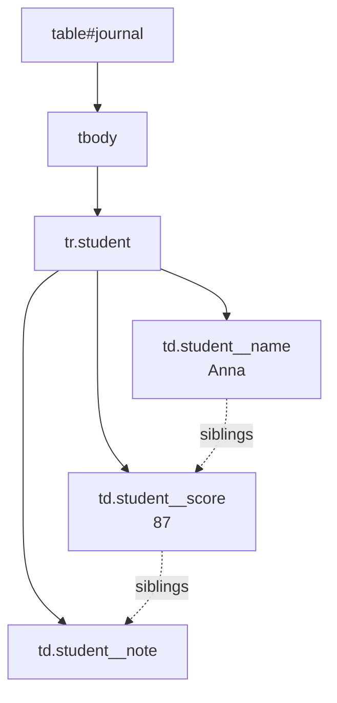
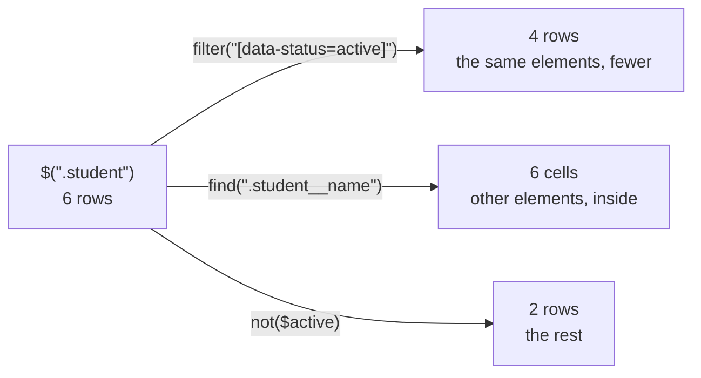
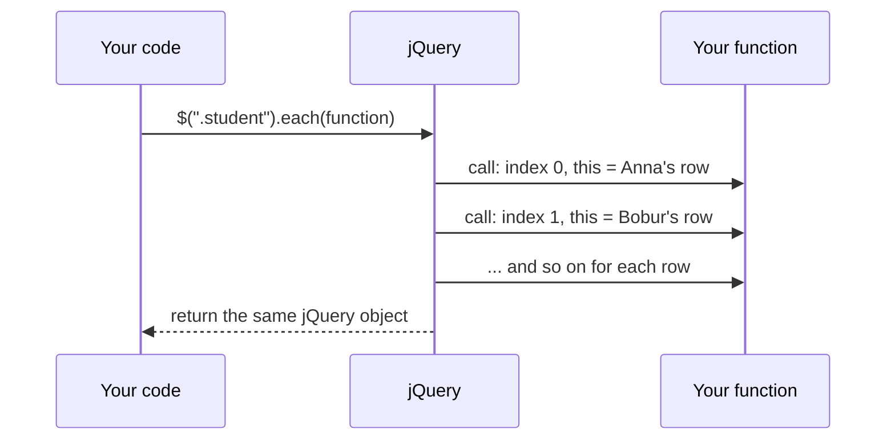
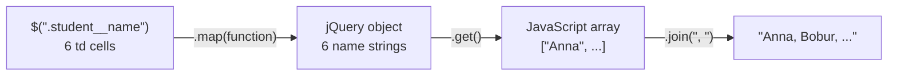

# Selectors and DOM traversal

[Contents](../../README.md) · [← Back](../../Lesson-1/en/Getting%20to%20know%20jQuery.md) · [Next →](../../Lesson-3/en/Content%20and%20attributes.md) · [RU](../ru/%D0%A1%D0%B5%D0%BB%D0%B5%D0%BA%D1%82%D0%BE%D1%80%D1%8B%20%D0%B8%20%D0%BE%D0%B1%D1%85%D0%BE%D0%B4%20DOM.md) · [EN](Selectors%20and%20DOM%20traversal.md) · [UZ](../uz/Selektorlar%20va%20DOM%20bo'ylab%20harakat.md)

> **Link to lesson 1:** you learned to find elements with `$("selector")`, change their text with `.text()` and build chains. But so far every search started "from scratch" - from the whole page. Today we will learn to select elements more precisely and **walk the tree**: from an element to its parent, children and siblings, and then go through what we found one by one.

---

## Why you need this

Imagine a group register: a table of students, each with a score and a status, "studying" or "left". The teacher asks: "Highlight the best of those who are still studying and give me a list of their names." A single `$(".student")` selector will not solve this. You need to:

- select only the active students;
- go through each one and compare scores;
- get the name from the row you found - that is, go down inside the row to the right cell;
- collect the names into a regular JavaScript array.

This is exactly what you will do in the independent work. Similar tasks come up all the time: "close the card whose button was clicked", "highlight the menu item next to the active one", "collect all checked products".

---

## What you will learn

- Use any CSS selector in `$()`, including combinators.
- Select elements by attributes: `[data-status="active"]`, `[href^="https"]`.
- Go down the tree: `.find()` and `.children()`.
- Go up: `.parent()` and `.closest()`.
- Move sideways: `.siblings()`, `.next()`, `.prev()`.
- Take an element by position: `.first()`, `.last()`, `.eq()`.
- Narrow down and check elements: `.filter()`, `.not()`, `.is()`.
- Go through elements one by one: `.each()` and `$(this)`.
- Collect data into an array: `.map().get()`.

---

## Review: 3 questions from lesson 1

1. What does `$(".card")` return if there are no cards on the page? How can you check this?
2. Why can you continue the chain after `.text("New")` but not after `.text()`?
3. How do you turn the DOM element `heading` into a jQuery object and back?

Answers are at the end of the lesson.

---

## Lesson plan

| Section | What we do |
| --- | --- |
| Selectors in `$()` | CSS combinators and pseudo-classes |
| Attribute selectors | Selecting by `data-*` and other attributes |
| The DOM tree | Parents, children, siblings |
| Down: `.find` and `.children` | Searching inside an element |
| Up and sideways | `.parent`, `.closest`, `.siblings`, `.next`, `.prev` |
| Mini-task 1 | A journey through course cards |
| Position: `.first`, `.last`, `.eq` | One element from a set |
| Filtering: `.filter`, `.not`, `.is` | Narrow a set and check it |
| Iteration: `.each` | A separate action for each element |
| Collecting data: `.map().get()` | An array of values from elements |
| Mini-task 2 | A task list |
| Independent work | Group register |

---

## Selectors in `$()`

**In simple words:** a selector is the address on an envelope. The more precise the address, the less likely the letter goes to the wrong place. `$(".name")` means "to everyone called name", and `$("#journal .student .name")` means "in the register, in a student's row, to the name cell".

Everything you wrote in CSS and in `querySelectorAll` works in `$()`:

| Selector | What it selects | Example |
| --- | --- | --- |
| `tag` | All elements with the tag | `$("li")` |
| `.class` | All elements with the class | `$(".card")` |
| `#id` | The element with the id | `$("#journal")` |
| `A B` | B anywhere inside A | `$("#journal td")` |
| `A > B` | B is a direct child of A | `$("ul > li")` |
| `A + B` | B right after A | `$("h2 + p")` |
| `A, B` | Both A and B | `$("h1, h2")` |
| `:first-child`, `:nth-child(2)` | Position among siblings | `$("li:nth-child(2)")` |
| `:not(.x)` | Everything except `.x` | `$("li:not(.done)")` |
| `:checked`, `:disabled` | Field state | `$("input:checked")` |

```js
$("#menu li").length;              // all li at any depth, including nested lists
$("#menu > li").length;            // only direct children of #menu
$("#menu > li:not(.active)").length; // direct children without the active class
```

> **Important:** in old code you will see the selectors `:first`, `:last`, `:eq(2)`, `:even`, `:odd`. They are not CSS but a jQuery invention. In jQuery 4 they are deprecated: instead you write the methods `.first()`, `.last()`, `.eq(2)` and `.filter()` - we will cover them below. But `:first-child` and `:nth-child()` are real CSS pseudo-classes, and you can use them.

---

## Attribute selectors

In the JavaScript course you stored data right in the markup: `data-id="js"`, `data-lessons="10"`. An attribute selector lets you select elements **by attribute value**.

**In simple words:** in a library you can look for books not only by shelf (class) but also by the label on the spine: "all books whose label says *science fiction*". An attribute is such a label.

| Selector | What it selects | Example |
| --- | --- | --- |
| `[attr]` | The attribute exists (any value) | `$("[data-score]")` |
| `[attr="v"]` | The value is exactly `v` | `$('[data-status="active"]')` |
| `[attr^="v"]` | Starts with `v` | `$('a[href^="https"]')` |
| `[attr$="v"]` | Ends with `v` | `$('a[href$=".pdf"]')` |
| `[attr*="v"]` | Contains `v` | `$('[class*="btn"]')` |

```html
<tr class="student" data-status="active" data-score="87">...</tr>
<tr class="student" data-status="left" data-score="99">...</tr>
```

```js
const $active = $('tr[data-status="active"]');
console.log($active.length); // 1
```

The attribute value goes in quotes inside the selector string. A convenient way: single quotes outside, double quotes inside - `$('tr[data-status="active"]')`. Then you do not need to escape quotes with `\"`.

### Reading an element's `data-*`

Selecting an element by attribute is half the job. Often you need to read the value. In this lesson we read it the way you know from the JavaScript course - through the DOM element's `dataset`:

```js
const row = $('tr[data-status="active"]')[0]; // DOM element
console.log(row.dataset.score);               // "87" - a string!
console.log(Number(row.dataset.score) + 1);   // 88
```

> **Important:** `dataset` always returns a **string**. Strings are compared character by character: `"100" > "95"` is `false`, because `"1"` is less than `"9"`. Before comparing or adding, turn the value into a number: `Number(...)`. jQuery has its own `.data()` method that does this for you - we will cover it in lesson 3.

---

## The DOM tree: parents, children, siblings

For the browser, a page is a tree. Every element (except `<html>`) has a **parent**, and many have **children** and **siblings** (elements with the same parent).

**In simple words:** the DOM tree is like a family tree. A table cell is a child of a row, a row is a child of `tbody`. Two cells of the same row are brothers and sisters. And the table is the cell's "great-grandmother".

```html
<table id="journal">
    <tbody>
        <tr class="student">
            <td class="student__name">Anna</td>
            <td class="student__score">87</td>
            <td class="student__note"></td>
        </tr>
    </tbody>
</table>
```



**How to read the diagram.** Solid arrows go from a parent to its children: `tr` is the parent of three cells. A dotted line connects siblings: the cells have the same parent. You can move through the tree in three directions: **down** (to children and deeper), **up** (to the parent and ancestors), **sideways** (to siblings).

| Direction | jQuery methods | Plain JavaScript |
| --- | --- | --- |
| Down | `.find()`, `.children()` | `querySelectorAll`, `children` |
| Up | `.parent()`, `.closest()` | `parentElement`, `closest` |
| Sideways | `.siblings()`, `.next()`, `.prev()` | `nextElementSibling`, `previousElementSibling` |

In the examples below the register has six rows, as in the independent work: Anna 87, Bobur 72, Timur 99 (left), Dilnoza 95, Elena 64, Farhod 58 (left).

All these methods return a **new jQuery object**, so you can chain them, as in lesson 1.

---

## Down: `.find()` and `.children()`

### `.find(selector)` - search inside

`.find()` looks for descendants at **any depth** inside the elements you already found.

```js
const $row = $(".student").first();
console.log($row.find(".student__name").text()); // "Anna"
```

This is like `$(".student .student__name")`, but the search starts from a specific element that is already stored in a variable.

### `.children()` - only direct children

```js
$("#journal tbody").children().length; // number of tr rows
$(".student").first().children().length; // 3 cells
$(".student").first().children(".student__score").text(); // "87"
```

**In simple words:** `.children()` calls your own children, `.find()` calls all descendants with the right name: children, grandchildren, great-grandchildren.

| Code | Depth | Is a selector needed |
| --- | --- | --- |
| `.find(".x")` | Any | Required |
| `.children()` | One level | Optional: without it - all children |
| `.children(".x")` | One level | Filters children by the selector |

---

## Up and sideways

### `.parent()` and `.closest()`

`.parent()` takes **exactly one step** up. `.closest(selector)` goes up until it meets a matching element, and **starts checking from the element itself**.

```js
const $score = $(".student__score").first();
$score.parent();            // tr.student - one step up
$score.closest("tr");       // the same tr
$score.closest("table");    // table#journal - three steps up
$score.closest("td");       // $score itself: it is already a td
$score.closest(".nothing"); // empty object, length 0
```

Step by step, how `.closest("table")` looks for an ancestor:

| Step | What is checked | Matches `table`? | Result |
| --- | --- | --- | --- |
| 1 | `td.student__score` itself | No | Go up |
| 2 | `tr.student` | No | Go up |
| 3 | `tbody` | No | Go up |
| 4 | `table#journal` | Yes | Return `table` |

**In simple words:** `.closest(".guard")` - you go up the floors of a building and stop at the first floor where a guard stands. If you are the guard yourself, you do not need to go anywhere. And `.parent()` simply means going up one floor, whoever is there.

`.closest()` is needed very often: in lesson 6, when the "Delete" button is clicked, we will use it to find the card that contains the button.

### Siblings: `.siblings()`, `.next()`, `.prev()`

```js
const $name = $(".student__name").first();
$name.next().text();          // "87" - the next sibling
$name.next().next().text();   // "" - the note cell
$name.siblings().length;      // 2 - all siblings except itself
$name.prev().length;          // 0 - nobody on the left
```

`.next()` and `.prev()` return one sibling, `.siblings()` returns all of them except the element itself. You can pass a selector to all three: `.siblings(".x")`.

### A traversal chain

Traversal methods combine into a route: "from the cell - up to the row - down to the name".

```js
const $firstScore = $(".student__score").first();
const studentName = $firstScore
    .closest(".student")
    .find(".student__name")
    .text();
console.log(studentName); // "Anna"
```

In plain JavaScript it is `.closest(".student").querySelector(".student__name").textContent`. The difference in behavior: if nothing is found at some step, plain JavaScript crashes with the error `Cannot read properties of null`, while jQuery returns an empty object, and `.text()` gives an empty string.

---

## Mini-task 1

```html
<div class="courses">
    <article class="course" data-level="start">
        <h2 class="course__title">HTML</h2>
        <p class="course__price">Free</p>
    </article>
    <article class="course" data-level="middle">
        <h2 class="course__title" id="js-title">JavaScript</h2>
        <p class="course__price">300 000 sum</p>
    </article>
    <article class="course" data-level="middle">
        <h2 class="course__title">jQuery</h2>
        <p class="course__price">200 000 sum</p>
    </article>
</div>
```

1. Save in `$jsCard` the card that contains `#js-title` (with `.closest`).
2. Log the price from this card to the console (with `.find`).
3. Log how many sibling cards `$jsCard` has.
4. Find the `middle` level cards with an attribute selector and log their number.
5. Log the title of the card that comes after `$jsCard`.

---

## Position: `.first()`, `.last()`, `.eq()`

The `$()` method always finds **all** matching elements. If you need one by its order, use the position methods. They return a **jQuery object** with one element (or an empty one), so the chain continues.

```js
const $students = $(".student");

$students.first();   // first row
$students.last();    // last row
$students.eq(1);     // second: counting starts from zero
$students.eq(-1);    // last: a negative index counts from the end
$students.eq(100);   // empty object, no error
```

| Code | What it returns | Can you continue the chain |
| --- | --- | --- |
| `$students.eq(1)` | A jQuery object with the 2nd element | Yes: `.eq(1).text()` |
| `$students[1]` | A DOM element | No jQuery methods |
| `$students.get(1)` | A DOM element | No jQuery methods |

**In simple words:** `.eq(1)` means taking the second apple out of the basket and **putting it into a small basket**. You can do everything with the small basket that you can do with the big one. And `[1]` means taking the apple straight into your hand: it has no basket methods.

---

## Filtering: `.filter()`, `.not()`, `.is()`

### `.filter()` - keep the matching ones

`.filter(selector)` does not search for anything new: out of the **already found** elements it keeps only the matching ones.

```js
const $students = $(".student");
const $active = $students.filter('[data-status="active"]');
```



**How to read the diagram.** One set of rows gives three different results. `filter` and `not` split the set into two parts - the elements stay **the same rows**. `find` goes inside and returns **other** elements - cells.

### `.filter()` with a function

If you cannot write the condition as a selector - for example, "score above 80" - pass a function. jQuery calls it for each element; `this` inside is the current DOM element. If it returns `true`, the element stays.

```js
const $strong = $(".student").filter(function () {
    return Number(this.dataset.score) > 80;
});
console.log($strong.length);
```

| Step | `this` | `Number(this.dataset.score)` | `> 80`? | Stays |
| --- | --- | --- | --- | --- |
| 1 | Anna's row | 87 | `true` | Yes |
| 2 | Bobur's row | 72 | `false` | No |
| 3 | Timur's row | 99 | `true` | Yes |
| 4 | Dilnoza's row | 95 | `true` | Yes |
| 5–6 | Elena, Farhod | 64, 58 | `false` | No |
| Total | | | | `$strong.length === 3` |

Why a regular `function` and not an arrow `() => {}`? An arrow function has no `this` of its own: it takes it from outside, and that will not be a table row. More on this in the section about `.each()`.

### `.not()` - everything except

`$(".student").not($active)` or `.not('[data-status="active"]')` is the opposite of `.filter()`. `.not()` accepts a selector, a function or another jQuery object - handy when one group is already stored in a variable.

### `.is()` - check, not filter

`.is()` returns not a jQuery object but `true` or `false`: whether **at least one** element matches.

```js
const $first = $(".student").first();
if ($first.is('[data-status="left"]')) {
    console.log("The first one on the list has already left");
}
console.log($(".student").is(".is-best")); // is there at least one best row
```

| Method | Returns | Question it answers |
| --- | --- | --- |
| `.filter(x)` | jQuery object (smaller) | "Which of them match?" |
| `.not(x)` | jQuery object (smaller) | "Which of them do not match?" |
| `.is(x)` | `true` / `false` | "Is there a matching one among them?" |

---

## Iteration: `.each()` and `$(this)`

Implicit iteration from lesson 1 does **the same thing** to all elements. But if each element needs its own action or calculation - for example, comparing scores - you need explicit iteration with `.each()`.

**In simple words:** implicit iteration is a teacher telling the class "Everybody stand up". `.each()` is a teacher walking around the desks and checking each student's notebook separately.

```js
$(".student").each(function (index) {
    const name = $(this).find(".student__name").text();
    console.log(index, name); // 0 "Anna", 1 "Bobur", ...
});
```

| What | Value inside the function |
| --- | --- |
| `index` (first parameter) | The element's number, starting from zero |
| `element` (second parameter) | The current DOM element |
| `this` | The same current DOM element |
| `$(this)` | The same element wrapped in a jQuery object - with `.find`, `.text`... methods |



**How to read the diagram.** You do not call the function yourself: you give it to jQuery, and jQuery calls it in turn for each element, putting a new element into `this` each time. After the iteration, `.each()` returns the same set, so you can continue the chain.

### Finding the maximum with `.each()`

A typical task is to find the largest value. It is the same algorithm as in the JavaScript course with the `for...of` loop: we create a "best so far" variable and update it when we meet a larger value.

```js
let bestScore = -1;
$(".student").each(function () {
    const score = Number(this.dataset.score);
    if (score > bestScore) {
        bestScore = score;
    }
});
console.log(bestScore); // 99
```

| Step | Row | `score` | `score > bestScore`? | `bestScore` after the step |
| --- | --- | --- | --- | --- |
| Start | - | - | - | -1 |
| 1 | Anna | 87 | 87 > -1 - yes | 87 |
| 2 | Bobur | 72 | 72 > 87 - no | 87 |
| 3 | Timur | 99 | 99 > 87 - yes | 99 |
| 4 | Dilnoza | 95 | 95 > 99 - no | 99 |
| 5 | Elena | 64 | no | 99 |
| 6 | Farhod | 58 | no | 99 |

`bestScore` is declared with `let` because it changes. The strict `>` (not `>=`) means that in a tie, the one met earlier stays.

Once the maximum is known, it is easy to find its row with `.filter()` and take the first one:

```js
const $bestRow = $(".student")
    .filter(function () {
        return Number(this.dataset.score) === bestScore;
    })
    .first();
```

If there were no rows, `$bestRow.length` will be `0` - you need to check this before showing the result.

### `this` and arrow functions

```js
// Mistake: in an arrow function this is the outer one (window), not the row
$(".student").each(() => {
    console.log(this.dataset.score); // TypeError
});
// If you want an arrow function, take the element from the second parameter
$(".student").each((index, row) => {
    console.log(Number(row.dataset.score));
});
```

In this course, a regular `function` and `this` are used inside `.each()`, `.filter()` and `.map()` - this is how the jQuery documentation and most plugins write it.

---

## Collecting data: `.map().get()`

`.each()` **does** something with each element. `.map()` **gets a value** from each element and collects the results together.

```js
const names = $(".student__name")
    .map(function () {
        return $(this).text();
    })
    .get();
console.log(names); // ["Anna", "Bobur", "Timur", "Dilnoza", "Elena", "Farhod"]
console.log(names.join(", "));
```



**How to read the diagram.** In jQuery, `.map()` returns **not an array** but a jQuery object again, only it holds the values your function returned. To get a real array with `join`, `includes`, `length`, you add `.get()` at the end.

| Code | What you get |
| --- | --- |
| `$els.map(fn)` | A jQuery object with values: `join` does not work |
| `$els.map(fn).get()` | A JavaScript array |
| `$els.get()` | An array of DOM elements (without `map`) |

### jQuery `.map()` and array `.map()`

Arrays in JavaScript also have `.map()`, but their parameters are **in a different order**:

| | First parameter | Second parameter |
| --- | --- | --- |
| `array.map((item, index) => ...)` | Element | Index |
| `$els.map(function (index, element) { ... })` | **Index** | Element |

```js
// Mistake: name is the index 0, 1, 2..., not the element
$(".student__name").map((name) => $(name).text()).get(); // ["", "", ...]
// Reliable: function () { ... } and the element from this
```

> **Important:** if you need to both filter and collect data, first filter the elements (`.filter`, an attribute selector), and then call `.map().get()`. This keeps the function simple: one task - one value.

---

### Try to break it

1. Remove `Number()` when finding the maximum and change Anna's score to `100`. Who does the code consider the best now? Why?
2. In `.each()`, replace the regular function with an arrow `() => { ... }` that uses `this`. What does the console show?
3. Remove `.get()` after `.map()` and call `names.join(", ")`. What error do you see?
4. Write `$(".student")[0].find(".student__name")`. Then fix it with `.eq(0)`.
5. Compare `$("#journal").children().length` and `$("#journal").find("tr").length`. Why are the numbers different?
6. Call `$(".student__name").first().closest(".nothing").length`. Is there an error?

### Typical beginner mistakes

| Mistake | What you get | How to fix |
| --- | --- | --- |
| Comparing `dataset` without `Number` | `"100" > "95"` is `false`, wrong maximum | `Number(this.dataset.score)` |
| An arrow function with `this` in `.each` | `TypeError` or `undefined` | `function () { ... }` or the `(index, el)` parameters |
| `this.find(...)` inside `.each` | `this.find is not a function` | `$(this).find(...)` |
| `$els[1].text()` | `text is not a function`: it is a DOM element | `$els.eq(1).text()` |
| `.map()` without `.get()` | No array methods: `join is not a function` | `.map(fn).get()` |
| `.filter(".x")` instead of `.find(".x")` | Empty result: it searches among the elements themselves, not inside | Inside - `.find`, among - `.filter` |
| `.children(".x")` for grandchildren | Empty object: only one level | `.find(".x")` |
| `$("li:first")`, `$("li:eq(2)")` | Works, but deprecated in jQuery 4 | `.first()`, `.eq(2)` |
| `if ($rows.filter(".x"))` | The condition is always true: `filter` returns an object, even an empty one | `if ($rows.is(".x"))` or `.length > 0` |

---

## Mini-task 2

```html
<ul id="tasks">
    <li class="task done" data-priority="high">Build the header</li>
    <li class="task" data-priority="low">Pick a font</li>
    <li class="task" data-priority="high">Connect jQuery</li>
    <li class="task" data-priority="high">Write the menu</li>
    <li class="task done" data-priority="low">Create a repository</li>
</ul>
<p id="summary"></p>
```

1. Save all tasks in `$tasks`, and the unfinished ones (without the `done` class) in `$todo` with `.not`.
2. Add the `is-next` class to the first unfinished task.
3. Collect the texts of unfinished `high` priority tasks into the `urgent` array (`.filter` + `.map().get()`).
4. Use `.is()` to check whether there is at least one finished task, and write to `#summary`: `Left: 3. Urgent: Connect jQuery, Write the menu` (if there are no finished tasks, add ` Nothing is done yet.` at the end).

---

## Lesson summary: cheat sheet

| Task | Code |
| --- | --- |
| Direct children in a selector | `$("ul > li")` |
| By attribute | `$('[data-status="active"]')`, `$('a[href^="https"]')` |
| Read `data-*` | `Number(element.dataset.score)` |
| Search inside | `$el.find(".x")` |
| Direct children | `$el.children()` |
| Parent / closest ancestor | `$el.parent()` / `$el.closest(".card")` |
| Siblings | `$el.next()`, `$el.prev()`, `$el.siblings()` |
| By position | `.first()`, `.last()`, `.eq(1)`, `.eq(-1)` |
| Keep / remove | `.filter(x)` / `.not(x)` |
| Check | `$el.is(".done")` - `true` / `false` |
| Iterate | `$els.each(function () { $(this)... })` |
| Collect into an array | `$els.map(function () { return ...; }).get()` |

---

## Independent work

### Part 1. IDE task (graded by the platform)

The `#journal` table has `tr.student` rows with the attributes `data-status` (`"active"` or `"left"`) and `data-score` (score); inside are `td.student__name`, `td.student__score` and an empty `td.student__note`. jQuery is already loaded.

1. Save the rows inside `#journal` with `data-status="active"` in the constant `$active` (attribute selector).
2. Write the text `Active students: 4` to `#active-count`, where the number is `$active.length`.
3. Add the `is-left` class to the other `.student` rows (the `.not` method).
4. Use `.each` to find the best score among active students: `Number(this.dataset.score)`.
5. Add the `is-best` class to the row with the best score (in a tie - the first one in the table), write `best` to its `.student__note`, and `Best result: Dilnoza (95)` to `#best`; if there are no active students - `No active students`.
6. Collect the names of active students into the `names` array with `.map(...).get()`, write them to `#names` separated by a comma and a space, and log the array to the console.

Do not use `document.querySelector`, `innerHTML`, `.html()` or `for` loops.

What the platform checks: that `$active` contains only active `tr` rows; the counter text; the `is-left` class only on students who left; that the best is chosen among active students (Timur, who left with 99 points, does not count); the `best` mark in the right cell and the `#best` text; that scores are compared as numbers (100 is greater than 95) and in a tie the first row is chosen; that `names` is a real array and is logged to the console; that a new row added to the table is taken into account; that a table with no active students does not break the program; that `.each` and `.map().get()` are used.

### Part 2. Project on your computer

1. On your website from the HTML/CSS/JS courses, add the `data-category` attribute to cards (courses, projects, products) and log how many cards are in each category - using attribute selectors.
2. Use `.map().get()` to collect an array of all card titles and log it to the console.
3. Use `.each` to find the card with the longest title and add the `is-highlight` class to it (describe it in CSS).
4. For the first link in the menu, log the text of its siblings: `.siblings()` or `.parent().siblings()`, depending on your markup.

### Acceptance criteria

- [ ] The IDE task is accepted.
- [ ] You can explain the difference between `.find()` and `.filter()`, `.parent()` and `.closest()`.
- [ ] Numbers from `dataset` are converted with `Number()` before comparing.
- [ ] Inside `.each()`, `$(this)` is used for jQuery methods.
- [ ] The positional `:first`, `:eq()` do not appear in the code - only `.first()`, `.eq()`.

---

## Self-check questions

1. What is the difference between the selectors `$("ul li")` and `$("ul > li")`?
2. How do you select all links whose address ends with `.pdf`?
3. How is `.find()` different from `.children()`?
4. How is `.closest()` different from `.parent()`? Which element does `.closest()` start checking from?
5. What do `$items.eq(1)` and `$items[1]` return? Why does one have `.text()` and the other does not?
6. How is `.filter()` different from `.find()`?
7. What does `.is()` return, and when is it more convenient than `.filter()`?
8. What is `this` inside `.each()`, and why write `$(this)`?
9. Why do you need `.get()` after `.map()`?
10. Why is `"100" > "95"` equal to `false`, and how do you avoid this when reading `data-*`?

After the questions, take the **lesson test** on the platform: 12 questions, pass mark 70%.

---

## What's next

Now you can find any element on the page and go through a set of elements. So far we have only changed the text of the elements we found. In lesson 3 we will learn to work with **content and attributes**: we will cover `.html()` and why it is dangerous, field values with `.val()`, attributes with `.attr()` and `.prop()`, and the `.data()` method, which reads `data-*` and turns `"95"` into a number by itself.

---

## Answers

**Review**

1. An empty jQuery object with `length === 0`. Check: `$(".card").length === 0`.
2. A setter returns a jQuery object, while a getter returns a string, which has no jQuery methods.
3. `$(heading)` is a jQuery object; `$heading[0]` or `$heading.get(0)` is a DOM element.

**Mini-task 1**

```js
const $jsCard = $("#js-title").closest(".course");
console.log($jsCard.find(".course__price").text()); // "300 000 sum"

console.log($jsCard.siblings().length); // 2

const $middle = $('.course[data-level="middle"]');
console.log($middle.length); // 2

console.log($jsCard.next().find(".course__title").text()); // "jQuery"
```

**Mini-task 2**

```js
const $tasks = $("#tasks .task");
const $todo = $tasks.not(".done");

$todo.first().addClass("is-next");

const urgent = $todo
    .filter('[data-priority="high"]')
    .map(function () {
        return $(this).text();
    })
    .get();

let summary = `Left: ${$todo.length}. Urgent: ${urgent.join(", ")}`;
if (!$tasks.is(".done")) {
    summary += " Nothing is done yet.";
}
$("#summary").text(summary);
```

**Self-check questions**

1. `ul li` means all `li` at any depth inside `ul`, `ul > li` means only direct children.
2. `$('a[href$=".pdf"]')`.
3. `.find()` searches for descendants at any depth and requires a selector; `.children()` returns only direct children.
4. `.parent()` is exactly one step up. `.closest(sel)` goes up to the first matching ancestor and starts checking from the element itself.
5. `.eq(1)` is a jQuery object with the second element, it has jQuery methods. `[1]` is a DOM element, it has no jQuery methods.
6. `.filter()` keeps the matching ones out of the elements already found, `.find()` searches for new elements inside them.
7. `true` or `false` - whether there is at least one matching element. It is more convenient in `if` conditions.
8. `this` is the current DOM element of the iteration. `$(this)` turns it into a jQuery object so you can call `.find()`, `.text()` and other methods.
9. In jQuery, `.map()` returns a jQuery object; `.get()` turns it into a real array with `join`, `includes` and other methods.
10. Strings are compared character by character, and `"1"` is less than `"9"`. The value from `dataset` must be turned into a number: `Number(this.dataset.score)`.

---

[Contents](../../README.md) · [← Back](../../Lesson-1/en/Getting%20to%20know%20jQuery.md) · [Next →](../../Lesson-3/en/Content%20and%20attributes.md) · [RU](../ru/%D0%A1%D0%B5%D0%BB%D0%B5%D0%BA%D1%82%D0%BE%D1%80%D1%8B%20%D0%B8%20%D0%BE%D0%B1%D1%85%D0%BE%D0%B4%20DOM.md) · [EN](Selectors%20and%20DOM%20traversal.md) · [UZ](../uz/Selektorlar%20va%20DOM%20bo'ylab%20harakat.md)
