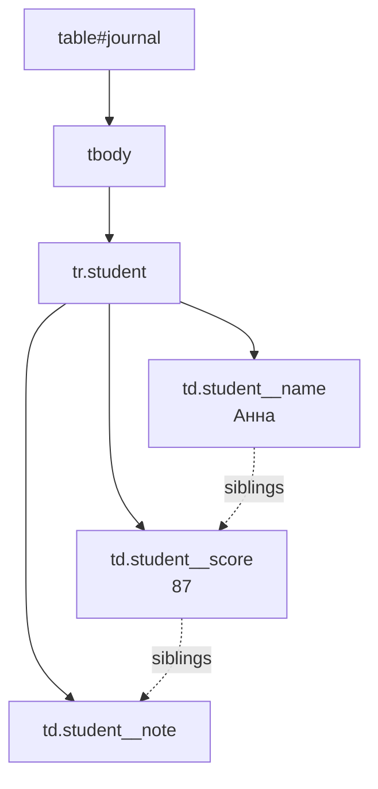
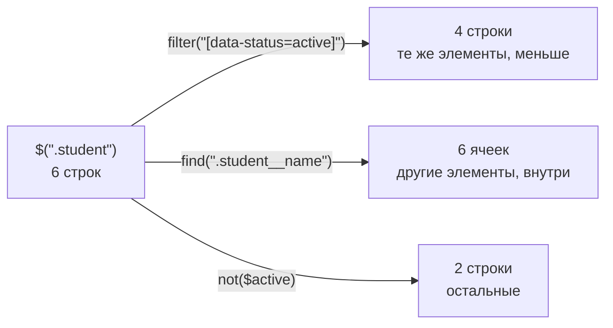
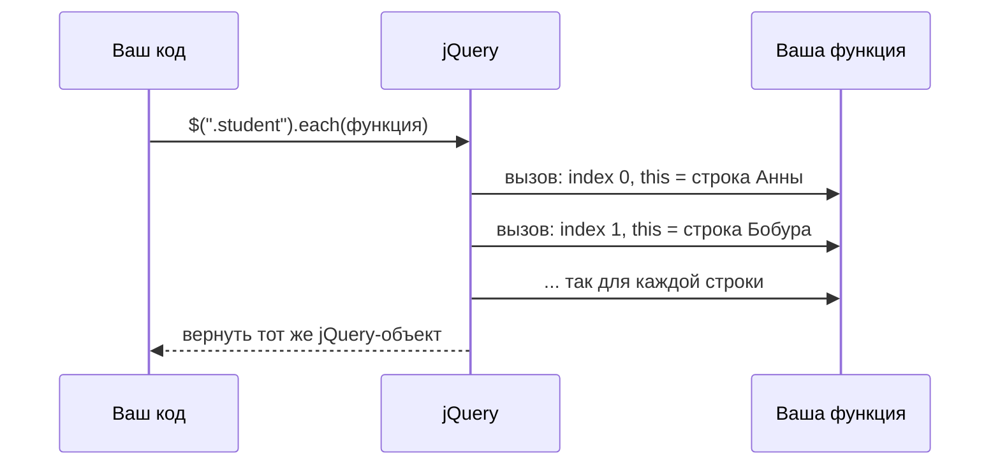
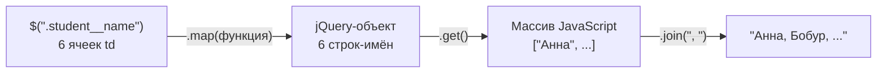

# Селекторы и обход DOM

[Содержание](../../README.md) · [← Назад](../../Lesson-1/ru/%D0%97%D0%BD%D0%B0%D0%BA%D0%BE%D0%BC%D1%81%D1%82%D0%B2%D0%BE%20%D1%81%20jQuery.md) · [Вперёд →](../../Lesson-3/ru/%D0%A1%D0%BE%D0%B4%D0%B5%D1%80%D0%B6%D0%B8%D0%BC%D0%BE%D0%B5%20%D0%B8%20%D0%B0%D1%82%D1%80%D0%B8%D0%B1%D1%83%D1%82%D1%8B.md) · [RU](%D0%A1%D0%B5%D0%BB%D0%B5%D0%BA%D1%82%D0%BE%D1%80%D1%8B%20%D0%B8%20%D0%BE%D0%B1%D1%85%D0%BE%D0%B4%20DOM.md) · [EN](../en/Selectors%20and%20DOM%20traversal.md) · [UZ](../uz/Selektorlar%20va%20DOM%20bo'ylab%20harakat.md)

> **Связь с уроком 1:** вы научились находить элементы через `$("селектор")`, менять им текст через `.text()` и строить цепочки. Но пока каждый поиск начинался «с нуля» - со всей страницы. Сегодня научимся точнее выбирать элементы и **ходить по дереву**: от элемента к его родителю, детям и соседям, а затем перебирать найденное по одному.

---

## Зачем это вам

Представьте журнал группы: таблица с учениками, у каждого - баллы и статус «учится» или «ушёл». Преподаватель просит: «Подсвети лучшего из тех, кто ещё учится, и дай мне список их имён». Один селектор `$(".student")` эту задачу не решит. Нужно:

- отобрать только активных учеников;
- пройти по каждому и сравнить баллы;
- из найденной строки достать имя - то есть спуститься внутрь строки к нужной ячейке;
- собрать имена в обычный массив JavaScript.

Ровно это вы сделаете в самостоятельной работе. Похожие задачи встречаются постоянно: «закрыть карточку, в которой нажали кнопку», «выделить пункт меню рядом с активным», «собрать все отмеченные товары».

---

## Чему вы научитесь

- Использовать в `$()` любые CSS-селекторы, включая комбинаторы.
- Выбирать элементы по атрибутам: `[data-status="active"]`, `[href^="https"]`.
- Спускаться вниз по дереву: `.find()` и `.children()`.
- Подниматься вверх: `.parent()` и `.closest()`.
- Двигаться в стороны: `.siblings()`, `.next()`, `.prev()`.
- Брать элемент по позиции: `.first()`, `.last()`, `.eq()`.
- Отбирать и проверять элементы: `.filter()`, `.not()`, `.is()`.
- Перебирать элементы по одному: `.each()` и `$(this)`.
- Собирать данные в массив: `.map().get()`.

---

## Повторение: 3 вопроса из урока 1

1. Что вернёт `$(".card")`, если на странице нет ни одной карточки? Как это проверить?
2. Почему после `.text("Новый")` цепочку можно продолжить, а после `.text()` - нет?
3. Как превратить DOM-элемент `heading` в jQuery-объект и обратно?

Ответы - в конце урока.

---

## План урока

| Раздел | Что делаем |
| --- | --- |
| Селекторы в `$()` | Комбинаторы и псевдоклассы CSS |
| Атрибутные селекторы | Выбор по `data-*` и другим атрибутам |
| Дерево DOM | Родители, дети, соседи |
| Вниз: `.find` и `.children` | Поиск внутри элемента |
| Вверх и в стороны | `.parent`, `.closest`, `.siblings`, `.next`, `.prev` |
| Мини-задание 1 | Путешествие по карточкам курсов |
| Позиция: `.first`, `.last`, `.eq` | Один элемент из набора |
| Отбор: `.filter`, `.not`, `.is` | Сузить набор и проверить его |
| Перебор: `.each` | Действие для каждого элемента отдельно |
| Сбор данных: `.map().get()` | Массив значений из элементов |
| Мини-задание 2 | Список задач |
| Самостоятельная работа | Журнал группы |

---

## Селекторы в `$()`

**Простыми словами:** селектор - это адрес на конверте. Чем точнее адрес, тем меньше шансов, что письмо попадёт не туда. `$(".name")` - «всем, кого зовут name», а `$("#journal .student .name")` - «в журнале, в строке ученика, ячейке с именем».

В `$()` работает всё, что вы писали в CSS и в `querySelectorAll`:

| Селектор | Что выбирает | Пример |
| --- | --- | --- |
| `тег` | Все элементы с тегом | `$("li")` |
| `.класс` | Все элементы с классом | `$(".card")` |
| `#id` | Элемент с id | `$("#journal")` |
| `A B` | B где угодно внутри A | `$("#journal td")` |
| `A > B` | B - прямой ребёнок A | `$("ul > li")` |
| `A + B` | B сразу после A | `$("h2 + p")` |
| `A, B` | И A, и B | `$("h1, h2")` |
| `:first-child`, `:nth-child(2)` | Позиция среди братьев | `$("li:nth-child(2)")` |
| `:not(.x)` | Все, кроме `.x` | `$("li:not(.done)")` |
| `:checked`, `:disabled` | Состояние поля | `$("input:checked")` |

```js
$("#menu li").length;              // все li на любой глубине, включая вложенные списки
$("#menu > li").length;            // только прямые дети #menu
$("#menu > li:not(.active)").length; // прямые дети без класса active
```

> **Важно:** в старом коде встречаются селекторы `:first`, `:last`, `:eq(2)`, `:even`, `:odd`. Это не CSS, а изобретение jQuery. В jQuery 4 они устарели: вместо них пишут методы `.first()`, `.last()`, `.eq(2)` и `.filter()` - их разберём ниже. А `:first-child` и `:nth-child()` - настоящие CSS-псевдоклассы, ими пользоваться можно.

---

## Атрибутные селекторы

В курсе JavaScript вы хранили данные прямо в разметке: `data-id="js"`, `data-lessons="10"`. Атрибутный селектор позволяет выбрать элементы **по значению атрибута**.

**Простыми словами:** в библиотеке книги можно искать не только по полке (класс), но и по наклейке на корешке: «все книги, где на наклейке написано *фантастика*». Атрибут - такая наклейка.

| Селектор | Что выбирает | Пример |
| --- | --- | --- |
| `[attr]` | Атрибут есть (любое значение) | `$("[data-score]")` |
| `[attr="v"]` | Значение ровно `v` | `$('[data-status="active"]')` |
| `[attr^="v"]` | Начинается с `v` | `$('a[href^="https"]')` |
| `[attr$="v"]` | Заканчивается на `v` | `$('a[href$=".pdf"]')` |
| `[attr*="v"]` | Содержит `v` | `$('[class*="btn"]')` |

```html
<tr class="student" data-status="active" data-score="87">...</tr>
<tr class="student" data-status="left" data-score="99">...</tr>
```

```js
const $active = $('tr[data-status="active"]');
console.log($active.length); // 1
```

Значение атрибута - в кавычках внутри строки селектора. Удобно так: снаружи одинарные, внутри двойные - `$('tr[data-status="active"]')`. Тогда не нужно экранировать кавычки через `\"`.

### Прочитать `data-*` у элемента

Выбрать элемент по атрибуту - полдела. Часто нужно прочитать значение. В этом уроке читаем его знакомым из курса JavaScript способом - через `dataset` у DOM-элемента:

```js
const row = $('tr[data-status="active"]')[0]; // DOM-элемент
console.log(row.dataset.score);               // "87" - строка!
console.log(Number(row.dataset.score) + 1);   // 88
```

> **Важно:** `dataset` всегда возвращает **строку**. Строки сравниваются посимвольно: `"100" > "95"` равно `false`, потому что `"1"` меньше `"9"`. Перед сравнением и сложением превращайте значение в число: `Number(...)`. У jQuery есть свой метод `.data()`, который делает это сам, - разберём его в уроке 3.

---

## Дерево DOM: родители, дети, соседи

Страница для браузера - это дерево. У каждого элемента (кроме `<html>`) есть **родитель**, у многих есть **дети** и **соседи** (элементы с тем же родителем).

**Простыми словами:** дерево DOM похоже на семейное древо. Ячейка таблицы - ребёнок строки, строка - ребёнок `tbody`. Две ячейки одной строки - родные братья. А таблица - «прабабушка» ячейки.

```html
<table id="journal">
    <tbody>
        <tr class="student">
            <td class="student__name">Анна</td>
            <td class="student__score">87</td>
            <td class="student__note"></td>
        </tr>
    </tbody>
</table>
```



**Как читать схему.** Сплошные стрелки идут от родителя к детям: `tr` - родитель трёх ячеек. Пунктир соединяет соседей: у ячеек один родитель. Двигаться по дереву можно в трёх направлениях: **вниз** (к детям и глубже), **вверх** (к родителю и предкам), **в стороны** (к соседям).

| Направление | Методы jQuery | Чистый JavaScript |
| --- | --- | --- |
| Вниз | `.find()`, `.children()` | `querySelectorAll`, `children` |
| Вверх | `.parent()`, `.closest()` | `parentElement`, `closest` |
| В стороны | `.siblings()`, `.next()`, `.prev()` | `nextElementSibling`, `previousElementSibling` |

В примерах дальше в журнале шесть строк, как в самостоятельной работе: Анна 87, Бобур 72, Тимур 99 (ушёл), Дильноза 95, Елена 64, Фарход 58 (ушёл).

Все эти методы возвращают **новый jQuery-объект**, поэтому их можно соединять в цепочки, как в уроке 1.

---

## Вниз: `.find()` и `.children()`

### `.find(селектор)` - искать внутри

`.find()` ищет потомков на **любой глубине** внутри уже найденных элементов.

```js
const $row = $(".student").first();
console.log($row.find(".student__name").text()); // "Анна"
```

Это как `$(".student .student__name")`, но поиск идёт от конкретного элемента, который уже лежит в переменной.

### `.children()` - только прямые дети

```js
$("#journal tbody").children().length; // число строк tr
$(".student").first().children().length; // 3 ячейки
$(".student").first().children(".student__score").text(); // "87"
```

**Простыми словами:** `.children()` - позвать своих детей, `.find()` - позвать всех потомков с нужным именем: детей, внуков, правнуков.

| Запись | Глубина | Нужен ли селектор |
| --- | --- | --- |
| `.find(".x")` | Любая | Обязателен |
| `.children()` | Один уровень | Необязателен: без него - все дети |
| `.children(".x")` | Один уровень | Отбирает детей по селектору |

---

## Вверх и в стороны

### `.parent()` и `.closest()`

`.parent()` делает **ровно один шаг** вверх. `.closest(селектор)` поднимается, пока не встретит подходящий элемент, и **начинает проверку с самого элемента**.

```js
const $score = $(".student__score").first();
$score.parent();            // tr.student - один шаг вверх
$score.closest("tr");       // тот же tr
$score.closest("table");    // table#journal - три шага вверх
$score.closest("td");       // сам $score: он уже td
$score.closest(".nothing"); // пустой объект, length 0
```

Пошагово, как `.closest("table")` ищет предка:

| Шаг | Что проверяется | Подходит под `table`? | Результат |
| --- | --- | --- | --- |
| 1 | Сам `td.student__score` | Нет | Идём вверх |
| 2 | `tr.student` | Нет | Идём вверх |
| 3 | `tbody` | Нет | Идём вверх |
| 4 | `table#journal` | Да | Возвращаем `table` |

**Простыми словами:** `.closest(".охранник")` - вы поднимаетесь по этажам здания и останавливаетесь на первом этаже, где стоит охранник. Если охранник - вы сами, никуда идти не надо. А `.parent()` - просто подняться на один этаж, кто бы там ни был.

`.closest()` нужен очень часто: в уроке 6 по нажатию кнопки «Удалить» будем находить через него карточку, в которой лежит кнопка.

### Соседи: `.siblings()`, `.next()`, `.prev()`

```js
const $name = $(".student__name").first();
$name.next().text();          // "87" - следующий сосед
$name.next().next().text();   // "" - ячейка отметки
$name.siblings().length;      // 2 - все соседи, кроме себя
$name.prev().length;          // 0 - слева никого нет
```

`.next()` и `.prev()` возвращают одного соседа, `.siblings()` - всех, кроме самого элемента. Во все три можно передать селектор: `.siblings(".x")`.

### Цепочка путешествия

Методы обхода соединяются в маршрут: «от ячейки - вверх к строке - вниз к имени».

```js
const $firstScore = $(".student__score").first();
const studentName = $firstScore
    .closest(".student")
    .find(".student__name")
    .text();
console.log(studentName); // "Анна"
```

На чистом JavaScript - `.closest(".student").querySelector(".student__name").textContent`. Разница в поведении: если на каком-то шаге ничего не найдено, чистый JavaScript упадёт с ошибкой `Cannot read properties of null`, а jQuery вернёт пустой объект, и `.text()` даст пустую строку.

---

## Мини-задание 1

```html
<div class="courses">
    <article class="course" data-level="start">
        <h2 class="course__title">HTML</h2>
        <p class="course__price">Бесплатно</p>
    </article>
    <article class="course" data-level="middle">
        <h2 class="course__title" id="js-title">JavaScript</h2>
        <p class="course__price">300 000 сум</p>
    </article>
    <article class="course" data-level="middle">
        <h2 class="course__title">jQuery</h2>
        <p class="course__price">200 000 сум</p>
    </article>
</div>
```

1. Сохраните в `$jsCard` карточку, в которой лежит `#js-title` (через `.closest`).
2. Выведите в консоль цену из этой карточки (через `.find`).
3. Выведите в консоль, сколько у `$jsCard` соседних карточек.
4. Найдите атрибутным селектором карточки уровня `middle` и выведите их количество.
5. Выведите название следующей после `$jsCard` карточки.

---

## Позиция: `.first()`, `.last()`, `.eq()`

Метод `$()` всегда находит **все** подходящие элементы. Если нужен один по порядку - используйте методы позиции. Они возвращают **jQuery-объект** с одним элементом (или пустой), поэтому цепочка продолжается.

```js
const $students = $(".student");

$students.first();   // первая строка
$students.last();    // последняя строка
$students.eq(1);     // вторая: счёт с нуля
$students.eq(-1);    // последняя: отрицательный индекс - с конца
$students.eq(100);   // пустой объект, ошибки нет
```

| Запись | Что вернёт | Можно продолжить цепочку |
| --- | --- | --- |
| `$students.eq(1)` | jQuery-объект со 2-м элементом | Да: `.eq(1).text()` |
| `$students[1]` | DOM-элемент | Нет методов jQuery |
| `$students.get(1)` | DOM-элемент | Нет методов jQuery |

**Простыми словами:** `.eq(1)` - достать из корзины второе яблоко, **положив его в маленькую корзинку**. С корзинкой можно делать всё то же, что с большой. А `[1]` - взять яблоко прямо в руку: методов корзины у него нет.

---

## Отбор: `.filter()`, `.not()`, `.is()`

### `.filter()` - оставить подходящие

`.filter(селектор)` не ищет ничего нового: из **уже найденных** элементов он оставляет только подходящие.

```js
const $students = $(".student");
const $active = $students.filter('[data-status="active"]');
```



**Как читать схему.** Из одного набора строк получаются три разных результата. `filter` и `not` делят набор на две части - элементы остаются **теми же строками**. `find` спускается внутрь и возвращает **другие** элементы - ячейки.

### `.filter()` с функцией

Если условие не записать селектором - например, «баллы больше 80», - передайте функцию. jQuery вызовет её для каждого элемента; `this` внутри - текущий DOM-элемент. Вернули `true` - элемент остаётся.

```js
const $strong = $(".student").filter(function () {
    return Number(this.dataset.score) > 80;
});
console.log($strong.length);
```

| Шаг | `this` | `Number(this.dataset.score)` | `> 80`? | Остаётся |
| --- | --- | --- | --- | --- |
| 1 | строка Анны | 87 | `true` | Да |
| 2 | строка Бобура | 72 | `false` | Нет |
| 3 | строка Тимура | 99 | `true` | Да |
| 4 | строка Дильнозы | 95 | `true` | Да |
| 5–6 | Елена, Фарход | 64, 58 | `false` | Нет |
| Итог | | | | `$strong.length === 3` |

Почему обычная `function`, а не стрелочная `() => {}`? У стрелочной функции нет своего `this`: она берёт его снаружи, и это будет не строка таблицы. Подробно - в разделе про `.each()`.

### `.not()` - всё, кроме

`$(".student").not($active)` или `.not('[data-status="active"]')` - противоположность `.filter()`. `.not()` принимает селектор, функцию или другой jQuery-объект - удобно, когда одна группа уже лежит в переменной.

### `.is()` - проверить, а не отобрать

`.is()` возвращает не jQuery-объект, а `true` или `false`: подходит ли **хотя бы один** элемент.

```js
const $first = $(".student").first();
if ($first.is('[data-status="left"]')) {
    console.log("Первый в списке уже ушёл");
}
console.log($(".student").is(".is-best")); // есть ли хоть одна лучшая строка
```

| Метод | Возвращает | Вопрос, на который отвечает |
| --- | --- | --- |
| `.filter(x)` | jQuery-объект (меньше) | «Кто из них подходит?» |
| `.not(x)` | jQuery-объект (меньше) | «Кто из них не подходит?» |
| `.is(x)` | `true` / `false` | «Есть ли среди них подходящий?» |

---

## Перебор: `.each()` и `$(this)`

Неявный перебор из урока 1 делает **одно и то же** со всеми элементами. А если для каждого элемента нужно своё действие или вычисление - например, сравнить баллы - нужен явный перебор `.each()`.

**Простыми словами:** неявный перебор - учитель говорит классу «Все встаньте». `.each()` - учитель обходит парты и у каждого ученика проверяет тетрадь отдельно.

```js
$(".student").each(function (index) {
    const name = $(this).find(".student__name").text();
    console.log(index, name); // 0 "Анна", 1 "Бобур", ...
});
```

| Что | Значение внутри функции |
| --- | --- |
| `index` (первый параметр) | Номер элемента с нуля |
| `element` (второй параметр) | Текущий DOM-элемент |
| `this` | Тот же текущий DOM-элемент |
| `$(this)` | Он же, обёрнутый в jQuery-объект - с методами `.find`, `.text`... |



**Как читать схему.** Вы не вызываете функцию сами: вы отдаёте её jQuery, и он вызывает её по очереди для каждого элемента, каждый раз подставляя в `this` новый элемент. После перебора `.each()` возвращает тот же набор, поэтому цепочку можно продолжить.

### Поиск максимума через `.each()`

Типичная задача - найти наибольшее значение. Это тот же алгоритм, что в курсе JavaScript с циклом `for...of`: заводим переменную «лучший пока» и обновляем её, если встретили больше.

```js
let bestScore = -1;
$(".student").each(function () {
    const score = Number(this.dataset.score);
    if (score > bestScore) {
        bestScore = score;
    }
});
console.log(bestScore); // 99
```

| Шаг | Строка | `score` | `score > bestScore`? | `bestScore` после шага |
| --- | --- | --- | --- | --- |
| Старт | - | - | - | -1 |
| 1 | Анна | 87 | 87 > -1 - да | 87 |
| 2 | Бобур | 72 | 72 > 87 - нет | 87 |
| 3 | Тимур | 99 | 99 > 87 - да | 99 |
| 4 | Дильноза | 95 | 95 > 99 - нет | 99 |
| 5 | Елена | 64 | нет | 99 |
| 6 | Фарход | 58 | нет | 99 |

`bestScore` объявлен через `let`, потому что меняется. Строгое `>` (а не `>=`) означает: при равенстве остаётся тот, кто встретился раньше.

Когда максимум известен, строку с ним удобно найти через `.filter()` и взять первую:

```js
const $bestRow = $(".student")
    .filter(function () {
        return Number(this.dataset.score) === bestScore;
    })
    .first();
```

Если строк не было, `$bestRow.length` будет `0` - это нужно проверить, прежде чем выводить результат.

### `this` и стрелочные функции

```js
// Ошибка: у стрелочной функции this - внешний (window), а не строка
$(".student").each(() => {
    console.log(this.dataset.score); // TypeError
});
// Если хочется стрелочную - берите элемент из второго параметра
$(".student").each((index, row) => {
    console.log(Number(row.dataset.score));
});
```

В курсе внутри `.each()`, `.filter()` и `.map()` используется обычная `function` и `this` - так пишут в документации jQuery и в большинстве плагинов.

---

## Сбор данных: `.map().get()`

`.each()` что-то **делает** с каждым элементом. А `.map()` из каждого элемента **получает значение** и собирает результаты вместе.

```js
const names = $(".student__name")
    .map(function () {
        return $(this).text();
    })
    .get();
console.log(names); // ["Анна", "Бобур", "Тимур", "Дильноза", "Елена", "Фарход"]
console.log(names.join(", "));
```



**Как читать схему.** `.map()` в jQuery возвращает **не массив**, а снова jQuery-объект, только внутри лежат значения, которые вернула ваша функция. Чтобы получить настоящий массив с методами `join`, `includes`, `length`, в конце пишут `.get()`.

| Запись | Что получится |
| --- | --- |
| `$els.map(fn)` | jQuery-объект со значениями: `join` не работает |
| `$els.map(fn).get()` | Массив JavaScript |
| `$els.get()` | Массив DOM-элементов (без `map`) |

### `.map()` jQuery и `.map()` массива

У массивов в JavaScript тоже есть `.map()`, но параметры у них **в разном порядке**:

| | Первый параметр | Второй параметр |
| --- | --- | --- |
| `array.map((item, index) => ...)` | Элемент | Индекс |
| `$els.map(function (index, element) { ... })` | **Индекс** | Элемент |

```js
// Ошибка: name - это индекс 0, 1, 2..., а не элемент
$(".student__name").map((name) => $(name).text()).get(); // ["", "", ...]
// Надёжно: function () { ... } и элемент из this
```

> **Важно:** если нужно и отобрать, и собрать данные, сначала отберите элементы (`.filter`, атрибутный селектор), а потом вызывайте `.map().get()`. Так функция остаётся простой: одна задача - одно значение.

---

### Попробуйте сломать

1. Уберите `Number()` в поиске максимума и поменяйте баллы Анны на `100`. Кого теперь код считает лучшим? Почему?
2. Замените в `.each()` обычную функцию на стрелочную `() => { ... }` с `this`. Что напишет консоль?
3. Уберите `.get()` после `.map()` и вызовите `names.join(", ")`. Какую ошибку вы увидите?
4. Напишите `$(".student")[0].find(".student__name")`. Затем исправьте на `.eq(0)`.
5. Сравните `$("#journal").children().length` и `$("#journal").find("tr").length`. Почему числа разные?
6. Вызовите `$(".student__name").first().closest(".nothing").length`. Есть ли ошибка?

### Частые ошибки новичков

| Ошибка | Что получится | Как исправить |
| --- | --- | --- |
| Сравнение `dataset` без `Number` | `"100" > "95"` - `false`, неверный максимум | `Number(this.dataset.score)` |
| Стрелочная функция с `this` в `.each` | `TypeError` или `undefined` | `function () { ... }` или параметр `(index, el)` |
| `this.find(...)` внутри `.each` | `this.find is not a function` | `$(this).find(...)` |
| `$els[1].text()` | `text is not a function`: это DOM-элемент | `$els.eq(1).text()` |
| `.map()` без `.get()` | Нет методов массива: `join is not a function` | `.map(fn).get()` |
| `.filter(".x")` вместо `.find(".x")` | Пустой результат: ищет среди самих элементов, а не внутри | Внутри - `.find`, среди - `.filter` |
| `.children(".x")` для внуков | Пустой объект: только один уровень | `.find(".x")` |
| `$("li:first")`, `$("li:eq(2)")` | Работает, но устарело в jQuery 4 | `.first()`, `.eq(2)` |
| `if ($rows.filter(".x"))` | Условие всегда истинно: `filter` возвращает объект, даже пустой | `if ($rows.is(".x"))` или `.length > 0` |

---

## Мини-задание 2

```html
<ul id="tasks">
    <li class="task done" data-priority="high">Сверстать шапку</li>
    <li class="task" data-priority="low">Подобрать шрифт</li>
    <li class="task" data-priority="high">Подключить jQuery</li>
    <li class="task" data-priority="high">Написать меню</li>
    <li class="task done" data-priority="low">Создать репозиторий</li>
</ul>
<p id="summary"></p>
```

1. Сохраните все задачи в `$tasks`, невыполненные (без класса `done`) - в `$todo` через `.not`.
2. Первой невыполненной задаче добавьте класс `is-next`.
3. Соберите в массив `urgent` тексты невыполненных задач с приоритетом `high` (`.filter` + `.map().get()`).
4. Через `.is()` проверьте, есть ли хоть одна выполненная задача, и запишите в `#summary`: `Осталось: 3. Срочно: Подключить jQuery, Написать меню` (если выполненных нет, допишите в конце ` Пока ничего не сделано.`).

---

## Итоги урока: шпаргалка

| Задача | Запись |
| --- | --- |
| Прямые дети в селекторе | `$("ul > li")` |
| По атрибуту | `$('[data-status="active"]')`, `$('a[href^="https"]')` |
| Прочитать `data-*` | `Number(element.dataset.score)` |
| Искать внутри | `$el.find(".x")` |
| Прямые дети | `$el.children()` |
| Родитель / ближайший предок | `$el.parent()` / `$el.closest(".card")` |
| Соседи | `$el.next()`, `$el.prev()`, `$el.siblings()` |
| По позиции | `.first()`, `.last()`, `.eq(1)`, `.eq(-1)` |
| Оставить / убрать | `.filter(x)` / `.not(x)` |
| Проверить | `$el.is(".done")` - `true` / `false` |
| Перебрать | `$els.each(function () { $(this)... })` |
| Собрать в массив | `$els.map(function () { return ...; }).get()` |

---

## Самостоятельная работа

### Часть 1. Задание в IDE (засчитывается платформой)

В таблице `#journal` строки `tr.student` с атрибутами `data-status` (`"active"` или `"left"`) и `data-score` (баллы), внутри - `td.student__name`, `td.student__score` и пустая `td.student__note`. jQuery уже подключён.

1. Сохраните в константу `$active` строки внутри `#journal` с `data-status="active"` (атрибутный селектор).
2. Запишите в `#active-count` текст `Активных учеников: 4`, где число - `$active.length`.
3. Остальным строкам `.student` добавьте класс `is-left` (метод `.not`).
4. Через `.each` найдите лучший балл среди активных учеников: `Number(this.dataset.score)`.
5. Строке с лучшим баллом (при равенстве - первой в таблице) добавьте класс `is-best`, в её `.student__note` запишите `лучший`, в `#best` - `Лучший результат: Дильноза (95)`; если активных учеников нет - `Активных учеников нет`.
6. Соберите имена активных учеников в массив `names` через `.map(...).get()`, запишите в `#names` через запятую с пробелом и выведите массив в консоль.

`document.querySelector`, `innerHTML`, `.html()` и циклы `for` не используйте.

Что проверяет платформа: что `$active` содержит только активные строки `tr`; текст счётчика; класс `is-left` только у ушедших; лучший выбирается среди активных (ушедший Тимур с 99 баллами не считается); отметка `лучший` в нужной ячейке и текст `#best`; что баллы сравниваются как числа (100 больше 95) и при равенстве выбирается первая строка; что `names` - настоящий массив и выведен в консоль; что новая строка, добавленная в таблицу, учитывается; что таблица без активных учеников не ломает программу; что используются `.each` и `.map().get()`.

### Часть 2. Проект на компьютере

1. На своём сайте из курсов HTML/CSS/JS добавьте к карточкам (курсов, проектов, товаров) атрибут `data-category` и выведите в консоль, сколько карточек в каждой категории - атрибутными селекторами.
2. Соберите через `.map().get()` массив заголовков всех карточек и выведите его в консоль.
3. Через `.each` найдите карточку с самым длинным заголовком и добавьте ей класс `is-highlight` (опишите его в CSS).
4. Для первой ссылки в меню выведите в консоль текст её соседей: `.siblings()` или `.parent().siblings()` - в зависимости от вашей разметки.

### Критерии готовности

- [ ] Задание в IDE засчитано.
- [ ] Вы объясните разницу между `.find()` и `.filter()`, `.parent()` и `.closest()`.
- [ ] Числа из `dataset` превращаются через `Number()` перед сравнением.
- [ ] Внутри `.each()` используется `$(this)` для методов jQuery.
- [ ] Позиционные `:first`, `:eq()` в коде не встречаются - только `.first()`, `.eq()`.

---

## Вопросы для самопроверки

1. Чем отличаются селекторы `$("ul li")` и `$("ul > li")`?
2. Как выбрать все ссылки, адрес которых заканчивается на `.pdf`?
3. Чем `.find()` отличается от `.children()`?
4. Чем `.closest()` отличается от `.parent()`? С какого элемента `.closest()` начинает проверку?
5. Что вернут `$items.eq(1)` и `$items[1]`? Почему у одного есть `.text()`, а у другого нет?
6. Чем `.filter()` отличается от `.find()`?
7. Что возвращает `.is()` и когда он удобнее `.filter()`?
8. Что такое `this` внутри `.each()` и зачем писать `$(this)`?
9. Почему после `.map()` нужен `.get()`?
10. Почему `"100" > "95"` равно `false` и как этого избежать при чтении `data-*`?

После вопросов пройдите **тест урока** на платформе: 12 вопросов, порог 70%.

---

## Что дальше

Теперь вы умеете найти любой элемент на странице и пройти по набору элементов. Пока мы меняли у найденного только текст. В уроке 3 научимся работать с **содержимым и атрибутами**: разберём `.html()` и почему он опасен, значения полей `.val()`, атрибуты `.attr()` и `.prop()`, а также метод `.data()`, который читает `data-*` и сам превращает `"95"` в число.

---

## Ответы

**Повторение**

1. Пустой jQuery-объект с `length === 0`. Проверка: `$(".card").length === 0`.
2. Сеттер возвращает jQuery-объект, а геттер - строку, у которой нет методов jQuery.
3. `$(heading)` - jQuery-объект; `$heading[0]` или `$heading.get(0)` - DOM-элемент.

**Мини-задание 1**

```js
const $jsCard = $("#js-title").closest(".course");
console.log($jsCard.find(".course__price").text()); // "300 000 сум"

console.log($jsCard.siblings().length); // 2

const $middle = $('.course[data-level="middle"]');
console.log($middle.length); // 2

console.log($jsCard.next().find(".course__title").text()); // "jQuery"
```

**Мини-задание 2**

```js
const $tasks = $("#tasks .task");
const $todo = $tasks.not(".done");

$todo.first().addClass("is-next");

const urgent = $todo
    .filter('[data-priority="high"]')
    .map(function () {
        return $(this).text();
    })
    .get();

let summary = `Осталось: ${$todo.length}. Срочно: ${urgent.join(", ")}`;
if (!$tasks.is(".done")) {
    summary += " Пока ничего не сделано.";
}
$("#summary").text(summary);
```

**Вопросы для самопроверки**

1. `ul li` - все `li` на любой глубине внутри `ul`, `ul > li` - только прямые дети.
2. `$('a[href$=".pdf"]')`.
3. `.find()` ищет потомков на любой глубине и требует селектор; `.children()` - только прямых детей.
4. `.parent()` - ровно один шаг вверх. `.closest(sel)` поднимается до первого подходящего предка и начинает проверку с самого элемента.
5. `.eq(1)` - jQuery-объект со вторым элементом, у него есть методы jQuery. `[1]` - DOM-элемент, у него методов jQuery нет.
6. `.filter()` оставляет подходящие из уже найденных элементов, `.find()` ищет новые элементы внутри них.
7. `true` или `false` - есть ли хоть один подходящий элемент. Удобнее в условиях `if`.
8. `this` - текущий DOM-элемент перебора. `$(this)` превращает его в jQuery-объект, чтобы вызывать `.find()`, `.text()` и другие методы.
9. `.map()` в jQuery возвращает jQuery-объект; `.get()` превращает его в настоящий массив с `join`, `includes` и другими методами.
10. Строки сравниваются посимвольно, а `"1"` меньше `"9"`. Значение из `dataset` нужно превращать в число: `Number(this.dataset.score)`.

---

[Содержание](../../README.md) · [← Назад](../../Lesson-1/ru/%D0%97%D0%BD%D0%B0%D0%BA%D0%BE%D0%BC%D1%81%D1%82%D0%B2%D0%BE%20%D1%81%20jQuery.md) · [Вперёд →](../../Lesson-3/ru/%D0%A1%D0%BE%D0%B4%D0%B5%D1%80%D0%B6%D0%B8%D0%BC%D0%BE%D0%B5%20%D0%B8%20%D0%B0%D1%82%D1%80%D0%B8%D0%B1%D1%83%D1%82%D1%8B.md) · [RU](%D0%A1%D0%B5%D0%BB%D0%B5%D0%BA%D1%82%D0%BE%D1%80%D1%8B%20%D0%B8%20%D0%BE%D0%B1%D1%85%D0%BE%D0%B4%20DOM.md) · [EN](../en/Selectors%20and%20DOM%20traversal.md) · [UZ](../uz/Selektorlar%20va%20DOM%20bo'ylab%20harakat.md)
