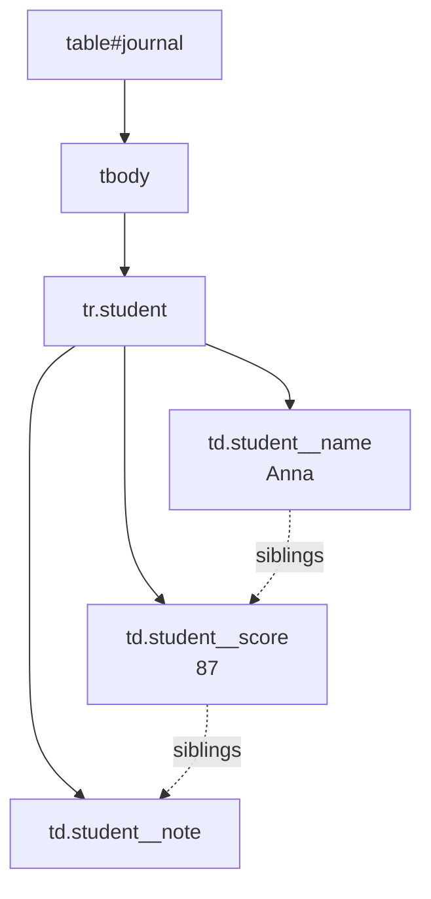
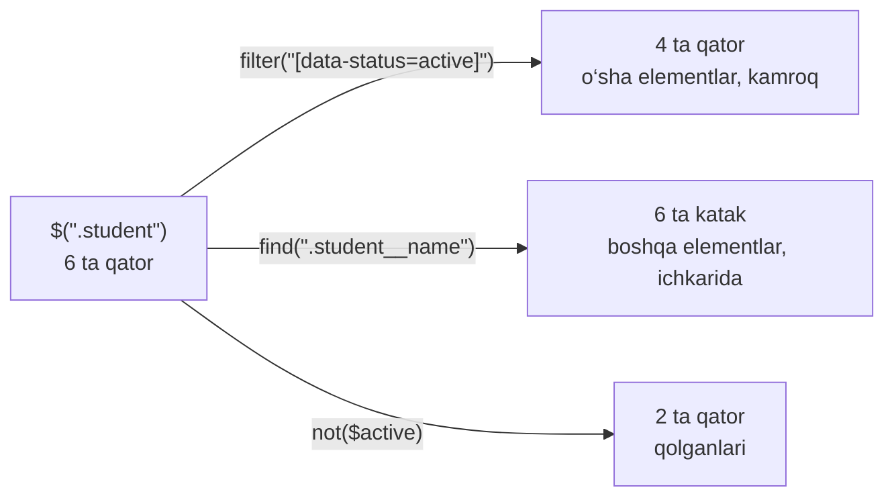
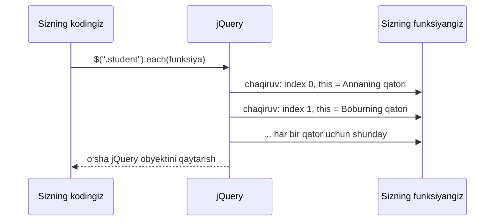
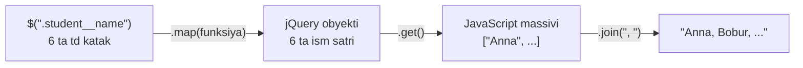

# Selektorlar va DOM bo‘ylab harakat

[Mundarija](../../README.md) · [← Orqaga](../../Lesson-1/uz/jQuery%20bilan%20tanishuv.md) · [Keyingi →](../../Lesson-3/uz/Kontent%20va%20atributlar.md) · [RU](../ru/%D0%A1%D0%B5%D0%BB%D0%B5%D0%BA%D1%82%D0%BE%D1%80%D1%8B%20%D0%B8%20%D0%BE%D0%B1%D1%85%D0%BE%D0%B4%20DOM.md) · [EN](../en/Selectors%20and%20DOM%20traversal.md) · [UZ](Selektorlar%20va%20DOM%20bo'ylab%20harakat.md)

> **1-dars bilan bog‘liqlik:** siz elementlarni `$("selektor")` orqali topishni, ularning matnini `.text()` bilan o‘zgartirishni va zanjirlar tuzishni o‘rgandingiz. Lekin hozircha har bir qidiruv «noldan» - butun sahifadan boshlanardi. Bugun elementlarni aniqroq tanlashni va **daraxt bo‘ylab yurishni** o‘rganamiz: elementdan uning ota elementiga, bolalariga va qo‘shnilariga o‘tamiz, so‘ng topilganlarni birma-bir aylanib chiqamiz.

---

## Bu sizga nima uchun kerak

Guruh jurnalini tasavvur qiling: o‘quvchilar jadvali, har birida ball va «o‘qiyapti» yoki «ketgan» holati bor. O‘qituvchi so‘raydi: «Hali o‘qiyotganlar orasidan eng yaxshisini ajratib ko‘rsat va menga ularning ismlari ro‘yxatini ber». Bitta `$(".student")` selektori bu vazifani hal qilmaydi. Quyidagilar kerak:

- faqat faol o‘quvchilarni ajratib olish;
- har birini aylanib chiqib, ballarini solishtirish;
- topilgan qatordan ismni olish - ya’ni qator ichiga kerakli katakkacha tushish;
- ismlarni oddiy JavaScript massiviga yig‘ish.

Aynan shuni mustaqil ishda bajarasiz. Shunga o‘xshash vazifalar doim uchraydi: «tugmasi bosilgan kartochkani yopish», «faol menyu bandi yonidagisini ajratish», «belgilangan barcha mahsulotlarni yig‘ish».

---

## Nimani o‘rganasiz

- `$()` ichida istalgan CSS selektorlaridan, jumladan kombinatorlardan foydalanish.
- Elementlarni atributlar bo‘yicha tanlash: `[data-status="active"]`, `[href^="https"]`.
- Daraxt bo‘ylab pastga tushish: `.find()` va `.children()`.
- Yuqoriga ko‘tarilish: `.parent()` va `.closest()`.
- Yon tomonlarga harakatlanish: `.siblings()`, `.next()`, `.prev()`.
- Elementni o‘rni bo‘yicha olish: `.first()`, `.last()`, `.eq()`.
- Elementlarni saralash va tekshirish: `.filter()`, `.not()`, `.is()`.
- Elementlarni birma-bir aylanib chiqish: `.each()` va `$(this)`.
- Ma’lumotlarni massivga yig‘ish: `.map().get()`.

---

## Takrorlash: 1-darsdan 3 savol

1. Sahifada birorta ham kartochka bo‘lmasa, `$(".card")` nimani qaytaradi? Buni qanday tekshirish mumkin?
2. Nima uchun `.text("Yangi")` dan keyin zanjirni davom ettirish mumkin, `.text()` dan keyin esa yo‘q?
3. `heading` DOM elementini jQuery obyektiga va aksincha qanday aylantirish mumkin?

Javoblar - dars oxirida.

---

## Reja

| Bo‘lim | Nima qilamiz |
| --- | --- |
| `$()` dagi selektorlar | CSS kombinatorlari va psevdoklasslari |
| Atribut selektorlari | `data-*` va boshqa atributlar bo‘yicha tanlash |
| DOM daraxti | Ota elementlar, bolalar, qo‘shnilar |
| Pastga: `.find` va `.children` | Element ichidan qidirish |
| Yuqoriga va yon tomonlarga | `.parent`, `.closest`, `.siblings`, `.next`, `.prev` |
| Mini-topshiriq 1 | Kurs kartochkalari bo‘ylab sayohat |
| O‘rin: `.first`, `.last`, `.eq` | To‘plamdan bitta element |
| Saralash: `.filter`, `.not`, `.is` | To‘plamni toraytirish va tekshirish |
| Aylanib chiqish: `.each` | Har bir element uchun alohida amal |
| Ma’lumot yig‘ish: `.map().get()` | Elementlardan qiymatlar massivi |
| Mini-topshiriq 2 | Vazifalar ro‘yxati |
| Mustaqil ish | Guruh jurnali |

---

## `$()` dagi selektorlar

**Oddiy so‘z bilan:** selektor - konvertdagi manzil. Manzil qanchalik aniq bo‘lsa, xat noto‘g‘ri joyga borib qolish ehtimoli shunchalik kam. `$(".name")` - «name deb ataladigan hammaga», `$("#journal .student .name")` esa - «jurnaldagi, o‘quvchi qatoridagi, ism katagiga».

`$()` ichida CSS va `querySelectorAll` da yozgan hamma narsangiz ishlaydi:

| Selektor | Nimani tanlaydi | Misol |
| --- | --- | --- |
| `teg` | Shu tegli barcha elementlar | `$("li")` |
| `.klass` | Shu klassli barcha elementlar | `$(".card")` |
| `#id` | Shu id li element | `$("#journal")` |
| `A B` | A ichidagi istalgan joydagi B | `$("#journal td")` |
| `A > B` | B - A ning bevosita bolasi | `$("ul > li")` |
| `A + B` | A dan darhol keyingi B | `$("h2 + p")` |
| `A, B` | Ham A, ham B | `$("h1, h2")` |
| `:first-child`, `:nth-child(2)` | Aka-ukalar orasidagi o‘rni | `$("li:nth-child(2)")` |
| `:not(.x)` | `.x` dan boshqa hammasi | `$("li:not(.done)")` |
| `:checked`, `:disabled` | Maydon holati | `$("input:checked")` |

```js
$("#menu li").length;              // istalgan chuqurlikdagi barcha li, ichki ro‘yxatlar bilan birga
$("#menu > li").length;            // faqat #menu ning bevosita bolalari
$("#menu > li:not(.active)").length; // active klassi bo‘lmagan bevosita bolalar
```

> **Muhim:** eski kodda `:first`, `:last`, `:eq(2)`, `:even`, `:odd` selektorlari uchraydi. Bu CSS emas, jQuery ixtirosi. jQuery 4 da ular eskirgan: ularning o‘rniga `.first()`, `.last()`, `.eq(2)` va `.filter()` metodlari yoziladi - ularni quyida ko‘rib chiqamiz. `:first-child` va `:nth-child()` esa haqiqiy CSS psevdoklasslari, ulardan foydalanish mumkin.

---

## Atribut selektorlari

JavaScript kursida siz ma’lumotlarni to‘g‘ridan-to‘g‘ri belgilashda saqlagansiz: `data-id="js"`, `data-lessons="10"`. Atribut selektori elementlarni **atribut qiymati bo‘yicha** tanlash imkonini beradi.

**Oddiy so‘z bilan:** kutubxonada kitoblarni faqat javon (klass) bo‘yicha emas, balki muqovadagi yorliq bo‘yicha ham qidirish mumkin: «yorlig‘ida *fantastika* deb yozilgan barcha kitoblar». Atribut - ana shunday yorliq.

| Selektor | Nimani tanlaydi | Misol |
| --- | --- | --- |
| `[attr]` | Atribut bor (qiymati istalgan) | `$("[data-score]")` |
| `[attr="v"]` | Qiymati aynan `v` | `$('[data-status="active"]')` |
| `[attr^="v"]` | `v` bilan boshlanadi | `$('a[href^="https"]')` |
| `[attr$="v"]` | `v` bilan tugaydi | `$('a[href$=".pdf"]')` |
| `[attr*="v"]` | `v` ni o‘z ichiga oladi | `$('[class*="btn"]')` |

```html
<tr class="student" data-status="active" data-score="87">...</tr>
<tr class="student" data-status="left" data-score="99">...</tr>
```

```js
const $active = $('tr[data-status="active"]');
console.log($active.length); // 1
```

Atribut qiymati selektor satri ichida qo‘shtirnoqda yoziladi. Shunday qilish qulay: tashqarida bittalik, ichkarida qo‘sh qo‘shtirnoq - `$('tr[data-status="active"]')`. Shunda qo‘shtirnoqlarni `\"` orqali ekranlash shart emas.

### Elementning `data-*` atributini o‘qish

Elementni atribut bo‘yicha tanlash - ishning yarmi. Ko‘pincha qiymatni o‘qish kerak bo‘ladi. Bu darsda uni JavaScript kursidan tanish usulda - DOM elementining `dataset` xususiyati orqali o‘qiymiz:

```js
const row = $('tr[data-status="active"]')[0]; // DOM element
console.log(row.dataset.score);               // "87" - satr!
console.log(Number(row.dataset.score) + 1);   // 88
```

> **Muhim:** `dataset` har doim **satr** qaytaradi. Satrlar belgima-belgi solishtiriladi: `"100" > "95"` `false` ga teng, chunki `"1"` `"9"` dan kichik. Solishtirish va qo‘shishdan oldin qiymatni songa aylantiring: `Number(...)`. jQuery da buni o‘zi bajaradigan `.data()` metodi bor - uni 3-darsda ko‘rib chiqamiz.

---

## DOM daraxti: ota elementlar, bolalar, qo‘shnilar

Brauzer uchun sahifa - bu daraxt. Har bir elementning (`<html>` dan tashqari) **ota elementi** bor, ko‘plarida **bolalar** va **qo‘shnilar** (ota elementi bir xil bo‘lgan elementlar) bor.

**Oddiy so‘z bilan:** DOM daraxti shajaraga o‘xshaydi. Jadval katagi - qatorning bolasi, qator - `tbody` ning bolasi. Bir qatordagi ikki katak - tug‘ishgan aka-ukalar. Jadval esa katakning «katta buvisi».

```html
<table id="journal">
    <tbody>
        <tr class="student">
            <td class="student__name">Anna</td>
            <td class="student__score">87</td>
            <td class="student__note"></td>
        </tr>
    </tbody>
</table>
```



**Sxemani qanday o‘qish kerak.** Uzluksiz strelkalar ota elementdan bolalarga boradi: `tr` - uchta katakning ota elementi. Punktir qo‘shnilarni bog‘laydi: kataklarning ota elementi bitta. Daraxt bo‘ylab uch yo‘nalishda harakatlanish mumkin: **pastga** (bolalarga va undan chuqurroq), **yuqoriga** (ota elementga va ajdodlarga), **yon tomonlarga** (qo‘shnilarga).

| Yo‘nalish | jQuery metodlari | Sof JavaScript |
| --- | --- | --- |
| Pastga | `.find()`, `.children()` | `querySelectorAll`, `children` |
| Yuqoriga | `.parent()`, `.closest()` | `parentElement`, `closest` |
| Yon tomonlarga | `.siblings()`, `.next()`, `.prev()` | `nextElementSibling`, `previousElementSibling` |

Keyingi misollarda jurnalda mustaqil ishdagidek oltita qator bor: Anna 87, Bobur 72, Timur 99 (ketgan), Dilnoza 95, Yelena 64, Farhod 58 (ketgan).

Bu metodlarning barchasi **yangi jQuery obyekti** qaytaradi, shuning uchun ularni 1-darsdagidek zanjirga ulash mumkin.

---

## Pastga: `.find()` va `.children()`

### `.find(selektor)` - ichidan qidirish

`.find()` allaqachon topilgan elementlar ichidan **istalgan chuqurlikdagi** avlodlarni qidiradi.

```js
const $row = $(".student").first();
console.log($row.find(".student__name").text()); // "Anna"
```

Bu `$(".student .student__name")` ga o‘xshaydi, lekin qidiruv o‘zgaruvchida turgan aniq elementdan boshlanadi.

### `.children()` - faqat bevosita bolalar

```js
$("#journal tbody").children().length; // tr qatorlari soni
$(".student").first().children().length; // 3 ta katak
$(".student").first().children(".student__score").text(); // "87"
```

**Oddiy so‘z bilan:** `.children()` - o‘z bolalaringizni chaqirish, `.find()` - kerakli ismdagi barcha avlodlarni chaqirish: bolalar, nevaralar, chevaralar.

| Yozuv | Chuqurlik | Selektor kerakmi |
| --- | --- | --- |
| `.find(".x")` | Istalgan | Majburiy |
| `.children()` | Bir daraja | Majburiy emas: usiz - barcha bolalar |
| `.children(".x")` | Bir daraja | Bolalarni selektor bo‘yicha saralaydi |

---

## Yuqoriga va yon tomonlarga

### `.parent()` va `.closest()`

`.parent()` yuqoriga **aynan bir qadam** tashlaydi. `.closest(selektor)` mos element uchramaguncha yuqoriga ko‘tariladi va **tekshiruvni elementning o‘zidan boshlaydi**.

```js
const $score = $(".student__score").first();
$score.parent();            // tr.student - bir qadam yuqoriga
$score.closest("tr");       // o‘sha tr
$score.closest("table");    // table#journal - uch qadam yuqoriga
$score.closest("td");       // $score ning o‘zi: u allaqachon td
$score.closest(".nothing"); // bo‘sh obyekt, length 0
```

`.closest("table")` ajdodni qanday qidirishi, qadamma-qadam:

| Qadam | Nima tekshiriladi | `table` ga mosmi? | Natija |
| --- | --- | --- | --- |
| 1 | `td.student__score` ning o‘zi | Yo‘q | Yuqoriga boramiz |
| 2 | `tr.student` | Yo‘q | Yuqoriga boramiz |
| 3 | `tbody` | Yo‘q | Yuqoriga boramiz |
| 4 | `table#journal` | Ha | `table` ni qaytaramiz |

**Oddiy so‘z bilan:** `.closest(".qorovul")` - siz bino qavatlari bo‘ylab ko‘tarilasiz va qorovul turgan birinchi qavatda to‘xtaysiz. Agar qorovul o‘zingiz bo‘lsangiz, hech qayerga borish shart emas. `.parent()` esa - u yerda kim bo‘lishidan qat’i nazar, shunchaki bir qavat ko‘tarilish.

`.closest()` juda tez-tez kerak bo‘ladi: 6-darsda «O‘chirish» tugmasi bosilganda u orqali tugma joylashgan kartochkani topamiz.

### Qo‘shnilar: `.siblings()`, `.next()`, `.prev()`

```js
const $name = $(".student__name").first();
$name.next().text();          // "87" - keyingi qo‘shni
$name.next().next().text();   // "" - izoh katagi
$name.siblings().length;      // 2 - o‘zidan tashqari barcha qo‘shnilar
$name.prev().length;          // 0 - chap tomonda hech kim yo‘q
```

`.next()` va `.prev()` bitta qo‘shnini, `.siblings()` esa elementning o‘zidan boshqa hammasini qaytaradi. Uchalasiga ham selektor berish mumkin: `.siblings(".x")`.

### Sayohat zanjiri

Aylanib o‘tish metodlari marshrutga ulanadi: «katakdan - yuqoriga qatorga - pastga ismga».

```js
const $firstScore = $(".student__score").first();
const studentName = $firstScore
    .closest(".student")
    .find(".student__name")
    .text();
console.log(studentName); // "Anna"
```

Sof JavaScript da - `.closest(".student").querySelector(".student__name").textContent`. Xatti-harakatdagi farq: agar biror qadamda hech narsa topilmasa, sof JavaScript `Cannot read properties of null` xatosi bilan to‘xtaydi, jQuery esa bo‘sh obyekt qaytaradi va `.text()` bo‘sh satr beradi.

---

## Mini-topshiriq 1

```html
<div class="courses">
    <article class="course" data-level="start">
        <h2 class="course__title">HTML</h2>
        <p class="course__price">Bepul</p>
    </article>
    <article class="course" data-level="middle">
        <h2 class="course__title" id="js-title">JavaScript</h2>
        <p class="course__price">300 000 so‘m</p>
    </article>
    <article class="course" data-level="middle">
        <h2 class="course__title">jQuery</h2>
        <p class="course__price">200 000 so‘m</p>
    </article>
</div>
```

1. `#js-title` joylashgan kartochkani `$jsCard` ga saqlang (`.closest` orqali).
2. Shu kartochkadagi narxni konsolga chiqaring (`.find` orqali).
3. `$jsCard` ning nechta qo‘shni kartochkasi borligini konsolga chiqaring.
4. Atribut selektori bilan `middle` darajadagi kartochkalarni toping va ularning sonini chiqaring.
5. `$jsCard` dan keyingi kartochkaning nomini chiqaring.

---

## O‘rin: `.first()`, `.last()`, `.eq()`

`$()` metodi har doim **barcha** mos elementlarni topadi. Agar tartib bo‘yicha bittasi kerak bo‘lsa, o‘rin metodlaridan foydalaning. Ular bitta elementli (yoki bo‘sh) **jQuery obyekti** qaytaradi, shuning uchun zanjir davom etadi.

```js
const $students = $(".student");

$students.first();   // birinchi qator
$students.last();    // oxirgi qator
$students.eq(1);     // ikkinchisi: sanoq noldan
$students.eq(-1);    // oxirgisi: manfiy indeks - oxiridan
$students.eq(100);   // bo‘sh obyekt, xato yo‘q
```

| Yozuv | Nimani qaytaradi | Zanjirni davom ettirish mumkinmi |
| --- | --- | --- |
| `$students.eq(1)` | 2-elementli jQuery obyekti | Ha: `.eq(1).text()` |
| `$students[1]` | DOM element | jQuery metodlari yo‘q |
| `$students.get(1)` | DOM element | jQuery metodlari yo‘q |

**Oddiy so‘z bilan:** `.eq(1)` - savatdan ikkinchi olmani olib, **uni kichik savatchaga solish**. Savatcha bilan katta savat bilan qilinadigan hamma narsani qilish mumkin. `[1]` esa - olmani to‘g‘ridan-to‘g‘ri qo‘lga olish: unda savat metodlari yo‘q.

---

## Saralash: `.filter()`, `.not()`, `.is()`

### `.filter()` - mosini qoldirish

`.filter(selektor)` hech narsa yangi qidirmaydi: **allaqachon topilgan** elementlardan faqat moslarini qoldiradi.

```js
const $students = $(".student");
const $active = $students.filter('[data-status="active"]');
```



**Sxemani qanday o‘qish kerak.** Bitta qatorlar to‘plamidan uch xil natija olinadi. `filter` va `not` to‘plamni ikki qismga bo‘ladi - elementlar **o‘sha qatorlar** bo‘lib qoladi. `find` ichkariga tushadi va **boshqa** elementlarni - kataklarni qaytaradi.

### Funksiyali `.filter()`

Agar shartni selektor bilan yozib bo‘lmasa - masalan, «ball 80 dan yuqori» - funksiya bering. jQuery uni har bir element uchun chaqiradi; ichidagi `this` - joriy DOM element. `true` qaytarildi - element qoladi.

```js
const $strong = $(".student").filter(function () {
    return Number(this.dataset.score) > 80;
});
console.log($strong.length);
```

| Qadam | `this` | `Number(this.dataset.score)` | `> 80`? | Qoladi |
| --- | --- | --- | --- | --- |
| 1 | Annaning qatori | 87 | `true` | Ha |
| 2 | Boburning qatori | 72 | `false` | Yo‘q |
| 3 | Timurning qatori | 99 | `true` | Ha |
| 4 | Dilnozaning qatori | 95 | `true` | Ha |
| 5–6 | Yelena, Farhod | 64, 58 | `false` | Yo‘q |
| Yakun | | | | `$strong.length === 3` |

Nima uchun strelkali `() => {}` emas, oddiy `function`? Strelkali funksiyaning o‘z `this` i yo‘q: u uni tashqaridan oladi, va bu jadval qatori bo‘lmaydi. Batafsil - `.each()` haqidagi bo‘limda.

### `.not()` - bundan boshqa hammasi

`$(".student").not($active)` yoki `.not('[data-status="active"]')` - `.filter()` ning teskarisi. `.not()` selektor, funksiya yoki boshqa jQuery obyektini qabul qiladi - bitta guruh allaqachon o‘zgaruvchida turganda qulay.

### `.is()` - saralash emas, tekshirish

`.is()` jQuery obyektini emas, `true` yoki `false` ni qaytaradi: **kamida bitta** element mos keladimi.

```js
const $first = $(".student").first();
if ($first.is('[data-status="left"]')) {
    console.log("Ro‘yxatdagi birinchi o‘quvchi allaqachon ketgan");
}
console.log($(".student").is(".is-best")); // kamida bitta eng yaxshi qator bormi
```

| Metod | Qaytaradi | Qaysi savolga javob beradi |
| --- | --- | --- |
| `.filter(x)` | jQuery obyekti (kichikroq) | «Ulardan qaysilari mos?» |
| `.not(x)` | jQuery obyekti (kichikroq) | «Ulardan qaysilari mos emas?» |
| `.is(x)` | `true` / `false` | «Ular orasida mosi bormi?» |

---

## Aylanib chiqish: `.each()` va `$(this)`

1-darsdagi yashirin aylanib chiqish barcha elementlar bilan **bir xil ishni** bajaradi. Agar har bir element uchun o‘z amali yoki hisobi kerak bo‘lsa - masalan, ballarni solishtirish - aniq aylanib chiqish `.each()` kerak.

**Oddiy so‘z bilan:** yashirin aylanib chiqish - o‘qituvchi sinfga «Hamma o‘rnidan tursin» deydi. `.each()` - o‘qituvchi partalarni aylanib chiqadi va har bir o‘quvchining daftarini alohida tekshiradi.

```js
$(".student").each(function (index) {
    const name = $(this).find(".student__name").text();
    console.log(index, name); // 0 "Anna", 1 "Bobur", ...
});
```

| Nima | Funksiya ichidagi qiymati |
| --- | --- |
| `index` (birinchi parametr) | Elementning noldan boshlangan raqami |
| `element` (ikkinchi parametr) | Joriy DOM element |
| `this` | O‘sha joriy DOM element |
| `$(this)` | Uning o‘zi, jQuery obyektiga o‘ralgan - `.find`, `.text` metodlari bilan... |



**Sxemani qanday o‘qish kerak.** Funksiyani o‘zingiz chaqirmaysiz: uni jQuery ga berasiz, u esa uni har bir element uchun navbat bilan chaqiradi va har safar `this` ga yangi elementni qo‘yadi. Aylanib chiqqandan keyin `.each()` o‘sha to‘plamni qaytaradi, shuning uchun zanjirni davom ettirish mumkin.

### `.each()` orqali maksimumni topish

Odatiy vazifa - eng katta qiymatni topish. Bu JavaScript kursidagi `for...of` siklidagi algoritmning o‘zi: «hozircha eng yaxshi» o‘zgaruvchisini yaratamiz va kattarog‘i uchrasa, uni yangilaymiz.

```js
let bestScore = -1;
$(".student").each(function () {
    const score = Number(this.dataset.score);
    if (score > bestScore) {
        bestScore = score;
    }
});
console.log(bestScore); // 99
```

| Qadam | Qator | `score` | `score > bestScore`? | Qadamdan keyin `bestScore` |
| --- | --- | --- | --- | --- |
| Boshlanish | - | - | - | -1 |
| 1 | Anna | 87 | 87 > -1 - ha | 87 |
| 2 | Bobur | 72 | 72 > 87 - yo‘q | 87 |
| 3 | Timur | 99 | 99 > 87 - ha | 99 |
| 4 | Dilnoza | 95 | 95 > 99 - yo‘q | 99 |
| 5 | Yelena | 64 | yo‘q | 99 |
| 6 | Farhod | 58 | yo‘q | 99 |

`bestScore` `let` orqali e’lon qilingan, chunki u o‘zgaradi. Qat’iy `>` (`>=` emas) shuni anglatadi: tenglikda oldinroq uchragani qoladi.

Maksimum ma’lum bo‘lgach, unga mos qatorni `.filter()` orqali topib, birinchisini olish qulay:

```js
const $bestRow = $(".student")
    .filter(function () {
        return Number(this.dataset.score) === bestScore;
    })
    .first();
```

Agar qatorlar bo‘lmagan bo‘lsa, `$bestRow.length` `0` bo‘ladi - natijani chiqarishdan oldin buni tekshirish kerak.

### `this` va strelkali funksiyalar

```js
// Xato: strelkali funksiyada this - tashqi (window), qator emas
$(".student").each(() => {
    console.log(this.dataset.score); // TypeError
});
// Strelkali funksiya kerak bo‘lsa - elementni ikkinchi parametrdan oling
$(".student").each((index, row) => {
    console.log(Number(row.dataset.score));
});
```

Kursda `.each()`, `.filter()` va `.map()` ichida oddiy `function` va `this` ishlatiladi - jQuery hujjatlarida va ko‘pchilik plaginlarda shunday yoziladi.

---

## Ma’lumot yig‘ish: `.map().get()`

`.each()` har bir element bilan nimadir **qiladi**. `.map()` esa har bir elementdan **qiymat oladi** va natijalarni bir joyga yig‘adi.

```js
const names = $(".student__name")
    .map(function () {
        return $(this).text();
    })
    .get();
console.log(names); // ["Anna", "Bobur", "Timur", "Dilnoza", "Yelena", "Farhod"]
console.log(names.join(", "));
```



**Sxemani qanday o‘qish kerak.** jQuery dagi `.map()` **massiv emas**, yana jQuery obyekti qaytaradi, faqat ichida funksiyangiz qaytargan qiymatlar yotadi. `join`, `includes`, `length` metodlari bor haqiqiy massivni olish uchun oxirida `.get()` yoziladi.

| Yozuv | Nima chiqadi |
| --- | --- |
| `$els.map(fn)` | Qiymatlarli jQuery obyekti: `join` ishlamaydi |
| `$els.map(fn).get()` | JavaScript massivi |
| `$els.get()` | DOM elementlar massivi (`map` siz) |

### jQuery dagi `.map()` va massivdagi `.map()`

JavaScript da massivlarning ham `.map()` metodi bor, lekin ularning parametrlari **boshqa tartibda**:

| | Birinchi parametr | Ikkinchi parametr |
| --- | --- | --- |
| `array.map((item, index) => ...)` | Element | Indeks |
| `$els.map(function (index, element) { ... })` | **Indeks** | Element |

```js
// Xato: name - bu 0, 1, 2... indeks, element emas
$(".student__name").map((name) => $(name).text()).get(); // ["", "", ...]
// Ishonchli: function () { ... } va elementni this dan olish
```

> **Muhim:** agar ham saralash, ham ma’lumot yig‘ish kerak bo‘lsa, avval elementlarni saralang (`.filter`, atribut selektori), keyin `.map().get()` ni chaqiring. Shunda funksiya sodda qoladi: bitta vazifa - bitta qiymat.

---

### Buzib ko‘ring

1. Maksimumni qidirishda `Number()` ni olib tashlang va Annaning ballini `100` ga o‘zgartiring. Endi kod kimni eng yaxshi deb hisoblaydi? Nima uchun?
2. `.each()` dagi oddiy funksiyani `this` li strelkali `() => { ... }` ga almashtiring. Konsol nima yozadi?
3. `.map()` dan keyingi `.get()` ni olib tashlang va `names.join(", ")` ni chaqiring. Qanday xatoni ko‘rasiz?
4. `$(".student")[0].find(".student__name")` deb yozing. Keyin uni `.eq(0)` ga tuzating.
5. `$("#journal").children().length` va `$("#journal").find("tr").length` ni solishtiring. Nima uchun sonlar har xil?
6. `$(".student__name").first().closest(".nothing").length` ni chaqiring. Xato bormi?

### Yangi o‘rganuvchilarning tipik xatolari

| Xato | Nima bo‘ladi | Qanday tuzatish |
| --- | --- | --- |
| `dataset` ni `Number` siz solishtirish | `"100" > "95"` - `false`, noto‘g‘ri maksimum | `Number(this.dataset.score)` |
| `.each` da `this` li strelkali funksiya | `TypeError` yoki `undefined` | `function () { ... }` yoki `(index, el)` parametri |
| `.each` ichida `this.find(...)` | `this.find is not a function` | `$(this).find(...)` |
| `$els[1].text()` | `text is not a function`: bu DOM element | `$els.eq(1).text()` |
| `.get()` siz `.map()` | Massiv metodlari yo‘q: `join is not a function` | `.map(fn).get()` |
| `.find(".x")` o‘rniga `.filter(".x")` | Bo‘sh natija: ichidan emas, elementlarning o‘zi orasidan qidiradi | Ichidan - `.find`, orasidan - `.filter` |
| Nevaralar uchun `.children(".x")` | Bo‘sh obyekt: faqat bir daraja | `.find(".x")` |
| `$("li:first")`, `$("li:eq(2)")` | Ishlaydi, lekin jQuery 4 da eskirgan | `.first()`, `.eq(2)` |
| `if ($rows.filter(".x"))` | Shart doim rost: `filter` bo‘sh bo‘lsa ham obyekt qaytaradi | `if ($rows.is(".x"))` yoki `.length > 0` |

---

## Mini-topshiriq 2

```html
<ul id="tasks">
    <li class="task done" data-priority="high">Sarlavha qismini maketlash</li>
    <li class="task" data-priority="low">Shrift tanlash</li>
    <li class="task" data-priority="high">jQuery ni ulash</li>
    <li class="task" data-priority="high">Menyu yozish</li>
    <li class="task done" data-priority="low">Repozitoriy yaratish</li>
</ul>
<p id="summary"></p>
```

1. Barcha vazifalarni `$tasks` ga, bajarilmaganlarini (`done` klassisiz) esa `.not` orqali `$todo` ga saqlang.
2. Birinchi bajarilmagan vazifaga `is-next` klassini qo‘shing.
3. `high` ustuvorlikdagi bajarilmagan vazifalar matnlarini `urgent` massiviga yig‘ing (`.filter` + `.map().get()`).
4. `.is()` orqali kamida bitta bajarilgan vazifa bor-yo‘qligini tekshiring va `#summary` ga yozing: `Qoldi: 3. Shoshilinch: jQuery ni ulash, Menyu yozish` (agar bajarilganlari bo‘lmasa, oxiriga ` Hali hech narsa bajarilmagan.` ni qo‘shing).

---

## Dars yakuni: shpargalka

| Vazifa | Yozuv |
| --- | --- |
| Selektorda bevosita bolalar | `$("ul > li")` |
| Atribut bo‘yicha | `$('[data-status="active"]')`, `$('a[href^="https"]')` |
| `data-*` ni o‘qish | `Number(element.dataset.score)` |
| Ichidan qidirish | `$el.find(".x")` |
| Bevosita bolalar | `$el.children()` |
| Ota element / eng yaqin ajdod | `$el.parent()` / `$el.closest(".card")` |
| Qo‘shnilar | `$el.next()`, `$el.prev()`, `$el.siblings()` |
| O‘rni bo‘yicha | `.first()`, `.last()`, `.eq(1)`, `.eq(-1)` |
| Qoldirish / olib tashlash | `.filter(x)` / `.not(x)` |
| Tekshirish | `$el.is(".done")` - `true` / `false` |
| Aylanib chiqish | `$els.each(function () { $(this)... })` |
| Massivga yig‘ish | `$els.map(function () { return ...; }).get()` |

---

## Mustaqil ish

### 1-qism. IDE topshirig‘i (platforma hisoblaydi)

`#journal` jadvalida `data-status` (`"active"` yoki `"left"`) va `data-score` (ball) atributli `tr.student` qatorlari bor, ichida - `td.student__name`, `td.student__score` va bo‘sh `td.student__note`. jQuery allaqachon ulangan.

1. `#journal` ichidagi `data-status="active"` li qatorlarni `$active` konstantasiga saqlang (atribut selektori).
2. `#active-count` ga `Faol o‘quvchilar: 4` matnini yozing, bunda son - `$active.length`.
3. Qolgan `.student` qatorlariga `is-left` klassini qo‘shing (`.not` metodi).
4. `.each` orqali faol o‘quvchilar orasidan eng yaxshi ballni toping: `Number(this.dataset.score)`.
5. Eng yaxshi balli qatorga (tenglikda - jadvaldagi birinchisiga) `is-best` klassini qo‘shing, uning `.student__note` katagiga `eng yaxshi` deb, `#best` ga - `Eng yaxshi natija: Dilnoza (95)` deb yozing; agar faol o‘quvchilar bo‘lmasa - `Faol o‘quvchilar yo‘q`.
6. Faol o‘quvchilarning ismlarini `.map(...).get()` orqali `names` massiviga yig‘ing, `#names` ga vergul va bo‘sh joy bilan yozing va massivni konsolga chiqaring.

`document.querySelector`, `innerHTML`, `.html()` va `for` sikllaridan foydalanmang.

Platforma nimani tekshiradi: `$active` faqat faol `tr` qatorlarini o‘z ichiga olishi; hisoblagich matni; `is-left` klassi faqat ketganlarda ekani; eng yaxshisi faollar orasidan tanlanishi (99 balli ketgan Timur hisobga olinmaydi); kerakli katakdagi `eng yaxshi` belgisi va `#best` matni; ballar son sifatida solishtirilishi (100 soni 95 dan katta) va tenglikda birinchi qator tanlanishi; `names` haqiqiy massiv ekani va konsolga chiqarilgani; jadvalga qo‘shilgan yangi qator hisobga olinishi; faol o‘quvchilarsiz jadval dasturni buzmasligi; `.each` va `.map().get()` ishlatilgani.

### 2-qism. Kompyuterdagi loyiha

1. HTML/CSS/JS kurslaridagi saytingizda kartochkalarga (kurslar, loyihalar, mahsulotlar) `data-category` atributini qo‘shing va har bir kategoriyada nechta kartochka borligini atribut selektorlari bilan konsolga chiqaring.
2. `.map().get()` orqali barcha kartochkalar sarlavhalari massivini yig‘ing va uni konsolga chiqaring.
3. `.each` orqali eng uzun sarlavhali kartochkani toping va unga `is-highlight` klassini qo‘shing (uni CSS da tavsiflang).
4. Menyudagi birinchi havola uchun uning qo‘shnilari matnini konsolga chiqaring: belgilashingizga qarab `.siblings()` yoki `.parent().siblings()`.

### Tayyorlik mezonlari

- [ ] IDE topshirig‘i qabul qilindi.
- [ ] Siz `.find()` va `.filter()`, `.parent()` va `.closest()` orasidagi farqni tushuntira olasiz.
- [ ] `dataset` dagi sonlar solishtirishdan oldin `Number()` orqali aylantiriladi.
- [ ] `.each()` ichida jQuery metodlari uchun `$(this)` ishlatiladi.
- [ ] Kodda `:first`, `:eq()` o‘rin psevdoklasslari uchramaydi - faqat `.first()`, `.eq()`.

---

## O‘zini tekshirish uchun savollar

1. `$("ul li")` va `$("ul > li")` selektorlari nimasi bilan farq qiladi?
2. Manzili `.pdf` bilan tugaydigan barcha havolalarni qanday tanlash mumkin?
3. `.find()` `.children()` dan nimasi bilan farq qiladi?
4. `.closest()` `.parent()` dan nimasi bilan farq qiladi? `.closest()` tekshiruvni qaysi elementdan boshlaydi?
5. `$items.eq(1)` va `$items[1]` nimani qaytaradi? Nima uchun birida `.text()` bor, ikkinchisida yo‘q?
6. `.filter()` `.find()` dan nimasi bilan farq qiladi?
7. `.is()` nimani qaytaradi va qachon u `.filter()` dan qulayroq?
8. `.each()` ichidagi `this` nima va nima uchun `$(this)` deb yozish kerak?
9. Nima uchun `.map()` dan keyin `.get()` kerak?
10. Nima uchun `"100" > "95"` `false` ga teng va `data-*` ni o‘qishda bunga qanday yo‘l qo‘ymaslik mumkin?

Savollardan keyin platformada **dars testini** topshiring: 12 ta savol, o‘tish chegarasi 70%.

---

## Keyin nima

Endi siz sahifadagi istalgan elementni topa olasiz va elementlar to‘plamini aylanib chiqa olasiz. Hozircha topilgan elementda faqat matnni o‘zgartirdik. 3-darsda **kontent va atributlar** bilan ishlashni o‘rganamiz: `.html()` ni va u nima uchun xavfli ekanini, `.val()` maydon qiymatlarini, `.attr()` va `.prop()` atributlarini, shuningdek `data-*` ni o‘qiydigan va `"95"` ni o‘zi songa aylantiradigan `.data()` metodini ko‘rib chiqamiz.

---

## Javoblar

**Takrorlash**

1. `length === 0` bo‘lgan bo‘sh jQuery obyekti. Tekshirish: `$(".card").length === 0`.
2. Setter jQuery obyektini qaytaradi, getter esa jQuery metodlari bo‘lmagan satrni qaytaradi.
3. `$(heading)` - jQuery obyekti; `$heading[0]` yoki `$heading.get(0)` - DOM element.

**Mini-topshiriq 1**

```js
const $jsCard = $("#js-title").closest(".course");
console.log($jsCard.find(".course__price").text()); // "300 000 so‘m"

console.log($jsCard.siblings().length); // 2

const $middle = $('.course[data-level="middle"]');
console.log($middle.length); // 2

console.log($jsCard.next().find(".course__title").text()); // "jQuery"
```

**Mini-topshiriq 2**

```js
const $tasks = $("#tasks .task");
const $todo = $tasks.not(".done");

$todo.first().addClass("is-next");

const urgent = $todo
    .filter('[data-priority="high"]')
    .map(function () {
        return $(this).text();
    })
    .get();

let summary = `Qoldi: ${$todo.length}. Shoshilinch: ${urgent.join(", ")}`;
if (!$tasks.is(".done")) {
    summary += " Hali hech narsa bajarilmagan.";
}
$("#summary").text(summary);
```

**O‘zini tekshirish uchun savollar**

1. `ul li` - `ul` ichidagi istalgan chuqurlikdagi barcha `li`, `ul > li` - faqat bevosita bolalar.
2. `$('a[href$=".pdf"]')`.
3. `.find()` istalgan chuqurlikdagi avlodlarni qidiradi va selektor talab qiladi; `.children()` - faqat bevosita bolalarni.
4. `.parent()` - yuqoriga aynan bir qadam. `.closest(sel)` birinchi mos ajdodgacha ko‘tariladi va tekshiruvni elementning o‘zidan boshlaydi.
5. `.eq(1)` - ikkinchi elementli jQuery obyekti, unda jQuery metodlari bor. `[1]` - DOM element, unda jQuery metodlari yo‘q.
6. `.filter()` allaqachon topilgan elementlardan moslarini qoldiradi, `.find()` ularning ichidan yangi elementlarni qidiradi.
7. `true` yoki `false` - kamida bitta mos element bormi. `if` shartlarida qulayroq.
8. `this` - aylanib chiqishdagi joriy DOM element. `$(this)` uni jQuery obyektiga aylantiradi, shunda `.find()`, `.text()` va boshqa metodlarni chaqirish mumkin.
9. jQuery dagi `.map()` jQuery obyektini qaytaradi; `.get()` uni `join`, `includes` va boshqa metodlarga ega haqiqiy massivga aylantiradi.
10. Satrlar belgima-belgi solishtiriladi, `"1"` esa `"9"` dan kichik. `dataset` dagi qiymatni songa aylantirish kerak: `Number(this.dataset.score)`.

---

[Mundarija](../../README.md) · [← Orqaga](../../Lesson-1/uz/jQuery%20bilan%20tanishuv.md) · [Keyingi →](../../Lesson-3/uz/Kontent%20va%20atributlar.md) · [RU](../ru/%D0%A1%D0%B5%D0%BB%D0%B5%D0%BA%D1%82%D0%BE%D1%80%D1%8B%20%D0%B8%20%D0%BE%D0%B1%D1%85%D0%BE%D0%B4%20DOM.md) · [EN](../en/Selectors%20and%20DOM%20traversal.md) · [UZ](Selektorlar%20va%20DOM%20bo'ylab%20harakat.md)
