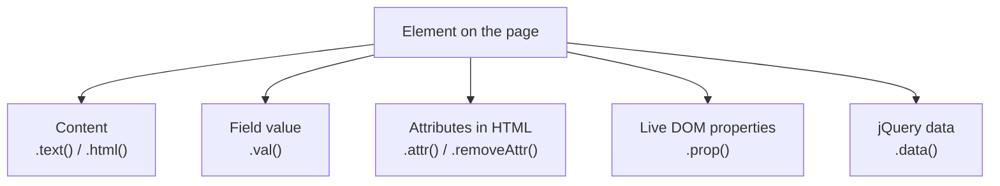
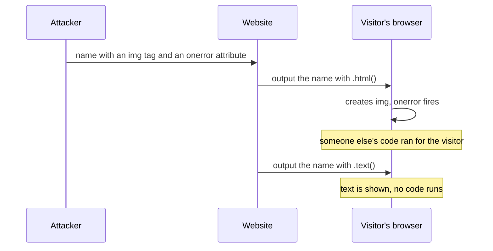
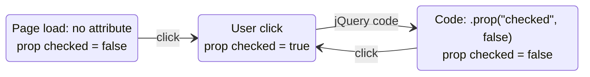
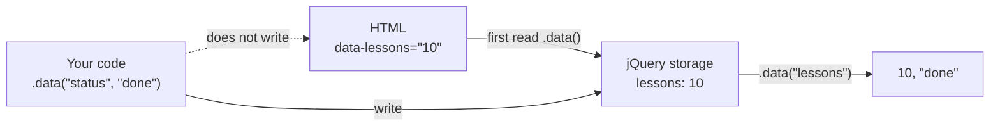

# Content and attributes

[Contents](../../README.md) · [← Back](../../Lesson-2/en/Selectors%20and%20DOM%20traversal.md) · [Next →](../../Lesson-4/en/Classes%20and%20styles.md) · [RU](../ru/%D0%A1%D0%BE%D0%B4%D0%B5%D1%80%D0%B6%D0%B8%D0%BC%D0%BE%D0%B5%20%D0%B8%20%D0%B0%D1%82%D1%80%D0%B8%D0%B1%D1%83%D1%82%D1%8B.md) · [EN](Content%20and%20attributes.md) · [UZ](../uz/Kontent%20va%20atributlar.md)

> **Link to lesson 2:** you learned to find the elements you need: by selector, with `.find()`, `.closest()`, `.eq()`, and to loop over them with `.each()`. Now we will learn to change what a found element has inside and "on its label": text, markup, field value, attributes, properties and data.

---

## Why you need this

Almost every website shows data that came not from HTML but from code: the user's name in the header, an avatar, a link to the profile, a "mentor" badge, an email in the settings field. The markup is an empty form, and the data lives in a JavaScript object. The programmer's job is to carefully move each value into the right "box" of the form.

jQuery has a separate method for each box. Mix them up and you get a checkbox that "does not listen", a field that does not update, or a security hole through which an attacker runs their own code on your website. In this lesson we will figure out which method is for what.

---

## What you will learn

- Output text with `.text()` and understand why `.html()` is dangerous.
- Read and write the values of input fields: `.val()`.
- Read, change and remove attributes: `.attr()`, `.removeAttr()`.
- Set several attributes in one call by passing an object to `.attr()`.
- Tell an attribute from a property and control checkboxes and buttons with `.prop()`.
- Store data on an element with `.data()` and understand which type the values turn into.
- Explain the "getter - setter" rule for all the methods in this lesson.
- Pass a function to a method to calculate a new value from the old one.

---

## Review: 3 questions from lesson 2

1. How is `$("#list").find("li")` different from `$("#list").children("li")`?
2. What does `.closest(".card")` do, and where does it look for the element?
3. What is `$(this)` inside `.each()`, and why do we wrap `this` in `$()`?

Answers are at the end of the lesson.

---

## Lesson plan

| Section | What we do |
| --- | --- |
| What an element has | Text, markup, value, attributes, properties, data |
| `.text()` and `.html()` | Text and markup, the XSS danger |
| `.val()` | The value of an input field |
| Mini-task 1 | A greeting from an input field |
| `.attr()` and `.removeAttr()` | Attributes, an object in `.attr()` |
| `.prop()` | Attribute or property: checkboxes and buttons |
| `.data()` | Your own data on an element and its types |
| Getter, setter and function | The general rule and a function as an argument |
| Mini-task 2 | A course card from `data-*` |
| Independent work | A profile card from the `user` object |

---

## What an element has

**In simple words:** imagine a parcel box. Inside is the content (text or other things). On the outside there is a **label** with the address - those are the attributes. The box has an **indicator**: "opened / not opened" - that is a property, and it changes right now. And the courier also keeps a **note** in mind: "the customer asked to call in advance" - you cannot see it on the box, that is `.data()` data.

```html
<a id="link" href="/courses" title="All courses">Courses</a>
<input id="email" type="email" value="">
<input id="agree" type="checkbox" checked>
<div id="card" data-lessons="10"></div>
```



**How to read the diagram.** One element has five "boxes", and each has its own method. Text and markup are what is between the tags. The value is what is in the input field right now. Attributes are what is written in the HTML tag. Properties are the current state of the element in the browser's memory. Data is what your code remembers about the element.

| Plain JavaScript (JS course, lesson 7) | jQuery |
| --- | --- |
| `el.textContent` | `$el.text()` |
| `el.innerHTML` | `$el.html()` |
| `el.value` | `$el.val()` |
| `el.getAttribute("href")` / `el.setAttribute("href", url)` | `$el.attr("href")` / `$el.attr("href", url)` |
| `el.removeAttribute("title")` | `$el.removeAttr("title")` |
| `el.checked`, `el.disabled` | `$el.prop("checked")`, `$el.prop("disabled")` |
| `el.dataset.lessons` | `$el.data("lessons")` - with type conversion |

---

## `.text()` and `.html()`

### `.text()` - a review

You already know `.text()` from lesson 1: the getter returns text, the setter writes a string **as text**.

```js
$("#title").text("Profile");    // write
const title = $("#title").text(); // read: "Profile"
```

### `.html()` - markup

`.html()` works like `innerHTML`: the getter returns the HTML code inside the element, the setter **parses** the string as markup.

```html
<p id="note">Hello, <b>world</b>!</p>
```

```js
console.log($("#note").text()); // "Hello, world!"         - text only
console.log($("#note").html()); // "Hello, <b>world</b>!"  - together with the tags

$("#note").html("<i>Italic</i>"); // on the page - the word "Italic" in italics
$("#note").text("<i>Italic</i>"); // on the page - literally <i>Italic</i>
```

| Code | What the user sees |
| --- | --- |
| `.text("<i>Italic</i>")` | `<i>Italic</i>` - the `<` and `>` signs as letters |
| `.html("<i>Italic</i>")` | *Italic* - the browser created an `<i>` element |

### Why `.html()` with data is dangerous

**In simple words:** `.text()` is a photocopier: it prints exactly what it was given. `.html()` is an obedient secretary: if a letter says "open the safe", they will open it. As long as you write the letters yourself, this is convenient. But if a stranger wrote the letter, the secretary will carry out their order too.

Suppose a user typed this string instead of a name when signing up:

```text

```

```js
const userName = $("#name-input").val();

$("#greeting").html(`Hello, ${userName}`); // the browser creates img, the image fails to load, onerror runs
$("#greeting").text(`Hello, ${userName}`); // the page shows plain text with angle brackets
```



**How to read the diagram.** An attacker saves a "name" on the website with code hidden inside it. If the website outputs the name with `.html()`, the browser of **every visitor** parses it as markup and runs the code: it can steal data or replace the page. This is the **XSS** vulnerability, which you know from `innerHTML` in the JavaScript course. With `.text()`, the same name is just harmless letters.

> **Important:** the course rule is that data (anything the user typed or the server sent) is output only with `.text()`. `.html()` is allowed only for markup you wrote yourself, in full, with no data inserted. We will learn to create elements with data safely in lesson 5.

Step by step, what happens to `<p id="greeting">`:

| Step | What happens | Value / page state |
| --- | --- | --- |
| 1 | `userName` = `<b>Ali</b>` | The variable holds a string of 10 characters |
| 2 | `$("#greeting").text(userName)` | jQuery writes `textContent` |
| 3 | The browser escapes `<` and `>` | In HTML: `&lt;b&gt;Ali&lt;/b&gt;` |
| 4 | The page is redrawn | Visible: `<b>Ali</b>`, no bold text |
| 5 | `$("#greeting b").length` | `0` - no `<b>` element appeared |

---

## `.val()` - the field value

Input fields (`<input>`, `<textarea>`, `<select>`) have no text between the tags - they have a **value**: whatever is typed or selected right now. `.val()` reads and writes it.

```html
<input id="email" type="email" value="">
<textarea id="about"></textarea>
<select id="city">
    <option>Tashkent</option>
    <option selected>Almalyk</option>
</select>
```

```js
$("#email").val("anna@example.com");  // write
console.log($("#email").val());        // "anna@example.com"
console.log($("#city").val());         // "Almalyk" - the selected option
$("#about").val("");                   // clear the field
```

| Code | What it does | Plain JavaScript |
| --- | --- | --- |
| `$input.val()` | Current value, always a string | `input.value` |
| `$input.val("text")` | Write a value | `input.value = "text"` |
| `$input.val(42)` | Write; reading it back gives the string `"42"` | `input.value = 42` |
| `$("#nothing").val()` | `undefined` - there are no elements | A `null` error |

**In simple words:** the `value` attribute in HTML is the "default" text written in pencil on a form. `.val()` is what a person wrote over it in pen. That is exactly what you need.

> **Important:** `.text()` on an input field returns nothing: an `<input>` has no text inside. For fields, use only `.val()`. And `.attr("value")` reads the initial value from the HTML, not what the user typed.

Numbers from a field come as strings. Convert them to numbers before calculating, as in the JavaScript course:

```js
const age = Number($("#age").val());
```

Forms, checkboxes, lists and field validation are covered in detail in lesson 8. Here it is enough to be able to read and write a value.

---

## Mini-task 1

On the page:

```html
<input id="name-input" type="text" value="Guest">
<p id="greeting"></p>
<p id="preview"></p>
```

1. Read the value of `#name-input` into a `userName` constant and output the text `Hello, Guest!` to `#greeting`.
2. Write the new value `<b>Anna</b>` into the field with `.val()`, read it again and output it to `#greeting` - make sure the tags show up as letters.
3. Output to `#preview` the HTML code that is currently inside `#greeting` - using the `.html()` getter and the `.text()` setter. What did you see, and why is there `&lt;`?

---

## Attributes: `.attr()` and `.removeAttr()`

**In simple words:** attributes are the label on the box: what is written in the HTML tag. `href` on a link, `src` and `alt` on an image, `title`, `type`, `id`.

### Read and write

```html
<a id="docs" href="/docs" target="_blank">Documentation</a>

```

```js
const $docs = $("#docs");

console.log($docs.attr("href"));   // "/docs" - as written in the HTML
console.log($docs.attr("title"));  // undefined - there is no such attribute

$docs.attr("href", "https://api.jquery.com");
$("#logo").attr("alt", "JLearn logo");
```

| Code | What it does |
| --- | --- |
| `$el.attr("href")` | The attribute value of the **first** element, or `undefined` |
| `$el.attr("href", url)` | Write the attribute to **all** found elements |
| `$el.attr("data-n", 5)` | Write; in HTML it is always the string `"5"` |
| `$el.removeAttr("title")` | Remove the attribute completely |
| `$el.attr("title", null)` | Also removes the attribute |

> **Important:** `.attr("title", "")` does not remove the attribute, it makes it empty: `title=""`. To have no attribute at all, use `.removeAttr("title")`.

### Several attributes at once - an object

Instead of several calls, you can pass an **object**: the key is the attribute name, the value is what to write.

```js
// Three calls
$("#logo").attr("src", "img/jlearn.png");
$("#logo").attr("alt", "JLearn logo");
$("#logo").attr("width", "120");

// One call with an object
$("#logo").attr({
    src: "img/jlearn.png",
    alt: "JLearn logo",
    width: "120",
});
```

If the attribute name contains a hyphen, the key is written in quotes: `{ "aria-label": "Close" }`.

This is handy when the data is already in an object:

```js
const course = { cover: "img/js.png", title: "JavaScript" };

$("#cover").attr({
    src: course.cover,
    alt: `${course.title} course cover`,
});
```

Step by step for ``:

| Step | What happens | Value / page state |
| --- | --- | --- |
| 1 | `$("#cover")` | jQuery object, `length` = 1 |
| 2 | `.attr({ src: ..., alt: ... })` loops over the object's keys | Key `src` |
| 3 | `setAttribute("src", "img/js.png")` | `` |
| 4 | Key `alt`: `setAttribute("alt", "JavaScript course cover")` | `` |
| 5 | The method returns the same jQuery object | You can continue the chain |

---

## Attribute or property: `.prop()`

### What the difference is

When the browser reads HTML, it creates an object in memory for each tag - a DOM element. The attributes from the tag become the **initial** values of this object's properties. After that, the user clicks and types, and the **properties** change, while the attributes in the HTML stay as they were.

**In simple words:** the `checked` attribute is a line in the manual saying "the lamp is on when switched on". The `checked` property is whether the lamp is on **right now**. The user flipped the switch - the lamp went off, but the manual did not change.

```html
<input id="agree" type="checkbox">
```

The user ticked the box:

```js
$("#agree").attr("checked"); // undefined - there is no attribute in the HTML
$("#agree").prop("checked"); // true      - the checkbox is ticked right now
```



**How to read the diagram.** The attribute from the HTML is needed only when the page loads. The rest of the time, the state of the checkbox is stored in the **property**: it is changed by the user's clicks and by your code through `.prop()`. The attribute is the same in all three states.

### When to use what

| What you need | Method | Example |
| --- | --- | --- |
| Link or image address, `alt`, `title`, `aria-*` | `.attr()` | `$a.attr("href", url)` |
| Whether a checkbox or radio button is ticked | `.prop("checked")` | `$cb.prop("checked", true)` |
| Whether a button or field is disabled | `.prop("disabled")` | `$btn.prop("disabled", true)` |
| Whether a list option is selected | `.prop("selected")` | `$option.prop("selected", true)` |
| Field value | `.val()` | `$input.val("...")` |

The rule: everything that answers "yes / no" about the **current state** (`checked`, `disabled`, `selected`, `readOnly`) goes through `.prop()` with the value `true` or `false`.

```js
$("#send").prop("disabled", true);   // the button is inactive
$("#send").prop("disabled", false);  // active again
$("#agree").prop("checked", user.agreed); // true or false from the data
```

### Why `.attr("checked", ...)` lets you down

Step by step: the checkbox `<input id="agree" type="checkbox">`, and the code wants to tick it through the **attribute**.

| Step | What happens | `checked` attribute / property |
| --- | --- | --- |
| 1 | The page has loaded | none / `false` |
| 2 | `$("#agree").attr("checked", true)` | `"true"` / `true` - so far the property "listens" to the attribute |
| 3 | The user clicked and unticked the box | `"true"` / `false` - now the property lives on its own |
| 4 | The code again: `.attr("checked", true)` | `"true"` / **`false`** - no tick! |
| 5 | The code: `.prop("checked", true)` | `"true"` / `true` - the tick appeared |

After the first click, the browser stops looking at the `checked` attribute. That is why code with `.attr()` "sometimes works, sometimes does not", while `.prop()` always works.

> **Important:** the string `"false"` is not `false`. `.prop("disabled", "false")` **disables** the button: a non-empty string is truthy. Pass real `true` and `false`.

---

## Data: `.data()`

### `data-*` attributes

From the JavaScript course you know `data-*` attributes - your own data in the markup - and `dataset` for reading them. In jQuery, `.data()` reads them:

```html
<article id="course" data-lessons="10" data-free="true" data-course-id="js" data-tags='["dom","events"]'>
    JavaScript
</article>
```

```js
const $course = $("#course");

$course.data("lessons");   // 10       - a number!
$course.data("free");      // true     - a boolean
$course.data("courseId");  // "js"     - data-course-id → courseId
$course.data("tags");      // ["dom", "events"] - an array from JSON
```

**In simple words:** `dataset` is a courier who brings everything in envelopes: even the number 10 arrives as a piece of paper saying "10". `.data()` is a courier who opens the envelopes and hands you what is inside: a number as a number, `true` as `true`.

### Which type the values turn into

| In HTML | `.data(...)` returns | `.attr(...)` and `dataset` return |
| --- | --- | --- |
| `data-lessons="10"` | `10` (a number) | `"10"` |
| `data-free="true"` | `true` | `"true"` |
| `data-tags='["a","b"]'` | the array `["a", "b"]` | a string |
| `data-id="007"` | `"007"` (a string: a number would lose the zeros) | `"007"` |
| `data-price="1.50"` | `"1.50"` (a string: `1.5` would be written differently) | `"1.50"` |
| `data-name="Anna"` | `"Anna"` | `"Anna"` |

jQuery turns a string into a number only if the number is written exactly the same way as in the HTML. That is why `"007"` and `"1.50"` stay strings.

```js
console.log($course.data("lessons") + 1);         // 11
console.log($course.attr("data-lessons") + 1);    // "101" - string concatenation
```

### The `.data()` setter does not change the HTML

```js
$course.data("status", "done");
console.log($course.data("status"));       // "done"
console.log($course.attr("data-status"));  // undefined - nothing appeared in the HTML
```



**How to read the diagram.** On the first read, jQuery takes the value from the `data-*` attribute, converts its type and puts it into its own storage in memory. After that, `.data()` reads and writes only the storage and does not touch the HTML. That is why the result of `.data("status", "done")` is not visible in DevTools.

| Task | What to use |
| --- | --- |
| Store a value for your own code (id, object, number) | `.data("userId", 17)` |
| The value must be visible in the HTML, for example for CSS `[data-status="done"]` | `.attr("data-status", "done")` |

> **Important:** do not mix `.attr("data-...")` and `.data()` for the same key. After the first read, `.data()` remembers its value and will not notice that you changed the attribute with `.attr()`.

You can store anything in `.data()`, even a whole object: `$card.data("user", user)` - and later `$card.data("user").name`. This will come in handy in lesson 6: when a card is clicked, you will get the data out of it.

---

## Getter, setter and a function as an argument

### The general rule

All the methods in this lesson work the same way:

| Call | Mode | Result |
| --- | --- | --- |
| `.text()` | Getter | The text of **all** elements, joined |
| `.html()`, `.val()`, `.attr("x")`, `.prop("x")`, `.data("x")` | Getter | The value of the **first** element |
| `.method(value)` | Setter | Writes to **all** elements, returns the jQuery object |
| `.attr({...})` | Setter | Several attributes for all elements |

```html
<a class="nav" href="/html">HTML</a>
<a class="nav" href="/css">CSS</a>
```

```js
$(".nav").attr("href");             // "/html" - only the first link
$(".nav").attr("target", "_blank"); // for both links
```

To read the value of each element, loop over them - as in lesson 2:

```js
$(".nav").each(function () {
    console.log($(this).attr("href")); // "/html", then "/css"
});
```

### A function instead of a value

You can pass a **function** to a setter. jQuery will call it for each element and write whatever it returns. The function receives two arguments: the element's index (from zero) and the **current** value.

**In simple words:** a normal setter is a rubber stamp: the same thing for everyone. A setter with a function is a craftsman who walks up to each box, looks at what is written on it now, and adds something of their own.

```html
<li class="step">Connect jQuery</li>
<li class="step">Find elements</li>
<li class="step">Change text</li>
```

```js
$(".step").text(function (index, oldText) {
    return `Step ${index + 1}: ${oldText}`;
});
```

| Function call | `index` | `oldText` | Returned |
| --- | --- | --- | --- |
| For the first `li` | 0 | `"Connect jQuery"` | `"Step 1: Connect jQuery"` |
| For the second `li` | 1 | `"Find elements"` | `"Step 2: Find elements"` |
| For the third `li` | 2 | `"Change text"` | `"Step 3: Change text"` |

`.attr()`, `.val()` and `.prop()` work the same way:

```js
// Add a tag to all links
$(".nav").attr("href", (index, oldHref) => `${oldHref}?from=menu`);

// Trim spaces at the edges in all fields
$(".field").val((index, oldValue) => oldValue.trim());
```

Inside a regular `function`, the word `this` is the current DOM element, as in `.each()`. In an arrow function `this` is different, so use the `index` argument and the old value.

---

### Try to break it

1. Output the string `` into an element with `.html()`. What happened? Replace it with `.text()`.
2. Tick the checkbox by hand, then run `$("#agree").attr("checked")` and `$("#agree").prop("checked")` in the console. Why are the answers different?
3. Call `$("#send").prop("disabled", "false")`. Was the button disabled? Why?
4. For `data-lessons="10"`, run `$("#course").data("lessons", 20)`, then open the **Elements** tab. Did the attribute change?
5. Read a field's value with `.text()` instead of `.val()`. What came back?
6. Run `$("#title").text().attr("title", "x")`. Read the error message.

### Typical beginner mistakes

| Mistake | What you get | How to fix |
| --- | --- | --- |
| User name via `.html(name)` | XSS vulnerability: someone else's code runs | `.text(name)` |
| `.text()` on an input field | An empty string | `.val()` |
| `.attr("value")` instead of `.val()` | The initial value from the HTML, not what was typed | `.val()` |
| Checkbox via `.attr("checked", true)` | Stops working after the user clicks | `.prop("checked", true)` |
| `.prop("disabled", "false")` | The button is disabled: the string is truthy | `.prop("disabled", false)` |
| `.attr("title", "")` to remove it | The attribute stays, empty | `.removeAttr("title")` |
| `.attr("data-lessons") + 1` | `"101"` - string concatenation | `.data("lessons") + 1` or `Number(...)` |
| Expecting an attribute after `.data("x", 1)` | The value is not in the HTML or CSS | `.attr("data-x", "1")` if you need it in the HTML |
| Mixing `.data("course-id")` and `.data("courseId")` | It works, but the code is hard to read | In this course - camelCase: `.data("courseId")` |
| The `.attr("href")` getter on several links | Only the first one's value | Loop with `.each()` or a function in the setter |

---

## Mini-task 2

A course card:

```html
<article id="course" data-lessons="10" data-done="4" data-url="/courses/jquery">
    <h3 class="course__title">jQuery</h3>
    <p class="course__progress"></p>
    <a class="course__link" href="#">Continue</a>
    <button class="course__certificate" type="button">Get certificate</button>
</article>
```

1. Use `.data()` to read the number of lessons and the number of completed lessons. Output the text `Completed 4 of 10 (40%)` to `.course__progress` - calculate the percentage.
2. Give the `.course__link` link the attributes `href` (from `data-url`) and `title` `Open the jQuery course` - in one call with an object.
3. Disable the `.course__certificate` button with `.prop()` if the course is not fully completed, and enable it if it is.
4. Save a `progress` key with the percentage value in the card's data and print it to the console with the `.data()` getter.
5. Change `data-done="10"` in the HTML and make sure the button became active.

---

## Lesson summary: cheat sheet

| Task | Code |
| --- | --- |
| Output text (data) | `$el.text(value)` |
| Read or insert your own markup | `$el.html()` / `$el.html("<b>...</b>")` - not with data |
| Field value | `$input.val()` / `$input.val("...")` |
| Read an attribute | `$el.attr("href")` |
| Write an attribute | `$el.attr("href", url)` |
| Several attributes | `$el.attr({ src: ..., alt: ... })` |
| Remove an attribute | `$el.removeAttr("title")` |
| Is the checkbox ticked | `$cb.prop("checked")` |
| Tick / disable | `$cb.prop("checked", true)`, `$btn.prop("disabled", true)` |
| Read `data-*` with its type | `$el.data("userId")` ← `data-user-id` |
| Remember a value on an element | `$el.data("key", value)` - will not appear in the HTML |
| New value from the old one | `$el.text((index, old) => ...)` |

---

## Independent work

### Part 1. IDE task (graded by the platform)

The platform has defined a `user` object with the fields `id`, `name`, `avatar`, `profileUrl`, `isMentor`, `email`, `level`. The page has an `article#profile` card with the attribute `data-max-level="10"`, and inside it `img#avatar`, `h2#profile-name`, `p#level-text`, the link `a#profile-link`, the checkbox `#mentor` and the field `#email`. Write a function `fillProfile(person)` that fills the card with data from `person`:

1. The name - into `#profile-name` with `.text()`.
2. Give `#avatar` `src` = `person.avatar` and `alt` = `"Photo: "` + name in one `.attr()` call with an object.
3. Give `#profile-link` the attribute `href` = `person.profileUrl`.
4. Tick or untick the `#mentor` checkbox with `.prop("checked", person.isMentor)`.
5. Write `person.email` into the `#email` field with `.val()`.
6. Save `person.id` in the card's data: `.data("userId", ...)`.
7. Read the maximum level from `data-max-level` with `.data("maxLevel")` and write the text `Level 3 of 10` into `#level-text`, where 3 is `person.level`.
8. Call `fillProfile(user)`.

The function must work when called again with a different student. Do not use `document.querySelector`, `innerHTML` or `.html()`.

What the platform checks: the name, the avatar (`src`, `alt` and an object in `.attr()`), the link, the email in the field, `.data("userId")` and the level text; that a name like `<b>Hacker</b>` is output as text, not as markup; that the checkbox gets ticked even after the user has clicked it and gets unticked when `isMentor: false`; that the maximum level is read from `data-max-level` (on a page with `data-max-level="12"` - `Level 3 of 12`); that calling it again with a different student rewrites the whole card, even if the user has already typed something in the email field; that the code runs without errors.

### Part 2. Project on your computer

1. On your website from the HTML, CSS and JavaScript courses, create an "About me" block with a photo, a name, a link to GitHub or Telegram and a "Contact email" field.
2. Describe yourself with a `const me = { ... }` object in `main.js` and fill the block with a function modeled on the IDE task: `.text()`, `.attr({...})`, `.val()`.
3. Add the attributes `data-year` and `data-stack='["HTML","CSS"]'` to the project cards. Read them with `.data()` and output `2026 · HTML, CSS` under each card - by looping with `.each()`.
4. Number the items of any list with a function setter: `.text((index, old) => ...)`.
5. Give all external links `target="_blank"` and `rel="noopener"` in one `.attr()` call with an object.

### Acceptance criteria

- [ ] The IDE task is accepted.
- [ ] Data is output with `.text()`; `.html()` with data is not used anywhere.
- [ ] Checkboxes and disabling buttons are done with `.prop()` using `true` / `false` values.
- [ ] `data-*` values are read with `.data()`; numbers are not concatenated as strings.
- [ ] You can explain the difference between an attribute and a property using a checkbox as an example.

---

## Self-check questions

1. How is `.text()` different from `.html()` when reading and when writing?
2. What is XSS, and how do you avoid it when outputting user data?
3. Why is the value of an input field read with `.val()` and not with `.text()` or `.attr("value")`?
4. How do you remove an attribute? How is this different from writing an empty string?
5. How do you set several attributes in one call?
6. What is the difference between an attribute and a property of a DOM element?
7. Why is a checkbox ticked with `.prop("checked", true)` and not `.attr("checked", true)`?
8. What does `.data("lessons")` return for `data-lessons="10"`, and what does `.attr("data-lessons")` return?
9. Why is a value written with `.data("x", 1)` not visible in DevTools?
10. Which arguments does a function passed to a setter receive, for example `.text(function (index, old) { ... })`?

After the questions, take the **lesson test** on the platform: 12 questions, pass mark 70%.

---

## What's next

Today you changed the content, attributes and state of elements. But we hardly touched their appearance. In lesson 4 we will work with **classes and styles**: `.addClass()`, `.removeClass()`, `.toggleClass()`, `.css()` - and find out why it is better to change the appearance with classes rather than with styles from code.

---

## Answers

**Review**

1. `.find("li")` searches at any depth inside `#list`, `.children("li")` - only among the direct children.
2. It goes up from the element itself through its parents and returns the first one that matches the selector (the element itself is checked too).
3. `this` is the current DOM element of the loop. It has no jQuery methods, so we wrap it: `$(this).text()`.

**Mini-task 1**

```js
const $input = $("#name-input");
const $greeting = $("#greeting");

const userName = $input.val();
$greeting.text(`Hello, ${userName}!`);

$input.val("<b>Anna</b>");
const newName = $input.val();
$greeting.text(`Hello, ${newName}!`);

$("#preview").text($greeting.html());
```

`#preview` shows `Hello, &lt;b&gt;Anna&lt;/b&gt;!`: `.text()` escaped the angle brackets, so in the HTML code of `#greeting` they are written as `&lt;` and `&gt;`, and there is no `<b>` tag.

**Mini-task 2**

```js
const $course = $("#course");

const lessons = $course.data("lessons");
const done = $course.data("done");
const percent = Math.round(done / lessons * 100);

$course.find(".course__progress").text(`Completed ${done} of ${lessons} (${percent}%)`);

$course.find(".course__link").attr({
    href: $course.data("url"),
    title: "Open the jQuery course",
});

$course.find(".course__certificate").prop("disabled", done < lessons);

$course.data("progress", percent);
console.log($course.data("progress"));
```

`done < lessons` is already `true` or `false`, so you can pass it straight to `.prop()`. Numbers from `.data()` are real numbers, so division and comparison work without `Number()`.

**Self-check questions**

1. When reading, `.text()` returns only the text, `.html()` returns the markup with tags. When writing, `.text()` inserts the string as text, `.html()` parses it as HTML.
2. XSS is when someone else's code hidden in data runs on other visitors' pages. Data is output only with `.text()`.
3. A field has no text inside, and the `value` attribute is the initial value from the HTML. The current value typed by the user is returned by `.val()`.
4. `.removeAttr("title")` (or `.attr("title", null)`). An empty string keeps the attribute: `title=""`.
5. Pass an object: `.attr({ src: "...", alt: "..." })`.
6. An attribute is written in the HTML and sets the initial value. A property is the current state of the element object in memory; the user and the code change it.
7. After the user clicks, the `checked` property no longer depends on the attribute, and `.attr()` no longer changes the tick. `.prop()` changes the state itself.
8. `.data("lessons")` returns the number `10`, `.attr("data-lessons")` returns the string `"10"`.
9. The `.data()` setter keeps the value in jQuery's memory and does not write an attribute to the HTML.
10. The element's index from zero and the current value (old text, attribute, field value). It must return the new value.

---

[Contents](../../README.md) · [← Back](../../Lesson-2/en/Selectors%20and%20DOM%20traversal.md) · [Next →](../../Lesson-4/en/Classes%20and%20styles.md) · [RU](../ru/%D0%A1%D0%BE%D0%B4%D0%B5%D1%80%D0%B6%D0%B8%D0%BC%D0%BE%D0%B5%20%D0%B8%20%D0%B0%D1%82%D1%80%D0%B8%D0%B1%D1%83%D1%82%D1%8B.md) · [EN](Content%20and%20attributes.md) · [UZ](../uz/Kontent%20va%20atributlar.md)
