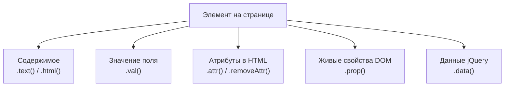
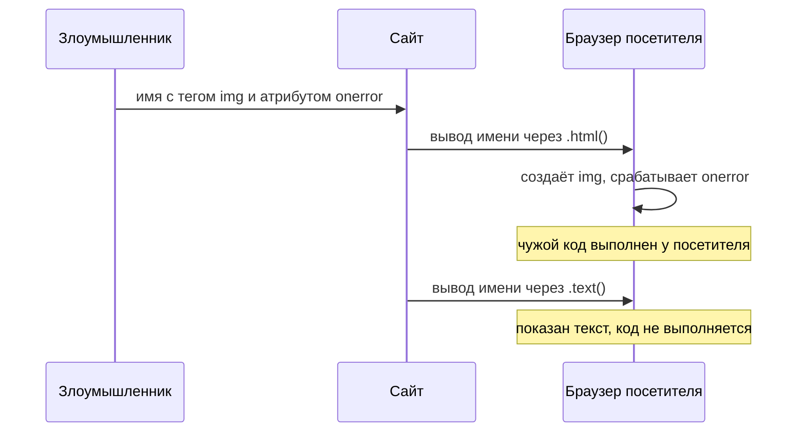
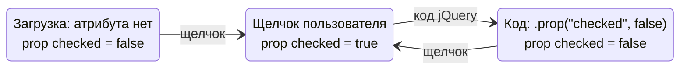
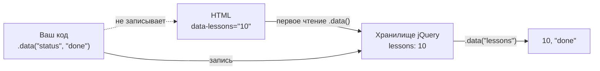

# Содержимое и атрибуты

[Содержание](../../README.md) · [← Назад](../../Lesson-2/ru/%D0%A1%D0%B5%D0%BB%D0%B5%D0%BA%D1%82%D0%BE%D1%80%D1%8B%20%D0%B8%20%D0%BE%D0%B1%D1%85%D0%BE%D0%B4%20DOM.md) · [Вперёд →](../../Lesson-4/ru/%D0%9A%D0%BB%D0%B0%D1%81%D1%81%D1%8B%20%D0%B8%20%D1%81%D1%82%D0%B8%D0%BB%D0%B8.md) · [RU](%D0%A1%D0%BE%D0%B4%D0%B5%D1%80%D0%B6%D0%B8%D0%BC%D0%BE%D0%B5%20%D0%B8%20%D0%B0%D1%82%D1%80%D0%B8%D0%B1%D1%83%D1%82%D1%8B.md) · [EN](../en/Content%20and%20attributes.md) · [UZ](../uz/Kontent%20va%20atributlar.md)

> **Связь с уроком 2:** вы научились находить нужные элементы: по селектору, через `.find()`, `.closest()`, `.eq()` и перебирать их в `.each()`. Теперь научимся менять то, что у найденного элемента внутри и «на бирке»: текст, разметку, значение поля, атрибуты, свойства и данные.

---

## Зачем это вам

Почти любой сайт показывает данные, которые пришли не из HTML, а из кода: имя пользователя в шапке, аватар, ссылку на профиль, отметку «наставник», почту в поле настроек. Разметка - это пустой бланк, а данные лежат в объекте JavaScript. Задача программиста - аккуратно перенести каждое значение в правильное «окошко» бланка.

Для каждого окошка в jQuery свой метод. Перепутаете - получите флажок, который «не слушается», поле, которое не обновляется, или дыру в безопасности, через которую злоумышленник выполнит свой код на вашем сайте. В этом уроке разберём, какой метод для чего.

---

## Чему вы научитесь

- Выводить текст через `.text()` и понимать, чем опасен `.html()`.
- Читать и записывать значения полей ввода: `.val()`.
- Читать, менять и удалять атрибуты: `.attr()`, `.removeAttr()`.
- Задавать несколько атрибутов одним вызовом - объектом в `.attr()`.
- Отличать атрибут от свойства и управлять флажками и кнопками через `.prop()`.
- Хранить данные у элемента через `.data()` и понимать, в какой тип превращаются значения.
- Объяснять правило «геттер - сеттер» для всех методов урока.
- Передавать в метод функцию, чтобы вычислить новое значение из старого.

---

## Повторение: 3 вопроса из урока 2

1. Чем `$("#list").find("li")` отличается от `$("#list").children("li")`?
2. Что делает `.closest(".card")` и где ищет элемент?
3. Что такое `$(this)` внутри `.each()` и зачем оборачивать `this` в `$()`?

Ответы - в конце урока.

---

## План урока

| Раздел | Что делаем |
| --- | --- |
| Что есть у элемента | Текст, разметка, значение, атрибуты, свойства, данные |
| `.text()` и `.html()` | Текст и разметка, опасность XSS |
| `.val()` | Значение поля ввода |
| Мини-задание 1 | Приветствие из поля ввода |
| `.attr()` и `.removeAttr()` | Атрибуты, объект в `.attr()` |
| `.prop()` | Атрибут или свойство: флажки и кнопки |
| `.data()` | Свои данные у элемента и их типы |
| Геттер, сеттер и функция | Общее правило и функция как аргумент |
| Мини-задание 2 | Карточка курса из `data-*` |
| Самостоятельная работа | Карточка профиля из объекта `user` |

---

## Что есть у элемента

**Простыми словами:** представьте коробку с посылкой. Внутри - содержимое (текст или другие вещи). Снаружи наклеена **бирка** с адресом - это атрибуты. На коробке есть **индикатор**: «вскрыта / не вскрыта» - это свойство, оно меняется прямо сейчас. А ещё курьер держит в голове **заметку** «клиент просил звонить заранее» - её не видно на коробке, это данные `.data()`.

```html
<a id="link" href="/courses" title="Все курсы">Курсы</a>
<input id="email" type="email" value="">
<input id="agree" type="checkbox" checked>
<div id="card" data-lessons="10"></div>
```



**Как читать схему.** У одного элемента пять «окошек», и у каждого свой метод. Текст и разметка - то, что между тегами. Значение - то, что сейчас в поле ввода. Атрибуты - то, что написано в теге HTML. Свойства - текущее состояние элемента в памяти браузера. Данные - то, что ваш код запомнил про элемент.

| Чистый JavaScript (курс JS, урок 7) | jQuery |
| --- | --- |
| `el.textContent` | `$el.text()` |
| `el.innerHTML` | `$el.html()` |
| `el.value` | `$el.val()` |
| `el.getAttribute("href")` / `el.setAttribute("href", url)` | `$el.attr("href")` / `$el.attr("href", url)` |
| `el.removeAttribute("title")` | `$el.removeAttr("title")` |
| `el.checked`, `el.disabled` | `$el.prop("checked")`, `$el.prop("disabled")` |
| `el.dataset.lessons` | `$el.data("lessons")` - с превращением типов |

---

## `.text()` и `.html()`

### `.text()` - повторение

Вы уже знаете `.text()` из урока 1: геттер возвращает текст, сеттер записывает строку **как текст**.

```js
$("#title").text("Профиль");    // записать
const title = $("#title").text(); // прочитать: "Профиль"
```

### `.html()` - разметка

`.html()` работает как `innerHTML`: геттер возвращает HTML-код внутри элемента, сеттер **разбирает** строку как разметку.

```html
<p id="note">Привет, <b>мир</b>!</p>
```

```js
console.log($("#note").text()); // "Привет, мир!"         - только текст
console.log($("#note").html()); // "Привет, <b>мир</b>!"  - вместе с тегами

$("#note").html("<i>Курсив</i>"); // на странице - слово «Курсив» курсивом
$("#note").text("<i>Курсив</i>"); // на странице - буквально <i>Курсив</i>
```

| Запись | Что видит пользователь |
| --- | --- |
| `.text("<i>Курсив</i>")` | `<i>Курсив</i>` - знаки `<` и `>` как буквы |
| `.html("<i>Курсив</i>")` | *Курсив* - браузер создал элемент `<i>` |

### Почему `.html()` с данными опасен

**Простыми словами:** `.text()` - это ксерокс: что дали, то и напечатал. `.html()` - исполнительный секретарь: если в письме написано «открой сейф», он откроет. Пока письма пишете вы сами, это удобно. Но если письмо написал незнакомец, секретарь выполнит и его приказ.

Пусть пользователь при регистрации ввёл вместо имени строку:

```text

```

```js
const userName = $("#name-input").val();

$("#greeting").html(`Привет, ${userName}`); // браузер создаст img, картинка не загрузится, выполнится onerror
$("#greeting").text(`Привет, ${userName}`); // на странице просто текст с угловыми скобками
```



**Как читать схему.** Злоумышленник сохраняет на сайте «имя», в котором спрятан код. Если сайт выводит имя через `.html()`, браузер **каждого посетителя** разбирает его как разметку и выполняет код: может украсть данные или подменить страницу. Это уязвимость **XSS**, вы знаете её по `innerHTML` из курса JavaScript. Через `.text()` то же самое имя - безобидные буквы.

> **Важно:** правило курса - данные (всё, что ввёл пользователь или пришло с сервера) выводятся только через `.text()`. `.html()` допустим только для разметки, которую вы написали сами, целиком, без подстановки данных. Создавать элементы с данными безопасно научимся в уроке 5.

Пошагово, что происходит с `<p id="greeting">`:

| Шаг | Что происходит | Значение / состояние страницы |
| --- | --- | --- |
| 1 | `userName` = `<b>Аня</b>` | В переменной строка из 10 символов |
| 2 | `$("#greeting").text(userName)` | jQuery записывает `textContent` |
| 3 | Браузер экранирует `<` и `>` | В HTML: `&lt;b&gt;Аня&lt;/b&gt;` |
| 4 | Страница перерисовывается | Видно: `<b>Аня</b>`, жирного текста нет |
| 5 | `$("#greeting b").length` | `0` - элемента `<b>` не появилось |

---

## `.val()` - значение поля

У полей ввода (`<input>`, `<textarea>`, `<select>`) нет текста между тегами - есть **значение**: то, что сейчас набрано или выбрано. Его читает и пишет `.val()`.

```html
<input id="email" type="email" value="">
<textarea id="about"></textarea>
<select id="city">
    <option>Ташкент</option>
    <option selected>Алмалык</option>
</select>
```

```js
$("#email").val("anna@example.com");  // записать
console.log($("#email").val());        // "anna@example.com"
console.log($("#city").val());         // "Алмалык" - выбранный пункт
$("#about").val("");                   // очистить поле
```

| Запись | Что делает | Чистый JavaScript |
| --- | --- | --- |
| `$input.val()` | Текущее значение, всегда строка | `input.value` |
| `$input.val("текст")` | Записать значение | `input.value = "текст"` |
| `$input.val(42)` | Записать; прочитаете обратно строку `"42"` | `input.value = 42` |
| `$("#nothing").val()` | `undefined` - элементов нет | Ошибка `null` |

**Простыми словами:** атрибут `value` в HTML - это надпись карандашом на бланке «по умолчанию». `.val()` - то, что человек написал ручкой поверх. Именно это вам и нужно.

> **Важно:** `.text()` у поля ввода ничего не вернёт: у `<input>` нет текста внутри. Для полей - только `.val()`. А `.attr("value")` прочитает начальное значение из HTML, а не то, что ввёл пользователь.

Числа из поля приходят строкой. Перед вычислением превратите их в число, как в курсе JavaScript:

```js
const age = Number($("#age").val());
```

Подробно о формах, флажках, списках и проверке полей - в уроке 8. Здесь достаточно уметь прочитать и записать значение.

---

## Мини-задание 1

На странице:

```html
<input id="name-input" type="text" value="Гость">
<p id="greeting"></p>
<p id="preview"></p>
```

1. Прочитайте значение `#name-input` в константу `userName` и выведите в `#greeting` текст `Здравствуйте, Гость!`.
2. Запишите в поле новое значение `<b>Анна</b>` через `.val()`, снова прочитайте его и выведите в `#greeting` - убедитесь, что теги видны буквами.
3. В `#preview` выведите HTML-код, который сейчас внутри `#greeting`, - через геттер `.html()` и сеттер `.text()`. Что вы увидели и почему там `&lt;`?

---

## Атрибуты: `.attr()` и `.removeAttr()`

**Простыми словами:** атрибуты - это бирка на коробке: что написано в теге HTML. `href` у ссылки, `src` и `alt` у картинки, `title`, `type`, `id`.

### Прочитать и записать

```html
<a id="docs" href="/docs" target="_blank">Документация</a>

```

```js
const $docs = $("#docs");

console.log($docs.attr("href"));   // "/docs" - как написано в HTML
console.log($docs.attr("title"));  // undefined - атрибута нет

$docs.attr("href", "https://api.jquery.com");
$("#logo").attr("alt", "Логотип JLearn");
```

| Запись | Что делает |
| --- | --- |
| `$el.attr("href")` | Значение атрибута у **первого** элемента или `undefined` |
| `$el.attr("href", url)` | Записать атрибут **всем** найденным |
| `$el.attr("data-n", 5)` | Записать; в HTML всегда строка `"5"` |
| `$el.removeAttr("title")` | Удалить атрибут целиком |
| `$el.attr("title", null)` | Тоже удалит атрибут |

> **Важно:** `.attr("title", "")` не удаляет атрибут, а делает его пустым: `title=""`. Чтобы атрибута не было совсем - `.removeAttr("title")`.

### Несколько атрибутов сразу - объект

Вместо нескольких вызовов можно передать **объект**: ключ - имя атрибута, значение - то, что записать.

```js
// Три вызова
$("#logo").attr("src", "img/jlearn.png");
$("#logo").attr("alt", "Логотип JLearn");
$("#logo").attr("width", "120");

// Один вызов с объектом
$("#logo").attr({
    src: "img/jlearn.png",
    alt: "Логотип JLearn",
    width: "120",
});
```

Если в имени атрибута есть дефис, ключ пишут в кавычках: `{ "aria-label": "Закрыть" }`.

Это удобно, когда данные уже лежат в объекте:

```js
const course = { cover: "img/js.png", title: "JavaScript" };

$("#cover").attr({
    src: course.cover,
    alt: `Обложка курса ${course.title}`,
});
```

Пошагово для ``:

| Шаг | Что происходит | Значение / состояние страницы |
| --- | --- | --- |
| 1 | `$("#cover")` | jQuery-объект, `length` = 1 |
| 2 | `.attr({ src: ..., alt: ... })` перебирает ключи объекта | Ключ `src` |
| 3 | `setAttribute("src", "img/js.png")` | `` |
| 4 | Ключ `alt`: `setAttribute("alt", "Обложка курса JavaScript")` | `` |
| 5 | Метод возвращает тот же jQuery-объект | Можно продолжить цепочку |

---

## Атрибут или свойство: `.prop()`

### В чём разница

Когда браузер читает HTML, он создаёт для каждого тега объект в памяти - DOM-элемент. Атрибуты из тега становятся **начальными** значениями свойств этого объекта. Дальше пользователь щёлкает, печатает, и **свойства** меняются, а атрибуты в HTML остаются как были.

**Простыми словами:** атрибут `checked` - это строчка в инструкции «при включении лампа горит». Свойство `checked` - горит ли лампа **сейчас**. Пользователь щёлкнул выключателем - лампа погасла, а инструкция не изменилась.

```html
<input id="agree" type="checkbox">
```

Пользователь поставил галочку:

```js
$("#agree").attr("checked"); // undefined - в HTML атрибута нет
$("#agree").prop("checked"); // true      - флажок отмечен прямо сейчас
```



**Как читать схему.** Атрибут из HTML нужен только при загрузке страницы. Всё остальное время состояние флажка хранит **свойство**: его меняют щелчки пользователя и ваш код через `.prop()`. Атрибут во всех трёх состояниях один и тот же.

### Когда что использовать

| Что нужно | Метод | Пример |
| --- | --- | --- |
| Адрес ссылки, картинки, `alt`, `title`, `aria-*` | `.attr()` | `$a.attr("href", url)` |
| Отмечен ли флажок или переключатель | `.prop("checked")` | `$cb.prop("checked", true)` |
| Заблокирована ли кнопка или поле | `.prop("disabled")` | `$btn.prop("disabled", true)` |
| Выбран ли пункт списка | `.prop("selected")` | `$option.prop("selected", true)` |
| Значение поля | `.val()` | `$input.val("...")` |

Правило: всё, что отвечает «да / нет» о **текущем состоянии** (`checked`, `disabled`, `selected`, `readOnly`), - через `.prop()` со значением `true` или `false`.

```js
$("#send").prop("disabled", true);   // кнопка неактивна
$("#send").prop("disabled", false);  // снова активна
$("#agree").prop("checked", user.agreed); // true или false из данных
```

### Почему `.attr("checked", ...)` подводит

Пошагово: флажок `<input id="agree" type="checkbox">`, код хочет отметить его через **атрибут**.

| Шаг | Что происходит | Атрибут / свойство `checked` |
| --- | --- | --- |
| 1 | Страница загружена | нет / `false` |
| 2 | `$("#agree").attr("checked", true)` | `"true"` / `true` - пока свойство «слушает» атрибут |
| 3 | Пользователь щёлкнул и снял галочку | `"true"` / `false` - теперь свойство живёт само |
| 4 | Код снова: `.attr("checked", true)` | `"true"` / **`false`** - галочки нет! |
| 5 | Код: `.prop("checked", true)` | `"true"` / `true` - галочка появилась |

После первого щелчка браузер перестаёт смотреть на атрибут `checked`. Поэтому код через `.attr()` «то работает, то нет», а `.prop()` работает всегда.

> **Важно:** строка `"false"` - не `false`. `.prop("disabled", "false")` **заблокирует** кнопку: непустая строка истинна. Передавайте настоящие `true` и `false`.

---

## Данные: `.data()`

### Атрибуты `data-*`

Из курса JavaScript вы знаете атрибуты `data-*` - свои данные в разметке, и `dataset` для их чтения. В jQuery их читает `.data()`:

```html
<article id="course" data-lessons="10" data-free="true" data-course-id="js" data-tags='["dom","events"]'>
    JavaScript
</article>
```

```js
const $course = $("#course");

$course.data("lessons");   // 10       - число!
$course.data("free");      // true     - логическое значение
$course.data("courseId");  // "js"     - data-course-id → courseId
$course.data("tags");      // ["dom", "events"] - массив из JSON
```

**Простыми словами:** `dataset` - курьер, который приносит всё в конвертах: даже число 10 приходит как бумажка с надписью «10». `.data()` - курьер, который конверты вскрывает и отдаёт вам то, что внутри: число как число, `true` как `true`.

### В какой тип превращаются значения

| В HTML | `.data(...)` вернёт | `.attr(...)` и `dataset` вернут |
| --- | --- | --- |
| `data-lessons="10"` | `10` (число) | `"10"` |
| `data-free="true"` | `true` | `"true"` |
| `data-tags='["a","b"]'` | массив `["a", "b"]` | строка |
| `data-id="007"` | `"007"` (строка: число потеряло бы нули) | `"007"` |
| `data-price="1.50"` | `"1.50"` (строка: `1.5` записалось бы иначе) | `"1.50"` |
| `data-name="Анна"` | `"Анна"` | `"Анна"` |

jQuery превращает строку в число, только если число записывается точно так же, как в HTML. Поэтому `"007"` и `"1.50"` остаются строками.

```js
console.log($course.data("lessons") + 1);         // 11
console.log($course.attr("data-lessons") + 1);    // "101" - склейка строк
```

### Сеттер `.data()` не меняет HTML

```js
$course.data("status", "done");
console.log($course.data("status"));       // "done"
console.log($course.attr("data-status"));  // undefined - в HTML ничего не появилось
```



**Как читать схему.** При первом чтении jQuery берёт значение из атрибута `data-*`, превращает тип и кладёт в своё хранилище в памяти. Дальше `.data()` читает и пишет только хранилище, а HTML не трогает. Поэтому в DevTools запись `.data("status", "done")` не видна.

| Задача | Что использовать |
| --- | --- |
| Хранить значение для своего кода (id, объект, число) | `.data("userId", 17)` |
| Значение должно быть видно в HTML, например для CSS `[data-status="done"]` | `.attr("data-status", "done")` |

> **Важно:** не смешивайте `.attr("data-...")` и `.data()` для одного ключа. После первого чтения `.data()` помнит своё значение и не заметит, что вы поменяли атрибут через `.attr()`.

В `.data()` можно хранить что угодно, даже объект целиком: `$card.data("user", user)` - и потом `$card.data("user").name`. В уроке 6 это пригодится: по щелчку на карточке вы достанете из неё данные.

---

## Геттер, сеттер и функция как аргумент

### Общее правило

Все методы урока устроены одинаково:

| Вызов | Режим | Результат |
| --- | --- | --- |
| `.text()` | Геттер | Текст **всех** элементов, склеенный |
| `.html()`, `.val()`, `.attr("x")`, `.prop("x")`, `.data("x")` | Геттер | Значение **первого** элемента |
| `.метод(значение)` | Сеттер | Записывает **всем** элементам, возвращает jQuery-объект |
| `.attr({...})` | Сеттер | Несколько атрибутов всем элементам |

```html
<a class="nav" href="/html">HTML</a>
<a class="nav" href="/css">CSS</a>
```

```js
$(".nav").attr("href");             // "/html" - только первая ссылка
$(".nav").attr("target", "_blank"); // обеим ссылкам
```

Чтобы прочитать значение каждого элемента, перебирайте их - как в уроке 2:

```js
$(".nav").each(function () {
    console.log($(this).attr("href")); // "/html", затем "/css"
});
```

### Функция вместо значения

Сеттеру можно передать **функцию**. jQuery вызовет её для каждого элемента и запишет то, что она вернула. Функция получает два аргумента: номер элемента (с нуля) и **текущее** значение.

**Простыми словами:** обычный сеттер - это штамп: всем одно и то же. Сеттер с функцией - это мастер, который подходит к каждой коробке, смотрит, что на ней написано сейчас, и дописывает своё.

```html
<li class="step">Подключить jQuery</li>
<li class="step">Найти элементы</li>
<li class="step">Изменить текст</li>
```

```js
$(".step").text(function (index, oldText) {
    return `Шаг ${index + 1}: ${oldText}`;
});
```

| Вызов функции | `index` | `oldText` | Вернула |
| --- | --- | --- | --- |
| Для первого `li` | 0 | `"Подключить jQuery"` | `"Шаг 1: Подключить jQuery"` |
| Для второго `li` | 1 | `"Найти элементы"` | `"Шаг 2: Найти элементы"` |
| Для третьего `li` | 2 | `"Изменить текст"` | `"Шаг 3: Изменить текст"` |

Так же работают `.attr()`, `.val()`, `.prop()`:

```js
// Дописать метку ко всем ссылкам
$(".nav").attr("href", (index, oldHref) => `${oldHref}?from=menu`);

// Убрать пробелы по краям во всех полях
$(".field").val((index, oldValue) => oldValue.trim());
```

Внутри обычной `function` слово `this` - текущий DOM-элемент, как в `.each()`. В стрелочной функции `this` другой, поэтому пользуйтесь аргументами `index` и старым значением.

---

### Попробуйте сломать

1. Выведите в элемент через `.html()` строку ``. Что произошло? Замените на `.text()`.
2. Поставьте галочку во флажке вручную, затем в консоли выполните `$("#agree").attr("checked")` и `$("#agree").prop("checked")`. Почему ответы разные?
3. Вызовите `$("#send").prop("disabled", "false")`. Заблокировалась ли кнопка? Почему?
4. Для `data-lessons="10"` выполните `$("#course").data("lessons", 20)`, затем откройте вкладку **Elements**. Изменился ли атрибут?
5. Прочитайте значение поля через `.text()` вместо `.val()`. Что вернулось?
6. Выполните `$("#title").text().attr("title", "x")`. Прочитайте сообщение об ошибке.

### Частые ошибки новичков

| Ошибка | Что получится | Как исправить |
| --- | --- | --- |
| Имя пользователя через `.html(name)` | Уязвимость XSS: чужой код выполнится | `.text(name)` |
| `.text()` у поля ввода | Пустая строка | `.val()` |
| `.attr("value")` вместо `.val()` | Начальное значение из HTML, а не введённое | `.val()` |
| Флажок через `.attr("checked", true)` | После щелчка пользователя перестаёт работать | `.prop("checked", true)` |
| `.prop("disabled", "false")` | Кнопка заблокирована: строка истинна | `.prop("disabled", false)` |
| `.attr("title", "")` для удаления | Атрибут остаётся пустым | `.removeAttr("title")` |
| `.attr("data-lessons") + 1` | `"101"` - склейка строк | `.data("lessons") + 1` или `Number(...)` |
| Ждать атрибут после `.data("x", 1)` | В HTML и CSS значения нет | `.attr("data-x", "1")`, если нужно в HTML |
| `.data("course-id")` и `.data("courseId")` вперемешку | Работает, но код трудно читать | В курсе - camelCase: `.data("courseId")` |
| Геттер `.attr("href")` у нескольких ссылок | Значение только первой | Перебор `.each()` или функция в сеттере |

---

## Мини-задание 2

Карточка курса:

```html
<article id="course" data-lessons="10" data-done="4" data-url="/courses/jquery">
    <h3 class="course__title">jQuery</h3>
    <p class="course__progress"></p>
    <a class="course__link" href="#">Продолжить</a>
    <button class="course__certificate" type="button">Получить сертификат</button>
</article>
```

1. Прочитайте через `.data()` число уроков и число пройденных уроков. Выведите в `.course__progress` текст `Пройдено 4 из 10 (40%)` - процент вычислите.
2. Задайте ссылке `.course__link` атрибуты `href` (из `data-url`) и `title` `Открыть курс jQuery` - одним вызовом с объектом.
3. Заблокируйте кнопку `.course__certificate` через `.prop()`, если курс пройден не полностью, и разблокируйте, если полностью.
4. Сохраните в данных карточки ключ `progress` со значением процента и выведите его в консоль через геттер `.data()`.
5. Поменяйте в HTML `data-done="10"` и убедитесь, что кнопка стала активной.

---

## Итоги урока: шпаргалка

| Задача | Запись |
| --- | --- |
| Вывести текст (данные) | `$el.text(value)` |
| Прочитать или вставить свою разметку | `$el.html()` / `$el.html("<b>...</b>")` - не с данными |
| Значение поля | `$input.val()` / `$input.val("...")` |
| Прочитать атрибут | `$el.attr("href")` |
| Записать атрибут | `$el.attr("href", url)` |
| Несколько атрибутов | `$el.attr({ src: ..., alt: ... })` |
| Удалить атрибут | `$el.removeAttr("title")` |
| Отмечен ли флажок | `$cb.prop("checked")` |
| Отметить / заблокировать | `$cb.prop("checked", true)`, `$btn.prop("disabled", true)` |
| Прочитать `data-*` с типом | `$el.data("userId")` ← `data-user-id` |
| Запомнить значение у элемента | `$el.data("key", value)` - в HTML не появится |
| Новое значение из старого | `$el.text((index, old) => ...)` |

---

## Самостоятельная работа

### Часть 1. Задание в IDE (засчитывается платформой)

Платформа задала объект `user` с полями `id`, `name`, `avatar`, `profileUrl`, `isMentor`, `email`, `level`. На странице - карточка `article#profile` с атрибутом `data-max-level="10"`, внутри `img#avatar`, `h2#profile-name`, `p#level-text`, ссылка `a#profile-link`, флажок `#mentor` и поле `#email`. Напишите функцию `fillProfile(person)`, которая заполняет карточку данными из `person`:

1. Имя - в `#profile-name` через `.text()`.
2. У `#avatar` задайте `src` = `person.avatar` и `alt` = `"Фото: "` + имя одним вызовом `.attr()` с объектом.
3. У `#profile-link` задайте атрибут `href` = `person.profileUrl`.
4. Отметьте или снимите флажок `#mentor` через `.prop("checked", person.isMentor)`.
5. Запишите `person.email` в поле `#email` через `.val()`.
6. Сохраните `person.id` в данные карточки: `.data("userId", ...)`.
7. Прочитайте максимальный уровень из `data-max-level` через `.data("maxLevel")` и запишите в `#level-text` текст `Уровень 3 из 10`, где 3 - `person.level`.
8. Вызовите `fillProfile(user)`.

Функция должна работать при повторном вызове с другим учеником. `document.querySelector`, `innerHTML` и `.html()` не используйте.

Что проверяет платформа: имя, аватар (`src`, `alt` и объект в `.attr()`), ссылку, почту в поле, `.data("userId")` и текст уровня; что имя вида `<b>Хакер</b>` выводится как текст, а не как разметка; что флажок отмечается и после щелчка пользователя и снимается при `isMentor: false`; что максимальный уровень читается из `data-max-level` (на странице с `data-max-level="12"` - `Уровень 3 из 12`); что повторный вызов с другим учеником перезаписывает всю карточку, даже если пользователь уже напечатал что-то в поле почты; что код выполняется без ошибок.

### Часть 2. Проект на компьютере

1. На своём сайте из курсов HTML, CSS и JavaScript создайте блок «Обо мне» с фото, именем, ссылкой на GitHub или Telegram и полем «Почта для связи».
2. Опишите себя объектом `const me = { ... }` в `main.js` и заполните блок функцией по образцу IDE-задания: `.text()`, `.attr({...})`, `.val()`.
3. Добавьте к карточкам проектов атрибуты `data-year` и `data-stack='["HTML","CSS"]'`. Прочитайте их через `.data()` и выведите под каждой карточкой `2026 · HTML, CSS` - перебором `.each()`.
4. Пронумеруйте пункты любого списка сеттером с функцией: `.text((index, old) => ...)`.
5. Всем внешним ссылкам задайте `target="_blank"` и `rel="noopener"` одним вызовом `.attr()` с объектом.

### Критерии готовности

- [ ] Задание в IDE засчитано.
- [ ] Данные выводятся через `.text()`, `.html()` с данными нигде не используется.
- [ ] Флажки и блокировка кнопок - через `.prop()` со значениями `true` / `false`.
- [ ] Значения `data-*` читаются через `.data()`, числа не склеиваются строками.
- [ ] Вы можете объяснить разницу между атрибутом и свойством на примере флажка.

---

## Вопросы для самопроверки

1. Чем `.text()` отличается от `.html()` при чтении и при записи?
2. Что такое XSS и как его избежать при выводе данных пользователя?
3. Почему значение поля ввода читают через `.val()`, а не через `.text()` или `.attr("value")`?
4. Как удалить атрибут? Чем это отличается от записи пустой строки?
5. Как задать несколько атрибутов одним вызовом?
6. В чём разница между атрибутом и свойством DOM-элемента?
7. Почему флажок отмечают через `.prop("checked", true)`, а не `.attr("checked", true)`?
8. Что вернёт `.data("lessons")` для `data-lessons="10"` и что вернёт `.attr("data-lessons")`?
9. Почему значение, записанное через `.data("x", 1)`, не видно в DevTools?
10. Какие аргументы получает функция, переданная в сеттер, например `.text(function (index, old) { ... })`?

После вопросов пройдите **тест урока** на платформе: 12 вопросов, порог 70%.

---

## Что дальше

Сегодня вы меняли содержимое, атрибуты и состояние элементов. Но внешний вид мы почти не трогали. В уроке 4 займёмся **классами и стилями**: `.addClass()`, `.removeClass()`, `.toggleClass()`, `.css()` - и узнаем, почему внешний вид лучше менять классами, а не стилями из кода.

---

## Ответы

**Повторение**

1. `.find("li")` ищет на любой глубине внутри `#list`, `.children("li")` - только прямых детей.
2. Поднимается от самого элемента вверх по родителям и возвращает первого, кто подходит под селектор (сам элемент тоже проверяется).
3. `this` - текущий DOM-элемент перебора. У него нет методов jQuery, поэтому его оборачивают: `$(this).text()`.

**Мини-задание 1**

```js
const $input = $("#name-input");
const $greeting = $("#greeting");

const userName = $input.val();
$greeting.text(`Здравствуйте, ${userName}!`);

$input.val("<b>Анна</b>");
const newName = $input.val();
$greeting.text(`Здравствуйте, ${newName}!`);

$("#preview").text($greeting.html());
```

В `#preview` видно `Здравствуйте, &lt;b&gt;Анна&lt;/b&gt;!`: `.text()` экранировал угловые скобки, поэтому в HTML-коде `#greeting` они записаны как `&lt;` и `&gt;`, а тега `<b>` нет.

**Мини-задание 2**

```js
const $course = $("#course");

const lessons = $course.data("lessons");
const done = $course.data("done");
const percent = Math.round(done / lessons * 100);

$course.find(".course__progress").text(`Пройдено ${done} из ${lessons} (${percent}%)`);

$course.find(".course__link").attr({
    href: $course.data("url"),
    title: "Открыть курс jQuery",
});

$course.find(".course__certificate").prop("disabled", done < lessons);

$course.data("progress", percent);
console.log($course.data("progress"));
```

`done < lessons` - уже `true` или `false`, поэтому его можно сразу передать в `.prop()`. Числа из `.data()` - настоящие числа, деление и сравнение работают без `Number()`.

**Вопросы для самопроверки**

1. При чтении `.text()` возвращает только текст, `.html()` - разметку с тегами. При записи `.text()` вставляет строку как текст, `.html()` разбирает её как HTML.
2. XSS - выполнение чужого кода, спрятанного в данных, на страницах других посетителей. Данные выводят только через `.text()`.
3. У поля нет текста внутри, а атрибут `value` - начальное значение из HTML. Текущее, введённое пользователем значение возвращает `.val()`.
4. `.removeAttr("title")` (или `.attr("title", null)`). Пустая строка оставляет атрибут: `title=""`.
5. Передать объект: `.attr({ src: "...", alt: "..." })`.
6. Атрибут записан в HTML и задаёт начальное значение. Свойство - текущее состояние объекта элемента в памяти, его меняют пользователь и код.
7. После щелчка пользователя свойство `checked` перестаёт зависеть от атрибута, и `.attr()` уже не меняет галочку. `.prop()` меняет само состояние.
8. `.data("lessons")` - число `10`, `.attr("data-lessons")` - строку `"10"`.
9. Сеттер `.data()` хранит значение в памяти jQuery и не записывает атрибут в HTML.
10. Номер элемента с нуля и текущее значение (старый текст, атрибут, значение поля). Вернуть нужно новое значение.

---

[Содержание](../../README.md) · [← Назад](../../Lesson-2/ru/%D0%A1%D0%B5%D0%BB%D0%B5%D0%BA%D1%82%D0%BE%D1%80%D1%8B%20%D0%B8%20%D0%BE%D0%B1%D1%85%D0%BE%D0%B4%20DOM.md) · [Вперёд →](../../Lesson-4/ru/%D0%9A%D0%BB%D0%B0%D1%81%D1%81%D1%8B%20%D0%B8%20%D1%81%D1%82%D0%B8%D0%BB%D0%B8.md) · [RU](%D0%A1%D0%BE%D0%B4%D0%B5%D1%80%D0%B6%D0%B8%D0%BC%D0%BE%D0%B5%20%D0%B8%20%D0%B0%D1%82%D1%80%D0%B8%D0%B1%D1%83%D1%82%D1%8B.md) · [EN](../en/Content%20and%20attributes.md) · [UZ](../uz/Kontent%20va%20atributlar.md)
