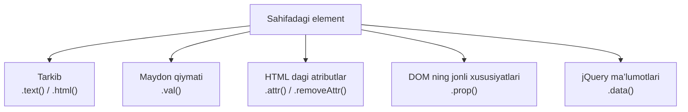
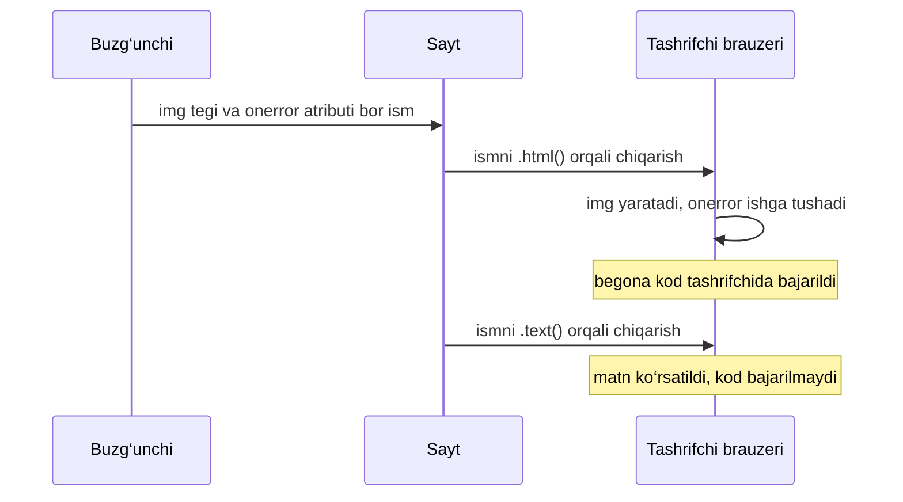
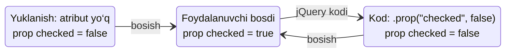
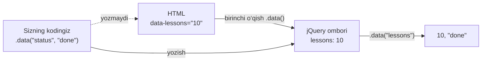

# Kontent va atributlar

[Mundarija](../../README.md) · [← Orqaga](../../Lesson-2/uz/Selektorlar%20va%20DOM%20bo'ylab%20harakat.md) · [Keyingi →](../../Lesson-4/uz/Klasslar%20va%20uslublar.md) · [RU](../ru/%D0%A1%D0%BE%D0%B4%D0%B5%D1%80%D0%B6%D0%B8%D0%BC%D0%BE%D0%B5%20%D0%B8%20%D0%B0%D1%82%D1%80%D0%B8%D0%B1%D1%83%D1%82%D1%8B.md) · [EN](../en/Content%20and%20attributes.md) · [UZ](Kontent%20va%20atributlar.md)

> **2-dars bilan bog‘liqlik:** siz kerakli elementlarni topishni o‘rgandingiz: selektor bo‘yicha, `.find()`, `.closest()`, `.eq()` orqali, va ularni `.each()` da aylanib chiqishni. Endi topilgan elementning ichidagi va «yorlig‘idagi» narsalarni o‘zgartirishni o‘rganamiz: matn, belgilash, maydon qiymati, atributlar, xususiyatlar va ma’lumotlar.

---

## Bu sizga nima uchun kerak

Deyarli har qanday sayt HTML’dan emas, koddan kelgan ma’lumotlarni ko‘rsatadi: sarlavhadagi foydalanuvchi ismi, avatar, profilga havola, «mentor» belgisi, sozlamalar maydonidagi pochta. Belgilash - bo‘sh blanka, ma’lumotlar esa JavaScript obyektida turadi. Dasturchining vazifasi - har bir qiymatni blankaning to‘g‘ri «katagiga» ehtiyotkorlik bilan ko‘chirish.

jQuery’da har bir katak uchun o‘z metodi bor. Adashtirib qo‘ysangiz - «gap uqmaydigan» checkbox, yangilanmaydigan maydon yoki xavfsizlikdagi teshik paydo bo‘ladi, u orqali buzg‘unchi saytingizda o‘z kodini bajaradi. Bu darsda qaysi metod nima uchun ekanini ko‘rib chiqamiz.

---

## Nimani o‘rganasiz

- Matnni `.text()` orqali chiqarish va `.html()` nimasi bilan xavfli ekanini tushunish.
- Kiritish maydonlarining qiymatlarini o‘qish va yozish: `.val()`.
- Atributlarni o‘qish, o‘zgartirish va o‘chirish: `.attr()`, `.removeAttr()`.
- Bir nechta atributni bitta chaqiruv bilan berish - `.attr()` ga obyekt uzatib.
- Atributni xususiyatdan farqlash va checkbox hamda tugmalarni `.prop()` orqali boshqarish.
- Ma’lumotlarni element yonida `.data()` orqali saqlash va qiymatlar qaysi turga aylanishini tushunish.
- Darsdagi barcha metodlar uchun «getter - setter» qoidasini tushuntirish.
- Eski qiymatdan yangisini hisoblash uchun metodga funksiya uzatish.

---

## Takrorlash: 2-darsdan 3 savol

1. `$("#list").find("li")` ning `$("#list").children("li")` dan farqi nima?
2. `.closest(".card")` nima qiladi va elementni qayerdan qidiradi?
3. `.each()` ichidagi `$(this)` nima va `this` ni nima uchun `$()` ga o‘rash kerak?

Javoblar - dars oxirida.

---

## Reja

| Bo‘lim | Nima qilamiz |
| --- | --- |
| Elementda nimalar bor | Matn, belgilash, qiymat, atributlar, xususiyatlar, ma’lumotlar |
| `.text()` va `.html()` | Matn va belgilash, XSS xavfi |
| `.val()` | Kiritish maydonining qiymati |
| Mini-topshiriq 1 | Kiritish maydonidan salomlashish |
| `.attr()` va `.removeAttr()` | Atributlar, `.attr()` dagi obyekt |
| `.prop()` | Atribut yoki xususiyat: checkbox va tugmalar |
| `.data()` | Elementdagi o‘z ma’lumotlaringiz va ularning turlari |
| Getter, setter va funksiya | Umumiy qoida va argument sifatida funksiya |
| Mini-topshiriq 2 | `data-*` dan kurs kartochkasi |
| Mustaqil ish | `user` obyektidan profil kartochkasi |

---

## Elementda nimalar bor

**Oddiy so‘z bilan:** pochta qutisini tasavvur qiling. Ichida - tarkib (matn yoki boshqa narsalar). Tashqarisiga manzil yozilgan **yorliq** yopishtirilgan - bular atributlar. Qutida **indikator** bor: «ochilgan / ochilmagan» - bu xususiyat, u aynan hozir o‘zgaradi. Kuryer esa yana **eslatma**ni yodda tutadi: «mijoz oldindan qo‘ng‘iroq qilishni so‘ragan» - u qutida ko‘rinmaydi, bu `.data()` ma’lumotlari.

```html
<a id="link" href="/courses" title="Barcha kurslar">Kurslar</a>
<input id="email" type="email" value="">
<input id="agree" type="checkbox" checked>
<div id="card" data-lessons="10"></div>
```



**Sxemani qanday o‘qish kerak.** Bitta elementda beshta «katak» bor va har birining o‘z metodi bor. Matn va belgilash - teglar orasidagi narsa. Qiymat - hozir kiritish maydonida turgan narsa. Atributlar - HTML tegida yozilgan narsa. Xususiyatlar - brauzer xotirasidagi elementning joriy holati. Ma’lumotlar - kodingiz element haqida eslab qolgan narsa.

| Sof JavaScript (JS kursi, 7-dars) | jQuery |
| --- | --- |
| `el.textContent` | `$el.text()` |
| `el.innerHTML` | `$el.html()` |
| `el.value` | `$el.val()` |
| `el.getAttribute("href")` / `el.setAttribute("href", url)` | `$el.attr("href")` / `$el.attr("href", url)` |
| `el.removeAttribute("title")` | `$el.removeAttr("title")` |
| `el.checked`, `el.disabled` | `$el.prop("checked")`, `$el.prop("disabled")` |
| `el.dataset.lessons` | `$el.data("lessons")` - turlarni aylantirish bilan |

---

## `.text()` va `.html()`

### `.text()` - takrorlash

`.text()` ni 1-darsdan bilasiz: getter matnni qaytaradi, setter satrni **matn sifatida** yozadi.

```js
$("#title").text("Profil");    // yozish
const title = $("#title").text(); // o‘qish: "Profil"
```

### `.html()` - belgilash

`.html()` `innerHTML` kabi ishlaydi: getter element ichidagi HTML kodni qaytaradi, setter satrni belgilash sifatida **tahlil qiladi**.

```html
<p id="note">Salom, <b>dunyo</b>!</p>
```

```js
console.log($("#note").text()); // "Salom, dunyo!"         - faqat matn
console.log($("#note").html()); // "Salom, <b>dunyo</b>!"  - teglar bilan birga

$("#note").html("<i>Kursiv</i>"); // sahifada - «Kursiv» so‘zi kursivda
$("#note").text("<i>Kursiv</i>"); // sahifada - aynan <i>Kursiv</i>
```

| Yozuv | Foydalanuvchi nimani ko‘radi |
| --- | --- |
| `.text("<i>Kursiv</i>")` | `<i>Kursiv</i>` - `<` va `>` belgilari harf sifatida |
| `.html("<i>Kursiv</i>")` | *Kursiv* - brauzer `<i>` elementini yaratdi |

### Nima uchun ma’lumotlar bilan `.html()` xavfli

**Oddiy so‘z bilan:** `.text()` - nusxa ko‘chirish apparati: nima berilsa, o‘shani chop etadi. `.html()` - ijrochi kotib: xatda «seyfni och» deb yozilgan bo‘lsa, u ochadi. Xatlarni o‘zingiz yozguningizcha bu qulay. Lekin xatni notanish odam yozgan bo‘lsa, kotib uning buyrug‘ini ham bajaradi.

Aytaylik, foydalanuvchi ro‘yxatdan o‘tishda ism o‘rniga quyidagi satrni kiritdi:

```text

```

```js
const userName = $("#name-input").val();

$("#greeting").html(`Salom, ${userName}`); // brauzer img yaratadi, rasm yuklanmaydi, onerror bajariladi
$("#greeting").text(`Salom, ${userName}`); // sahifada burchakli qavslar bilan oddiy matn
```



**Sxemani qanday o‘qish kerak.** Buzg‘unchi saytda ichiga kod yashirilgan «ism»ni saqlaydi. Agar sayt ismni `.html()` orqali chiqarsa, **har bir tashrifchining** brauzeri uni belgilash sifatida tahlil qiladi va kodni bajaradi: ma’lumotlarni o‘g‘irlashi yoki sahifani almashtirib qo‘yishi mumkin. Bu **XSS** zaifligi, uni JavaScript kursidagi `innerHTML` dan bilasiz. `.text()` orqali o‘sha ism - zararsiz harflar.

> **Muhim:** kurs qoidasi - ma’lumotlar (foydalanuvchi kiritgan yoki serverdan kelgan hamma narsa) faqat `.text()` orqali chiqariladi. `.html()` faqat o‘zingiz to‘liq yozgan, ma’lumot qo‘yilmagan belgilash uchun ruxsat etiladi. Ma’lumotli elementlarni xavfsiz yaratishni 5-darsda o‘rganamiz.

`<p id="greeting">` bilan qadamma-qadam nima bo‘ladi:

| Qadam | Nima bo‘ladi | Qiymat / sahifa holati |
| --- | --- | --- |
| 1 | `userName` = `<b>Ali</b>` | O‘zgaruvchida 10 belgili satr |
| 2 | `$("#greeting").text(userName)` | jQuery `textContent` ni yozadi |
| 3 | Brauzer `<` va `>` ni ekranlaydi | HTML da: `&lt;b&gt;Ali&lt;/b&gt;` |
| 4 | Sahifa qayta chiziladi | Ko‘rinadi: `<b>Ali</b>`, qalin matn yo‘q |
| 5 | `$("#greeting b").length` | `0` - `<b>` elementi paydo bo‘lmadi |

---

## `.val()` - maydon qiymati

Kiritish maydonlarida (`<input>`, `<textarea>`, `<select>`) teglar orasida matn yo‘q - **qiymat** bor: hozir terilgan yoki tanlangan narsa. Uni `.val()` o‘qiydi va yozadi.

```html
<input id="email" type="email" value="">
<textarea id="about"></textarea>
<select id="city">
    <option>Toshkent</option>
    <option selected>Olmaliq</option>
</select>
```

```js
$("#email").val("anna@example.com");  // yozish
console.log($("#email").val());        // "anna@example.com"
console.log($("#city").val());         // "Olmaliq" - tanlangan band
$("#about").val("");                   // maydonni tozalash
```

| Yozuv | Nima qiladi | Sof JavaScript |
| --- | --- | --- |
| `$input.val()` | Joriy qiymat, doim satr | `input.value` |
| `$input.val("matn")` | Qiymatni yozish | `input.value = "matn"` |
| `$input.val(42)` | Yozish; qaytarib o‘qisangiz `"42"` satri chiqadi | `input.value = 42` |
| `$("#nothing").val()` | `undefined` - elementlar yo‘q | `null` xatosi |

**Oddiy so‘z bilan:** HTML dagi `value` atributi - blankaga qalam bilan yozilgan «standart» yozuv. `.val()` - odam ustidan ruchka bilan yozgan narsa. Sizga aynan shu kerak.

> **Muhim:** kiritish maydonida `.text()` hech narsa qaytarmaydi: `<input>` ichida matn yo‘q. Maydonlar uchun - faqat `.val()`. `.attr("value")` esa foydalanuvchi kiritgan narsani emas, HTML dagi boshlang‘ich qiymatni o‘qiydi.

Maydondan sonlar satr bo‘lib keladi. Hisoblashdan oldin ularni JavaScript kursidagidek songa aylantiring:

```js
const age = Number($("#age").val());
```

Formalar, checkbox’lar, ro‘yxatlar va maydonlarni tekshirish haqida batafsil - 8-darsda. Bu yerda qiymatni o‘qiy va yoza olish kifoya.

---

## Mini-topshiriq 1

Sahifada:

```html
<input id="name-input" type="text" value="Mehmon">
<p id="greeting"></p>
<p id="preview"></p>
```

1. `#name-input` qiymatini `userName` konstantasiga o‘qing va `#greeting` ga `Assalomu alaykum, Mehmon!` matnini chiqaring.
2. Maydonga `.val()` orqali yangi `<b>Anna</b>` qiymatini yozing, uni qayta o‘qing va `#greeting` ga chiqaring - teglar harf bo‘lib ko‘rinayotganiga ishonch hosil qiling.
3. `#preview` ga hozir `#greeting` ichida turgan HTML kodni chiqaring - `.html()` getteri va `.text()` setteri orqali. Nimani ko‘rdingiz va u yerda nima uchun `&lt;` bor?

---

## Atributlar: `.attr()` va `.removeAttr()`

**Oddiy so‘z bilan:** atributlar - qutidagi yorliq: HTML tegida yozilgan narsa. Havoladagi `href`, rasmdagi `src` va `alt`, `title`, `type`, `id`.

### O‘qish va yozish

```html
<a id="docs" href="/docs" target="_blank">Hujjatlar</a>

```

```js
const $docs = $("#docs");

console.log($docs.attr("href"));   // "/docs" - HTML da qanday yozilgan bo‘lsa
console.log($docs.attr("title"));  // undefined - atribut yo‘q

$docs.attr("href", "https://api.jquery.com");
$("#logo").attr("alt", "JLearn logotipi");
```

| Yozuv | Nima qiladi |
| --- | --- |
| `$el.attr("href")` | **Birinchi** elementdagi atribut qiymati yoki `undefined` |
| `$el.attr("href", url)` | Atributni topilganlarning **barchasiga** yozish |
| `$el.attr("data-n", 5)` | Yozish; HTML da doim `"5"` satri |
| `$el.removeAttr("title")` | Atributni butunlay o‘chirish |
| `$el.attr("title", null)` | Bu ham atributni o‘chiradi |

> **Muhim:** `.attr("title", "")` atributni o‘chirmaydi, balki bo‘sh qiladi: `title=""`. Atribut umuman bo‘lmasligi uchun - `.removeAttr("title")`.

### Bir nechta atribut birdaniga - obyekt

Bir nechta chaqiruv o‘rniga **obyekt** uzatish mumkin: kalit - atribut nomi, qiymat - nima yozish kerakligi.

```js
// Uchta chaqiruv
$("#logo").attr("src", "img/jlearn.png");
$("#logo").attr("alt", "JLearn logotipi");
$("#logo").attr("width", "120");

// Obyektli bitta chaqiruv
$("#logo").attr({
    src: "img/jlearn.png",
    alt: "JLearn logotipi",
    width: "120",
});
```

Atribut nomida chiziqcha bo‘lsa, kalit qo‘shtirnoqda yoziladi: `{ "aria-label": "Yopish" }`.

Bu ma’lumotlar allaqachon obyektda turganda qulay:

```js
const course = { cover: "img/js.png", title: "JavaScript" };

$("#cover").attr({
    src: course.cover,
    alt: `${course.title} kursi muqovasi`,
});
```

`` uchun qadamma-qadam:

| Qadam | Nima bo‘ladi | Qiymat / sahifa holati |
| --- | --- | --- |
| 1 | `$("#cover")` | jQuery obyekti, `length` = 1 |
| 2 | `.attr({ src: ..., alt: ... })` obyekt kalitlarini aylanib chiqadi | `src` kaliti |
| 3 | `setAttribute("src", "img/js.png")` | `` |
| 4 | `alt` kaliti: `setAttribute("alt", "JavaScript kursi muqovasi")` | `` |
| 5 | Metod o‘sha jQuery obyektini qaytaradi | Zanjirni davom ettirish mumkin |

---

## Atribut yoki xususiyat: `.prop()`

### Farqi nimada

Brauzer HTML ni o‘qiganda har bir teg uchun xotirada obyekt yaratadi - DOM elementi. Tegdagi atributlar shu obyekt xususiyatlarining **boshlang‘ich** qiymatlariga aylanadi. Keyin foydalanuvchi bosadi, yozadi va **xususiyatlar** o‘zgaradi, HTML dagi atributlar esa avvalgidek qoladi.

**Oddiy so‘z bilan:** `checked` atributi - yo‘riqnomadagi «yoqilganda chiroq yonib turadi» degan satr. `checked` xususiyati - chiroq **hozir** yonib turibdimi. Foydalanuvchi kalitni bosdi - chiroq o‘chdi, yo‘riqnoma esa o‘zgarmadi.

```html
<input id="agree" type="checkbox">
```

Foydalanuvchi belgi qo‘ydi:

```js
$("#agree").attr("checked"); // undefined - HTML da atribut yo‘q
$("#agree").prop("checked"); // true      - checkbox aynan hozir belgilangan
```



**Sxemani qanday o‘qish kerak.** HTML dagi atribut faqat sahifa yuklanayotganda kerak. Qolgan barcha vaqtda checkbox holatini **xususiyat** saqlaydi: uni foydalanuvchining bosishlari va sizning kodingiz `.prop()` orqali o‘zgartiradi. Atribut uchala holatda ham bir xil.

### Qachon nimadan foydalanish

| Nima kerak | Metod | Misol |
| --- | --- | --- |
| Havola, rasm manzili, `alt`, `title`, `aria-*` | `.attr()` | `$a.attr("href", url)` |
| Checkbox yoki radio tugma belgilanganmi | `.prop("checked")` | `$cb.prop("checked", true)` |
| Tugma yoki maydon bloklanganmi | `.prop("disabled")` | `$btn.prop("disabled", true)` |
| Ro‘yxat bandi tanlanganmi | `.prop("selected")` | `$option.prop("selected", true)` |
| Maydon qiymati | `.val()` | `$input.val("...")` |

Qoida: **joriy holat** haqida «ha / yo‘q» deb javob beradigan hamma narsa (`checked`, `disabled`, `selected`, `readOnly`) - `.prop()` orqali, `true` yoki `false` qiymati bilan.

```js
$("#send").prop("disabled", true);   // tugma nofaol
$("#send").prop("disabled", false);  // yana faol
$("#agree").prop("checked", user.agreed); // ma’lumotlardan true yoki false
```

### Nima uchun `.attr("checked", ...)` pand beradi

Qadamma-qadam: `<input id="agree" type="checkbox">` checkbox’i, kod uni **atribut** orqali belgilamoqchi.

| Qadam | Nima bo‘ladi | `checked` atributi / xususiyati |
| --- | --- | --- |
| 1 | Sahifa yuklandi | yo‘q / `false` |
| 2 | `$("#agree").attr("checked", true)` | `"true"` / `true` - hozircha xususiyat atributga «quloq soladi» |
| 3 | Foydalanuvchi bosib, belgini olib tashladi | `"true"` / `false` - endi xususiyat mustaqil yashaydi |
| 4 | Kod yana: `.attr("checked", true)` | `"true"` / **`false`** - belgi yo‘q! |
| 5 | Kod: `.prop("checked", true)` | `"true"` / `true` - belgi paydo bo‘ldi |

Birinchi bosishdan keyin brauzer `checked` atributiga qaramay qo‘yadi. Shuning uchun `.attr()` orqali yozilgan kod «goh ishlaydi, goh yo‘q», `.prop()` esa doim ishlaydi.

> **Muhim:** `"false"` satri - `false` emas. `.prop("disabled", "false")` tugmani **bloklaydi**: bo‘sh bo‘lmagan satr rost hisoblanadi. Haqiqiy `true` va `false` ni uzating.

---

## Ma’lumotlar: `.data()`

### `data-*` atributlari

JavaScript kursidan `data-*` atributlarini - belgilashdagi o‘z ma’lumotlaringizni, va ularni o‘qish uchun `dataset` ni bilasiz. jQuery’da ularni `.data()` o‘qiydi:

```html
<article id="course" data-lessons="10" data-free="true" data-course-id="js" data-tags='["dom","events"]'>
    JavaScript
</article>
```

```js
const $course = $("#course");

$course.data("lessons");   // 10       - son!
$course.data("free");      // true     - mantiqiy qiymat
$course.data("courseId");  // "js"     - data-course-id → courseId
$course.data("tags");      // ["dom", "events"] - JSON dan massiv
```

**Oddiy so‘z bilan:** `dataset` - hamma narsani konvertda olib keladigan kuryer: hatto 10 soni ham «10» deb yozilgan qog‘oz bo‘lib keladi. `.data()` - konvertlarni ochib, ichidagini beradigan kuryer: son - son sifatida, `true` - `true` sifatida.

### Qiymatlar qaysi turga aylanadi

| HTML da | `.data(...)` qaytaradi | `.attr(...)` va `dataset` qaytaradi |
| --- | --- | --- |
| `data-lessons="10"` | `10` (son) | `"10"` |
| `data-free="true"` | `true` | `"true"` |
| `data-tags='["a","b"]'` | `["a", "b"]` massivi | satr |
| `data-id="007"` | `"007"` (satr: son nollarni yo‘qotgan bo‘lardi) | `"007"` |
| `data-price="1.50"` | `"1.50"` (satr: `1.5` boshqacha yozilgan bo‘lardi) | `"1.50"` |
| `data-name="Anna"` | `"Anna"` | `"Anna"` |

jQuery satrni songa faqat son HTML dagidek aynan bir xil yozilsagina aylantiradi. Shuning uchun `"007"` va `"1.50"` satr bo‘lib qoladi.

```js
console.log($course.data("lessons") + 1);         // 11
console.log($course.attr("data-lessons") + 1);    // "101" - satrlar ulanishi
```

### `.data()` setteri HTML ni o‘zgartirmaydi

```js
$course.data("status", "done");
console.log($course.data("status"));       // "done"
console.log($course.attr("data-status"));  // undefined - HTML da hech narsa paydo bo‘lmadi
```



**Sxemani qanday o‘qish kerak.** Birinchi o‘qishda jQuery qiymatni `data-*` atributidan oladi, turini aylantiradi va xotiradagi o‘z omboriga qo‘yadi. Keyin `.data()` faqat omborni o‘qiydi va yozadi, HTML ga esa tegmaydi. Shuning uchun DevTools’da `.data("status", "done")` yozuvi ko‘rinmaydi.

| Vazifa | Nimadan foydalanish |
| --- | --- |
| Qiymatni o‘z kodingiz uchun saqlash (id, obyekt, son) | `.data("userId", 17)` |
| Qiymat HTML da ko‘rinishi kerak, masalan CSS `[data-status="done"]` uchun | `.attr("data-status", "done")` |

> **Muhim:** bitta kalit uchun `.attr("data-...")` va `.data()` ni aralashtirmang. Birinchi o‘qishdan keyin `.data()` o‘z qiymatini eslab qoladi va atributni `.attr()` orqali o‘zgartirganingizni sezmaydi.

`.data()` da istalgan narsani, hatto butun obyektni saqlash mumkin: `$card.data("user", user)` - keyin esa `$card.data("user").name`. Bu 6-darsda asqatadi: kartochka bosilganda undan ma’lumotlarni olasiz.

---

## Getter, setter va argument sifatida funksiya

### Umumiy qoida

Darsdagi barcha metodlar bir xil tuzilgan:

| Chaqiruv | Rejim | Natija |
| --- | --- | --- |
| `.text()` | Getter | **Barcha** elementlar matni, birlashtirilgan |
| `.html()`, `.val()`, `.attr("x")`, `.prop("x")`, `.data("x")` | Getter | **Birinchi** elementning qiymati |
| `.metod(qiymat)` | Setter | **Barcha** elementlarga yozadi, jQuery obyektini qaytaradi |
| `.attr({...})` | Setter | Barcha elementlarga bir nechta atribut |

```html
<a class="nav" href="/html">HTML</a>
<a class="nav" href="/css">CSS</a>
```

```js
$(".nav").attr("href");             // "/html" - faqat birinchi havola
$(".nav").attr("target", "_blank"); // ikkala havolaga
```

Har bir elementning qiymatini o‘qish uchun ularni aylanib chiqing - 2-darsdagidek:

```js
$(".nav").each(function () {
    console.log($(this).attr("href")); // "/html", keyin "/css"
});
```

### Qiymat o‘rniga funksiya

Setterga **funksiya** uzatish mumkin. jQuery uni har bir element uchun chaqiradi va u qaytargan narsani yozadi. Funksiya ikkita argument oladi: element raqami (noldan) va **joriy** qiymat.

**Oddiy so‘z bilan:** oddiy setter - muhr: hammaga bir xil narsa. Funksiyali setter - har bir quti oldiga borib, unda hozir nima yozilganini ko‘radigan va o‘zinikini qo‘shib yozadigan usta.

```html
<li class="step">jQuery’ni ulash</li>
<li class="step">Elementlarni topish</li>
<li class="step">Matnni o‘zgartirish</li>
```

```js
$(".step").text(function (index, oldText) {
    return `${index + 1}-qadam: ${oldText}`;
});
```

| Funksiya chaqiruvi | `index` | `oldText` | Qaytardi |
| --- | --- | --- | --- |
| Birinchi `li` uchun | 0 | `"jQuery’ni ulash"` | `"1-qadam: jQuery’ni ulash"` |
| Ikkinchi `li` uchun | 1 | `"Elementlarni topish"` | `"2-qadam: Elementlarni topish"` |
| Uchinchi `li` uchun | 2 | `"Matnni o‘zgartirish"` | `"3-qadam: Matnni o‘zgartirish"` |

`.attr()`, `.val()`, `.prop()` ham xuddi shunday ishlaydi:

```js
// Barcha havolalarga belgi qo‘shib yozish
$(".nav").attr("href", (index, oldHref) => `${oldHref}?from=menu`);

// Barcha maydonlarda chetdagi bo‘sh joylarni olib tashlash
$(".field").val((index, oldValue) => oldValue.trim());
```

Oddiy `function` ichida `this` so‘zi - joriy DOM elementi, `.each()` dagidek. Strelkali funksiyada `this` boshqa, shuning uchun `index` argumentidan va eski qiymatdan foydalaning.

---

### Buzib ko‘ring

1. Elementga `.html()` orqali `` satrini chiqaring. Nima bo‘ldi? `.text()` ga almashtiring.
2. Checkbox’ga qo‘lda belgi qo‘ying, so‘ng konsolda `$("#agree").attr("checked")` va `$("#agree").prop("checked")` ni bajaring. Javoblar nima uchun har xil?
3. `$("#send").prop("disabled", "false")` ni chaqiring. Tugma bloklandimi? Nima uchun?
4. `data-lessons="10"` uchun `$("#course").data("lessons", 20)` ni bajaring, so‘ng **Elements** yorlig‘ini oching. Atribut o‘zgardimi?
5. Maydon qiymatini `.val()` o‘rniga `.text()` orqali o‘qing. Nima qaytdi?
6. `$("#title").text().attr("title", "x")` ni bajaring. Xato xabarini o‘qing.

### Yangi o‘rganuvchilarning tipik xatolari

| Xato | Nima bo‘ladi | Qanday tuzatish |
| --- | --- | --- |
| Foydalanuvchi ismi `.html(name)` orqali | XSS zaifligi: begona kod bajariladi | `.text(name)` |
| Kiritish maydonida `.text()` | Bo‘sh satr | `.val()` |
| `.val()` o‘rniga `.attr("value")` | Kiritilgan emas, HTML dagi boshlang‘ich qiymat | `.val()` |
| Checkbox `.attr("checked", true)` orqali | Foydalanuvchi bosgandan keyin ishlamay qoladi | `.prop("checked", true)` |
| `.prop("disabled", "false")` | Tugma bloklangan: satr rost | `.prop("disabled", false)` |
| O‘chirish uchun `.attr("title", "")` | Atribut bo‘sh bo‘lib qoladi | `.removeAttr("title")` |
| `.attr("data-lessons") + 1` | `"101"` - satrlar ulanishi | `.data("lessons") + 1` yoki `Number(...)` |
| `.data("x", 1)` dan keyin atributni kutish | HTML va CSS da qiymat yo‘q | HTML da kerak bo‘lsa `.attr("data-x", "1")` |
| `.data("course-id")` va `.data("courseId")` aralash | Ishlaydi, lekin kodni o‘qish qiyin | Kursda - camelCase: `.data("courseId")` |
| Bir nechta havolada `.attr("href")` getteri | Faqat birinchisining qiymati | `.each()` bilan aylanib chiqish yoki setterda funksiya |

---

## Mini-topshiriq 2

Kurs kartochkasi:

```html
<article id="course" data-lessons="10" data-done="4" data-url="/courses/jquery">
    <h3 class="course__title">jQuery</h3>
    <p class="course__progress"></p>
    <a class="course__link" href="#">Davom ettirish</a>
    <button class="course__certificate" type="button">Sertifikat olish</button>
</article>
```

1. `.data()` orqali darslar sonini va o‘tilgan darslar sonini o‘qing. `.course__progress` ga `10 tadan 4 tasi o‘tildi (40%)` matnini chiqaring - foizni hisoblang.
2. `.course__link` havolasiga `href` (`data-url` dan) va `title` `jQuery kursini ochish` atributlarini bering - obyektli bitta chaqiruv bilan.
3. Kurs to‘liq o‘tilmagan bo‘lsa, `.course__certificate` tugmasini `.prop()` orqali bloklang, to‘liq o‘tilgan bo‘lsa - blokdan chiqaring.
4. Kartochka ma’lumotlarida `progress` kalitini foiz qiymati bilan saqlang va uni `.data()` getteri orqali konsolga chiqaring.
5. HTML da `data-done="10"` qilib o‘zgartiring va tugma faol bo‘lganiga ishonch hosil qiling.

---

## Dars yakuni: shpargalka

| Vazifa | Yozuv |
| --- | --- |
| Matnni (ma’lumotlarni) chiqarish | `$el.text(value)` |
| O‘z belgilashingizni o‘qish yoki qo‘yish | `$el.html()` / `$el.html("<b>...</b>")` - ma’lumotlar bilan emas |
| Maydon qiymati | `$input.val()` / `$input.val("...")` |
| Atributni o‘qish | `$el.attr("href")` |
| Atributni yozish | `$el.attr("href", url)` |
| Bir nechta atribut | `$el.attr({ src: ..., alt: ... })` |
| Atributni o‘chirish | `$el.removeAttr("title")` |
| Checkbox belgilanganmi | `$cb.prop("checked")` |
| Belgi qo‘yish / bloklash | `$cb.prop("checked", true)`, `$btn.prop("disabled", true)` |
| `data-*` ni turi bilan o‘qish | `$el.data("userId")` ← `data-user-id` |
| Qiymatni element yonida eslab qolish | `$el.data("key", value)` - HTML da paydo bo‘lmaydi |
| Eski qiymatdan yangisi | `$el.text((index, old) => ...)` |

---

## Mustaqil ish

### 1-qism. IDE topshirig‘i (platforma hisoblaydi)

Platforma `id`, `name`, `avatar`, `profileUrl`, `isMentor`, `email`, `level` maydonlari bor `user` obyektini bergan. Sahifada - `data-max-level="10"` atributli `article#profile` kartochkasi, ichida `img#avatar`, `h2#profile-name`, `p#level-text`, `a#profile-link` havolasi, `#mentor` checkbox’i va `#email` maydoni. Kartochkani `person` dagi ma’lumotlar bilan to‘ldiradigan `fillProfile(person)` funksiyasini yozing:

1. Ism - `#profile-name` ga `.text()` orqali.
2. `#avatar` ga `src` = `person.avatar` va `alt` = `"Rasm: "` + ismni obyektli bitta `.attr()` chaqiruvi bilan bering.
3. `#profile-link` ga `href` = `person.profileUrl` atributini bering.
4. `#mentor` checkbox’ini `.prop("checked", person.isMentor)` orqali belgilang yoki belgini olib tashlang.
5. `person.email` ni `#email` maydoniga `.val()` orqali yozing.
6. `person.id` ni kartochka ma’lumotlariga saqlang: `.data("userId", ...)`.
7. Maksimal darajani `data-max-level` dan `.data("maxLevel")` orqali o‘qing va `#level-text` ga `Daraja 3 / 10` matnini yozing, bu yerda 3 - `person.level`.
8. `fillProfile(user)` ni chaqiring.

Funksiya boshqa o‘quvchi bilan qayta chaqirilganda ham ishlashi kerak. `document.querySelector`, `innerHTML` va `.html()` dan foydalanmang.

Platforma nimani tekshiradi: ism, avatar (`src`, `alt` va `.attr()` dagi obyekt), havola, maydondagi pochta, `.data("userId")` va daraja matni; `<b>Xaker</b>` ko‘rinishidagi ism belgilash emas, matn sifatida chiqarilishi; checkbox foydalanuvchi bosgandan keyin ham belgilanishi va `isMentor: false` bo‘lganda belgi olib tashlanishi; maksimal daraja `data-max-level` dan o‘qilishi (`data-max-level="12"` bo‘lgan sahifada - `Daraja 3 / 12`); boshqa o‘quvchi bilan qayta chaqiruv butun kartochkani, hatto foydalanuvchi pochta maydoniga allaqachon nimadir yozgan bo‘lsa ham, qayta yozishi; kod xatosiz bajarilishi.

### 2-qism. Kompyuterdagi loyiha

1. HTML, CSS va JavaScript kurslaridagi saytingizda rasm, ism, GitHub yoki Telegram’ga havola va «Aloqa uchun pochta» maydoni bor «Men haqimda» blokini yarating.
2. `main.js` da o‘zingizni `const me = { ... }` obyekti bilan tasvirlang va blokni IDE topshirig‘i namunasidagi funksiya bilan to‘ldiring: `.text()`, `.attr({...})`, `.val()`.
3. Loyiha kartochkalariga `data-year` va `data-stack='["HTML","CSS"]'` atributlarini qo‘shing. Ularni `.data()` orqali o‘qing va har bir kartochka ostiga `2026 · HTML, CSS` ni chiqaring - `.each()` bilan aylanib chiqib.
4. Istalgan ro‘yxat bandlarini funksiyali setter bilan raqamlang: `.text((index, old) => ...)`.
5. Barcha tashqi havolalarga `target="_blank"` va `rel="noopener"` ni obyektli bitta `.attr()` chaqiruvi bilan bering.

### Tayyorlik mezonlari

- [ ] IDE topshirig‘i qabul qilindi.
- [ ] Ma’lumotlar `.text()` orqali chiqariladi, ma’lumotli `.html()` hech qayerda ishlatilmagan.
- [ ] Checkbox’lar va tugmalarni bloklash - `.prop()` orqali, `true` / `false` qiymatlari bilan.
- [ ] `data-*` qiymatlari `.data()` orqali o‘qiladi, sonlar satr bo‘lib ulanib ketmaydi.
- [ ] Atribut va xususiyat orasidagi farqni checkbox misolida tushuntira olasiz.

---

## O‘zini tekshirish uchun savollar

1. O‘qish va yozishda `.text()` ning `.html()` dan farqi nima?
2. XSS nima va foydalanuvchi ma’lumotlarini chiqarishda undan qanday saqlanish mumkin?
3. Nima uchun kiritish maydoni qiymati `.text()` yoki `.attr("value")` orqali emas, `.val()` orqali o‘qiladi?
4. Atributni qanday o‘chirish mumkin? Bu bo‘sh satr yozishdan nimasi bilan farq qiladi?
5. Bitta chaqiruv bilan bir nechta atributni qanday berish mumkin?
6. DOM elementining atributi va xususiyati orasidagi farq nimada?
7. Nima uchun checkbox `.attr("checked", true)` orqali emas, `.prop("checked", true)` orqali belgilanadi?
8. `data-lessons="10"` uchun `.data("lessons")` nimani qaytaradi va `.attr("data-lessons")` nimani qaytaradi?
9. Nima uchun `.data("x", 1)` orqali yozilgan qiymat DevTools’da ko‘rinmaydi?
10. Setterga uzatilgan funksiya, masalan `.text(function (index, old) { ... })`, qanday argumentlar oladi?

Savollardan keyin platformada **dars testini** topshiring: 12 ta savol, o‘tish chegarasi 70%.

---

## Keyin nima

Bugun siz elementlarning tarkibi, atributlari va holatini o‘zgartirdingiz. Lekin tashqi ko‘rinishga deyarli tegmadik. 4-darsda **klasslar va uslublar** bilan shug‘ullanamiz: `.addClass()`, `.removeClass()`, `.toggleClass()`, `.css()` - va tashqi ko‘rinishni nima uchun koddan uslublar bilan emas, klasslar bilan o‘zgartirgan ma’qul ekanini bilib olamiz.

---

## Javoblar

**Takrorlash**

1. `.find("li")` `#list` ichida istalgan chuqurlikda qidiradi, `.children("li")` - faqat bevosita bolalarini.
2. Elementning o‘zidan boshlab ota-elementlar bo‘ylab yuqoriga ko‘tariladi va selektorga mos keladigan birinchisini qaytaradi (elementning o‘zi ham tekshiriladi).
3. `this` - aylanib chiqishdagi joriy DOM elementi. Unda jQuery metodlari yo‘q, shuning uchun uni o‘rashadi: `$(this).text()`.

**Mini-topshiriq 1**

```js
const $input = $("#name-input");
const $greeting = $("#greeting");

const userName = $input.val();
$greeting.text(`Assalomu alaykum, ${userName}!`);

$input.val("<b>Anna</b>");
const newName = $input.val();
$greeting.text(`Assalomu alaykum, ${newName}!`);

$("#preview").text($greeting.html());
```

`#preview` da `Assalomu alaykum, &lt;b&gt;Anna&lt;/b&gt;!` ko‘rinadi: `.text()` burchakli qavslarni ekranlagan, shuning uchun `#greeting` ning HTML kodida ular `&lt;` va `&gt;` bo‘lib yozilgan, `<b>` tegi esa yo‘q.

**Mini-topshiriq 2**

```js
const $course = $("#course");

const lessons = $course.data("lessons");
const done = $course.data("done");
const percent = Math.round(done / lessons * 100);

$course.find(".course__progress").text(`${lessons} tadan ${done} tasi o‘tildi (${percent}%)`);

$course.find(".course__link").attr({
    href: $course.data("url"),
    title: "jQuery kursini ochish",
});

$course.find(".course__certificate").prop("disabled", done < lessons);

$course.data("progress", percent);
console.log($course.data("progress"));
```

`done < lessons` - allaqachon `true` yoki `false`, shuning uchun uni darhol `.prop()` ga uzatish mumkin. `.data()` dan kelgan sonlar - haqiqiy sonlar, bo‘lish va solishtirish `Number()` siz ishlaydi.

**O‘zini tekshirish uchun savollar**

1. O‘qishda `.text()` faqat matnni, `.html()` - teglari bilan belgilashni qaytaradi. Yozishda `.text()` satrni matn sifatida qo‘yadi, `.html()` uni HTML sifatida tahlil qiladi.
2. XSS - ma’lumotlarga yashirilgan begona kodning boshqa tashrifchilar sahifalarida bajarilishi. Ma’lumotlar faqat `.text()` orqali chiqariladi.
3. Maydon ichida matn yo‘q, `value` atributi esa HTML dagi boshlang‘ich qiymat. Foydalanuvchi kiritgan joriy qiymatni `.val()` qaytaradi.
4. `.removeAttr("title")` (yoki `.attr("title", null)`). Bo‘sh satr atributni qoldiradi: `title=""`.
5. Obyekt uzatish kerak: `.attr({ src: "...", alt: "..." })`.
6. Atribut HTML da yozilgan va boshlang‘ich qiymatni beradi. Xususiyat - xotiradagi element obyektining joriy holati, uni foydalanuvchi va kod o‘zgartiradi.
7. Foydalanuvchi bosgandan keyin `checked` xususiyati atributga bog‘liq bo‘lmay qoladi va `.attr()` endi belgini o‘zgartirmaydi. `.prop()` holatning o‘zini o‘zgartiradi.
8. `.data("lessons")` - `10` sonini, `.attr("data-lessons")` - `"10"` satrini.
9. `.data()` setteri qiymatni jQuery xotirasida saqlaydi va HTML ga atribut yozmaydi.
10. Noldan boshlangan element raqami va joriy qiymat (eski matn, atribut, maydon qiymati). Yangi qiymatni qaytarish kerak.

---

[Mundarija](../../README.md) · [← Orqaga](../../Lesson-2/uz/Selektorlar%20va%20DOM%20bo'ylab%20harakat.md) · [Keyingi →](../../Lesson-4/uz/Klasslar%20va%20uslublar.md) · [RU](../ru/%D0%A1%D0%BE%D0%B4%D0%B5%D1%80%D0%B6%D0%B8%D0%BC%D0%BE%D0%B5%20%D0%B8%20%D0%B0%D1%82%D1%80%D0%B8%D0%B1%D1%83%D1%82%D1%8B.md) · [EN](../en/Content%20and%20attributes.md) · [UZ](Kontent%20va%20atributlar.md)
