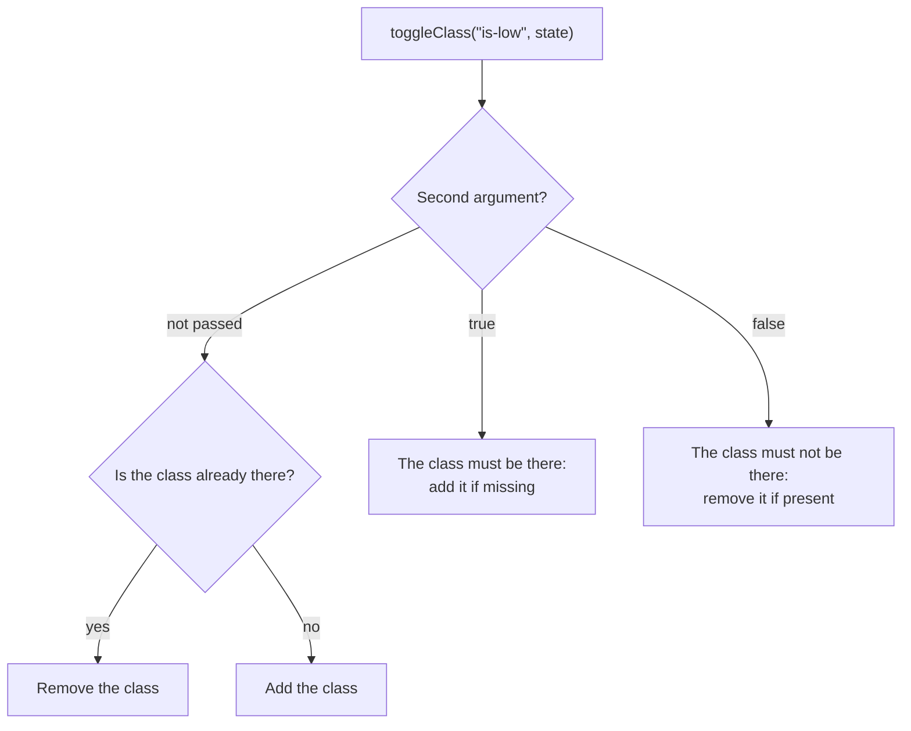
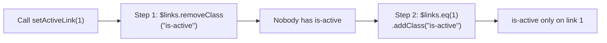
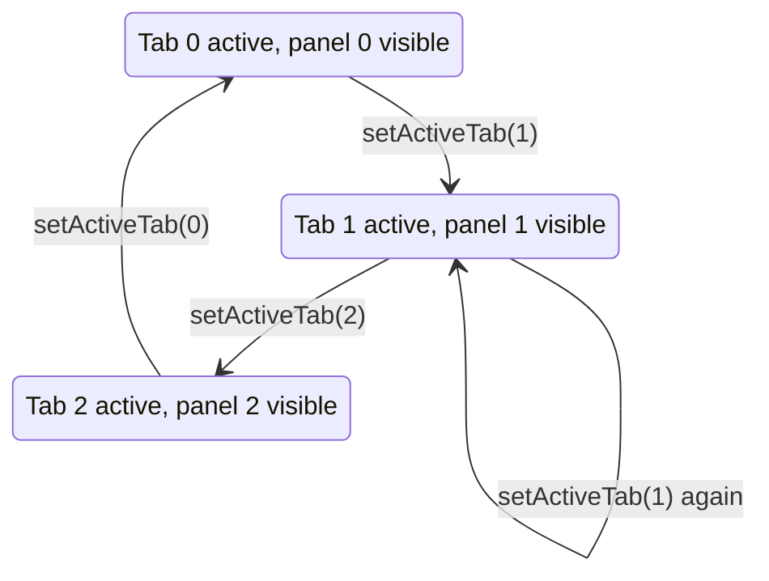
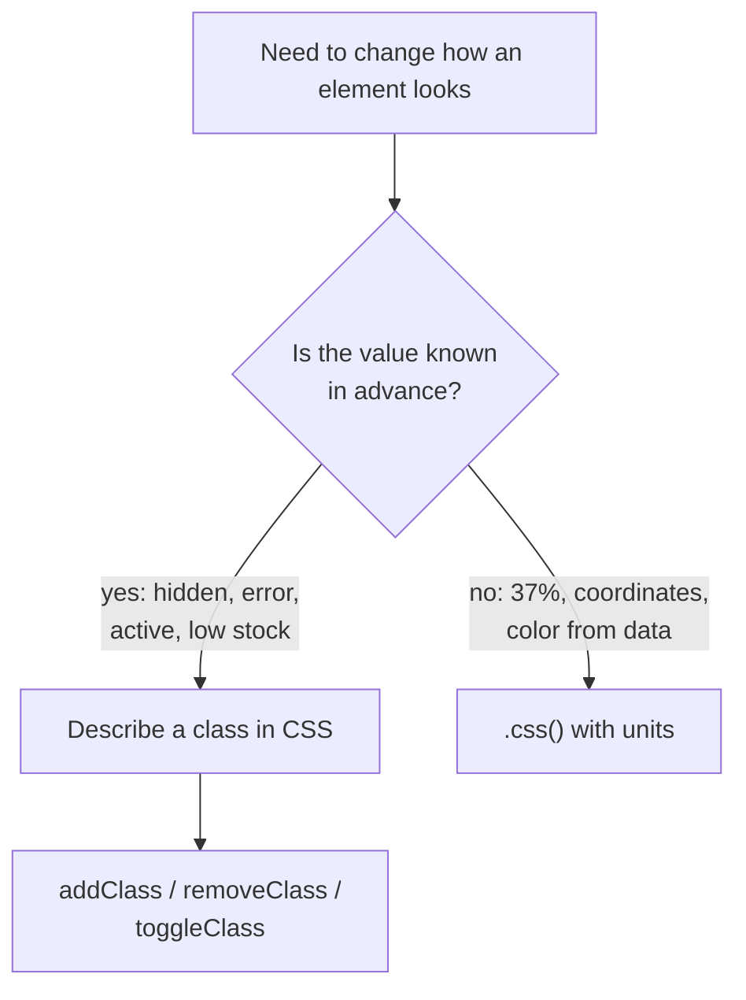
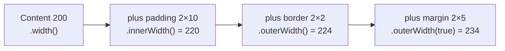

# Classes and styles

[Contents](../../README.md) · [← Back](../../Lesson-3/en/Content%20and%20attributes.md) · [Next →](../../Lesson-5/en/Creating%20and%20removing%20elements.md) · [RU](../ru/%D0%9A%D0%BB%D0%B0%D1%81%D1%81%D1%8B%20%D0%B8%20%D1%81%D1%82%D0%B8%D0%BB%D0%B8.md) · [EN](Classes%20and%20styles.md) · [UZ](../uz/Klasslar%20va%20uslublar.md)

> **Link to lesson 3:** you learned to read and change content and attributes: `.text()`, `.val()`, `.attr()`, `.prop()`, `.data()`. Today we change the **appearance**: we turn CSS classes on and off, read and set styles, and find out the size and position of elements. The `data-*` and `aria-*` attributes from lesson 3 will work together with classes.

---

## Why you need this

Almost everything a user sees as the "state" of a page is classes. The open tab is underlined, a product that is almost sold out is highlighted in red, a field with an error has a border around it, the menu on a phone is sometimes hidden and sometimes shown. In CSS you describe in advance what each state looks like, and JavaScript only **turns classes on and off** at the right moment.

Sometimes a value is not known in advance: the width of a progress bar `37%`, the coordinates of a popup tooltip. Such values are calculated in code and written directly into the style. Today you will learn to tell these two cases apart and do both with jQuery - in one line for all the elements that were found.

---

## What you will learn

- Add and remove classes: `.addClass()`, `.removeClass()`.
- Toggle a class based on a condition: `.toggleClass("name", state)`.
- Check whether a class is there: `.hasClass()`.
- Make one element of a group "active": remove the class from all of them and add it to one with `.eq()`.
- Read the computed style and write a style: `.css()`, including with an object.
- Specify units correctly in jQuery 4.
- Choose between a class and `.css()`.
- Find out sizes: `.width()`, `.height()`, `.innerWidth()`, `.outerWidth()`, `.outerHeight()`.
- Find out position and scrolling: `.offset()`, `.position()`, `.scrollTop()`.

---

## Review: 3 questions from lesson 3

1. How is `.text("<b>Hello</b>")` different from `.html("<b>Hello</b>")`, and why is `.html()` dangerous with user data?
2. When do you need `.prop()` and not `.attr()`? Give an example.
3. What does `$("#item").data("stock")` return for `<li id="item" data-stock="12">` - a string or a number?

Answers are at the end of the lesson.

---

## Lesson plan

| Section | What we do |
| --- | --- |
| Classes: add and remove | `.addClass()`, `.removeClass()` |
| Toggling and checking | `.toggleClass()`, `.hasClass()` |
| Mini-task 1 | Course cards with statuses |
| One active in a group | Menu and tabs: `.eq()` + classes + `aria-*` |
| `.css()` | Read and write a style, units, object |
| Class or style | When to choose which |
| Sizes | `.width()`, `.innerWidth()`, `.outerWidth()` |
| Position and scrolling | `.offset()`, `.position()`, `.scrollTop()` |
| Mini-task 2 | Progress bar |
| Independent work | Tabs and stock levels |

---

## Classes: add and remove

**In simple words:** a class is a sticker on an element. In CSS you wrote in advance: "everything with the `is-active` sticker gets a blue line at the bottom". JavaScript does not draw anything itself - it only **puts stickers on and peels them off**, and the browser immediately redraws the element according to the CSS rules.

In the JavaScript course you did this with `classList`. In jQuery the same actions have short names, and they work on **all** the elements that were found (implicit iteration from lesson 1).

```css
/* style.css */
.card.is-new { border-color: #16a34a; }
.is-hidden { display: none; }
```

### `.addClass()` - add a class

```html
<div class="card">HTML</div>
<div class="card">CSS</div>
```

```js
$(".card").addClass("is-new");
```

Result: `<div class="card is-new">` on both cards. The `card` class **stays** - `addClass` adds, it does not replace. If the class is already there, it will not be added a second time.

Several classes are written with a space: `$("#title").addClass("is-ready is-big")`.

### `.removeClass()` - remove a class

`$(".card").removeClass("is-new")` removes the class from all cards, and `removeClass("is-new is-sale")` removes several at once. If the class is not there, nothing happens and there is no error.

> **Important:** `.removeClass()` **without arguments** removes **all** classes of the element, including `card`. All the styling disappears with them. Always write the class name.

### Comparison with plain JavaScript

| Task | Plain JavaScript | jQuery |
| --- | --- | --- |
| Add a class to all cards | `for (const c of cards) { c.classList.add("x"); }` | `$(".card").addClass("x")` |
| Remove a class from all | Loop + `classList.remove("x")` | `$(".card").removeClass("x")` |
| Several classes | `classList.add("a", "b")` | `.addClass("a b")` |

### Why not `.attr("class", ...)`

In lesson 3 you learned `.attr()`. You can use it to write the `class` attribute, but it **overwrites** the whole attribute:

| Code | Before `class="tab"` | After |
| --- | --- | --- |
| `.addClass("is-active")` | `tab` | `tab is-active` |
| `.attr("class", "is-active")` | `tab` | `is-active` |

For classes, use only `addClass`, `removeClass` and `toggleClass`.

---

## Toggling and checking

### `.hasClass()` - is the class there

**In simple words:** this is the question "does this element have this sticker?". The answer is `true` or `false`.

```js
const $menu = $("#menu");

if ($menu.hasClass("is-open")) {
    console.log("The menu is open");
}
```

`.hasClass()` is a getter: it returns `true`/`false`, not a jQuery object, so it goes at the end of a chain. If several elements were found, the answer is `true` when **at least one** of them has the class.

### `.toggleClass()` without a second argument - "back and forth"

**In simple words:** a light switch. Press it - the light is on, press it again - it is off. You do not say "turn on" or "turn off", you say "switch".

```js
$("#menu").toggleClass("is-open"); // was not there - added
$("#menu").toggleClass("is-open"); // was there - removed
```

This is handy when the reaction is always "the opposite": a menu button on a phone, a dark theme. We will cover buttons and clicks in lesson 6, and for now we call the methods directly in code.

### `.toggleClass("name", state)` - based on a condition

The second argument is a boolean. Then it is no longer a switch but a **command**: `true` - the class must be there, `false` - the class must not be there.

**In simple words:** not "switch the light", but "the light must be on if it is dark outside". No matter how many times you repeat this command, the result is the same.

```js
const stock = 3;
$("#item").toggleClass("is-low", stock < 5); // 3 < 5 → true → class is there
```

One line replaces a condition:

```js
// Long
if (stock < 5) { $("#item").addClass("is-low"); } else { $("#item").removeClass("is-low"); }

// Short - the same thing
$("#item").toggleClass("is-low", stock < 5);
```



**How to read the diagram.** Without the second argument, the result depends on what there was before the call (the left branch). With the second argument, the result depends only on the condition: `true` - the class is there, `false` - it is not, no matter what there was before.

### Trace: repeated calls

At first there is no `is-open` class.

| Step | What happens | Value / page state |
| --- | --- | --- |
| 1 | `$box.toggleClass("is-open")` | `class="box is-open"` |
| 2 | `$box.toggleClass("is-open")` | `class="box"` - class removed |
| 3 | `$box.toggleClass("is-open", true)` | `class="box is-open"` |
| 4 | `$box.toggleClass("is-open", true)` | `class="box is-open"` - nothing changed |
| 5 | `$box.toggleClass("is-open", false)` | `class="box"` |
| 6 | `$box.hasClass("is-open")` | `false` |

Steps 3–4 show the main point: you can call a command with a state as many times as you like - the result does not "jump".

> **Important:** jQuery 4 removed the form `.toggleClass(true)` or `.toggleClass(false)` **without a class name**. It silently does nothing. Always write the name: `.toggleClass("is-open", true)`.

### Table of methods

| Code | What it does | Returns |
| --- | --- | --- |
| `$el.addClass("a")` | Add a class to all | jQuery object |
| `$el.addClass("a b")` | Add several | jQuery object |
| `$el.removeClass("a")` | Remove a class from all | jQuery object |
| `$el.toggleClass("a")` | Toggle: was there - remove, was not - add | jQuery object |
| `$el.toggleClass("a", condition)` | The class is there only if the condition is `true` | jQuery object |
| `$el.hasClass("a")` | Does at least one have the class | `true` / `false` |

---

## Mini-task 1

Here is the markup:

```html
<ul>
    <li class="course" data-progress="100">HTML</li>
    <li class="course" data-progress="40">CSS</li>
    <li class="course" data-progress="0">JavaScript</li>
</ul>
```

1. Add the class `course--card` to all `.course` elements with one call.
2. Go through the courses with `.each()` and give each one the class `is-done` if `data-progress` equals `100`, and the class `is-new` if `data-progress` equals `0`. Use `.toggleClass("name", condition)`.
3. Print to the console whether the first course has the class `is-done` (`.first()` and `.hasClass()`).

---

## One active in a group

The most common task with classes: in a group of similar elements, **exactly one** is highlighted. The menu item of the current page, the selected filter, the open tab.

**In simple words:** it is a relay baton. Only one runner holds it. To pass it on, you first have to take it from whoever had it. If you forget to "take it", there will be two batons.

### The "remove from all - add to one" technique

```html
<nav>
    <a class="menu__link is-active" href="#">Home</a>
    <a class="menu__link" href="#">Courses</a>
    <a class="menu__link" href="#">Contacts</a>
</nav>
```

```js
function setActiveLink(index) {
    const $links = $(".menu__link");

    $links.removeClass("is-active");          // step 1: take from all
    $links.eq(index).addClass("is-active");   // step 2: give to one
}

setActiveLink(1); // "Courses" is highlighted
```

The `.eq(index)` method from lesson 2 selects an element by its number, starting from zero, and returns a **jQuery object**, so it has `addClass` right away. Do not confuse it with `$links[index]` - that is a DOM element without jQuery methods.

We do not need to know **who** was active before: we remove the class from all of them at once, and this is always correct.



**How to read the diagram.** Between the two steps there is a short moment when there are no active elements at all. The user will not see it: the browser redraws the page only after the function has finished.

### Tabs: class, `aria-selected` and panels

Tabs have two sets of elements: tab buttons and panels with content. For screen readers, a tab has the `aria-selected` attribute: `"true"` on the selected one and `"false"` on the rest. You already know how to change attributes with `.attr()` from lesson 3.

```html
<button class="tab" aria-selected="true">Description</button>
<button class="tab" aria-selected="false">Reviews</button>

<section class="panel">Description text</section>
<section class="panel is-hidden">Reviews text</section>
```

A tab and its panel have **the same number**: tab 0 - panel 0, tab 1 - panel 1.

It is handy to go through the panels with `.each()` and tell each one: "be hidden if your number is not the selected one":

```js
$(".panel").each(function (i) {
    $(this).toggleClass("is-hidden", i !== 1);
});
```

| Panel number `i` | `i !== 1` | Result |
| --- | --- | --- |
| 0 | `true` | has `is-hidden` - hidden |
| 1 | `false` | no `is-hidden` - visible |
| 2 | `true` | hidden |

You will write the full tabs function in the independent work: it brings together `.eq()`, classes, `aria-selected` and `.toggleClass` with a state.



**How to read the diagram.** A group of tabs is always in exactly one of three states. Each call moves it to the needed state, no matter where we came from. The loop on `Tab1` is a repeated call with the same number: the state does not change. That is exactly why the panels need `.toggleClass` **with a state**, not a "back and forth" switch.

---

## `.css()` - read and write a style

**In simple words:** a class is a ready-made suit from the wardrobe (the CSS file). `.css()` is adjusting a sleeve right on the person to an exact measurement. It is handy when the measurement only becomes known now.

### Reading: the computed style

```css
#box {
    color: red;
    width: 200px;
}
```

```js
const $box = $("#box");

console.log($box.css("width"));   // "200px"
console.log($box.css("color"));   // "rgb(255, 0, 0)"
```

The `.css()` getter returns the **computed** value - what the browser actually applied, even if the style came from the CSS file and not from the `style` attribute. That is why the color comes in `rgb(...)` format and sizes come in pixels. It is a string: to calculate with it, turn it into a number, for example `parseFloat("200px")` → `200`.

If there are several elements, the getter returns the value of the **first** one.

You can write the property name as in CSS (`"background-color"`) or in camelCase (`"backgroundColor"`) - jQuery understands both.

### Writing: one property

```js
$("#bar").css("width", "37%");
$(".note").css("background-color", "#fef3c7");
```

jQuery writes the value into the `style` attribute of each element found - just like `element.style.width = "37%"` in plain JavaScript.

An empty string **removes** the property from the `style` attribute, and the element is styled by the CSS file again:

```js
$("#bar").css("width", "");
```

### Units in jQuery 4

| Code | Result in jQuery 4.1 |
| --- | --- |
| `.css("width", "200px")` | `200px` |
| `.css("width", 200)` | `200px` - for sizes, `margin`, `padding`, `top`/`left` jQuery still adds `px` |
| `.css("font-size", 20)` | **Nothing**: `px` is not added, and the browser ignores `20` without units |
| `.css("font-size", "20px")` | `20px` |
| `.css("opacity", 0.5)` | `0.5` - opacity has no units |
| `.css("width", "+=50px")` | The width grows by 50 pixels |

In old versions, jQuery added `px` to almost all numbers. In jQuery 4 this remains only for sizes, margins and paddings, and positions. So you do not have to memorize the list, the course has a simple rule:

> **Important:** always write units explicitly, as a string: `"200px"`, `"1.5rem"`, `"37%"`. There will be no error with a wrong value - the style will just silently not be applied.

The value is often built with a template string: `` $("#bar").css("width", `${percent}%`) ``.

### Writing: an object

Several properties - in one call, with an object:

```js
$("#tooltip").css({ top: "120px", left: "48px", "max-width": "240px" });
```

Keys in camelCase are written without quotes (`maxWidth`), but keys with a hyphen must be in quotes (`"max-width"`), otherwise JavaScript reads the hyphen as a minus.

### Comparison with plain JavaScript

| Task | Plain JavaScript | jQuery |
| --- | --- | --- |
| Read the computed style | `getComputedStyle(el).width` | `$el.css("width")` |
| Write one property | `el.style.width = "37%"` | `$el.css("width", "37%")` |
| Write several | Several lines of `el.style...` | `$el.css({ ... })` |
| For all elements found | Loop | The same call |

---

## Class or style

You already heard this in the JavaScript course: a style in the `style` attribute is what we gave up in the CSS course. You cannot see it in the CSS file, you cannot override it with a class, and a dark theme will not take it into account. `.css()` writes exactly there.



**How to read the diagram.** Ask yourself: "Can I write this value in the CSS file right now?" If yes, it is a class. If the value appears only while the program is running, it is `.css()`.

| Task | Correct | Why |
| --- | --- | --- |
| Hide a panel | `.addClass("is-hidden")` | The state is known in advance |
| Highlight a field with an error | `.addClass("is-error")` | The border color is design, it belongs in CSS |
| Progress bar width 37% | `.css("width", "37%")` | The number is calculated in code |
| Tooltip next to the cursor | `.css({ top: ..., left: ... })` | The coordinates are known only at the moment of the event |
| Label color from data `"#e11d48"` | `.css("background-color", color)` | The color came from data |

---

## Element sizes

Sometimes you need to know a size to calculate something: align a tooltip, adjust a height. jQuery has four pairs of methods for this.

**In simple words:** imagine a framed picture on a wall. The canvas itself is the content; the mat around the canvas is `padding`; the wooden frame is `border`; the empty space up to the next picture is `margin`. The methods differ in what they "measure with the tape".

```html
<div id="card">Card</div>
```

```css
#card {
    box-sizing: content-box;
    width: 200px;
    padding: 10px;
    border: 2px solid #333;
    margin: 5px;
}
```

| Method | What is included | Result |
| --- | --- | --- |
| `.width()` | Content only | `200` |
| `.innerWidth()` | + `padding` on both sides | `220` |
| `.outerWidth()` | + `padding` + `border` | `224` |
| `.outerWidth(true)` | + `padding` + `border` + `margin` | `234` |

The same goes for height: `.height()`, `.innerHeight()`, `.outerHeight()`, `.outerHeight(true)`.



**How to read the diagram.** Each next method adds one more "frame" layer on both sides to the previous one.

The difference from `.css("width")`: the size methods return a **number** without `px`, so you can calculate with it right away.

```js
const $card = $("#card");
console.log($card.css("width"));  // "200px" - a string
console.log($card.width());       // 200 - a number
console.log($card.width() / 2);   // 100
```

> **Important:** a hidden element (`display: none`) has no size - the browser does not draw it. You have to measure a visible element.

---

## Position and scrolling

### `.offset()` and `.position()`

Both methods return an object `{ top, left }` in pixels, but they measure from different points.

| Method | Measured from | When you need it |
| --- | --- | --- |
| `.offset()` | The top left corner of the **whole document** | Find out where the element is on the page; put a tooltip next to it |
| `.position()` | The nearest parent with `position: relative/absolute` | The position inside its own block |

```js
const place = $("#help").offset();
console.log(place.top, place.left); // for example: 340 120

$("#tooltip").css({
    top: `${place.top + 30}px`,
    left: `${place.left}px`
});
```

**In simple words:** `.offset()` is the address of a house from the city center, `.position()` is the apartment number inside the house.

### `.scrollTop()` - scrolling

Like `.text()`, this method works in two modes:

| Code | What it does |
| --- | --- |
| `$(window).scrollTop()` | How many pixels the page is scrolled from the top |
| `$(window).scrollTop(0)` | Scroll to the very top |
| `$("#chat").scrollTop()` | Scrolling inside a block with `overflow: auto` |
| `$("#chat").scrollTop($("#chat")[0].scrollHeight)` | Scroll the chat to the very bottom |

You will be able to connect scrolling to a "Back to top" button or to the `scroll` event in lesson 6, and smooth scrolling with `.animate()` in lesson 7.

### Trace: a tooltip under an element

`#help` is on the page at the point `top: 340`, `left: 120`, its height is `24`.

| Step | What happens | Value / page state |
| --- | --- | --- |
| 1 | `const place = $("#help").offset();` | `{ top: 340, left: 120 }` |
| 2 | `const height = $("#help").outerHeight();` | `24` |
| 3 | `` `${place.top + height + 8}px` `` | `"372px"` |
| 4 | `$("#tooltip").css({ top: "372px", left: "120px" })` | the tooltip is 8px below `#help` |
| 5 | `$("#tooltip").removeClass("is-hidden")` | the tooltip is visible |

Steps 4 and 5 show the "class or style" rule in one task: the coordinates are calculated, so it is `.css()`, and showing or hiding is a class.

---

### Try to break it

1. Call `$(".card").removeClass()` without arguments. What happened to the styling of the cards? Look at the `class` attribute in the **Elements** tab.
2. Call `$("#menu").toggleClass("is-open")` twice in a row, and then `$("#menu").toggleClass("is-open", true)` twice. Compare the results.
3. Run `$("#title").css("font-size", 40)` and `$("#title").css("font-size", "40px")`. Which one worked? Was there an error in the console?
4. Write `$("#tab").attr("class", "is-active")`. Which classes are left on the element?
5. In the "one active in a group" function, delete the line with `removeClass` and call the function with the numbers 0, 1, 2. How many elements are highlighted?
6. Hide an element with the `is-hidden` class and print `$("#card").width()`. Why does the result not match the CSS?

### Typical beginner mistakes

| Mistake | What you get | How to fix |
| --- | --- | --- |
| `.addClass(".is-active")` with a dot | A class with a dot in its name is added, the CSS does not work | Class name without a dot: `.addClass("is-active")` |
| `.removeClass()` without a name | All classes and all styling are gone | Give the name: `.removeClass("is-new")` |
| `.attr("class", "x")` | The old classes are erased | `.addClass("x")` |
| The class is not removed from the others | Several elements are active | First `$all.removeClass(...)`, then `.eq(i).addClass(...)` |
| `.toggleClass("x")` where you need to "turn on" | On a repeated call the class disappears | `.toggleClass("x", true)` or `.addClass("x")` |
| `.toggleClass(true)` without a class name | Nothing happens in jQuery 4 | `.toggleClass("x", true)` |
| `.css("font-size", 20)` | The style is not applied, no error | Explicit units: `"20px"` |
| Design through `.css()`: error color, hiding | Styling is scattered across JS and cannot be overridden in CSS | A class in CSS + `addClass` |
| `$links[1].addClass("x")` | `TypeError: ... addClass is not a function` | `$links.eq(1).addClass("x")` |
| Comparing `$el.css("width") === 200` | Always `false`: it is the string `"200px"` | `$el.width() === 200` |

---

## Mini-task 2

A course progress bar:

```html
<div class="progress">
    <div class="progress__bar" id="bar"></div>
</div>
<p id="progress-text"></p>
```

In CSS, `.progress__bar` has a height and a blue background, and `.progress__bar.is-done` has a green background.

Write the function `showProgress(done, total)`:

1. Calculate the percentage: `Math.round(done / total * 100)`.
2. Write the width of `#bar` with `.css()` in percent, with units.
3. Give `#bar` the class `is-done` only if the percentage equals `100` (`.toggleClass` with a state).
4. Write text like `Completed 4 of 10 (40%)` into `#progress-text`.
5. Call `showProgress(4, 10)`, then `showProgress(10, 10)`, then `showProgress(4, 10)` again, and check that the green color is gone.

---

## Lesson summary: cheat sheet

| Task | Code |
| --- | --- |
| Add a class | `$el.addClass("is-active")` |
| Add several | `$el.addClass("a b")` |
| Remove a class | `$el.removeClass("is-active")` |
| Toggle | `$el.toggleClass("is-open")` |
| Class based on a condition | `$el.toggleClass("is-low", stock < limit)` |
| Is the class there | `$el.hasClass("is-open")` |
| One active in a group | `$all.removeClass("x"); $all.eq(i).addClass("x");` |
| Read a style | `$el.css("width")` → `"200px"` |
| Write a style | `$el.css("width", "37%")` - always explicit units |
| Several styles | `$el.css({ top: "10px", left: "20px" })` |
| Remove a written style | `$el.css("width", "")` |
| Sizes | `.width()`, `.innerWidth()`, `.outerWidth()`, `.outerWidth(true)` |
| Position | `.offset()` - from the document, `.position()` - from the parent |
| Scrolling | `$(window).scrollTop()` / `.scrollTop(0)` |

---

## Independent work

### Part 1. IDE task (graded by the platform)

The page has three tabs `.tab`, three panels `.panel` (all with the class `is-hidden`) and a list of products `li.product` with the `data-stock` attribute - the number of items in stock. The classes `is-active`, `is-hidden` and `is-low` are already described in CSS. Using only jQuery:

1. Write the function `setActiveTab(index)`: remove the class `is-active` from all `.tab` elements and set `aria-selected="false"` on them; add `is-active` and `aria-selected="true"` to the tab with the number `index` (with `.eq`); remove `is-hidden` from the panel with the number `index` and add it to all the others - with `.toggleClass("is-hidden", state)`.
2. Write the function `markLowStock(limit)`: add the class `is-low` to each `.product` whose `data-stock` is **less than** `limit`, and remove it from the others. Find the products inside the function.
3. At the end, call `setActiveTab(0)` and `markLowStock(5)`.

The tests call the functions many times with different arguments. Do not use `document.querySelector`, `classList`, `.style`, `innerHTML` or `.html()`.

What the platform checks: after loading, the first tab is active and the first panel is visible; after `setActiveTab(2)` exactly one tab is active, only it has `aria-selected="true"`, and only its panel is visible; several switches in a row and a repeated call with the same number; that the `tab` and `panel` classes are not lost; `markLowStock` with different `limit` values (the edge case: stock `5` with `limit` `5` is not "low"), removing extra marks, and a product added after loading; that `.eq()` and `.toggleClass()` are used; that the program runs without errors.

### Part 2. Project on your computer

1. In the `style.css` of your website from the HTML and CSS courses, describe state classes: `is-active`, `is-hidden` and one more of your own (for example, `is-new` or `is-sale`).
2. Write the function `setActiveLink(index)` for the site menu and call it with the number of the current page.
3. Add a `data-*` attribute to elements with a special feature, and highlight them with a class using `.each()` + `.toggleClass("name", condition)`.
4. Make a progress bar or a rating scale whose width is set with `.css()` in percent.
5. Print `.outerWidth()` and `.offset()` of the main heading to the console and compare them with the **Elements** → **Computed** tab.

### Acceptance criteria

- [ ] The IDE task is accepted.
- [ ] The styling of states is described with classes in CSS, not with `.css()`.
- [ ] `.css()` is used only for calculated values, and units are written explicitly.
- [ ] In a group of elements only one is active, no matter how many times the function is called.
- [ ] You can explain the difference between `.toggleClass("x")` and `.toggleClass("x", condition)`.

---

## Self-check questions

1. How is `.addClass("x")` different from `.attr("class", "x")`?
2. What does `.removeClass()` without arguments do?
3. What does `.hasClass()` return if several elements were found and only one of them has the class?
4. How is `.toggleClass("x")` different from `.toggleClass("x", condition)`? When do you need each one?
5. Why does the "one active in a group" function first remove the class from all elements?
6. What does `$("#box").css("color")` return if the color is set in the CSS file? In what format?
7. Why do you have to write `"20px"` and not `20` in jQuery 4?
8. What rule do you use to choose between a class and `.css()`? Give an example of each.
9. How are `.width()`, `.innerWidth()`, `.outerWidth()` and `.outerWidth(true)` different?
10. How is `.offset()` different from `.position()`?

After the questions, take the **lesson test** on the platform: 12 questions, pass mark 70%.

---

## What's next

So far we have only changed what is already on the page. In lesson 5 we will learn to **create and remove elements**: build new `li` elements with `$("<li>")`, insert them with `.append()` and `.prepend()`, remove them with `.remove()`, and render a whole array of objects. The classes from this lesson will be useful right away: the new elements will need styling.

---

## Answers

**Review**

1. `.text()` inserts the string as text: the page literally shows `<b>Hello</b>`. `.html()` parses the string as markup, so with user data someone else's code can be inserted through it.
2. `.prop()` is for the current state of an element, which changes while the page is in use: `checked`, `disabled`, `selected`. For example, `$("#agree").prop("checked")` returns `true` or `false`, while `.attr("checked")` returns only the original attribute from the HTML.
3. The number `12`: `.data()` turns strings that look like numbers into numbers.

**Mini-task 1**

```js
$(".course").addClass("course--card");

$(".course").each(function () {
    const progress = $(this).data("progress");

    $(this)
        .toggleClass("is-done", progress === 100)
        .toggleClass("is-new", progress === 0);
});

console.log($(".course").first().hasClass("is-done")); // true
```

**Mini-task 2**

```js
function showProgress(done, total) {
    const percent = Math.round(done / total * 100);

    $("#bar")
        .css("width", `${percent}%`)
        .toggleClass("is-done", percent === 100);

    $("#progress-text").text(`Completed ${done} of ${total} (${percent}%)`);
}

showProgress(4, 10);
showProgress(10, 10);
showProgress(4, 10);
```

**Self-check questions**

1. `addClass` adds a class to the existing ones, while `.attr("class", "x")` overwrites the whole attribute - the old classes are gone.
2. It removes all classes of the element, and the styling disappears with them.
3. `true`: `.hasClass()` checks whether at least one element has the class.
4. Without the second argument it is a switch: the result depends on whether the class was there. With a condition it is a command: `true` - the class is there, `false` - it is not, no matter how many times you call it. The first is for "the opposite" (a menu button), the second is for when the state is calculated (low stock, the selected tab).
5. We do not know who was active before. By removing the class from all elements, we guarantee that after `.eq(i).addClass(...)` exactly one element is active.
6. The computed value that the browser applied, even if it came from the CSS file. The color is a string in `rgb(...)` format, for example `"rgb(255, 0, 0)"`.
7. In jQuery 4, `px` is added automatically only to sizes, margins and paddings, and positions. For other properties, for example `font-size`, a number without units is invalid and is silently not applied. Explicit units always work.
8. If the value can be written in CSS in advance, use a class (hide a panel, highlight an error). If it is calculated in code, use `.css()` (progress width `37%`, tooltip coordinates).
9. `.width()` is the content only; `.innerWidth()` adds `padding`; `.outerWidth()` adds `padding` and `border`; `.outerWidth(true)` also adds `margin`.
10. `.offset()` measures coordinates from the top left corner of the document, and `.position()` from the nearest positioned parent.

[Contents](../../README.md) · [← Back](../../Lesson-3/en/Content%20and%20attributes.md) · [Next →](../../Lesson-5/en/Creating%20and%20removing%20elements.md) · [RU](../ru/%D0%9A%D0%BB%D0%B0%D1%81%D1%81%D1%8B%20%D0%B8%20%D1%81%D1%82%D0%B8%D0%BB%D0%B8.md) · [EN](Classes%20and%20styles.md) · [UZ](../uz/Klasslar%20va%20uslublar.md)
