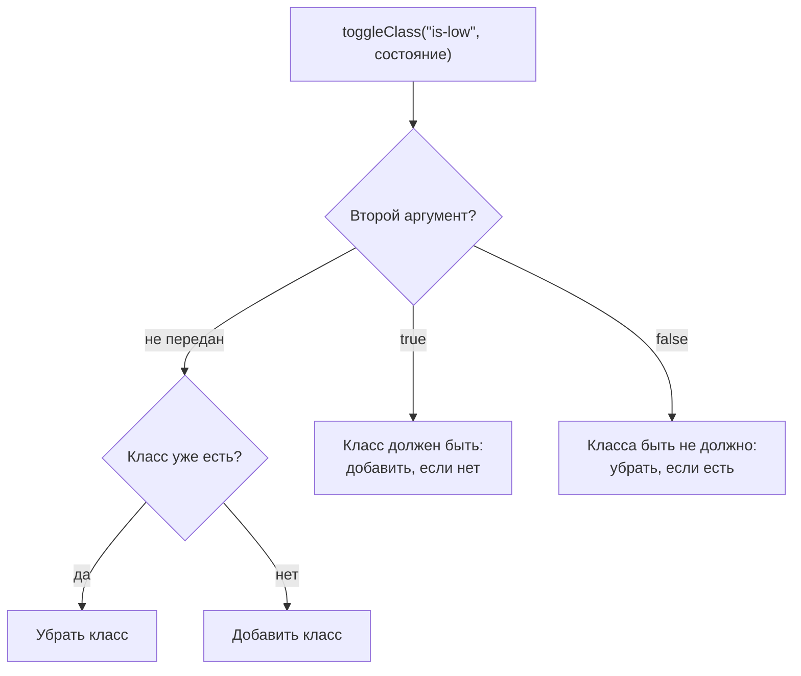
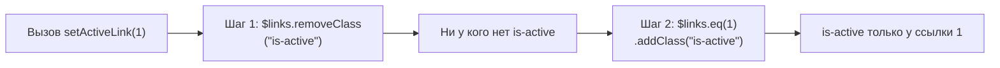
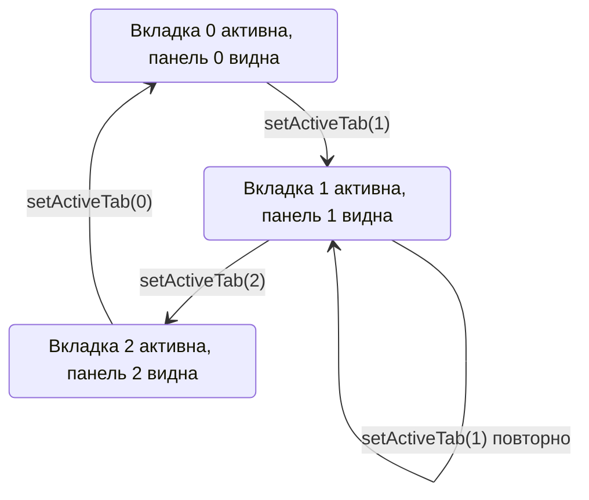
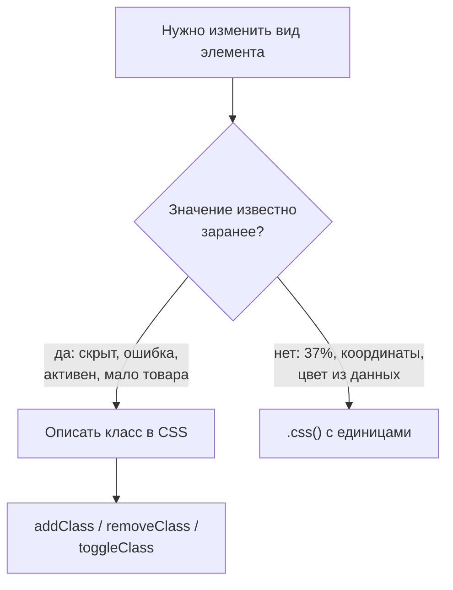
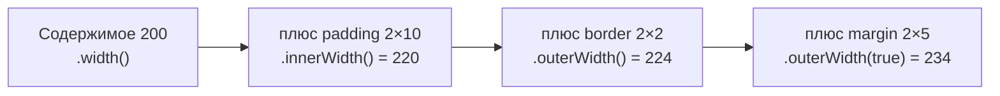

# Классы и стили

[Содержание](../../README.md) · [← Назад](../../Lesson-3/ru/%D0%A1%D0%BE%D0%B4%D0%B5%D1%80%D0%B6%D0%B8%D0%BC%D0%BE%D0%B5%20%D0%B8%20%D0%B0%D1%82%D1%80%D0%B8%D0%B1%D1%83%D1%82%D1%8B.md) · [Вперёд →](../../Lesson-5/ru/%D0%A1%D0%BE%D0%B7%D0%B4%D0%B0%D0%BD%D0%B8%D0%B5%20%D0%B8%20%D1%83%D0%B4%D0%B0%D0%BB%D0%B5%D0%BD%D0%B8%D0%B5%20%D1%8D%D0%BB%D0%B5%D0%BC%D0%B5%D0%BD%D1%82%D0%BE%D0%B2.md) · [RU](%D0%9A%D0%BB%D0%B0%D1%81%D1%81%D1%8B%20%D0%B8%20%D1%81%D1%82%D0%B8%D0%BB%D0%B8.md) · [EN](../en/Classes%20and%20styles.md) · [UZ](../uz/Klasslar%20va%20uslublar.md)

> **Связь с уроком 3:** вы научились читать и менять содержимое и атрибуты: `.text()`, `.val()`, `.attr()`, `.prop()`, `.data()`. Сегодня меняем **внешний вид**: включаем и выключаем классы CSS, читаем и задаём стили, узнаём размеры и положение элементов. Атрибуты `data-*` и `aria-*` из урока 3 будут работать вместе с классами.

---

## Зачем это вам

Почти всё, что пользователь видит как «состояние» страницы, - это классы. Открытая вкладка подчёркнута, товар, которого почти не осталось, подсвечен красным, ошибочное поле обведено рамкой, меню на телефоне то скрыто, то показано. В CSS вы заранее описываете, как выглядит каждое состояние, а JavaScript в нужный момент только **включает и выключает** классы.

Иногда значение заранее неизвестно: ширина полоски прогресса `37%`, координата всплывающей подсказки. Такие значения вычисляются в коде и записываются прямо в стиль. Сегодня вы научитесь различать эти два случая и делать оба на jQuery - одной строкой для всех найденных элементов.

---

## Чему вы научитесь

- Добавлять и убирать классы: `.addClass()`, `.removeClass()`.
- Переключать класс по условию: `.toggleClass("имя", состояние)`.
- Проверять, есть ли класс: `.hasClass()`.
- Делать «активным» один элемент из группы: снять класс со всех и поставить одному через `.eq()`.
- Читать вычисленный стиль и записывать стиль: `.css()`, в том числе объектом.
- Правильно указывать единицы измерения в jQuery 4.
- Выбирать между классом и `.css()`.
- Узнавать размеры: `.width()`, `.height()`, `.innerWidth()`, `.outerWidth()`, `.outerHeight()`.
- Узнавать положение и прокрутку: `.offset()`, `.position()`, `.scrollTop()`.

---

## Повторение: 3 вопроса из урока 3

1. Чем `.text("<b>Привет</b>")` отличается от `.html("<b>Привет</b>")` и почему `.html()` опасен с данными пользователя?
2. Когда нужен `.prop()`, а не `.attr()`? Приведите пример.
3. Что вернёт `$("#item").data("stock")` для `<li id="item" data-stock="12">` - строку или число?

Ответы - в конце урока.

---

## План урока

| Раздел | Что делаем |
| --- | --- |
| Классы: добавить и убрать | `.addClass()`, `.removeClass()` |
| Переключение и проверка | `.toggleClass()`, `.hasClass()` |
| Мини-задание 1 | Карточки курсов со статусами |
| Один активный из группы | Меню и вкладки: `.eq()` + классы + `aria-*` |
| `.css()` | Прочитать и записать стиль, единицы, объект |
| Класс или стиль | Когда что выбирать |
| Размеры | `.width()`, `.innerWidth()`, `.outerWidth()` |
| Положение и прокрутка | `.offset()`, `.position()`, `.scrollTop()` |
| Мини-задание 2 | Полоска прогресса |
| Самостоятельная работа | Вкладки и остатки на складе |

---

## Классы: добавить и убрать

**Простыми словами:** класс - это наклейка на элементе. В CSS вы заранее написали: «у всего с наклейкой `is-active` - синяя полоса снизу». JavaScript ничего не рисует сам - он только **клеит и отклеивает наклейки**, а браузер сразу перерисовывает элемент по правилам CSS.

В курсе JavaScript вы делали это через `classList`. В jQuery у тех же действий короткие имена, и они срабатывают **у всех** найденных элементов (неявный перебор из урока 1).

```css
/* style.css */
.card.is-new { border-color: #16a34a; }
.is-hidden { display: none; }
```

### `.addClass()` - добавить класс

```html
<div class="card">HTML</div>
<div class="card">CSS</div>
```

```js
$(".card").addClass("is-new");
```

Результат: `<div class="card is-new">` у обеих карточек. Класс `card` **остался** - `addClass` добавляет, а не заменяет. Если класс уже есть, второй раз он не добавится.

Несколько классов пишут через пробел: `$("#title").addClass("is-ready is-big")`.

### `.removeClass()` - убрать класс

`$(".card").removeClass("is-new")` убирает класс у всех карточек, `removeClass("is-new is-sale")` - несколько сразу. Если класса нет, ничего не произойдёт и ошибки не будет.

> **Важно:** `.removeClass()` **без аргументов** убирает **все** классы элемента, включая `card`. Вместе с ними пропадёт всё оформление. Всегда пишите имя класса.

### Сравнение с чистым JavaScript

| Задача | Чистый JavaScript | jQuery |
| --- | --- | --- |
| Добавить класс всем карточкам | `for (const c of cards) { c.classList.add("x"); }` | `$(".card").addClass("x")` |
| Убрать класс у всех | Цикл + `classList.remove("x")` | `$(".card").removeClass("x")` |
| Несколько классов | `classList.add("a", "b")` | `.addClass("a b")` |

### Почему не `.attr("class", ...)`

В уроке 3 вы узнали `.attr()`. Им можно записать атрибут `class`, но он **перезапишет** его целиком:

| Запись | Было `class="tab"` | Стало |
| --- | --- | --- |
| `.addClass("is-active")` | `tab` | `tab is-active` |
| `.attr("class", "is-active")` | `tab` | `is-active` |

Для классов используйте только `addClass`, `removeClass` и `toggleClass`.

---

## Переключение и проверка

### `.hasClass()` - есть ли класс

**Простыми словами:** это вопрос «на этом элементе есть такая наклейка?». Ответ - `true` или `false`.

```js
const $menu = $("#menu");

if ($menu.hasClass("is-open")) {
    console.log("Меню открыто");
}
```

`.hasClass()` - геттер: возвращает не jQuery-объект, а `true`/`false`, поэтому ставится в конце цепочки. Если найдено несколько элементов, ответ `true`, когда класс есть **хотя бы у одного**.

### `.toggleClass()` без второго аргумента - «туда-обратно»

**Простыми словами:** выключатель света. Нажали - включили, нажали ещё раз - выключили. Вы не говорите «включи» или «выключи», вы говорите «переключи».

```js
$("#menu").toggleClass("is-open"); // не было - добавил
$("#menu").toggleClass("is-open"); // был - убрал
```

Это удобно, когда реакция всегда «наоборот»: кнопка меню на телефоне, тёмная тема. Кнопки и клики разберём в уроке 6, а пока вызываем методы прямо в коде.

### `.toggleClass("имя", состояние)` - по условию

Второй аргумент - логическое значение. Тогда это уже не выключатель, а **команда**: `true` - класс должен быть, `false` - класса быть не должно.

**Простыми словами:** не «переключи свет», а «свет должен гореть, если на улице темно». Сколько раз ни повторяй эту команду, результат один и тот же.

```js
const stock = 3;
$("#item").toggleClass("is-low", stock < 5); // 3 < 5 → true → класс есть
```

Одна строка заменяет условие:

```js
// Длинно
if (stock < 5) { $("#item").addClass("is-low"); } else { $("#item").removeClass("is-low"); }

// Коротко - то же самое
$("#item").toggleClass("is-low", stock < 5);
```



**Как читать схему.** Без второго аргумента результат зависит от того, что было до вызова (левая ветка). Со вторым аргументом результат зависит только от условия: `true` - класс есть, `false` - класса нет, что бы ни было раньше.

### Трассировка: повторные вызовы

Класса `is-open` сначала нет.

| Шаг | Что происходит | Значение / состояние страницы |
| --- | --- | --- |
| 1 | `$box.toggleClass("is-open")` | `class="box is-open"` |
| 2 | `$box.toggleClass("is-open")` | `class="box"` - класс убран |
| 3 | `$box.toggleClass("is-open", true)` | `class="box is-open"` |
| 4 | `$box.toggleClass("is-open", true)` | `class="box is-open"` - не изменилось |
| 5 | `$box.toggleClass("is-open", false)` | `class="box"` |
| 6 | `$box.hasClass("is-open")` | `false` |

Шаги 3–4 показывают главное: команду с состоянием можно вызывать сколько угодно раз - результат не «прыгает».

> **Важно:** в jQuery 4 удалена запись `.toggleClass(true)` или `.toggleClass(false)` **без имени класса**. Она молча ничего не делает. Всегда пишите имя: `.toggleClass("is-open", true)`.

### Таблица методов

| Запись | Что делает | Возвращает |
| --- | --- | --- |
| `$el.addClass("a")` | Добавить класс всем | jQuery-объект |
| `$el.addClass("a b")` | Добавить несколько | jQuery-объект |
| `$el.removeClass("a")` | Убрать класс у всех | jQuery-объект |
| `$el.toggleClass("a")` | Переключить: был - убрать, не было - добавить | jQuery-объект |
| `$el.toggleClass("a", условие)` | Класс есть, только если условие `true` | jQuery-объект |
| `$el.hasClass("a")` | Есть ли класс хотя бы у одного | `true` / `false` |

---

## Мини-задание 1

Дана разметка:

```html
<ul>
    <li class="course" data-progress="100">HTML</li>
    <li class="course" data-progress="40">CSS</li>
    <li class="course" data-progress="0">JavaScript</li>
</ul>
```

1. Добавьте всем `.course` класс `course--card` одним вызовом.
2. Переберите курсы через `.each()` и каждому поставьте класс `is-done`, если `data-progress` равно `100`, и класс `is-new`, если `data-progress` равно `0`. Используйте `.toggleClass("имя", условие)`.
3. Выведите в консоль, есть ли класс `is-done` у первого курса (`.first()` и `.hasClass()`).

---

## Один активный из группы

Самая частая задача с классами: в группе одинаковых элементов **ровно один** выделен. Пункт меню текущей страницы, выбранный фильтр, открытая вкладка.

**Простыми словами:** это эстафетная палочка. Она в руках только у одного бегуна. Чтобы передать её, нужно сначала забрать у того, у кого она была. Если забыть «забрать», палочек станет две.

### Приём «снять со всех - поставить одному»

```html
<nav>
    <a class="menu__link is-active" href="#">Главная</a>
    <a class="menu__link" href="#">Курсы</a>
    <a class="menu__link" href="#">Контакты</a>
</nav>
```

```js
function setActiveLink(index) {
    const $links = $(".menu__link");

    $links.removeClass("is-active");          // шаг 1: забрать у всех
    $links.eq(index).addClass("is-active");   // шаг 2: отдать одному
}

setActiveLink(1); // выделены «Курсы»
```

Метод `.eq(index)` из урока 2 выбирает элемент по номеру с нуля и возвращает **jQuery-объект**, поэтому у него сразу есть `addClass`. Не путайте с `$links[index]` - это DOM-элемент без методов jQuery.

Нам не нужно знать, **кто** был активным до этого: снимаем класс со всех сразу, и это всегда правильно.



**Как читать схему.** Между двумя шагами есть короткий момент, когда активных нет совсем. Пользователь его не увидит: браузер перерисует страницу только после того, как функция закончит работу.

### Вкладки: класс, `aria-selected` и панели

У вкладок два набора элементов: кнопки-вкладки и панели с содержимым. Для экранных дикторов у вкладки есть атрибут `aria-selected`: `"true"` у выбранной, `"false"` у остальных. Атрибуты вы уже умеете менять через `.attr()` из урока 3.

```html
<button class="tab" aria-selected="true">Описание</button>
<button class="tab" aria-selected="false">Отзывы</button>

<section class="panel">Текст описания</section>
<section class="panel is-hidden">Текст отзывов</section>
```

Одна вкладка и её панель имеют **одинаковый номер**: вкладка 0 - панель 0, вкладка 1 - панель 1.

Панели удобно перебрать через `.each()` и каждой сказать: «будь скрыта, если твой номер - не тот, что выбран»:

```js
$(".panel").each(function (i) {
    $(this).toggleClass("is-hidden", i !== 1);
});
```

| Номер панели `i` | `i !== 1` | Результат |
| --- | --- | --- |
| 0 | `true` | `is-hidden` есть - скрыта |
| 1 | `false` | `is-hidden` нет - видна |
| 2 | `true` | скрыта |

Полную функцию вкладок вы напишете в самостоятельной работе: в ней соединятся `.eq()`, классы, `aria-selected` и `.toggleClass` с состоянием.



**Как читать схему.** У группы вкладок всегда ровно одно состояние из трёх. Каждый вызов переводит в нужное состояние, откуда бы мы ни пришли. Петля на `Tab1` - повторный вызов с тем же номером: состояние не меняется. Именно поэтому для панелей нужен `.toggleClass` **с состоянием**, а не переключатель «туда-обратно».

---

## `.css()` - прочитать и записать стиль

**Простыми словами:** класс - это готовый костюм из шкафа (CSS-файла). `.css()` - это подогнать рукав прямо на человеке по точной мерке. Удобно, когда мерка становится известна только сейчас.

### Чтение: вычисленный стиль

```css
#box {
    color: red;
    width: 200px;
}
```

```js
const $box = $("#box");

console.log($box.css("width"));   // "200px"
console.log($box.css("color"));   // "rgb(255, 0, 0)"
```

Геттер `.css()` возвращает **вычисленное** значение - то, что браузер реально применил, даже если стиль пришёл из CSS-файла, а не из атрибута `style`. Поэтому цвет приходит в формате `rgb(...)`, а размеры - в пикселях. Это строка: чтобы посчитать, превратите её в число, например `parseFloat("200px")` → `200`.

Если элементов несколько, геттер вернёт значение **первого**.

Имя свойства можно писать как в CSS (`"background-color"`) или в camelCase (`"backgroundColor"`) - jQuery понимает оба.

### Запись: одно свойство

```js
$("#bar").css("width", "37%");
$(".note").css("background-color", "#fef3c7");
```

jQuery записывает значение в атрибут `style` каждого найденного элемента - так же, как `element.style.width = "37%"` в чистом JavaScript.

Пустая строка **удаляет** свойство из атрибута `style`, и элемент снова оформляется по CSS-файлу:

```js
$("#bar").css("width", "");
```

### Единицы измерения в jQuery 4

| Запись | Результат в jQuery 4.1 |
| --- | --- |
| `.css("width", "200px")` | `200px` |
| `.css("width", 200)` | `200px` - для размеров, `margin`, `padding`, `top`/`left` jQuery ещё добавляет `px` |
| `.css("font-size", 20)` | **Ничего**: `px` не добавляется, браузер отбрасывает `20` без единиц |
| `.css("font-size", "20px")` | `20px` |
| `.css("opacity", 0.5)` | `0.5` - у прозрачности единиц нет |
| `.css("width", "+=50px")` | Ширина увеличится на 50 пикселей |

В старых версиях jQuery добавлял `px` почти ко всем числам. В jQuery 4 это осталось только для размеров, отступов и позиций. Чтобы не запоминать список, в курсе правило простое:

> **Важно:** всегда пишите единицы явно, строкой: `"200px"`, `"1.5rem"`, `"37%"`. Ошибки при неверном значении не будет - стиль просто молча не применится.

Значение часто собирают шаблонной строкой: `` $("#bar").css("width", `${percent}%`) ``.

### Запись: объект

Несколько свойств - одним вызовом, объектом:

```js
$("#tooltip").css({ top: "120px", left: "48px", "max-width": "240px" });
```

Ключи в camelCase пишут без кавычек (`maxWidth`), а с дефисом - обязательно в кавычках (`"max-width"`), иначе JavaScript прочитает дефис как минус.

### Сравнение с чистым JavaScript

| Задача | Чистый JavaScript | jQuery |
| --- | --- | --- |
| Прочитать вычисленный стиль | `getComputedStyle(el).width` | `$el.css("width")` |
| Записать одно свойство | `el.style.width = "37%"` | `$el.css("width", "37%")` |
| Записать несколько | Несколько строк `el.style...` | `$el.css({ ... })` |
| Всем найденным | Цикл | Тот же вызов |

---

## Класс или стиль

В курсе JavaScript вы уже слышали: стиль в атрибуте `style` - то, от чего мы отказались в курсе CSS. Его не видно в CSS-файле, его не переопределить классом, тёмная тема его не учтёт. `.css()` пишет именно туда.



**Как читать схему.** Задайте себе вопрос: «Могу ли я написать это значение в CSS-файле прямо сейчас?» Если да - это класс. Если значение появится только во время работы программы - `.css()`.

| Задача | Правильно | Почему |
| --- | --- | --- |
| Скрыть панель | `.addClass("is-hidden")` | Состояние известно заранее |
| Подсветить ошибочное поле | `.addClass("is-error")` | Цвет рамки - дизайн, ему место в CSS |
| Ширина полоски прогресса 37% | `.css("width", "37%")` | Число вычисляется в коде |
| Подсказка у курсора | `.css({ top: ..., left: ... })` | Координаты известны только в момент события |
| Цвет метки из данных `"#e11d48"` | `.css("background-color", color)` | Цвет пришёл из данных |

---

## Размеры элемента

Иногда нужно узнать размер, чтобы что-то посчитать: выровнять подсказку, подогнать высоту. В jQuery для этого четыре пары методов.

**Простыми словами:** представьте картину в рамке на стене. Сам холст - это содержимое; паспарту вокруг холста - `padding`; деревянная рамка - `border`; пустое место до соседней картины - `margin`. Методы отличаются тем, что они «меряют рулеткой».

```html
<div id="card">Карточка</div>
```

```css
#card {
    box-sizing: content-box;
    width: 200px;
    padding: 10px;
    border: 2px solid #333;
    margin: 5px;
}
```

| Метод | Что входит | Результат |
| --- | --- | --- |
| `.width()` | Только содержимое | `200` |
| `.innerWidth()` | + `padding` с двух сторон | `220` |
| `.outerWidth()` | + `padding` + `border` | `224` |
| `.outerWidth(true)` | + `padding` + `border` + `margin` | `234` |

Для высоты то же самое: `.height()`, `.innerHeight()`, `.outerHeight()`, `.outerHeight(true)`.



**Как читать схему.** Каждый следующий метод добавляет к предыдущему один слой «рамки» с обеих сторон.

Отличие от `.css("width")`: методы размеров возвращают **число** без `px`, с ним сразу можно считать.

```js
const $card = $("#card");
console.log($card.css("width"));  // "200px" - строка
console.log($card.width());       // 200 - число
console.log($card.width() / 2);   // 100
```

> **Важно:** у скрытого элемента (`display: none`) размеров нет - браузер его не рисует. Измерять нужно видимый элемент.

---

## Положение и прокрутка

### `.offset()` и `.position()`

Оба метода возвращают объект `{ top, left }` в пикселях, но считают от разных точек.

| Метод | От чего считает | Когда нужен |
| --- | --- | --- |
| `.offset()` | От левого верхнего угла **всего документа** | Узнать, где элемент на странице; поставить рядом подсказку |
| `.position()` | От ближайшего родителя с `position: relative/absolute` | Положение внутри своего блока |

```js
const place = $("#help").offset();
console.log(place.top, place.left); // например: 340 120

$("#tooltip").css({
    top: `${place.top + 30}px`,
    left: `${place.left}px`
});
```

**Простыми словами:** `.offset()` - адрес дома от центра города, `.position()` - номер квартиры внутри дома.

### `.scrollTop()` - прокрутка

Как `.text()`, этот метод работает в двух режимах:

| Запись | Что делает |
| --- | --- |
| `$(window).scrollTop()` | Сколько пикселей страница прокручена сверху |
| `$(window).scrollTop(0)` | Прокрутить в самый верх |
| `$("#chat").scrollTop()` | Прокрутка внутри блока с `overflow: auto` |
| `$("#chat").scrollTop($("#chat")[0].scrollHeight)` | Прокрутить чат в самый низ |

Привязать прокрутку к кнопке «Наверх» или к событию `scroll` вы сможете в уроке 6, а плавную прокрутку через `.animate()` - в уроке 7.

### Трассировка: подсказка под элементом

`#help` стоит на странице в точке `top: 340`, `left: 120`, высота `24`.

| Шаг | Что происходит | Значение / состояние страницы |
| --- | --- | --- |
| 1 | `const place = $("#help").offset();` | `{ top: 340, left: 120 }` |
| 2 | `const height = $("#help").outerHeight();` | `24` |
| 3 | `` `${place.top + height + 8}px` `` | `"372px"` |
| 4 | `$("#tooltip").css({ top: "372px", left: "120px" })` | подсказка на 8px ниже `#help` |
| 5 | `$("#tooltip").removeClass("is-hidden")` | подсказка видна |

Шаги 4 и 5 показывают правило «класс или стиль» в одной задаче: координаты вычислены - значит `.css()`, а показать или скрыть - класс.

---

### Попробуйте сломать

1. Вызовите `$(".card").removeClass()` без аргументов. Что случилось с оформлением карточек? Посмотрите атрибут `class` во вкладке **Elements**.
2. Вызовите два раза подряд `$("#menu").toggleClass("is-open")`, а потом два раза `$("#menu").toggleClass("is-open", true)`. Сравните результаты.
3. Выполните `$("#title").css("font-size", 40)` и `$("#title").css("font-size", "40px")`. Какая запись сработала? Была ли ошибка в консоли?
4. Запишите `$("#tab").attr("class", "is-active")`. Какие классы остались у элемента?
5. В функции «один активный из группы» удалите строку с `removeClass` и вызовите функцию с номерами 0, 1, 2. Сколько элементов выделено?
6. Скройте элемент классом `is-hidden` и выведите `$("#card").width()`. Почему результат не совпадает с CSS?

### Частые ошибки новичков

| Ошибка | Что получится | Как исправить |
| --- | --- | --- |
| `.addClass(".is-active")` с точкой | Добавится класс с точкой в имени, CSS не сработает | Имя класса без точки: `.addClass("is-active")` |
| `.removeClass()` без имени | Пропали все классы и всё оформление | Указать имя: `.removeClass("is-new")` |
| `.attr("class", "x")` | Старые классы стёрты | `.addClass("x")` |
| Не снят класс у остальных | Активных элементов несколько | Сначала `$all.removeClass(...)`, потом `.eq(i).addClass(...)` |
| `.toggleClass("x")` там, где нужно «включить» | При повторном вызове класс пропадает | `.toggleClass("x", true)` или `.addClass("x")` |
| `.toggleClass(true)` без имени класса | В jQuery 4 ничего не происходит | `.toggleClass("x", true)` |
| `.css("font-size", 20)` | Стиль не применился, ошибки нет | Единицы явно: `"20px"` |
| Дизайн через `.css()`: цвет ошибки, скрытие | Оформление размазано по JS, его не переопределить в CSS | Класс в CSS + `addClass` |
| `$links[1].addClass("x")` | `TypeError: ... addClass is not a function` | `$links.eq(1).addClass("x")` |
| Сравнение `$el.css("width") === 200` | Всегда `false`: там строка `"200px"` | `$el.width() === 200` |

---

## Мини-задание 2

Полоска прогресса курса:

```html
<div class="progress">
    <div class="progress__bar" id="bar"></div>
</div>
<p id="progress-text"></p>
```

В CSS у `.progress__bar` задана высота и синий фон, а у `.progress__bar.is-done` - зелёный фон.

Напишите функцию `showProgress(done, total)`:

1. Посчитайте процент: `Math.round(done / total * 100)`.
2. Запишите ширину `#bar` через `.css()` в процентах, с единицами.
3. Поставьте `#bar` класс `is-done`, только если процент равен `100` (`.toggleClass` с состоянием).
4. Запишите в `#progress-text` текст вида `Пройдено 4 из 10 (40%)`.
5. Вызовите `showProgress(4, 10)`, затем `showProgress(10, 10)`, затем снова `showProgress(4, 10)` и проверьте, что зелёный цвет пропал.

---

## Итоги урока: шпаргалка

| Задача | Запись |
| --- | --- |
| Добавить класс | `$el.addClass("is-active")` |
| Добавить несколько | `$el.addClass("a b")` |
| Убрать класс | `$el.removeClass("is-active")` |
| Переключить | `$el.toggleClass("is-open")` |
| Класс по условию | `$el.toggleClass("is-low", stock < limit)` |
| Есть ли класс | `$el.hasClass("is-open")` |
| Один активный из группы | `$all.removeClass("x"); $all.eq(i).addClass("x");` |
| Прочитать стиль | `$el.css("width")` → `"200px"` |
| Записать стиль | `$el.css("width", "37%")` - единицы всегда явно |
| Несколько стилей | `$el.css({ top: "10px", left: "20px" })` |
| Убрать записанный стиль | `$el.css("width", "")` |
| Размеры | `.width()`, `.innerWidth()`, `.outerWidth()`, `.outerWidth(true)` |
| Положение | `.offset()` - от документа, `.position()` - от родителя |
| Прокрутка | `$(window).scrollTop()` / `.scrollTop(0)` |

---

## Самостоятельная работа

### Часть 1. Задание в IDE (засчитывается платформой)

На странице три вкладки `.tab`, три панели `.panel` (у всех класс `is-hidden`) и список товаров `li.product` с атрибутом `data-stock` - остатком на складе. Классы `is-active`, `is-hidden` и `is-low` уже описаны в CSS. Используя только jQuery:

1. Напишите функцию `setActiveTab(index)`: снимите класс `is-active` со всех `.tab` и поставьте им `aria-selected="false"`; вкладке с номером `index` (через `.eq`) добавьте `is-active` и `aria-selected="true"`; панели с номером `index` уберите `is-hidden`, всем остальным поставьте - через `.toggleClass("is-hidden", состояние)`.
2. Напишите функцию `markLowStock(limit)`: каждому `.product`, у которого `data-stock` **меньше** `limit`, добавьте класс `is-low`, остальным уберите его. Товары ищите внутри функции.
3. В конце вызовите `setActiveTab(0)` и `markLowStock(5)`.

Тесты вызывают функции много раз с разными аргументами. `document.querySelector`, `classList`, `.style`, `innerHTML` и `.html()` не используйте.

Что проверяет платформа: после загрузки активна первая вкладка и видна первая панель; после `setActiveTab(2)` активна ровно одна вкладка, `aria-selected="true"` только у неё, видна только её панель; несколько переключений подряд и повторный вызов с тем же номером; что классы `tab` и `panel` не потерялись; `markLowStock` с разными `limit` (граница: остаток `5` при `limit` `5` - не «мало»), снятие лишних отметок и товар, добавленный после загрузки; что использованы `.eq()` и `.toggleClass()`; что программа работает без ошибок.

### Часть 2. Проект на компьютере

1. Опишите в `style.css` своего сайта из курсов HTML и CSS классы состояний: `is-active`, `is-hidden` и ещё один свой (например, `is-new` или `is-sale`).
2. Напишите функцию `setActiveLink(index)` для меню сайта и вызовите её с номером текущей страницы.
3. Добавьте элементам с особым признаком атрибут `data-*` и через `.each()` + `.toggleClass("имя", условие)` выделите их классом.
4. Сделайте полоску прогресса или шкалу рейтинга, ширина которой задаётся через `.css()` в процентах.
5. Выведите в консоль `.outerWidth()` и `.offset()` главного заголовка и сверьте с вкладкой **Elements** → **Computed**.

### Критерии готовности

- [ ] Задание в IDE засчитано.
- [ ] Оформление состояний описано классами в CSS, а не через `.css()`.
- [ ] `.css()` используется только для вычисленных значений, единицы указаны явно.
- [ ] В группе элементов активным бывает только один, сколько бы раз ни вызывалась функция.
- [ ] Вы можете объяснить разницу между `.toggleClass("x")` и `.toggleClass("x", условие)`.

---

## Вопросы для самопроверки

1. Чем `.addClass("x")` отличается от `.attr("class", "x")`?
2. Что сделает `.removeClass()` без аргументов?
3. Что вернёт `.hasClass()`, если найдено несколько элементов и класс есть только у одного?
4. Чем `.toggleClass("x")` отличается от `.toggleClass("x", условие)`? Когда нужен каждый?
5. Почему в функции «один активный из группы» сначала снимают класс со всех?
6. Что вернёт `$("#box").css("color")`, если цвет задан в CSS-файле? В каком формате?
7. Почему в jQuery 4 нужно писать `"20px"`, а не `20`?
8. По какому правилу выбрать между классом и `.css()`? Приведите по примеру.
9. Чем отличаются `.width()`, `.innerWidth()`, `.outerWidth()` и `.outerWidth(true)`?
10. Чем `.offset()` отличается от `.position()`?

После вопросов пройдите **тест урока** на платформе: 12 вопросов, порог 70%.

---

## Что дальше

Пока мы меняли только то, что уже есть на странице. В уроке 5 научимся **создавать и удалять элементы**: собирать новые `li` через `$("<li>")`, вставлять их через `.append()` и `.prepend()`, удалять через `.remove()` и отрисовывать целый массив объектов. Классы из этого урока пригодятся сразу: новые элементы нужно будет оформить.

---

## Ответы

**Повторение**

1. `.text()` вставляет строку как текст: на странице видно буквально `<b>Привет</b>`. `.html()` разбирает строку как разметку, поэтому с данными пользователя через него можно вставить чужой код.
2. `.prop()` - для текущего состояния элемента, которое меняется во время работы: `checked`, `disabled`, `selected`. Например, `$("#agree").prop("checked")` вернёт `true` или `false`, а `.attr("checked")` - только исходный атрибут из HTML.
3. Число `12`: `.data()` превращает строки, похожие на числа, в числа.

**Мини-задание 1**

```js
$(".course").addClass("course--card");

$(".course").each(function () {
    const progress = $(this).data("progress");

    $(this)
        .toggleClass("is-done", progress === 100)
        .toggleClass("is-new", progress === 0);
});

console.log($(".course").first().hasClass("is-done")); // true
```

**Мини-задание 2**

```js
function showProgress(done, total) {
    const percent = Math.round(done / total * 100);

    $("#bar")
        .css("width", `${percent}%`)
        .toggleClass("is-done", percent === 100);

    $("#progress-text").text(`Пройдено ${done} из ${total} (${percent}%)`);
}

showProgress(4, 10);
showProgress(10, 10);
showProgress(4, 10);
```

**Вопросы для самопроверки**

1. `addClass` добавляет класс к уже существующим, а `.attr("class", "x")` перезаписывает атрибут целиком - старые классы пропадают.
2. Уберёт все классы элемента, вместе с ними пропадёт оформление.
3. `true`: `.hasClass()` проверяет, есть ли класс хотя бы у одного элемента.
4. Без второго аргумента - переключатель: результат зависит от того, был ли класс. С условием - команда: `true` - класс есть, `false` - нет, сколько бы раз ни вызывали. Первый - для «наоборот» (кнопка меню), второй - когда состояние вычисляется (мало товара, выбранная вкладка).
5. Мы не знаем, кто был активным раньше. Сняв класс со всех, мы гарантируем, что после `.eq(i).addClass(...)` активным будет ровно один элемент.
6. Вычисленное значение, которое применил браузер, даже из CSS-файла. Цвет - строкой в формате `rgb(...)`, например `"rgb(255, 0, 0)"`.
7. В jQuery 4 `px` автоматически добавляется только к размерам, отступам и позициям. Для остальных свойств, например `font-size`, число без единиц некорректно и молча не применится. Явные единицы работают всегда.
8. Если значение можно написать в CSS заранее - класс (скрыть панель, подсветить ошибку). Если оно вычисляется в коде - `.css()` (ширина прогресса `37%`, координаты подсказки).
9. `.width()` - только содержимое; `.innerWidth()` - плюс `padding`; `.outerWidth()` - плюс `padding` и `border`; `.outerWidth(true)` - ещё и `margin`.
10. `.offset()` считает координаты от левого верхнего угла документа, `.position()` - от ближайшего позиционированного родителя.

[Содержание](../../README.md) · [← Назад](../../Lesson-3/ru/%D0%A1%D0%BE%D0%B4%D0%B5%D1%80%D0%B6%D0%B8%D0%BC%D0%BE%D0%B5%20%D0%B8%20%D0%B0%D1%82%D1%80%D0%B8%D0%B1%D1%83%D1%82%D1%8B.md) · [Вперёд →](../../Lesson-5/ru/%D0%A1%D0%BE%D0%B7%D0%B4%D0%B0%D0%BD%D0%B8%D0%B5%20%D0%B8%20%D1%83%D0%B4%D0%B0%D0%BB%D0%B5%D0%BD%D0%B8%D0%B5%20%D1%8D%D0%BB%D0%B5%D0%BC%D0%B5%D0%BD%D1%82%D0%BE%D0%B2.md) · [RU](%D0%9A%D0%BB%D0%B0%D1%81%D1%81%D1%8B%20%D0%B8%20%D1%81%D1%82%D0%B8%D0%BB%D0%B8.md) · [EN](../en/Classes%20and%20styles.md) · [UZ](../uz/Klasslar%20va%20uslublar.md)
