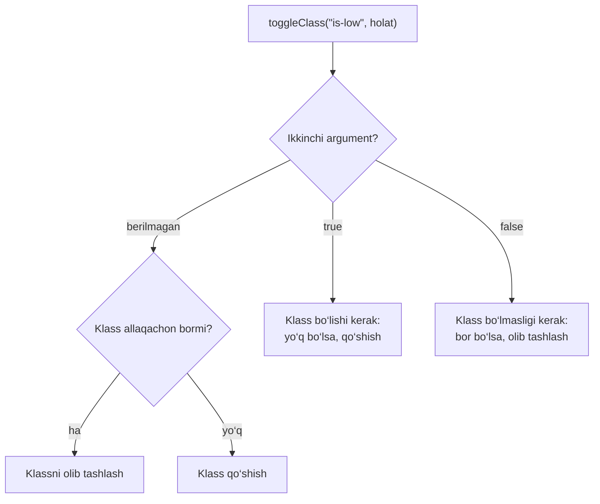
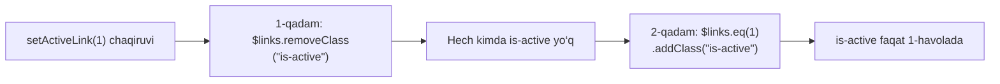
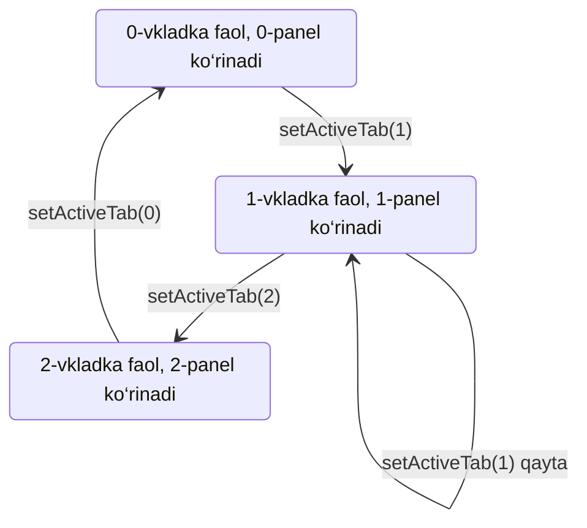
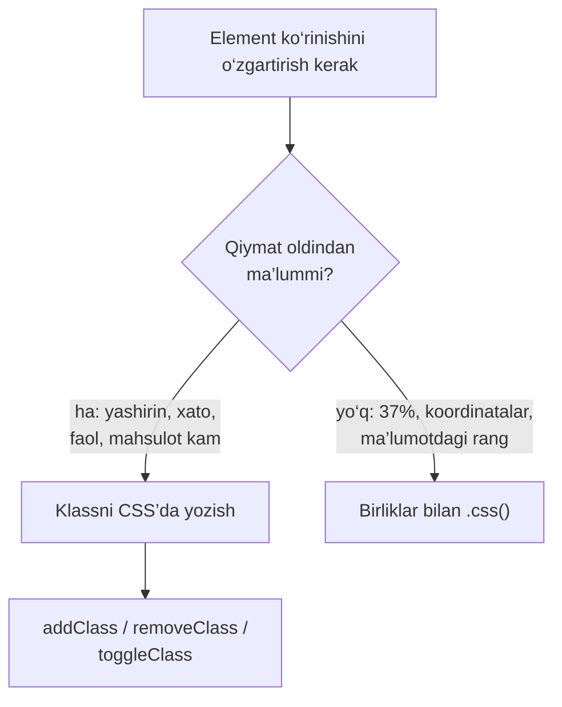
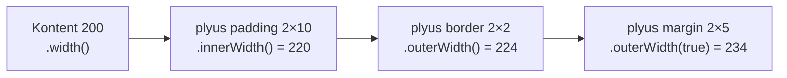

# Klasslar va uslublar

[Mundarija](../../README.md) · [← Orqaga](../../Lesson-3/uz/Kontent%20va%20atributlar.md) · [Keyingi →](../../Lesson-5/uz/Elementlarni%20yaratish%20va%20o'chirish.md) · [RU](../ru/%D0%9A%D0%BB%D0%B0%D1%81%D1%81%D1%8B%20%D0%B8%20%D1%81%D1%82%D0%B8%D0%BB%D0%B8.md) · [EN](../en/Classes%20and%20styles.md) · [UZ](Klasslar%20va%20uslublar.md)

> **3-dars bilan bog‘liqlik:** siz kontent va atributlarni o‘qish va o‘zgartirishni o‘rgandingiz: `.text()`, `.val()`, `.attr()`, `.prop()`, `.data()`. Bugun **tashqi ko‘rinishni** o‘zgartiramiz: CSS klasslarini yoqamiz va o‘chiramiz, uslublarni o‘qiymiz va beramiz, elementlarning o‘lchami va joylashuvini bilib olamiz. 3-darsdagi `data-*` va `aria-*` atributlari klasslar bilan birga ishlaydi.

---

## Bu sizga nima uchun kerak

Foydalanuvchi sahifaning «holati» deb ko‘radigan deyarli hamma narsa - bu klasslar. Ochiq vkladka tagiga chizilgan, deyarli qolmagan mahsulot qizil rangda ajratilgan, xato kiritilgan maydon ramka bilan o‘ralgan, telefondagi menyu goh yashirin, goh ko‘rinadi. CSS’da siz har bir holat qanday ko‘rinishini oldindan yozib qo‘yasiz, JavaScript esa kerakli paytda faqat klasslarni **yoqadi va o‘chiradi**.

Ba’zan qiymat oldindan noma’lum bo‘ladi: progress chizig‘ining kengligi `37%`, qalqib chiquvchi maslahatning koordinatasi. Bunday qiymatlar kodda hisoblanadi va to‘g‘ridan-to‘g‘ri uslubga yoziladi. Bugun bu ikki holatni farqlashni va ikkalasini ham jQuery’da - topilgan barcha elementlar uchun bitta qatorda bajarishni o‘rganasiz.

---

## Nimani o‘rganasiz

- Klasslarni qo‘shish va olib tashlash: `.addClass()`, `.removeClass()`.
- Klassni shartga ko‘ra almashtirish: `.toggleClass("nom", holat)`.
- Klass bor-yo‘qligini tekshirish: `.hasClass()`.
- Guruhdagi bitta elementni «faol» qilish: klassni hammasidan olib, `.eq()` orqali bittasiga qo‘yish.
- Hisoblangan uslubni o‘qish va uslub yozish: `.css()`, jumladan obyekt bilan.
- jQuery 4 da o‘lchov birliklarini to‘g‘ri ko‘rsatish.
- Klass va `.css()` o‘rtasida tanlash.
- O‘lchamlarni bilish: `.width()`, `.height()`, `.innerWidth()`, `.outerWidth()`, `.outerHeight()`.
- Joylashuv va aylantirishni bilish: `.offset()`, `.position()`, `.scrollTop()`.

---

## Takrorlash: 3-darsdan 3 savol

1. `.text("<b>Salom</b>")` va `.html("<b>Salom</b>")` nimasi bilan farq qiladi va nima uchun `.html()` foydalanuvchi ma’lumotlari bilan xavfli?
2. Qachon `.attr()` emas, `.prop()` kerak? Misol keltiring.
3. `<li id="item" data-stock="12">` uchun `$("#item").data("stock")` nimani qaytaradi - satrnimi yoki sonnimi?

Javoblar - dars oxirida.

---

## Reja

| Bo‘lim | Nima qilamiz |
| --- | --- |
| Klasslar: qo‘shish va olib tashlash | `.addClass()`, `.removeClass()` |
| Almashtirish va tekshirish | `.toggleClass()`, `.hasClass()` |
| Mini-topshiriq 1 | Holatli kurs kartochkalari |
| Guruhdan bitta faol | Menyu va vkladkalar: `.eq()` + klasslar + `aria-*` |
| `.css()` | Uslubni o‘qish va yozish, birliklar, obyekt |
| Klassmi yoki uslubmi | Qachon nimani tanlash |
| O‘lchamlar | `.width()`, `.innerWidth()`, `.outerWidth()` |
| Joylashuv va aylantirish | `.offset()`, `.position()`, `.scrollTop()` |
| Mini-topshiriq 2 | Progress chizig‘i |
| Mustaqil ish | Vkladkalar va ombordagi qoldiqlar |

---

## Klasslar: qo‘shish va olib tashlash

**Oddiy so‘z bilan:** klass - elementdagi yorliq. CSS’da siz oldindan yozib qo‘ygansiz: «`is-active` yorlig‘i bor hamma narsaning pastida ko‘k chiziq bo‘ladi». JavaScript o‘zi hech narsa chizmaydi - u faqat **yorliqlarni yopishtiradi va ko‘chirib oladi**, brauzer esa elementni darhol CSS qoidalari bo‘yicha qayta chizadi.

JavaScript kursida buni `classList` orqali qilgansiz. jQuery’da xuddi shu amallarning nomlari qisqa va ular topilgan **barcha** elementlarda ishlaydi (1-darsdagi yashirin aylanib chiqish).

```css
/* style.css */
.card.is-new { border-color: #16a34a; }
.is-hidden { display: none; }
```

### `.addClass()` - klass qo‘shish

```html
<div class="card">HTML</div>
<div class="card">CSS</div>
```

```js
$(".card").addClass("is-new");
```

Natija: ikkala kartochkada ham `<div class="card is-new">`. `card` klassi **saqlanib qoldi** - `addClass` almashtirmaydi, qo‘shadi. Agar klass allaqachon bo‘lsa, u ikkinchi marta qo‘shilmaydi.

Bir nechta klass bo‘sh joy bilan yoziladi: `$("#title").addClass("is-ready is-big")`.

### `.removeClass()` - klassni olib tashlash

`$(".card").removeClass("is-new")` klassni barcha kartochkalardan olib tashlaydi, `removeClass("is-new is-sale")` - bir nechtasini birdaniga. Klass bo‘lmasa, hech narsa bo‘lmaydi va xato ham chiqmaydi.

> **Muhim:** **argumentsiz** `.removeClass()` elementning **barcha** klasslarini, jumladan `card` ni ham olib tashlaydi. Ular bilan birga butun bezak yo‘qoladi. Har doim klass nomini yozing.

### Sof JavaScript bilan taqqoslash

| Vazifa | Sof JavaScript | jQuery |
| --- | --- | --- |
| Barcha kartochkalarga klass qo‘shish | `for (const c of cards) { c.classList.add("x"); }` | `$(".card").addClass("x")` |
| Hammasidan klassni olib tashlash | Sikl + `classList.remove("x")` | `$(".card").removeClass("x")` |
| Bir nechta klass | `classList.add("a", "b")` | `.addClass("a b")` |

### Nima uchun `.attr("class", ...)` emas

3-darsda siz `.attr()` bilan tanishdingiz. U bilan `class` atributini yozish mumkin, lekin u atributni butunlay **qayta yozib yuboradi**:

| Yozuv | Avval `class="tab"` | Keyin |
| --- | --- | --- |
| `.addClass("is-active")` | `tab` | `tab is-active` |
| `.attr("class", "is-active")` | `tab` | `is-active` |

Klasslar uchun faqat `addClass`, `removeClass` va `toggleClass` dan foydalaning.

---

## Almashtirish va tekshirish

### `.hasClass()` - klass bormi

**Oddiy so‘z bilan:** bu «shu elementda shunday yorliq bormi?» degan savol. Javob - `true` yoki `false`.

```js
const $menu = $("#menu");

if ($menu.hasClass("is-open")) {
    console.log("Menyu ochiq");
}
```

`.hasClass()` - getter: u jQuery obyektini emas, `true`/`false` ni qaytaradi, shuning uchun zanjir oxirida turadi. Bir nechta element topilgan bo‘lsa, klass **hech bo‘lmaganda bittasida** bor bo‘lganda javob `true` bo‘ladi.

### Ikkinchi argumentsiz `.toggleClass()` - «u yoqqa-bu yoqqa»

**Oddiy so‘z bilan:** chiroq o‘chirgichi. Bosdingiz - yondi, yana bosdingiz - o‘chdi. Siz «yoq» yoki «o‘chir» demaysiz, «almashtir» deysiz.

```js
$("#menu").toggleClass("is-open"); // yo‘q edi - qo‘shdi
$("#menu").toggleClass("is-open"); // bor edi - olib tashladi
```

Bu reaksiya doim «teskari» bo‘lganda qulay: telefondagi menyu tugmasi, tungi mavzu. Tugmalar va bosishlarni 6-darsda ko‘ramiz, hozircha metodlarni to‘g‘ridan-to‘g‘ri kodda chaqiramiz.

### `.toggleClass("nom", holat)` - shartga ko‘ra

Ikkinchi argument - mantiqiy qiymat. Shunda bu endi o‘chirgich emas, **buyruq**: `true` - klass bo‘lishi kerak, `false` - klass bo‘lmasligi kerak.

**Oddiy so‘z bilan:** «chiroqni almashtir» emas, «tashqari qorong‘i bo‘lsa, chiroq yonib turishi kerak». Bu buyruqni necha marta takrorlamang, natija bir xil.

```js
const stock = 3;
$("#item").toggleClass("is-low", stock < 5); // 3 < 5 → true → klass bor
```

Bitta qator shartni almashtiradi:

```js
// Uzun
if (stock < 5) { $("#item").addClass("is-low"); } else { $("#item").removeClass("is-low"); }

// Qisqa - xuddi shu narsa
$("#item").toggleClass("is-low", stock < 5);
```



**Sxemani qanday o‘qish kerak.** Ikkinchi argumentsiz natija chaqiruvdan oldin nima bo‘lganiga bog‘liq (chap tarmoq). Ikkinchi argument bilan natija faqat shartga bog‘liq: `true` - klass bor, `false` - klass yo‘q, oldin nima bo‘lganidan qat’i nazar.

### Kuzatuv: takroriy chaqiruvlar

Boshida `is-open` klassi yo‘q.

| Qadam | Nima bo‘ladi | Qiymat / sahifa holati |
| --- | --- | --- |
| 1 | `$box.toggleClass("is-open")` | `class="box is-open"` |
| 2 | `$box.toggleClass("is-open")` | `class="box"` - klass olib tashlandi |
| 3 | `$box.toggleClass("is-open", true)` | `class="box is-open"` |
| 4 | `$box.toggleClass("is-open", true)` | `class="box is-open"` - o‘zgarmadi |
| 5 | `$box.toggleClass("is-open", false)` | `class="box"` |
| 6 | `$box.hasClass("is-open")` | `false` |

3–4-qadamlar asosiy narsani ko‘rsatadi: holatli buyruqni xohlagancha chaqirish mumkin - natija «sakramaydi».

> **Muhim:** jQuery 4 da **klass nomisiz** `.toggleClass(true)` yoki `.toggleClass(false)` yozuvi olib tashlangan. U jimgina hech narsa qilmaydi. Har doim nomni yozing: `.toggleClass("is-open", true)`.

### Metodlar jadvali

| Yozuv | Nima qiladi | Qaytaradi |
| --- | --- | --- |
| `$el.addClass("a")` | Hammasiga klass qo‘shish | jQuery obyekti |
| `$el.addClass("a b")` | Bir nechtasini qo‘shish | jQuery obyekti |
| `$el.removeClass("a")` | Hammasidan klassni olib tashlash | jQuery obyekti |
| `$el.toggleClass("a")` | Almashtirish: bor edi - olib tashlash, yo‘q edi - qo‘shish | jQuery obyekti |
| `$el.toggleClass("a", shart)` | Klass faqat shart `true` bo‘lsa bor | jQuery obyekti |
| `$el.hasClass("a")` | Hech bo‘lmaganda bittasida klass bormi | `true` / `false` |

---

## Mini-topshiriq 1

Belgilash berilgan:

```html
<ul>
    <li class="course" data-progress="100">HTML</li>
    <li class="course" data-progress="40">CSS</li>
    <li class="course" data-progress="0">JavaScript</li>
</ul>
```

1. Barcha `.course` larga bitta chaqiruv bilan `course--card` klassini qo‘shing.
2. Kurslarni `.each()` orqali aylanib chiqing va har biriga `data-progress` `100` ga teng bo‘lsa `is-done` klassini, `0` ga teng bo‘lsa `is-new` klassini qo‘ying. `.toggleClass("nom", shart)` dan foydalaning.
3. Birinchi kursda `is-done` klassi bor-yo‘qligini konsolga chiqaring (`.first()` va `.hasClass()`).

---

## Guruhdan bitta faol

Klasslar bilan eng ko‘p uchraydigan vazifa: bir xil elementlar guruhida **faqat bittasi** ajratilgan. Joriy sahifaning menyu bandi, tanlangan filtr, ochiq vkladka.

**Oddiy so‘z bilan:** bu estafeta tayoqchasi. U faqat bitta yuguruvchining qo‘lida bo‘ladi. Uni uzatish uchun avval kimda bo‘lsa, undan olish kerak. «Olish» esdan chiqsa, tayoqcha ikkita bo‘lib qoladi.

### «Hammasidan olish - bittasiga qo‘yish» usuli

```html
<nav>
    <a class="menu__link is-active" href="#">Bosh sahifa</a>
    <a class="menu__link" href="#">Kurslar</a>
    <a class="menu__link" href="#">Aloqa</a>
</nav>
```

```js
function setActiveLink(index) {
    const $links = $(".menu__link");

    $links.removeClass("is-active");          // 1-qadam: hammasidan olish
    $links.eq(index).addClass("is-active");   // 2-qadam: bittasiga berish
}

setActiveLink(1); // «Kurslar» ajratilgan
```

2-darsdagi `.eq(index)` metodi elementni noldan boshlanadigan raqami bo‘yicha tanlaydi va **jQuery obyektini** qaytaradi, shuning uchun unda darhol `addClass` bor. Uni `$links[index]` bilan adashtirmang - bu jQuery metodlari yo‘q DOM elementi.

Bundan oldin **kim** faol bo‘lganini bilishimiz shart emas: klassni hammasidan birdaniga olamiz va bu doim to‘g‘ri.



**Sxemani qanday o‘qish kerak.** Ikki qadam orasida faol element umuman bo‘lmagan qisqa lahza bor. Foydalanuvchi uni ko‘rmaydi: brauzer sahifani faqat funksiya ishini tugatgandan keyin qayta chizadi.

### Vkladkalar: klass, `aria-selected` va panellar

Vkladkalarda ikki xil elementlar to‘plami bor: vkladka-tugmalar va kontentli panellar. Ekran o‘quvchi dasturlar uchun vkladkada `aria-selected` atributi bor: tanlanganida `"true"`, qolganlarida `"false"`. Atributlarni siz 3-darsdan beri `.attr()` orqali o‘zgartira olasiz.

```html
<button class="tab" aria-selected="true">Tavsif</button>
<button class="tab" aria-selected="false">Sharhlar</button>

<section class="panel">Tavsif matni</section>
<section class="panel is-hidden">Sharhlar matni</section>
```

Vkladka va uning paneli **bir xil raqamga** ega: 0-vkladka - 0-panel, 1-vkladka - 1-panel.

Panellarni `.each()` orqali aylanib chiqib, har biriga «raqaming tanlangani bo‘lmasa, yashirin bo‘l» deyish qulay:

```js
$(".panel").each(function (i) {
    $(this).toggleClass("is-hidden", i !== 1);
});
```

| Panel raqami `i` | `i !== 1` | Natija |
| --- | --- | --- |
| 0 | `true` | `is-hidden` bor - yashirin |
| 1 | `false` | `is-hidden` yo‘q - ko‘rinadi |
| 2 | `true` | yashirin |

Vkladkalarning to‘liq funksiyasini mustaqil ishda yozasiz: unda `.eq()`, klasslar, `aria-selected` va holatli `.toggleClass` birlashadi.



**Sxemani qanday o‘qish kerak.** Vkladkalar guruhida doim uchta holatdan aynan bittasi bo‘ladi. Har bir chaqiruv qayerdan kelganimizdan qat’i nazar kerakli holatga o‘tkazadi. `Tab1` dagi halqa - xuddi shu raqam bilan takroriy chaqiruv: holat o‘zgarmaydi. Aynan shuning uchun panellar uchun «u yoqqa-bu yoqqa» o‘chirgich emas, **holatli** `.toggleClass` kerak.

---

## `.css()` - uslubni o‘qish va yozish

**Oddiy so‘z bilan:** klass - shkafdagi (CSS faylidagi) tayyor kostyum. `.css()` esa yengni aniq o‘lcham bo‘yicha to‘g‘ridan-to‘g‘ri odamning ustida moslash. O‘lcham faqat hozir ma’lum bo‘lganda qulay.

### O‘qish: hisoblangan uslub

```css
#box {
    color: red;
    width: 200px;
}
```

```js
const $box = $("#box");

console.log($box.css("width"));   // "200px"
console.log($box.css("color"));   // "rgb(255, 0, 0)"
```

`.css()` getteri **hisoblangan** qiymatni qaytaradi - brauzer amalda qo‘llagan qiymatni, hatto uslub `style` atributidan emas, CSS faylidan kelgan bo‘lsa ham. Shuning uchun rang `rgb(...)` formatida, o‘lchamlar esa pikselda keladi. Bu satr: hisoblash uchun uni songa aylantiring, masalan `parseFloat("200px")` → `200`.

Elementlar bir nechta bo‘lsa, getter **birinchisining** qiymatini qaytaradi.

Xususiyat nomini CSS’dagidek (`"background-color"`) yoki camelCase’da (`"backgroundColor"`) yozish mumkin - jQuery ikkalasini ham tushunadi.

### Yozish: bitta xususiyat

```js
$("#bar").css("width", "37%");
$(".note").css("background-color", "#fef3c7");
```

jQuery qiymatni topilgan har bir elementning `style` atributiga yozadi - sof JavaScript’dagi `element.style.width = "37%"` kabi.

Bo‘sh satr xususiyatni `style` atributidan **o‘chiradi** va element yana CSS fayli bo‘yicha bezatiladi:

```js
$("#bar").css("width", "");
```

### jQuery 4 da o‘lchov birliklari

| Yozuv | jQuery 4.1 dagi natija |
| --- | --- |
| `.css("width", "200px")` | `200px` |
| `.css("width", 200)` | `200px` - o‘lchamlar, `margin`, `padding`, `top`/`left` uchun jQuery hali ham `px` qo‘shadi |
| `.css("font-size", 20)` | **Hech narsa**: `px` qo‘shilmaydi, brauzer birliksiz `20` ni tashlab yuboradi |
| `.css("font-size", "20px")` | `20px` |
| `.css("opacity", 0.5)` | `0.5` - shaffoflikning birligi yo‘q |
| `.css("width", "+=50px")` | Kenglik 50 pikselga oshadi |

Eski versiyalarda jQuery deyarli barcha sonlarga `px` qo‘shardi. jQuery 4 da bu faqat o‘lchamlar, chekinishlar va joylashuvlar uchun qoldi. Ro‘yxatni yodlamaslik uchun kursda qoida oddiy:

> **Muhim:** birliklarni har doim aniq, satr ko‘rinishida yozing: `"200px"`, `"1.5rem"`, `"37%"`. Noto‘g‘ri qiymatda xato chiqmaydi - uslub shunchaki jimgina qo‘llanmaydi.

Qiymat ko‘pincha shablon satri bilan yig‘iladi: `` $("#bar").css("width", `${percent}%`) ``.

### Yozish: obyekt

Bir nechta xususiyat - bitta chaqiruvda, obyekt bilan:

```js
$("#tooltip").css({ top: "120px", left: "48px", "max-width": "240px" });
```

camelCase’dagi kalitlar qo‘shtirnoqsiz yoziladi (`maxWidth`), chiziqchali kalitlar esa albatta qo‘shtirnoqda (`"max-width"`), aks holda JavaScript chiziqchani minus deb o‘qiydi.

### Sof JavaScript bilan taqqoslash

| Vazifa | Sof JavaScript | jQuery |
| --- | --- | --- |
| Hisoblangan uslubni o‘qish | `getComputedStyle(el).width` | `$el.css("width")` |
| Bitta xususiyatni yozish | `el.style.width = "37%"` | `$el.css("width", "37%")` |
| Bir nechtasini yozish | Bir necha `el.style...` qatori | `$el.css({ ... })` |
| Barcha topilganlarga | Sikl | Xuddi shu chaqiruv |

---

## Klassmi yoki uslubmi

JavaScript kursida siz buni eshitgansiz: `style` atributidagi uslub - CSS kursida biz voz kechgan narsa. U CSS faylida ko‘rinmaydi, uni klass bilan qayta belgilab bo‘lmaydi, tungi mavzu uni hisobga olmaydi. `.css()` aynan o‘sha yerga yozadi.



**Sxemani qanday o‘qish kerak.** O‘zingizga savol bering: «Bu qiymatni hozirning o‘zida CSS fayliga yoza olamanmi?» Ha bo‘lsa - bu klass. Qiymat faqat dastur ishlayotganda paydo bo‘lsa - `.css()`.

| Vazifa | To‘g‘ri | Nima uchun |
| --- | --- | --- |
| Panelni yashirish | `.addClass("is-hidden")` | Holat oldindan ma’lum |
| Xato maydonni ajratib ko‘rsatish | `.addClass("is-error")` | Ramka rangi - dizayn, uning joyi CSS’da |
| Progress chizig‘i kengligi 37% | `.css("width", "37%")` | Son kodda hisoblanadi |
| Kursor yonidagi maslahat | `.css({ top: ..., left: ... })` | Koordinatalar faqat hodisa paytida ma’lum |
| Ma’lumotdagi `"#e11d48"` belgi rangi | `.css("background-color", color)` | Rang ma’lumotlardan keldi |

---

## Element o‘lchamlari

Ba’zan biror narsani hisoblash uchun o‘lchamni bilish kerak: maslahatni tekislash, balandlikni moslash. jQuery’da buning uchun to‘rt juft metod bor.

**Oddiy so‘z bilan:** devordagi ramkali rasmni tasavvur qiling. Kanvasning o‘zi - kontent; kanvas atrofidagi paspartu - `padding`; yog‘och ramka - `border`; qo‘shni rasmgacha bo‘sh joy - `margin`. Metodlar nimani «ruletka bilan o‘lchashi» bilan farq qiladi.

```html
<div id="card">Kartochka</div>
```

```css
#card {
    box-sizing: content-box;
    width: 200px;
    padding: 10px;
    border: 2px solid #333;
    margin: 5px;
}
```

| Metod | Nima kiradi | Natija |
| --- | --- | --- |
| `.width()` | Faqat kontent | `200` |
| `.innerWidth()` | + ikki tomondan `padding` | `220` |
| `.outerWidth()` | + `padding` + `border` | `224` |
| `.outerWidth(true)` | + `padding` + `border` + `margin` | `234` |

Balandlik uchun ham xuddi shunday: `.height()`, `.innerHeight()`, `.outerHeight()`, `.outerHeight(true)`.



**Sxemani qanday o‘qish kerak.** Har bir keyingi metod oldingisiga ikki tomondan bitta «ramka» qatlamini qo‘shadi.

`.css("width")` dan farqi: o‘lcham metodlari `px` siz **son** qaytaradi, u bilan darhol hisoblash mumkin.

```js
const $card = $("#card");
console.log($card.css("width"));  // "200px" - satr
console.log($card.width());       // 200 - son
console.log($card.width() / 2);   // 100
```

> **Muhim:** yashirin elementning (`display: none`) o‘lchamlari yo‘q - brauzer uni chizmaydi. Ko‘rinib turgan elementni o‘lchash kerak.

---

## Joylashuv va aylantirish

### `.offset()` va `.position()`

Ikkala metod ham pikselda `{ top, left }` obyektini qaytaradi, lekin har xil nuqtalardan hisoblaydi.

| Metod | Nimadan hisoblaydi | Qachon kerak |
| --- | --- | --- |
| `.offset()` | **Butun hujjatning** chap yuqori burchagidan | Element sahifada qayerda ekanini bilish; yoniga maslahat qo‘yish |
| `.position()` | `position: relative/absolute` bo‘lgan eng yaqin ota-elementdan | O‘z bloki ichidagi joylashuv |

```js
const place = $("#help").offset();
console.log(place.top, place.left); // masalan: 340 120

$("#tooltip").css({
    top: `${place.top + 30}px`,
    left: `${place.left}px`
});
```

**Oddiy so‘z bilan:** `.offset()` - shahar markazidan uyning manzili, `.position()` - uy ichidagi xonadon raqami.

### `.scrollTop()` - aylantirish

`.text()` kabi bu metod ikki rejimda ishlaydi:

| Yozuv | Nima qiladi |
| --- | --- |
| `$(window).scrollTop()` | Sahifa yuqoridan necha pikselga aylantirilgan |
| `$(window).scrollTop(0)` | Eng yuqoriga aylantirish |
| `$("#chat").scrollTop()` | `overflow: auto` bo‘lgan blok ichidagi aylantirish |
| `$("#chat").scrollTop($("#chat")[0].scrollHeight)` | Chatni eng pastga aylantirish |

Aylantirishni «Yuqoriga» tugmasiga yoki `scroll` hodisasiga bog‘lashni 6-darsda, `.animate()` orqali silliq aylantirishni esa 7-darsda qila olasiz.

### Kuzatuv: element ostidagi maslahat

`#help` sahifada `top: 340`, `left: 120` nuqtasida turibdi, balandligi `24`.

| Qadam | Nima bo‘ladi | Qiymat / sahifa holati |
| --- | --- | --- |
| 1 | `const place = $("#help").offset();` | `{ top: 340, left: 120 }` |
| 2 | `const height = $("#help").outerHeight();` | `24` |
| 3 | `` `${place.top + height + 8}px` `` | `"372px"` |
| 4 | `$("#tooltip").css({ top: "372px", left: "120px" })` | maslahat `#help` dan 8px pastda |
| 5 | `$("#tooltip").removeClass("is-hidden")` | maslahat ko‘rinadi |

4 va 5-qadamlar «klassmi yoki uslubmi» qoidasini bitta vazifada ko‘rsatadi: koordinatalar hisoblangan - demak `.css()`, ko‘rsatish yoki yashirish esa - klass.

---

### Buzib ko‘ring

1. `$(".card").removeClass()` ni argumentsiz chaqiring. Kartochkalar bezagi bilan nima bo‘ldi? **Elements** vkladkasida `class` atributiga qarang.
2. `$("#menu").toggleClass("is-open")` ni ketma-ket ikki marta, keyin `$("#menu").toggleClass("is-open", true)` ni ikki marta chaqiring. Natijalarni solishtiring.
3. `$("#title").css("font-size", 40)` va `$("#title").css("font-size", "40px")` ni bajaring. Qaysi yozuv ishladi? Konsolda xato bo‘ldimi?
4. `$("#tab").attr("class", "is-active")` ni yozing. Elementda qaysi klasslar qoldi?
5. «Guruhdan bitta faol» funksiyasida `removeClass` qatorini o‘chiring va funksiyani 0, 1, 2 raqamlari bilan chaqiring. Nechta element ajratilgan?
6. Elementni `is-hidden` klassi bilan yashiring va `$("#card").width()` ni chiqaring. Nima uchun natija CSS bilan mos kelmaydi?

### Yangi o‘rganuvchilarning tipik xatolari

| Xato | Nima bo‘ladi | Qanday tuzatish |
| --- | --- | --- |
| Nuqtali `.addClass(".is-active")` | Nomida nuqta bor klass qo‘shiladi, CSS ishlamaydi | Klass nomi nuqtasiz: `.addClass("is-active")` |
| Nomsiz `.removeClass()` | Barcha klasslar va butun bezak yo‘qoldi | Nomni ko‘rsatish: `.removeClass("is-new")` |
| `.attr("class", "x")` | Eski klasslar o‘chib ketdi | `.addClass("x")` |
| Qolganlardan klass olinmagan | Faol elementlar bir nechta | Avval `$all.removeClass(...)`, keyin `.eq(i).addClass(...)` |
| «Yoqish» kerak bo‘lgan joyda `.toggleClass("x")` | Takroriy chaqiruvda klass yo‘qoladi | `.toggleClass("x", true)` yoki `.addClass("x")` |
| Klass nomisiz `.toggleClass(true)` | jQuery 4 da hech narsa bo‘lmaydi | `.toggleClass("x", true)` |
| `.css("font-size", 20)` | Uslub qo‘llanmadi, xato yo‘q | Birliklar aniq: `"20px"` |
| Dizayn `.css()` orqali: xato rangi, yashirish | Bezak JS bo‘ylab sochilib ketgan, uni CSS’da qayta belgilab bo‘lmaydi | CSS’dagi klass + `addClass` |
| `$links[1].addClass("x")` | `TypeError: ... addClass is not a function` | `$links.eq(1).addClass("x")` |
| `$el.css("width") === 200` taqqoslash | Doim `false`: u yerda `"200px"` satri | `$el.width() === 200` |

---

## Mini-topshiriq 2

Kursning progress chizig‘i:

```html
<div class="progress">
    <div class="progress__bar" id="bar"></div>
</div>
<p id="progress-text"></p>
```

CSS’da `.progress__bar` uchun balandlik va ko‘k fon, `.progress__bar.is-done` uchun esa yashil fon berilgan.

`showProgress(done, total)` funksiyasini yozing:

1. Foizni hisoblang: `Math.round(done / total * 100)`.
2. `#bar` kengligini `.css()` orqali foizda, birliklar bilan yozing.
3. `#bar` ga `is-done` klassini faqat foiz `100` ga teng bo‘lsa qo‘ying (holatli `.toggleClass`).
4. `#progress-text` ga `10 tadan 4 tasi o‘tildi (40%)` ko‘rinishidagi matnni yozing.
5. `showProgress(4, 10)`, keyin `showProgress(10, 10)`, keyin yana `showProgress(4, 10)` ni chaqiring va yashil rang yo‘qolganini tekshiring.

---

## Dars yakuni: shpargalka

| Vazifa | Yozuv |
| --- | --- |
| Klass qo‘shish | `$el.addClass("is-active")` |
| Bir nechtasini qo‘shish | `$el.addClass("a b")` |
| Klassni olib tashlash | `$el.removeClass("is-active")` |
| Almashtirish | `$el.toggleClass("is-open")` |
| Shartga ko‘ra klass | `$el.toggleClass("is-low", stock < limit)` |
| Klass bormi | `$el.hasClass("is-open")` |
| Guruhdan bitta faol | `$all.removeClass("x"); $all.eq(i).addClass("x");` |
| Uslubni o‘qish | `$el.css("width")` → `"200px"` |
| Uslubni yozish | `$el.css("width", "37%")` - birliklar doim aniq |
| Bir nechta uslub | `$el.css({ top: "10px", left: "20px" })` |
| Yozilgan uslubni olib tashlash | `$el.css("width", "")` |
| O‘lchamlar | `.width()`, `.innerWidth()`, `.outerWidth()`, `.outerWidth(true)` |
| Joylashuv | `.offset()` - hujjatdan, `.position()` - ota-elementdan |
| Aylantirish | `$(window).scrollTop()` / `.scrollTop(0)` |

---

## Mustaqil ish

### 1-qism. IDE topshirig‘i (platforma hisoblaydi)

Sahifada uchta `.tab` vkladkasi, uchta `.panel` paneli (hammasida `is-hidden` klassi) va `data-stock` atributi - ombordagi qoldig‘i bor `li.product` mahsulotlar ro‘yxati bor. `is-active`, `is-hidden` va `is-low` klasslari CSS’da allaqachon yozilgan. Faqat jQuery’dan foydalanib:

1. `setActiveTab(index)` funksiyasini yozing: barcha `.tab` lardan `is-active` klassini oling va ularga `aria-selected="false"` qo‘ying; `index` raqamli vkladkaga (`.eq` orqali) `is-active` va `aria-selected="true"` qo‘shing; `index` raqamli paneldan `is-hidden` ni olib tashlang, qolganlarining hammasiga qo‘ying - `.toggleClass("is-hidden", holat)` orqali.
2. `markLowStock(limit)` funksiyasini yozing: `data-stock` qiymati `limit` dan **kichik** bo‘lgan har bir `.product` ga `is-low` klassini qo‘shing, qolganlaridan uni olib tashlang. Mahsulotlarni funksiya ichida qidiring.
3. Oxirida `setActiveTab(0)` va `markLowStock(5)` ni chaqiring.

Testlar funksiyalarni turli argumentlar bilan ko‘p marta chaqiradi. `document.querySelector`, `classList`, `.style`, `innerHTML` va `.html()` dan foydalanmang.

Platforma nimani tekshiradi: yuklangandan keyin birinchi vkladka faol va birinchi panel ko‘rinadi; `setActiveTab(2)` dan keyin faqat bitta vkladka faol, `aria-selected="true"` faqat unda, faqat uning paneli ko‘rinadi; ketma-ket bir necha almashtirish va xuddi shu raqam bilan takroriy chaqiruv; `tab` va `panel` klasslari yo‘qolmagani; turli `limit` bilan `markLowStock` (chegara: `limit` `5` bo‘lganda `5` qoldiq - «kam» emas), ortiqcha belgilarni olib tashlash va yuklangandan keyin qo‘shilgan mahsulot; `.eq()` va `.toggleClass()` ishlatilgani; dastur xatosiz ishlashi.

### 2-qism. Kompyuterdagi loyiha

1. HTML va CSS kurslaridagi saytingizning `style.css` faylida holat klasslarini yozing: `is-active`, `is-hidden` va yana bitta o‘zingizniki (masalan, `is-new` yoki `is-sale`).
2. Sayt menyusi uchun `setActiveLink(index)` funksiyasini yozing va uni joriy sahifa raqami bilan chaqiring.
3. Alohida belgisi bor elementlarga `data-*` atributini qo‘shing va `.each()` + `.toggleClass("nom", shart)` orqali ularni klass bilan ajratib ko‘rsating.
4. Kengligi `.css()` orqali foizda beriladigan progress chizig‘i yoki reyting shkalasini yasang.
5. Asosiy sarlavhaning `.outerWidth()` va `.offset()` qiymatlarini konsolga chiqaring va **Elements** → **Computed** vkladkasi bilan solishtiring.

### Tayyorlik mezonlari

- [ ] IDE topshirig‘i qabul qilindi.
- [ ] Holatlar bezagi `.css()` orqali emas, CSS’dagi klasslar bilan yozilgan.
- [ ] `.css()` faqat hisoblangan qiymatlar uchun ishlatiladi, birliklar aniq ko‘rsatilgan.
- [ ] Funksiya necha marta chaqirilmasin, elementlar guruhida faqat bittasi faol bo‘ladi.
- [ ] Siz `.toggleClass("x")` va `.toggleClass("x", shart)` o‘rtasidagi farqni tushuntira olasiz.

---

## O‘zini tekshirish uchun savollar

1. `.addClass("x")` va `.attr("class", "x")` nimasi bilan farq qiladi?
2. Argumentsiz `.removeClass()` nima qiladi?
3. Bir nechta element topilgan va klass faqat bittasida bo‘lsa, `.hasClass()` nimani qaytaradi?
4. `.toggleClass("x")` va `.toggleClass("x", shart)` nimasi bilan farq qiladi? Har biri qachon kerak?
5. Nima uchun «guruhdan bitta faol» funksiyasida avval klass hammasidan olinadi?
6. Rang CSS faylida berilgan bo‘lsa, `$("#box").css("color")` nimani qaytaradi? Qaysi formatda?
7. Nima uchun jQuery 4 da `20` emas, `"20px"` deb yozish kerak?
8. Klass va `.css()` o‘rtasida qaysi qoida bo‘yicha tanlash kerak? Har biriga misol keltiring.
9. `.width()`, `.innerWidth()`, `.outerWidth()` va `.outerWidth(true)` nimasi bilan farq qiladi?
10. `.offset()` va `.position()` nimasi bilan farq qiladi?

Savollardan keyin platformada **dars testini** topshiring: 12 ta savol, o‘tish chegarasi 70%.

---

## Keyin nima

Hozircha biz faqat sahifada bor narsani o‘zgartirdik. 5-darsda **elementlarni yaratish va o‘chirishni** o‘rganamiz: yangi `li` larni `$("<li>")` orqali yig‘ish, ularni `.append()` va `.prepend()` orqali qo‘yish, `.remove()` orqali o‘chirish va obyektlarning butun massivini chizish. Bu darsdagi klasslar darhol kerak bo‘ladi: yangi elementlarni bezash kerak bo‘ladi.

---

## Javoblar

**Takrorlash**

1. `.text()` satrni matn sifatida qo‘yadi: sahifada so‘zma-so‘z `<b>Salom</b>` ko‘rinadi. `.html()` satrni belgilash sifatida tahlil qiladi, shuning uchun foydalanuvchi ma’lumotlari bilan u orqali begona kod qo‘yib yuborish mumkin.
2. `.prop()` - elementning ish davomida o‘zgaradigan joriy holati uchun: `checked`, `disabled`, `selected`. Masalan, `$("#agree").prop("checked")` `true` yoki `false` ni qaytaradi, `.attr("checked")` esa - faqat HTML’dagi dastlabki atributni.
3. `12` soni: `.data()` songa o‘xshash satrlarni songa aylantiradi.

**Mini-topshiriq 1**

```js
$(".course").addClass("course--card");

$(".course").each(function () {
    const progress = $(this).data("progress");

    $(this)
        .toggleClass("is-done", progress === 100)
        .toggleClass("is-new", progress === 0);
});

console.log($(".course").first().hasClass("is-done")); // true
```

**Mini-topshiriq 2**

```js
function showProgress(done, total) {
    const percent = Math.round(done / total * 100);

    $("#bar")
        .css("width", `${percent}%`)
        .toggleClass("is-done", percent === 100);

    $("#progress-text").text(`${total} tadan ${done} tasi o‘tildi (${percent}%)`);
}

showProgress(4, 10);
showProgress(10, 10);
showProgress(4, 10);
```

**O‘zini tekshirish uchun savollar**

1. `addClass` klassni mavjudlariga qo‘shadi, `.attr("class", "x")` esa atributni butunlay qayta yozadi - eski klasslar yo‘qoladi.
2. Elementning barcha klasslarini olib tashlaydi, ular bilan birga bezak ham yo‘qoladi.
3. `true`: `.hasClass()` klass hech bo‘lmaganda bitta elementda bor-yo‘qligini tekshiradi.
4. Ikkinchi argumentsiz - o‘chirgich: natija klass bor bo‘lgan-bo‘lmaganiga bog‘liq. Shart bilan - buyruq: `true` - klass bor, `false` - yo‘q, necha marta chaqirilmasin. Birinchisi - «teskari» uchun (menyu tugmasi), ikkinchisi - holat hisoblanganda (mahsulot kam, tanlangan vkladka).
5. Oldin kim faol bo‘lganini bilmaymiz. Klassni hammasidan olib, `.eq(i).addClass(...)` dan keyin aynan bitta element faol bo‘lishini kafolatlaymiz.
6. Brauzer qo‘llagan hisoblangan qiymatni, hatto CSS faylidan bo‘lsa ham. Rang - `rgb(...)` formatidagi satr, masalan `"rgb(255, 0, 0)"`.
7. jQuery 4 da `px` avtomatik ravishda faqat o‘lchamlar, chekinishlar va joylashuvlarga qo‘shiladi. Boshqa xususiyatlar, masalan `font-size` uchun birliksiz son noto‘g‘ri va jimgina qo‘llanmaydi. Aniq birliklar doim ishlaydi.
8. Qiymatni CSS’da oldindan yozish mumkin bo‘lsa - klass (panelni yashirish, xatoni ajratib ko‘rsatish). Agar u kodda hisoblansa - `.css()` (progress kengligi `37%`, maslahat koordinatalari).
9. `.width()` - faqat kontent; `.innerWidth()` - plyus `padding`; `.outerWidth()` - plyus `padding` va `border`; `.outerWidth(true)` - yana `margin` ham.
10. `.offset()` koordinatalarni hujjatning chap yuqori burchagidan hisoblaydi, `.position()` - eng yaqin joylashtirilgan ota-elementdan.

[Mundarija](../../README.md) · [← Orqaga](../../Lesson-3/uz/Kontent%20va%20atributlar.md) · [Keyingi →](../../Lesson-5/uz/Elementlarni%20yaratish%20va%20o'chirish.md) · [RU](../ru/%D0%9A%D0%BB%D0%B0%D1%81%D1%81%D1%8B%20%D0%B8%20%D1%81%D1%82%D0%B8%D0%BB%D0%B8.md) · [EN](../en/Classes%20and%20styles.md) · [UZ](Klasslar%20va%20uslublar.md)
