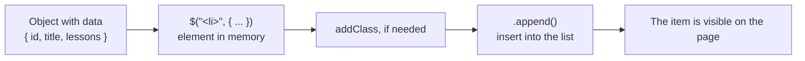
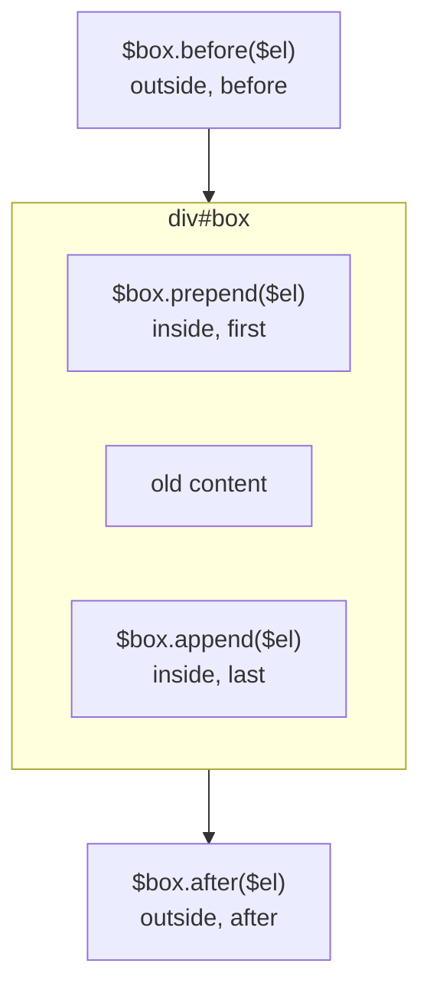
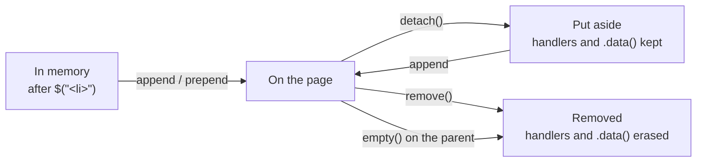
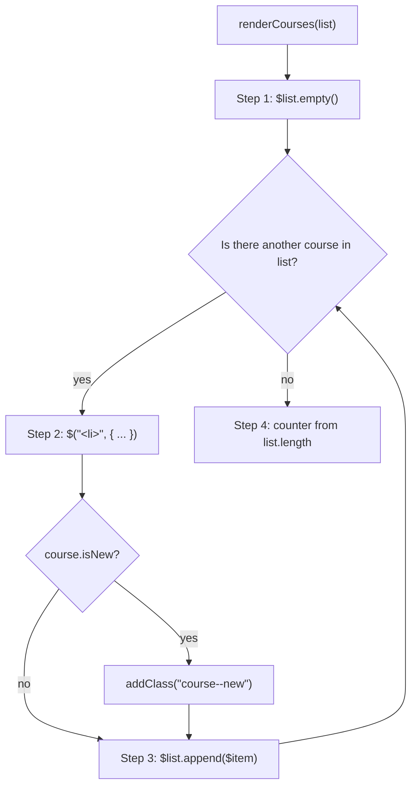

# Creating and removing elements

[Contents](../../README.md) · [← Back](../../Lesson-4/en/Classes%20and%20styles.md) · [Next →](../../Lesson-6/en/Events.md) · [RU](../ru/%D0%A1%D0%BE%D0%B7%D0%B4%D0%B0%D0%BD%D0%B8%D0%B5%20%D0%B8%20%D1%83%D0%B4%D0%B0%D0%BB%D0%B5%D0%BD%D0%B8%D0%B5%20%D1%8D%D0%BB%D0%B5%D0%BC%D0%B5%D0%BD%D1%82%D0%BE%D0%B2.md) · [EN](Creating%20and%20removing%20elements.md) · [UZ](../uz/Elementlarni%20yaratish%20va%20o'chirish.md)

> **Link to lesson 4:** you learned to change how existing elements look - to add classes and styles. But so far, all the elements were already in the HTML. Today jQuery will **create** new elements from data, insert them in the right place on the page and remove the ones you no longer need.

---

## Why you need this

Open the catalog of any online store. There are hundreds of products, but nobody wrote them by hand in the HTML file: the server sent an array of objects, and a script turned each object into a card. You add a product to the cart - a row appears in the list. You delete it - the row disappears. You change the filter - the old list is cleared and a new one is drawn.

In the JavaScript course you did this with `createElement`, `textContent`, `classList.add` and `append` - four or five lines for each element. jQuery can create an element with a class, text and attributes in one call, and insert, move or remove it with one short method.

---

## What you will learn

- Create elements: `$("<li>")` and `$("<li>", { ... })` with a class, text and attributes.
- Insert inside an element: `.append()` and `.prepend()`.
- Insert next to an element: `.after()` and `.before()`.
- Understand the difference between `.append()` and `.appendTo()`.
- Remove elements: `.remove()`, clear the content: `.empty()`, take out for a while: `.detach()`.
- Copy elements: `.clone()`, replace them: `.replaceWith()`.
- Render an array of objects with a `render` function that does not duplicate the list.
- Output data safely - as text, not as markup.

---

## Review: 3 questions from lesson 4

1. What does `$card.toggleClass("is-active", isOpen)` do if `isOpen === false`?
2. Why does `$box.css("font-size", 20)` not change the font size, while `$box.css("font-size", "20px")` does?
3. When should you change the look with a class, and when with `.css()`?

Answers are at the end of the lesson.

---

## Lesson plan

| Section | What we do |
| --- | --- |
| Creating an element | `$("<li>")` - an element in memory |
| Settings object | `$("<li>", { class, text, ... })` |
| Inserting inside | `.append()`, `.prepend()` |
| Inserting next to | `.after()`, `.before()` |
| `appendTo` and `prependTo` | The same insertion "from the other side" |
| Mini-task 1 | News feed |
| Removing | `.remove()`, `.empty()`, `.detach()` |
| Copying and replacing | `.clone()`, `.replaceWith()` |
| Rendering an array | The `render(list)` function |
| Safety | Text, not an HTML string |
| Mini-task 2 | To-do list |
| Independent work | The `renderCourses(list)` function |

---

## Creating an element

### `$("<li>")` - a new element

In lesson 1 you passed a selector to `$()`, and jQuery **searched** for elements. But if the string starts with a tag in angle brackets, jQuery **creates** a new element.

```js
const $found = $("li");    // find all li elements on the page
const $fresh = $("<li>");  // create one new li
```

**In simple words:** `$("li")` means "find all the students in the classroom", and `$("<li>")` means "bring a new empty desk". The desk has appeared, but it is still standing in the hallway: nobody has carried it into the classroom (onto the page) yet.

A created element lives **in memory**. It is not on the page until you insert it with one of the methods below.

```js
const $item = $("<li>")
    .addClass("course")
    .text("HTML (lessons: 10)");

console.log($item.length);           // 1 - the element is created
console.log($item.parent().length);  // 0 - no parent, it is not on the page
```

| Plain JavaScript | jQuery |
| --- | --- |
| `const li = document.createElement("li");` | `const $li = $("<li>");` |
| `li.classList.add("course");` | `$li.addClass("course");` |
| `li.textContent = "HTML";` | `$li.text("HTML");` |
| `list.append(li);` | `$list.append($li);` |

All the methods you know - `.text()`, `.attr()`, `.addClass()`, `.css()` - work with a new element the same way as with a found one.

### Settings object: `$("<li>", { ... })`

As the second argument you can pass a **settings object**: jQuery will immediately give the element a class, text and attributes.

```js
const $item = $("<li>", {
    class: "course",
    text: "HTML (lessons: 10)",
    "data-id": "html",
    title: "HTML course",
});
```

The result in memory:

```html
<li class="course" data-id="html" title="HTML course">HTML (lessons: 10)</li>
```

| Key | What it does | Another way to write it |
| --- | --- | --- |
| `class` | Class (several - separated by spaces) | `.addClass("course")` |
| `text` | Element text, **as text** | `.text("...")` |
| `"data-id"` | The `data-id` attribute | `.attr("data-id", "html")` |
| `title`, `href`, `src`, `alt` ... | Regular attributes | `.attr("href", "...")` |

**In simple words:** a settings object is an order form. Instead of first buying an empty desk, then painting it, then gluing on a name plate, you fill in the form right away: "a desk, blue, with the name plate 'Anna'" - and get a finished one.

> **Important:** the key `"data-id"` is written **in quotes**: because of the hyphen, without quotes JavaScript reads `data - id` as subtraction. The keys `class`, `text`, `title` can go without quotes.

> **Important:** `$item.data("id", "html")` from lesson 3 does **not** write the `data-id` attribute to the HTML: the value is stored inside jQuery. If you need the attribute in the markup (for CSS, for DevTools, for tests), use `"data-id"` in the settings object or `.attr("data-id", ...)`.



**How to read the diagram.** An element goes through three stages: creation (in memory), setup (class, text, attributes) and insertion. Until the last step is done, the user sees nothing - this is the most common reason for the question "why didn't my element appear?"

### Trace: creating an item

```js
const course = { id: "js", title: "JavaScript", lessons: 10, isNew: true };
const $item = $("<li>", {
    class: "course",
    text: `${course.title} (lessons: ${course.lessons})`,
    "data-id": course.id,
});
if (course.isNew) {
    $item.addClass("course--new");
}
$("#course-list").append($item);
```

| Step | What happens | Value / page state |
| --- | --- | --- |
| 1 | The `course` object is created | `{ id: "js", title: "JavaScript", ... }` |
| 2 | `$("<li>", {...})` creates an item | In memory: `<li class="course" data-id="js">JavaScript (lessons: 10)</li>` |
| 3 | `course.isNew === true` - a class is added | `class="course course--new"` |
| 4 | `.append($item)` | The item became the last child of `#course-list` and is visible on the page |

---

## Inserting inside: `.append()` and `.prepend()`

```html
<ul id="news">
    <li>Old news</li>
</ul>
```

```js
const $news = $("#news");

$news.append($("<li>", { text: "At the end" }));
$news.prepend($("<li>", { text: "At the start" }));
```

Result:

```html
<ul id="news">
    <li>At the start</li>
    <li>Old news</li>
    <li>At the end</li>
</ul>
```

| Code | Where it inserts |
| --- | --- |
| `$parent.append($el)` | Inside `$parent`, as the last child |
| `$parent.prepend($el)` | Inside `$parent`, as the first child |

**In simple words:** `append` means joining the end of the queue, `prepend` means skipping the queue and going to the front. Both queues are inside the same office (the parent).

You can pass several elements or an array to `.append()` at once:

```js
$news.append(
    $("<li>", { text: "First" }),
    $("<li>", { text: "Second" })
);
```

### Inserting an existing element means moving it

If you pass to `.append()` an element that is **already** on the page, jQuery does not copy it but **moves** it:

```js
$("#done").append($("#task-3")); // task 3 moved to the "Done" list
```

An element cannot be in two places at once. If you need a copy, use `.clone()` (below).

---

## Inserting next to: `.after()` and `.before()`

`.after()` and `.before()` insert an element **outside** - as a sibling, not as a child.

```html
<h2 id="title">News</h2>
<ul id="news"></ul>
```

```js
$("#title").after($("<p>", { text: "Updated today", class: "note" }));
$("#title").before($("<hr>"));
```

```html
<hr>
<h2 id="title">News</h2>
<p class="note">Updated today</p>
<ul id="news"></ul>
```



**How to read the diagram.** The frame is the `#box` element itself. The `prepend` and `append` methods put the new element **inside** the frame, and `before` and `after` put it **outside** it, on the same level as `#box`.

| Method | Inside or next to | Where exactly |
| --- | --- | --- |
| `.prepend()` | Inside | At the start |
| `.append()` | Inside | At the end |
| `.before()` | Next to | Before the element |
| `.after()` | Next to | After the element |

---

## `.appendTo()` and `.prependTo()`

These methods do the same as `.append()` and `.prepend()`, but they read **from the other side**: first what we insert, then where.

```js
// the same result
$("#news").append($item);   // "to the news, add the item"
$item.appendTo("#news");    // "add the item to the news"
```

The main difference is **what is returned** and what the chain continues with:

| Code | Returns | The chain continues with |
| --- | --- | --- |
| `$("#news").append($item)` | `$("#news")` | The list |
| `$item.appendTo("#news")` | `$item` | The new item |

That is why `appendTo` is handy when, after inserting, you need to do something with the new element itself:

```js
$("<li>", { text: "Urgent!" })
    .prependTo("#news")
    .addClass("is-urgent");
```

**In simple words:** "The teacher sat Anna at the desk" and "Anna sat at the desk" describe the same event, but in the first sentence the main character is the teacher, and in the second it is Anna. The next action belongs to the main character.

---

## Mini-task 1

The page:

```html
<h2 id="feed-title">Feed</h2>
<ul id="feed">
    <li>Welcome!</li>
</ul>
```

1. Create an item with the text from the variable `const message = "Lesson 5 is out";`, the class `feed__item` and the attribute `data-type="lesson"` - with one `$("<li>", {...})` call.
2. Insert it **first** in `#feed`.
3. Using `appendTo`, add the item `End of feed` to the end of `#feed` and, in the same chain, give it the class `feed__end`.
4. Right after the heading `#feed-title`, insert the paragraph `Posts: N`, where N is the number of items in `#feed`.

---

## Removing: `.remove()`, `.empty()`, `.detach()`

### `.remove()` - remove an element

```js
$("#banner").remove();          // remove the banner
$(".task.is-done").remove();    // remove all completed tasks - implicit iteration
```

The element disappears from the page **together with all its content**. jQuery also erases its event handlers and `.data()` data.

### `.empty()` - clear the content

```js
$("#course-list").empty();
```

**All children** are removed, and `#course-list` itself stays in place, empty. This is the same as `container.textContent = ""` from the JavaScript course.

**In simple words:** `.empty()` means shaking everything out of a box, while the box stays on the shelf. `.remove()` means throwing away the whole box. If after `.remove()` you want to put new things in the box, it is no longer there.

| Code | What is left on the page |
| --- | --- |
| `$("#list").empty()` | `<ul id="list"></ul>` |
| `$("#list").remove()` | Nothing: the list is gone |
| `$("#list li").remove()` | `<ul id="list"></ul>` - like `empty`, if the list contains only `li` |

### `.detach()` - take out and put aside

`.detach()` removes an element from the page like `.remove()`, but **keeps** its event handlers and `.data()` data. You can insert the element back, and it will work as before.

```js
const $ad = $("#ad").detach();  // took the ad away for a while

// ... later
$("#sidebar").append($ad);      // put it back - the handlers are still there
```

**In simple words:** `.remove()` means taking a book to paper recycling, `.detach()` means putting it on a shelf so that you can read it again later with the same bookmarks. We will look at event handlers in detail in lesson 6 - there the difference will become especially clear.



**How to read the diagram.** A created element first lives in memory, and after insertion - on the page. From `detach` the road leads back to the page "in working order", but after `remove` and `empty` the element is considered thrown away: even if you insert it again, the handlers and data will not come back.

| Method | The element itself | Children | Handlers and `.data()` |
| --- | --- | --- | --- |
| `.remove()` | Removed | Removed | Erased |
| `.detach()` | Removed | Removed with it | Kept |
| `.empty()` | Stays | Removed | Erased on the children |

---

## Copying and replacing

### `.clone()` - a copy of an element

```html
<article class="card" id="card-template">
    <h3 class="card__title">Title</h3>
    <p class="card__text">Description</p>
</article>
```

```js
const $copy = $("#card-template").clone();
$copy.removeAttr("id");
$copy.find(".card__title").text("jQuery");
$copy.appendTo("#cards");
```

`.clone()` copies an element **with all its content**. The copy is in memory, and you need to insert it. Note `removeAttr("id")`: an `id` must be unique, but the copy got the same `id`.

| Code | What is copied |
| --- | --- |
| `.clone()` | The element, children, attributes, classes |
| `.clone(true)` | The same + event handlers and `.data()` |

**In simple words:** `.clone()` is a photocopy. The text and pictures on it are the same, but signatures in pen (handlers) are not copied unless you ask for `clone(true)`.

### `.replaceWith()` - replace

```js
$("#loading").replaceWith(
    $("<p>", { text: "Data loaded", class: "status status--ok" })
);
```

The old element is removed, and the new one takes its place. Handy for "Loading..." placeholders.

### Trace: copying a card

| Step | What happens | Value / page state |
| --- | --- | --- |
| 1 | `$("#card-template").clone()` | A copy in memory: `<article class="card" id="card-template">...` |
| 2 | `.removeAttr("id")` | The copy has no `id`, the page still has one `#card-template` |
| 3 | `.find(".card__title").text("jQuery")` | The copy's title is `jQuery`, the original's is `Title` |
| 4 | `.appendTo("#cards")` | A new card appeared in `#cards`, the original is in place |

---

## Rendering an array

### The `render(list)` function

The main technique of the lesson is turning an array of objects into a list on the page. The pattern is the same as in the JavaScript course, only shorter.

```js
const courses = [
    { id: "html", title: "HTML", lessons: 10 },
    { id: "css", title: "CSS", lessons: 10 },
];

function renderCourses(list) {
    const $list = $("#course-list");

    $list.empty();                                  // Step 1: clear

    for (const course of list) {                    // Step 2: for each object
        const $item = $("<li>", {                   // Step 3: create
            class: "course",
            text: `${course.title} (lessons: ${course.lessons})`,
        });
        $list.append($item);                        // Step 4: insert
    }
}

renderCourses(courses);
```



**How to read the diagram.** Clearing happens **once at the start**, creating and inserting happen for **each** course inside the loop, and the counter is set **once at the end**. If you move `append` outside the loop, only the last course will be inserted; if you remove `empty`, each call will add to the old list.

### Why clearing is required

A render function is called many times: after filtering, sorting, loading new data. Each call must draw **from scratch**.

| Call | Without `.empty()` | With `.empty()` |
| --- | --- | --- |
| `renderCourses(courses)` (2 courses) | 2 items | 2 items |
| `renderCourses(courses)` once more | 4 items | 2 items |
| `renderCourses([])` | 4 items | 0 items |

### A parameter, not an outside variable

Inside the function, work with the **parameter** `list`, not with the global `courses`. Otherwise `renderCourses(filtered)` will still draw the whole array, and the filter will not work.

```js
const newOnly = courses.filter((course) => course.isNew);
renderCourses(newOnly); // draws only the new ones - if list is used inside
```

### Alternative: build an array and insert it at once

Sometimes the items are built with `map` and inserted with one call:

```js
const $items = list.map((course) => $("<li>", { class: "course", text: course.title }));
$list.empty().append($items);
```

`.empty()` returns the same `$list`, so the chain `empty().append(...)` works. Both ways are correct - choose the one that is clearer to you.

---

## Safety: text, not an HTML string

jQuery can also create elements from a long HTML string:

```js
$list.append("<li class=\"course\">" + course.title + "</li>"); // dangerous!
```

If `course.title` came from a user and equals ``, the browser will **run** this code. This is the same XSS vulnerability as with `innerHTML` in the JavaScript course.

| Code | `title = "<b>Hack</b>"` | Safe? |
| --- | --- | --- |
| `$("<li>" + title + "</li>")` | The word "Hack" in bold | No |
| `$("<li>").html(title)` | The word "Hack" in bold | No |
| `$("<li>", { text: title })` | Literally `<b>Hack</b>` | Yes |
| `$("<li>").text(title)` | Literally `<b>Hack</b>` | Yes |

> **Important:** inside `$("<...>")`, write only **a tag without data**. Pass the data through `text` in the settings object or through `.text()`. Then any string will be shown as text.

---

### Try to break it

1. Create `$("<li>", { text: "Test" })` and do not insert it. Did the item appear? What does `.parent().length` show?
2. Remove `$list.empty()` from `renderCourses` and call the function three times. How many items are there now?
3. Replace `.empty()` with `.remove()` and call the function twice. Where did the list go, and what does `$("#course-list").length` show?
4. Pass a course with `title: "<i>italic</i>"` to the version with a glued HTML string and to the version with `text`. Compare the results.
5. Run `$("#a").clone().appendTo("body")` and check `$("[id='a']").length` in the console. Why are two elements with the same `id` bad?
6. Write `data-id: course.id` without quotes around the key. Read the error in the console.

### Typical beginner mistakes

| Mistake | What you get | How to fix |
| --- | --- | --- |
| The element is created but not inserted | Nothing appeared on the page | `.append()`, `.appendTo()` etc. |
| No clearing in `render` | The list is duplicated on every call | `$list.empty()` at the start of the function |
| `.remove()` instead of `.empty()` | The list is gone, there is nowhere to insert new items | `.empty()` - removes only the children |
| Data glued into an HTML string | An XSS hole, "strange" characters break the markup | `$("<li>", { text: ... })` |
| `.data("id", x)` instead of an attribute | No `data-id` in the HTML, CSS and `[data-id]` selectors do not work | `"data-id": x` or `.attr("data-id", x)` |
| `append` after the loop | Only the last element is inserted | `append` inside the loop or an array via `map` |
| `courses` instead of `list` inside the function | The filter does not work, always the whole array | Use the function parameter |
| A copy with the same `id` | Two identical `id`s, `$("#id")` finds the wrong one | `.removeAttr("id")` on the copy |
| Expected `.append($el)` to copy the element | The element **moved** from its old place | `.clone()` before inserting |

---

## Mini-task 2

The page:

```html
<ul id="tasks">
    <li class="task">Buy a notebook</li>
    <li class="task is-done">Read lesson 4</li>
    <li class="task is-done">Do the mini-task</li>
</ul>
<p id="placeholder">Loading...</p>
<button id="template" class="btn">Template</button>
```

1. Remove all completed tasks (`.task.is-done`) with one line.
2. Write a function `addTask(title)` that creates `li.task` with the text `title` and inserts it at the end of `#tasks`. Call it twice.
3. Replace `#placeholder` with the paragraph `Tasks: N` with the class `summary`, where N is the number of `.task` elements.
4. Make a copy of the `#template` button, remove the `id` from the copy, set the text `Copy` and insert it right after the original.

---

## Lesson summary: cheat sheet

| Task | Code |
| --- | --- |
| Create an element | `$("<li>")` |
| Create with settings | `$("<li>", { class: "x", text: "...", "data-id": id })` |
| Insert inside at the end / start | `$parent.append($el)` / `$parent.prepend($el)` |
| Insert next to, after / before | `$el.after($new)` / `$el.before($new)` |
| Insert and continue the chain with the new one | `$new.appendTo("#list")` / `.prependTo(...)` |
| Remove an element | `$el.remove()` |
| Clear the content | `$el.empty()` |
| Take out and keep the handlers | `const $saved = $el.detach();` |
| Copy | `$el.clone()` / `$el.clone(true)` |
| Replace | `$old.replaceWith($new)` |
| Render an array | `empty()` → loop: create, insert → counter |

---

## Independent work

### Part 1. IDE task (graded by the platform)

The page has a paragraph `#course-count` and a list `#course-list` with the placeholder item `Loading list...`. The platform provides an array `courses` of objects `{ id, title, lessons, isNew }`. jQuery is already loaded. Write a function `renderCourses(list)`:

1. Find `#course-list` and `#course-count` with `$()`.
2. Clear the list with the `.empty()` method.
3. For each course in `list`, create an item `$("<li>", { ... })` with the class `course`, the text `HTML (lessons: 10)` and the `data-id` attribute from `id`.
4. Add the class `course--new` to courses with `isNew: true`.
5. Insert the item into the list with `.append()`.
6. Write `Courses: N` into `#course-count`, where N is the length of `list`.

At the end, call `renderCourses(courses)`. A repeated call must not duplicate the list. Do not use `document.querySelector`, `createElement`, `innerHTML`, `textContent` or `.html()`.

What the platform checks: three `li.course` items with the correct texts in the original order; the placeholder is removed; the `data-id` attributes; the class `course--new` only on new courses; the counter; that it works with another array of four courses; a repeated call with one course and a call with an empty array; that a title with tags is shown as text; that the elements are created with `$("<li>...")` and inserted with `.append()` or `.appendTo()`; no errors.

### Part 2. Project on your computer

1. On your website from the HTML, CSS and JS courses, replace a list written by hand in HTML (menu, skills, projects) with an array of objects in `main.js` and a `render` function that draws it with `$("<li>", {...})`.
2. Add a modifier class to the CSS (for example, `project--featured`) and give it to elements based on an object field.
3. Under the list, show the counter `Total: N`.
4. Call `render` a second time with a filtered array (`filter`) and make sure in DevTools that the list is not duplicated.
5. Remove a placeholder or an old block from the page with `.remove()` or `.replaceWith()`.

### Acceptance criteria

- [ ] The IDE task is accepted.
- [ ] The list on the website is drawn from an array, not written by hand in HTML.
- [ ] Calling `render` again does not duplicate the items.
- [ ] Data is output through `text`, and the code has no HTML strings with data.
- [ ] You can explain the difference between `.remove()`, `.empty()` and `.detach()`.

---

## Self-check questions

1. How is `$("li")` different from `$("<li>")`?
2. Where is the element right after `$("<li>", { text: "A" })`, and why can't you see it?
3. Which keys can you pass in the settings object, and why is `"data-id"` written in quotes?
4. How is `.append()` different from `.after()`?
5. How is `.append()` different from `.appendTo()` if the result on the page is the same?
6. What happens if you use `.append()` to insert an element that is already on the page?
7. How are `.remove()`, `.empty()` and `.detach()` different from each other?
8. What do you need to do with the copy after `.clone()` if the original has an `id`?
9. Why do you call `.empty()` at the start of a render function, and why do you work with the parameter inside it, not with the global array?
10. Why is `$("<li>" + title + "</li>")` dangerous, and how do you write it safely?

After the questions, take the **lesson test** on the platform: 12 questions, pass mark 70%.

---

## What's next

Now you can draw lists from data. But so far they are "dead": nothing happens on a click. In lesson 6 we will connect **events** with `.on()`: likes, switching the theme, removing an item with a button. You will find out why a handler attached to an item before `renderCourses` stops working after re-rendering, and how **delegation** - `.on("click", ".course", ...)` - solves this.

---

## Answers

**Review**

1. It removes the class `is-active`: the second argument `false` means "the class must not be there".
2. jQuery 4 adds `px` to a number only for sizes and spacing (`width`, `margin` and so on). For `font-size`, a number without units is ignored, so in this course units are always written explicitly.
3. With a class - when the look is described in CSS in advance (states: active, error, hidden). With `.css()` - when the value is calculated in code (width by percentage, coordinates).

**Mini-task 1**

```js
const message = "Lesson 5 is out";
const $feed = $("#feed");

const $item = $("<li>", {
    class: "feed__item",
    text: message,
    "data-type": "lesson",
});
$feed.prepend($item);

$("<li>", { text: "End of feed" })
    .appendTo($feed)
    .addClass("feed__end");

const count = $feed.children("li").length;
$("#feed-title").after($("<p>", { text: `Posts: ${count}` }));
```

**Mini-task 2**

```js
$(".task.is-done").remove();

function addTask(title) {
    $("<li>", { class: "task", text: title }).appendTo("#tasks");
}

addTask("Review lesson 5");
addTask("Do the IDE task");

const taskCount = $(".task").length;
$("#placeholder").replaceWith(
    $("<p>", { class: "summary", text: `Tasks: ${taskCount}` })
);

const $template = $("#template");
const $copy = $template.clone()
    .removeAttr("id")
    .text("Copy");
$template.after($copy);
```

**Self-check questions**

1. `$("li")` searches for existing items on the page, `$("<li>")` creates a new item in memory.
2. In memory: it is created but not inserted. For it to appear, you need `.append()`, `.prepend()`, `.after()`, `.before()` or `.appendTo()`.
3. `class`, `text`, any attributes (`title`, `href`, `"data-id"`). JavaScript reads a key with a hyphen and no quotes as subtraction.
4. `.append()` inserts inside the element as the last child, `.after()` - outside, as the next sibling.
5. By the return value: `append` returns the parent, `appendTo` returns the inserted element, and the chain continues with it.
6. The element will move: it cannot be in two places at once. For a copy, you need `.clone()`.
7. `.remove()` removes the element and erases its handlers and data; `.detach()` removes it but keeps them for inserting it again; `.empty()` removes only the children, and the element itself stays.
8. Remove or change the `id` (`.removeAttr("id")`) - an `id` must be unique on the page - and insert the copy into the page.
9. `.empty()` removes the old items, otherwise each call adds the list again. The parameter lets you draw any array: filtered, empty, new.
10. The data turns into markup, and someone else's code can run (XSS). Safe: `$("<li>", { text: title })` or `$("<li>").text(title)`.

[Contents](../../README.md) · [← Back](../../Lesson-4/en/Classes%20and%20styles.md) · [Next →](../../Lesson-6/en/Events.md) · [RU](../ru/%D0%A1%D0%BE%D0%B7%D0%B4%D0%B0%D0%BD%D0%B8%D0%B5%20%D0%B8%20%D1%83%D0%B4%D0%B0%D0%BB%D0%B5%D0%BD%D0%B8%D0%B5%20%D1%8D%D0%BB%D0%B5%D0%BC%D0%B5%D0%BD%D1%82%D0%BE%D0%B2.md) · [EN](Creating%20and%20removing%20elements.md) · [UZ](../uz/Elementlarni%20yaratish%20va%20o'chirish.md)
