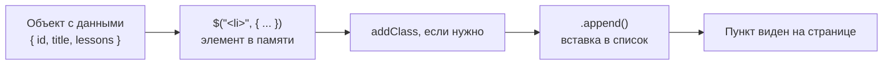
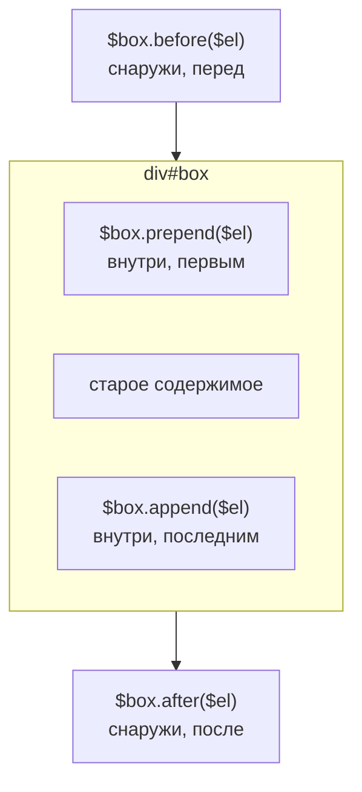
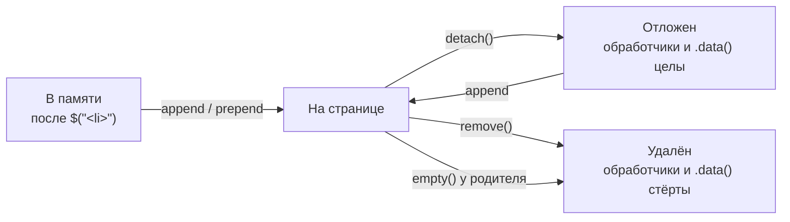
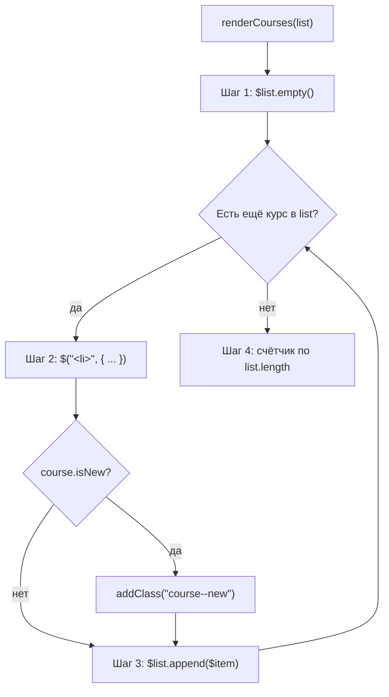

# Создание и удаление элементов

[Содержание](../../README.md) · [← Назад](../../Lesson-4/ru/%D0%9A%D0%BB%D0%B0%D1%81%D1%81%D1%8B%20%D0%B8%20%D1%81%D1%82%D0%B8%D0%BB%D0%B8.md) · [Вперёд →](../../Lesson-6/ru/%D0%A1%D0%BE%D0%B1%D1%8B%D1%82%D0%B8%D1%8F.md) · [RU](%D0%A1%D0%BE%D0%B7%D0%B4%D0%B0%D0%BD%D0%B8%D0%B5%20%D0%B8%20%D1%83%D0%B4%D0%B0%D0%BB%D0%B5%D0%BD%D0%B8%D0%B5%20%D1%8D%D0%BB%D0%B5%D0%BC%D0%B5%D0%BD%D1%82%D0%BE%D0%B2.md) · [EN](../en/Creating%20and%20removing%20elements.md) · [UZ](../uz/Elementlarni%20yaratish%20va%20o'chirish.md)

> **Связь с уроком 4:** вы научились менять внешний вид готовых элементов - добавлять классы и стили. Но все элементы до сих пор уже были в HTML. Сегодня jQuery будет **создавать** новые элементы из данных, вставлять их в нужное место страницы и убирать лишние.

---

## Зачем это вам

Откройте каталог любого интернет-магазина. Товаров сотни, но в HTML-файле их никто не писал вручную: сервер прислал массив объектов, а скрипт превратил каждый объект в карточку. Добавили товар в корзину - в списке появилась строка. Удалили - строка исчезла. Сменили фильтр - старый список очистился и нарисовался новый.

В курсе JavaScript вы делали это через `createElement`, `textContent`, `classList.add` и `append` - по четыре-пять строк на каждый элемент. jQuery умеет создать элемент с классом, текстом и атрибутами одним вызовом, а вставить, переместить или удалить его - одним коротким методом.

---

## Чему вы научитесь

- Создавать элементы: `$("<li>")` и `$("<li>", { ... })` с классом, текстом и атрибутами.
- Вставлять внутрь элемента: `.append()` и `.prepend()`.
- Вставлять рядом с элементом: `.after()` и `.before()`.
- Понимать разницу между `.append()` и `.appendTo()`.
- Удалять элементы: `.remove()`, очищать содержимое: `.empty()`, временно убирать: `.detach()`.
- Копировать элементы: `.clone()`, заменять: `.replaceWith()`.
- Отрисовывать массив объектов функцией `render`, которая не задваивает список.
- Выводить данные безопасно - текстом, а не разметкой.

---

## Повторение: 3 вопроса из урока 4

1. Что делает `$card.toggleClass("is-active", isOpen)`, если `isOpen === false`?
2. Почему запись `$box.css("font-size", 20)` не меняет размер шрифта, а `$box.css("font-size", "20px")` - меняет?
3. Когда менять внешний вид классом, а когда - через `.css()`?

Ответы - в конце урока.

---

## План урока

| Раздел | Что делаем |
| --- | --- |
| Создание элемента | `$("<li>")` - элемент в памяти |
| Объект настроек | `$("<li>", { class, text, ... })` |
| Вставка внутрь | `.append()`, `.prepend()` |
| Вставка рядом | `.after()`, `.before()` |
| `appendTo` и `prependTo` | Та же вставка «с другой стороны» |
| Мини-задание 1 | Лента новостей |
| Удаление | `.remove()`, `.empty()`, `.detach()` |
| Копирование и замена | `.clone()`, `.replaceWith()` |
| Отрисовка массива | Функция `render(list)` |
| Безопасность | Текст, а не HTML-строка |
| Мини-задание 2 | Список задач |
| Самостоятельная работа | Функция `renderCourses(list)` |

---

## Создание элемента

### `$("<li>")` - новый элемент

В уроке 1 вы передавали в `$()` селектор, и jQuery **искал** элементы. Если же строка начинается с тега в угловых скобках, jQuery **создаёт** новый элемент.

```js
const $found = $("li");    // найти все li на странице
const $fresh = $("<li>");  // создать один новый li
```

**Простыми словами:** `$("li")` - «найди в классе всех учеников», а `$("<li>")` - «принеси новую пустую парту». Парта появилась, но пока стоит в коридоре: в класс (на страницу) её ещё никто не занёс.

Созданный элемент живёт **в памяти**. На странице его нет, пока вы не вставите его одним из методов ниже.

```js
const $item = $("<li>")
    .addClass("course")
    .text("HTML (уроков: 10)");

console.log($item.length);           // 1 - элемент создан
console.log($item.parent().length);  // 0 - родителя нет, на странице его нет
```

| Чистый JavaScript | jQuery |
| --- | --- |
| `const li = document.createElement("li");` | `const $li = $("<li>");` |
| `li.classList.add("course");` | `$li.addClass("course");` |
| `li.textContent = "HTML";` | `$li.text("HTML");` |
| `list.append(li);` | `$list.append($li);` |

Все знакомые методы - `.text()`, `.attr()`, `.addClass()`, `.css()` - работают с новым элементом так же, как с найденным.

### Объект настроек: `$("<li>", { ... })`

Вторым аргументом можно передать **объект настроек**: jQuery сразу задаст элементу класс, текст и атрибуты.

```js
const $item = $("<li>", {
    class: "course",
    text: "HTML (уроков: 10)",
    "data-id": "html",
    title: "Курс по HTML",
});
```

Результат в памяти:

```html
<li class="course" data-id="html" title="Курс по HTML">HTML (уроков: 10)</li>
```

| Ключ | Что делает | Как это записать иначе |
| --- | --- | --- |
| `class` | Класс (несколько - через пробел) | `.addClass("course")` |
| `text` | Текст элемента, **как текст** | `.text("...")` |
| `"data-id"` | Атрибут `data-id` | `.attr("data-id", "html")` |
| `title`, `href`, `src`, `alt` ... | Обычные атрибуты | `.attr("href", "...")` |

**Простыми словами:** объект настроек - это бланк заказа. Вместо того чтобы сначала купить пустую парту, потом покрасить её, потом приклеить табличку, вы сразу заполняете бланк: «парта, синяя, с табличкой "Анна"» - и получаете готовую.

> **Важно:** ключ `"data-id"` пишется **в кавычках**: из-за дефиса без кавычек JavaScript прочитает `data - id` как вычитание. Ключи `class`, `text`, `title` можно без кавычек.

> **Важно:** `$item.data("id", "html")` из урока 3 **не** записывает атрибут `data-id` в HTML: значение хранится внутри jQuery. Если атрибут нужен в разметке (для CSS, для DevTools, для тестов) - используйте `"data-id"` в объекте настроек или `.attr("data-id", ...)`.



**Как читать схему.** Элемент проходит три этапа: создание (в памяти), настройка (класс, текст, атрибуты) и вставка. Пока не выполнен последний шаг, пользователь ничего не увидит - это самая частая причина вопроса «почему мой элемент не появился?».

### Трассировка: создание пункта

```js
const course = { id: "js", title: "JavaScript", lessons: 10, isNew: true };
const $item = $("<li>", {
    class: "course",
    text: `${course.title} (уроков: ${course.lessons})`,
    "data-id": course.id,
});
if (course.isNew) {
    $item.addClass("course--new");
}
$("#course-list").append($item);
```

| Шаг | Что происходит | Значение / состояние страницы |
| --- | --- | --- |
| 1 | Создаётся объект `course` | `{ id: "js", title: "JavaScript", ... }` |
| 2 | `$("<li>", {...})` создаёт пункт | В памяти: `<li class="course" data-id="js">JavaScript (уроков: 10)</li>` |
| 3 | `course.isNew === true` - добавляется класс | `class="course course--new"` |
| 4 | `.append($item)` | Пункт стал последним ребёнком `#course-list` и виден на странице |

---

## Вставка внутрь: `.append()` и `.prepend()`

```html
<ul id="news">
    <li>Старая новость</li>
</ul>
```

```js
const $news = $("#news");

$news.append($("<li>", { text: "В конец" }));
$news.prepend($("<li>", { text: "В начало" }));
```

Результат:

```html
<ul id="news">
    <li>В начало</li>
    <li>Старая новость</li>
    <li>В конец</li>
</ul>
```

| Запись | Куда вставляет |
| --- | --- |
| `$parent.append($el)` | Внутрь `$parent`, последним ребёнком |
| `$parent.prepend($el)` | Внутрь `$parent`, первым ребёнком |

**Простыми словами:** `append` - встать в конец очереди, `prepend` - пройти без очереди в начало. Обе очереди - внутри одного кабинета (родителя).

В `.append()` можно передать сразу несколько элементов или массив:

```js
$news.append(
    $("<li>", { text: "Первая" }),
    $("<li>", { text: "Вторая" })
);
```

### Вставка уже существующего элемента - это перемещение

Если передать в `.append()` элемент, который **уже есть** на странице, jQuery его не копирует, а **переносит**:

```js
$("#done").append($("#task-3")); // задача 3 переехала в список «Готово»
```

Элемент не может находиться в двух местах одновременно. Нужна копия - используйте `.clone()` (ниже).

---

## Вставка рядом: `.after()` и `.before()`

`.after()` и `.before()` вставляют элемент **снаружи** - соседом, а не ребёнком.

```html
<h2 id="title">Новости</h2>
<ul id="news"></ul>
```

```js
$("#title").after($("<p>", { text: "Обновлено сегодня", class: "note" }));
$("#title").before($("<hr>"));
```

```html
<hr>
<h2 id="title">Новости</h2>
<p class="note">Обновлено сегодня</p>
<ul id="news"></ul>
```



**Как читать схему.** Рамка - это сам элемент `#box`. Методы `prepend` и `append` кладут новое **внутрь** рамки, а `before` и `after` - **за её пределы**, на один уровень с `#box`.

| Метод | Внутрь или рядом | Где именно |
| --- | --- | --- |
| `.prepend()` | Внутрь | В начало |
| `.append()` | Внутрь | В конец |
| `.before()` | Рядом | Перед элементом |
| `.after()` | Рядом | После элемента |

---

## `.appendTo()` и `.prependTo()`

Эти методы делают то же самое, что `.append()` и `.prepend()`, но читаются **с другой стороны**: сначала то, что вставляем, потом - куда.

```js
// одинаковый результат
$("#news").append($item);   // «в новости добавь пункт»
$item.appendTo("#news");    // «пункт добавь в новости»
```

Главная разница - **что возвращается** и с чем продолжается цепочка:

| Запись | Возвращает | Цепочка продолжается с |
| --- | --- | --- |
| `$("#news").append($item)` | `$("#news")` | Списком |
| `$item.appendTo("#news")` | `$item` | Новым пунктом |

Поэтому `appendTo` удобен, когда после вставки нужно что-то сделать с самим новым элементом:

```js
$("<li>", { text: "Срочно!" })
    .prependTo("#news")
    .addClass("is-urgent");
```

**Простыми словами:** «Учитель посадил Анну за парту» и «Анна села за парту» - событие одно, но в первой фразе главный учитель, а во второй - Анна. Следующее действие относится к главному.

---

## Мини-задание 1

Страница:

```html
<h2 id="feed-title">Лента</h2>
<ul id="feed">
    <li>Добро пожаловать!</li>
</ul>
```

1. Создайте пункт с текстом из переменной `const message = "Вышел урок 5";`, классом `feed__item` и атрибутом `data-type="lesson"` - одним вызовом `$("<li>", {...})`.
2. Вставьте его **первым** в `#feed`.
3. Через `appendTo` добавьте в конец `#feed` пункт `Конец ленты` и в той же цепочке дайте ему класс `feed__end`.
4. Сразу после заголовка `#feed-title` вставьте абзац `Записей: N`, где N - число пунктов в `#feed`.

---

## Удаление: `.remove()`, `.empty()`, `.detach()`

### `.remove()` - удалить элемент

```js
$("#banner").remove();          // удалить баннер
$(".task.is-done").remove();    // удалить все выполненные задачи - неявный перебор
```

Элемент исчезает со страницы **вместе со всем содержимым**. jQuery также стирает его обработчики событий и данные `.data()`.

### `.empty()` - очистить содержимое

```js
$("#course-list").empty();
```

Удаляются **все дети**, а сам `#course-list` остаётся на месте, пустым. Это то же, что `container.textContent = ""` из курса JavaScript.

**Простыми словами:** `.empty()` - вытряхнуть всё из коробки, коробка остаётся на полке. `.remove()` - выбросить коробку целиком. Если после `.remove()` захотите положить в коробку новые вещи - её уже нет.

| Запись | Что остаётся на странице |
| --- | --- |
| `$("#list").empty()` | `<ul id="list"></ul>` |
| `$("#list").remove()` | Ничего: списка больше нет |
| `$("#list li").remove()` | `<ul id="list"></ul>` - как `empty`, если в списке только `li` |

### `.detach()` - вынуть и отложить

`.detach()` убирает элемент со страницы, как `.remove()`, но **сохраняет** его обработчики событий и данные `.data()`. Элемент можно вставить обратно - и он будет работать как раньше.

```js
const $ad = $("#ad").detach();  // убрали рекламу на время

// ... позже
$("#sidebar").append($ad);      // вернули - обработчики на месте
```

**Простыми словами:** `.remove()` - сдать книгу в макулатуру, `.detach()` - убрать её на полку, чтобы потом снова читать с теми же закладками. Обработчики событий подробно разберём в уроке 6 - там разница станет особенно заметна.



**Как читать схему.** Созданный элемент сначала живёт в памяти, после вставки - на странице. Из `detach` дорога ведёт обратно на страницу «в рабочем состоянии», а после `remove` и `empty` элемент считается выброшенным: даже если вставить его снова, обработчики и данные не вернутся.

| Метод | Сам элемент | Дети | Обработчики и `.data()` |
| --- | --- | --- | --- |
| `.remove()` | Удалён | Удалены | Стёрты |
| `.detach()` | Удалён | Удалены вместе с ним | Сохранены |
| `.empty()` | Остался | Удалены | Стёрты у детей |

---

## Копирование и замена

### `.clone()` - копия элемента

```html
<article class="card" id="card-template">
    <h3 class="card__title">Название</h3>
    <p class="card__text">Описание</p>
</article>
```

```js
const $copy = $("#card-template").clone();
$copy.removeAttr("id");
$copy.find(".card__title").text("jQuery");
$copy.appendTo("#cards");
```

`.clone()` копирует элемент **со всем содержимым**. Копия - в памяти, её нужно вставить. Обратите внимание на `removeAttr("id")`: `id` должен быть уникальным, а копия получила тот же `id`.

| Запись | Что копируется |
| --- | --- |
| `.clone()` | Элемент, дети, атрибуты, классы |
| `.clone(true)` | То же + обработчики событий и `.data()` |

**Простыми словами:** `.clone()` - ксерокопия. Текст и картинки на ней те же, но подписи ручкой (обработчики) не копируются, если не попросить `clone(true)`.

### `.replaceWith()` - заменить

```js
$("#loading").replaceWith(
    $("<p>", { text: "Данные загружены", class: "status status--ok" })
);
```

Старый элемент удаляется, на его место встаёт новый. Удобно для заглушек «Загрузка...».

### Трассировка: копия карточки

| Шаг | Что происходит | Значение / состояние страницы |
| --- | --- | --- |
| 1 | `$("#card-template").clone()` | В памяти копия: `<article class="card" id="card-template">...` |
| 2 | `.removeAttr("id")` | У копии нет `id`, на странице всё ещё один `#card-template` |
| 3 | `.find(".card__title").text("jQuery")` | Заголовок копии - `jQuery`, у оригинала - `Название` |
| 4 | `.appendTo("#cards")` | В `#cards` появилась новая карточка, оригинал на месте |

---

## Отрисовка массива

### Функция `render(list)`

Главный приём урока - превратить массив объектов в список на странице. Схема та же, что в курсе JavaScript, только короче.

```js
const courses = [
    { id: "html", title: "HTML", lessons: 10 },
    { id: "css", title: "CSS", lessons: 10 },
];

function renderCourses(list) {
    const $list = $("#course-list");

    $list.empty();                                  // Шаг 1: очистить

    for (const course of list) {                    // Шаг 2: для каждого объекта
        const $item = $("<li>", {                   // Шаг 3: создать
            class: "course",
            text: `${course.title} (уроков: ${course.lessons})`,
        });
        $list.append($item);                        // Шаг 4: вставить
    }
}

renderCourses(courses);
```



**Как читать схему.** Очистка происходит **один раз в начале**, создание и вставка - для **каждого** курса внутри цикла, счётчик - **один раз в конце**. Если перенести `append` за пределы цикла, вставится только последний курс; если убрать `empty`, каждый вызов будет дописывать к старому списку.

### Почему очистка обязательна

Функцию отрисовки вызывают много раз: после фильтра, сортировки, загрузки новых данных. Каждый вызов должен рисовать **с нуля**.

| Вызов | Без `.empty()` | С `.empty()` |
| --- | --- | --- |
| `renderCourses(courses)` (2 курса) | 2 пункта | 2 пункта |
| `renderCourses(courses)` ещё раз | 4 пункта | 2 пункта |
| `renderCourses([])` | 4 пункта | 0 пунктов |

### Параметр, а не внешняя переменная

Внутри функции работайте с **параметром** `list`, а не с глобальным `courses`. Иначе `renderCourses(filtered)` всё равно нарисует весь массив, и фильтр не будет работать.

```js
const newOnly = courses.filter((course) => course.isNew);
renderCourses(newOnly); // нарисует только новые - если внутри используется list
```

### Альтернатива: собрать массив и вставить разом

Иногда пункты собирают через `map` и вставляют одним вызовом:

```js
const $items = list.map((course) => $("<li>", { class: "course", text: course.title }));
$list.empty().append($items);
```

`.empty()` возвращает тот же `$list`, поэтому цепочка `empty().append(...)` работает. Оба способа правильные - выбирайте тот, что вам понятнее.

---

## Безопасность: текст, а не HTML-строка

jQuery умеет создавать элементы и из длинной HTML-строки:

```js
$list.append("<li class=\"course\">" + course.title + "</li>"); // опасно!
```

Если `course.title` пришёл от пользователя и равен ``, браузер **выполнит** этот код. Это та же уязвимость XSS, что и с `innerHTML` в курсе JavaScript.

| Запись | `title = "<b>Хак</b>"` | Безопасно? |
| --- | --- | --- |
| `$("<li>" + title + "</li>")` | Жирное слово «Хак» | Нет |
| `$("<li>").html(title)` | Жирное слово «Хак» | Нет |
| `$("<li>", { text: title })` | Буквально `<b>Хак</b>` | Да |
| `$("<li>").text(title)` | Буквально `<b>Хак</b>` | Да |

> **Важно:** в `$("<...>")` пишите только **тег без данных**. Данные передавайте через `text` в объекте настроек или через `.text()`. Тогда любая строка выведется как текст.

---

### Попробуйте сломать

1. Создайте `$("<li>", { text: "Тест" })` и не вставляйте его. Появился ли пункт? Что покажет `.parent().length`?
2. Уберите `$list.empty()` из `renderCourses` и вызовите функцию три раза. Сколько пунктов стало?
3. Замените `.empty()` на `.remove()` и вызовите функцию дважды. Куда делся список и что покажет `$("#course-list").length`?
4. Передайте курс с `title: "<i>курсив</i>"` в версию со склеенной HTML-строкой и в версию с `text`. Сравните результат.
5. Сделайте `$("#a").clone().appendTo("body")` и проверьте в консоли `$("[id='a']").length`. Почему два элемента с одним `id` - это плохо?
6. Напишите `data-id: course.id` без кавычек вокруг ключа. Прочитайте ошибку в консоли.

### Частые ошибки новичков

| Ошибка | Что получится | Как исправить |
| --- | --- | --- |
| Элемент создан, но не вставлен | На странице ничего не появилось | `.append()`, `.appendTo()` и т.п. |
| Нет очистки в `render` | Список дублируется при каждом вызове | `$list.empty()` в начале функции |
| `.remove()` вместо `.empty()` | Список исчез, новые пункты некуда вставить | `.empty()` - удаляет только детей |
| Данные склеены в HTML-строку | Дыра XSS, «странные» символы ломают разметку | `$("<li>", { text: ... })` |
| `.data("id", x)` вместо атрибута | В HTML нет `data-id`, CSS и селекторы `[data-id]` не работают | `"data-id": x` или `.attr("data-id", x)` |
| `append` после цикла | Вставлен только последний элемент | `append` внутри цикла или массив через `map` |
| Внутри функции `courses` вместо `list` | Фильтр не работает, всегда весь массив | Использовать параметр функции |
| Копия с тем же `id` | Два одинаковых `id`, `$("#id")` находит не тот | `.removeAttr("id")` у копии |
| Ждали, что `.append($el)` скопирует элемент | Элемент **переехал** из старого места | `.clone()` перед вставкой |

---

## Мини-задание 2

Страница:

```html
<ul id="tasks">
    <li class="task">Купить тетрадь</li>
    <li class="task is-done">Прочитать урок 4</li>
    <li class="task is-done">Сделать мини-задание</li>
</ul>
<p id="placeholder">Загрузка...</p>
<button id="template" class="btn">Шаблон</button>
```

1. Удалите все выполненные задачи (`.task.is-done`) одной строкой.
2. Напишите функцию `addTask(title)`, которая создаёт `li.task` с текстом `title` и вставляет его в конец `#tasks`. Вызовите её дважды.
3. Замените `#placeholder` на абзац `Задач: N` с классом `summary`, где N - число `.task`.
4. Сделайте копию кнопки `#template`, уберите у копии `id`, задайте текст `Копия` и вставьте её сразу после оригинала.

---

## Итоги урока: шпаргалка

| Задача | Запись |
| --- | --- |
| Создать элемент | `$("<li>")` |
| Создать с настройками | `$("<li>", { class: "x", text: "...", "data-id": id })` |
| Вставить внутрь в конец / начало | `$parent.append($el)` / `$parent.prepend($el)` |
| Вставить рядом после / перед | `$el.after($new)` / `$el.before($new)` |
| Вставить, продолжая цепочку с новым | `$new.appendTo("#list")` / `.prependTo(...)` |
| Удалить элемент | `$el.remove()` |
| Очистить содержимое | `$el.empty()` |
| Убрать и сохранить обработчики | `const $saved = $el.detach();` |
| Копия | `$el.clone()` / `$el.clone(true)` |
| Заменить | `$old.replaceWith($new)` |
| Отрисовать массив | `empty()` → цикл: создать, вставить → счётчик |

---

## Самостоятельная работа

### Часть 1. Задание в IDE (засчитывается платформой)

На странице есть абзац `#course-count` и список `#course-list` с пунктом-заглушкой `Загрузка списка...`. Платформа задаёт массив `courses` из объектов `{ id, title, lessons, isNew }`. jQuery уже подключён. Напишите функцию `renderCourses(list)`:

1. Найдите `#course-list` и `#course-count` через `$()`.
2. Очистите список методом `.empty()`.
3. Для каждого курса из `list` создайте пункт `$("<li>", { ... })` с классом `course`, текстом `HTML (уроков: 10)` и атрибутом `data-id` из `id`.
4. Курсам с `isNew: true` добавьте класс `course--new`.
5. Вставьте пункт в список через `.append()`.
6. В `#course-count` запишите `Курсов: N`, где N - длина `list`.

В конце вызовите `renderCourses(courses)`. Повторный вызов не должен задваивать список. `document.querySelector`, `createElement`, `innerHTML`, `textContent` и `.html()` не используйте.

Что проверяет платформа: три пункта `li.course` с правильными текстами в исходном порядке; заглушка удалена; атрибуты `data-id`; класс `course--new` только у новых курсов; счётчик; работа на другом массиве из четырёх курсов; повторный вызов с одним курсом и вызов с пустым массивом; что название с тегами выводится как текст; что элементы созданы через `$("<li>...")` и вставлены через `.append()` или `.appendTo()`; отсутствие ошибок.

### Часть 2. Проект на компьютере

1. На своём сайте из курсов HTML, CSS и JS замените список, написанный вручную в HTML (меню, навыки, проекты), массивом объектов в `main.js` и функцией `render`, которая рисует его через `$("<li>", {...})`.
2. Добавьте в CSS класс-модификатор (например, `project--featured`) и выдайте его элементам по полю объекта.
3. Под списком выведите счётчик `Всего: N`.
4. Вызовите `render` второй раз с отфильтрованным массивом (`filter`) и убедитесь в DevTools, что список не задвоился.
5. Удалите со страницы заглушку или старый блок через `.remove()` или `.replaceWith()`.

### Критерии готовности

- [ ] Задание в IDE засчитано.
- [ ] Список на сайте рисуется из массива, а не написан вручную в HTML.
- [ ] Повторный вызов `render` не задваивает пункты.
- [ ] Данные выводятся через `text`, в коде нет HTML-строк с данными.
- [ ] Вы можете объяснить разницу между `.remove()`, `.empty()` и `.detach()`.

---

## Вопросы для самопроверки

1. Чем `$("li")` отличается от `$("<li>")`?
2. Где находится элемент сразу после `$("<li>", { text: "A" })` и почему его не видно?
3. Какие ключи можно передать в объект настроек и почему `"data-id"` пишется в кавычках?
4. Чем `.append()` отличается от `.after()`?
5. Чем `.append()` отличается от `.appendTo()`, если результат на странице одинаковый?
6. Что произойдёт, если вставить через `.append()` элемент, который уже есть на странице?
7. Чем `.remove()`, `.empty()` и `.detach()` отличаются друг от друга?
8. Что нужно сделать с копией после `.clone()`, если у оригинала есть `id`?
9. Зачем в начале функции отрисовки вызывать `.empty()` и почему внутри работают с параметром, а не с глобальным массивом?
10. Почему `$("<li>" + title + "</li>")` опасно и как записать безопасно?

После вопросов пройдите **тест урока** на платформе: 12 вопросов, порог 70%.

---

## Что дальше

Теперь вы умеете рисовать списки из данных. Но пока они «мёртвые»: на клик ничего не происходит. В уроке 6 подключим **события** через `.on()`: лайки, переключение темы, удаление пункта по кнопке. Вы узнаете, почему обработчик, повешенный на пункт до `renderCourses`, перестаёт работать после перерисовки, и как это решает **делегирование** - `.on("click", ".course", ...)`.

---

## Ответы

**Повторение**

1. Убирает класс `is-active`: второй аргумент `false` означает «класса быть не должно».
2. jQuery 4 добавляет `px` к числу только у размеров и отступов (`width`, `margin` и т. п.). Для `font-size` число без единиц отбрасывается, поэтому в курсе единицы всегда пишут явно.
3. Классом - когда вид заранее описан в CSS (состояния: активный, ошибка, скрытый). `.css()` - когда значение вычисляется в коде (ширина по проценту, координаты).

**Мини-задание 1**

```js
const message = "Вышел урок 5";
const $feed = $("#feed");

const $item = $("<li>", {
    class: "feed__item",
    text: message,
    "data-type": "lesson",
});
$feed.prepend($item);

$("<li>", { text: "Конец ленты" })
    .appendTo($feed)
    .addClass("feed__end");

const count = $feed.children("li").length;
$("#feed-title").after($("<p>", { text: `Записей: ${count}` }));
```

**Мини-задание 2**

```js
$(".task.is-done").remove();

function addTask(title) {
    $("<li>", { class: "task", text: title }).appendTo("#tasks");
}

addTask("Повторить урок 5");
addTask("Сделать задание в IDE");

const taskCount = $(".task").length;
$("#placeholder").replaceWith(
    $("<p>", { class: "summary", text: `Задач: ${taskCount}` })
);

const $template = $("#template");
const $copy = $template.clone()
    .removeAttr("id")
    .text("Копия");
$template.after($copy);
```

**Вопросы для самопроверки**

1. `$("li")` ищет существующие пункты на странице, `$("<li>")` создаёт новый пункт в памяти.
2. В памяти: он создан, но не вставлен. Чтобы он появился, нужен `.append()`, `.prepend()`, `.after()`, `.before()` или `.appendTo()`.
3. `class`, `text`, любые атрибуты (`title`, `href`, `"data-id"`). Ключ с дефисом без кавычек JavaScript прочитает как вычитание.
4. `.append()` вставляет внутрь элемента последним ребёнком, `.after()` - снаружи, следующим соседом.
5. Возвращаемым значением: `append` возвращает родителя, `appendTo` - вставленный элемент, и цепочка продолжается с ним.
6. Элемент переместится: в двух местах одновременно он находиться не может. Для копии нужен `.clone()`.
7. `.remove()` удаляет элемент и стирает его обработчики и данные; `.detach()` удаляет, но сохраняет их для повторной вставки; `.empty()` удаляет только детей, сам элемент остаётся.
8. Убрать или поменять `id` (`.removeAttr("id")`) - `id` на странице должен быть уникальным - и вставить копию на страницу.
9. `.empty()` убирает старые пункты, иначе каждый вызов дописывает список заново. Параметр позволяет нарисовать любой массив: отфильтрованный, пустой, новый.
10. Данные превращаются в разметку, и чужой код может выполниться (XSS). Безопасно: `$("<li>", { text: title })` или `$("<li>").text(title)`.

[Содержание](../../README.md) · [← Назад](../../Lesson-4/ru/%D0%9A%D0%BB%D0%B0%D1%81%D1%81%D1%8B%20%D0%B8%20%D1%81%D1%82%D0%B8%D0%BB%D0%B8.md) · [Вперёд →](../../Lesson-6/ru/%D0%A1%D0%BE%D0%B1%D1%8B%D1%82%D0%B8%D1%8F.md) · [RU](%D0%A1%D0%BE%D0%B7%D0%B4%D0%B0%D0%BD%D0%B8%D0%B5%20%D0%B8%20%D1%83%D0%B4%D0%B0%D0%BB%D0%B5%D0%BD%D0%B8%D0%B5%20%D1%8D%D0%BB%D0%B5%D0%BC%D0%B5%D0%BD%D1%82%D0%BE%D0%B2.md) · [EN](../en/Creating%20and%20removing%20elements.md) · [UZ](../uz/Elementlarni%20yaratish%20va%20o'chirish.md)
