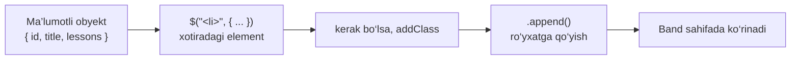
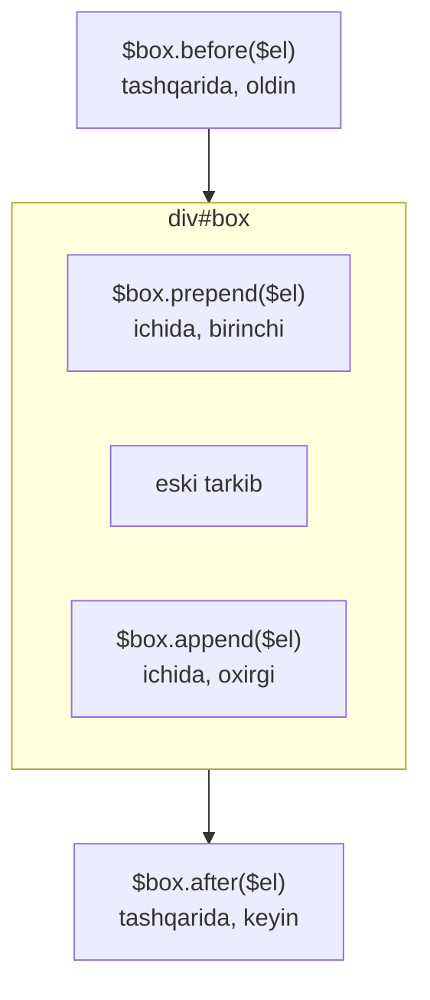
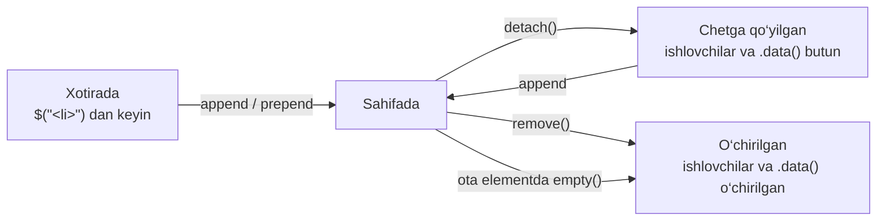
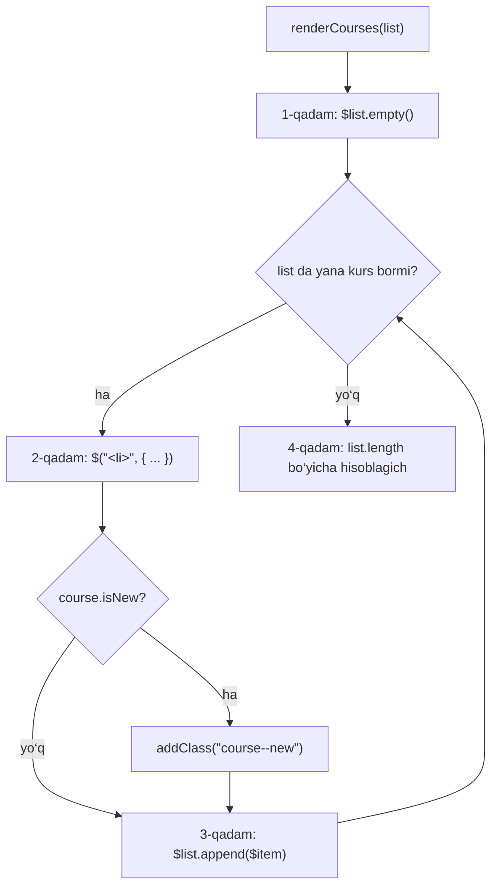

# Elementlarni yaratish va o‘chirish

[Mundarija](../../README.md) · [← Orqaga](../../Lesson-4/uz/Klasslar%20va%20uslublar.md) · [Keyingi →](../../Lesson-6/uz/Hodisalar.md) · [RU](../ru/%D0%A1%D0%BE%D0%B7%D0%B4%D0%B0%D0%BD%D0%B8%D0%B5%20%D0%B8%20%D1%83%D0%B4%D0%B0%D0%BB%D0%B5%D0%BD%D0%B8%D0%B5%20%D1%8D%D0%BB%D0%B5%D0%BC%D0%B5%D0%BD%D1%82%D0%BE%D0%B2.md) · [EN](../en/Creating%20and%20removing%20elements.md) · [UZ](Elementlarni%20yaratish%20va%20o'chirish.md)

> **4-dars bilan bog‘liqlik:** siz tayyor elementlarning ko‘rinishini o‘zgartirishni - klasslar va uslublar qo‘shishni o‘rgandingiz. Lekin hozirgacha barcha elementlar HTML’da allaqachon bor edi. Bugun jQuery ma’lumotlardan yangi elementlarni **yaratadi**, ularni sahifaning kerakli joyiga qo‘yadi va ortiqchalarini olib tashlaydi.

---

## Bu sizga nima uchun kerak

Istalgan internet-do‘konning katalogini oching. Mahsulotlar yuzlab, lekin HTML faylda ularni hech kim qo‘lda yozmagan: server obyektlar massivini yuborgan, skript esa har bir obyektni kartochkaga aylantirgan. Mahsulotni savatga qo‘shdingiz - ro‘yxatda qator paydo bo‘ldi. O‘chirdingiz - qator yo‘qoldi. Filtrni almashtirdingiz - eski ro‘yxat tozalandi va yangisi chizildi.

JavaScript kursida siz buni `createElement`, `textContent`, `classList.add` va `append` orqali qilgansiz - har bir element uchun to‘rt-besh qatordan. jQuery klassi, matni va atributlari bor elementni bitta chaqiruv bilan yarata oladi, uni qo‘yish, ko‘chirish yoki o‘chirish esa - bitta qisqa metod bilan.

---

## Nimani o‘rganasiz

- Elementlarni yaratish: `$("<li>")` va klass, matn va atributlar bilan `$("<li>", { ... })`.
- Element ichiga qo‘yish: `.append()` va `.prepend()`.
- Element yoniga qo‘yish: `.after()` va `.before()`.
- `.append()` va `.appendTo()` orasidagi farqni tushunish.
- Elementlarni o‘chirish: `.remove()`, ichini tozalash: `.empty()`, vaqtincha olib qo‘yish: `.detach()`.
- Elementlarni nusxalash: `.clone()`, almashtirish: `.replaceWith()`.
- Obyektlar massivini ro‘yxatni ikkilantirmaydigan `render` funksiyasi bilan chizish.
- Ma’lumotlarni xavfsiz chiqarish - belgilash sifatida emas, matn sifatida.

---

## Takrorlash: 4-darsdan 3 savol

1. Agar `isOpen === false` bo‘lsa, `$card.toggleClass("is-active", isOpen)` nima qiladi?
2. Nima uchun `$box.css("font-size", 20)` yozuvi shrift o‘lchamini o‘zgartirmaydi, `$box.css("font-size", "20px")` esa o‘zgartiradi?
3. Ko‘rinishni qachon klass bilan, qachon esa `.css()` orqali o‘zgartirish kerak?

Javoblar - dars oxirida.

---

## Reja

| Bo‘lim | Nima qilamiz |
| --- | --- |
| Element yaratish | `$("<li>")` - xotiradagi element |
| Sozlamalar obyekti | `$("<li>", { class, text, ... })` |
| Ichiga qo‘yish | `.append()`, `.prepend()` |
| Yoniga qo‘yish | `.after()`, `.before()` |
| `appendTo` va `prependTo` | O‘sha qo‘yish, faqat «boshqa tomondan» |
| Mini-topshiriq 1 | Yangiliklar lentasi |
| O‘chirish | `.remove()`, `.empty()`, `.detach()` |
| Nusxalash va almashtirish | `.clone()`, `.replaceWith()` |
| Massivni chizish | `render(list)` funksiyasi |
| Xavfsizlik | HTML satr emas, matn |
| Mini-topshiriq 2 | Vazifalar ro‘yxati |
| Mustaqil ish | `renderCourses(list)` funksiyasi |

---

## Element yaratish

### `$("<li>")` - yangi element

1-darsda siz `$()` ga selektor uzatgansiz va jQuery elementlarni **qidirgan**. Agar satr burchakli qavsdagi teg bilan boshlansa, jQuery yangi element **yaratadi**.

```js
const $found = $("li");    // sahifadagi barcha li larni topish
const $fresh = $("<li>");  // bitta yangi li yaratish
```

**Oddiy so‘z bilan:** `$("li")` - «sinfdagi barcha o‘quvchilarni top», `$("<li>")` esa - «yangi bo‘sh parta olib kel». Parta paydo bo‘ldi, lekin hozircha yo‘lakda turibdi: uni sinfga (sahifaga) hali hech kim olib kirmagan.

Yaratilgan element **xotirada** yashaydi. Uni quyidagi metodlardan biri bilan qo‘ymaguningizcha, u sahifada bo‘lmaydi.

```js
const $item = $("<li>")
    .addClass("course")
    .text("HTML (darslar: 10)");

console.log($item.length);           // 1 - element yaratildi
console.log($item.parent().length);  // 0 - ota elementi yo‘q, u sahifada emas
```

| Sof JavaScript | jQuery |
| --- | --- |
| `const li = document.createElement("li");` | `const $li = $("<li>");` |
| `li.classList.add("course");` | `$li.addClass("course");` |
| `li.textContent = "HTML";` | `$li.text("HTML");` |
| `list.append(li);` | `$list.append($li);` |

Barcha tanish metodlar - `.text()`, `.attr()`, `.addClass()`, `.css()` - yangi element bilan ham topilgan element bilan qanday ishlasa, xuddi shunday ishlaydi.

### Sozlamalar obyekti: `$("<li>", { ... })`

Ikkinchi argument sifatida **sozlamalar obyektini** uzatish mumkin: jQuery elementga darhol klass, matn va atributlarni beradi.

```js
const $item = $("<li>", {
    class: "course",
    text: "HTML (darslar: 10)",
    "data-id": "html",
    title: "HTML kursi",
});
```

Xotiradagi natija:

```html
<li class="course" data-id="html" title="HTML kursi">HTML (darslar: 10)</li>
```

| Kalit | Nima qiladi | Boshqacha qanday yozish mumkin |
| --- | --- | --- |
| `class` | Klass (bir nechtasi - probel orqali) | `.addClass("course")` |
| `text` | Element matni, **matn sifatida** | `.text("...")` |
| `"data-id"` | `data-id` atributi | `.attr("data-id", "html")` |
| `title`, `href`, `src`, `alt` ... | Oddiy atributlar | `.attr("href", "...")` |

**Oddiy so‘z bilan:** sozlamalar obyekti - buyurtma blankasi. Avval bo‘sh parta sotib olib, keyin uni bo‘yab, keyin lavha yopishtirish o‘rniga, darhol blankani to‘ldirasiz: «parta, ko‘k, "Anna" lavhasi bilan» - va tayyorini olasiz.

> **Muhim:** `"data-id"` kaliti **qo‘shtirnoq ichida** yoziladi: defis tufayli qo‘shtirnoqsiz JavaScript `data - id` ni ayirish deb o‘qiydi. `class`, `text`, `title` kalitlarini qo‘shtirnoqsiz yozish mumkin.

> **Muhim:** 3-darsdagi `$item.data("id", "html")` HTML’ga `data-id` atributini **yozmaydi**: qiymat jQuery ichida saqlanadi. Agar atribut belgilashda kerak bo‘lsa (CSS uchun, DevTools uchun, testlar uchun) - sozlamalar obyektida `"data-id"` dan yoki `.attr("data-id", ...)` dan foydalaning.



**Sxemani qanday o‘qish kerak.** Element uch bosqichdan o‘tadi: yaratish (xotirada), sozlash (klass, matn, atributlar) va qo‘yish. Oxirgi qadam bajarilmaguncha foydalanuvchi hech narsani ko‘rmaydi - «nega mening elementim paydo bo‘lmadi?» degan savolning eng ko‘p uchraydigan sababi shu.

### Trassirovka: band yaratish

```js
const course = { id: "js", title: "JavaScript", lessons: 10, isNew: true };
const $item = $("<li>", {
    class: "course",
    text: `${course.title} (darslar: ${course.lessons})`,
    "data-id": course.id,
});
if (course.isNew) {
    $item.addClass("course--new");
}
$("#course-list").append($item);
```

| Qadam | Nima bo‘ladi | Qiymat / sahifa holati |
| --- | --- | --- |
| 1 | `course` obyekti yaratiladi | `{ id: "js", title: "JavaScript", ... }` |
| 2 | `$("<li>", {...})` band yaratadi | Xotirada: `<li class="course" data-id="js">JavaScript (darslar: 10)</li>` |
| 3 | `course.isNew === true` - klass qo‘shiladi | `class="course course--new"` |
| 4 | `.append($item)` | Band `#course-list` ning oxirgi bola elementi bo‘ldi va sahifada ko‘rinadi |

---

## Ichiga qo‘yish: `.append()` va `.prepend()`

```html
<ul id="news">
    <li>Eski yangilik</li>
</ul>
```

```js
const $news = $("#news");

$news.append($("<li>", { text: "Oxiriga" }));
$news.prepend($("<li>", { text: "Boshiga" }));
```

Natija:

```html
<ul id="news">
    <li>Boshiga</li>
    <li>Eski yangilik</li>
    <li>Oxiriga</li>
</ul>
```

| Yozuv | Qayerga qo‘yadi |
| --- | --- |
| `$parent.append($el)` | `$parent` ichiga, oxirgi bola element qilib |
| `$parent.prepend($el)` | `$parent` ichiga, birinchi bola element qilib |

**Oddiy so‘z bilan:** `append` - navbatning oxiriga turish, `prepend` - navbatsiz boshiga o‘tish. Ikkala navbat ham bitta xona (ota element) ichida.

`.append()` ga bir vaqtning o‘zida bir nechta element yoki massiv uzatish mumkin:

```js
$news.append(
    $("<li>", { text: "Birinchi" }),
    $("<li>", { text: "Ikkinchi" })
);
```

### Mavjud elementni qo‘yish - bu ko‘chirish

Agar `.append()` ga sahifada **allaqachon bor** elementni uzatsangiz, jQuery uni nusxalamaydi, balki **ko‘chiradi**:

```js
$("#done").append($("#task-3")); // 3-vazifa «Tayyor» ro‘yxatiga ko‘chdi
```

Element bir vaqtda ikki joyda bo‘la olmaydi. Nusxa kerak bo‘lsa - `.clone()` dan foydalaning (pastda).

---

## Yoniga qo‘yish: `.after()` va `.before()`

`.after()` va `.before()` elementni **tashqariga** qo‘yadi - bola element qilib emas, qo‘shni qilib.

```html
<h2 id="title">Yangiliklar</h2>
<ul id="news"></ul>
```

```js
$("#title").after($("<p>", { text: "Bugun yangilandi", class: "note" }));
$("#title").before($("<hr>"));
```

```html
<hr>
<h2 id="title">Yangiliklar</h2>
<p class="note">Bugun yangilandi</p>
<ul id="news"></ul>
```



**Sxemani qanday o‘qish kerak.** Ramka - `#box` elementining o‘zi. `prepend` va `append` metodlari yangisini ramka **ichiga** qo‘yadi, `before` va `after` esa - **uning tashqarisiga**, `#box` bilan bir darajaga.

| Metod | Ichigami yoki yonigami | Aynan qayerga |
| --- | --- | --- |
| `.prepend()` | Ichiga | Boshiga |
| `.append()` | Ichiga | Oxiriga |
| `.before()` | Yoniga | Elementdan oldin |
| `.after()` | Yoniga | Elementdan keyin |

---

## `.appendTo()` va `.prependTo()`

Bu metodlar `.append()` va `.prepend()` bilan bir xil ishni qiladi, lekin **boshqa tomondan** o‘qiladi: avval nimani qo‘yamiz, keyin - qayerga.

```js
// natija bir xil
$("#news").append($item);   // «yangiliklarga bandni qo‘sh»
$item.appendTo("#news");    // «bandni yangiliklarga qo‘sh»
```

Asosiy farq - **nima qaytariladi** va zanjir nima bilan davom etadi:

| Yozuv | Qaytaradi | Zanjir nima bilan davom etadi |
| --- | --- | --- |
| `$("#news").append($item)` | `$("#news")` | Ro‘yxat bilan |
| `$item.appendTo("#news")` | `$item` | Yangi band bilan |

Shuning uchun qo‘yilgandan keyin yangi elementning o‘zi bilan biror narsa qilish kerak bo‘lsa, `appendTo` qulay:

```js
$("<li>", { text: "Shoshilinch!" })
    .prependTo("#news")
    .addClass("is-urgent");
```

**Oddiy so‘z bilan:** «O‘qituvchi Annani partaga o‘tqazdi» va «Anna partaga o‘tirdi» - voqea bitta, lekin birinchi gapda bosh qahramon o‘qituvchi, ikkinchisida esa - Anna. Keyingi harakat bosh qahramonga tegishli bo‘ladi.

---

## Mini-topshiriq 1

Sahifa:

```html
<h2 id="feed-title">Lenta</h2>
<ul id="feed">
    <li>Xush kelibsiz!</li>
</ul>
```

1. `const message = "5-dars chiqdi";` o‘zgaruvchisidagi matn, `feed__item` klassi va `data-type="lesson"` atributi bilan band yarating - bitta `$("<li>", {...})` chaqiruvi bilan.
2. Uni `#feed` ga **birinchi** qilib qo‘ying.
3. `appendTo` orqali `#feed` oxiriga `Lenta oxiri` bandini qo‘shing va o‘sha zanjirda unga `feed__end` klassini bering.
4. `#feed-title` sarlavhasidan darhol keyin `Yozuvlar: N` xatboshisini qo‘ying, bunda N - `#feed` dagi bandlar soni.

---

## O‘chirish: `.remove()`, `.empty()`, `.detach()`

### `.remove()` - elementni o‘chirish

```js
$("#banner").remove();          // bannerni o‘chirish
$(".task.is-done").remove();    // barcha bajarilgan vazifalarni o‘chirish - yashirin aylanib chiqish
```

Element sahifadan **butun ichidagisi bilan birga** yo‘qoladi. jQuery uning hodisa ishlovchilari va `.data()` ma’lumotlarini ham o‘chirib tashlaydi.

### `.empty()` - ichini tozalash

```js
$("#course-list").empty();
```

**Barcha bola elementlar** o‘chiriladi, `#course-list` ning o‘zi esa joyida bo‘sh holda qoladi. Bu JavaScript kursidagi `container.textContent = ""` bilan bir xil.

**Oddiy so‘z bilan:** `.empty()` - qutidagi hamma narsani to‘kib tashlash, quti javonda qoladi. `.remove()` - qutini butunlay tashlab yuborish. Agar `.remove()` dan keyin qutiga yangi narsalar solmoqchi bo‘lsangiz - u endi yo‘q.

| Yozuv | Sahifada nima qoladi |
| --- | --- |
| `$("#list").empty()` | `<ul id="list"></ul>` |
| `$("#list").remove()` | Hech narsa: ro‘yxat endi yo‘q |
| `$("#list li").remove()` | `<ul id="list"></ul>` - ro‘yxatda faqat `li` bo‘lsa, `empty` kabi |

### `.detach()` - olib, chetga qo‘yish

`.detach()` elementni sahifadan `.remove()` kabi olib tashlaydi, lekin uning hodisa ishlovchilari va `.data()` ma’lumotlarini **saqlab qoladi**. Elementni qaytarib qo‘yish mumkin - va u avvalgidek ishlaydi.

```js
const $ad = $("#ad").detach();  // reklamani vaqtincha olib qo‘ydik

// ... keyinroq
$("#sidebar").append($ad);      // qaytardik - ishlovchilar joyida
```

**Oddiy so‘z bilan:** `.remove()` - kitobni makulaturaga topshirish, `.detach()` - keyin o‘sha xatchoplar bilan yana o‘qish uchun uni javonga qo‘yib qo‘yish. Hodisa ishlovchilarini 6-darsda batafsil ko‘rib chiqamiz - u yerda farq ayniqsa yaqqol ko‘rinadi.



**Sxemani qanday o‘qish kerak.** Yaratilgan element avval xotirada, qo‘yilgandan keyin esa sahifada yashaydi. `detach` dan yo‘l sahifaga «ishlaydigan holatda» qaytadi, `remove` va `empty` dan keyin esa element tashlab yuborilgan hisoblanadi: uni qayta qo‘ysangiz ham, ishlovchilar va ma’lumotlar qaytmaydi.

| Metod | Elementning o‘zi | Bola elementlar | Ishlovchilar va `.data()` |
| --- | --- | --- | --- |
| `.remove()` | O‘chirilgan | O‘chirilgan | O‘chirilgan |
| `.detach()` | O‘chirilgan | U bilan birga o‘chirilgan | Saqlangan |
| `.empty()` | Qolgan | O‘chirilgan | Bola elementlarda o‘chirilgan |

---

## Nusxalash va almashtirish

### `.clone()` - elementning nusxasi

```html
<article class="card" id="card-template">
    <h3 class="card__title">Nomi</h3>
    <p class="card__text">Tavsif</p>
</article>
```

```js
const $copy = $("#card-template").clone();
$copy.removeAttr("id");
$copy.find(".card__title").text("jQuery");
$copy.appendTo("#cards");
```

`.clone()` elementni **butun ichidagisi bilan** nusxalaydi. Nusxa xotirada, uni qo‘yish kerak. `removeAttr("id")` ga e’tibor bering: `id` noyob bo‘lishi kerak, nusxa esa o‘sha `id` ni olgan.

| Yozuv | Nima nusxalanadi |
| --- | --- |
| `.clone()` | Element, bola elementlar, atributlar, klasslar |
| `.clone(true)` | O‘sha + hodisa ishlovchilari va `.data()` |

**Oddiy so‘z bilan:** `.clone()` - kserokopiya. Undagi matn va rasmlar o‘sha, lekin ruchka bilan qo‘yilgan imzolar (ishlovchilar) `clone(true)` deb so‘ramasangiz nusxalanmaydi.

### `.replaceWith()` - almashtirish

```js
$("#loading").replaceWith(
    $("<p>", { text: "Ma’lumotlar yuklandi", class: "status status--ok" })
);
```

Eski element o‘chiriladi, uning o‘rniga yangisi turadi. «Yuklanmoqda...» o‘rinbosarlari uchun qulay.

### Trassirovka: kartochka nusxasi

| Qadam | Nima bo‘ladi | Qiymat / sahifa holati |
| --- | --- | --- |
| 1 | `$("#card-template").clone()` | Xotirada nusxa: `<article class="card" id="card-template">...` |
| 2 | `.removeAttr("id")` | Nusxada `id` yo‘q, sahifada hamon bitta `#card-template` |
| 3 | `.find(".card__title").text("jQuery")` | Nusxaning sarlavhasi - `jQuery`, aslida - `Nomi` |
| 4 | `.appendTo("#cards")` | `#cards` da yangi kartochka paydo bo‘ldi, asli joyida |

---

## Massivni chizish

### `render(list)` funksiyasi

Darsning asosiy usuli - obyektlar massivini sahifadagi ro‘yxatga aylantirish. Sxema JavaScript kursidagi bilan bir xil, faqat qisqaroq.

```js
const courses = [
    { id: "html", title: "HTML", lessons: 10 },
    { id: "css", title: "CSS", lessons: 10 },
];

function renderCourses(list) {
    const $list = $("#course-list");

    $list.empty();                                  // 1-qadam: tozalash

    for (const course of list) {                    // 2-qadam: har bir obyekt uchun
        const $item = $("<li>", {                   // 3-qadam: yaratish
            class: "course",
            text: `${course.title} (darslar: ${course.lessons})`,
        });
        $list.append($item);                        // 4-qadam: qo‘yish
    }
}

renderCourses(courses);
```



**Sxemani qanday o‘qish kerak.** Tozalash **boshida bir marta** bo‘ladi, yaratish va qo‘yish - sikl ichida **har bir** kurs uchun, hisoblagich - **oxirida bir marta**. Agar `append` ni sikldan tashqariga chiqarsangiz, faqat oxirgi kurs qo‘yiladi; `empty` ni olib tashlasangiz, har bir chaqiruv eski ro‘yxatga qo‘shib yozadi.

### Nega tozalash majburiy

Chizish funksiyasi ko‘p marta chaqiriladi: filtrdan, saralashdan, yangi ma’lumotlar yuklangandan keyin. Har bir chaqiruv **noldan** chizishi kerak.

| Chaqiruv | `.empty()` siz | `.empty()` bilan |
| --- | --- | --- |
| `renderCourses(courses)` (2 ta kurs) | 2 ta band | 2 ta band |
| `renderCourses(courses)` yana bir marta | 4 ta band | 2 ta band |
| `renderCourses([])` | 4 ta band | 0 ta band |

### Tashqi o‘zgaruvchi emas, parametr

Funksiya ichida global `courses` bilan emas, `list` **parametri** bilan ishlang. Aks holda `renderCourses(filtered)` baribir butun massivni chizadi va filtr ishlamaydi.

```js
const newOnly = courses.filter((course) => course.isNew);
renderCourses(newOnly); // faqat yangilarini chizadi - agar ichida list ishlatilsa
```

### Muqobil: massiv yig‘ib, birdaniga qo‘yish

Ba’zan bandlarni `map` orqali yig‘ib, bitta chaqiruv bilan qo‘yishadi:

```js
const $items = list.map((course) => $("<li>", { class: "course", text: course.title }));
$list.empty().append($items);
```

`.empty()` o‘sha `$list` ni qaytaradi, shuning uchun `empty().append(...)` zanjiri ishlaydi. Ikkala usul ham to‘g‘ri - o‘zingizga tushunarlirog‘ini tanlang.

---

## Xavfsizlik: HTML satr emas, matn

jQuery elementlarni uzun HTML satrdan ham yarata oladi:

```js
$list.append("<li class=\"course\">" + course.title + "</li>"); // xavfli!
```

Agar `course.title` foydalanuvchidan kelgan va `` ga teng bo‘lsa, brauzer bu kodni **bajaradi**. Bu JavaScript kursidagi `innerHTML` bilan bo‘lgan o‘sha XSS zaifligi.

| Yozuv | `title = "<b>Xak</b>"` | Xavfsizmi? |
| --- | --- | --- |
| `$("<li>" + title + "</li>")` | Qalin «Xak» so‘zi | Yo‘q |
| `$("<li>").html(title)` | Qalin «Xak» so‘zi | Yo‘q |
| `$("<li>", { text: title })` | So‘zma-so‘z `<b>Xak</b>` | Ha |
| `$("<li>").text(title)` | So‘zma-so‘z `<b>Xak</b>` | Ha |

> **Muhim:** `$("<...>")` ichiga faqat **ma’lumotsiz tegni** yozing. Ma’lumotlarni sozlamalar obyektidagi `text` orqali yoki `.text()` orqali uzating. Shunda istalgan satr matn sifatida chiqadi.

---

### Buzib ko‘ring

1. `$("<li>", { text: "Test" })` yarating va uni qo‘ymang. Band paydo bo‘ldimi? `.parent().length` nimani ko‘rsatadi?
2. `renderCourses` dan `$list.empty()` ni olib tashlang va funksiyani uch marta chaqiring. Nechta band bo‘ldi?
3. `.empty()` ni `.remove()` ga almashtiring va funksiyani ikki marta chaqiring. Ro‘yxat qayoqqa ketdi va `$("#course-list").length` nimani ko‘rsatadi?
4. `title: "<i>kursiv</i>"` bo‘lgan kursni yopishtirilgan HTML satrli versiyaga va `text` li versiyaga uzating. Natijani solishtiring.
5. `$("#a").clone().appendTo("body")` ni bajaring va konsolda `$("[id='a']").length` ni tekshiring. Bitta `id` li ikkita element nima uchun yomon?
6. Kalit atrofida qo‘shtirnoqsiz `data-id: course.id` deb yozing. Konsoldagi xatoni o‘qing.

### Yangi o‘rganuvchilarning tipik xatolari

| Xato | Nima bo‘ladi | Qanday tuzatish |
| --- | --- | --- |
| Element yaratilgan, lekin qo‘yilmagan | Sahifada hech narsa paydo bo‘lmadi | `.append()`, `.appendTo()` va h.k. |
| `render` da tozalash yo‘q | Har bir chaqiruvda ro‘yxat takrorlanadi | Funksiya boshida `$list.empty()` |
| `.empty()` o‘rniga `.remove()` | Ro‘yxat yo‘qoldi, yangi bandlarni qo‘yadigan joy yo‘q | `.empty()` - faqat bola elementlarni o‘chiradi |
| Ma’lumotlar HTML satrga yopishtirilgan | XSS teshigi, «g‘alati» belgilar belgilashni buzadi | `$("<li>", { text: ... })` |
| Atribut o‘rniga `.data("id", x)` | HTML’da `data-id` yo‘q, CSS va `[data-id]` selektorlari ishlamaydi | `"data-id": x` yoki `.attr("data-id", x)` |
| Sikldan keyin `append` | Faqat oxirgi element qo‘yilgan | `append` sikl ichida yoki `map` orqali massiv |
| Funksiya ichida `list` o‘rniga `courses` | Filtr ishlamaydi, doim butun massiv | Funksiya parametridan foydalanish |
| O‘sha `id` li nusxa | Ikkita bir xil `id`, `$("#id")` noto‘g‘ri elementni topadi | Nusxada `.removeAttr("id")` |
| `.append($el)` elementni nusxalaydi deb kutilgan | Element eski joyidan **ko‘chib ketdi** | Qo‘yishdan oldin `.clone()` |

---

## Mini-topshiriq 2

Sahifa:

```html
<ul id="tasks">
    <li class="task">Daftar sotib olish</li>
    <li class="task is-done">4-darsni o‘qish</li>
    <li class="task is-done">Mini-topshiriqni bajarish</li>
</ul>
<p id="placeholder">Yuklanmoqda...</p>
<button id="template" class="btn">Shablon</button>
```

1. Barcha bajarilgan vazifalarni (`.task.is-done`) bitta qator bilan o‘chiring.
2. `title` matnli `li.task` yaratib, uni `#tasks` oxiriga qo‘yadigan `addTask(title)` funksiyasini yozing. Uni ikki marta chaqiring.
3. `#placeholder` ni `summary` klassli `Vazifalar: N` xatboshisiga almashtiring, bunda N - `.task` lar soni.
4. `#template` tugmasining nusxasini yarating, nusxadan `id` ni olib tashlang, `Nusxa` matnini bering va uni aslidan darhol keyin qo‘ying.

---

## Dars yakuni: shpargalka

| Vazifa | Yozuv |
| --- | --- |
| Element yaratish | `$("<li>")` |
| Sozlamalar bilan yaratish | `$("<li>", { class: "x", text: "...", "data-id": id })` |
| Ichiga oxiriga / boshiga qo‘yish | `$parent.append($el)` / `$parent.prepend($el)` |
| Yoniga keyin / oldin qo‘yish | `$el.after($new)` / `$el.before($new)` |
| Qo‘yib, zanjirni yangisi bilan davom ettirish | `$new.appendTo("#list")` / `.prependTo(...)` |
| Elementni o‘chirish | `$el.remove()` |
| Ichini tozalash | `$el.empty()` |
| Olib tashlab, ishlovchilarni saqlash | `const $saved = $el.detach();` |
| Nusxa | `$el.clone()` / `$el.clone(true)` |
| Almashtirish | `$old.replaceWith($new)` |
| Massivni chizish | `empty()` → sikl: yaratish, qo‘yish → hisoblagich |

---

## Mustaqil ish

### 1-qism. IDE topshirig‘i (platforma hisoblaydi)

Sahifada `#course-count` xatboshisi va `Ro‘yxat yuklanmoqda...` o‘rinbosar bandli `#course-list` ro‘yxati bor. Platforma `{ id, title, lessons, isNew }` obyektlaridan iborat `courses` massivini beradi. jQuery allaqachon ulangan. `renderCourses(list)` funksiyasini yozing:

1. `#course-list` va `#course-count` ni `$()` orqali toping.
2. Ro‘yxatni `.empty()` metodi bilan tozalang.
3. `list` dagi har bir kurs uchun `course` klassi, `HTML (darslar: 10)` matni va `id` dan olingan `data-id` atributi bilan `$("<li>", { ... })` bandini yarating.
4. `isNew: true` bo‘lgan kurslarga `course--new` klassini qo‘shing.
5. Bandni ro‘yxatga `.append()` orqali qo‘ying.
6. `#course-count` ga `Kurslar: N` ni yozing, bunda N - `list` uzunligi.

Oxirida `renderCourses(courses)` ni chaqiring. Qayta chaqiruv ro‘yxatni ikkilantirmasligi kerak. `document.querySelector`, `createElement`, `innerHTML`, `textContent` va `.html()` dan foydalanmang.

Platforma nimani tekshiradi: asl tartibda to‘g‘ri matnli uchta `li.course` bandi; o‘rinbosar o‘chirilgani; `data-id` atributlari; `course--new` klassi faqat yangi kurslarda; hisoblagich; to‘rtta kursdan iborat boshqa massivda ishlashi; bitta kurs bilan qayta chaqiruv va bo‘sh massiv bilan chaqiruv; teglar bor nom matn sifatida chiqishi; elementlar `$("<li>...")` orqali yaratilgani va `.append()` yoki `.appendTo()` orqali qo‘yilgani; xatolar yo‘qligi.

### 2-qism. Kompyuterdagi loyiha

1. HTML, CSS va JS kurslaridagi saytingizda HTML’da qo‘lda yozilgan ro‘yxatni (menyu, ko‘nikmalar, loyihalar) `main.js` dagi obyektlar massivi va uni `$("<li>", {...})` orqali chizadigan `render` funksiyasi bilan almashtiring.
2. CSS’ga modifikator-klass qo‘shing (masalan, `project--featured`) va uni elementlarga obyekt maydoni bo‘yicha bering.
3. Ro‘yxat ostida `Jami: N` hisoblagichini chiqaring.
4. `render` ni filtrlangan massiv (`filter`) bilan ikkinchi marta chaqiring va DevTools’da ro‘yxat ikkilanmaganiga ishonch hosil qiling.
5. Sahifadan o‘rinbosarni yoki eski blokni `.remove()` yoki `.replaceWith()` orqali o‘chiring.

### Tayyorlik mezonlari

- [ ] IDE topshirig‘i qabul qilindi.
- [ ] Saytdagi ro‘yxat HTML’da qo‘lda yozilmagan, massivdan chiziladi.
- [ ] `render` ni qayta chaqirish bandlarni ikkilantirmaydi.
- [ ] Ma’lumotlar `text` orqali chiqariladi, kodda ma’lumotli HTML satrlar yo‘q.
- [ ] Siz `.remove()`, `.empty()` va `.detach()` orasidagi farqni tushuntira olasiz.

---

## O‘zini tekshirish uchun savollar

1. `$("li")` ning `$("<li>")` dan farqi nima?
2. `$("<li>", { text: "A" })` dan darhol keyin element qayerda bo‘ladi va nega u ko‘rinmaydi?
3. Sozlamalar obyektiga qaysi kalitlarni uzatish mumkin va nega `"data-id"` qo‘shtirnoq ichida yoziladi?
4. `.append()` ning `.after()` dan farqi nima?
5. Sahifadagi natija bir xil bo‘lsa, `.append()` ning `.appendTo()` dan farqi nima?
6. Sahifada allaqachon bor elementni `.append()` orqali qo‘ysangiz nima bo‘ladi?
7. `.remove()`, `.empty()` va `.detach()` bir-biridan nimasi bilan farq qiladi?
8. Agar aslida `id` bo‘lsa, `.clone()` dan keyin nusxa bilan nima qilish kerak?
9. Nega chizish funksiyasi boshida `.empty()` chaqiriladi va nega ichida global massiv bilan emas, parametr bilan ishlanadi?
10. Nega `$("<li>" + title + "</li>")` xavfli va uni qanday xavfsiz yozish mumkin?

Savollardan keyin platformada **dars testini** topshiring: 12 ta savol, o‘tish chegarasi 70%.

---

## Keyin nima

Endi siz ma’lumotlardan ro‘yxatlar chiza olasiz. Lekin hozircha ular «jonsiz»: bosilganda hech narsa bo‘lmaydi. 6-darsda `.on()` orqali **hodisalarni** ulaymiz: layklar, mavzuni almashtirish, tugma bilan bandni o‘chirish. Nega `renderCourses` dan oldin bandga osilgan ishlovchi qayta chizilgandan keyin ishlamay qolishini va buni **delegatsiya** - `.on("click", ".course", ...)` qanday hal qilishini bilib olasiz.

---

## Javoblar

**Takrorlash**

1. `is-active` klassini olib tashlaydi: ikkinchi argument `false` «klass bo‘lmasligi kerak» degani.
2. jQuery 4 songa `px` ni faqat o‘lchamlar va chekinishlarda (`width`, `margin` va h.k.) qo‘shadi. `font-size` uchun birliksiz son tashlab yuboriladi, shuning uchun kursda birliklar doim aniq yoziladi.
3. Klass bilan - ko‘rinish CSS’da oldindan tasvirlangan bo‘lsa (holatlar: faol, xato, yashirin). `.css()` - qiymat kodda hisoblansa (foiz bo‘yicha kenglik, koordinatalar).

**Mini-topshiriq 1**

```js
const message = "5-dars chiqdi";
const $feed = $("#feed");

const $item = $("<li>", {
    class: "feed__item",
    text: message,
    "data-type": "lesson",
});
$feed.prepend($item);

$("<li>", { text: "Lenta oxiri" })
    .appendTo($feed)
    .addClass("feed__end");

const count = $feed.children("li").length;
$("#feed-title").after($("<p>", { text: `Yozuvlar: ${count}` }));
```

**Mini-topshiriq 2**

```js
$(".task.is-done").remove();

function addTask(title) {
    $("<li>", { class: "task", text: title }).appendTo("#tasks");
}

addTask("5-darsni takrorlash");
addTask("IDE topshirig‘ini bajarish");

const taskCount = $(".task").length;
$("#placeholder").replaceWith(
    $("<p>", { class: "summary", text: `Vazifalar: ${taskCount}` })
);

const $template = $("#template");
const $copy = $template.clone()
    .removeAttr("id")
    .text("Nusxa");
$template.after($copy);
```

**O‘zini tekshirish uchun savollar**

1. `$("li")` sahifadagi mavjud bandlarni qidiradi, `$("<li>")` xotirada yangi band yaratadi.
2. Xotirada: u yaratilgan, lekin qo‘yilmagan. U paydo bo‘lishi uchun `.append()`, `.prepend()`, `.after()`, `.before()` yoki `.appendTo()` kerak.
3. `class`, `text`, istalgan atributlar (`title`, `href`, `"data-id"`). Defisli kalitni qo‘shtirnoqsiz JavaScript ayirish deb o‘qiydi.
4. `.append()` element ichiga oxirgi bola element qilib qo‘yadi, `.after()` - tashqariga, keyingi qo‘shni qilib.
5. Qaytariladigan qiymat bilan: `append` ota elementni qaytaradi, `appendTo` - qo‘yilgan elementni, va zanjir u bilan davom etadi.
6. Element ko‘chadi: u bir vaqtda ikki joyda bo‘la olmaydi. Nusxa uchun `.clone()` kerak.
7. `.remove()` elementni o‘chiradi va uning ishlovchilari va ma’lumotlarini o‘chirib tashlaydi; `.detach()` o‘chiradi, lekin ularni qayta qo‘yish uchun saqlaydi; `.empty()` faqat bola elementlarni o‘chiradi, elementning o‘zi qoladi.
8. `id` ni olib tashlash yoki o‘zgartirish (`.removeAttr("id")`) - sahifada `id` noyob bo‘lishi kerak - va nusxani sahifaga qo‘yish.
9. `.empty()` eski bandlarni olib tashlaydi, aks holda har bir chaqiruv ro‘yxatni qaytadan qo‘shib yozadi. Parametr istalgan massivni chizish imkonini beradi: filtrlangan, bo‘sh, yangi.
10. Ma’lumotlar belgilashga aylanadi va begona kod bajarilishi mumkin (XSS). Xavfsiz: `$("<li>", { text: title })` yoki `$("<li>").text(title)`.

[Mundarija](../../README.md) · [← Orqaga](../../Lesson-4/uz/Klasslar%20va%20uslublar.md) · [Keyingi →](../../Lesson-6/uz/Hodisalar.md) · [RU](../ru/%D0%A1%D0%BE%D0%B7%D0%B4%D0%B0%D0%BD%D0%B8%D0%B5%20%D0%B8%20%D1%83%D0%B4%D0%B0%D0%BB%D0%B5%D0%BD%D0%B8%D0%B5%20%D1%8D%D0%BB%D0%B5%D0%BC%D0%B5%D0%BD%D1%82%D0%BE%D0%B2.md) · [EN](../en/Creating%20and%20removing%20elements.md) · [UZ](Elementlarni%20yaratish%20va%20o'chirish.md)
