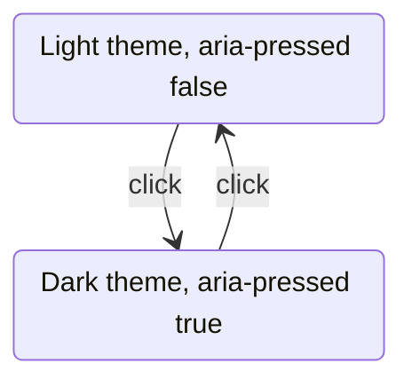
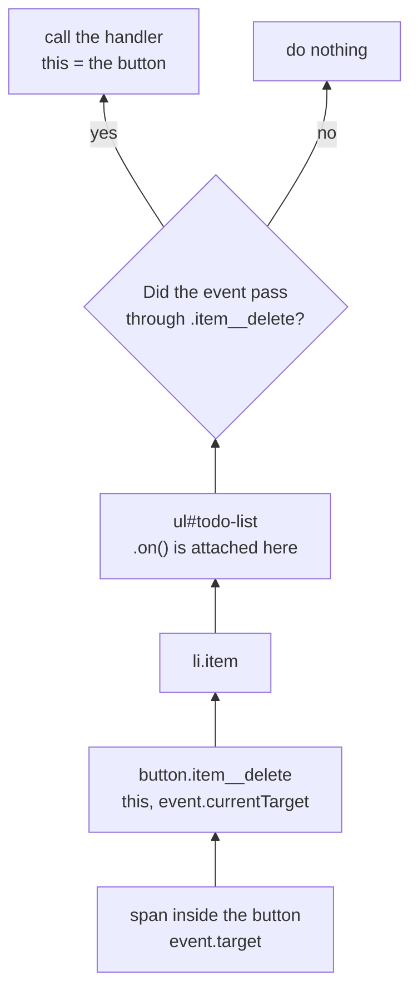

# Events

[Contents](../../README.md) · [← Back](../../Lesson-5/en/Creating%20and%20removing%20elements.md) · [Next →](../../Lesson-7/en/Effects%20and%20animation.md) · [RU](../ru/%D0%A1%D0%BE%D0%B1%D1%8B%D1%82%D0%B8%D1%8F.md) · [EN](Events.md) · [UZ](../uz/Hodisalar.md)

> **Link to lesson 5:** you learned how to create elements (`$("<li>")`), insert them (`.append`, `.prepend`) and remove them (`.remove`). But so far, all of this happened right when the page loaded. Today the page will start **responding to the user**: a click on a button will add a like, switch the theme, delete a list item, and typing text will update a character counter.

---

## Why you need this

Almost every website reacts to what people do: "Add to cart" increases the number on the icon, a cross closes a window, a star gives a rating, a comment field shows "40 characters left". All of these are **events** and **handlers**.

In the JavaScript course you wrote this with `addEventListener`. In other people's jQuery projects (WordPress, admin panels, old online shops) you will see `.on("click", ...)` - and that is exactly what you need to be able to read and write. And delegation in jQuery takes one line, without `event.target.closest(...)` and a `null` check.

---

## What you will learn

- Subscribe to events with the `.on()` method and explain why not `.click(fn)`.
- Use `this` and `$(this)` inside a handler and understand why an arrow function gets in the way here.
- Keep **state** between clicks: a like counter, a theme that is on.
- Read the event object: `event.target`, `event.currentTarget`, `event.type`, `event.key`.
- React to input (`input`) and keys (`keydown`).
- Cancel the browser's action (`preventDefault`) and stop bubbling (`stopPropagation`).
- Delegate events: `$list.on("click", ".item__delete", ...)` - for elements that will appear later.
- Manage handlers: `.off`, `.one`, `.trigger` and `click.menu` namespaces.

---

## Review: 3 questions from lesson 5

1. How is `$("<li>")` different from `$("li")`?
2. What does `.remove()` do, and how is it different from `.empty()`?
3. When rendering an array of objects, why is text written with `.text()` instead of gluing data into an HTML string?

Answers are at the end of the lesson.

---

## Lesson plan

| Section | What we do |
| --- | --- |
| The `.on()` method | Subscribing to an event, comparison with `addEventListener` |
| `this` and `$(this)` | Which element called the handler |
| State | Likes and a theme switch |
| The event object | `target`, `currentTarget`, `type`, `key` |
| Mini-task 1 | A "Show password" button |
| Input and keyboard | `input`, `keydown`, Escape |
| Default action and bubbling | `preventDefault`, `stopPropagation`, `return false` |
| Delegation | One handler for the whole list |
| Managing handlers | `.off`, `.one`, `.trigger`, namespaces |
| Mini-task 2 | A shopping list with deleting |
| Independent work | Likes, theme, list, counter |

---

## The `.on()` method

**In simple words:** an event handler is an instruction for a person on duty: "When the doorbell rings, open the door." You leave the instruction once, and it is carried out every time the bell rings. `.on()` is the way to leave such an instruction for an element.

```html
<button type="button" id="hello-btn">Say hello</button>
<p id="hello-text"></p>
```

```js
$("#hello-btn").on("click", function () {
    $("#hello-text").text("Hello!");
});
```

What you get: until the button is clicked, the paragraph is empty. After a click, `Hello!` appears in it.

| Part of the code | What it means |
| --- | --- |
| `$("#hello-btn")` | Which element we are waiting for the event on |
| `.on(` | "Subscribe to the event" |
| `"click"` | The event name - the same as in `addEventListener` |
| `function () { ... }` | The handler: code that runs on every click |

Just like `addEventListener`, only shorter. And the **implicit iteration** from lesson 1 works: `$(".card").on("click", ...)` subscribes **all** the cards at once, without a loop.

### Why not `.click(fn)`

In old code you will come across shortcuts:

| Old code | Status | How we write it in the course |
| --- | --- | --- |
| `$btn.click(function () { ... })` | Deprecated | `$btn.on("click", function () { ... })` |
| `$form.submit(function () { ... })` | Deprecated | `$form.on("submit", ...)` - lesson 8 |
| `$btn.bind("click", ...)`, `.delegate(...)` | Deprecated | `.on(...)` |
| `<button onclick="...">` | Mixes HTML and JS | `.on(...)` in the `main.js` file |

> **Important:** `.on()` subscribes only the elements that **already exist** on the page when it is called. A button created later with `$("<button>")` will not get the handler. The solution is delegation, which we will cover below.

---

## `this` and `$(this)`

If the page has five `.like` buttons and only one handler, how do you know which one was clicked? Inside a handler, the word `this` points to **the element on which the handler fired**.

**In simple words:** a teacher tells the whole class: "Whoever has finished, raise your hand." A particular student raises a hand. `this` is "the one who raised the hand".

```html
<button type="button" class="tag">HTML</button>
<button type="button" class="tag">CSS</button>
<button type="button" class="tag">JavaScript</button>
```

```js
$(".tag").on("click", function () {
    $(this).toggleClass("is-selected");
});
```

What you get: the clicked button becomes highlighted or loses its highlight, and the others do not change.

| Code | What it is | What you can do with it |
| --- | --- | --- |
| `this` | A DOM element | `this.id`, `this.textContent` |
| `$(this)` | A jQuery object with this element | `.text()`, `.addClass()`, `.closest()` |

This is the same "DOM element → jQuery object" conversion from lesson 1: `$(element)`.

### Arrow functions and `this`

```js
// Does not work: this is not the button
$(".tag").on("click", () => {
    $(this).toggleClass("is-selected");
});
```

An arrow function **has no `this` of its own**: it takes it from the outside, and outside it is `window`. There will be no error, but `$(this)` will not be the right button, and the class will not toggle.

| Do you need `$(this)`? | Which function to write |
| --- | --- |
| Yes | `function () { ... }` |
| No, or you take the element from `event.currentTarget` | An arrow function `(event) => { ... }` is fine |

> **Important:** in the course, inside handlers that need "this element", we write `function () { ... }`. This is the most common beginner mistake in jQuery.

---

## State between events

**In simple words:** state is what the page "remembers" between clicks. Like the score on a scoreboard: each goal adds one to what is already there instead of starting from zero.

### Likes

```html
<button type="button" id="like-btn">Like</button>
<span id="like-count">0</span>
```

```js
const $likeCount = $("#like-count");
let likes = 0;

$("#like-btn").on("click", function () {
    likes++;
    $likeCount.text(likes);
});
```

The `likes` variable is declared **outside** the handler: it is created once when the page loads and lives as long as the page is open. `let` - because the value changes.

| Step | What happens | Value / page state |
| --- | --- | --- |
| Load | `let likes = 0;`, subscribing with `.on("click", ...)` | `likes = 0`, the page shows `0` |
| Click 1 | `likes++`, `.text(likes)` | `likes = 1`, the page shows `1` |
| Click 2 | `likes++`, `.text(likes)` | `likes = 2`, the page shows `2` |
| Click 3 | `likes++`, `.text(likes)` | `likes = 3`, the page shows `3` |

### A theme switch and `aria-pressed`

A button that can be "pressed" and "not pressed" tells a screen reader its state with the `aria-pressed` attribute. The value is the string `"true"` or `"false"`.

```html
<button type="button" id="theme-toggle" aria-pressed="false">Dark theme</button>
```

```js
$("#theme-toggle").on("click", function () {
    const $body = $("body");
    $body.toggleClass("theme-dark");
    const isDark = $body.hasClass("theme-dark");
    $(this).attr("aria-pressed", String(isDark));
});
```

Here the state is stored not in a variable but **in the page itself**: whether `body` has the class `theme-dark` or not. `.hasClass()` from lesson 4 reads it.



**How to read the diagram.** The switch has two states. Each click moves it to the opposite one. That is why you need `toggleClass`, not `addClass`: `addClass` can only "turn on", and the second click will change nothing.

> **Important:** `String(isDark)` turns `true` into `"true"`. Attributes are always strings, and `aria-pressed` expects exactly the text `"true"` or `"false"`.

---

## The event object

The browser passes an **event object** with details to the handler. jQuery wraps it in its own object with the same properties so that they work the same everywhere. It is usually called `event`.

```js
$("#like-btn").on("click", function (event) {
    console.log(event.type);   // "click"
    console.log(event.target); // the element that was clicked
});
```

| Property | What it contains |
| --- | --- |
| `event.type` | The event name: `"click"`, `"input"`, `"keydown"` |
| `event.target` | The deepest element where the event happened |
| `event.currentTarget` | The element whose handler is running now (the same as `this`) |
| `event.key` | For the keyboard: `"Enter"`, `"Escape"`, `"a"` |

### `target` and `currentTarget`

**In simple words:** you knock on the window of a flat, and the owner opens the door. `target` is the window you knocked on, `currentTarget` is the flat that responded.

```html
<button type="button" id="save"><span class="icon">✓</span> Save</button>
```

```js
$("#save").on("click", function (event) {
    console.log(event.target);        // <span class="icon"> - if you hit the check mark
    console.log(event.currentTarget); // <button id="save"> - always the button
    console.log(this === event.currentTarget); // true
});
```

If you click right on the check mark, `event.target` is the `span`, not the button. So when you need the element with the handler, take `this` or `event.currentTarget`, not `event.target`.

---

## Mini-task 1

A "Show password" button:

```html
<input type="password" id="password">
<button type="button" id="show-password" aria-pressed="false">Show password</button>
```

When the button is clicked, the field switches between `type="password"` and `type="text"`, the button text between `Show password` and `Hide password`, and `aria-pressed` between `"false"` and `"true"`. Use `.on()`, `$(this)` and `.attr()` from lesson 3. The solution is in the "Answers" section.

---

## Input and keyboard

### The `input` event

`input` happens on **every** change of the field's value: a letter was typed, deleted, or text was pasted with the mouse.

```html
<textarea id="comment" maxlength="100"></textarea>
<p id="comment-counter">0 / 100</p>
```

```js
$("#comment").on("input", function () {
    const length = $(this).val().length;
    $("#comment-counter")
        .text(`${length} / 100`)
        .toggleClass("is-warning", length > 90);
});
```

`.val()` from lesson 3 reads the field's value, and `.toggleClass(name, state)` from lesson 4 adds the class if the condition is `true` and removes it if it is `false`.

| Step | What the user typed | `length` | Counter text | Class `is-warning` |
| --- | --- | --- | --- | --- |
| 1 | `Hello!` | 6 | `6 / 100` | no |
| 2 | 89 more characters | 95 | `95 / 100` | yes |
| 3 | 3 more characters | 98 | `98 / 100` | yes |
| 4 | deleted everything | 0 | `0 / 100` | no |

Step 3 shows why the second argument is needed. Without it, `.toggleClass("is-warning")` would toggle the class on **every** input: turn it on at 95 characters and off at 98.

| Event | When it happens |
| --- | --- |
| `input` | Every change of the value |
| `change` | The value changed and the field lost focus (for checkboxes and `select` - right away) |
| `keydown` | A key was pressed (before the field's value changed) |

### Keyboard: `keydown`

```js
$(document).on("keydown", function (event) {
    if (event.key === "Escape") {
        $(".modal").removeClass("is-open");
    }
});
```

A handler on `document` catches key presses on the whole page. `event.key` is the name of the key: `"Enter"`, `"Escape"`, `"ArrowUp"`, `" "` (space), letters.

> **Important:** for a character counter, use `input`, not `keydown`: `keydown` fires **before** the value changes and does not notice text pasted with the mouse.

---

## Default action and bubbling

### `preventDefault`

Some elements have a **default action**: a link opens an address, a form is submitted and reloads the page.

Suppose the page has a link `<a href="https://jlearn.space" class="demo-link">`:

```js
$(".demo-link").on("click", function (event) {
    event.preventDefault();
    $(this).text("Navigation cancelled");
});
```

Its main use is forms in lesson 8: we will check the fields ourselves and will not let the page reload.

### Bubbling and `stopPropagation`

An event happens on an element and then **bubbles up** to its parents: `button` → `li` → `ul` → `body` → `document`. The parents' handlers fire too.

**In simple words:** an air bubble from the bottom of an aquarium rises up and passes through every layer of water. Every layer "notices" the bubble.

```js
$(".card").on("click", function () {
    $(this).toggleClass("is-open");
});

$(".card__favorite").on("click", function (event) {
    event.stopPropagation(); // a click on the star does not open the card
    $(this).toggleClass("is-active");
});
```

Without `stopPropagation`, a click on the star inside a card would work twice: the star would toggle, and then the event would bubble up to `.card` - and the card would open.

| Code | What it cancels |
| --- | --- |
| `event.preventDefault()` | The browser's action (navigation, form submission) |
| `event.stopPropagation()` | Bubbling up to the parents |
| `return false;` in a jQuery handler | Both at once |

> **Important:** `return false` in jQuery is short but not obvious: someone reading the code may not realize that bubbling is stopped too. In the course we write `event.preventDefault()` explicitly, and `stopPropagation` only when it is really needed: it gets in the way of delegation.

---

## Delegation

In lesson 5 you rendered a list with the `renderCourses(list)` function. Suppose each item has a "Delete" button. If you subscribe the buttons like this:

```js
$(".item__delete").on("click", function () {
    $(this).closest(".item").remove();
});
```

then only the buttons that were on the page **at the moment** `.on()` was called will work. An item added later with `.append()` will not be deleted: its button never got the handler.

### The solution: one handler on the parent

**In simple words:** instead of giving a key to every new resident, you put a concierge at the building entrance. The concierge sees everyone who comes in - both old and new residents - and decides whom to let through.

```html
<ul id="todo-list">
    <li class="item"><span class="item__text">Review selectors</span> <button type="button" class="item__delete">Delete</button></li>
    <li class="item"><span class="item__text">Complete lesson 6</span> <button type="button" class="item__delete">Delete</button></li>
</ul>
```

```js
const $list = $("#todo-list");

$list.on("click", ".item__delete", function () {
    $(this).closest(".item").remove();
});
```

| Part of the code | What it means |
| --- | --- |
| `$list` | A parent that always exists - the handler is attached to it |
| `"click"` | The event |
| `".item__delete"` | **Filter selector**: react only to clicks that came from such elements |
| `this` | The `.item__delete` button that was clicked (not the list!) |



**How to read the diagram.** The diagram is read from bottom to top, the way the event bubbles up. The click reaches the list, and jQuery checks the path: was there an `.item__delete` element on it. If yes, it calls the handler and puts exactly this button into `this`. If the item text was clicked, the handler is not called at all.

### Comparison with plain JavaScript

```js
// Plain JavaScript (lesson 8 of the JS course)
list.addEventListener("click", (event) => {
    const button = event.target.closest(".item__delete");
    if (!button) {
        return;
    }
    button.closest(".item").remove();
});

// jQuery
$list.on("click", ".item__delete", function () {
    $(this).closest(".item").remove();
});
```

jQuery does the `closest` and the `null` check by itself: that is exactly what the second selector argument is. And the list itself, where `.on()` is attached, is available as `event.delegateTarget`.

### Delegation step by step

The item "New item" was added with `.append()` **after** subscribing. The user clicks its "Delete" button.

| Step | What happens | Value / page state |
| --- | --- | --- |
| 1 | Click on the button of the new item | `event.target` is the button |
| 2 | The event bubbles up: button → `li` → `ul#todo-list` | `ul` has a jQuery handler |
| 3 | jQuery checks the path against the `.item__delete` selector | The button matches |
| 4 | The handler is called | `this` is the button of the new item |
| 5 | `$(this).closest(".item")` | The `li` of the new item is found |
| 6 | `.remove()` | The item is gone, the others stay |

### Update the counter after deleting

After deleting, the number of items must be **counted again**, not decreased by hand:

```js
$list.on("click", ".item__delete", function () {
    $(this).closest(".item").remove();
    $("#items-count").text(`Items: ${$list.children(".item").length}`);
});
```

When no items are left, `.length` returns `0`, and the page shows `Items: 0` - without errors.

---

## Managing handlers

### `.off()` - remove a handler

`$("#like-btn").off("click");` - the button no longer reacts to clicks.

### `.one()` - fire only once

```js
$("#accept-cookies").one("click", function () {
    $(this).text("Thank you!");
});
```

The handler fires on the first click and removes itself. Handy for "Accept the terms" or "Show a hint once".

### `.trigger()` - fire an event from code

```js
$("#comment").on("input", function () {
    $("#comment-counter").text(`${$(this).val().length} / 100`);
});

$("#comment").val("Draft").trigger("input"); // the counter immediately shows 5 / 100
```

**In simple words:** `.trigger()` is like ringing the doorbell for a guest. Everything that happens on a real ring happens now. This way you do not need to copy the handler's code to run it when the page loads.

### Namespaces: `click.menu`

One button can have handlers from different parts of the code: yours, a plugin's, analytics. `.off("click")` would remove **all** of them. A namespace is the handler's "surname":

```js
$("#menu-btn").on("click.menu", function () {
    $("#menu").toggleClass("is-open");
});

$("#menu-btn").on("click.stats", function () {
    console.log("Menu click");
});

$("#menu-btn").off(".menu"); // only the menu handler is removed, the stats still work
```

| Code | What it does |
| --- | --- |
| `.on("click.menu", fn)` | Subscribe with the `menu` namespace |
| `.off("click.menu")` | Remove the clicks of the `menu` namespace |
| `.off(".menu")` | Remove **all** events of the `menu` namespace |
| `.trigger("click.menu")` | Run only the `menu` handlers |

---

### Try to break it

1. In the theme handler, replace `function ()` with `() =>`. What happens to `aria-pressed`? Print `this` to the console.
2. Move `let likes = 0;` inside the like handler and click three times. What number is on the page?
3. Subscribe the delete buttons directly with `$(".item__delete").on(...)`, then add an item in the console with `$("#todo-list").append(...)` and try to delete it.
4. Remove the second argument from `.toggleClass("is-warning", length > 90)` and type 95, then 96 characters. What happens to the class?
5. Add `return false;` to the click handler of a list item, and attach `.on("click", ...)` with `console.log` to `body`. Does it fire?
6. Replace the `input` event with `change`. When does the counter update now?

### Typical beginner mistakes

| Mistake | What you get | How to fix |
| --- | --- | --- |
| An arrow function and `$(this)` | Nothing changes: `this` is `window` | `function () { ... }` or `$(event.currentTarget)` |
| `let likes = 0;` inside the handler | The counter is always `1` | Declare it outside |
| `addClass` in a switch | The second click turns nothing off | `toggleClass` |
| Subscribing new elements directly | Items added later do not react | Delegation `$list.on("click", ".item__delete", ...)` |
| `$(this).remove()` in the delete button | The button disappears, the item text stays | `$(this).closest(".item").remove()` |
| Delegation without a selector `$list.on("click", ...)` | `this` is the whole list; a click on the text also deletes | The second argument `".item__delete"` |
| `event.target` instead of `this` | A click on an icon inside the button gives the wrong element | `this` or `event.currentTarget` |
| `change` for a character counter | Updates only after leaving the field | `input` |
| `.toggleClass("x")` without a state | The class flickers on every input | `.toggleClass("x", condition)` |

---

## Mini-task 2

A shopping list:

```html
<input type="text" id="product" placeholder="What to buy?">
<button type="button" id="add-product">Add</button>
<ul id="shopping-list"></ul>
<p id="shopping-count">Products: 0</p>
```

1. When `#add-product` is clicked, create an item `li.product` with the text from the field (`.trim()`, do not add an empty string) and a button `button.product__delete` with the text `✕`. Clear the field.
2. With one delegated handler on `#shopping-list`, delete an item when its `✕` is clicked.
3. A click on the item itself (not on `✕`) toggles its class `is-bought`.
4. Update `#shopping-count` after adding and deleting.

---

## Lesson summary: cheat sheet

| Task | Code |
| --- | --- |
| Subscribe to an event | `$el.on("click", function () { ... })` |
| The element on which the handler fired | `this`, `$(this)`, `event.currentTarget` |
| The deepest element under the cursor | `event.target` |
| Keep state | `let count = 0;` outside the handler |
| Toggle a class by a condition | `$el.toggleClass("x", condition)` |
| Input in a field | `$input.on("input", function () { $(this).val() })` |
| A key | `$(document).on("keydown", ...)`, `event.key === "Escape"` |
| Cancel the browser's action | `event.preventDefault()` |
| Stop bubbling | `event.stopPropagation()` |
| Delegation | `$list.on("click", ".item__delete", function () { ... })` |
| Remove a handler | `$el.off("click")`, `$el.off(".menu")` |
| Only once | `$el.one("click", fn)` |
| Fire from code | `$el.trigger("click")` |

---

## Independent work

### Part 1. IDE task (graded by the platform)

The page has a button `#like-btn` and a number `#like-count`, a theme button `#theme-toggle` with `aria-pressed="false"`, a list `#todo-list` of items `li.item` (each with `.item__text` and a button `.item__delete`), a paragraph `#items-count` with the text `Items: 3`, a field `#comment` and a paragraph `#comment-counter`. jQuery is already loaded. Bring the page to life:

1. A click on `#like-btn` increases the number in `#like-count` by 1. The variable `let likes = 0;` is declared outside the handler.
2. A click on `#theme-toggle` toggles the class `theme-dark` on `body` and sets the button's `aria-pressed` to `"true"` or `"false"`.
3. Deleting with delegation: **one** handler `$("#todo-list").on("click", ".item__delete", ...)` deletes the whole `li.item` whose button was clicked and writes `Items: 2` into `#items-count` - the number of items left. Items added after the page loads must be deleted too.
4. When the user types in `#comment`, `#comment-counter` shows `12 / 100`, and if there are more than 90 characters, `#comment-counter` has the class `is-warning`.

Handlers only through `.on()`; do not use `.click(fn)`, `addEventListener`, `onclick`, `innerHTML`, `.html()` or `.style`.

What the platform checks: one and three clicks on the like button; turning the theme on and off together with `aria-pressed`; that the whole item is deleted, not the button; the text of `#items-count` after deleting, and `Items: 0` after all items are deleted; that an item added **after** loading is deleted; that a click on the item text deletes nothing; the character counter, including after the field is cleared; the class `is-warning` at 95 and 98 characters and its absence at 5; subscribing with `.on()`; no errors.

### Part 2. Project on your computer

1. Rewrite all handlers in `main.js` of your website from the JavaScript course in jQuery: `addEventListener` → `.on()`.
2. Make a theme switch with `aria-pressed` and store the class `theme-dark` on `body`; add dark theme styles to the CSS.
3. If your website has a list rendered from an array (lesson 5), add a delete button with delegation to each item.
4. Add closing an open menu or window with Escape.

### Acceptance criteria

- [ ] The IDE task is accepted.
- [ ] All handlers in your code are attached with `.on()`, there is no `.click(fn)` or `onclick`.
- [ ] Where `$(this)` is needed, the handler is written as `function () { ... }`.
- [ ] Deleting works for items added after the page loads.
- [ ] You can explain the difference between `event.target` and `this`.

---

## Self-check questions

1. Why is `.on("click", fn)` better than `.click(fn)` and `onclick=""`?
2. What is `this` in a jQuery handler, and how do you turn it into a jQuery object?
3. Why does `$(this)` not work with an arrow function?
4. Where should you declare a counter variable, and why?
5. How is `event.target` different from `event.currentTarget`?
6. Which event should you choose for a character counter, and why not `change`?
7. How is `preventDefault()` different from `stopPropagation()`? What does `return false` do?
8. What is delegation, and which two problems does it solve?
9. What are `click.menu` namespaces for?
10. What do `.one()` and `.trigger()` do?

After the questions, take the **lesson test** on the platform: 12 questions, pass mark 70%.

---

## What's next

Right now elements appear and disappear instantly. In lesson 7 we will add **effects and animation**: smooth appearing with `.fadeIn()`, collapsing with `.slideUp()`, your own animation with `.animate()` - and we will build an accordion that opens on click. The `.on()` handlers from this lesson will start these effects.

---

## Answers

**Review**

1. `$("<li>")` **creates** a new `li` element (not on the page yet), while `$("li")` **finds** all existing `li` elements.
2. `.remove()` deletes the element itself together with its content; `.empty()` keeps the element but deletes everything inside it.
3. `.text()` inserts data as text: if the data contains `<script>` or markup, the browser will not run it.

**Mini-task 1**

```js
$("#show-password").on("click", function () {
    const $password = $("#password");
    const isHidden = $password.attr("type") === "password";

    $password.attr("type", isHidden ? "text" : "password");
    $(this)
        .text(isHidden ? "Hide password" : "Show password")
        .attr("aria-pressed", String(isHidden));
});
```

**Mini-task 2**

```js
const $product = $("#product");
const $shoppingList = $("#shopping-list");

function updateCount() {
    $("#shopping-count").text(`Products: ${$shoppingList.children(".product").length}`);
}

$("#add-product").on("click", function () {
    const name = $product.val().trim();
    if (name === "") {
        return;
    }

    const $item = $("<li>", { class: "product" });
    $("<span>", { class: "product__name", text: name }).appendTo($item);
    $("<button>", { type: "button", class: "product__delete", text: "✕" }).appendTo($item);
    $shoppingList.append($item);

    $product.val("");
    updateCount();
});

$shoppingList.on("click", ".product__delete", function (event) {
    event.stopPropagation();
    $(this).closest(".product").remove();
    updateCount();
});

$shoppingList.on("click", ".product", function () {
    $(this).toggleClass("is-bought");
});
```

**Self-check questions**

1. `.on()` is one method for all events, and it supports delegation and namespaces; `.click(fn)` is deprecated, and `onclick=""` mixes HTML and JavaScript.
2. The DOM element on which the handler fired; `$(this)`.
3. An arrow function has no `this` of its own: it takes it from the outside, usually `window`.
4. Outside the handler: then it is created once and keeps its value between clicks.
5. `target` is the deepest element that was hit (for example, an icon), `currentTarget` is the element whose handler is running (the button), the same as `this`.
6. `input`: it fires on every change, including pasting with the mouse; `change` fires only after leaving the field.
7. `preventDefault` cancels the browser's action, `stopPropagation` cancels bubbling up to the parents; `return false` in jQuery does both.
8. One handler on the parent with a filter selector. It solves: many handlers → one; elements added later work too.
9. To remove and fire only your own handlers (`.off(".menu")`) without touching other people's handlers on the same element.
10. `.one()` attaches a handler that fires once and removes itself; `.trigger()` fires an event from code, and its handlers run.

[Contents](../../README.md) · [← Back](../../Lesson-5/en/Creating%20and%20removing%20elements.md) · [Next →](../../Lesson-7/en/Effects%20and%20animation.md) · [RU](../ru/%D0%A1%D0%BE%D0%B1%D1%8B%D1%82%D0%B8%D1%8F.md) · [EN](Events.md) · [UZ](../uz/Hodisalar.md)
