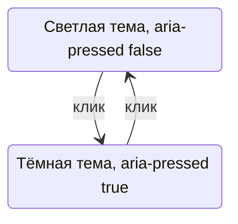
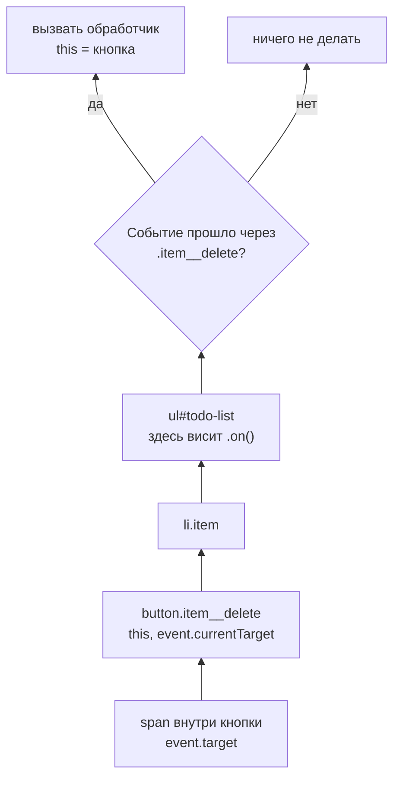

# События

[Содержание](../../README.md) · [← Назад](../../Lesson-5/ru/%D0%A1%D0%BE%D0%B7%D0%B4%D0%B0%D0%BD%D0%B8%D0%B5%20%D0%B8%20%D1%83%D0%B4%D0%B0%D0%BB%D0%B5%D0%BD%D0%B8%D0%B5%20%D1%8D%D0%BB%D0%B5%D0%BC%D0%B5%D0%BD%D1%82%D0%BE%D0%B2.md) · [Вперёд →](../../Lesson-7/ru/%D0%AD%D1%84%D1%84%D0%B5%D0%BA%D1%82%D1%8B%20%D0%B8%20%D0%B0%D0%BD%D0%B8%D0%BC%D0%B0%D1%86%D0%B8%D1%8F.md) · [RU](%D0%A1%D0%BE%D0%B1%D1%8B%D1%82%D0%B8%D1%8F.md) · [EN](../en/Events.md) · [UZ](../uz/Hodisalar.md)

> **Связь с уроком 5:** вы научились создавать элементы (`$("<li>")`), вставлять их (`.append`, `.prepend`) и удалять (`.remove`). Но пока всё это происходило сразу при загрузке страницы. Сегодня страница начнёт **отвечать пользователю**: клик по кнопке добавит лайк, переключит тему, удалит пункт списка, а ввод текста обновит счётчик символов.

---

## Зачем это вам

Почти любой сайт реагирует на действия человека: «Добавить в корзину» увеличивает число на значке, крестик закрывает окно, звёздочка ставит оценку, поле комментария показывает «осталось 40 символов». Всё это - **события** и **обработчики**.

В курсе JavaScript вы писали это через `addEventListener`. В чужих проектах на jQuery (WordPress, админки, старые магазины) вы увидите `.on("click", ...)` - и именно его нужно уметь читать и писать. А делегирование в jQuery записывается одной строкой, без `event.target.closest(...)` и проверки на `null`.

---

## Чему вы научитесь

- Подписываться на события методом `.on()` и объяснять, почему не `.click(fn)`.
- Использовать `this` и `$(this)` внутри обработчика и понимать, почему стрелочная функция здесь мешает.
- Хранить **состояние** между кликами: счётчик лайков, включённая тема.
- Читать объект события: `event.target`, `event.currentTarget`, `event.type`, `event.key`.
- Реагировать на ввод (`input`) и клавиши (`keydown`).
- Отменять действие браузера (`preventDefault`) и останавливать всплытие (`stopPropagation`).
- Делегировать события: `$list.on("click", ".item__delete", ...)` - для элементов, которые появятся позже.
- Управлять обработчиками: `.off`, `.one`, `.trigger` и пространства имён `click.menu`.

---

## Повторение: 3 вопроса из урока 5

1. Чем `$("<li>")` отличается от `$("li")`?
2. Что делает `.remove()` и чем он отличается от `.empty()`?
3. Почему при отрисовке массива объектов текст записывают через `.text()`, а не склеивают HTML-строку с данными?

Ответы - в конце урока.

---

## План урока

| Раздел | Что делаем |
| --- | --- |
| Метод `.on()` | Подписка на событие, сравнение с `addEventListener` |
| `this` и `$(this)` | Какой элемент вызвал обработчик |
| Состояние | Лайки и переключатель темы |
| Объект события | `target`, `currentTarget`, `type`, `key` |
| Мини-задание 1 | Кнопка «Показать пароль» |
| Ввод и клавиатура | `input`, `keydown`, Escape |
| Действие по умолчанию и всплытие | `preventDefault`, `stopPropagation`, `return false` |
| Делегирование | Один обработчик на весь список |
| Управление обработчиками | `.off`, `.one`, `.trigger`, пространства имён |
| Мини-задание 2 | Список покупок с удалением |
| Самостоятельная работа | Лайки, тема, список, счётчик |

---

## Метод `.on()`

**Простыми словами:** обработчик события - это инструкция дежурному: «Когда позвонят в дверь - открой». Вы оставляете инструкцию один раз, а выполняется она каждый раз, когда звонят. `.on()` - это способ оставить такую инструкцию элементу.

```html
<button type="button" id="hello-btn">Поздороваться</button>
<p id="hello-text"></p>
```

```js
$("#hello-btn").on("click", function () {
    $("#hello-text").text("Привет!");
});
```

Что получится: пока кнопку не нажали, абзац пустой. После клика в нём появляется `Привет!`.

| Часть записи | Что означает |
| --- | --- |
| `$("#hello-btn")` | На каком элементе ждём событие |
| `.on(` | «Подпишись на событие» |
| `"click"` | Имя события - то же, что в `addEventListener` |
| `function () { ... }` | Обработчик: код, который выполнится при каждом клике |

Как и `addEventListener`, только короче. И работает **неявный перебор** из урока 1: `$(".card").on("click", ...)` подписывает **все** карточки сразу, без цикла.

### Почему не `.click(fn)`

В старом коде вы встретите сокращения:

| Старая запись | Статус | Как писать в курсе |
| --- | --- | --- |
| `$btn.click(function () { ... })` | Устарела | `$btn.on("click", function () { ... })` |
| `$form.submit(function () { ... })` | Устарела | `$form.on("submit", ...)` - урок 8 |
| `$btn.bind("click", ...)`, `.delegate(...)` | Устарели | `.on(...)` |
| `<button onclick="...">` | Смешивает HTML и JS | `.on(...)` в файле `main.js` |

> **Важно:** `.on()` подписывает только те элементы, которые **уже есть** на странице в момент вызова. Кнопка, созданная позже через `$("<button>")`, обработчик не получит. Решение - делегирование, разберём ниже.

---

## `this` и `$(this)`

Если на странице пять кнопок `.like`, а обработчик один, как узнать, какую нажали? Внутри обработчика слово `this` указывает на **тот элемент, на котором сработал обработчик**.

**Простыми словами:** учитель говорит всему классу: «Кто закончил - поднимите руку». Руку поднимает конкретный ученик. `this` - это «тот, кто поднял руку».

```html
<button type="button" class="tag">HTML</button>
<button type="button" class="tag">CSS</button>
<button type="button" class="tag">JavaScript</button>
```

```js
$(".tag").on("click", function () {
    $(this).toggleClass("is-selected");
});
```

Что получится: нажатая кнопка выделяется или снимает выделение, остальные не меняются.

| Запись | Что это | Что с ним можно |
| --- | --- | --- |
| `this` | DOM-элемент | `this.id`, `this.textContent` |
| `$(this)` | jQuery-объект с этим элементом | `.text()`, `.addClass()`, `.closest()` |

Это тот же переход «DOM-элемент → jQuery-объект» из урока 1: `$(element)`.

### Стрелочная функция и `this`

```js
// Не работает: this - не кнопка
$(".tag").on("click", () => {
    $(this).toggleClass("is-selected");
});
```

У стрелочной функции **нет своего `this`**: она берёт его снаружи, а снаружи это `window`. Ошибки не будет, но `$(this)` окажется не той кнопкой, и класс не переключится.

| Нужен `$(this)`? | Какую функцию писать |
| --- | --- |
| Да | `function () { ... }` |
| Нет, или берёте элемент из `event.currentTarget` | Можно стрелочную `(event) => { ... }` |

> **Важно:** в курсе внутри обработчиков, где нужен «этот элемент», пишем `function () { ... }`. Это самая частая ошибка новичков в jQuery.

---

## Состояние между событиями

**Простыми словами:** состояние - это то, что страница «помнит» между кликами. Как счёт на табло: каждый гол прибавляет единицу к тому, что уже есть, а не начинает с нуля.

### Лайки

```html
<button type="button" id="like-btn">Нравится</button>
<span id="like-count">0</span>
```

```js
const $likeCount = $("#like-count");
let likes = 0;

$("#like-btn").on("click", function () {
    likes++;
    $likeCount.text(likes);
});
```

Переменная `likes` объявлена **снаружи** обработчика: она создаётся один раз при загрузке и живёт, пока открыта страница. `let` - потому что значение меняется.

| Шаг | Что происходит | Значение / состояние страницы |
| --- | --- | --- |
| Загрузка | `let likes = 0;`, подписка `.on("click", ...)` | `likes = 0`, на странице `0` |
| Клик 1 | `likes++`, `.text(likes)` | `likes = 1`, на странице `1` |
| Клик 2 | `likes++`, `.text(likes)` | `likes = 2`, на странице `2` |
| Клик 3 | `likes++`, `.text(likes)` | `likes = 3`, на странице `3` |

### Переключатель темы и `aria-pressed`

Кнопка, которая бывает «нажата» и «отжата», сообщает своё состояние экранной читалке атрибутом `aria-pressed`. Значение - строка `"true"` или `"false"`.

```html
<button type="button" id="theme-toggle" aria-pressed="false">Тёмная тема</button>
```

```js
$("#theme-toggle").on("click", function () {
    const $body = $("body");
    $body.toggleClass("theme-dark");
    const isDark = $body.hasClass("theme-dark");
    $(this).attr("aria-pressed", String(isDark));
});
```

Здесь состояние хранится не в переменной, а **в самой странице**: есть у `body` класс `theme-dark` или нет. `.hasClass()` из урока 4 его читает.



**Как читать схему.** У переключателя два состояния. Каждый клик переводит его в противоположное. Поэтому нужен `toggleClass`, а не `addClass`: `addClass` умеет только «включить», и второй клик ничего не изменит.

> **Важно:** `String(isDark)` превращает `true` в `"true"`. Атрибуты - всегда строки, и `aria-pressed` ожидает именно текст `"true"` или `"false"`.

---

## Объект события

Браузер передаёт в обработчик **объект события** с подробностями. jQuery оборачивает его в свой объект с теми же свойствами, чтобы они работали одинаково везде. Принято называть его `event`.

```js
$("#like-btn").on("click", function (event) {
    console.log(event.type);   // "click"
    console.log(event.target); // элемент, по которому кликнули
});
```

| Свойство | Что содержит |
| --- | --- |
| `event.type` | Имя события: `"click"`, `"input"`, `"keydown"` |
| `event.target` | Самый глубокий элемент, на котором произошло событие |
| `event.currentTarget` | Элемент, чей обработчик сейчас выполняется (то же, что `this`) |
| `event.key` | Для клавиатуры: `"Enter"`, `"Escape"`, `"a"` |

### `target` и `currentTarget`

**Простыми словами:** вы стучите в окно квартиры, а дверь открывает хозяин. `target` - окно, в которое постучали, `currentTarget` - квартира, которая отреагировала.

```html
<button type="button" id="save"><span class="icon">✓</span> Сохранить</button>
```

```js
$("#save").on("click", function (event) {
    console.log(event.target);        // <span class="icon"> - если попали по галочке
    console.log(event.currentTarget); // <button id="save"> - всегда кнопка
    console.log(this === event.currentTarget); // true
});
```

Если попасть мышью по галочке, `event.target` - это `span`, а не кнопка. Поэтому, когда нужен элемент с обработчиком, берите `this` или `event.currentTarget`, а не `event.target`.

---

## Мини-задание 1

Кнопка «Показать пароль»:

```html
<input type="password" id="password">
<button type="button" id="show-password" aria-pressed="false">Показать пароль</button>
```

По клику на кнопку поле переключается между `type="password"` и `type="text"`, текст кнопки - между `Показать пароль` и `Скрыть пароль`, а `aria-pressed` - между `"false"` и `"true"`. Используйте `.on()`, `$(this)` и `.attr()` из урока 3. Решение - в разделе «Ответы».

---

## Ввод и клавиатура

### Событие `input`

`input` происходит при **каждом** изменении значения поля: напечатали букву, стёрли, вставили текст мышью.

```html
<textarea id="comment" maxlength="100"></textarea>
<p id="comment-counter">0 / 100</p>
```

```js
$("#comment").on("input", function () {
    const length = $(this).val().length;
    $("#comment-counter")
        .text(`${length} / 100`)
        .toggleClass("is-warning", length > 90);
});
```

`.val()` из урока 3 читает значение поля, а `.toggleClass(имя, состояние)` из урока 4 ставит класс, если условие `true`, и убирает, если `false`.

| Шаг | Что ввёл пользователь | `length` | Текст счётчика | Класс `is-warning` |
| --- | --- | --- | --- | --- |
| 1 | `Привет` | 6 | `6 / 100` | нет |
| 2 | ещё 89 символов | 95 | `95 / 100` | есть |
| 3 | ещё 3 символа | 98 | `98 / 100` | есть |
| 4 | стёр всё | 0 | `0 / 100` | нет |

На шаге 3 видно, зачем второй аргумент. Без него `.toggleClass("is-warning")` переключал бы класс при **каждом** вводе: на 95 символах включил, на 98 - выключил.

| Событие | Когда происходит |
| --- | --- |
| `input` | Каждое изменение значения |
| `change` | Значение изменено и поле потеряло фокус (у флажков и `select` - сразу) |
| `keydown` | Нажата клавиша (до того, как значение поля изменилось) |

### Клавиатура: `keydown`

```js
$(document).on("keydown", function (event) {
    if (event.key === "Escape") {
        $(".modal").removeClass("is-open");
    }
});
```

Обработчик на `document` ловит нажатия на всей странице. `event.key` - название клавиши: `"Enter"`, `"Escape"`, `"ArrowUp"`, `" "` (пробел), буквы.

> **Важно:** для счётчика символов берите `input`, а не `keydown`: `keydown` срабатывает **до** изменения значения и не замечает вставку текста мышью.

---

## Действие по умолчанию и всплытие

### `preventDefault`

У некоторых элементов есть **действие по умолчанию**: ссылка открывает адрес, форма отправляется и перезагружает страницу.

Пусть на странице есть ссылка `<a href="https://jlearn.space" class="demo-link">`:

```js
$(".demo-link").on("click", function (event) {
    event.preventDefault();
    $(this).text("Переход отменён");
});
```

Главное применение - формы в уроке 8: проверим поля сами и не дадим странице перезагрузиться.

### Всплытие и `stopPropagation`

Событие происходит на элементе, а затем **всплывает** к родителям: `button` → `li` → `ul` → `body` → `document`. Обработчики родителей тоже срабатывают.

**Простыми словами:** пузырёк воздуха со дна аквариума поднимается вверх и проходит через каждый слой воды. Каждый слой «замечает» пузырёк.

```js
$(".card").on("click", function () {
    $(this).toggleClass("is-open");
});

$(".card__favorite").on("click", function (event) {
    event.stopPropagation(); // клик по звёздочке не раскрывает карточку
    $(this).toggleClass("is-active");
});
```

Без `stopPropagation` клик по звёздочке внутри карточки сработал бы дважды: звёздочка переключилась бы, а потом событие всплыло бы до `.card` - и карточка раскрылась бы.

| Запись | Что отменяет |
| --- | --- |
| `event.preventDefault()` | Действие браузера (переход, отправку формы) |
| `event.stopPropagation()` | Всплытие к родителям |
| `return false;` в обработчике jQuery | Оба сразу |

> **Важно:** `return false` в jQuery - короткая, но неочевидная запись: читатель кода может не понять, что всплытие тоже остановлено. В курсе пишем `event.preventDefault()` явно, а `stopPropagation` - только когда он действительно нужен: он мешает делегированию.

---

## Делегирование

В уроке 5 вы рисовали список функцией `renderCourses(list)`. Допустим, у каждого пункта есть кнопка «Удалить». Если подписать кнопки так:

```js
$(".item__delete").on("click", function () {
    $(this).closest(".item").remove();
});
```

то работают только кнопки, которые были на странице **в момент вызова** `.on()`. Пункт, добавленный позже через `.append()`, не удалится: его кнопка обработчик не получила.

### Решение: один обработчик на родителе

**Простыми словами:** вместо того чтобы давать ключ каждому новому жильцу, вы ставите консьержа у входа в подъезд. Консьерж видит всех, кто входит, - и старых, и новых жильцов - и решает, кого пропустить.

```html
<ul id="todo-list">
    <li class="item"><span class="item__text">Повторить селекторы</span> <button type="button" class="item__delete">Удалить</button></li>
    <li class="item"><span class="item__text">Пройти урок 6</span> <button type="button" class="item__delete">Удалить</button></li>
</ul>
```

```js
const $list = $("#todo-list");

$list.on("click", ".item__delete", function () {
    $(this).closest(".item").remove();
});
```

| Часть записи | Что означает |
| --- | --- |
| `$list` | Родитель, который существует всегда, - на нём висит обработчик |
| `"click"` | Событие |
| `".item__delete"` | **Селектор-фильтр**: реагировать только на клики, пришедшие с таких элементов |
| `this` | Та кнопка `.item__delete`, по которой кликнули (не список!) |



**Как читать схему.** Схема читается снизу вверх, как всплывает событие. Клик доходит до списка, и jQuery проверяет путь: был ли на нём элемент `.item__delete`. Если да - вызывает обработчик и подставляет в `this` именно эту кнопку. Если кликнули по тексту пункта - обработчик не вызывается вовсе.

### Сравнение с чистым JavaScript

```js
// Чистый JavaScript (урок 8 курса JS)
list.addEventListener("click", (event) => {
    const button = event.target.closest(".item__delete");
    if (!button) {
        return;
    }
    button.closest(".item").remove();
});

// jQuery
$list.on("click", ".item__delete", function () {
    $(this).closest(".item").remove();
});
```

jQuery сам делает `closest` и проверку на `null`: это и есть второй аргумент-селектор. А сам список, на котором висит `.on()`, доступен как `event.delegateTarget`.

### Делегирование по шагам

Пункт «Новый пункт» добавлен через `.append()` **после** подписки. Пользователь кликает по его кнопке «Удалить».

| Шаг | Что происходит | Значение / состояние страницы |
| --- | --- | --- |
| 1 | Клик по кнопке нового пункта | `event.target` - кнопка |
| 2 | Событие всплывает: кнопка → `li` → `ul#todo-list` | На `ul` есть обработчик jQuery |
| 3 | jQuery проверяет путь на селектор `.item__delete` | Кнопка подходит |
| 4 | Вызов обработчика | `this` - кнопка нового пункта |
| 5 | `$(this).closest(".item")` | Найден `li` нового пункта |
| 6 | `.remove()` | Пункт исчез, остальные на месте |

### Обновить счётчик после удаления

После удаления число пунктов нужно **посчитать заново**, а не уменьшать вручную:

```js
$list.on("click", ".item__delete", function () {
    $(this).closest(".item").remove();
    $("#items-count").text(`Пунктов: ${$list.children(".item").length}`);
});
```

Когда пунктов не останется, `.length` вернёт `0`, и на странице будет `Пунктов: 0` - без ошибок.

---

## Управление обработчиками

### `.off()` - снять обработчик

`$("#like-btn").off("click");` - кнопка больше не реагирует на клик.

### `.one()` - сработать один раз

```js
$("#accept-cookies").one("click", function () {
    $(this).text("Спасибо!");
});
```

Обработчик сработает при первом клике и снимется сам. Удобно для «Принять условия», «Показать подсказку один раз».

### `.trigger()` - запустить событие из кода

```js
$("#comment").on("input", function () {
    $("#comment-counter").text(`${$(this).val().length} / 100`);
});

$("#comment").val("Черновик").trigger("input"); // счётчик сразу покажет 8 / 100
```

**Простыми словами:** `.trigger()` - как нажать кнопку звонка за гостя. Срабатывает всё то же, что и при настоящем звонке. Так не нужно копировать код обработчика, чтобы выполнить его при загрузке.

### Пространства имён: `click.menu`

На одной кнопке могут висеть обработчики из разных частей кода: ваш, плагина, аналитики. `.off("click")` снял бы **все**. Пространство имён - это «фамилия» обработчика:

```js
$("#menu-btn").on("click.menu", function () {
    $("#menu").toggleClass("is-open");
});

$("#menu-btn").on("click.stats", function () {
    console.log("Клик по меню");
});

$("#menu-btn").off(".menu"); // снят только обработчик меню, статистика работает
```

| Запись | Что делает |
| --- | --- |
| `.on("click.menu", fn)` | Подписка с пространством имён `menu` |
| `.off("click.menu")` | Снять клики пространства `menu` |
| `.off(".menu")` | Снять **все** события пространства `menu` |
| `.trigger("click.menu")` | Запустить только обработчики `menu` |

---

### Попробуйте сломать

1. Замените в обработчике темы `function ()` на `() =>`. Что произойдёт с `aria-pressed`? Выведите `this` в консоль.
2. Перенесите `let likes = 0;` внутрь обработчика лайков и кликните три раза. Какое число на странице?
3. Подпишите кнопки удаления напрямую `$(".item__delete").on(...)`, затем в консоли добавьте пункт `$("#todo-list").append(...)` и попробуйте его удалить.
4. Уберите второй аргумент у `.toggleClass("is-warning", length > 90)` и наберите 95, затем 96 символов. Что с классом?
5. Добавьте `return false;` в обработчик клика по пункту списка, а на `body` повесьте `.on("click", ...)` с `console.log`. Срабатывает ли он?
6. Замените событие `input` на `change`. Когда теперь обновляется счётчик?

### Частые ошибки новичков

| Ошибка | Что получится | Как исправить |
| --- | --- | --- |
| Стрелочная функция и `$(this)` | Ничего не меняется: `this` - `window` | `function () { ... }` или `$(event.currentTarget)` |
| `let likes = 0;` внутри обработчика | Счётчик всегда `1` | Объявить снаружи |
| `addClass` в переключателе | Второй клик ничего не выключает | `toggleClass` |
| Прямая подписка новых элементов | Добавленные позже пункты не реагируют | Делегирование `$list.on("click", ".item__delete", ...)` |
| `$(this).remove()` в кнопке удаления | Исчезает кнопка, текст пункта остаётся | `$(this).closest(".item").remove()` |
| Делегирование без селектора `$list.on("click", ...)` | `this` - весь список; клик по тексту тоже удаляет | Второй аргумент `".item__delete"` |
| `event.target` вместо `this` | При клике по иконке внутри кнопки - не тот элемент | `this` или `event.currentTarget` |
| `change` для счётчика символов | Обновляется только после ухода из поля | `input` |
| `.toggleClass("x")` без состояния | Класс мигает при каждом вводе | `.toggleClass("x", условие)` |

---

## Мини-задание 2

Список покупок:

```html
<input type="text" id="product" placeholder="Что купить?">
<button type="button" id="add-product">Добавить</button>
<ul id="shopping-list"></ul>
<p id="shopping-count">Покупок: 0</p>
```

1. По клику на `#add-product` создайте пункт `li.product` с текстом из поля (`.trim()`, пустую строку не добавляйте) и кнопкой `button.product__delete` с текстом `✕`. Очистите поле.
2. Одним делегированным обработчиком на `#shopping-list` удаляйте пункт по клику на `✕`.
3. Клик по самому пункту (не по `✕`) переключает у него класс `is-bought`.
4. После добавления и удаления обновляйте `#shopping-count`.

---

## Итоги урока: шпаргалка

| Задача | Запись |
| --- | --- |
| Подписаться на событие | `$el.on("click", function () { ... })` |
| Элемент, на котором сработал обработчик | `this`, `$(this)`, `event.currentTarget` |
| Самый глубокий элемент под курсором | `event.target` |
| Хранить состояние | `let count = 0;` снаружи обработчика |
| Переключить класс по условию | `$el.toggleClass("x", условие)` |
| Ввод в поле | `$input.on("input", function () { $(this).val() })` |
| Клавиша | `$(document).on("keydown", ...)`, `event.key === "Escape"` |
| Отменить действие браузера | `event.preventDefault()` |
| Остановить всплытие | `event.stopPropagation()` |
| Делегирование | `$list.on("click", ".item__delete", function () { ... })` |
| Снять обработчик | `$el.off("click")`, `$el.off(".menu")` |
| Один раз | `$el.one("click", fn)` |
| Запустить из кода | `$el.trigger("click")` |

---

## Самостоятельная работа

### Часть 1. Задание в IDE (засчитывается платформой)

На странице есть кнопка `#like-btn` и число `#like-count`, кнопка темы `#theme-toggle` с `aria-pressed="false"`, список `#todo-list` из пунктов `li.item` (внутри `.item__text` и кнопка `.item__delete`), абзац `#items-count` с текстом `Пунктов: 3`, поле `#comment` и абзац `#comment-counter`. jQuery уже подключён. Оживите страницу:

1. Клик по `#like-btn` увеличивает число в `#like-count` на 1. Переменная `let likes = 0;` объявлена снаружи обработчика.
2. Клик по `#theme-toggle` переключает у `body` класс `theme-dark` и ставит кнопке `aria-pressed` `"true"` или `"false"`.
3. Удаление делегированием: **один** обработчик `$("#todo-list").on("click", ".item__delete", ...)` удаляет весь пункт `li.item`, в котором нажата кнопка, и записывает в `#items-count` `Пунктов: 2` - число пунктов, которые остались. Пункты, добавленные после загрузки, тоже должны удаляться.
4. При вводе в `#comment` в `#comment-counter` пишется `12 / 100`, а если символов больше 90 - у `#comment-counter` есть класс `is-warning`.

Обработчики - только через `.on()`; `.click(fn)`, `addEventListener`, `onclick`, `innerHTML`, `.html()` и `.style` не используйте.

Что проверяет платформа: один и три клика по лайку; включение и выключение темы вместе с `aria-pressed`; что удаляется весь пункт, а не кнопка; текст `#items-count` после удаления и `Пунктов: 0` после удаления всех пунктов; что удаляется пункт, добавленный **после** загрузки; что клик по тексту пункта ничего не удаляет; счётчик символов, в том числе после очистки поля; класс `is-warning` при 95 и 98 символах и его отсутствие при 5; подписку через `.on()`; отсутствие ошибок.

### Часть 2. Проект на компьютере

1. Перепишите на jQuery все обработчики из `main.js` своего сайта курса JavaScript: `addEventListener` → `.on()`.
2. Сделайте переключатель темы с `aria-pressed` и сохраните в `body` класс `theme-dark`; добавьте стили тёмной темы в CSS.
3. Если на сайте есть список, который рисуется из массива (урок 5), добавьте в каждый пункт кнопку удаления с делегированием.
4. Добавьте закрытие открытого меню или окна по Escape.

### Критерии готовности

- [ ] Задание в IDE засчитано.
- [ ] Во всём коде обработчики подключены через `.on()`, нет `.click(fn)` и `onclick`.
- [ ] Там, где нужен `$(this)`, обработчик написан через `function () { ... }`.
- [ ] Удаление работает для пунктов, добавленных после загрузки.
- [ ] Вы можете объяснить разницу между `event.target` и `this`.

---

## Вопросы для самопроверки

1. Чем `.on("click", fn)` лучше `.click(fn)` и `onclick=""`?
2. Что такое `this` в обработчике jQuery и как превратить его в jQuery-объект?
3. Почему со стрелочной функцией `$(this)` не работает?
4. Где нужно объявить переменную-счётчик и почему?
5. Чем `event.target` отличается от `event.currentTarget`?
6. Какое событие выбрать для счётчика символов и почему не `change`?
7. Чем `preventDefault()` отличается от `stopPropagation()`? Что делает `return false`?
8. Что такое делегирование и какие две задачи оно решает?
9. Зачем нужны пространства имён `click.menu`?
10. Что делают `.one()` и `.trigger()`?

После вопросов пройдите **тест урока** на платформе: 12 вопросов, порог 70%.

---

## Что дальше

Сейчас элементы появляются и исчезают мгновенно. В уроке 7 добавим **эффекты и анимацию**: плавное появление `.fadeIn()`, сворачивание `.slideUp()`, свою анимацию `.animate()` - и соберём аккордеон, который раскрывается по клику. Обработчики `.on()` из этого урока будут запускать эти эффекты.

---

## Ответы

**Повторение**

1. `$("<li>")` **создаёт** новый элемент `li` (пока не на странице), а `$("li")` **находит** все существующие `li`.
2. `.remove()` удаляет сам элемент вместе с содержимым; `.empty()` оставляет элемент, но удаляет всё внутри него.
3. `.text()` вставляет данные как текст: если в данных окажется `<script>` или разметка, браузер их не выполнит.

**Мини-задание 1**

```js
$("#show-password").on("click", function () {
    const $password = $("#password");
    const isHidden = $password.attr("type") === "password";

    $password.attr("type", isHidden ? "text" : "password");
    $(this)
        .text(isHidden ? "Скрыть пароль" : "Показать пароль")
        .attr("aria-pressed", String(isHidden));
});
```

**Мини-задание 2**

```js
const $product = $("#product");
const $shoppingList = $("#shopping-list");

function updateCount() {
    $("#shopping-count").text(`Покупок: ${$shoppingList.children(".product").length}`);
}

$("#add-product").on("click", function () {
    const name = $product.val().trim();
    if (name === "") {
        return;
    }

    const $item = $("<li>", { class: "product" });
    $("<span>", { class: "product__name", text: name }).appendTo($item);
    $("<button>", { type: "button", class: "product__delete", text: "✕" }).appendTo($item);
    $shoppingList.append($item);

    $product.val("");
    updateCount();
});

$shoppingList.on("click", ".product__delete", function (event) {
    event.stopPropagation();
    $(this).closest(".product").remove();
    updateCount();
});

$shoppingList.on("click", ".product", function () {
    $(this).toggleClass("is-bought");
});
```

**Вопросы для самопроверки**

1. `.on()` - один метод для всех событий, умеет делегирование и пространства имён; `.click(fn)` устарел, а `onclick=""` смешивает HTML и JavaScript.
2. DOM-элемент, на котором сработал обработчик; `$(this)`.
3. У стрелочной функции нет своего `this`: она берёт его снаружи, обычно это `window`.
4. Снаружи обработчика: тогда она создаётся один раз и сохраняет значение между кликами.
5. `target` - самый глубокий элемент, по которому попали (например, иконка), `currentTarget` - элемент, чей обработчик выполняется (кнопка), то же, что `this`.
6. `input`: он срабатывает при каждом изменении, включая вставку мышью; `change` - только после ухода из поля.
7. `preventDefault` отменяет действие браузера, `stopPropagation` - всплытие к родителям; `return false` в jQuery делает оба.
8. Один обработчик на родителе с селектором-фильтром. Решает: много обработчиков → один; элементы, добавленные позже, тоже работают.
9. Чтобы снимать и запускать только свои обработчики (`.off(".menu")`), не трогая чужие на том же элементе.
10. `.one()` подключает обработчик, который сработает один раз и снимется; `.trigger()` запускает событие из кода, и срабатывают его обработчики.

[Содержание](../../README.md) · [← Назад](../../Lesson-5/ru/%D0%A1%D0%BE%D0%B7%D0%B4%D0%B0%D0%BD%D0%B8%D0%B5%20%D0%B8%20%D1%83%D0%B4%D0%B0%D0%BB%D0%B5%D0%BD%D0%B8%D0%B5%20%D1%8D%D0%BB%D0%B5%D0%BC%D0%B5%D0%BD%D1%82%D0%BE%D0%B2.md) · [Вперёд →](../../Lesson-7/ru/%D0%AD%D1%84%D1%84%D0%B5%D0%BA%D1%82%D1%8B%20%D0%B8%20%D0%B0%D0%BD%D0%B8%D0%BC%D0%B0%D1%86%D0%B8%D1%8F.md) · [RU](%D0%A1%D0%BE%D0%B1%D1%8B%D1%82%D0%B8%D1%8F.md) · [EN](../en/Events.md) · [UZ](../uz/Hodisalar.md)
