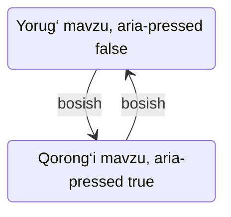
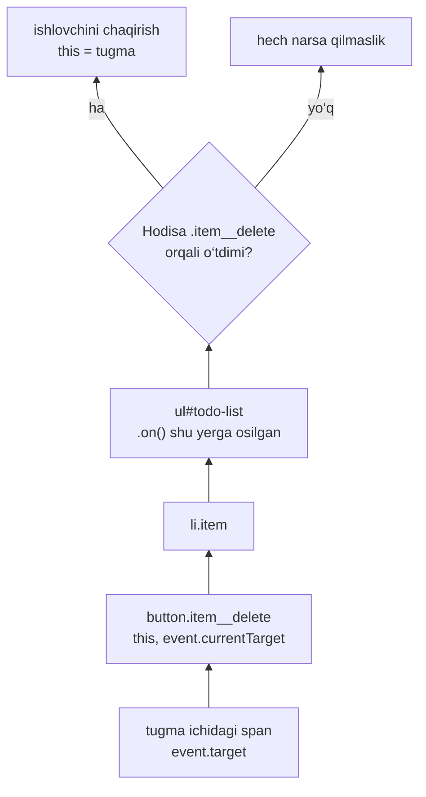

# Hodisalar

[Mundarija](../../README.md) · [← Orqaga](../../Lesson-5/uz/Elementlarni%20yaratish%20va%20o'chirish.md) · [Keyingi →](../../Lesson-7/uz/Effektlar%20va%20animatsiya.md) · [RU](../ru/%D0%A1%D0%BE%D0%B1%D1%8B%D1%82%D0%B8%D1%8F.md) · [EN](../en/Events.md) · [UZ](Hodisalar.md)

> **5-dars bilan bog‘liqlik:** siz elementlarni yaratishni (`$("<li>")`), ularni joylashni (`.append`, `.prepend`) va o‘chirishni (`.remove`) o‘rgandingiz. Lekin hozircha bularning hammasi sahifa yuklanishi bilanoq sodir bo‘lardi. Bugun sahifa **foydalanuvchiga javob bera** boshlaydi: tugmaga bosish layk qo‘shadi, mavzuni almashtiradi, ro‘yxat bandini o‘chiradi, matn kiritish esa belgilar hisoblagichini yangilaydi.

---

## Bu sizga nima uchun kerak

Deyarli har qanday sayt odamning harakatlariga javob beradi: «Savatga qo‘shish» belgidagi sonni oshiradi, xochcha oynani yopadi, yulduzcha baho qo‘yadi, izoh maydoni «40 ta belgi qoldi» deb ko‘rsatadi. Bularning hammasi - **hodisalar** va **ishlovchilar**.

JavaScript kursida siz buni `addEventListener` orqali yozgansiz. Boshqalarning jQuery’dagi loyihalarida (WordPress, admin panellar, eski do‘konlar) siz `.on("click", ...)` ni ko‘rasiz - aynan uni o‘qiy va yoza olish kerak. jQuery’da delegatsiya esa `event.target.closest(...)` va `null` tekshiruvisiz bitta qatorda yoziladi.

---

## Nimani o‘rganasiz

- `.on()` metodi bilan hodisalarga obuna bo‘lish va nima uchun `.click(fn)` emasligini tushuntirish.
- Ishlovchi ichida `this` va `$(this)` dan foydalanish va bu yerda strelkali funksiya nima uchun xalaqit berishini tushunish.
- Bosishlar orasida **holatni** saqlash: layklar hisoblagichi, yoqilgan mavzu.
- Hodisa obyektini o‘qish: `event.target`, `event.currentTarget`, `event.type`, `event.key`.
- Kiritishga (`input`) va tugmachalarga (`keydown`) javob berish.
- Brauzer amalini bekor qilish (`preventDefault`) va ko‘tarilishni to‘xtatish (`stopPropagation`).
- Hodisalarni delegatsiya qilish: `$list.on("click", ".item__delete", ...)` - keyinroq paydo bo‘ladigan elementlar uchun.
- Ishlovchilarni boshqarish: `.off`, `.one`, `.trigger` va `click.menu` nomlar fazolari.

---

## Takrorlash: 5-darsdan 3 savol

1. `$("<li>")` ning `$("li")` dan farqi nimada?
2. `.remove()` nima qiladi va uning `.empty()` dan farqi nimada?
3. Obyektlar massivini chizishda nima uchun matn HTML satrini ma’lumotlar bilan yopishtirib emas, `.text()` orqali yoziladi?

Javoblar - dars oxirida.

---

## Reja

| Bo‘lim | Nima qilamiz |
| --- | --- |
| `.on()` metodi | Hodisaga obuna bo‘lish, `addEventListener` bilan solishtirish |
| `this` va `$(this)` | Ishlovchini qaysi element chaqirgani |
| Holat | Layklar va mavzu almashtirgichi |
| Hodisa obyekti | `target`, `currentTarget`, `type`, `key` |
| Mini-topshiriq 1 | «Parolni ko‘rsatish» tugmasi |
| Kiritish va klaviatura | `input`, `keydown`, Escape |
| Standart amal va ko‘tarilish | `preventDefault`, `stopPropagation`, `return false` |
| Delegatsiya | Butun ro‘yxatga bitta ishlovchi |
| Ishlovchilarni boshqarish | `.off`, `.one`, `.trigger`, nomlar fazolari |
| Mini-topshiriq 2 | O‘chirish imkoniyatli xaridlar ro‘yxati |
| Mustaqil ish | Layklar, mavzu, ro‘yxat, hisoblagich |

---

## `.on()` metodi

**Oddiy so‘z bilan:** hodisa ishlovchisi - navbatchiga berilgan ko‘rsatma: «Eshik qo‘ng‘irog‘i chalinsa - eshikni och». Siz ko‘rsatmani bir marta qoldirasiz, u esa har safar qo‘ng‘iroq chalinganda bajariladi. `.on()` - elementga shunday ko‘rsatma qoldirish usuli.

```html
<button type="button" id="hello-btn">Salomlashish</button>
<p id="hello-text"></p>
```

```js
$("#hello-btn").on("click", function () {
    $("#hello-text").text("Salom!");
});
```

Nima bo‘ladi: tugma bosilmaguncha xatboshi bo‘sh. Bosishdan keyin unda `Salom!` paydo bo‘ladi.

| Yozuv qismi | Ma’nosi |
| --- | --- |
| `$("#hello-btn")` | Hodisani qaysi elementda kutamiz |
| `.on(` | «Hodisaga obuna bo‘l» |
| `"click"` | Hodisa nomi - `addEventListener` dagi bilan bir xil |
| `function () { ... }` | Ishlovchi: har bir bosishda bajariladigan kod |

`addEventListener` kabi, faqat qisqaroq. Va 1-darsdagi **yashirin aylanib chiqish** ishlaydi: `$(".card").on("click", ...)` sikl yozmasdan **barcha** kartochkalarni birdaniga obuna qiladi.

### Nima uchun `.click(fn)` emas

Eski kodda siz qisqartmalarni uchratasiz:

| Eski yozuv | Holati | Kursda qanday yoziladi |
| --- | --- | --- |
| `$btn.click(function () { ... })` | Eskirgan | `$btn.on("click", function () { ... })` |
| `$form.submit(function () { ... })` | Eskirgan | `$form.on("submit", ...)` - 8-dars |
| `$btn.bind("click", ...)`, `.delegate(...)` | Eskirgan | `.on(...)` |
| `<button onclick="...">` | HTML va JS ni aralashtiradi | `main.js` faylida `.on(...)` |

> **Muhim:** `.on()` faqat chaqiruv paytida sahifada **allaqachon bor** elementlarni obuna qiladi. Keyinroq `$("<button>")` orqali yaratilgan tugma ishlovchini olmaydi. Yechim - delegatsiya, uni quyida ko‘rib chiqamiz.

---

## `this` va `$(this)`

Sahifada beshta `.like` tugmasi bo‘lsa-yu, ishlovchi bitta bo‘lsa, qaysi biri bosilganini qanday bilish mumkin? Ishlovchi ichida `this` so‘zi **ishlovchi ishga tushgan elementni** ko‘rsatadi.

**Oddiy so‘z bilan:** o‘qituvchi butun sinfga aytadi: «Kim tugatgan bo‘lsa - qo‘lini ko‘tarsin». Qo‘lni aniq bir o‘quvchi ko‘taradi. `this` - «qo‘l ko‘targan o‘sha o‘quvchi».

```html
<button type="button" class="tag">HTML</button>
<button type="button" class="tag">CSS</button>
<button type="button" class="tag">JavaScript</button>
```

```js
$(".tag").on("click", function () {
    $(this).toggleClass("is-selected");
});
```

Nima bo‘ladi: bosilgan tugma ajratib ko‘rsatiladi yoki ajratish olib tashlanadi, qolganlari o‘zgarmaydi.

| Yozuv | Bu nima | U bilan nima qilish mumkin |
| --- | --- | --- |
| `this` | DOM elementi | `this.id`, `this.textContent` |
| `$(this)` | Shu element bor jQuery obyekti | `.text()`, `.addClass()`, `.closest()` |

Bu 1-darsdagi o‘sha «DOM elementi → jQuery obyekti» o‘tishi: `$(element)`.

### Strelkali funksiya va `this`

```js
// Ishlamaydi: this - tugma emas
$(".tag").on("click", () => {
    $(this).toggleClass("is-selected");
});
```

Strelkali funksiyaning **o‘z `this` i yo‘q**: u uni tashqaridan oladi, tashqarida esa bu `window`. Xato chiqmaydi, lekin `$(this)` boshqa narsa bo‘lib chiqadi va klass almashmaydi.

| `$(this)` kerakmi? | Qanday funksiya yozish kerak |
| --- | --- |
| Ha | `function () { ... }` |
| Yo‘q, yoki elementni `event.currentTarget` dan olasiz | Strelkali `(event) => { ... }` ham bo‘ladi |

> **Muhim:** kursda «shu element» kerak bo‘lgan ishlovchilar ichida `function () { ... }` deb yozamiz. Bu jQuery’da yangi o‘rganuvchilarning eng ko‘p uchraydigan xatosi.

---

## Hodisalar orasidagi holat

**Oddiy so‘z bilan:** holat - sahifa bosishlar orasida «eslab qoladigan» narsa. Tablodagi hisob kabi: har bir gol noldan boshlamay, bor hisobga bitta qo‘shadi.

### Layklar

```html
<button type="button" id="like-btn">Yoqdi</button>
<span id="like-count">0</span>
```

```js
const $likeCount = $("#like-count");
let likes = 0;

$("#like-btn").on("click", function () {
    likes++;
    $likeCount.text(likes);
});
```

`likes` o‘zgaruvchisi ishlovchidan **tashqarida** e’lon qilingan: u yuklanishda bir marta yaratiladi va sahifa ochiq turguncha yashaydi. `let` - chunki qiymat o‘zgaradi.

| Qadam | Nima sodir bo‘ladi | Qiymat / sahifa holati |
| --- | --- | --- |
| Yuklanish | `let likes = 0;`, `.on("click", ...)` obunasi | `likes = 0`, sahifada `0` |
| 1-bosish | `likes++`, `.text(likes)` | `likes = 1`, sahifada `1` |
| 2-bosish | `likes++`, `.text(likes)` | `likes = 2`, sahifada `2` |
| 3-bosish | `likes++`, `.text(likes)` | `likes = 3`, sahifada `3` |

### Mavzu almashtirgichi va `aria-pressed`

«Bosilgan» va «bosilmagan» bo‘lishi mumkin bo‘lgan tugma o‘z holatini ekran o‘qish dasturiga `aria-pressed` atributi orqali bildiradi. Qiymati - `"true"` yoki `"false"` satri.

```html
<button type="button" id="theme-toggle" aria-pressed="false">Qorong‘i mavzu</button>
```

```js
$("#theme-toggle").on("click", function () {
    const $body = $("body");
    $body.toggleClass("theme-dark");
    const isDark = $body.hasClass("theme-dark");
    $(this).attr("aria-pressed", String(isDark));
});
```

Bu yerda holat o‘zgaruvchida emas, **sahifaning o‘zida** saqlanadi: `body` da `theme-dark` klassi bormi yoki yo‘qmi. 4-darsdagi `.hasClass()` uni o‘qiydi.



**Sxemani qanday o‘qish kerak.** Almashtirgichning ikkita holati bor. Har bir bosish uni qarama-qarshi holatga o‘tkazadi. Shuning uchun `addClass` emas, `toggleClass` kerak: `addClass` faqat «yoqa» oladi, ikkinchi bosish esa hech narsani o‘zgartirmaydi.

> **Muhim:** `String(isDark)` `true` ni `"true"` ga aylantiradi. Atributlar doim satr bo‘ladi, `aria-pressed` esa aynan `"true"` yoki `"false"` matnini kutadi.

---

## Hodisa obyekti

Brauzer ishlovchiga tafsilotlar bilan **hodisa obyektini** uzatadi. jQuery uni hamma joyda bir xil ishlashi uchun xuddi shu xususiyatlarga ega o‘z obyektiga o‘raydi. Uni odatda `event` deb nomlashadi.

```js
$("#like-btn").on("click", function (event) {
    console.log(event.type);   // "click"
    console.log(event.target); // bosilgan element
});
```

| Xususiyat | Nimani saqlaydi |
| --- | --- |
| `event.type` | Hodisa nomi: `"click"`, `"input"`, `"keydown"` |
| `event.target` | Hodisa sodir bo‘lgan eng chuqur element |
| `event.currentTarget` | Hozir ishlovchisi bajarilayotgan element (`this` bilan bir xil) |
| `event.key` | Klaviatura uchun: `"Enter"`, `"Escape"`, `"a"` |

### `target` va `currentTarget`

**Oddiy so‘z bilan:** siz kvartira derazasini taqillatasiz, eshikni esa uy egasi ochadi. `target` - taqillatilgan deraza, `currentTarget` - javob bergan kvartira.

```html
<button type="button" id="save"><span class="icon">✓</span> Saqlash</button>
```

```js
$("#save").on("click", function (event) {
    console.log(event.target);        // <span class="icon"> - agar belgichaga tegilgan bo‘lsa
    console.log(event.currentTarget); // <button id="save"> - doim tugma
    console.log(this === event.currentTarget); // true
});
```

Agar sichqoncha bilan belgichaga tegsangiz, `event.target` tugma emas, `span` bo‘ladi. Shuning uchun ishlovchisi bor element kerak bo‘lsa, `event.target` ni emas, `this` yoki `event.currentTarget` ni oling.

---

## Mini-topshiriq 1

«Parolni ko‘rsatish» tugmasi:

```html
<input type="password" id="password">
<button type="button" id="show-password" aria-pressed="false">Parolni ko‘rsatish</button>
```

Tugma bosilganda maydon `type="password"` va `type="text"` orasida, tugma matni - `Parolni ko‘rsatish` va `Parolni yashirish` orasida, `aria-pressed` esa `"false"` va `"true"` orasida almashadi. `.on()`, `$(this)` va 3-darsdagi `.attr()` dan foydalaning. Yechim - «Javoblar» bo‘limida.

---

## Kiritish va klaviatura

### `input` hodisasi

`input` maydon qiymatining **har bir** o‘zgarishida sodir bo‘ladi: harf yozildi, o‘chirildi, sichqoncha bilan matn qo‘yildi.

```html
<textarea id="comment" maxlength="100"></textarea>
<p id="comment-counter">0 / 100</p>
```

```js
$("#comment").on("input", function () {
    const length = $(this).val().length;
    $("#comment-counter")
        .text(`${length} / 100`)
        .toggleClass("is-warning", length > 90);
});
```

3-darsdagi `.val()` maydon qiymatini o‘qiydi, 4-darsdagi `.toggleClass(nom, holat)` esa shart `true` bo‘lsa klassni qo‘yadi, `false` bo‘lsa olib tashlaydi.

| Qadam | Foydalanuvchi nima kiritdi | `length` | Hisoblagich matni | `is-warning` klassi |
| --- | --- | --- | --- | --- |
| 1 | `Salom!` | 6 | `6 / 100` | yo‘q |
| 2 | yana 89 ta belgi | 95 | `95 / 100` | bor |
| 3 | yana 3 ta belgi | 98 | `98 / 100` | bor |
| 4 | hammasini o‘chirdi | 0 | `0 / 100` | yo‘q |

3-qadamda ikkinchi argument nima uchun kerakligi ko‘rinadi. Usiz `.toggleClass("is-warning")` klassni **har bir** kiritishda almashtirgan bo‘lardi: 95 ta belgida yoqardi, 98 tada - o‘chirardi.

| Hodisa | Qachon sodir bo‘ladi |
| --- | --- |
| `input` | Qiymatning har bir o‘zgarishi |
| `change` | Qiymat o‘zgardi va maydon fokusni yo‘qotdi (bayroqchalar va `select` da - darhol) |
| `keydown` | Tugmacha bosildi (maydon qiymati o‘zgarishidan oldin) |

### Klaviatura: `keydown`

```js
$(document).on("keydown", function (event) {
    if (event.key === "Escape") {
        $(".modal").removeClass("is-open");
    }
});
```

`document` dagi ishlovchi butun sahifadagi bosishlarni ushlaydi. `event.key` - tugmacha nomi: `"Enter"`, `"Escape"`, `"ArrowUp"`, `" "` (probel), harflar.

> **Muhim:** belgilar hisoblagichi uchun `keydown` ni emas, `input` ni oling: `keydown` qiymat o‘zgarishidan **oldin** ishga tushadi va sichqoncha bilan matn qo‘yilganini sezmaydi.

---

## Standart amal va ko‘tarilish

### `preventDefault`

Ba’zi elementlarda **standart amal** bor: havola manzilni ochadi, forma yuboriladi va sahifani qayta yuklaydi.

Sahifada `<a href="https://jlearn.space" class="demo-link">` havolasi bor deylik:

```js
$(".demo-link").on("click", function (event) {
    event.preventDefault();
    $(this).text("O‘tish bekor qilindi");
});
```

Asosiy qo‘llanilishi - 8-darsdagi formalar: maydonlarni o‘zimiz tekshiramiz va sahifaning qayta yuklanishiga yo‘l qo‘ymaymiz.

### Ko‘tarilish va `stopPropagation`

Hodisa elementda sodir bo‘ladi, keyin esa ota-onalariga **ko‘tariladi**: `button` → `li` → `ul` → `body` → `document`. Ota-onalarning ishlovchilari ham ishga tushadi.

**Oddiy so‘z bilan:** akvarium tubidagi havo pufakchasi yuqoriga ko‘tariladi va suvning har bir qatlamidan o‘tadi. Har bir qatlam pufakchani «sezadi».

```js
$(".card").on("click", function () {
    $(this).toggleClass("is-open");
});

$(".card__favorite").on("click", function (event) {
    event.stopPropagation(); // yulduzchaga bosish kartochkani ochmaydi
    $(this).toggleClass("is-active");
});
```

`stopPropagation` siz kartochka ichidagi yulduzchaga bosish ikki marta ishlagan bo‘lardi: yulduzcha almashardi, keyin hodisa `.card` gacha ko‘tarilardi - va kartochka ochilardi.

| Yozuv | Nimani bekor qiladi |
| --- | --- |
| `event.preventDefault()` | Brauzer amalini (o‘tish, formani yuborish) |
| `event.stopPropagation()` | Ota-onalarga ko‘tarilishni |
| jQuery ishlovchisida `return false;` | Ikkalasini birdaniga |

> **Muhim:** jQuery’dagi `return false` - qisqa, lekin tushunarsiz yozuv: kodni o‘qigan odam ko‘tarilish ham to‘xtatilganini tushunmasligi mumkin. Kursda `event.preventDefault()` ni aniq yozamiz, `stopPropagation` ni esa faqat haqiqatan kerak bo‘lganda: u delegatsiyaga xalaqit beradi.

---

## Delegatsiya

5-darsda siz ro‘yxatni `renderCourses(list)` funksiyasi bilan chizgansiz. Faraz qilaylik, har bir bandda «O‘chirish» tugmasi bor. Agar tugmalarni shunday obuna qilsangiz:

```js
$(".item__delete").on("click", function () {
    $(this).closest(".item").remove();
});
```

unda faqat `.on()` chaqirilgan **paytda** sahifada bo‘lgan tugmalar ishlaydi. Keyinroq `.append()` orqali qo‘shilgan band o‘chirilmaydi: uning tugmasi ishlovchini olmagan.

### Yechim: ota elementda bitta ishlovchi

**Oddiy so‘z bilan:** har bir yangi ijarachiga kalit berish o‘rniga, siz podyezd kirishiga navbatchi qo‘yasiz. Navbatchi kirgan hammani - eski ijarachilarni ham, yangilarini ham - ko‘radi va kimni o‘tkazishni hal qiladi.

```html
<ul id="todo-list">
    <li class="item"><span class="item__text">Selektorlarni takrorlash</span> <button type="button" class="item__delete">O‘chirish</button></li>
    <li class="item"><span class="item__text">6-darsni o‘tish</span> <button type="button" class="item__delete">O‘chirish</button></li>
</ul>
```

```js
const $list = $("#todo-list");

$list.on("click", ".item__delete", function () {
    $(this).closest(".item").remove();
});
```

| Yozuv qismi | Ma’nosi |
| --- | --- |
| `$list` | Doim mavjud bo‘lgan ota element - ishlovchi unga osilgan |
| `"click"` | Hodisa |
| `".item__delete"` | **Filtr-selektor**: faqat shunday elementlardan kelgan bosishlarga javob berish |
| `this` | Bosilgan o‘sha `.item__delete` tugmasi (ro‘yxat emas!) |



**Sxemani qanday o‘qish kerak.** Sxema hodisa ko‘tarilgani kabi pastdan yuqoriga o‘qiladi. Bosish ro‘yxatgacha yetib boradi va jQuery yo‘lni tekshiradi: unda `.item__delete` elementi bo‘lganmi. Agar bo‘lsa - ishlovchini chaqiradi va `this` ga aynan shu tugmani qo‘yadi. Agar band matniga bosilgan bo‘lsa - ishlovchi umuman chaqirilmaydi.

### Sof JavaScript bilan solishtirish

```js
// Sof JavaScript (JS kursining 8-darsi)
list.addEventListener("click", (event) => {
    const button = event.target.closest(".item__delete");
    if (!button) {
        return;
    }
    button.closest(".item").remove();
});

// jQuery
$list.on("click", ".item__delete", function () {
    $(this).closest(".item").remove();
});
```

jQuery `closest` va `null` tekshiruvini o‘zi bajaradi: ikkinchi argument-selektor aynan shu. `.on()` osilgan ro‘yxatning o‘zi esa `event.delegateTarget` sifatida mavjud.

### Delegatsiya qadamma-qadam

«Yangi band» bandi obunadan **keyin** `.append()` orqali qo‘shilgan. Foydalanuvchi uning «O‘chirish» tugmasini bosadi.

| Qadam | Nima sodir bo‘ladi | Qiymat / sahifa holati |
| --- | --- | --- |
| 1 | Yangi bandning tugmasiga bosish | `event.target` - tugma |
| 2 | Hodisa ko‘tariladi: tugma → `li` → `ul#todo-list` | `ul` da jQuery ishlovchisi bor |
| 3 | jQuery yo‘lni `.item__delete` selektoriga tekshiradi | Tugma mos keladi |
| 4 | Ishlovchini chaqirish | `this` - yangi bandning tugmasi |
| 5 | `$(this).closest(".item")` | Yangi bandning `li` elementi topildi |
| 6 | `.remove()` | Band yo‘qoldi, qolganlari joyida |

### O‘chirishdan keyin hisoblagichni yangilash

O‘chirishdan keyin bandlar sonini qo‘lda kamaytirmay, **qaytadan sanash** kerak:

```js
$list.on("click", ".item__delete", function () {
    $(this).closest(".item").remove();
    $("#items-count").text(`Bandlar: ${$list.children(".item").length}`);
});
```

Bandlar qolmaganda `.length` `0` qaytaradi va sahifada xatolarsiz `Bandlar: 0` chiqadi.

---

## Ishlovchilarni boshqarish

### `.off()` - ishlovchini olib tashlash

`$("#like-btn").off("click");` - tugma endi bosishga javob bermaydi.

### `.one()` - bir marta ishlash

```js
$("#accept-cookies").one("click", function () {
    $(this).text("Rahmat!");
});
```

Ishlovchi birinchi bosishda ishlaydi va o‘zi olib tashlanadi. «Shartlarni qabul qilish», «Maslahatni bir marta ko‘rsatish» uchun qulay.

### `.trigger()` - hodisani koddan ishga tushirish

```js
$("#comment").on("input", function () {
    $("#comment-counter").text(`${$(this).val().length} / 100`);
});

$("#comment").val("Qoralama").trigger("input"); // hisoblagich darhol 8 / 100 ni ko‘rsatadi
```

**Oddiy so‘z bilan:** `.trigger()` - mehmon o‘rniga qo‘ng‘iroq tugmasini bosishdek. Haqiqiy qo‘ng‘iroqdagi hamma narsa ishga tushadi. Shunda ishlovchini yuklanishda bajarish uchun uning kodini nusxalash kerak bo‘lmaydi.

### Nomlar fazolari: `click.menu`

Bitta tugmada kodning turli qismlaridan ishlovchilar osilgan bo‘lishi mumkin: sizniki, plaginniki, analitikaniki. `.off("click")` ularning **hammasini** olib tashlagan bo‘lardi. Nomlar fazosi - ishlovchining «familiyasi»:

```js
$("#menu-btn").on("click.menu", function () {
    $("#menu").toggleClass("is-open");
});

$("#menu-btn").on("click.stats", function () {
    console.log("Menyuga bosish");
});

$("#menu-btn").off(".menu"); // faqat menyu ishlovchisi olib tashlandi, statistika ishlayapti
```

| Yozuv | Nima qiladi |
| --- | --- |
| `.on("click.menu", fn)` | `menu` nomlar fazosi bilan obuna bo‘lish |
| `.off("click.menu")` | `menu` fazosidagi bosishlarni olib tashlash |
| `.off(".menu")` | `menu` fazosidagi **barcha** hodisalarni olib tashlash |
| `.trigger("click.menu")` | Faqat `menu` ishlovchilarini ishga tushirish |

---

### Buzib ko‘ring

1. Mavzu ishlovchisida `function ()` ni `() =>` ga almashtiring. `aria-pressed` bilan nima bo‘ladi? `this` ni konsolga chiqaring.
2. `let likes = 0;` ni layklar ishlovchisi ichiga ko‘chiring va uch marta bosing. Sahifada qanday son?
3. O‘chirish tugmalarini to‘g‘ridan-to‘g‘ri `$(".item__delete").on(...)` bilan obuna qiling, keyin konsolda `$("#todo-list").append(...)` bandini qo‘shing va uni o‘chirib ko‘ring.
4. `.toggleClass("is-warning", length > 90)` dan ikkinchi argumentni olib tashlang va 95, keyin 96 ta belgi yozing. Klass bilan nima bo‘ladi?
5. Ro‘yxat bandiga bosish ishlovchisiga `return false;` qo‘shing, `body` ga esa `console.log` bilan `.on("click", ...)` osing. U ishga tushadimi?
6. `input` hodisasini `change` ga almashtiring. Endi hisoblagich qachon yangilanadi?

### Yangi o‘rganuvchilarning tipik xatolari

| Xato | Nima bo‘ladi | Qanday tuzatish |
| --- | --- | --- |
| Strelkali funksiya va `$(this)` | Hech narsa o‘zgarmaydi: `this` - `window` | `function () { ... }` yoki `$(event.currentTarget)` |
| Ishlovchi ichida `let likes = 0;` | Hisoblagich doim `1` | Tashqarida e’lon qilish |
| Almashtirgichda `addClass` | Ikkinchi bosish hech narsani o‘chirmaydi | `toggleClass` |
| Yangi elementlarni to‘g‘ridan-to‘g‘ri obuna qilish | Keyin qo‘shilgan bandlar javob bermaydi | Delegatsiya `$list.on("click", ".item__delete", ...)` |
| O‘chirish tugmasida `$(this).remove()` | Tugma yo‘qoladi, band matni qoladi | `$(this).closest(".item").remove()` |
| Selektorsiz delegatsiya `$list.on("click", ...)` | `this` - butun ro‘yxat; matnga bosish ham o‘chiradi | Ikkinchi argument `".item__delete"` |
| `this` o‘rniga `event.target` | Tugma ichidagi belgichaga bosilganda - boshqa element | `this` yoki `event.currentTarget` |
| Belgilar hisoblagichi uchun `change` | Faqat maydondan chiqqandan keyin yangilanadi | `input` |
| Holatsiz `.toggleClass("x")` | Klass har bir kiritishda yonib-o‘chadi | `.toggleClass("x", shart)` |

---

## Mini-topshiriq 2

Xaridlar ro‘yxati:

```html
<input type="text" id="product" placeholder="Nima sotib olish kerak?">
<button type="button" id="add-product">Qo‘shish</button>
<ul id="shopping-list"></ul>
<p id="shopping-count">Xaridlar: 0</p>
```

1. `#add-product` bosilganda maydondagi matn (`.trim()`, bo‘sh satrni qo‘shmang) va `✕` matnli `button.product__delete` tugmasi bilan `li.product` bandini yarating. Maydonni tozalang.
2. `#shopping-list` dagi bitta delegatsiyalangan ishlovchi bilan `✕` ga bosilganda bandni o‘chiring.
3. Bandning o‘ziga (`✕` ga emas) bosish undagi `is-bought` klassini almashtiradi.
4. Qo‘shish va o‘chirishdan keyin `#shopping-count` ni yangilang.

---

## Dars yakuni: shpargalka

| Vazifa | Yozuv |
| --- | --- |
| Hodisaga obuna bo‘lish | `$el.on("click", function () { ... })` |
| Ishlovchi ishga tushgan element | `this`, `$(this)`, `event.currentTarget` |
| Kursor ostidagi eng chuqur element | `event.target` |
| Holatni saqlash | Ishlovchidan tashqarida `let count = 0;` |
| Klassni shart bo‘yicha almashtirish | `$el.toggleClass("x", shart)` |
| Maydonga kiritish | `$input.on("input", function () { $(this).val() })` |
| Tugmacha | `$(document).on("keydown", ...)`, `event.key === "Escape"` |
| Brauzer amalini bekor qilish | `event.preventDefault()` |
| Ko‘tarilishni to‘xtatish | `event.stopPropagation()` |
| Delegatsiya | `$list.on("click", ".item__delete", function () { ... })` |
| Ishlovchini olib tashlash | `$el.off("click")`, `$el.off(".menu")` |
| Bir marta | `$el.one("click", fn)` |
| Koddan ishga tushirish | `$el.trigger("click")` |

---

## Mustaqil ish

### 1-qism. IDE topshirig‘i (platforma hisoblaydi)

Sahifada `#like-btn` tugmasi va `#like-count` soni, `aria-pressed="false"` bo‘lgan `#theme-toggle` mavzu tugmasi, `li.item` bandlaridan iborat `#todo-list` ro‘yxati (ichida `.item__text` va `.item__delete` tugmasi), `Bandlar: 3` matnli `#items-count` xatboshisi, `#comment` maydoni va `#comment-counter` xatboshisi bor. jQuery allaqachon ulangan. Sahifani jonlantiring:

1. `#like-btn` ga bosish `#like-count` dagi sonni 1 ga oshiradi. `let likes = 0;` o‘zgaruvchisi ishlovchidan tashqarida e’lon qilingan.
2. `#theme-toggle` ga bosish `body` dagi `theme-dark` klassini almashtiradi va tugmaga `aria-pressed` ni `"true"` yoki `"false"` qilib qo‘yadi.
3. Delegatsiya bilan o‘chirish: **bitta** `$("#todo-list").on("click", ".item__delete", ...)` ishlovchisi tugma bosilgan butun `li.item` bandini o‘chiradi va `#items-count` ga `Bandlar: 2` ni yozadi - qolgan bandlar soni. Yuklangandan keyin qo‘shilgan bandlar ham o‘chirilishi kerak.
4. `#comment` ga kiritilganda `#comment-counter` ga `12 / 100` yoziladi, belgilar 90 tadan ko‘p bo‘lsa - `#comment-counter` da `is-warning` klassi bo‘ladi.

Ishlovchilar - faqat `.on()` orqali; `.click(fn)`, `addEventListener`, `onclick`, `innerHTML`, `.html()` va `.style` dan foydalanmang.

Platforma nimani tekshiradi: laykka bir va uch marta bosish; mavzuning `aria-pressed` bilan birga yoqilishi va o‘chirilishi; tugma emas, butun band o‘chirilishi; o‘chirishdan keyingi `#items-count` matni va barcha bandlar o‘chirilgandan keyin `Bandlar: 0`; yuklangandan **keyin** qo‘shilgan band o‘chirilishi; band matniga bosish hech narsani o‘chirmasligi; belgilar hisoblagichi, shu jumladan maydon tozalangandan keyin; 95 va 98 ta belgida `is-warning` klassi borligi va 5 tada yo‘qligi; `.on()` orqali obuna; xatolar yo‘qligi.

### 2-qism. Kompyuterdagi loyiha

1. JavaScript kursidagi saytingizning `main.js` faylidagi barcha ishlovchilarni jQuery’ga qayta yozing: `addEventListener` → `.on()`.
2. `aria-pressed` bilan mavzu almashtirgichini yasang va `body` da `theme-dark` klassini saqlang; CSS ga qorong‘i mavzu stillarini qo‘shing.
3. Saytda massivdan chiziladigan ro‘yxat bo‘lsa (5-dars), har bir bandga delegatsiyali o‘chirish tugmasini qo‘shing.
4. Ochiq menyu yoki oynani Escape bilan yopishni qo‘shing.

### Tayyorlik mezonlari

- [ ] IDE topshirig‘i qabul qilindi.
- [ ] Butun kodda ishlovchilar `.on()` orqali ulangan, `.click(fn)` va `onclick` yo‘q.
- [ ] `$(this)` kerak bo‘lgan joyda ishlovchi `function () { ... }` orqali yozilgan.
- [ ] O‘chirish yuklangandan keyin qo‘shilgan bandlar uchun ham ishlaydi.
- [ ] `event.target` va `this` orasidagi farqni tushuntira olasiz.

---

## O‘zini tekshirish uchun savollar

1. `.on("click", fn)` nimasi bilan `.click(fn)` va `onclick=""` dan yaxshiroq?
2. jQuery ishlovchisida `this` nima va uni qanday qilib jQuery obyektiga aylantirish mumkin?
3. Nima uchun strelkali funksiya bilan `$(this)` ishlamaydi?
4. Hisoblagich-o‘zgaruvchini qayerda e’lon qilish kerak va nima uchun?
5. `event.target` ning `event.currentTarget` dan farqi nimada?
6. Belgilar hisoblagichi uchun qaysi hodisani tanlash kerak va nima uchun `change` emas?
7. `preventDefault()` ning `stopPropagation()` dan farqi nimada? `return false` nima qiladi?
8. Delegatsiya nima va u qaysi ikki vazifani hal qiladi?
9. `click.menu` nomlar fazolari nima uchun kerak?
10. `.one()` va `.trigger()` nima qiladi?

Savollardan keyin platformada **dars testini** topshiring: 12 ta savol, o‘tish chegarasi 70%.

---

## Keyin nima

Hozir elementlar bir zumda paydo bo‘ladi va yo‘qoladi. 7-darsda **effektlar va animatsiya** qo‘shamiz: `.fadeIn()` bilan silliq paydo bo‘lish, `.slideUp()` bilan yig‘ilish, `.animate()` bilan o‘z animatsiyangiz - va bosilganda ochiladigan akkordeon yig‘amiz. Bu darsdagi `.on()` ishlovchilari o‘sha effektlarni ishga tushiradi.

---

## Javoblar

**Takrorlash**

1. `$("<li>")` yangi `li` elementini **yaratadi** (hali sahifada emas), `$("li")` esa barcha mavjud `li` larni **topadi**.
2. `.remove()` elementning o‘zini ichidagisi bilan birga o‘chiradi; `.empty()` elementni qoldiradi, lekin uning ichidagi hamma narsani o‘chiradi.
3. `.text()` ma’lumotlarni matn sifatida qo‘yadi: agar ma’lumotlarda `<script>` yoki belgilash bo‘lib qolsa, brauzer ularni bajarmaydi.

**Mini-topshiriq 1**

```js
$("#show-password").on("click", function () {
    const $password = $("#password");
    const isHidden = $password.attr("type") === "password";

    $password.attr("type", isHidden ? "text" : "password");
    $(this)
        .text(isHidden ? "Parolni yashirish" : "Parolni ko‘rsatish")
        .attr("aria-pressed", String(isHidden));
});
```

**Mini-topshiriq 2**

```js
const $product = $("#product");
const $shoppingList = $("#shopping-list");

function updateCount() {
    $("#shopping-count").text(`Xaridlar: ${$shoppingList.children(".product").length}`);
}

$("#add-product").on("click", function () {
    const name = $product.val().trim();
    if (name === "") {
        return;
    }

    const $item = $("<li>", { class: "product" });
    $("<span>", { class: "product__name", text: name }).appendTo($item);
    $("<button>", { type: "button", class: "product__delete", text: "✕" }).appendTo($item);
    $shoppingList.append($item);

    $product.val("");
    updateCount();
});

$shoppingList.on("click", ".product__delete", function (event) {
    event.stopPropagation();
    $(this).closest(".product").remove();
    updateCount();
});

$shoppingList.on("click", ".product", function () {
    $(this).toggleClass("is-bought");
});
```

**O‘zini tekshirish uchun savollar**

1. `.on()` - barcha hodisalar uchun bitta metod, delegatsiya va nomlar fazolarini qo‘llab-quvvatlaydi; `.click(fn)` eskirgan, `onclick=""` esa HTML va JavaScript ni aralashtiradi.
2. Ishlovchi ishga tushgan DOM elementi; `$(this)`.
3. Strelkali funksiyaning o‘z `this` i yo‘q: u uni tashqaridan oladi, odatda bu `window`.
4. Ishlovchidan tashqarida: shunda u bir marta yaratiladi va qiymatni bosishlar orasida saqlaydi.
5. `target` - tegilgan eng chuqur element (masalan, belgicha), `currentTarget` - ishlovchisi bajarilayotgan element (tugma), `this` bilan bir xil.
6. `input`: u har bir o‘zgarishda, shu jumladan sichqoncha bilan qo‘yishda ishga tushadi; `change` - faqat maydondan chiqqandan keyin.
7. `preventDefault` brauzer amalini, `stopPropagation` - ota-onalarga ko‘tarilishni bekor qiladi; jQuery’dagi `return false` ikkalasini ham qiladi.
8. Ota elementda filtr-selektorli bitta ishlovchi. Hal qiladi: ko‘p ishlovchi → bitta; keyin qo‘shilgan elementlar ham ishlaydi.
9. Bir elementdagi boshqalarning ishlovchilariga tegmasdan, faqat o‘z ishlovchilaringizni olib tashlash va ishga tushirish uchun (`.off(".menu")`).
10. `.one()` bir marta ishlab, o‘zi olib tashlanadigan ishlovchini ulaydi; `.trigger()` hodisani koddan ishga tushiradi va uning ishlovchilari ishlaydi.

[Mundarija](../../README.md) · [← Orqaga](../../Lesson-5/uz/Elementlarni%20yaratish%20va%20o'chirish.md) · [Keyingi →](../../Lesson-7/uz/Effektlar%20va%20animatsiya.md) · [RU](../ru/%D0%A1%D0%BE%D0%B1%D1%8B%D1%82%D0%B8%D1%8F.md) · [EN](../en/Events.md) · [UZ](Hodisalar.md)
