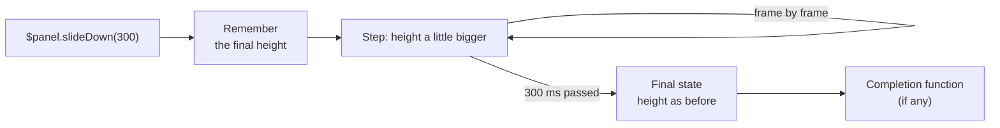
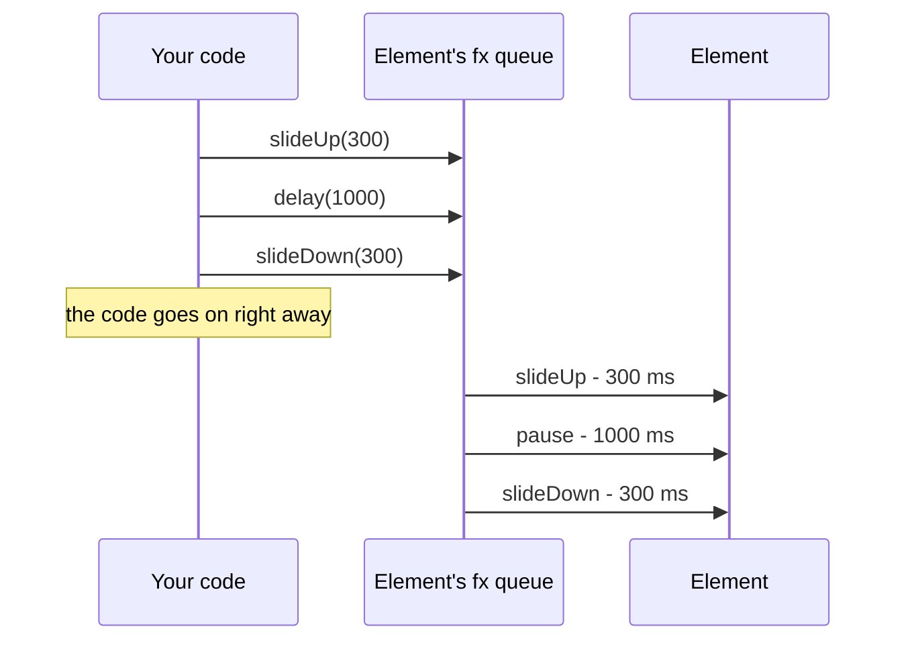
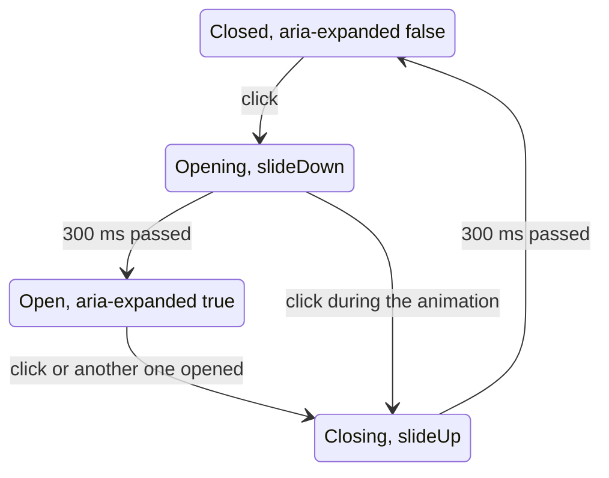
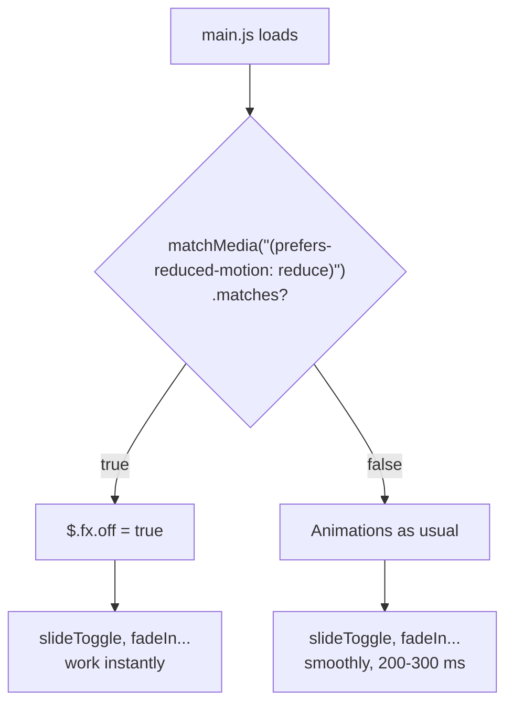

# Effects and animation

[Contents](../../README.md) · [← Back](../../Lesson-6/en/Events.md) · [Next →](../../Lesson-8/en/Forms.md) · [RU](../ru/%D0%AD%D1%84%D1%84%D0%B5%D0%BA%D1%82%D1%8B%20%D0%B8%20%D0%B0%D0%BD%D0%B8%D0%BC%D0%B0%D1%86%D0%B8%D1%8F.md) · [EN](Effects%20and%20animation.md) · [UZ](../uz/Effektlar%20va%20animatsiya.md)

> **Link to lesson 6:** you learned to react to user actions: `.on()`, `$(this)`, delegation, `.trigger()`. But so far the page responds with a "jerk": a block was there - and instantly vanished. Today we will teach it to move smoothly: appear, fade away, expand and collapse. And just as important - **not** to move when the user does not want it.

---

## Why you need this

Open the FAQ page of any online store. There are twenty questions, but the answers are hidden - you only see the headings. You click a question - the answer smoothly slides down, and the one that was open before collapses. This is an **accordion**. You click "Save" - a small "Saved" box appears in the corner for a couple of seconds and quietly fades away. This is a **pop-up notification** (a toast).

Without animation these elements still work, but the user gets lost: something suddenly disappeared, the text "jumped", and it is not clear what changed. A smooth transition of a quarter of a second shows the eye **where** the new block came from and **where** the old one went. In jQuery such effects take one command - that is why you see them so often on real websites.

---

## What you will learn

- Show and hide elements instantly: `.show()`, `.hide()`, `.toggle()`.
- Fade and slide smoothly: `.fadeIn()`, `.fadeOut()`, `.fadeToggle()`, `.slideDown()`, `.slideUp()`, `.slideToggle()`.
- Set the duration and run code **after** the animation ends - the completion function.
- Animate numeric CSS properties with `.animate()`.
- Understand the animation queue and control it: `.stop()`, `.delay()`.
- Check visibility: `.is(":visible")`, `.is(":animated")` - and understand when you cannot trust them.
- Respect the "reduce motion" setting: `prefers-reduced-motion`, `window.matchMedia`, `$.fx.off`.
- Choose between jQuery effects and CSS transitions with `.toggleClass()`.

---

## Review: 3 questions from lesson 6

1. How is `$("#list").on("click", ".item", fn)` different from `$(".item").on("click", fn)`? When do you need the first form?
2. What are `this` and `$(this)` inside an `.on()` handler?
3. Why does the course not use `$("#btn").click(function () { ... })`?

Answers are at the end of the lesson.

---

## Lesson plan

| Section | What we do |
| --- | --- |
| Show and hide | `.show`, `.hide`, `.toggle` and what they do with `display` |
| Smooth effects | `fade` and `slide` methods, duration |
| Completion function | Code that waits for the end of the animation |
| Mini-task 1 | A banner that fades out and is removed |
| `.animate()` | Your own animation of numeric properties |
| Animation queue | `.delay`, `.stop` and "stuck" clicks |
| Visibility and state | `:visible`, `:animated`, `aria-expanded` |
| Less motion | `prefers-reduced-motion` and `$.fx.off` |
| jQuery or CSS | When `transition` + `toggleClass` is better |
| Mini-task 2 | A "More" block and a "Copied" tooltip |
| Independent work | Accordion and pop-up notification |

---

## Show and hide: `.show()`, `.hide()`, `.toggle()`

**In simple words:** it is a light switch. `.hide()` turns it off, `.show()` turns it on, `.toggle()` flips the switch: if it was on, it goes off, and the other way round.

```html
<p id="hint">The password must be at least 8 characters long</p>
<button id="hint-btn" type="button">Hint</button>
```

```js
const $hint = $("#hint");

$hint.hide();                 // hide
$hint.show();                 // show
$("#hint-btn").on("click", function () {
    $hint.toggle();           // toggle
});
```

| Code | What it does |
| --- | --- |
| `$el.hide()` | Sets `display: none` - the element disappears and takes up no space |
| `$el.show()` | Gives the element back its usual `display` (`block`, `inline`, `flex`...) |
| `$el.toggle()` | Shows it if hidden, hides it if visible |
| `$el.toggle(true)` / `$el.toggle(false)` | Show / hide by a condition, like `.toggleClass("x", state)` from lesson 4 |

### What happens inside

In the JavaScript course you wrote `element.style.display = "none"`. jQuery does the same, but more carefully: before hiding, it **remembers** what `display` was there. If the block had `display: flex`, then `.show()` brings back exactly `flex`, not `block`.

```js
// Plain JavaScript
const hint = document.querySelector("#hint");
hint.style.display = hint.style.display === "none" ? "" : "none";

// jQuery
$("#hint").toggle();
```

`.show()` can even handle an element that is hidden **in a CSS file** (`.answer { display: none; }`): jQuery writes the right `display` straight into the `style` attribute, and it overrides the CSS rule.

> **Important:** a hidden element **stays in the DOM**. You can find it with `$()`, read its text and show it again. Only `.remove()` from lesson 5 removes an element.

---

## Smooth effects: `fade` and `slide`

`.show()`/`.hide()` have "smooth relatives". The end result is the same - the block's `display` - but the way there is stretched over time.

**In simple words:** `fade` is a light that goes out slowly through a dimmer. `slide` is a roller blind: it rolls up, and the window (the block) gets lower and lower until it disappears completely.

| Method | How it looks | What changes step by step |
| --- | --- | --- |
| `.fadeIn()` | The block appears | `opacity` from 0 to 1 |
| `.fadeOut()` | The block fades away | `opacity` from 1 to 0, at the end `display: none` |
| `.fadeToggle()` | Fade out or fade in | Depends on the current state |
| `.fadeTo(400, 0.5)` | A semi-transparent block | `opacity` to 0.5, the block stays visible |
| `.slideDown()` | The block slides down | `height` from 0 to the full height |
| `.slideUp()` | The block collapses upwards | `height` to 0, at the end `display: none` |
| `.slideToggle()` | Expand or collapse | Depends on the current state |

```html
<button id="more-btn" type="button">Show description</button>
<div id="details" class="details">A 10-lesson course with IDE tasks.</div>
```

```css
.details { display: none; }
```

```js
$("#more-btn").on("click", function () {
    $("#details").slideToggle();
});
```

The first click - the description smoothly slides down, the second - it collapses.

### Duration

The first argument of an effect is the duration in **milliseconds** (1000 ms = 1 second).

| Code | Duration |
| --- | --- |
| `.fadeIn()` | 400 ms - the default |
| `.fadeIn(200)` | 200 ms |
| `.fadeIn("fast")` | 200 ms |
| `.fadeIn("slow")` | 600 ms |
| `.fadeIn("300ms")` | 400 ms: jQuery does not understand this string and uses the default value |

For an interface, 150–300 ms works well: the eye notices the movement, and the person does not have to wait. An animation longer than 500 ms already feels "slow".

The second optional argument is **easing**: `"swing"` (the default - slow at the start and end, faster in the middle) or `"linear"` (even speed): `.slideDown(300, "linear")`.

### How animation works



**How to read the diagram.** There is no magic in jQuery: many times per second, roughly on every screen frame, it changes the property in the `style` attribute a little - `height: 12px`, `height: 25px`, `height: 39px`... The eye joins these frames into movement. When the time is up, jQuery sets the exact final value and calls the completion function.

### Trace: `slideToggle` twice

| Step | What happens | Value / page state |
| --- | --- | --- |
| 1 | Page load, CSS `.details { display: none; }` | The block is hidden |
| 2 | Click: `slideToggle()` sees that the block is hidden → chooses `slideDown` | `display: block`, `height` grows from 0 |
| 3 | After 400 ms | The block is fully open, the temporary `height` is removed |
| 4 | Second click: the block is visible → `slideUp` | `height` shrinks to 0 |
| 5 | After another 400 ms | `display: none`, the block is hidden |

---

## Completion function

An animation **does not stop the program**. Calling `.fadeOut()` only starts the fading, and the next line of code runs right away.

```js
$("#box").fadeOut(400);
console.log("Done?"); // printed right away, although the block is still visible
```

**In simple words:** you put the kettle on and went to cut bread - you do not stand over it for 3 minutes. To pour the tea **on time**, the kettle has a whistle. The completion function is the whistle: "call me when you are done".

You pass the function as the last argument:

```js
$("#box").fadeOut(400, function () {
    console.log("The block is gone");
});
console.log("Animation started");
```

| Step | What happens | Console output |
| --- | --- | --- |
| 1 | `fadeOut` starts the fading and returns control **right away** | - |
| 2 | The next line runs | `Animation started` |
| 3 | For 400 ms jQuery changes `opacity` | - |
| 4 | The animation is over, `display: none` | - |
| 5 | jQuery calls the completion function | `The block is gone` |

### `this` in the completion function

Inside the function, `this` is the **DOM element** that finished the animation, just like in an event handler. If there are several elements, the function is called **for each one**:

```js
$(".card").fadeOut(300, function () {
    $(this).remove(); // each card removes itself
});
```

Three cards - three calls. If you need an action once after all of them, it is easier to put it on one wrapper element (`$("#cards").fadeOut(...)`) or call it separately.

### When you cannot do without a completion function

| Task | Why you need a completion function |
| --- | --- |
| Remove an element after it disappears | If you call `.remove()` right away, the animation will not be visible |
| Change the text while the block is invisible | First `fadeOut`, in the function - the new text and `fadeIn` |
| Move focus into an expanded block | While the height is 0, focus "flies away" to an invisible place |

```js
// Smooth text change
const $quote = $("#quote");
$quote.fadeOut(200, function () {
    $quote.text("A new quote of the day").fadeIn(200);
});
```

> **Important:** do not put `.remove()` on the line after `.fadeOut()` - the element is removed instantly and the user sees nothing. Removing goes inside the completion function.

---

## Mini-task 1

The page has a banner:

```html
<div id="promo" class="promo">
    <p>20% off all courses until the end of the week!</p>
    <button class="promo__close" type="button">Close</button>
</div>
<p id="status"></p>
```

1. When `.promo__close` is clicked, the banner fades out in 300 ms.
2. **After** it disappears, the banner is removed from the DOM, and the text `Banner closed` appears in `#status`.
3. Check `$("#promo").length` in the console before and after closing.

---

## `.animate()` - your own animation

The ready-made effects change `opacity` and `height`. If you need to move something smoothly, stretch it or make it semi-transparent, use `.animate()`. It takes an **object** with the final CSS values, like `.css()` from lesson 4.

```js
$("#progress-bar").animate({ width: "75%" }, 500);

$("#ball").animate({
    left: "200px",
    opacity: 0.5
}, 400, function () {
    console.log("The ball is in place");
});
```

| Code | What it does |
| --- | --- |
| `.animate({ width: "300px" })` | Smoothly to a width of 300px |
| `.animate({ left: "+=50px" })` | Move by 50px **from the current** value |
| `.animate({ height: "toggle" })` | The same as `slideToggle`: expand or collapse |
| `.animate({ opacity: 0 }, 300, fn)` | 300 ms, then the completion function |

### What you can animate

`.animate()` works only with **numeric** properties: `width`, `height`, `opacity`, `left`, `top`, `margin`, `padding`, `font-size`, `scrollTop`. A color (`background-color`, `color`) is not a number, and jQuery does not animate it without a plugin: the property simply does not change. For colors, use a CSS transition (see the section "jQuery or CSS").

> **Important:** in jQuery 4, `px` is added to a bare number only for sizes and spacing. In the course we always write units explicitly: `"200px"`, `"75%"`, `"2rem"`. The exception is `opacity`: it has no units, so we write the number `0.5`.

---

## Animation queue

What happens if you call two effects in a row?

```js
$("#box").slideUp(300).slideDown(300);
```

The block first collapses and **then** expands - the effects do not get mixed up. Each element has a **queue** (by default it is called `fx`): new effects go to the end and wait until the previous ones are finished.

**In simple words:** a line at the checkout. Each effect is a customer. The cashier (the element) serves them one at a time, in the order they came. A new customer does not push to the front but joins the end of the line.



**How to read the diagram.** In a fraction of a millisecond the code puts three tasks into the queue and moves on. The animation itself takes 1.6 seconds: the queue runs the tasks one at a time.

### `.delay()` - a pause in the queue

```js
$("#toast")
    .fadeIn(200)
    .delay(2000)
    .fadeOut(200);
```

The notification appears, stays for 2 seconds and fades away. `.delay()` affects **only the effects queue**: it does not affect `.text()` or `.addClass()` in the same chain - they run right away.

### The "stuck" clicks problem

An impatient user clicks a button 6 times in one second:

```js
$("#menu-btn").on("click", function () {
    $("#menu").slideToggle(400);
});
```

| Step | What happens | `#menu` queue |
| --- | --- | --- |
| 1 | Click 1 | `slideDown` is running |
| 2 | Clicks 2–6 within 1 second | `slideDown`, `slideUp`, `slideDown`, `slideUp`, `slideDown`, `slideUp` |
| 3 | The user stopped clicking | The menu keeps going up and down by itself for 2 more seconds |

### `.stop()` - stop it

| Code | What it does |
| --- | --- |
| `.stop()` | Stop the current animation where it is now; the queue continues |
| `.stop(true)` | Stop the current one and **clear the queue** |
| `.stop(true, true)` | Clear the queue and **jump to the end** of the current animation |
| `.finish()` | Finish the current animation and all queued ones at once |

The cure is `.stop(true, true)` **before** the new effect:

```js
$("#menu-btn").on("click", function () {
    $("#menu").stop(true, true).slideToggle(400);
});
```

Now each click first brings the previous animation to its end and throws away whatever "piled up", and only then starts one new animation. No matter how many times you click, the menu does only the last thing you asked for.

---

## Visibility and state

### `.is(":visible")` and `.is(":animated")`

The `.is()` method from lesson 2 can also check visibility:

```js
if ($("#details").is(":visible")) {
    console.log("The description is open");
}
```

| Code | `true` if... |
| --- | --- |
| `.is(":visible")` | The element takes up space on the page (not `display: none` and not inside a hidden parent) |
| `.is(":hidden")` | The opposite |
| `.is(":animated")` | A jQuery animation is running on the element right now |

### Why it is better to keep the state in an attribute

Let's look at the accordion at the moment when an answer is **collapsing** (`slideUp` is running):

| What we check | Result during `slideUp` | Is it true? |
| --- | --- | --- |
| `$answer.is(":visible")` | `true` - the height is not 0 yet | No: the user has already closed the answer |
| `$question.attr("aria-expanded")` | `"false"` - we wrote it right on click | Yes |

The attribute shows the **intention**, and visibility shows what is on the screen right now. During an animation they differ. That is why in the accordion we keep the state in `aria-expanded`:

```js
const isOpen = $question.attr("aria-expanded") === "true";
$question.attr("aria-expanded", String(!isOpen));
```

This is also about **accessibility**: users of screen readers hear `aria-expanded` - "How long is the course, button, collapsed". `String(!isOpen)` turns `true`/`false` into the strings `"true"`/`"false"`, because attribute values are always strings.



**How to read the diagram.** An accordion item has four states, not two: two of them are transitional. The `aria-expanded` attribute changes right on click, that is, at the moment of entering "Opening" or "Closing". The bottom arrow is a quick repeated click: this is exactly where `.stop(true, true)` comes in handy.

---

## Less motion: `prefers-reduced-motion` and `$.fx.off`

For some people, movement on the screen causes dizziness and nausea (vestibular disorders), and for others it makes it hard to concentrate. That is why Windows, macOS, iOS and Android have a "Reduce motion" setting (in Windows - "Animation effects"). The browser tells the website about it through the `prefers-reduced-motion` media query.

**In simple words:** it is a "Do not disturb" sign on a hotel room door. The housekeeper (your website) sees it and does not come in with a vacuum cleaner. Cleaning is still possible - but quietly.

### In CSS

```css
@media (prefers-reduced-motion: reduce) {
    * {
        transition: none !important;
        animation: none !important;
    }
}
```

### In JavaScript: `window.matchMedia`

`window.matchMedia("media query")` checks the same media query from JavaScript. It returns an object whose `.matches` property is `true` if the query matches.

```js
const reduceMotion = window.matchMedia("(prefers-reduced-motion: reduce)");
console.log(reduceMotion.matches); // true - the user asks for less motion
```

### `$.fx.off` - the switch for all jQuery effects

If you write `$.fx.off = true`, **all** jQuery effects on the page become instant: `.slideDown()` opens the block right away, `.fadeOut()` hides it right away, and completion functions are called right away. The page logic does not change - the accordion and notifications work, just without movement.

```js
const reduceMotion = window.matchMedia("(prefers-reduced-motion: reduce)");
if (reduceMotion.matches) {
    $.fx.off = true;
}
```

| Option | What you get |
| --- | --- |
| The lines above at the start of `main.js` | Motion is turned off only for those who asked for it |
| `$.fx.off = true;` without a condition | Animations disappear for everyone - so why write them at all |
| Doing nothing | A user with a vestibular disorder gets motion sickness from your website |



**How to read the diagram.** The check runs once on page load. The accordion and notification code is the same for everyone - the only difference is whether jQuery brings the elements to their final state smoothly or instantly.

> **Important:** the JLearn platform also writes `$.fx.off = true;` in the lesson task, so that the automatic tests see the final result right away instead of waiting 300 ms. This is one more use of the "switch": testing animations.

---

## jQuery or CSS transitions

In the CSS course you wrote `transition` - a smooth change between two states. It is often better than a jQuery effect: JavaScript only **toggles a class**, and the browser draws the movement.

```css
.menu {
    opacity: 0;
    transform: translateY(-10px);
    pointer-events: none;
    transition: opacity 0.2s, transform 0.2s;
}

.menu.is-open {
    opacity: 1;
    transform: translateY(0);
    pointer-events: auto;
}

@media (prefers-reduced-motion: reduce) {
    .menu { transition: none; }
}
```

```js
$("#menu-btn").on("click", function () {
    const isOpen = $("#menu").toggleClass("is-open").hasClass("is-open");
    $(this).attr("aria-expanded", String(isOpen));
});
```

**In simple words:** a jQuery effect is like turning the dimmer knob yourself. A CSS transition is like pressing a button while the lamp's electronics turn the dimmer. It is easier and more reliable, but you only get the settings the lamp has.

| Situation | Better choice |
| --- | --- |
| Hover, focus, highlighting | CSS `:hover`, `:focus` + `transition`, no JavaScript |
| Open/close a menu or modal window, switch the theme | `.toggleClass()` + `transition` |
| Smooth change of color, shadow, `transform` | CSS - jQuery does not animate color |
| Expand a block of **unknown height** (`height: auto`) | `.slideDown()` - a CSS transition to `auto` does not work in all browsers |
| An action strictly **after** the animation (remove, change text) | A jQuery effect with a completion function |
| A sequence with pauses | The jQuery queue: `.fadeIn().delay().fadeOut()` |
| The site already uses jQuery with ready-made effects | Do not rewrite it without a reason |

---

### Try to break it

1. Remove `.stop(true, true)` from the menu handler and click the button 8 times in a row. How long does the menu keep "moving" after the last click?
2. Put `.remove()` on the line after `.fadeOut(1000)` instead of inside the completion function. Can you see the animation?
3. Write `.fadeIn("300ms")` and `.fadeIn(3000)`. Is there any difference from `.fadeIn()`?
4. Try `.animate({ backgroundColor: "red" })`. Did the color change? Is there an error in the console?
5. In DevTools, turn on the `prefers-reduced-motion: reduce` emulation (menu ⋮ → More tools → Rendering) and reload the page. Does the accordion work? Is it smooth?
6. During a 3000 ms `slideUp`, print `$answer.is(":visible")` to the console. What did you get and why?

### Typical beginner mistakes

| Mistake | What you get | How to fix |
| --- | --- | --- |
| The slim build is loaded | `TypeError: $(...).fadeIn is not a function` | The full build `jquery-4.1.0.min.js` |
| `.remove()` right after `.fadeOut()` | The element disappears instantly | `.fadeOut(300, function () { $(this).remove(); })` |
| An effect without `.stop()` in a click handler | Animations pile up, the block "moves" by itself | `.stop(true, true).slideToggle()` |
| State taken from `.is(":visible")` during an animation | Wrong `aria-expanded` on quick clicks | Keep the state in `aria-expanded` |
| `.animate({ color: "red" })` | The color does not change, no error | CSS `transition` + a class |
| `.animate({ left: "100px" })` without `position` | The element does not move | `position: relative` in CSS |
| `.delay(1000).text("...")` | The text changes right away | `.delay()` is only for effects; put the text in the completion function |
| `$.fx.off = true` without a check | Nobody gets animations | Only if `matchMedia(...).matches` |
| Duration `"300ms"` | Works like 400 ms | The number `300` |

---

## Mini-task 2

```html
<button id="details-btn" type="button" aria-expanded="false">More</button>
<div id="details" class="details">A 10-lesson course. Each lesson has theory, an IDE task and a test.</div>

<button id="copy-btn" type="button">Copy promo code</button>
<span id="copied" class="copied">Copied!</span>
```

```css
.details, .copied { display: none; }
```

1. A click on `#details-btn` smoothly (250 ms) expands or collapses `#details`. Quick clicks do not pile up.
2. The button text changes to `Hide` / `More`, and `aria-expanded` to `"true"` / `"false"`. Take the state from the attribute.
3. A click on `#copy-btn` fades in `#copied` in 150 ms, and after 1.5 seconds the tooltip fades away. Repeated clicks do not fill up the queue.
4. At the start of the file, turn off animations for those who ask for less motion.

---

## Lesson summary: cheat sheet

| Task | Code |
| --- | --- |
| Hide / show / toggle instantly | `.hide()`, `.show()`, `.toggle()` |
| Show or hide by a condition | `.toggle(state)` |
| Fade in / fade out | `.fadeIn()`, `.fadeOut()`, `.fadeToggle()` |
| Expand / collapse by height | `.slideDown()`, `.slideUp()`, `.slideToggle()` |
| Duration | `.fadeIn(200)`, `"fast"` = 200, `"slow"` = 600, default 400 |
| Code after the animation | `.fadeOut(300, function () { ... })`, `this` is the element |
| Your own animation | `.animate({ width: "300px", opacity: 0.5 }, 400)` |
| Pause in the queue | `.fadeIn().delay(2000).fadeOut()` |
| Do not pile up animations | `.stop(true, true)` before the effect |
| Check visibility / animation | `.is(":visible")`, `.is(":animated")` |
| Expanded state | `aria-expanded` = `"true"` / `"false"` |
| Respect "less motion" | `if (window.matchMedia("(prefers-reduced-motion: reduce)").matches) { $.fx.off = true; }` |
| A transition with CSS | `transition` in CSS + `.toggleClass("is-open")` |

---

## Independent work

### Part 1. IDE task (graded by the platform)

The page has a question block `#faq`: each `.faq__item` contains a `.faq__question` button with `aria-expanded="false"` and a hidden answer `.faq__answer`. Below are the `#save-btn` button and a hidden notification `#toast` with the paragraph `.toast__text` and the `.toast__close` button. The platform has already turned off animations (`$.fx.off = true`) so that the tests see the result right away.

1. If `window.matchMedia("(prefers-reduced-motion: reduce)").matches`, turn off animations: `$.fx.off = true` (not allowed without the condition).
2. Accordion: with one delegated handler `$("#faq").on("click", ".faq__question", ...)`, when a question is clicked, close the other answers with `.slideUp()` and set `aria-expanded="false"` on their buttons, and toggle this question's answer with `.slideToggle()` and write `"true"` or `"false"` to this button's `aria-expanded`. Take the state from `aria-expanded`, not from `:visible`. Questions added after the page loads must also work.
3. Write the function `showToast(message)`: it writes `message` into `.toast__text` and shows `#toast` with `.fadeIn()`.
4. A click on `#save-btn` calls `showToast("Settings saved")`.
5. A click on `.toast__close` hides `#toast` with `.fadeOut()`.

Handlers - only with `.on()`; do not use `document.querySelector`, `innerHTML`, `.html()`, `.style` or `.click(fn)`.

What the platform checks: the first click opens the answer and sets `aria-expanded="true"`, a second click closes it; opening the second question closes the first one; before any clicks everything is closed; a question added after loading works (delegation); `showToast` shows the notification with the given text, and a repeated call replaces the text; the `#save-btn` button and the close button; with `prefers-reduced-motion` animations are turned off, and without it they are not; `slide` and `fade` effects are used; there are no errors.

### Part 2. Project on your computer

1. On your website from the HTML/CSS/JS courses, make an FAQ section with 4–5 items and connect the accordion from the task to it.
2. Add a pop-up notification that fades away by itself 3 seconds after `showToast`: `.stop(true, true).fadeIn(200).delay(3000).fadeOut(200)`. Give it `role="status"` so that a screen reader reads the text.
3. Rewrite one menu or modal window of the website with `transition` in CSS + `.toggleClass("is-open")`.
4. Add the `prefers-reduced-motion` check at the start of `main.js` and the media query in CSS. Test it with the emulation in DevTools.

### Acceptance criteria

- [ ] The IDE task is accepted.
- [ ] Quick clicks do not pile up animations: `.stop(true, true)` comes before the effects.
- [ ] Removing elements and changing text after an animation happen inside the completion function.
- [ ] With "reduce motion" turned on, the website works without animations.
- [ ] You can explain when to choose a CSS transition and when a jQuery effect.

---

## Self-check questions

1. How is `.hide()` different from `.fadeOut()` and from `.remove()`?
2. What does `.slideToggle()` do, and how does it choose whether to expand or collapse?
3. What duration values does jQuery understand? What is the default duration?
4. Why do you need a completion function? What is `this` inside it, and how many times is it called for three elements?
5. Which properties can you animate with `.animate()`, and which can you not?
6. What is the animation queue? What happens after `$el.slideUp().slideDown()`?
7. How are `.stop()`, `.stop(true)` and `.stop(true, true)` different? Why put them before an effect in a click handler?
8. Why is it better to keep the accordion state in `aria-expanded` instead of checking `.is(":visible")`?
9. What is `prefers-reduced-motion`, how do you check it from JavaScript, and what does `$.fx.off = true` do?
10. When is a CSS transition with `.toggleClass()` better, and when is a jQuery effect better?

After the questions, take the **lesson test** on the platform: 12 questions, pass mark 70%.

---

## What's next

Accordions and notifications most often live next to **forms**: "Saved", "Fill in this field", "Thank you for your request". In lesson 8 we will look at forms in jQuery: reading the values of fields, checkboxes and lists with `.val()` and `.prop()`, catching the `submit` event, validating fields, showing an error next to a field - and, of course, smoothly showing a success message.

---

## Answers

**Review**

1. The first form is delegation: one handler on the parent `#list` works for any `.item` inside it, including the ones added after the page loads. The second one subscribes only those `.item` elements that exist at the moment of the call.
2. `this` is the DOM element on which the handler fired (with delegation - the matched `.item`), and `$(this)` is the same element wrapped in a jQuery object so you can call jQuery methods.
3. Shortcuts like `.click(fn)` are deprecated; `.on()` is one way for all events, with delegation, namespaces and `.off()`.

**Mini-task 1**

```js
$("#promo").on("click", ".promo__close", function () {
    $("#promo").fadeOut(300, function () {
        $(this).remove();
        $("#status").text("Banner closed");
    });
});
```

In the console, `$("#promo").length` is `1` before closing and `0` after.

**Mini-task 2**

```js
const reduceMotion = window.matchMedia("(prefers-reduced-motion: reduce)");
if (reduceMotion.matches) {
    $.fx.off = true;
}

$("#details-btn").on("click", function () {
    const $btn = $(this);
    const isOpen = $btn.attr("aria-expanded") === "true";

    $("#details").stop(true, true).slideToggle(250);
    $btn
        .attr("aria-expanded", String(!isOpen))
        .text(isOpen ? "More" : "Hide");
});

$("#copy-btn").on("click", function () {
    $("#copied")
        .stop(true, true)
        .fadeIn(150)
        .delay(1500)
        .fadeOut(150);
});
```

**Self-check questions**

1. `.hide()` sets `display: none` instantly; `.fadeOut()` gets to the same result by smoothly lowering `opacity`; `.remove()` removes the element from the DOM completely.
2. It smoothly expands or collapses a block by changing `height`. It expands a hidden block (`slideDown`) and collapses a visible one (`slideUp`).
3. A number of milliseconds, `"fast"` (200) and `"slow"` (600). The default is 400 ms; an unknown string like `"300ms"` also gives 400.
4. To run code after the animation ends (remove an element, change text, move focus). `this` is the DOM element that finished the animation; for three elements the function is called three times.
5. Numeric ones: `width`, `height`, `opacity`, `left`, `top`, margins and paddings, `font-size`, `scrollTop`. Colors and non-numeric values - no.
6. Each element has an `fx` queue: effects run one at a time in the order they were called. The block first collapses, then expands.
7. `.stop()` stops the current animation, and the queue continues; `.stop(true)` stops it and clears the queue; `.stop(true, true)` clears the queue and brings the current animation to its end at once. Before an effect - so that quick clicks do not pile up animations.
8. During the closing animation the block is still visible, and `:visible` returns `true`. The attribute changes right on click and shows the intention, and screen readers also read it.
9. The "reduce motion" system setting. Check: `window.matchMedia("(prefers-reduced-motion: reduce)").matches`. `$.fx.off = true` makes all jQuery effects instant, and the page logic stays the same.
10. A CSS transition - for hover, color, `transform`, opening menus and windows with a class. A jQuery effect - for `auto` height (`slideDown`), for actions after an animation and sequences with pauses, and also on websites that already use jQuery effects.

[Contents](../../README.md) · [← Back](../../Lesson-6/en/Events.md) · [Next →](../../Lesson-8/en/Forms.md) · [RU](../ru/%D0%AD%D1%84%D1%84%D0%B5%D0%BA%D1%82%D1%8B%20%D0%B8%20%D0%B0%D0%BD%D0%B8%D0%BC%D0%B0%D1%86%D0%B8%D1%8F.md) · [EN](Effects%20and%20animation.md) · [UZ](../uz/Effektlar%20va%20animatsiya.md)
