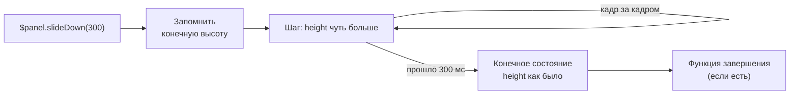
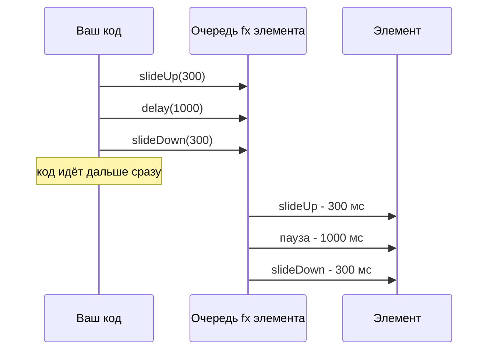
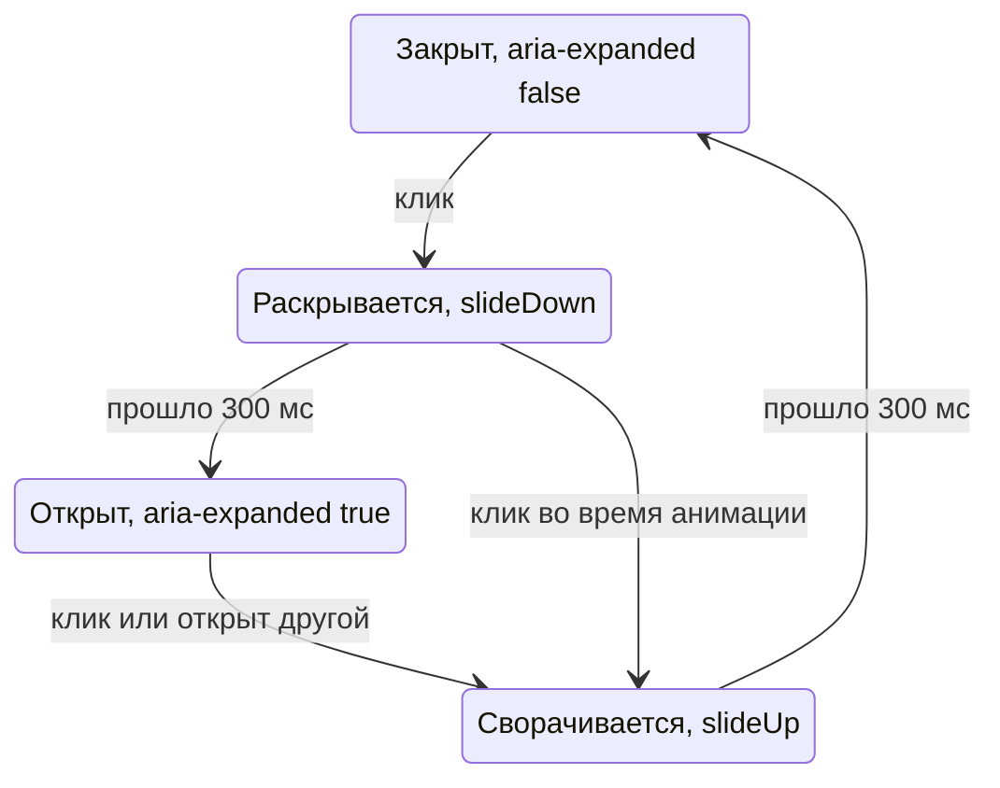
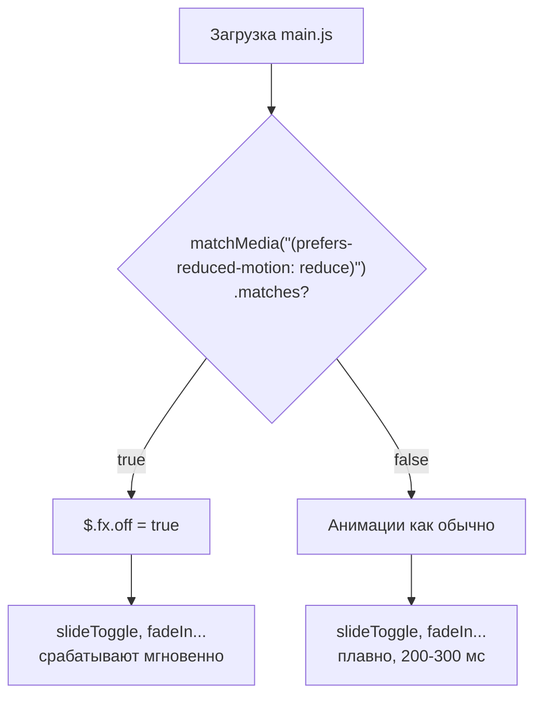

# Эффекты и анимация

[Содержание](../../README.md) · [← Назад](../../Lesson-6/ru/%D0%A1%D0%BE%D0%B1%D1%8B%D1%82%D0%B8%D1%8F.md) · [Вперёд →](../../Lesson-8/ru/%D0%A4%D0%BE%D1%80%D0%BC%D1%8B.md) · [RU](%D0%AD%D1%84%D1%84%D0%B5%D0%BA%D1%82%D1%8B%20%D0%B8%20%D0%B0%D0%BD%D0%B8%D0%BC%D0%B0%D1%86%D0%B8%D1%8F.md) · [EN](../en/Effects%20and%20animation.md) · [UZ](../uz/Effektlar%20va%20animatsiya.md)

> **Связь с уроком 6:** вы научились реагировать на действия пользователя: `.on()`, `$(this)`, делегирование, `.trigger()`. Но пока страница отвечает «рывком»: блок был - и мгновенно исчез. Сегодня научим её двигаться плавно: появляться, растворяться, раскрываться и сворачиваться. И так же важно - вовремя **не** двигаться, если пользователь этого не хочет.

---

## Зачем это вам

Откройте страницу «Частые вопросы» любого интернет-магазина. Вопросов двадцать, а ответов не видно - видны только заголовки. Нажали на вопрос - ответ плавно выезжает вниз, а предыдущий открытый сворачивается. Это **аккордеон**. Нажали «Сохранить» - в углу на пару секунд появляется плашка «Сохранено» и тихо растворяется. Это **всплывающее уведомление** (toast - «тост»).

Без анимации такие элементы работают, но пользователь теряется: что-то резко пропало, текст «прыгнул», непонятно, что изменилось. Плавный переход длиной в четверть секунды показывает глазу, **откуда** пришёл новый блок и **куда** ушёл старый. В jQuery такие эффекты пишутся одной командой - именно поэтому их часто встречают в готовых сайтах.

---

## Чему вы научитесь

- Мгновенно показывать и скрывать элементы: `.show()`, `.hide()`, `.toggle()`.
- Плавно растворять и раскрывать: `.fadeIn()`, `.fadeOut()`, `.fadeToggle()`, `.slideDown()`, `.slideUp()`, `.slideToggle()`.
- Задавать длительность и выполнять код **после** окончания анимации - функция завершения.
- Анимировать числовые свойства CSS через `.animate()`.
- Понимать очередь анимаций и управлять ею: `.stop()`, `.delay()`.
- Проверять видимость: `.is(":visible")`, `.is(":animated")` - и понимать, когда им нельзя верить.
- Уважать настройку «уменьшить движение»: `prefers-reduced-motion`, `window.matchMedia`, `$.fx.off`.
- Выбирать между эффектами jQuery и переходами CSS с `.toggleClass()`.

---

## Повторение: 3 вопроса из урока 6

1. Чем `$("#list").on("click", ".item", fn)` отличается от `$(".item").on("click", fn)`? Когда нужна первая запись?
2. Что такое `this` и `$(this)` внутри обработчика `.on()`?
3. Почему в курсе не пишут `$("#btn").click(function () { ... })`?

Ответы - в конце урока.

---

## План урока

| Раздел | Что делаем |
| --- | --- |
| Показать и скрыть | `.show`, `.hide`, `.toggle` и что они делают с `display` |
| Плавные эффекты | `fade`- и `slide`-методы, длительность |
| Функция завершения | Код, который ждёт конца анимации |
| Мини-задание 1 | Баннер, который растворяется и удаляется |
| `.animate()` | Своя анимация числовых свойств |
| Очередь анимаций | `.delay`, `.stop` и «залипшие» клики |
| Видимость и состояние | `:visible`, `:animated`, `aria-expanded` |
| Меньше движения | `prefers-reduced-motion` и `$.fx.off` |
| jQuery или CSS | Когда лучше `transition` + `toggleClass` |
| Мини-задание 2 | Блок «Подробнее» и подсказка «Скопировано» |
| Самостоятельная работа | Аккордеон и всплывающее уведомление |

---

## Показать и скрыть: `.show()`, `.hide()`, `.toggle()`

**Простыми словами:** это выключатель света. `.hide()` - выключить, `.show()` - включить, `.toggle()` - щёлкнуть выключателем: было включено - станет выключено, и наоборот.

```html
<p id="hint">Пароль должен быть не короче 8 символов</p>
<button id="hint-btn" type="button">Подсказка</button>
```

```js
const $hint = $("#hint");

$hint.hide();                 // скрыть
$hint.show();                 // показать
$("#hint-btn").on("click", function () {
    $hint.toggle();           // переключить
});
```

| Запись | Что делает |
| --- | --- |
| `$el.hide()` | Ставит `display: none` - элемент исчезает и не занимает места |
| `$el.show()` | Возвращает элементу его обычный `display` (`block`, `inline`, `flex`...) |
| `$el.toggle()` | Скрытый - показывает, видимый - скрывает |
| `$el.toggle(true)` / `$el.toggle(false)` | Показать / скрыть по условию, как `.toggleClass("x", state)` из урока 4 |

### Что происходит внутри

В курсе JavaScript вы писали `element.style.display = "none"`. jQuery делает то же, но аккуратнее: перед скрытием **запоминает**, какой был `display`. Если у блока был `display: flex`, то `.show()` вернёт именно `flex`, а не `block`.

```js
// Чистый JavaScript
const hint = document.querySelector("#hint");
hint.style.display = hint.style.display === "none" ? "" : "none";

// jQuery
$("#hint").toggle();
```

`.show()` справится даже с элементом, который скрыт **в CSS-файле** (`.answer { display: none; }`): jQuery запишет нужный `display` прямо в атрибут `style`, и он перекроет правило из CSS.

> **Важно:** скрытый элемент **остаётся в DOM**. Его можно найти через `$()`, прочитать текст, снова показать. Удаляет элемент только `.remove()` из урока 5.

---

## Плавные эффекты: `fade` и `slide`

У `.show()`/`.hide()` есть «плавные родственники». Конечный результат тот же - `display` блока, но путь к нему растянут во времени.

**Простыми словами:** `fade` - это свет, который гаснет через диммер, постепенно. `slide` - это штора: она сворачивается вверх, и окно (блок) становится всё ниже, пока не исчезнет совсем.

| Метод | Как выглядит | Что меняется по шагам |
| --- | --- | --- |
| `.fadeIn()` | Блок проявляется | `opacity` от 0 до 1 |
| `.fadeOut()` | Блок растворяется | `opacity` от 1 до 0, в конце `display: none` |
| `.fadeToggle()` | Растворить или проявить | По текущему состоянию |
| `.fadeTo(400, 0.5)` | Полупрозрачный блок | `opacity` до 0.5, блок остаётся видимым |
| `.slideDown()` | Блок выезжает вниз | `height` от 0 до полной высоты |
| `.slideUp()` | Блок сворачивается вверх | `height` до 0, в конце `display: none` |
| `.slideToggle()` | Раскрыть или свернуть | По текущему состоянию |

```html
<button id="more-btn" type="button">Показать описание</button>
<div id="details" class="details">Курс из 10 уроков с заданиями в IDE.</div>
```

```css
.details { display: none; }
```

```js
$("#more-btn").on("click", function () {
    $("#details").slideToggle();
});
```

Первый клик - описание плавно выезжает, второй - сворачивается.

### Длительность

Первый аргумент эффекта - длительность в **миллисекундах** (1000 мс = 1 секунда).

| Запись | Длительность |
| --- | --- |
| `.fadeIn()` | 400 мс - по умолчанию |
| `.fadeIn(200)` | 200 мс |
| `.fadeIn("fast")` | 200 мс |
| `.fadeIn("slow")` | 600 мс |
| `.fadeIn("300ms")` | 400 мс: такую строку jQuery не понимает и берёт значение по умолчанию |

Для интерфейса хороши 150–300 мс: глаз успевает заметить движение, а человек не ждёт. Анимация длиннее 500 мс уже кажется «тормозом».

Второй необязательный аргумент - **плавность** (easing): `"swing"` (по умолчанию - медленно в начале и конце, быстрее в середине) или `"linear"` (равномерно): `.slideDown(300, "linear")`.

### Как работает анимация



**Как читать схему.** jQuery не владеет никакой магией: он много раз в секунду, примерно на каждом кадре экрана, немного меняет свойство в атрибуте `style` - `height: 12px`, `height: 25px`, `height: 39px`... Глаз склеивает эти кадры в движение. Когда время вышло, jQuery ставит точное конечное значение и вызывает функцию завершения.

### Трассировка: `slideToggle` дважды

| Шаг | Что происходит | Значение / состояние страницы |
| --- | --- | --- |
| 1 | Загрузка, CSS `.details { display: none; }` | Блок скрыт |
| 2 | Клик: `slideToggle()` видит, что блок скрыт → выбирает `slideDown` | `display: block`, `height` растёт от 0 |
| 3 | Через 400 мс | Блок раскрыт полностью, временный `height` убран |
| 4 | Второй клик: блок видим → `slideUp` | `height` уменьшается до 0 |
| 5 | Ещё через 400 мс | `display: none`, блок скрыт |

---

## Функция завершения

Анимация **не останавливает программу**. Вызов `.fadeOut()` только запускает растворение, а следующая строка кода выполняется сразу.

```js
$("#box").fadeOut(400);
console.log("Готово?"); // выведется сразу, хотя блок ещё виден
```

**Простыми словами:** вы поставили чайник и пошли резать хлеб - вы не стоите над ним 3 минуты. А чтобы налить чай **вовремя**, у чайника есть свисток. Функция завершения - это свисток: «когда закончишь - позови меня».

Функцию передают последним аргументом:

```js
$("#box").fadeOut(400, function () {
    console.log("Блок исчез");
});
console.log("Анимация запущена");
```

| Шаг | Что происходит | Вывод в консоли |
| --- | --- | --- |
| 1 | `fadeOut` запускает растворение и **сразу** возвращает управление | - |
| 2 | Выполняется следующая строка | `Анимация запущена` |
| 3 | 400 мс jQuery меняет `opacity` | - |
| 4 | Анимация закончилась, `display: none` | - |
| 5 | jQuery вызывает функцию завершения | `Блок исчез` |

### `this` в функции завершения

Внутри функции `this` - **DOM-элемент**, который закончил анимацию, как в обработчике события. Если элементов несколько, функция вызывается **для каждого**:

```js
$(".card").fadeOut(300, function () {
    $(this).remove(); // каждая карточка удаляет сама себя
});
```

Три карточки - три вызова. Если нужно действие один раз после всех, проще повесить его на один элемент-обёртку (`$("#cards").fadeOut(...)`) или вызвать отдельно.

### Когда без функции завершения не обойтись

| Задача | Почему нужна функция завершения |
| --- | --- |
| Удалить элемент после исчезновения | Если вызвать `.remove()` сразу, анимации не будет видно |
| Поменять текст, пока блок невидим | Сначала `fadeOut`, в функции - новый текст и `fadeIn` |
| Перенести фокус в раскрытый блок | Пока высота 0, фокус «улетит» в невидимое место |

```js
// Плавная смена текста
const $quote = $("#quote");
$quote.fadeOut(200, function () {
    $quote.text("Новая цитата дня").fadeIn(200);
});
```

> **Важно:** не ставьте `.remove()` следующей строкой после `.fadeOut()` - элемент удалится мгновенно, пользователь ничего не увидит. Удаление - внутри функции завершения.

---

## Мини-задание 1

На странице есть баннер:

```html
<div id="promo" class="promo">
    <p>Скидка 20% на курсы до конца недели!</p>
    <button class="promo__close" type="button">Закрыть</button>
</div>
<p id="status"></p>
```

1. По клику на `.promo__close` баннер растворяется за 300 мс.
2. **После** исчезновения баннер удаляется из DOM, а в `#status` появляется текст `Баннер закрыт`.
3. Проверьте в консоли `$("#promo").length` до и после закрытия.

---

## `.animate()` - своя анимация

Готовые эффекты меняют `opacity` и `height`. Если нужно плавно сдвинуть, растянуть или сделать полупрозрачным - используйте `.animate()`. Он принимает **объект** с конечными значениями CSS, как `.css()` из урока 4.

```js
$("#progress-bar").animate({ width: "75%" }, 500);

$("#ball").animate({
    left: "200px",
    opacity: 0.5
}, 400, function () {
    console.log("Мяч на месте");
});
```

| Запись | Что делает |
| --- | --- |
| `.animate({ width: "300px" })` | Плавно до ширины 300px |
| `.animate({ left: "+=50px" })` | Сдвинуть на 50px **от текущего** значения |
| `.animate({ height: "toggle" })` | То же, что `slideToggle`: раскрыть или свернуть |
| `.animate({ opacity: 0 }, 300, fn)` | 300 мс, затем функция завершения |

### Что можно анимировать

`.animate()` работает только с **числовыми** свойствами: `width`, `height`, `opacity`, `left`, `top`, `margin`, `padding`, `font-size`, `scrollTop`. Цвет (`background-color`, `color`) - не число, его jQuery без плагина не анимирует: свойство просто не изменится. Для цвета используйте CSS-переход (раздел «jQuery или CSS»).

> **Важно:** в jQuery 4 `px` подставляется к голому числу только для размеров и отступов. В курсе всегда пишем единицы явно: `"200px"`, `"75%"`, `"2rem"`. Исключение - `opacity`: у неё единиц нет, пишем число `0.5`.

---

## Очередь анимаций

Что будет, если вызвать два эффекта подряд?

```js
$("#box").slideUp(300).slideDown(300);
```

Блок сначала свернётся, а **потом** раскроется - эффекты не перемешиваются. У каждого элемента есть **очередь** (по умолчанию она называется `fx`): новые эффекты встают в конец и ждут, пока закончатся предыдущие.

**Простыми словами:** очередь в кассу. Каждый эффект - покупатель. Кассир (элемент) обслуживает их по одному, в порядке прихода. Новый покупатель не лезет вперёд, а встаёт в хвост.



**Как читать схему.** Код за долю миллисекунды кладёт в очередь три задания и идёт дальше. Сама анимация растягивается на 1,6 секунды: очередь выполняет задания по одному.

### `.delay()` - пауза в очереди

```js
$("#toast")
    .fadeIn(200)
    .delay(2000)
    .fadeOut(200);
```

Уведомление проявится, повисит 2 секунды и растворится. `.delay()` действует **только на очередь эффектов**: на `.text()` или `.addClass()` в той же цепочке он не влияет - они выполнятся сразу.

### Проблема «залипших» кликов

Пользователь нетерпеливо щёлкает по кнопке 6 раз за секунду:

```js
$("#menu-btn").on("click", function () {
    $("#menu").slideToggle(400);
});
```

| Шаг | Что происходит | Очередь `#menu` |
| --- | --- | --- |
| 1 | Клик 1 | `slideDown` идёт |
| 2 | Клики 2–6 за 1 секунду | `slideDown`, `slideUp`, `slideDown`, `slideUp`, `slideDown`, `slideUp` |
| 3 | Пользователь перестал кликать | Меню ещё 2 секунды само ездит вверх-вниз |

### `.stop()` - остановить

| Запись | Что делает |
| --- | --- |
| `.stop()` | Остановить текущую анимацию там, где она сейчас; очередь продолжится |
| `.stop(true)` | Остановить текущую и **очистить очередь** |
| `.stop(true, true)` | Очистить очередь и **сразу перейти в конец** текущей анимации |
| `.finish()` | Сразу завершить текущую и все анимации в очереди |

Лекарство - `.stop(true, true)` **перед** новым эффектом:

```js
$("#menu-btn").on("click", function () {
    $("#menu").stop(true, true).slideToggle(400);
});
```

Теперь каждый клик сначала доводит прошлую анимацию до конца и выбрасывает «накопленное», а потом запускает одну новую. Сколько ни кликай - меню делает только последнее, что просили.

---

## Видимость и состояние

### `.is(":visible")` и `.is(":animated")`

Метод `.is()` из урока 2 умеет проверять и видимость:

```js
if ($("#details").is(":visible")) {
    console.log("Описание открыто");
}
```

| Запись | `true`, если... |
| --- | --- |
| `.is(":visible")` | Элемент занимает место на странице (не `display: none` и не внутри скрытого родителя) |
| `.is(":hidden")` | Наоборот |
| `.is(":animated")` | У элемента сейчас идёт анимация jQuery |

### Почему состояние лучше хранить в атрибуте

Посмотрим на аккордеон в момент, когда ответ **сворачивается** (идёт `slideUp`):

| Что проверяем | Результат во время `slideUp` | Это правда? |
| --- | --- | --- |
| `$answer.is(":visible")` | `true` - высота ещё не 0 | Нет: пользователь уже закрыл ответ |
| `$question.attr("aria-expanded")` | `"false"` - мы записали сразу при клике | Да |

Атрибут отражает **намерение**, а видимость - то, что сейчас на экране. Во время анимации они расходятся. Поэтому в аккордеоне состояние храним в `aria-expanded`:

```js
const isOpen = $question.attr("aria-expanded") === "true";
$question.attr("aria-expanded", String(!isOpen));
```

Это ещё и **доступность**: `aria-expanded` слышат пользователи экранных дикторов - «Сколько длится курс, кнопка, свёрнуто». `String(!isOpen)` превращает `true`/`false` в строки `"true"`/`"false"`, потому что значения атрибутов - всегда строки.



**Как читать схему.** У пункта аккордеона четыре состояния, а не два: два из них - переходные. Атрибут `aria-expanded` меняется сразу при клике, то есть в момент входа в «Раскрывается» или «Сворачивается». Стрелка снизу - быстрый повторный клик: именно здесь пригодится `.stop(true, true)`.

---

## Меньше движения: `prefers-reduced-motion` и `$.fx.off`

У некоторых людей движение на экране вызывает головокружение и тошноту (вестибулярные нарушения), другим мешает сосредоточиться. Поэтому в Windows, macOS, iOS и Android есть настройка «Уменьшить движение» (в Windows - «Эффекты анимации»). Браузер сообщает сайту о ней через медиазапрос `prefers-reduced-motion`.

**Простыми словами:** это табличка «Не беспокоить» на двери номера в гостинице. Горничная (ваш сайт) её видит и не заходит с пылесосом. Убираться всё равно можно - но тихо.

### В CSS

```css
@media (prefers-reduced-motion: reduce) {
    * {
        transition: none !important;
        animation: none !important;
    }
}
```

### В JavaScript: `window.matchMedia`

`window.matchMedia("медиазапрос")` проверяет тот же медиазапрос из JavaScript. Он возвращает объект, у которого свойство `.matches` равно `true`, если запрос выполняется.

```js
const reduceMotion = window.matchMedia("(prefers-reduced-motion: reduce)");
console.log(reduceMotion.matches); // true - пользователь просит меньше движения
```

### `$.fx.off` - выключатель всех эффектов jQuery

Если записать `$.fx.off = true`, **все** эффекты jQuery на странице станут мгновенными: `.slideDown()` сразу раскроет блок, `.fadeOut()` сразу его скроет, функции завершения вызовутся сразу. Логика страницы при этом не меняется - аккордеон и уведомления работают, просто без движения.

```js
const reduceMotion = window.matchMedia("(prefers-reduced-motion: reduce)");
if (reduceMotion.matches) {
    $.fx.off = true;
}
```

| Вариант | Что получится |
| --- | --- |
| Строки выше в начале `main.js` | Движение выключено только у тех, кто об этом попросил |
| `$.fx.off = true;` без условия | Анимации пропадут у всех - зачем тогда их писать |
| Ничего не делать | Пользователя с вестибулярными нарушениями укачает от вашего сайта |



**Как читать схему.** Проверка выполняется один раз при загрузке. Код аккордеона и уведомлений один и тот же для всех - меняется только то, плавно или мгновенно jQuery доводит элементы до конечного состояния.

> **Важно:** платформа JLearn в задании урока тоже пишет `$.fx.off = true;` - чтобы автоматические тесты сразу видели конечный результат, а не ждали 300 мс. Это ещё одно применение «выключателя»: тесты анимаций.

---

## jQuery или CSS-переходы

В курсе CSS вы писали `transition` - плавный переход между двумя состояниями. Часто это лучше, чем эффект jQuery: JavaScript только **переключает класс**, а движение рисует браузер.

```css
.menu {
    opacity: 0;
    transform: translateY(-10px);
    pointer-events: none;
    transition: opacity 0.2s, transform 0.2s;
}

.menu.is-open {
    opacity: 1;
    transform: translateY(0);
    pointer-events: auto;
}

@media (prefers-reduced-motion: reduce) {
    .menu { transition: none; }
}
```

```js
$("#menu-btn").on("click", function () {
    const isOpen = $("#menu").toggleClass("is-open").hasClass("is-open");
    $(this).attr("aria-expanded", String(isOpen));
});
```

**Простыми словами:** эффект jQuery - это вы сами крутите ручку диммера. CSS-переход - вы нажали кнопку, а диммер крутит электроника лампы. Удобнее и надёжнее, но настройки - только те, что есть у лампы.

| Ситуация | Лучше |
| --- | --- |
| Наведение, фокус, подсветка | CSS `:hover`, `:focus` + `transition`, без JavaScript |
| Открыть/закрыть меню, модальное окно, смена темы | `.toggleClass()` + `transition` |
| Плавно меняется цвет, тень, `transform` | CSS - jQuery не анимирует цвет |
| Раскрыть блок **неизвестной высоты** (`height: auto`) | `.slideDown()` - CSS-переход до `auto` работает не во всех браузерах |
| Действие строго **после** анимации (удалить, сменить текст) | Эффект jQuery с функцией завершения |
| Последовательность с паузами | Очередь jQuery: `.fadeIn().delay().fadeOut()` |
| Сайт уже на jQuery с готовыми эффектами | Не переписывать без причины |

---

### Попробуйте сломать

1. Уберите из обработчика меню `.stop(true, true)` и кликните по кнопке 8 раз подряд. Сколько ещё меню «ездит» после последнего клика?
2. Поставьте `.remove()` следующей строкой после `.fadeOut(1000)`, а не внутри функции завершения. Видна ли анимация?
3. Запишите `.fadeIn("300ms")` и `.fadeIn(3000)`. Есть ли разница со `.fadeIn()`?
4. Попробуйте `.animate({ backgroundColor: "red" })`. Изменился ли цвет? Есть ли ошибка в консоли?
5. В DevTools включите эмуляцию `prefers-reduced-motion: reduce` (меню ⋮ → More tools → Rendering) и обновите страницу. Работает ли аккордеон? Плавно ли?
6. Во время `slideUp` длиной 3000 мс выведите в консоль `$answer.is(":visible")`. Что вернулось и почему?

### Частые ошибки новичков

| Ошибка | Что получится | Как исправить |
| --- | --- | --- |
| Подключена slim-сборка | `TypeError: $(...).fadeIn is not a function` | Полная сборка `jquery-4.1.0.min.js` |
| `.remove()` сразу после `.fadeOut()` | Элемент пропадает мгновенно | `.fadeOut(300, function () { $(this).remove(); })` |
| Эффект без `.stop()` в обработчике клика | Анимации копятся, блок «ездит» сам | `.stop(true, true).slideToggle()` |
| Состояние из `.is(":visible")` во время анимации | Неверное `aria-expanded` при быстрых кликах | Хранить состояние в `aria-expanded` |
| `.animate({ color: "red" })` | Цвет не меняется, ошибки нет | CSS `transition` + класс |
| `.animate({ left: "100px" })` без `position` | Элемент не двигается | `position: relative` в CSS |
| `.delay(1000).text("...")` | Текст меняется сразу | `.delay()` - только для эффектов; текст - в функции завершения |
| `$.fx.off = true` без проверки | Анимаций нет ни у кого | Только если `matchMedia(...).matches` |
| Длительность `"300ms"` | Работает как 400 мс | Число `300` |

---

## Мини-задание 2

```html
<button id="details-btn" type="button" aria-expanded="false">Подробнее</button>
<div id="details" class="details">Курс из 10 уроков. Каждый урок - теория, задание в IDE и тест.</div>

<button id="copy-btn" type="button">Скопировать промокод</button>
<span id="copied" class="copied">Скопировано!</span>
```

```css
.details, .copied { display: none; }
```

1. Клик по `#details-btn` плавно (250 мс) раскрывает или сворачивает `#details`. Быстрые клики не копятся.
2. Текст кнопки меняется на `Скрыть` / `Подробнее`, а `aria-expanded` - на `"true"` / `"false"`. Состояние берите из атрибута.
3. Клик по `#copy-btn` проявляет `#copied` за 150 мс, через 1,5 секунды подсказка растворяется. Повторные клики не накапливают очередь.
4. В начале файла выключите анимации для тех, кто просит меньше движения.

---

## Итоги урока: шпаргалка

| Задача | Запись |
| --- | --- |
| Скрыть / показать / переключить мгновенно | `.hide()`, `.show()`, `.toggle()` |
| Показать или скрыть по условию | `.toggle(state)` |
| Проявить / растворить | `.fadeIn()`, `.fadeOut()`, `.fadeToggle()` |
| Раскрыть / свернуть по высоте | `.slideDown()`, `.slideUp()`, `.slideToggle()` |
| Длительность | `.fadeIn(200)`, `"fast"` = 200, `"slow"` = 600, по умолчанию 400 |
| Код после анимации | `.fadeOut(300, function () { ... })`, `this` - элемент |
| Своя анимация | `.animate({ width: "300px", opacity: 0.5 }, 400)` |
| Пауза в очереди | `.fadeIn().delay(2000).fadeOut()` |
| Не копить анимации | `.stop(true, true)` перед эффектом |
| Проверить видимость / анимацию | `.is(":visible")`, `.is(":animated")` |
| Состояние раскрытия | `aria-expanded` = `"true"` / `"false"` |
| Уважать «меньше движения» | `if (window.matchMedia("(prefers-reduced-motion: reduce)").matches) { $.fx.off = true; }` |
| Переход средствами CSS | `transition` в CSS + `.toggleClass("is-open")` |

---

## Самостоятельная работа

### Часть 1. Задание в IDE (засчитывается платформой)

На странице есть блок вопросов `#faq`: в каждом `.faq__item` - кнопка `.faq__question` с `aria-expanded="false"` и скрытый ответ `.faq__answer`. Ниже - кнопка `#save-btn` и скрытое уведомление `#toast` с абзацем `.toast__text` и кнопкой `.toast__close`. Платформа уже выключила анимации (`$.fx.off = true`), чтобы тесты сразу видели результат.

1. Если `window.matchMedia("(prefers-reduced-motion: reduce)").matches`, выключите анимации: `$.fx.off = true` (без условия - нельзя).
2. Аккордеон: одним делегированным обработчиком `$("#faq").on("click", ".faq__question", ...)` по клику на вопрос закройте остальные ответы через `.slideUp()` и поставьте их кнопкам `aria-expanded="false"`, а свой ответ переключите через `.slideToggle()` и запишите своей кнопке `aria-expanded` `"true"` или `"false"`. Состояние берите из `aria-expanded`, а не из `:visible`. Вопросы, добавленные после загрузки, тоже должны работать.
3. Напишите функцию `showToast(message)`: она записывает `message` в `.toast__text` и показывает `#toast` через `.fadeIn()`.
4. Клик по `#save-btn` вызывает `showToast("Настройки сохранены")`.
5. Клик по `.toast__close` скрывает `#toast` через `.fadeOut()`.

Обработчики - только через `.on()`; `document.querySelector`, `innerHTML`, `.html()`, `.style` и `.click(fn)` не используйте.

Что проверяет платформа: первый клик открывает ответ и ставит `aria-expanded="true"`, повторный - закрывает; открытие второго вопроса закрывает первый; до кликов всё закрыто; вопрос, добавленный после загрузки, работает (делегирование); `showToast` показывает уведомление с переданным текстом, повторный вызов заменяет текст; кнопка `#save-btn` и кнопка закрытия; при `prefers-reduced-motion` анимации выключаются, а без него - нет; используются `slide`- и `fade`-эффекты; нет ошибок.

### Часть 2. Проект на компьютере

1. На своём сайте из курсов HTML/CSS/JS сделайте раздел «Частые вопросы» из 4–5 пунктов и подключите к нему аккордеон из задания.
2. Добавьте всплывающее уведомление, которое после `showToast` само растворяется через 3 секунды: `.stop(true, true).fadeIn(200).delay(3000).fadeOut(200)`. Дайте ему `role="status"`, чтобы экранный диктор прочитал текст.
3. Переделайте одно меню или модальное окно сайта на `transition` в CSS + `.toggleClass("is-open")`.
4. Добавьте проверку `prefers-reduced-motion` в начало `main.js` и медиазапрос в CSS. Проверьте через эмуляцию в DevTools.

### Критерии готовности

- [ ] Задание в IDE засчитано.
- [ ] Быстрые клики не накапливают анимации: перед эффектами стоит `.stop(true, true)`.
- [ ] Удаление и смена текста после анимации - внутри функции завершения.
- [ ] При «уменьшить движение» сайт работает без анимаций.
- [ ] Вы можете объяснить, когда выбрать CSS-переход, а когда эффект jQuery.

---

## Вопросы для самопроверки

1. Чем `.hide()` отличается от `.fadeOut()` и от `.remove()`?
2. Что делает `.slideToggle()` и как он выбирает, раскрыть или свернуть?
3. Какие значения длительности понимает jQuery? Какая длительность по умолчанию?
4. Зачем нужна функция завершения? Что такое `this` внутри неё и сколько раз она вызовется для трёх элементов?
5. Какие свойства можно анимировать через `.animate()`, а какие - нет?
6. Что такое очередь анимаций? Что произойдёт после `$el.slideUp().slideDown()`?
7. Чем отличаются `.stop()`, `.stop(true)` и `.stop(true, true)`? Зачем их ставить перед эффектом в обработчике клика?
8. Почему состояние аккордеона лучше хранить в `aria-expanded`, а не проверять `.is(":visible")`?
9. Что такое `prefers-reduced-motion`, как проверить его из JavaScript и что делает `$.fx.off = true`?
10. Когда лучше CSS-переход с `.toggleClass()`, а когда эффект jQuery?

После вопросов пройдите **тест урока** на платформе: 12 вопросов, порог 70%.

---

## Что дальше

Аккордеоны и уведомления чаще всего живут рядом с **формами**: «Сохранено», «Заполните поле», «Спасибо за заявку». В уроке 8 разберём формы на jQuery: читать значения полей, флажков и списков через `.val()` и `.prop()`, перехватывать отправку `submit`, проверять поля, показывать ошибку рядом с полем - и, конечно, плавно показывать сообщение об успехе.

---

## Ответы

**Повторение**

1. Первая запись - делегирование: один обработчик на родителе `#list` срабатывает для любых `.item` внутри, в том числе добавленных после загрузки. Вторая подписывает только те `.item`, что существуют в момент вызова.
2. `this` - DOM-элемент, на котором сработал обработчик (при делегировании - найденный `.item`), `$(this)` - тот же элемент в jQuery-объекте, чтобы вызывать методы jQuery.
3. Сокращения `.click(fn)` устарели; `.on()` - один способ для всех событий, с делегированием, пространствами имён и `.off()`.

**Мини-задание 1**

```js
$("#promo").on("click", ".promo__close", function () {
    $("#promo").fadeOut(300, function () {
        $(this).remove();
        $("#status").text("Баннер закрыт");
    });
});
```

В консоли до закрытия `$("#promo").length` равно `1`, после - `0`.

**Мини-задание 2**

```js
const reduceMotion = window.matchMedia("(prefers-reduced-motion: reduce)");
if (reduceMotion.matches) {
    $.fx.off = true;
}

$("#details-btn").on("click", function () {
    const $btn = $(this);
    const isOpen = $btn.attr("aria-expanded") === "true";

    $("#details").stop(true, true).slideToggle(250);
    $btn
        .attr("aria-expanded", String(!isOpen))
        .text(isOpen ? "Подробнее" : "Скрыть");
});

$("#copy-btn").on("click", function () {
    $("#copied")
        .stop(true, true)
        .fadeIn(150)
        .delay(1500)
        .fadeOut(150);
});
```

**Вопросы для самопроверки**

1. `.hide()` мгновенно ставит `display: none`; `.fadeOut()` приходит к тому же через плавное уменьшение `opacity`; `.remove()` удаляет элемент из DOM совсем.
2. Плавно раскрывает или сворачивает блок, меняя `height`. Скрытый блок раскрывает (`slideDown`), видимый - сворачивает (`slideUp`).
3. Число миллисекунд, `"fast"` (200) и `"slow"` (600). По умолчанию 400 мс; непонятная строка вроде `"300ms"` тоже даёт 400.
4. Чтобы выполнить код после окончания анимации (удалить, сменить текст, перенести фокус). `this` - DOM-элемент, закончивший анимацию; для трёх элементов функция вызовется три раза.
5. Числовые: `width`, `height`, `opacity`, `left`, `top`, отступы, `font-size`, `scrollTop`. Цвета и нечисловые значения - нет.
6. У каждого элемента есть очередь `fx`: эффекты выполняются по одному в порядке вызова. Блок сначала свернётся, потом раскроется.
7. `.stop()` - остановить текущую анимацию, очередь продолжится; `.stop(true)` - остановить и очистить очередь; `.stop(true, true)` - очистить очередь и сразу довести текущую до конца. Перед эффектом - чтобы быстрые клики не накапливали анимации.
8. Во время закрывающей анимации блок ещё виден, и `:visible` вернёт `true`. Атрибут меняется сразу при клике и отражает намерение, а ещё его читают экранные дикторы.
9. Настройка системы «уменьшить движение». Проверка: `window.matchMedia("(prefers-reduced-motion: reduce)").matches`. `$.fx.off = true` делает все эффекты jQuery мгновенными, логика страницы остаётся прежней.
10. CSS-переход - для наведения, цвета, `transform`, открытия меню и окон через класс. Эффект jQuery - для высоты `auto` (`slideDown`), для действий после анимации и последовательностей с паузами, а также на сайтах, где jQuery-эффекты уже используются.

[Содержание](../../README.md) · [← Назад](../../Lesson-6/ru/%D0%A1%D0%BE%D0%B1%D1%8B%D1%82%D0%B8%D1%8F.md) · [Вперёд →](../../Lesson-8/ru/%D0%A4%D0%BE%D1%80%D0%BC%D1%8B.md) · [RU](%D0%AD%D1%84%D1%84%D0%B5%D0%BA%D1%82%D1%8B%20%D0%B8%20%D0%B0%D0%BD%D0%B8%D0%BC%D0%B0%D1%86%D0%B8%D1%8F.md) · [EN](../en/Effects%20and%20animation.md) · [UZ](../uz/Effektlar%20va%20animatsiya.md)
