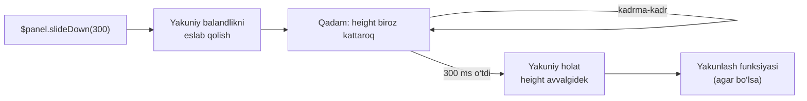
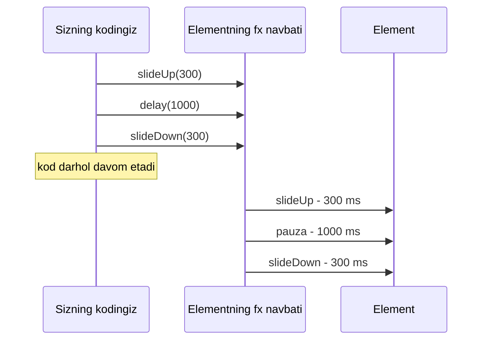
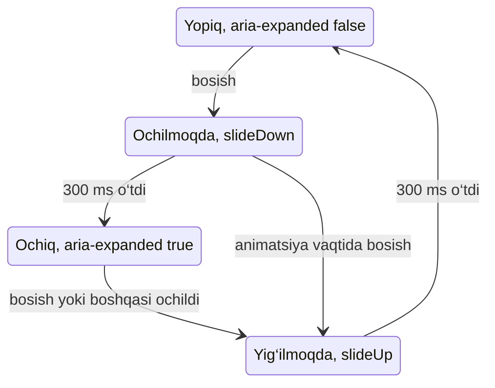
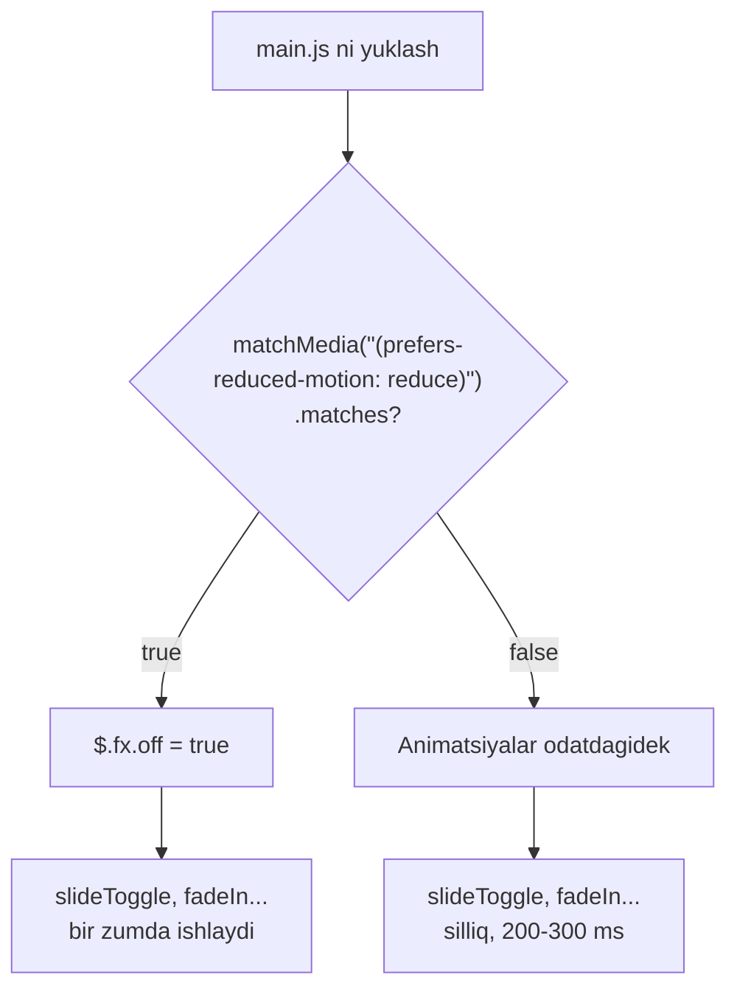

# Effektlar va animatsiya

[Mundarija](../../README.md) · [← Orqaga](../../Lesson-6/uz/Hodisalar.md) · [Keyingi →](../../Lesson-8/uz/Formalar.md) · [RU](../ru/%D0%AD%D1%84%D1%84%D0%B5%D0%BA%D1%82%D1%8B%20%D0%B8%20%D0%B0%D0%BD%D0%B8%D0%BC%D0%B0%D1%86%D0%B8%D1%8F.md) · [EN](../en/Effects%20and%20animation.md) · [UZ](Effektlar%20va%20animatsiya.md)

> **6-dars bilan bog‘liqlik:** siz foydalanuvchi harakatlariga javob berishni o‘rgandingiz: `.on()`, `$(this)`, delegatsiya, `.trigger()`. Lekin hozircha sahifa «sakrab» javob beradi: blok bor edi - va bir zumda g‘oyib bo‘ldi. Bugun uni silliq harakatlanishga o‘rgatamiz: paydo bo‘lish, so‘nib yo‘qolish, ochilish va yig‘ilish. Bundan kam muhim bo‘lmagani - agar foydalanuvchi buni istamasa, o‘z vaqtida harakat **qilmaslik**.

---

## Bu sizga nima uchun kerak

Istalgan internet-do‘konning «Ko‘p beriladigan savollar» sahifasini oching. Savollar yigirmata, javoblar esa ko‘rinmaydi - faqat sarlavhalar ko‘rinadi. Savolni bosdingiz - javob silliq pastga ochiladi, oldin ochilgani esa yig‘iladi. Bu **akkordeon**. «Saqlash» ni bosdingiz - burchakda bir-ikki soniyaga «Saqlandi» plashkasi paydo bo‘ladi va asta so‘nib ketadi. Bu **qalqib chiquvchi bildirishnoma** (toast - «tost»).

Animatsiyasiz bunday elementlar ishlaydi, lekin foydalanuvchi adashib qoladi: nimadir birdan yo‘qoldi, matn «sakradi», nima o‘zgargani tushunarsiz. Chorak soniyalik silliq o‘tish ko‘zga yangi blok **qayerdan** kelganini va eskisi **qayerga** ketganini ko‘rsatadi. jQuery’da bunday effektlar bitta buyruq bilan yoziladi - aynan shuning uchun ular tayyor saytlarda ko‘p uchraydi.

---

## Nimani o‘rganasiz

- Elementlarni bir zumda ko‘rsatish va yashirish: `.show()`, `.hide()`, `.toggle()`.
- Silliq so‘ndirish va ochish: `.fadeIn()`, `.fadeOut()`, `.fadeToggle()`, `.slideDown()`, `.slideUp()`, `.slideToggle()`.
- Davomiylikni berish va kodni animatsiya tugaganidan **keyin** bajarish - yakunlash funksiyasi.
- CSS’ning sonli xususiyatlarini `.animate()` orqali animatsiya qilish.
- Animatsiyalar navbatini tushunish va uni boshqarish: `.stop()`, `.delay()`.
- Ko‘rinishni tekshirish: `.is(":visible")`, `.is(":animated")` - va ularga qachon ishonib bo‘lmasligini tushunish.
- «Harakatni kamaytirish» sozlamasini hurmat qilish: `prefers-reduced-motion`, `window.matchMedia`, `$.fx.off`.
- jQuery effektlari va `.toggleClass()` bilan CSS o‘tishlari orasida tanlash.

---

## Takrorlash: 6-darsdan 3 savol

1. `$("#list").on("click", ".item", fn)` yozuvi `$(".item").on("click", fn)` dan nimasi bilan farq qiladi? Birinchi yozuv qachon kerak?
2. `.on()` ishlovchisi ichida `this` va `$(this)` nima?
3. Nima uchun kursda `$("#btn").click(function () { ... })` deb yozilmaydi?

Javoblar - dars oxirida.

---

## Reja

| Bo‘lim | Nima qilamiz |
| --- | --- |
| Ko‘rsatish va yashirish | `.show`, `.hide`, `.toggle` va ular `display` bilan nima qilishi |
| Silliq effektlar | `fade`- va `slide`-metodlar, davomiylik |
| Yakunlash funksiyasi | Animatsiya oxirini kutadigan kod |
| Mini-topshiriq 1 | So‘nib ketadigan va o‘chiriladigan banner |
| `.animate()` | Sonli xususiyatlarning o‘z animatsiyasi |
| Animatsiyalar navbati | `.delay`, `.stop` va «yopishib qolgan» bosishlar |
| Ko‘rinish va holat | `:visible`, `:animated`, `aria-expanded` |
| Kamroq harakat | `prefers-reduced-motion` va `$.fx.off` |
| jQuery yoki CSS | Qachon `transition` + `toggleClass` yaxshiroq |
| Mini-topshiriq 2 | «Batafsil» bloki va «Nusxalandi» maslahati |
| Mustaqil ish | Akkordeon va qalqib chiquvchi bildirishnoma |

---

## Ko‘rsatish va yashirish: `.show()`, `.hide()`, `.toggle()`

**Oddiy so‘z bilan:** bu chiroq o‘chirgichi. `.hide()` - o‘chirish, `.show()` - yoqish, `.toggle()` - o‘chirgichni bosish: yoniq bo‘lsa - o‘chadi, o‘chiq bo‘lsa - yonadi.

```html
<p id="hint">Parol kamida 8 ta belgidan iborat bo‘lishi kerak</p>
<button id="hint-btn" type="button">Maslahat</button>
```

```js
const $hint = $("#hint");

$hint.hide();                 // yashirish
$hint.show();                 // ko‘rsatish
$("#hint-btn").on("click", function () {
    $hint.toggle();           // almashtirish
});
```

| Yozuv | Nima qiladi |
| --- | --- |
| `$el.hide()` | `display: none` qo‘yadi - element yo‘qoladi va joy egallamaydi |
| `$el.show()` | Elementga uning odatiy `display` ini qaytaradi (`block`, `inline`, `flex`...) |
| `$el.toggle()` | Yashirin bo‘lsa - ko‘rsatadi, ko‘rinib turgan bo‘lsa - yashiradi |
| `$el.toggle(true)` / `$el.toggle(false)` | Shartga ko‘ra ko‘rsatish / yashirish, 4-darsdagi `.toggleClass("x", state)` kabi |

### Ichkarida nima bo‘ladi

JavaScript kursida siz `element.style.display = "none"` deb yozgansiz. jQuery ham xuddi shuni qiladi, lekin ehtiyotkorroq: yashirishdan oldin qanday `display` bo‘lganini **eslab qoladi**. Agar blokda `display: flex` bo‘lgan bo‘lsa, `.show()` `block` ni emas, aynan `flex` ni qaytaradi.

```js
// Sof JavaScript
const hint = document.querySelector("#hint");
hint.style.display = hint.style.display === "none" ? "" : "none";

// jQuery
$("#hint").toggle();
```

`.show()` hatto **CSS faylida** yashirilgan element bilan ham uddalaydi (`.answer { display: none; }`): jQuery kerakli `display` ni to‘g‘ridan-to‘g‘ri `style` atributiga yozadi va u CSS’dagi qoidani bosib o‘tadi.

> **Muhim:** yashirilgan element **DOM’da qoladi**. Uni `$()` orqali topish, matnini o‘qish, yana ko‘rsatish mumkin. Elementni faqat 5-darsdagi `.remove()` o‘chiradi.

---

## Silliq effektlar: `fade` va `slide`

`.show()`/`.hide()` ning «silliq qarindoshlari» bor. Yakuniy natija o‘sha - blokning `display` i, lekin unga yo‘l vaqt bo‘yicha cho‘zilgan.

**Oddiy so‘z bilan:** `fade` - bu dimmer orqali asta-sekin so‘nadigan chiroq. `slide` - bu parda: u yuqoriga o‘raladi va deraza (blok) to butunlay yo‘qolguncha tobora pastlashib boradi.

| Metod | Qanday ko‘rinadi | Qadamma-qadam nima o‘zgaradi |
| --- | --- | --- |
| `.fadeIn()` | Blok asta paydo bo‘ladi | `opacity` 0 dan 1 gacha |
| `.fadeOut()` | Blok so‘nib yo‘qoladi | `opacity` 1 dan 0 gacha, oxirida `display: none` |
| `.fadeToggle()` | So‘ndirish yoki paydo qilish | Joriy holatga qarab |
| `.fadeTo(400, 0.5)` | Yarim shaffof blok | `opacity` 0.5 gacha, blok ko‘rinib qoladi |
| `.slideDown()` | Blok pastga ochiladi | `height` 0 dan to‘liq balandlikkacha |
| `.slideUp()` | Blok yuqoriga yig‘iladi | `height` 0 gacha, oxirida `display: none` |
| `.slideToggle()` | Ochish yoki yig‘ish | Joriy holatga qarab |

```html
<button id="more-btn" type="button">Tavsifni ko‘rsatish</button>
<div id="details" class="details">IDE topshiriqlari bilan 10 darslik kurs.</div>
```

```css
.details { display: none; }
```

```js
$("#more-btn").on("click", function () {
    $("#details").slideToggle();
});
```

Birinchi bosish - tavsif silliq ochiladi, ikkinchisi - yig‘iladi.

### Davomiylik

Effektning birinchi argumenti - **millisekundlardagi** davomiylik (1000 ms = 1 soniya).

| Yozuv | Davomiylik |
| --- | --- |
| `.fadeIn()` | 400 ms - standart bo‘yicha |
| `.fadeIn(200)` | 200 ms |
| `.fadeIn("fast")` | 200 ms |
| `.fadeIn("slow")` | 600 ms |
| `.fadeIn("300ms")` | 400 ms: bunday satrni jQuery tushunmaydi va standart qiymatni oladi |

Interfeys uchun 150–300 ms yaxshi: ko‘z harakatni payqab ulguradi, odam esa kutib qolmaydi. 500 ms dan uzun animatsiya allaqachon «sekinlik» bo‘lib tuyuladi.

Ikkinchi ixtiyoriy argument - **silliqlik** (easing): `"swing"` (standart bo‘yicha - boshida va oxirida sekin, o‘rtasida tezroq) yoki `"linear"` (bir tekis): `.slideDown(300, "linear")`.

### Animatsiya qanday ishlaydi



**Sxemani qanday o‘qish kerak.** jQuery hech qanday sehrga ega emas: u soniyasiga ko‘p marta, taxminan ekranning har bir kadrida, `style` atributidagi xususiyatni biroz o‘zgartiradi - `height: 12px`, `height: 25px`, `height: 39px`... Ko‘z bu kadrlarni harakatga ulab qabul qiladi. Vaqt tugaganda jQuery aniq yakuniy qiymatni qo‘yadi va yakunlash funksiyasini chaqiradi.

### Trassirovka: `slideToggle` ikki marta

| Qadam | Nima bo‘ladi | Qiymat / sahifa holati |
| --- | --- | --- |
| 1 | Yuklash, CSS `.details { display: none; }` | Blok yashirin |
| 2 | Bosish: `slideToggle()` blok yashirinligini ko‘radi → `slideDown` ni tanlaydi | `display: block`, `height` 0 dan o‘sadi |
| 3 | 400 ms dan keyin | Blok to‘liq ochilgan, vaqtinchalik `height` olib tashlangan |
| 4 | Ikkinchi bosish: blok ko‘rinib turibdi → `slideUp` | `height` 0 gacha kamayadi |
| 5 | Yana 400 ms dan keyin | `display: none`, blok yashirin |

---

## Yakunlash funksiyasi

Animatsiya **dasturni to‘xtatmaydi**. `.fadeOut()` chaqiruvi faqat so‘nishni ishga tushiradi, keyingi kod qatori esa darhol bajariladi.

```js
$("#box").fadeOut(400);
console.log("Tayyormi?"); // darhol chiqadi, garchi blok hali ko‘rinib tursa ham
```

**Oddiy so‘z bilan:** siz choynakni qo‘ydingiz va non kesishga ketdingiz - uning tepasida 3 daqiqa turmaysiz. Choyni esa **o‘z vaqtida** quyish uchun choynakda hushtak bor. Yakunlash funksiyasi - bu hushtak: «tugatganingda - meni chaqir».

Funksiya oxirgi argument sifatida beriladi:

```js
$("#box").fadeOut(400, function () {
    console.log("Blok yo‘qoldi");
});
console.log("Animatsiya ishga tushdi");
```

| Qadam | Nima bo‘ladi | Konsoldagi natija |
| --- | --- | --- |
| 1 | `fadeOut` so‘nishni ishga tushiradi va boshqaruvni **darhol** qaytaradi | - |
| 2 | Keyingi qator bajariladi | `Animatsiya ishga tushdi` |
| 3 | 400 ms davomida jQuery `opacity` ni o‘zgartiradi | - |
| 4 | Animatsiya tugadi, `display: none` | - |
| 5 | jQuery yakunlash funksiyasini chaqiradi | `Blok yo‘qoldi` |

### Yakunlash funksiyasidagi `this`

Funksiya ichida `this` - animatsiyani tugatgan **DOM elementi**, xuddi hodisa ishlovchisidagi kabi. Agar elementlar bir nechta bo‘lsa, funksiya **har biri uchun** chaqiriladi:

```js
$(".card").fadeOut(300, function () {
    $(this).remove(); // har bir kartochka o‘zini o‘zi o‘chiradi
});
```

Uchta kartochka - uchta chaqiruv. Agar amal barchasidan keyin bir marta kerak bo‘lsa, uni bitta o‘rovchi elementga osish (`$("#cards").fadeOut(...)`) yoki alohida chaqirish osonroq.

### Yakunlash funksiyasisiz bo‘lmaydigan holatlar

| Vazifa | Nima uchun yakunlash funksiyasi kerak |
| --- | --- |
| Element yo‘qolgandan keyin uni o‘chirish | `.remove()` ni darhol chaqirsangiz, animatsiya ko‘rinmaydi |
| Blok ko‘rinmay turganda matnni almashtirish | Avval `fadeOut`, funksiyada - yangi matn va `fadeIn` |
| Fokusni ochilgan blokka o‘tkazish | Balandlik 0 bo‘lganda fokus ko‘rinmas joyga «uchib ketadi» |

```js
// Matnni silliq almashtirish
const $quote = $("#quote");
$quote.fadeOut(200, function () {
    $quote.text("Kunning yangi iqtibosi").fadeIn(200);
});
```

> **Muhim:** `.remove()` ni `.fadeOut()` dan keyingi qatorga qo‘ymang - element bir zumda o‘chadi, foydalanuvchi hech narsani ko‘rmaydi. O‘chirish - yakunlash funksiyasi ichida.

---

## Mini-topshiriq 1

Sahifada banner bor:

```html
<div id="promo" class="promo">
    <p>Hafta oxirigacha kurslarga 20% chegirma!</p>
    <button class="promo__close" type="button">Yopish</button>
</div>
<p id="status"></p>
```

1. `.promo__close` ni bosganda banner 300 ms davomida so‘nib yo‘qoladi.
2. Yo‘qolgandan **keyin** banner DOM’dan o‘chiriladi, `#status` da esa `Banner yopildi` matni paydo bo‘ladi.
3. Yopishdan oldin va keyin konsolda `$("#promo").length` ni tekshiring.

---

## `.animate()` - o‘z animatsiyangiz

Tayyor effektlar `opacity` va `height` ni o‘zgartiradi. Agar silliq siljitish, cho‘zish yoki yarim shaffof qilish kerak bo‘lsa - `.animate()` dan foydalaning. U 4-darsdagi `.css()` kabi yakuniy CSS qiymatlari yozilgan **obyekt** qabul qiladi.

```js
$("#progress-bar").animate({ width: "75%" }, 500);

$("#ball").animate({
    left: "200px",
    opacity: 0.5
}, 400, function () {
    console.log("To‘p joyida");
});
```

| Yozuv | Nima qiladi |
| --- | --- |
| `.animate({ width: "300px" })` | Silliq ravishda 300px kenglikkacha |
| `.animate({ left: "+=50px" })` | **Joriy** qiymatdan 50px ga siljitish |
| `.animate({ height: "toggle" })` | `slideToggle` bilan bir xil: ochish yoki yig‘ish |
| `.animate({ opacity: 0 }, 300, fn)` | 300 ms, keyin yakunlash funksiyasi |

### Nimani animatsiya qilish mumkin

`.animate()` faqat **sonli** xususiyatlar bilan ishlaydi: `width`, `height`, `opacity`, `left`, `top`, `margin`, `padding`, `font-size`, `scrollTop`. Rang (`background-color`, `color`) - son emas, jQuery uni plaginsiz animatsiya qilmaydi: xususiyat shunchaki o‘zgarmaydi. Rang uchun CSS o‘tishidan foydalaning («jQuery yoki CSS» bo‘limi).

> **Muhim:** jQuery 4 da `px` yalang son oldiga faqat o‘lchamlar va chekinishlar uchun qo‘yiladi. Kursda birliklarni doim aniq yozamiz: `"200px"`, `"75%"`, `"2rem"`. Istisno - `opacity`: uning birligi yo‘q, `0.5` sonini yozamiz.

---

## Animatsiyalar navbati

Ikkita effektni ketma-ket chaqirsak nima bo‘ladi?

```js
$("#box").slideUp(300).slideDown(300);
```

Blok avval yig‘iladi, **keyin** ochiladi - effektlar aralashib ketmaydi. Har bir elementning **navbati** bor (standart bo‘yicha u `fx` deb ataladi): yangi effektlar oxiriga turadi va oldingilari tugashini kutadi.

**Oddiy so‘z bilan:** kassadagi navbat. Har bir effekt - xaridor. Kassir (element) ularga birma-bir, kelish tartibida xizmat qiladi. Yangi xaridor oldinga o‘tmaydi, balki navbat oxiriga turadi.



**Sxemani qanday o‘qish kerak.** Kod millisekundning bir qismida navbatga uchta vazifa qo‘yadi va davom etadi. Animatsiyaning o‘zi esa 1,6 soniyaga cho‘ziladi: navbat vazifalarni birma-bir bajaradi.

### `.delay()` - navbatdagi pauza

```js
$("#toast")
    .fadeIn(200)
    .delay(2000)
    .fadeOut(200);
```

Bildirishnoma paydo bo‘ladi, 2 soniya turadi va so‘nib ketadi. `.delay()` **faqat effektlar navbatiga** ta’sir qiladi: o‘sha zanjirdagi `.text()` yoki `.addClass()` ga ta’sir qilmaydi - ular darhol bajariladi.

### «Yopishib qolgan» bosishlar muammosi

Foydalanuvchi sabrsizlanib tugmani bir soniyada 6 marta bosadi:

```js
$("#menu-btn").on("click", function () {
    $("#menu").slideToggle(400);
});
```

| Qadam | Nima bo‘ladi | `#menu` navbati |
| --- | --- | --- |
| 1 | 1-bosish | `slideDown` ketmoqda |
| 2 | 1 soniyada 2–6-bosishlar | `slideDown`, `slideUp`, `slideDown`, `slideUp`, `slideDown`, `slideUp` |
| 3 | Foydalanuvchi bosishni to‘xtatdi | Menyu yana 2 soniya o‘zi yuqoriga-pastga yuradi |

### `.stop()` - to‘xtatish

| Yozuv | Nima qiladi |
| --- | --- |
| `.stop()` | Joriy animatsiyani hozir turgan joyida to‘xtatish; navbat davom etadi |
| `.stop(true)` | Joriysini to‘xtatish va **navbatni tozalash** |
| `.stop(true, true)` | Navbatni tozalash va joriy animatsiya **oxiriga darhol o‘tish** |
| `.finish()` | Joriy va navbatdagi barcha animatsiyalarni darhol tugatish |

Davosi - yangi effektdan **oldin** `.stop(true, true)`:

```js
$("#menu-btn").on("click", function () {
    $("#menu").stop(true, true).slideToggle(400);
});
```

Endi har bir bosish avval oldingi animatsiyani oxirigacha yetkazadi va «yig‘ilib qolgan»ini tashlab yuboradi, keyin bitta yangisini ishga tushiradi. Qancha bossangiz ham - menyu faqat oxirgi so‘ralganini bajaradi.

---

## Ko‘rinish va holat

### `.is(":visible")` va `.is(":animated")`

2-darsdagi `.is()` metodi ko‘rinishni ham tekshira oladi:

```js
if ($("#details").is(":visible")) {
    console.log("Tavsif ochiq");
}
```

| Yozuv | `true`, agar... |
| --- | --- |
| `.is(":visible")` | Element sahifada joy egallaydi (`display: none` emas va yashirin ota element ichida emas) |
| `.is(":hidden")` | Aksincha |
| `.is(":animated")` | Elementda hozir jQuery animatsiyasi ketmoqda |

### Nima uchun holatni atributda saqlash yaxshiroq

Javob **yig‘ilayotgan** paytdagi (`slideUp` ketayotgan) akkordeonni ko‘rib chiqamiz:

| Nimani tekshiramiz | `slideUp` vaqtidagi natija | Bu to‘g‘rimi? |
| --- | --- | --- |
| `$answer.is(":visible")` | `true` - balandlik hali 0 emas | Yo‘q: foydalanuvchi javobni allaqachon yopdi |
| `$question.attr("aria-expanded")` | `"false"` - bosganda darhol yozdik | Ha |

Atribut **niyatni** aks ettiradi, ko‘rinish esa - hozir ekranda nima borligini. Animatsiya vaqtida ular bir-biridan farq qiladi. Shuning uchun akkordeonda holatni `aria-expanded` da saqlaymiz:

```js
const isOpen = $question.attr("aria-expanded") === "true";
$question.attr("aria-expanded", String(!isOpen));
```

Bu yana **qulaylik (accessibility)** hamdir: `aria-expanded` ni ekran o‘quvchi dasturlar foydalanuvchilari eshitadi - «Kurs qancha davom etadi, tugma, yig‘ilgan». `String(!isOpen)` `true`/`false` ni `"true"`/`"false"` satrlariga aylantiradi, chunki atribut qiymatlari - doim satrlar.



**Sxemani qanday o‘qish kerak.** Akkordeon bandining ikkita emas, to‘rtta holati bor: ulardan ikkitasi - o‘tish holatlari. `aria-expanded` atributi bosganda darhol, ya’ni «Ochilmoqda» yoki «Yig‘ilmoqda» ga kirish paytida o‘zgaradi. Pastdagi strelka - tezkor takroriy bosish: aynan shu yerda `.stop(true, true)` asqotadi.

---

## Kamroq harakat: `prefers-reduced-motion` va `$.fx.off`

Ba’zi odamlarda ekrandagi harakat bosh aylanishi va ko‘ngil aynishini keltirib chiqaradi (vestibulyar buzilishlar), boshqalarga diqqatni jamlashga xalaqit beradi. Shuning uchun Windows, macOS, iOS va Android’da «Harakatni kamaytirish» sozlamasi bor (Windows’da - «Animatsiya effektlari»). Brauzer bu haqda saytga `prefers-reduced-motion` media so‘rovi orqali xabar beradi.

**Oddiy so‘z bilan:** bu mehmonxona xonasi eshigidagi «Bezovta qilmang» lavhasi. Xizmatchi (sizning saytingiz) uni ko‘radi va changyutgich bilan kirmaydi. Baribir yig‘ishtirish mumkin - lekin jimgina.

### CSS’da

```css
@media (prefers-reduced-motion: reduce) {
    * {
        transition: none !important;
        animation: none !important;
    }
}
```

### JavaScript’da: `window.matchMedia`

`window.matchMedia("media so‘rov")` o‘sha media so‘rovni JavaScript’dan tekshiradi. U obyekt qaytaradi, agar so‘rov bajarilsa, uning `.matches` xususiyati `true` ga teng bo‘ladi.

```js
const reduceMotion = window.matchMedia("(prefers-reduced-motion: reduce)");
console.log(reduceMotion.matches); // true - foydalanuvchi kamroq harakat so‘ramoqda
```

### `$.fx.off` - barcha jQuery effektlarining o‘chirgichi

Agar `$.fx.off = true` deb yozsangiz, sahifadagi **barcha** jQuery effektlari bir zumda bajariladigan bo‘ladi: `.slideDown()` blokni darhol ochadi, `.fadeOut()` uni darhol yashiradi, yakunlash funksiyalari darhol chaqiriladi. Bunda sahifa mantig‘i o‘zgarmaydi - akkordeon va bildirishnomalar ishlaydi, faqat harakatsiz.

```js
const reduceMotion = window.matchMedia("(prefers-reduced-motion: reduce)");
if (reduceMotion.matches) {
    $.fx.off = true;
}
```

| Variant | Nima bo‘ladi |
| --- | --- |
| Yuqoridagi qatorlar `main.js` boshida | Harakat faqat buni so‘raganlar uchun o‘chiriladi |
| Shartsiz `$.fx.off = true;` | Animatsiyalar hammada yo‘qoladi - unda ularni yozishdan nima foyda |
| Hech narsa qilmaslik | Vestibulyar buzilishi bor foydalanuvchining saytingizdan boshi aylanadi |



**Sxemani qanday o‘qish kerak.** Tekshiruv yuklashda bir marta bajariladi. Akkordeon va bildirishnomalar kodi hamma uchun bir xil - faqat jQuery elementlarni yakuniy holatga silliq yoki bir zumda yetkazishi o‘zgaradi.

> **Muhim:** JLearn platformasi ham dars topshirig‘ida `$.fx.off = true;` deb yozadi - avtomatik testlar 300 ms kutmasdan, yakuniy natijani darhol ko‘rishi uchun. Bu «o‘chirgich» ning yana bir qo‘llanilishi: animatsiyalarni testlash.

---

## jQuery yoki CSS o‘tishlari

CSS kursida siz `transition` yozgansiz - ikki holat orasidagi silliq o‘tish. Ko‘pincha bu jQuery effektidan yaxshiroq: JavaScript faqat **klassni almashtiradi**, harakatni esa brauzer chizadi.

```css
.menu {
    opacity: 0;
    transform: translateY(-10px);
    pointer-events: none;
    transition: opacity 0.2s, transform 0.2s;
}

.menu.is-open {
    opacity: 1;
    transform: translateY(0);
    pointer-events: auto;
}

@media (prefers-reduced-motion: reduce) {
    .menu { transition: none; }
}
```

```js
$("#menu-btn").on("click", function () {
    const isOpen = $("#menu").toggleClass("is-open").hasClass("is-open");
    $(this).attr("aria-expanded", String(isOpen));
});
```

**Oddiy so‘z bilan:** jQuery effekti - dimmer dastagini o‘zingiz burayapsiz. CSS o‘tishi - siz tugmani bosdingiz, dimmerni esa chiroqning elektronikasi buraydi. Qulayroq va ishonchliroq, lekin sozlamalar - faqat chiroqda bor bo‘lganlari.

| Vaziyat | Yaxshiroq |
| --- | --- |
| Sichqoncha ustiga kelishi, fokus, ajratib ko‘rsatish | CSS `:hover`, `:focus` + `transition`, JavaScript’siz |
| Menyu, modal oynani ochish/yopish, mavzuni almashtirish | `.toggleClass()` + `transition` |
| Rang, soya, `transform` silliq o‘zgaradi | CSS - jQuery rangni animatsiya qilmaydi |
| **Noma’lum balandlikdagi** blokni ochish (`height: auto`) | `.slideDown()` - `auto` gacha CSS o‘tishi hamma brauzerlarda ishlamaydi |
| Amal qat’iy animatsiyadan **keyin** (o‘chirish, matnni almashtirish) | Yakunlash funksiyali jQuery effekti |
| Pauzali ketma-ketlik | jQuery navbati: `.fadeIn().delay().fadeOut()` |
| Sayt allaqachon tayyor effektlari bilan jQuery’da | Sababsiz qayta yozmaslik |

---

### Buzib ko‘ring

1. Menyu ishlovchisidan `.stop(true, true)` ni olib tashlang va tugmani ketma-ket 8 marta bosing. Oxirgi bosishdan keyin menyu yana qancha «yuradi»?
2. `.remove()` ni yakunlash funksiyasi ichiga emas, `.fadeOut(1000)` dan keyingi qatorga qo‘ying. Animatsiya ko‘rinadimi?
3. `.fadeIn("300ms")` va `.fadeIn(3000)` ni yozing. `.fadeIn()` dan farqi bormi?
4. `.animate({ backgroundColor: "red" })` ni sinab ko‘ring. Rang o‘zgardimi? Konsolda xato bormi?
5. DevTools’da `prefers-reduced-motion: reduce` emulyatsiyasini yoqing (⋮ menyusi → More tools → Rendering) va sahifani yangilang. Akkordeon ishlayaptimi? Silliqmi?
6. 3000 ms davom etadigan `slideUp` vaqtida konsolga `$answer.is(":visible")` ni chiqaring. Nima qaytdi va nima uchun?

### Yangi o‘rganuvchilarning tipik xatolari

| Xato | Nima bo‘ladi | Qanday tuzatish |
| --- | --- | --- |
| Slim yig‘ma ulangan | `TypeError: $(...).fadeIn is not a function` | To‘liq yig‘ma `jquery-4.1.0.min.js` |
| `.fadeOut()` dan keyin darhol `.remove()` | Element bir zumda yo‘qoladi | `.fadeOut(300, function () { $(this).remove(); })` |
| Bosish ishlovchisida `.stop()` siz effekt | Animatsiyalar yig‘iladi, blok o‘zi «yuradi» | `.stop(true, true).slideToggle()` |
| Animatsiya vaqtida holat `.is(":visible")` dan olinadi | Tez bosishlarda noto‘g‘ri `aria-expanded` | Holatni `aria-expanded` da saqlash |
| `.animate({ color: "red" })` | Rang o‘zgarmaydi, xato yo‘q | CSS `transition` + klass |
| `position` siz `.animate({ left: "100px" })` | Element siljimaydi | CSS’da `position: relative` |
| `.delay(1000).text("...")` | Matn darhol o‘zgaradi | `.delay()` - faqat effektlar uchun; matn - yakunlash funksiyasida |
| Tekshiruvsiz `$.fx.off = true` | Hech kimda animatsiya yo‘q | Faqat `matchMedia(...).matches` bo‘lsa |
| Davomiylik `"300ms"` | 400 ms kabi ishlaydi | `300` soni |

---

## Mini-topshiriq 2

```html
<button id="details-btn" type="button" aria-expanded="false">Batafsil</button>
<div id="details" class="details">10 darslik kurs. Har bir dars - nazariya, IDE topshirig‘i va test.</div>

<button id="copy-btn" type="button">Promokodni nusxalash</button>
<span id="copied" class="copied">Nusxalandi!</span>
```

```css
.details, .copied { display: none; }
```

1. `#details-btn` ni bosish `#details` ni silliq (250 ms) ochadi yoki yig‘adi. Tez bosishlar yig‘ilib qolmaydi.
2. Tugma matni `Yashirish` / `Batafsil` ga, `aria-expanded` esa `"true"` / `"false"` ga o‘zgaradi. Holatni atributdan oling.
3. `#copy-btn` ni bosish `#copied` ni 150 ms da paydo qiladi, 1,5 soniyadan keyin maslahat so‘nib ketadi. Takroriy bosishlar navbatni to‘plamaydi.
4. Fayl boshida kamroq harakat so‘raganlar uchun animatsiyalarni o‘chiring.

---

## Dars yakuni: shpargalka

| Vazifa | Yozuv |
| --- | --- |
| Bir zumda yashirish / ko‘rsatish / almashtirish | `.hide()`, `.show()`, `.toggle()` |
| Shartga ko‘ra ko‘rsatish yoki yashirish | `.toggle(state)` |
| Paydo qilish / so‘ndirish | `.fadeIn()`, `.fadeOut()`, `.fadeToggle()` |
| Balandlik bo‘yicha ochish / yig‘ish | `.slideDown()`, `.slideUp()`, `.slideToggle()` |
| Davomiylik | `.fadeIn(200)`, `"fast"` = 200, `"slow"` = 600, standart bo‘yicha 400 |
| Animatsiyadan keyingi kod | `.fadeOut(300, function () { ... })`, `this` - element |
| O‘z animatsiyangiz | `.animate({ width: "300px", opacity: 0.5 }, 400)` |
| Navbatdagi pauza | `.fadeIn().delay(2000).fadeOut()` |
| Animatsiyalarni to‘plamaslik | Effektdan oldin `.stop(true, true)` |
| Ko‘rinish / animatsiyani tekshirish | `.is(":visible")`, `.is(":animated")` |
| Ochilish holati | `aria-expanded` = `"true"` / `"false"` |
| «Kamroq harakat» ni hurmat qilish | `if (window.matchMedia("(prefers-reduced-motion: reduce)").matches) { $.fx.off = true; }` |
| CSS vositalari bilan o‘tish | CSS’da `transition` + `.toggleClass("is-open")` |

---

## Mustaqil ish

### 1-qism. IDE topshirig‘i (platforma hisoblaydi)

Sahifada `#faq` savollar bloki bor: har bir `.faq__item` da `aria-expanded="false"` li `.faq__question` tugmasi va yashirin `.faq__answer` javobi. Pastda - `#save-btn` tugmasi va `.toast__text` xatboshisi hamda `.toast__close` tugmasi bo‘lgan yashirin `#toast` bildirishnomasi. Testlar natijani darhol ko‘rishi uchun platforma animatsiyalarni allaqachon o‘chirgan (`$.fx.off = true`).

1. Agar `window.matchMedia("(prefers-reduced-motion: reduce)").matches` bo‘lsa, animatsiyalarni o‘chiring: `$.fx.off = true` (shartsiz - mumkin emas).
2. Akkordeon: bitta delegatsiyalangan `$("#faq").on("click", ".faq__question", ...)` ishlovchisi bilan savolni bosganda qolgan javoblarni `.slideUp()` orqali yoping va ularning tugmalariga `aria-expanded="false"` qo‘ying, o‘z javobingizni esa `.slideToggle()` orqali almashtiring va o‘z tugmangizga `aria-expanded` ni `"true"` yoki `"false"` qilib yozing. Holatni `:visible` dan emas, `aria-expanded` dan oling. Yuklangandan keyin qo‘shilgan savollar ham ishlashi kerak.
3. `showToast(message)` funksiyasini yozing: u `message` ni `.toast__text` ga yozadi va `#toast` ni `.fadeIn()` orqali ko‘rsatadi.
4. `#save-btn` ni bosish `showToast("Sozlamalar saqlandi")` ni chaqiradi.
5. `.toast__close` ni bosish `#toast` ni `.fadeOut()` orqali yashiradi.

Ishlovchilar - faqat `.on()` orqali; `document.querySelector`, `innerHTML`, `.html()`, `.style` va `.click(fn)` dan foydalanmang.

Platforma nimani tekshiradi: birinchi bosish javobni ochadi va `aria-expanded="true"` qo‘yadi, takroriysi - yopadi; ikkinchi savolni ochish birinchisini yopadi; bosishlargacha hammasi yopiq; yuklangandan keyin qo‘shilgan savol ishlaydi (delegatsiya); `showToast` berilgan matnli bildirishnomani ko‘rsatadi, takroriy chaqiruv matnni almashtiradi; `#save-btn` tugmasi va yopish tugmasi; `prefers-reduced-motion` bo‘lsa animatsiyalar o‘chiriladi, bo‘lmasa - yo‘q; `slide`- va `fade`-effektlar ishlatilgan; xatolar yo‘q.

### 2-qism. Kompyuterdagi loyiha

1. HTML/CSS/JS kurslaridagi saytingizda 4–5 banddan iborat «Ko‘p beriladigan savollar» bo‘limini yarating va unga topshiriqdagi akkordeonni ulang.
2. `showToast` dan keyin 3 soniyada o‘zi so‘nib ketadigan qalqib chiquvchi bildirishnoma qo‘shing: `.stop(true, true).fadeIn(200).delay(3000).fadeOut(200)`. Ekran o‘quvchi dastur matnni o‘qishi uchun unga `role="status"` bering.
3. Saytdagi bitta menyu yoki modal oynani CSS’dagi `transition` + `.toggleClass("is-open")` ga o‘tkazing.
4. `main.js` boshiga `prefers-reduced-motion` tekshiruvini va CSS’ga media so‘rovni qo‘shing. DevTools’dagi emulyatsiya orqali tekshiring.

### Tayyorlik mezonlari

- [ ] IDE topshirig‘i qabul qilindi.
- [ ] Tez bosishlar animatsiyalarni to‘plamaydi: effektlardan oldin `.stop(true, true)` turibdi.
- [ ] Animatsiyadan keyin o‘chirish va matnni almashtirish - yakunlash funksiyasi ichida.
- [ ] «Harakatni kamaytirish» yoqilganda sayt animatsiyalarsiz ishlaydi.
- [ ] Qachon CSS o‘tishini, qachon jQuery effektini tanlashni tushuntira olasiz.

---

## O‘zini tekshirish uchun savollar

1. `.hide()` `.fadeOut()` dan va `.remove()` dan nimasi bilan farq qiladi?
2. `.slideToggle()` nima qiladi va u ochish yoki yig‘ishni qanday tanlaydi?
3. jQuery qanday davomiylik qiymatlarini tushunadi? Standart davomiylik qancha?
4. Yakunlash funksiyasi nima uchun kerak? Uning ichida `this` nima va uchta element uchun u necha marta chaqiriladi?
5. `.animate()` orqali qaysi xususiyatlarni animatsiya qilish mumkin, qaysilarini - yo‘q?
6. Animatsiyalar navbati nima? `$el.slideUp().slideDown()` dan keyin nima bo‘ladi?
7. `.stop()`, `.stop(true)` va `.stop(true, true)` nimasi bilan farq qiladi? Ularni bosish ishlovchisida effektdan oldin nima uchun qo‘yish kerak?
8. Nima uchun akkordeon holatini `.is(":visible")` ni tekshirish o‘rniga `aria-expanded` da saqlash yaxshiroq?
9. `prefers-reduced-motion` nima, uni JavaScript’dan qanday tekshirish mumkin va `$.fx.off = true` nima qiladi?
10. Qachon `.toggleClass()` bilan CSS o‘tishi, qachon jQuery effekti yaxshiroq?

Savollardan keyin platformada **dars testini** topshiring: 12 ta savol, o‘tish chegarasi 70%.

---

## Keyin nima

Akkordeonlar va bildirishnomalar ko‘pincha **formalar** yonida yashaydi: «Saqlandi», «Maydonni to‘ldiring», «Arizangiz uchun rahmat». 8-darsda jQuery’dagi formalarni ko‘rib chiqamiz: maydonlar, belgilash katakchalari va ro‘yxatlar qiymatlarini `.val()` va `.prop()` orqali o‘qish, `submit` yuborishni ushlab qolish, maydonlarni tekshirish, xatoni maydon yonida ko‘rsatish - va, albatta, muvaffaqiyat xabarini silliq ko‘rsatish.

---

## Javoblar

**Takrorlash**

1. Birinchi yozuv - delegatsiya: `#list` ota elementidagi bitta ishlovchi ichidagi istalgan `.item` uchun, jumladan yuklangandan keyin qo‘shilganlari uchun ham ishlaydi. Ikkinchisi faqat chaqiruv paytida mavjud bo‘lgan `.item` larga obuna bo‘ladi.
2. `this` - ishlovchi ishga tushgan DOM elementi (delegatsiyada - topilgan `.item`), `$(this)` - jQuery metodlarini chaqirish uchun jQuery obyektiga o‘ralgan o‘sha element.
3. `.click(fn)` qisqartmalari eskirgan; `.on()` - delegatsiya, nomlar fazolari va `.off()` bilan barcha hodisalar uchun yagona usul.

**Mini-topshiriq 1**

```js
$("#promo").on("click", ".promo__close", function () {
    $("#promo").fadeOut(300, function () {
        $(this).remove();
        $("#status").text("Banner yopildi");
    });
});
```

Konsolda yopishdan oldin `$("#promo").length` `1` ga teng, keyin - `0`.

**Mini-topshiriq 2**

```js
const reduceMotion = window.matchMedia("(prefers-reduced-motion: reduce)");
if (reduceMotion.matches) {
    $.fx.off = true;
}

$("#details-btn").on("click", function () {
    const $btn = $(this);
    const isOpen = $btn.attr("aria-expanded") === "true";

    $("#details").stop(true, true).slideToggle(250);
    $btn
        .attr("aria-expanded", String(!isOpen))
        .text(isOpen ? "Batafsil" : "Yashirish");
});

$("#copy-btn").on("click", function () {
    $("#copied")
        .stop(true, true)
        .fadeIn(150)
        .delay(1500)
        .fadeOut(150);
});
```

**O‘zini tekshirish uchun savollar**

1. `.hide()` bir zumda `display: none` qo‘yadi; `.fadeOut()` xuddi shunga `opacity` ni silliq kamaytirish orqali keladi; `.remove()` elementni DOM’dan butunlay o‘chiradi.
2. `height` ni o‘zgartirib, blokni silliq ochadi yoki yig‘adi. Yashirin blokni ochadi (`slideDown`), ko‘rinib turganini - yig‘adi (`slideUp`).
3. Millisekundlar soni, `"fast"` (200) va `"slow"` (600). Standart bo‘yicha 400 ms; `"300ms"` kabi tushunarsiz satr ham 400 beradi.
4. Animatsiya tugaganidan keyin kodni bajarish uchun (o‘chirish, matnni almashtirish, fokusni o‘tkazish). `this` - animatsiyani tugatgan DOM elementi; uchta element uchun funksiya uch marta chaqiriladi.
5. Sonlilarni: `width`, `height`, `opacity`, `left`, `top`, chekinishlar, `font-size`, `scrollTop`. Ranglar va sonli bo‘lmagan qiymatlarni - yo‘q.
6. Har bir elementda `fx` navbati bor: effektlar chaqirilish tartibida birma-bir bajariladi. Blok avval yig‘iladi, keyin ochiladi.
7. `.stop()` - joriy animatsiyani to‘xtatish, navbat davom etadi; `.stop(true)` - to‘xtatish va navbatni tozalash; `.stop(true, true)` - navbatni tozalash va joriysini darhol oxirigacha yetkazish. Effektdan oldin - tez bosishlar animatsiyalarni to‘plamasligi uchun.
8. Yopilish animatsiyasi vaqtida blok hali ko‘rinib turadi va `:visible` `true` qaytaradi. Atribut bosganda darhol o‘zgaradi va niyatni aks ettiradi, buning ustiga uni ekran o‘quvchi dasturlar o‘qiydi.
9. Tizimning «harakatni kamaytirish» sozlamasi. Tekshiruv: `window.matchMedia("(prefers-reduced-motion: reduce)").matches`. `$.fx.off = true` barcha jQuery effektlarini bir zumda bajariladigan qiladi, sahifa mantig‘i avvalgidek qoladi.
10. CSS o‘tishi - sichqoncha ustiga kelishi, rang, `transform`, klass orqali menyu va oynalarni ochish uchun. jQuery effekti - `auto` balandlik (`slideDown`), animatsiyadan keyingi amallar va pauzali ketma-ketliklar uchun, shuningdek jQuery effektlari allaqachon ishlatilayotgan saytlarda.

[Mundarija](../../README.md) · [← Orqaga](../../Lesson-6/uz/Hodisalar.md) · [Keyingi →](../../Lesson-8/uz/Formalar.md) · [RU](../ru/%D0%AD%D1%84%D1%84%D0%B5%D0%BA%D1%82%D1%8B%20%D0%B8%20%D0%B0%D0%BD%D0%B8%D0%BC%D0%B0%D1%86%D0%B8%D1%8F.md) · [EN](../en/Effects%20and%20animation.md) · [UZ](Effektlar%20va%20animatsiya.md)
