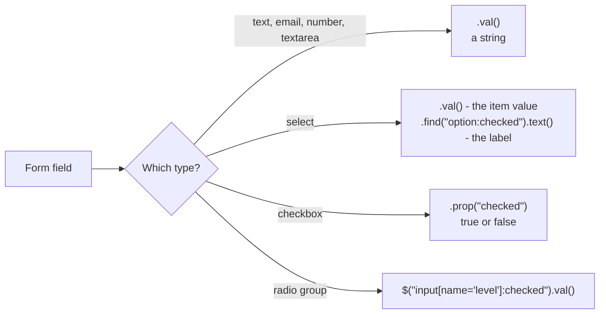
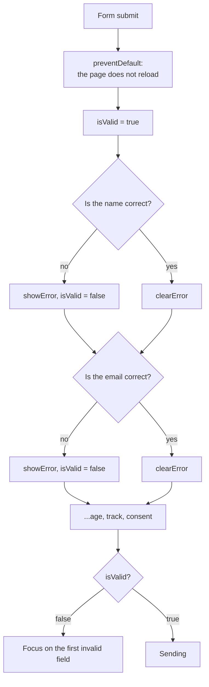
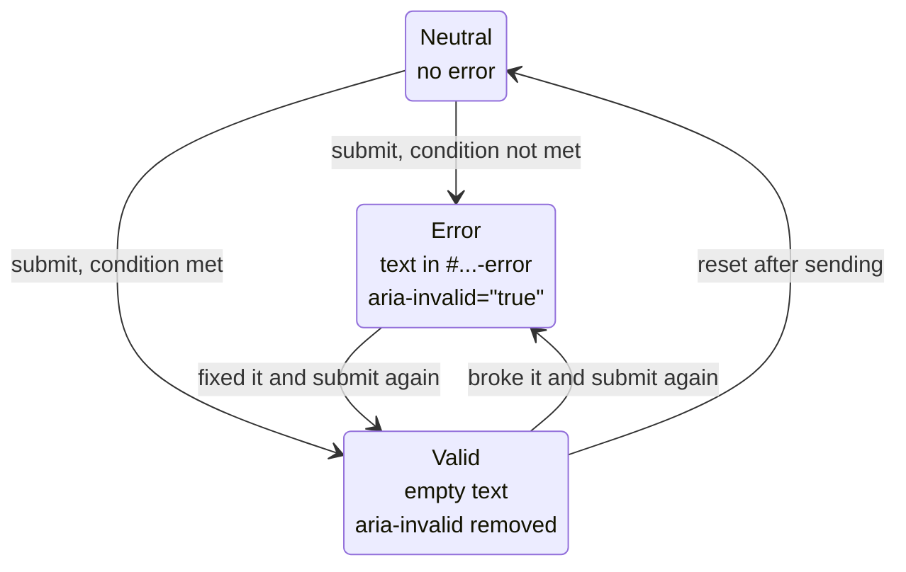
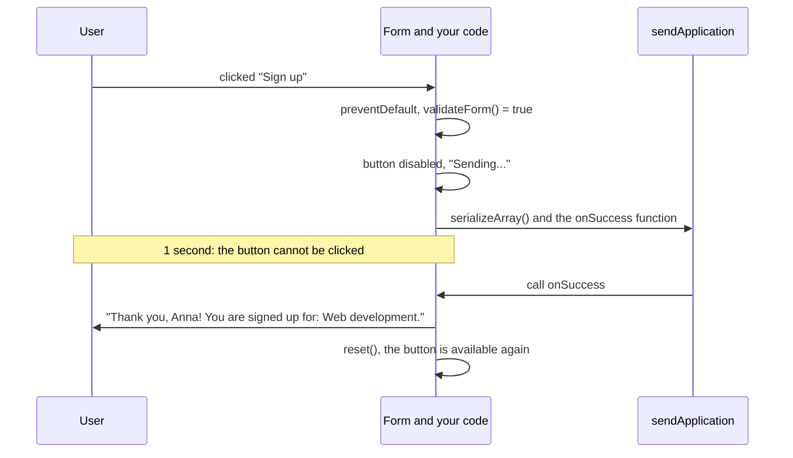

# Forms

[Contents](../../README.md) · [← Back](../../Lesson-7/en/Effects%20and%20animation.md) · [Next →](../../Lesson-9/en/AJAX%20-%20loading%20data.md) · [RU](../ru/%D0%A4%D0%BE%D1%80%D0%BC%D1%8B.md) · [EN](Forms.md) · [UZ](../uz/Formalar.md)

> **Link to lesson 7:** you learned to show and hide elements smoothly, and in lesson 6 - to subscribe to events and cancel the browser's default action. Today we put it all together on the most important element of a website - the **form**: we will read all the fields, check them, show errors next to the fields and carefully "send" an application.

---

## Why you need this

Imagine: the university is opening a programming club, and people sign up through a form on the website. An applicant forgot to enter the email - and finds out only after the page reloads and everything they typed is gone. Or they clicked "Sign up" three times because nothing seemed to happen - and now the list has three identical applications. Or they see "Error in the form" but cannot tell which field is wrong.

A good form tells you what to fix right away and right next to the field, does not lose what you typed, blocks the button while sending and clears itself after success. Almost every website with jQuery has forms like this: sign-up, feedback, orders, registration. In the JavaScript course you already wrote validation in plain JS - today the same thing becomes shorter, and the form data will be collected with **one call**.

---

## What you will learn

- Handle form submission with `.on("submit", ...)` without reloading the page.
- Read the values of text fields, numbers and `<select>` lists: `.val()`.
- Find out the state of checkboxes and radio buttons: `.prop("checked")`, `:checked`, `.is()`.
- Collect all form data with one call: `.serialize()` and `.serializeArray()`.
- Show **all** errors at once next to the fields and mark them for screen readers: `aria-invalid`.
- Block the button while sending and reset the form after success.

---

## Review: 3 questions from lesson 7

1. How is `.hide()` different from `.fadeOut(400)`? What do they have in common at the end?
2. Why pass a completion function: `$box.fadeOut(400, function () { ... })`?
3. What does `$.fx.off = true` do, and who needs it?

Answers are at the end of the lesson.

---

## Lesson plan

| Section | What we do |
| --- | --- |
| The form and the `submit` event | Catch submission without reloading the page |
| Field values | `.val()` for text, numbers and lists |
| Checkboxes and radio buttons | `.prop("checked")` and `:checked` |
| Mini-task 1 | A profile settings page |
| All form data at once | `.serialize()` and `.serializeArray()` |
| Validating fields | Rules, all errors at once |
| Errors next to the field | `aria-invalid`, `aria-describedby`, focus |
| Sending | Blocking the button, the "server" response, reset |
| Mini-task 2 | A subscription form |
| Independent work | A club sign-up form |

---

## The form and the `submit` event

### Where to catch submission

**In simple words:** a form is an application sheet, and the `submit` event is the moment a person hands the sheet in at the window. It does not matter how they do it: hand it over themselves (the button) or ask a neighbor (the Enter key in a field). So you need to wait at the window - **on the form**, not on the button.

```html
<form id="signup-form" novalidate>
    <label for="name">Name</label>
    <input id="name" name="name" type="text">
    <button type="submit">Sign up</button>
</form>
```

```js
const $form = $("#signup-form");

$form.on("submit", function (event) {
    event.preventDefault();             // do not reload the page
    console.log("The form was submitted");
});
```

| Plain JavaScript (JS course, lesson 9) | jQuery |
| --- | --- |
| `form.addEventListener("submit", (event) => { ... })` | `$form.on("submit", function (event) { ... })` |
| `event.preventDefault()` | `event.preventDefault()` - the same method |

### Why `preventDefault`

Without it, the browser performs the default action: it sends the data to the address in `action` (or to the same page) and **reloads** it. All your messages and everything the user typed disappear. You already met `preventDefault` in lesson 6 with links - here it is the same.

> **Important:** call `event.preventDefault()` on the **first line** of the handler - before any checks. If an error happens further down in the code, at least the page will not reload and you will see the message in the console.

In old code you will see `$form.submit(function () { ... })` - this shorthand is deprecated, just like `.click(fn)` from lesson 6. To trigger submission from code, use `$form.trigger("submit")`: your handlers will run, and if none of them calls `preventDefault`, the browser will submit the form.

### The `novalidate` attribute

The `required`, `type="email"`, `min` and `max` attributes make the browser check the form by itself and show its own hints - and every browser shows different ones. `novalidate` on `<form>` turns them off: **your** code does the checking and writes the error texts. Keep the `type` and `required` attributes - they describe the meaning of the field.

---

## Field values: `.val()`

You know `.val()` from lesson 3. In forms it is the main tool, so let's look at what it returns for different fields.

```html
<input id="age" name="age" type="number">
<select id="direction" name="direction">
    <option value="">Choose a track</option>
    <option value="web">Web development</option>
    <option value="python">Python for beginners</option>
</select>
```

| Field | `.val()` returns | Example |
| --- | --- | --- |
| `<input type="text">` | The typed text | `" Anna "` - with spaces, as typed |
| `<input type="number">` | A **string** with a number, or `""` | `"20"`, not `20` |
| `<select>` | The `value` of the selected `<option>` | `"web"`, not "Web development" |

### A number from a field is always a string

```js
const age = Number($("#age").val());   // "20" → 20
console.log(age + 1);                   // 21, without Number it would be "201"
```

In a `type="number"` field the browser does not let you type letters, but an empty field gives `""`, and `Number("")` is `0`. So check both for an empty value and with `Number.isNaN()` - as in the JavaScript course.

### A list: value and label

A `<select>` has two different "answers": the technical `value` for the program and the label for the person.

```js
const $direction = $("#direction");

$direction.val();                           // "web" - for checks and the server
$direction.find("option:checked").text();   // "Web development" - for a message
```

The `option:checked` selector is ordinary CSS: in lists, the selected item counts as "checked". In old code you will see `option:selected` - it is a jQuery extension and it also works, but the CSS version is clearer and faster.

---

## Checkboxes and radio buttons

### Checkbox: `.prop("checked")`

**In simple words:** a checkbox has a "label on the box" - `value` - and a "switch" - `checked`. `.val()` reads the label, which does not change when you click. We almost always need the switch.

```html
<label>
    <input id="agree" name="agree" type="checkbox">
    I agree to the club rules
</label>
```

```js
const $agree = $("#agree");

$agree.prop("checked");      // true or false - is it checked right now
$agree.is(":checked");       // the same
$agree.val();                // "on" - ALWAYS, even if it is not checked!
```

| Code | What it returns | Good for a check? |
| --- | --- | --- |
| `$agree.prop("checked")` | `true` / `false` - the current state | Yes |
| `$agree.attr("checked")` | The attribute from the HTML: `"checked"` or `undefined`, does not change on click | No (lesson 3) |
| `$agree.val()` | The checkbox `value`, without the attribute - `"on"` | No |

### Radio buttons: the selected one in a group

Radio buttons `type="radio"` with the same `name` form one group, and you can select only one of them.

```html
<label><input type="radio" name="level" value="beginner" checked> Beginner</label>
<label><input type="radio" name="level" value="pro"> I already code</label>
```

```js
const level = $("input[name='level']:checked").val();   // "beginner" or "pro"
```

You read the selector like this: "the field with `name="level"` that is checked right now". If none is checked, the jQuery object is empty and `.val()` returns `undefined`.

| Code | Result |
| --- | --- |
| `$("input[name='level']:checked").val()` | The `value` of the selected radio button |
| `$("input[name='level']").val()` | The `value` of the **first** one in the group, even if the second is selected - a trap |



**How to read the diagram.** First look at the field type, then choose how to read it. For text and lists - `.val()`, for "on/off" - `.prop("checked")`, for a group of radio buttons - first find the checked one, then ask it for `.val()`.

---

## Mini-task 1

A profile settings page:

```html
<input id="nickname" type="text">
<select id="lang">
    <option value="ru">Russian</option>
    <option value="uz">O'zbekcha</option>
</select>
<input id="notify" type="checkbox">
<input type="radio" name="level" value="Beginner" checked>
<input type="radio" name="level" value="Experienced">
<button id="show-btn" type="button">Show</button>
<p id="summary"></p>
```

When `#show-btn` is clicked, write a string like `Nickname: anna, language: Russian, notifications: yes, level: Beginner` into `#summary`. The nickname has no spaces at the edges; the language is the **label** of the selected item; notifications are `yes` or `no` depending on the checkbox state.

---

## All form data at once

Reading each field separately takes a long time. jQuery can collect the whole form with one call. It works by the **`name`** attribute of the fields - the same attribute that sent data to the server in the HTML course.

**In simple words:** `.serialize()` and `.serializeArray()` are like a clerk who takes a filled-in form and copies it into a register. The clerk copies only the boxes that have a title (`name`) and skips the crossed-out ones (`disabled`) and unticked checkboxes.

```html
<form id="signup-form">
    <input name="name" value="Anna Li">
    <input name="age" value="20">
    <input name="agree" type="checkbox">
</form>
```

### `.serializeArray()` - an array of pairs

```js
const data = $("#signup-form").serializeArray();
console.log(data);
// [ { name: "name", value: "Anna Li" }, { name: "age", value: "20" } ]
```

This is an array of `{ name, value }` objects from lesson 6 of the JS course. It is easy to loop over it or find the field you need:

```js
const ageField = data.find((field) => field.name === "age");
console.log(ageField.value); // "20" - a string!
```

### `.serialize()` - a string for the server

```js
$("#signup-form").serialize();
// "name=Anna%20Li&age=20"
```

This is the same string the browser adds to the address when it submits a GET form: `name=value` pairs joined with `&`, with non-Latin letters and spaces encoded (`%D0%90...`, `%20`). This string is what you send to the server - in lesson 9, with `$.post`.

| Method | What it returns | When you need it |
| --- | --- | --- |
| `.serializeArray()` | An array `[{ name, value }, ...]` | To loop over, find or show the data in code |
| `.serialize()` | A string `name=...&age=...` | To send to the server (lesson 9) |

### What gets into the result

| Field | Included? |
| --- | --- |
| A field with `name` | Yes |
| A field without `name` | No |
| A field with `disabled` | No |
| An unchecked checkbox | No |
| A checked checkbox without `value` | Yes, the value is `"on"` |
| A group of radio buttons | Only the selected one |

> **Important:** `.serializeArray()` returns the values **as they are**: strings with spaces, numbers as strings. You still have to check and clean the data (`trim`, `Number`) yourself.

---

## Validating fields

### Rules

For the club sign-up form, we will check five rules:

| Field | Error condition | Message |
| --- | --- | --- |
| Name | `name === ""` after `trim()` | "Enter your name" |
| Name | `name.length < 2` | "Name - at least 2 characters" |
| Email | `!email.includes("@")` | "Enter an email with the @ symbol" |
| Age | empty, `Number.isNaN(age)`, `age < 14` or `age > 60` | "Age - a number from 14 to 60" |
| Track | `$direction.val() === ""` | "Choose a track" |
| Consent | `!$agree.prop("checked")` | "Confirm that you agree to the rules" |

### Two helpers: show and clear an error

Each field has its own paragraph for an error next to it, and the link between them is written in the field's `aria-describedby` attribute:

```html
<input id="email" name="email" type="email" aria-describedby="email-error">
<p id="email-error" class="error"></p>
```

```js
function showError($field, text) {
    $(`#${$field.attr("aria-describedby")}`).text(text);
    $field.attr("aria-invalid", "true");
}

function clearError($field) {
    $(`#${$field.attr("aria-describedby")}`).text("");
    $field.removeAttr("aria-invalid");
}
```

You read `` $(`#${$field.attr("aria-describedby")}`) `` like this: take the field's `aria-describedby` attribute (`"email-error"`), add `#` in front - and you get the selector `#email-error`. One function works for any field.

### All errors at once

In the JavaScript course we left the function with `return` after the first error. That is simple but inconvenient: the person fixes the name, clicks the button - and only then learns about the email. Let's show **all** errors at once. For this, we create a flag.

**In simple words:** a teacher is marking a test. The teacher does not stop at the first mistake but underlines all of them, and only at the end gives the result: "pass" or "fail". The `isValid` flag is that final mark.

```js
function validateForm() {
    let isValid = true;

    const name = $name.val().trim();
    if (name === "") {
        showError($name, "Enter your name");
        isValid = false;
    } else if (name.length < 2) {
        showError($name, "Name - at least 2 characters");
        isValid = false;
    } else {
        clearError($name);
    }

    // ...the same for email, age, track and consent

    return isValid;
}
```



**How to read the diagram.** Each field is checked on its own: if it is correct, the error is cleared; if not, the error is shown and the flag drops to `false`. No branch leaves the function early. The decision "send or not" is made once, at the very end.

Trace: the user left the name empty, the email is `anna.mail.uz`, everything else is correct.

| Step | What happens | Value / page state |
| --- | --- | --- |
| 1 | `let isValid = true` | `isValid = true` |
| 2 | `name = "".trim()` → `""` | Next to the name: "Enter your name", `aria-invalid="true"`; `isValid = false` |
| 3 | `"anna.mail.uz".includes("@")` → `false` | Next to the email: "Enter an email with the @ symbol"; `isValid = false` |
| 4 | Age `"20"` → 20, in range | The age error is cleared |
| 5 | Track and consent are correct | Their errors are cleared |
| 6 | `return isValid` | `false` - nothing is sent, two errors are visible |

---

## Errors next to the field and accessibility

### `aria-invalid` and `aria-describedby`

A red border is visible to the eye, but a person using a screen reader will not see it. Two attributes from the HTML course solve this:

| Attribute | On which element | What it tells the screen reader |
| --- | --- | --- |
| `aria-invalid="true"` | On the field | "The field is filled in incorrectly" |
| `aria-describedby="email-error"` | On the field | "The field description is in the `#email-error` element": the screen reader reads the error text together with the label |

It is handy to use the same attribute in CSS, so you do not need a separate class:

```css
input[aria-invalid="true"],
select[aria-invalid="true"] {
    border-color: #b91c1c;
}
```

> **Important:** the attribute must be **removed** with `.removeAttr("aria-invalid")` when the field is fixed. If you leave `aria-invalid="true"`, the border stays red and the screen reader keeps saying "invalid" about a correct field.

### Field state



**How to read the diagram.** A field is in one of three states. Transitions happen when the form is submitted: `showError` moves it to "Error", `clearError` moves it to "Valid". After a successful submission and reset, the form goes back to the start.

### Focus on the first invalid field

It is helpful to put the cursor right where the user needs to fix something: `$form.find("[aria-invalid='true']").first().trigger("focus")`. A chain from lessons 2 and 6: find the invalid fields inside the form, take the first one, trigger the `focus` event on it.

---

## Sending: blocking the button and resetting

### A practice "server"

We will look at real sending to a server in lesson 9. For now, let's imagine that the server is the function `sendApplication(data, onSuccess)`: it takes the data and **after one second** calls the function `onSuccess` - as if the server replied "accepted". Inside, it is an ordinary `setTimeout` from the JavaScript course:

```js
function sendApplication(data, onSuccess) {
    console.log("Sending:", data);
    setTimeout(onSuccess, 1000);
}
```

**In simple words:** you handed in your application at the window, and they told you "please wait, we will call you". You do not have to stand at the window doing nothing - they will call you (`onSuccess`) when everything is ready. A "call me later" function like this is called a **callback function**: you have already passed them to `.on()` and `.fadeOut()`.

### The button while sending

One second is a long time. If nothing changes, the person will click the button again. So while sending, we block the button and change its text: `$submitBtn.prop("disabled", true).text("Sending...")`. `disabled` is a live property, so we use `.prop()`, just like for `checked` (lesson 3). A blocked button cannot be clicked, and the browser will not submit the form on Enter.

### Resetting the form

jQuery has no `.reset()` method. The DOM element of the form has it - we get it with `[0]` (lesson 1): `$form[0].reset()` returns all fields to their initial values from the HTML. Another option is `$form.trigger("reset")`.

### The whole handler

```js
$form.on("submit", function (event) {
    event.preventDefault();
    $message.text("");

    if (!validateForm()) {
        $form.find("[aria-invalid='true']").first().trigger("focus");
        return;
    }

    const name = $name.val().trim();
    const directionText = $direction.find("option:checked").text();
    const data = $form.serializeArray();

    $submitBtn.prop("disabled", true).text("Sending...");

    sendApplication(data, function () {
        $message.text(`Thank you, ${name}! You are signed up for: ${directionText}.`);
        $form[0].reset();
        $submitBtn.prop("disabled", false).text("Sign up");
    });
});
```

Note: the name and the track are saved into constants **before** sending. One second later, when `onSuccess` runs, we call `reset()` and the fields become empty - but the message must contain the data the user entered.



**How to read the diagram.** The `submit` handler does not wait for the answer: it blocks the button, passes the data and the function to the "server" and finishes. One second later the "server" itself calls `onSuccess`, and only then the message appears, the form is cleared and the button is unblocked.

Trace of a successful submission:

| Step | What happens | Value / page state |
| --- | --- | --- |
| 1 | `preventDefault()`, `$message.text("")` | The page does not reload, the message is empty |
| 2 | `validateForm()` | `true`, all errors are cleared |
| 3 | `name`, `directionText`, `data` | `"Anna"`, `"Web development"`, an array of 5 pairs |
| 4 | `.prop("disabled", true).text("Sending...")` | The button is grey, the label is "Sending..." |
| 5 | `sendApplication(data, fn)` | The handler has finished, waiting is in progress |
| 6 | After 1 s - `fn()` | In `#form-message`: "Thank you, Anna! You are signed up for: Web development." |
| 7 | `$form[0].reset()` | The fields are empty, the checkbox is unticked, the list shows "Choose a track" |
| 8 | `.prop("disabled", false).text("Sign up")` | The button can be clicked again |

---

### Try to break it

1. Remove `event.preventDefault()` and submit the form. What happened to the messages and the data you typed? What appeared in the address bar?
2. Replace `$agree.prop("checked")` with `$agree.val()` and submit the form with the checkbox unticked. Why did the check let it through?
3. Remove the `name` attribute from the email field and print `$form.serializeArray()` to the console. Where did the email go?
4. Move `const name = $name.val().trim();` inside `onSuccess`, after `reset()`. What will be in the message?
5. Remove the line `.prop("disabled", true)` and quickly click the button three times. How many times will "Sending:" appear in the console?

### Typical beginner mistakes

| Mistake | What you get | How to fix |
| --- | --- | --- |
| The handler is on the button's `click` | Enter in a field submits the form, skipping the check | `$form.on("submit", ...)` |
| No `preventDefault()` | The page reloads, everything is lost | On the first line of the handler |
| Checkbox read with `.val()` or `.attr("checked")` | "Consent" is always there or never changes | `.prop("checked")` or `.is(":checked")` |
| Age not converted to a number | `$age.val() + 1` gives `"201"`, and `"9" > "60"` is true: strings are compared letter by letter | `const age = Number($age.val())` |
| No `trim()` | A name made of spaces passes the check | `$name.val().trim()` |
| `return` after the first error | Only one error out of three is visible | A flag `let isValid = true` |
| The error was shown but not cleared | The fixed field stays red | `clearError`: empty text and `.removeAttr("aria-invalid")` |
| `$form.reset()` | `TypeError: $form.reset is not a function` | `$form[0].reset()` |

---

## Mini-task 2

A form to subscribe to club news:

```html
<form id="subscribe-form" novalidate>
    <input id="sub-email" name="email" type="email" aria-describedby="sub-email-error">
    <p id="sub-email-error" class="error"></p>
    <select id="topic" name="topic" aria-describedby="topic-error">
        <option value="">Newsletter topic</option>
        <option value="events">Events</option>
        <option value="lessons">New lessons</option>
    </select>
    <p id="topic-error" class="error"></p>
    <button type="submit">Subscribe</button>
</form>
<p id="subscribe-message" role="status"></p>
```

1. Use the `showError` and `clearError` functions from the lesson.
2. On submission, without reloading, check both fields: the email contains `@`, a topic is selected. Show both errors at once.
3. If there are no errors, print `$form.serialize()` to the console, write the text `Subscribed: anna@mail.uz` into `#subscribe-message` and reset the form.

---

## Lesson summary: cheat sheet

| Task | Code |
| --- | --- |
| Catch submission | `$form.on("submit", function (event) { event.preventDefault(); ... })` |
| Value of a field or list | `$field.val()` - always a string |
| Label of the selected item | `$select.find("option:checked").text()` |
| Is the checkbox checked | `$agree.prop("checked")` or `$agree.is(":checked")` |
| The selected radio button | `$("input[name='level']:checked").val()` |
| Data as an array | `$form.serializeArray()` → `[{ name, value }]` |
| Data as a string | `$form.serialize()` → `"name=...&age=..."` |
| Show an error | `.text("...")` in the error element + `.attr("aria-invalid", "true")` |
| Clear an error | `.text("")` + `.removeAttr("aria-invalid")` |
| Block the button | `$btn.prop("disabled", true)` |
| Reset the form | `$form[0].reset()` |

---

## Independent work

### Part 1. IDE task (graded by the platform)

The page has a club sign-up form `#signup-form` with the fields `#name`, `#email`, `#age`, the list `#direction` and the checkbox `#agree`. Each field has its own error element (`#name-error` and so on), and its id is written in the field's `aria-describedby` attribute. The button is `#submit-btn`, the success message is `#form-message`. The practice "server" `sendApplication(data, onSuccess)` already exists: it takes the data and calls `onSuccess` after one second.

1. Write `showError($field, text)`: the text goes into the field's error element and the field gets `aria-invalid="true"`; `clearError($field)`: empty text and no `aria-invalid`.
2. Write `validateForm()`: it checks **all** fields at once and returns `true` or `false`. The name after `trim()` is not empty ("Enter your name") and not shorter than 2 characters ("Name - at least 2 characters"); the email contains `@` ("Enter an email with the @ symbol"); the age is a number from 14 to 60 inclusive ("Age - a number from 14 to 60"); a track is selected in `#direction` ("Choose a track"); the checkbox `#agree` is checked ("Confirm that you agree to the rules"). For correct fields, the error is cleared.
3. The handler `$form.on("submit", ...)`: cancels the browser's submission, clears `#form-message` and validates the form.
4. If there are no errors: blocks `#submit-btn` and writes `Sending...` on it, calls `sendApplication($form.serializeArray(), function)`. In the function: the text `Thank you, Anna! You are signed up for: Web development.` in `#form-message` (the name after `trim` and the text of the selected track), the form is reset, the button is available again with the text `Sign up`.

Do not use `document.querySelector`, `innerHTML`, `.html()` or `.submit(fn)`.

What the platform checks: the texts of all five errors for an empty form and `aria-invalid` on the fields; that the page does not reload when the form is submitted in three ways (`.trigger("submit")`, `requestSubmit()` and a `submit` event); a name made of spaces and a one-letter name; an email without `@`; the age limits 13, 14, 60, 61 and an empty field; the list and the checkbox; that fixed fields lose their error; the blocked button and the `.serializeArray()` data in `sendApplication`; the message, the form reset and the unblocked button after the response; that the code runs without errors.

### Part 2. Project on your computer

1. Add a feedback form to your website from the HTML, CSS and JS courses: name, email, topic (`<select>`), message (`<textarea>`), a consent checkbox. The form has `novalidate`, and each field has `name`, `aria-describedby` and an error element.
2. Rewrite the validation from the JavaScript course in jQuery with `showError` / `clearError` and the `isValid` flag; style the errors in CSS with `[aria-invalid="true"]`.
3. Make your own `sendApplication` with `setTimeout`: block the button, show a success message, reset the form. In lesson 9 you will replace it with a real `$.post`.
4. Clear an error as soon as the user starts fixing the field: delegation from lesson 6 - `$form.on("input change", "input, select, textarea", function () { clearError($(this)); })`.

### Acceptance criteria

- [ ] The IDE task is accepted.
- [ ] The form is submitted both with the button and with the Enter key, and the page does not reload.
- [ ] All errors are visible at once, each next to its field, and they disappear after fixing.
- [ ] The checkbox state is read with `.prop("checked")`, numbers are converted with `Number()`.
- [ ] You can explain the difference between `.serialize()` and `.serializeArray()`.

---

## Self-check questions

1. Why is the submission handler attached to the form (`submit`) and not to the button (`click`)?
2. What happens if you do not call `event.preventDefault()` in the `submit` handler?
3. What type of value does `.val()` return for a `type="number"` field, and how do you compare it with a number?
4. How do you get the `value` of the selected `<select>` item, and how do you get its label?
5. Why is `.val()` not suitable for finding out whether a checkbox is checked?
6. How do you find out which radio button is selected in the group `name="level"`?
7. How is `.serialize()` different from `.serializeArray()`? Which fields do not get into the result?
8. Why do you need the `isValid` flag if you can leave with `return` after the first error?
9. What are the `aria-invalid` and `aria-describedby` attributes on a field for?
10. Why block the button while sending, and why must the data for the message be saved before `reset()`?

After the questions, take the **lesson test** on the platform: 12 questions, pass mark 70%.

---

## What's next

Our form collects and validates data, but the "server" is not real yet - it is a function with `setTimeout`. In lesson 9 the page will start **talking to a real server**: we will load a list of courses with `$.getJSON`, send a `.serialize()` string with `$.post` and learn to show the "loading", "error" and "empty" states with `.done`, `.fail` and `.always`. Blocking the button from this lesson will be useful there right away.

---

## Answers

**Review**

1. `.hide()` hides an element instantly, `.fadeOut(400)` hides it smoothly over 400 ms, gradually reducing its opacity. At the end, in both cases the element gets `display: none`.
2. The animation does not happen all at once: the code after `.fadeOut()` runs while the element is still visible. The completion function is called when the animation has finished - for example, to remove the element.
3. It turns off all jQuery animations: effects jump straight to their final state. This is needed by people who have reduced motion turned on (`prefers-reduced-motion`) and by automated tests.

**Mini-task 1**

```js
$("#show-btn").on("click", function () {
    const nickname = $("#nickname").val().trim();
    const langText = $("#lang").find("option:checked").text();
    const notify = $("#notify").prop("checked") ? "yes" : "no";
    const level = $("input[name='level']:checked").val();

    $("#summary").text(`Nickname: ${nickname}, language: ${langText}, notifications: ${notify}, level: ${level}`);
});
```

**Mini-task 2**

```js
const $subscribeForm = $("#subscribe-form");
const $subEmail = $("#sub-email");
const $topic = $("#topic");

// showError and clearError are the same as in the lesson

$subscribeForm.on("submit", function (event) {
    event.preventDefault();
    let isValid = true;

    const email = $subEmail.val().trim();
    if (!email.includes("@")) {
        showError($subEmail, "Enter an email with the @ symbol");
        isValid = false;
    } else {
        clearError($subEmail);
    }

    if ($topic.val() === "") {
        showError($topic, "Choose a newsletter topic");
        isValid = false;
    } else {
        clearError($topic);
    }

    if (!isValid) {
        return;
    }

    console.log($subscribeForm.serialize());
    $("#subscribe-message").text(`Subscribed: ${email}`);
    $subscribeForm[0].reset();
});
```

**Self-check questions**

1. A form is submitted both with the button and with the Enter key in a field; `submit` catches both ways, while `click` on the button catches only the first one.
2. The browser submits the form by itself and reloads the page: the messages and the typed data are lost.
3. A string, even if digits were typed. First `Number($age.val())`, then the comparison; an empty field and `NaN` are checked separately.
4. `$select.val()` is the `value` of the selected item; `$select.find("option:checked").text()` is its label.
5. `.val()` returns the checkbox's `value` attribute (without it - `"on"`), and it does not change on click. The state is `.prop("checked")` or `.is(":checked")`.
6. `$("input[name='level']:checked").val()`; if nothing is selected - `undefined`.
7. `.serialize()` is a string `name=...&age=...` for the server, `.serializeArray()` is an array of `{ name, value }` for code. Fields without `name`, fields with `disabled`, unchecked checkboxes and radio buttons, and buttons are not included.
8. To check all fields and show all errors at once; the decision to send is made once, at the end.
9. `aria-invalid="true"` tells the screen reader that the field is filled in incorrectly, `aria-describedby` links the field with the error text, and the screen reader reads it together with the label.
10. So that the user does not send the application twice and can see that sending is in progress. The "server" response comes later, and after `reset()` the fields are empty - so the name and the track are saved into constants in advance.

---

[Contents](../../README.md) · [← Back](../../Lesson-7/en/Effects%20and%20animation.md) · [Next →](../../Lesson-9/en/AJAX%20-%20loading%20data.md) · [RU](../ru/%D0%A4%D0%BE%D1%80%D0%BC%D1%8B.md) · [EN](Forms.md) · [UZ](../uz/Formalar.md)
